# GRSMD Gen2 ソフトウェア仕様書

**バージョン:** Gen2 (製品の版は 1.7 の規則による。最初のリリースより前なので、まだ版は無い。前の「Gen2 v0.5」は 1.7 より前の呼び名)
**日付:** 2026-10-29 (Gen2 v0.5: 2026-03-05)
**ステータス:** 統合仕様書 (Spec①②③ 統合 + アーキテクチャレビュー反映 + UI改善 + Reload/テーマ分離 + preprocessInput/トースト修正)

**改訂:** 2026-07-02 — CDN依存を最新安定版へ更新 (marked 17.0.1->18.0.5 / mermaid 11.12.2->11.16.0 / KaTeX 0.16.28->0.17.0 / marked-katex-extension 5.1.6->5.1.10)。plantuml-encoder (1.4.0) と highlight.js (11.11.1) は据置で、plantuml-encoder は jsdelivr /+esm の上流再ビルドに伴いSRIハッシュのみ再計算。あわせてMarkdown表に薄グレー罫線を追加。

**改訂:** 2026-07-16 — 全描画ライブラリ (marked / mermaid / highlight.js / KaTeX / marked-katex-extension / plantuml-encoder) をCDNから外し、npm依存としてViteビルドに**バンドル(単一ファイルへ内包)**。実行時にCDNから取得しない。外部通信はPlantUMLサーバ (同意付き) のみ。これにより jsdelivr /+esm のSRI破綻は原理的に解消し、SRIハッシュの保守は不要になった。KaTeXフォントはwoff2形式のみをdata URIで内包 (字形の網羅性は不変、woff/ttfフォールバックは削除)。単一ファイルは約54KB->約4.37MB (gzip約1.38MB)。

**改訂:** 2026-10-10 — Markdown出力のHTMLサニタイズを導入。marked (v18) にはサニタイズ機能が存在しないため、DOMPurify 3.4.12 (mermaid の推移的依存として既に内包されていたものを直接依存に昇格) で全出力をサニタイズしてからDOMへ挿入する (OS-14)。パース失敗時のエラーメッセージもエスケープし、`escapeHtml` はシングルクォートもエスケープするよう修正。外部画像読込の同意とCSPは同日の後続改訂 (INV-19, INV-20) で対応済み。

**改訂:** 2026-10-10 — バンドル依存を同一メジャー内の最新へ更新 (marked 18.0.5->18.1.0 / mermaid 11.16.0->11.17.2 / highlight.js 11.11.1->11.12.0 / KaTeX 0.17.0->0.18.11 / marked-katex-extension 5.1.10->5.1.13 / DOMPurify 3.4.12->3.4.16)。plantuml-encoder (1.4.0) は最新のため据置。KaTeX は 0.19.0 が最新だが、marked-katex-extension 5.1.13 の peerDependencies が `katex <0.19` のため 0.18.x に留める。KaTeX 0.18 は内部CSSクラスに接頭辞を付与した (例: `base`->`katex-base`) が、GRSMDが参照する `.katex` / `.katex-display` / `.katex-html` は不変。フォント構成 (20書体) も不変で、woff2のみ内包は維持。highlight.js 11.12.0 の commonビルドは36言語のまま (追加の `freedesktop` は非common) で、OS-17 / 5.3 の記述は不変。

**改訂:** 2026-10-10 — 外部画像の同意制とCSPを導入。Markdown内の外部画像はクリックで同意するまで読み込まない (CON-12, INV-19)。同意はメモリ上のみで保持し、[Clear] または新しいファイルのドロップで失効する。ビルド成果物にはインラインスクリプトのSHA-256ハッシュを用いた `<meta>` CSP を注入する (INV-20)。mermaid のラベル内 `` も同意なしの通信になるため除去する。

**改訂:** 2026-10-10 — 開発ツールのメジャー更新 (vite 7.3.7->8.3.4 / vitest 4.1.11->5.0.3)。バンドル依存 (付録A) は不変。jsdom は 28.1.0 に据置 (jsdom 30 は Node `^22.22.2 || ^24.15.0 || >=26.0.0` を要求し、現行の開発環境 Node 24.12.0 が範囲外のため)。vite 8 (Rolldown/Oxc) で `vite.config.js` のオプション変更は不要だが、Oxc の minify が `import(...)` の指定子をテンプレートリテラルで出力するため、`no-external-imports` は `` import(`https://...`) `` も検出するよう拡張した (INV-07)。単一ファイルは約4.38MB->約4.33MB (gzip約1.39MB->約1.37MB)。mermaid 12.1.0 は評価の上で見送り: ELK レイアウトの内包で約+0.5MB (gzip) 増え、フローチャート・状態図・クラス図・要求図の配置が変わるため。

**改訂:** 2026-10-10 — Markdown のその場編集を追加。上部バーの [Edit] (または `e`) で編集パレットを表示している間 (編集モード) は、プレビュー上のブロックをクリックすると原文の編集欄に切り替わり、確定すると変わったブロックだけを再描画する (SC-22, INV-29, INV-41, INV-42)。編集パレット (アイコンのみ、移動可能。SC-23)、明示保存 (上書き / 名前を付けて保存。SC-24)、直前 1 回の確定の Undo (INV-48) を追加。自動保存はしない (CON-13)。保存で通信しない (CON-14)。PlantUML はブロックの確定では自動送信しない (INV-23)。改行コード・BOM・ラッパーを保存時に保つ (INV-38, INV-44)。OS-06 / OS-11 / OS-13 を改訂し、OS-18 を追加。INV-02 / INV-09 / INV-13 / INV-14 / INV-17 を改訂。5.13 (preprocessInput) を修正 (ラッパーは両端が揃う場合だけ除去し、除去した部分を記録する。ラッパーの無いコードブロックで終わる文書の閉じフェンスを除去しなくなる)。**既存の動作の変更 (裁定 T33):** Markdown 表示中の `#editor` からの描画 ([Render Light] / [Render Dark] / `l` / `d`) では、`preprocessInput` のラッパーの除去をかけず、改行の正規化だけを行う。Markdown 表示中に `#editor` の中身をラッパー付きの AI 出力に貼り替えて描画すると、ラッパーは除去されず全体が 1 つのコードブロックとして表示される (除去するには Clear してからペーストする。5.14.1、PRT-W23)。製品コードの全関数に `@purity` タグを付ける (CON-15)。5.14 (SW設計原則 準拠確認) を 5.16 へ移動。依存の追加はない (付録A 不変)。

**改訂:** 2026-10-23 — その場編集の UI を改善。編集モードでないときのダブルクリック (INV-57)。Ctrl+S / Ctrl+Shift+S / Ctrl+Z / Ctrl+B / Ctrl+I (INV-58〜60)。表の確定で縦棒をそろえる (INV-61)。表のセルに限り WYSIWYG で編集する (INV-62〜65、INV-72。OS-13 を改訂)。文字色とリンクを貼る・外す (INV-66、INV-69。文字を選んで URL を Ctrl+V で貼るとリンク。ボタンはクリップボードの読み取りの許可を使う。CON-12 に注を追加)。書式の分割・結合 (INV-67)。見えない文字と行末の空白 2 つの表示 (INV-70)。本文の Enter / Shift+Enter で改行 (INV-71)。パレットを 7 列 × 2 段にし、行・列の削除、Align column、書式を追加。パレットのキーボード操作を廃止 (INV-53、OS-16)。無効なボタンの押下とグリップの長押し (INV-34 / 35 / 68。最小化の状態は記憶しない。CON-13)。パレットの表示とポップオーバーを状態機械にする (11-f)。表のセルの編集を 11-c に加え、表の編集の間は表のブロック ID と外枠を保つ (INV-21 / 42 / 45〜47)。パレットのボタンの有効・無効を改める (INV-52、5.15.5)。表の編集の性能の目標を加える (INV-51)。Undo は編集中にも使え、単位を「変更の単位」に改める (INV-48、OS-18)。用語集に表の編集・セルの編集・変更の単位・インラインの範囲などを追加し、「未保存」にセルの変更 (b') を加える。SC-22 / SC-23 を改訂。配色を GitHub (Primer) に合わせる (ダークの全体、ライトの本文とコードビュー、インラインのコードの地、コードの色分けは prettylights、コードブロックの余白 16px、印刷はライトの色)。編集の色を青にする (5.8、5.15.2)。依存の追加はない (付録A 不変)。

**改訂:** 2026-10-23 — UIController から「文書のライフサイクル」を新しいクラス DocumentLifecycle (UseCase 層) に分ける (動きは変えない)。現在の DocumentSession と DocumentLocation、文書 ID の採番、11-e の保存の状態機械 (`saveOperationStateMachine` / `saveOperationState`) と保存の実行、Reload の読み込みを DocumentLifecycle が持つ。UIController のコンストラクタの `services.fileAccess` は `services.documents` (main.js が組み立てる DocumentLifecycle) になる。1.4 のディレクトリ構成を今のファイルにそろえる。

**改訂:** 2026-10-23 — 画面の英語の文言を、短いふだんの英語に改める (トースト・確認・alert・図とプレビューの中の文字・パレットの名前。オーナーの裁定 R1〜R15)。上部の入力欄の呼び名を "the top box" にそろえる。パレットの "Paste link from clipboard" を "Paste copied link"、"Table options" を "Align column"、"Default alignment" を "Remove alignment" に改める (コードの名前は変えない)。PlantUML と外部画像の同意の文を、それぞれ短い 1 文の問いにする (外部画像の確認ダイアログはホスト名の一覧を示さない。同意の仕組みは変えない。INV-19)。JS が画面に出す文言をすべて `config.js` に移す (5.2。AT-STA-15)。使っていない `fileDrop.messages.unsupportedType` と `externalImage.maxHostsInDialog` を消す。長いトーストは画面の中で折り返す (5.12)。Insert table / Mermaid の雛形は、ブロック編集中なら編集欄を確定してから、編集欄の文字列の行の境目で割って挿入し (段落・リスト・引用だけを割る)、コード・数式・HTML・表の原文の中では断ってトーストで知らせる。挿入の後は、表の最初のセル (文字を選んだ状態) か Mermaid の原文の編集欄を開く。確定と挿入は別の変更の単位とする (INV-52、INV-46、INV-48、INV-51、11-c に `blockInsertRequested` / `insertedBlockRendered` を追加。改善要望 1、オーナーの裁定 2026-10-23)。依存の追加はない (付録A 不変)。

**改訂:** 2026-10-23 — ツール名を **GR Simple Markdown** に改める (旧名 GR Simple MD Renderer & Viewer。その場での編集の機能が加わり、表示するだけの道具ではなくなったため。略称 GRSMD・リポジトリ名・URL は変えない。用語集)。ヘッダーのロゴ、ヘルプの題名、`<title>`・meta・og・twitter・JSON-LD (`alternateName` に旧名と GRSMD) を改める。ヘルプを改める (SC-16、FS-10、5.1、5.11 の注): `English | Japanese` のトグルで片方だけを出し (新しいクラス `HelpLanguageSwitch`。最初の言語はブラウザの言語、選んだ言語はメモリだけ)、両方の言語の節をそろえ (日本語にサンプルデータ)、本文の先頭にダウンロードの枠 (最新の Release の `GRSMD.html`、新しいタブ) と版を置き、「編集」を 6 つの小見出しに分け、Reload が Chrome / Edge だけであること・Esc・図のコピー・印刷・挿入の位置・タッチのペースト・ダウンロードの行き先を足し、クリップボードの許可の説明を goodrelax.github.io で開いているときに限る (CON-12)。ヘルプ・プロンプトのモーダルを開いている間は、アプリの 1 キーの操作を効かせず、Esc で閉じる。開くときにフォーカスを中へ移し (ヘルプは押されている言語のボタン、プロンプトは ×)、Tab / Shift+Tab を中で回し、閉じるときに [?] へ戻す。閉じる × を `<button>` にする (ModalController。レビューの M1)。`<title>`・og:title・twitter:title は短く保ち (旧名を入れない)、旧名と改名の意図は description・og と twitter の description・keywords・JSON-LD に書く (要望 R6 の「title にも旧名を併記」との違い。調整役の裁定 M2 (c)、2026-10-23)。版を日時で管理する (1.7 を新設。ビルドのプラグイン `buildVersion`、`npm run build:release`、`tools/release.mjs`、AT-VER)。依存の追加はない (付録A 不変)。

**改訂:** 2026-10-23 — UI の直し (オーナーの裁定、2 つの話し合い)。**Esc は反映して閉じる:** すべてのブロック編集欄と表のセルで、Esc は内容を確定して閉じる (セルは表の編集を終える。IME の変換中は今のまま。INV-28 / INV-64、11-c の `escapePressed`)。取り消したいときは、続けて Undo (Ctrl+Z) を 1 回押す。変更のある編集欄・セルでのパレットの Undo (と欄の外の Ctrl+Z) も「反映して、それを戻す」にそろえる (Redo でやり直せる。確定が変更の単位にならないときは、それより前の単位を戻さない)。**多段の Undo / Redo:** 変更の単位の Undo を `CONFIG.edit.undoMaxSteps` (30) 回まで、Redo を同じ数まで行える (INV-48。OS-18 を改める)。Redo はキーだけ (主 + Shift + Z、Mac 以外は Ctrl+Y も。INV-59。パレットにボタンを足さない)。ブロック編集欄の中にフォーカスがあるときの Redo のキーは、変更の有無によらずいつもブラウザの Redo とする (ブラウザの Undo で打った文字を戻した後でも、それをやり直せるように。合意 D7 の手直し、調整役の裁定 M5、2026-10-24)。Undo の記録は本文全体の写しを持たず、変わらないブロックの値と参照リンクの定義をモデルの間で共有する (1 MB の文書で 30 件 約 2.0 MiB。参照リンクの定義が先頭にある文書と、先頭に空行が多い文書でも同じ。実測。AT-PERF-11)。**すき間からの挿入 (INV-73、新しいクラス `BlockGapInsert`):** 編集モードで、最上位のブロックのすき間 (文書の先頭の前と末尾の後ろを含む) にマウスを置くと点線と「+」が出て、押すとそこに空の編集欄が開く (タッチは、すき間のタップで点線を出し、点線のタップで開く)。入れた文字は確定で新しいブロックになり、空なら何も変えない。Undo 1 回で消える (11-c に `gapInsertRequested`、`redoRequested` を追加)。プレビューの上に重なったもの (タッチの配置の上部バーなど) の上では反応しない。マウスの動きは 1 フレームに 1 回だけ計算し、ブロックの要素の並びは描画で順が変わったときだけ作り直す (1 MB で 1 回の移動 約 0.3 ms)。本文が改行で終わるときは、末尾に入れても改行で終わる (INV-52 の末尾への挿入も同じ)。**表の原文の Enter:** 修飾キーなしの Enter はふつうの改行、Shift+Enter が `<br>` (INV-27)。**文字色:** パレットの 3 色を GitHub (Primer) の色に改める (赤 `#CF222E` / `#F85149`、青 `#0550AE` / `#58A6FF`、緑 `#1A7F37` / `#3FB950`。5.14.14)。**ヘルプ:** 題名の行 (題名・言語のトグル・×) を上に固定し、ヘルプの中の文字を 75% (16px → 12px) にし、「Editing」/「編集」の章を日英とも消す (キーの行は「Details」/「詳細」に置く。SC-16、FS-10)。B5 (編集の章の削除) に合わせて、クリップボードの許可の開示の 1 項目だけを「Privacy & Security」/「プライバシーとセキュリティ」の章へ移し (CON-12 / INV-69 の書く場所を改める)、INV-71 のゆるいリストと表の `\|` の注はヘルプに書かないことにした (調整役の裁定)。依存の追加はない (付録A 不変)。

**改訂:** 2026-10-24 — レビュー基準を `spec/grsmd_review_standards_ja.md` に置く (上流の gr-sw-maker の基準の写しは `spec/upstream_review_standards_ja.md`。コミット `63e6fdc`)。仕様の中のレビューの規則の参照を、上流がやめた番号 (R2.18・R4.4・R7.1・R7.3・R7.5・R7.6・R7.9) から「章 + 観点の名」に改める (CON-15、3.2、11-b、5.2、5.13、5.14.2、5.16、5.16.1)。1.4 のディレクトリの木に 2 つのファイルを足す。11-b に、状態遷移図と表を 1 つの原稿から作らないことを既知の制限として書く。動きは変えない。

**改訂:** 2026-10-24 — **複数のブロックをまとめて削除・カット・コピーする (INV-74、オーナーの裁定 D1〜D14、調整役の裁定 U1〜U6)。** 編集モードで、ブロックを開いていない間に、プレビューの文字をドラッグ (タッチは長押しの選択) で選ぶと、選択がかかった最上位のブロックに枠が付き、選択のすぐ下に帯 [削除][カット][コピー] が出る。Delete / Backspace で削除、主 + X でカット、主 + C でブロックの原文を丸ごとコピー。1 回の削除・カットが Undo の 1 単位 (用語集の「変更の単位」)。決まりの本体は INV-74 (書き込みの失敗の扱いは INV-74 (4))。範囲がある間の Esc は、まず選択を解く (11-c の `escapePressed` に [hasBlockRange])。範囲がある間はすき間の「+」を出さない (INV-73)。新しいクラス `BlockRangeSelection` (Framework 層) と純粋な関数 `floatingPlacement.placementNearLine`、`MarkdownBlockModel.removeRange` / `rangeSource`、`RendererOrchestrator.deleteBlocks` / `readBlocksSource`、11-c の `blockRangeDeleteRequested` / `blockRangeCutRequested` / `blockRangeCopyRequested`、BlockEditHost の `writeClipboardNow` / `writeClipboardLater`。SC-22、INV-14、INV-73、CON-12、5.1、5.2、5.11、FS-17 を改める。依存の追加はない (付録A 不変)。

**改訂:** 2026-10-24 — 同梱する OSS の著作権とライセンスの表記を、配布物に入れる (付録 A.2、INV-75。オーナーの指示「OSS は別で直してくれ」。調整役の裁定 Q2〜Q5)。ビルドのプラグイン `thirdPartyNotices` が、バンドルに入ったパッケージ (直接・間接・入れ子の別の版) のライセンスの文を `node_modules` から集め、次の 3 か所に書く: HTML の最後のコメント (全文)、先頭 (CSP の後) の案内の 1 行、ヘルプの最後の章「Licenses」/「ライセンス」(名前・版・ライセンスの一覧。SC-16、FS-10)。ほかのツールでパッケージの dist に束ねられたコード、KaTeX のフォント (OFL-1.1)、Vite と Rolldown の補助のコードも含める。DOMPurify は (MPL-2.0 OR Apache-2.0) から Apache-2.0 を選ぶ。許さないライセンス、文の無いパッケージ、一覧に無い束ねられたコードがあると、ビルドを失敗させる。パッケージが node_modules に無いもの (dist に束ねられたコードの元のパッケージなど) の文は、オーナーの OK (裁定 Q1) を得て `npm pack` で 1 回だけ取り、`tools/third-party-licenses/` に写してある。CSP の hash は変わらない (INV-20)。gzip は約 +15 kB。依存の追加はない (付録 A の表は不変)。

**改訂:** 2026-10-25 — 複数ブロックの削除のレビュー (1 回目) の直し。範囲がある間は、右クリックのメニュー・iPhone の吹き出し・Mac のメニューのコピーも原文にする。Shift+Delete / Shift+Backspace も Delete と同じく消すと書く (オーナーの裁定 2026-10-25)。Ctrl+A の後の 1 フレームの目標を 50 ms とし、枠はビューポートとその上下 1 画面分のブロックにだけ付ける (調整役の裁定)。2 章に「番号付きの細目は、頭の EARS の文を詳しくするもの」という決まりを置く (調整役の裁定 Q2)。INV-14 の入力の要素の判定を `utils.isTypingTarget` 1 か所にする。5.16 に BlockRangeSelection の責務・層・最小構成との比較を足す。

**改訂:** 2026-10-25 — 不具合の修正: 先頭の空行が多い文書 (約 25 行から 1 行ごとに時間が 2 倍。41 行で Chromium は数時間) の描画とペースト、`.md` の読み込みが終わらなかった。ラッパーの判定 (5.13 規則 1) の正規表現が、空行の並びの分け方をすべて試していた (ReDoS)。空行を 1 行ずつ読む形に改め、時間を空行の数に比例させる。判定の結果は変わらない。src の正規表現の入れ子の量指定子を静的な試験で見る (AT-STA-18)。あわせて、行末や末尾の並び (空白・タブ・改行・`\`) を正規表現 (`/[ \t]+$/`・`/ {2,}$/`・`/\n*$/` など 22 か所) で探していた所を、末尾から数える関数 `trailingRunLength` / `trimTrailingRun` / `trailingRun` (`textTransforms.js`) に改める。正規表現は、末尾でない長い並び (行の中の空白 10 万個、コードブロックの中の空行 30 万行など) を始まりの位置ごとに読み直し、2 乗の時間 (数秒〜数十秒) になっていた。結果は変わらない。後ろ読み (`(?<!…)`) は Safari 16.4 より前で構文の誤りになり、スクリプト全体が動かなくなるので使わない (試験仕様 P-05 の iPhone Safari (iOS 15+))。この 2 つの形も静的な試験で見る (AT-STA-19)。行の割り込みの空白 (2 個以上) の決まりを `MarkdownTextOps.lineBreakSpaceCount` の 1 か所にし、`InvisibleCharOverlay` もそれを使う (3.2)。HTML のブロックのタグを数える `TAG_RE` (`MarkdownBlockModel`) は、`>` の無い `<` の多いブロックで 2 乗の時間 (600 KB で 16 s) になっていたので、最後の `>` より後ろを読まない形に改める (数えるタグは変わらない)。Markdown の表示のコードブロックの色付けに上限を設ける (オーナーの裁定): 20,480 文字 (約 20 KB) を超えるブロックは色付けせず、言語の無いブロックは先頭の 3,072 文字 (約 3 KB) だけで言語を判定する (5.14.4、`CONFIG.rendering.highlightMaxChars` / `highlightDetectChars`。言語の無い空行 10 万行のブロックで描画が数十秒止まっていた)。ヘルプ (日英) に 1 行ずつ書く。コードビューの色付けは変えず、中身がその言語らしくないファイルで 2 乗の時間になることを既知の制限として 5.5 に書く (オーナーの裁定)。依存の追加はない (付録A 不変)。

**改訂:** 2026-10-25 — **数式のテンプレ (オーナーの裁定 2026-10-25):** パレットの Text format のポップオーバーを 2 段にし、2 段目に `Insert inline math` と `Insert math boxes` を置く (どちらも 1 回の押下で入れる。入れ子のポップオーバーは作らない。5.15.1 / 5.15.3)。行内の数式は、ブロック編集欄のカーソル (選択の終わり) に `CONFIG.edit.inlineMathTemplate` (ネイピア数の式) を入れる。入れてよい所はリンクを貼るの F-R1 と同じで、marked-katex-extension が数式と読むように前後に半角空白を要るときだけ足し、字句解析し直して数式 1 つと前後が元どおりに読めることを確かめる。読めなければ何も変えず、トースト `messages.edit.mathNotInsertable` で知らせる。セルの編集中と大きなブロックでは無効 (INV-52、5.15.5)。数式ボックスは、3 つの方程式 (Maxwell、Einstein と Christoffel、Schroedinger と規格化と Pauli 行列) を、それぞれ名前の段落の下の `$$` ブロックとして、1 回の挿入 (6 ブロック、Undo 1 回で消える) で入れる。経路は Insert table / Mermaid と同じ (`blockInsertRequested`)。入れた後は何も開かず、先頭のブロックが画面の外なら最小のスクロールだけをする。入れた最後のブロックを「最後に開いたブロック」とする (`MarkdownBlockModel.insertAt` の `lastInsertedBlockId`。1 ブロックの挿入の動きは変わらない。INV-52、調整役の裁定 2026-10-25)。Format のボタンは今のとおり編集中だけ有効。強調の記号のすぐ内側では、その側に空白を足さない (`**Note $…$**`。厳格なレビューの L1)。依存の追加はない (付録A 不変)。

**改訂:** 2026-10-25 — 同梱 OSS の表記のレビュー (1 回目) の直し。印の無い形で dist に束ねられていたコード (roughjs の中の path-data-parser・points-on-curve・points-on-path・hachure-fill、@upsetjs/venn.js の中の fmin、cytoscape の中の gl-matrix) と、ほかの道具が dist に入れた補助 (webpack の runtime、browserify の prelude、esbuild の補助、@rollup/plugin-commonjs の補助 (レビューの 2 回目の N1 で、rollup 本体の文から改めた)。Babel の補助は cytoscape・cytoscape-fcose・layout-base にもある) を表記に足す (裁定 Q-B・Q-C)。ビルドの検査に、宣言した依存の検査と、束ねた dist の版ごとの確かめの記録 (`DIST_RECORDS`) を足す (裁定 Q-D)。INV-75 を置き場所の要求 (1)〜(3) にし、ビルドを失敗させる要求を INV-76 に分ける。5.16.1 に表記の最小構成を足す。fmin・gl-matrix (裁定 Q-A) と webpack・browser-pack (裁定 Q-C) の文は、オーナーの OK を得て npm pack で取った。

**改訂:** 2026-10-25 — 複数ブロックの削除で、Edge のミニメニューが Delete を奪う不具合の直し (オーナーの裁定 S1〜S3)。Edge (156) は、マウスで文字を選ぶと選択の横にミニメニュー (Copilot・コピー・検索など) を出し、それが出ている間は Delete などのキーがページに届かない (ページの側では拾えない)。編集モードで、プレビューの中で始まったマウスの主ボタンのドラッグ (`CONFIG.pan.activationThresholdPx` を超えて動いたもの) が、離したときに editModeIdle で、プレビューに選択を残しているときは、その `mouseup` の既定の動作を止める (`BlockRangeSelection`。Edge のミニメニューが出なくなる。選択・枠・帯は今のまま。押下で開いていた編集欄を確定して閉じたドラッグも止める)。クリック (選んだ文字の上のクリックを含む) は今のまま。右クリックのメニューは止めない。止められないもの (スマホの OS の吹き出し、それでもミニメニューが出る場合) は INV-74 の既知の制限に書く。ヘルプは変えない。あわせて、押した位置から閾値を超えて動いたかの判断を `utils.isPastActivation` の 1 か所にし、BlockEditController (INV-29)・EditPalette (INV-68)・DiagramPanController・BlockRangeSelection がそれを使う。図のパンは、5px ちょうどの移動では始まらなくなる (3.5 の DiagramPanController の段落。レビューの L4、調整役の裁定 Q3)。依存の追加はない (付録A 不変)。

**改訂:** 2026-10-25 — **目次 (Index) を足す (SC-25、INV-77、FS-21。オーナーの裁定 T1〜T8)。** 上部バーの [Render Light] の左の [Index] (または `i`) で、文書の見出し (h1〜h6) の一覧を、プレビューの右端に浮かせて出す。地は 25% 透け (不透明度 75%)、目次自体もスクロールする。項目を押すとその見出しを見えている範囲の上端の 8 px 下へ飛ばし、目次は開いたまま。閉じるのは [Index]・`i`・Esc (Esc はパレットの後。裁定 T7)。描き直し・確定・Undo で作り直す。初期状態とコードビューでは [Index] を無効にする。数式は TeX のまま出す。ヘルプの Details に英日で 1 行ずつ足し、Esc の行に目次を足す。新しいクラス `DocumentIndex` と、右端の列 (`#sidePanels`) とスクロールのモジュール `sidePanels.js`。あわせて、**全体の描画の間に利用者がスクロールしたら、描き終えた後に元の位置へ戻さない (INV-78、INV-09 を改める。調整役の裁定 2026-10-25)。** 図を描いている数秒の間に目次・ホイール・キーで動かしても、描き終えると描画の前の位置へ戻されていた (`RendererOrchestrator._renderFull`)。`ScrollMemento.watchUserActs` で利用者の操作 (ホイール・指の移動・キー・押下) を見て、あれば戻さない。依存の追加はない (付録A 不変)。

**改訂:** 2026-10-25 — **保存のダイアログを前回のフォルダから開く (INV-79。オーナーの依頼、調整役の指示 2026-10-25)。** フォルダを指定する画面はアプリの中では保存のダイアログ (`showSaveFilePicker`。Save as と、保存先の無い文書の Save。Chrome / Edge) だけで、毎回ブラウザの既定のフォルダから始まっていた。ダイアログに `id` (`CONFIG.edit.savePickerId`) を付け、ブラウザが自分でそのダイアログの前回のフォルダを覚えるようにする (再読み込みや新しいタブの後も効く。アプリは何も保存しない)。さらに、このタブで最後にドロップした `.md` か、ダイアログで選んだファイルのハンドルをメモリだけに持ち (`MarkdownFileAccess.noteFile`)、`startIn` に渡して、そのファイルのフォルダから開く。ハンドルを IndexedDB に保存して再読み込みの後も覚えることはしない (オーナーの裁定 2026-10-25。CON-13 を守る)。書き込み API の無いブラウザ (Safari・Firefox・iPhone / iPad) はダウンロードのままで、変わらない。依存の追加はない (付録A 不変)。

**改訂:** 2026-10-25 — **検索と置換を足す (SC-26、INV-80、FS-22。オーナーの裁定 S1〜S14)。** 上部バーの [Index] の右の [Search] (`f`。編集モードでは主 + F も) で、右端の列の目次の上に検索の箱を出す。Markdown の原文 (コードビューではファイルの文字) を、通常の文字か正規表現 ([.*]) で探し、[Aa] で大文字小文字を区別する。検索欄の ↓ / ↑ で次 / 前、Enter は何もしない。今の一致のブロックに枠、その中の一致に色 (今の一致は橙) を付け、大きい表でも原文の n 番目に当たる所 (横にも) へスクロールする。編集モードの間は [Replace] / [All] で置き換え、Undo 1 回で戻る (`RendererOrchestrator.replaceBody`、11-c の新しい出来事 `searchReplaceRequested`)。Esc は、検索欄の中ではすぐ閉じ、外ではパレット → 検索 → 目次 の順 (INV-77 (4) を改める)。新しいクラス `DocumentSearch`、純粋関数のモジュール `textSearch.js`、`MarkdownBlockModel.blockIdAt`。gzip の上限を 1,450 kB から 1,460 kB に上げる (裁定 S5。レビュー基準 T4)。依存の追加はない (付録A 不変)。

**改訂:** 2026-10-25 — **目次と保存のダイアログのレビュー (1 回目) の直し (調整役の裁定 Q1〜Q5)。** **INV-78 を改める:** 全体の描画の間に利用者がビューを動かしたら、描き終えた後は、利用者が最後に動かした所の読んでいる位置 (`captureReadingAnchor`。INV-46) へ戻す (描画で上のブロックの高さが変わっても、読んでいた所に留まる)。数えるのはビューを動かす操作だけ (ホイール、指の移動、入力欄の外のスクロールのキー、スクロールバーの押下、目次・検索で飛ぶ) で、Shift などほかのキーや本文の外の押下 (キーのヒントなど) は数えない (前は、どの操作でも戻さなかったので、Shift を押しただけで描画の前の位置に戻らず、図の分だけずれた)。`ScrollMemento.watchUserActs` を `watchUserMoves` に替え、飛ぶ処理 (`scrollTargetTo`)、見えている範囲の上端と右端 (`shownTop` / `shownRight`)、スクロールバーの押下の判定 (`isScrollbarPress`。`BlockEditController` から移す) を `ScrollMemento` に集める (`sidePanels.js` は列を置くだけにし、`documentView` / `revealInView` を消す。検索も同じ `scrollTargetTo` で一致へ行く)。**INV-77 (2) を改める:** 目次を表示している間の作り直しは、変わったブロックの項目だけにする (1 MB で確定・Undo の後 50 ms 以下。AT-PERF-14)。11-c の表の注に、閲覧中の Esc は `escapePressed` を送らずに検索・目次を閉じることを書く。README に目次の行を足す。依存の追加はない (付録A 不変)。

**改訂:** 2026-10-25 — **検索と置換のレビュー (1 回目) の直し (調整役の裁定 Q1〜Q3)。** 正規表現の置換欄の展開を、自分で書かずにブラウザの `String.prototype.replace` に任せる (`$10`・名前付きの群の無い式の `$<名前>` が違っていた。INV-80 (5))。時間のかかる正規表現でページが固まることを既知の制限として書き、検索の箱を開いている間、確定・Undo のたびに正規表現を自分からは走らせない (件数の所に "Down: search again" を出し、↓ / ↑ などの利用者の操作で探す。INV-80 (3)。ヘルプにも英日で 1 文)。11-c の出来事 `replaceRequested` を `searchReplaceRequested` と改める (11-e の同じ名前の出来事と分ける)。IME の変換中の ↓ / ↑ / Esc は検索で使わない。[Replace] の後、描き直しの前に閉じたか条件を変えたら動かない。不正な式は確定の後も `invalid` のまま。[↑] / [↓] の title を Up / Down にする (Enter は何もしない)。OS-05 をスコープ内と改める。依存の追加はない (付録A 不変)。

**改訂:** 2026-10-26 — **高速起動を足す (案 D'、INV-81、5.17。オーナーの決定 2026-10-21、裁定 2026-10-25)。** 配布ファイルを並べ替え、中核 (アプリ・marked・DOMPurify・数式の字句解析) を本文の直後で動かす。mermaid・highlight.js・KaTeX・PlantUML のエンコーダーは、後ろに実行しないデータとして置き、要るとき (または手が空いた時) に、CSP のハッシュに載った script として動かす。届く前は、数式を TeX のまま、図を「Loading diagram...」の枠で出し、届いたら描き直す。コードビューは highlight.js を待つ。中核より前のドロップとペーストは、受け口が預かる。

**改訂:** 2026-10-26 — **高速起動のレビュー (1 回目) の直し (調整役の裁定 Q1〜Q3)。** データの塊は id で探さず、届いた知らせから参照で受け取る。文書の `grsmd-` で始まる id はサニタイズで落とす (文書がライブラリのデータの代わりになれた。C1)。PlantUML は描画の列でエンコーダーを待たず、「Loading diagram...」の枠で待つ。コードビューの待ちは最大 3,000 ms で、過ぎたら色なしで出し、届いたら色を付け直す。待っている間に開いた文書を、後から上書きしない。動かせなかったライブラリは、次の描画でもすぐに失敗を出す。届く前の目次の数式を、INV-77 と同じ区切りなしの TeX にする。KaTeX が届いた後の描き直しで、同意した PlantUML の図を [Render] に戻さない。HTML のキャッシュの無効化の契機と選び方を 5.17.3 に書く。5.16.1 に最小構成との比較を足す。

**改訂:** 2026-10-26 — **高速起動のレビュー (2 回目) の直し (調整役の裁定 Q4・Q5)。** KaTeX が届いた後の描き直しで、PlantUML は、全体の描画のダイアログで同意して送った図 (同じ原文とテーマ) だけを送り直す。確定・Undo で足した・変えた図は [Render] のまま (INV-23 に合わせる。前の直しは、全体の描画の同意を、描き直すブロックのすべての図に当てはめていた。N1)。届く前の振る舞いの e2e を、配信を途中で止める形にして、3 つのブラウザで流す (N2)。

**改訂:** 2026-10-26 — **ベータ版のビルドを足す (INV-82、5.18。オーナーの決定 2026-10-25、裁定 2026-10-26)。** `npm run build:beta` (`vite build --mode beta`) が、本番と同じビルドの robots の meta だけを `noindex` にしたファイルを `docs/grsmd-beta.html` に書く。`docs/index.html` は書かない。BETA の印は出さず、ヘルプ (版の行を含む) も変えない (オーナーの裁定 2026-10-26)。script も CSP も本番と 1 バイトも違わない。main には、調整役がオーナーの許可を得て、このファイルだけを 1 つのコミットで置き、リリースの後もベータ版の置き場として残す。依存の追加はない (付録A 不変)。

**改訂:** 2026-10-26 — **ベータ版のビルドのレビュー (1 回目) の直し (調整役の裁定、レビューの M1・L1〜L5)。** ベータ版を、それだけの Vite の mode (`beta`) でビルドしない。`npm run build:beta` は、本番と同じビルド (mode `production`) を `output/beta/` に作り、`tools/buildBeta.mjs` がその出力の robots の meta だけを置き換えて `docs/grsmd-beta.html` を書く (mode で中身が変わると、script と CSP が本番と違ってもビルドが通った。M1)。robots の meta は、属性の順・大文字小文字・引用符にかかわらず数える (L1)。`vite.config.js` のプラグイン `beta-channel` は除く。5.16.1 に最小構成との比較を足す (L4)。5.18 の develop の上の扱いを、追跡しているときは `git checkout` で戻す、と改める (L5)。

**改訂:** 2026-10-28 — **ブロック編集欄の字とスクロール (INV-83・INV-84 を足し、INV-40・INV-46 を改める。オーナーの指摘 2026-10-27 と裁定 ESF-1〜ESF-8)。** オーナーの指摘: (1) テキストブロックを編集すると、スクロールの位置が変わる (打っている途中に 1 字ごとに少しずつ。ESF-1)。(2) 編集中と表示中とでフォントが変わるのが違和感。**INV-83 (新):** 段落・見出し・リスト・引用・コードブロックの編集欄は、表示の字 (フォント・大きさ・太さ・行の高さ。見出しはその段の大きさと太さ。ESF-2・ESF-3) で出す。表の原文・数式・図・HTML は 5.14.13 の等幅のまま。編集欄の内側の余白と枠の線をなくし、枠は `outline` で示す (ESF-4)。**INV-84 (新):** 押して開くと、押した字にカーソルを置き、その行を画面の同じ高さに留める。確定・Esc では、カーソルの行を留める (ESF-5。前はカーソルが原文の末尾に行き、基準はブロックの上端だったので、長いブロックの下の方ほど行がずれた。2026-10-28 の実測 (Chrome): 表示の行の高さは段落 23.2 px・コード 13 px、編集欄は 21 px)。新しいクラス `BlockCaretMap` (描画された字の読み取りと測り)、純粋な `caretMatching.js` (描画された字と原文の対応)、`editorTextStyle.js` (編集欄と印の層が写す字の性質の並び)。すき間と空の文書の編集欄は本文の字 (INV-83 (3)。オーナーの裁定 ESF-7、2026-10-29)。**INV-40 を改める:** 高さを合わせるときに、スクロールの位置を変えない (測る前の位置を覚えて戻す。ESF-1。2026-10-28 の e2e `editScrollFont.e2e.js` で、直す前の WebKit では文書の末尾で打つと 126 px (マウス)・163 px (タッチ、改行) ずれ、直した後は 0 px。Chromium では、その段落の試験では直す前もずれなかったが、オーナーの指摘の形 (2026-10-29、Edge。文書の最後の高いコードブロック、ほとんど空行、の中ほどで打つ) では、直す前は 1 字目で 351 px、改行ごとにさらに 21 px ずれ、直した後は 0 px。高さを `auto` にした一瞬に文書が縮み、ブラウザがスクロールの位置を詰めるため。どのブラウザでも起きる。オーナーの指摘と裁定 ESF-8)。**INV-77・INV-80 (8)・5.8.1 を改める:** 目次と検索の箱の地は 15% 透ける (不透明度 75% → 85%。ESF-6。オーナーの自由欄の指摘: 背景が見えすぎて目次が見にくい)。5.14.13 と要素の表 (`.md-block-editor`) を INV-83 に合わせる。依存の追加はない (付録A 不変)。

**改訂:** 2026-10-29 — **仕様・実装・試験の一致の監査の直し (監査の High H1〜H8、Medium 1〜49 (A〜G)、Low。オーナーの裁定 AQ2・AQ3・AQ4・AQ7・AQ8、2026-10-29)。** **High:** H1 コードビューの `l` / `d` はテーマだけを変え、ファイルを読み直すのは `r` / [Reload] (FS-04、3.3、3.4)。H2 バイナリを断る文を実装の "GRSMD can only open text files." に (FS-03)。H3 3.4 の描画の図を、ブロックのモデルの流れ (`_renderFull`・`renderBlocks`・`LibraryLoader`) に。H4 PlantUML の送り直しを無くし、許した図の Copy SVG / PNG だけが確認なしに取り直すことを INV-02・CON-04・README・ヘルプ (英日) に書く。H5・H6 試験仕様の PRT-M02 (確認の文) と PRT-X19 (ブラウザの検索は F3)。H7 PlantUML の画像の 5 秒の時間切れの試験 (AT-DG-08)。H8 起動とライブラリの状態を状態機械にする (下の AQ2)。**Medium:** A (1〜2 章): キーの一覧に `i` / `f` (G-07、SC-06、INV-14、INV-52、FS-05、FS-10)、OS-04・OS-16、INV-01 の 2 つの例外 (INV-02・INV-19)、**CON-03 はブラウザの保存先 6 つ** (localStorage、sessionStorage、Cookie、IndexedDB、Origin Private File System、Cache Storage。INV-04・OS-03 はそれを指す)、1.4 の木、INV-21・INV-55・INV-56。**OS-05 は欠番として ID を残す** (2026-10-25 にスコープ内にした。ID は使い回さない)。B (3 章): 3.1 に LibraryLoader・受け口・ExternalImageGate、3.2 の箱と表、Undo・コードビューのドロップ・テーマの図。C (4 章): FS-01・03・05・07・12・14・18・19 の場面と、すべての FS のトレースの行。D (5 章と付録): A.1・A.2、5.5、5.8、5.11、5.12、5.14.7、5.16。E (README とヘルプ): ペーストで描き始める条件、CSP の文、5 MB の上限、数式の箱の言い方。F (試験仕様 v2.20〜v2.22): AT.2・AT.4 の行と INV の ID、PRT の古い期待結果。G: **INV-60** の主 + B / I は、`#editor` とほかの入力要素 (検索の箱など) からは取らない (INV-59 (a) と同じ。ブロック編集欄とセルは今どおり)。前は、検索の箱で押すと、開いたままのブロック編集欄に書式が付いた (Medium 49)。INV-80 (6): ポップオーバーを開いた検索の箱の Esc は、1 回目でポップオーバーだけを閉じる。**A11:** INV-74 の選択を広げるフレームの 4 ms は要件のまま残し、e2e で測る (`blockRange.e2e.js`、`GRSMD_PERF=1`)。**Low:** 仮の日付と並び、用語集 (中核・受け口・目次・検索の箱・ベータ版・settled を足す)、3 章の名前、FS と 5 章の細部、文書の細部。Medium 29 (バイナリの拡張子) と `.markdown` は、ファイルを開く判定の裁定 (AQ1・AQ5・AQ6) を待つので、ここでは変えない。**オーナーの裁定:** AQ2「不具合の元なので、レビュー基準通り状態遷移図と状態遷移表を書け。」: 3.3 に 11-g を足す (ライブラリ 1 つの状態機械 `libraryStateMachine` とページの状態機械 `pageStartupStateMachine`。状態は `LibraryLoader` の 1 つの値だけで持つ。全交点の試験 AT-LSM)。AQ3「a」: タッチのダブルタップでは編集を始めない (ブラウザの拡大のまま)。ペンは AQ3 が名指していないので、調整役の暫定の扱いとして、オーナーに問う間 (問 2-8) は裁定の前のとおりマウスと同じ (レビュー 1 回目の M3 で戻した)。タッチの編集の始め方は [Edit] → ブロックをタップ。PC のマウスのダブルクリックは今のまま。3.5 の `touch-action: manipulation` の文を消す (INV-57、Medium 18)。AQ4「a」: 編集の始め方を、ヘルプの Details / 詳細 ([Edit] の行の次、英日) と初期画面の 4 行目に入れる (Medium 41)。AQ7「a」: PlantUML の確認と送信は、4 つのライブラリが全部 ready か failed になってから (INV-81 (3)、11-g。レビュー 1 回目の M1 の後は answering から)。それまでは「Loading diagram...」の枠で、確認も送信もしない。4 つが決まったら (answering)、待っている図に 1 回だけ確認する (1 回の全体の描画に確認は 1 回。KaTeX の後の描き直しが 4 つが決まった後で動いても、2 回出さない)。`"repeat"` の送り直しを消す。AQ8「現在のGRSMD betaに不具合がある。 挿入用に (+)------------------------------ が出ている時、マウスのホイールでスクロールできない。 何とかしろ。」: すき間の点線の上のホイールは、プレビューの上と同じくプレビューをスクロールする (INV-73 (2))。同じ不具合の**範囲の帯**の上のホイールも直す (INV-74 (2))。どちらも新しいモジュール `wheelForwarding.js` が行い、Ctrl+ホイールとタッチの配置はブラウザのまま。依存の追加はない (付録A 不変)。

**改訂:** 2026-10-29 — **監査の直しのレビュー (1 回目) の直し (Medium M1〜M5、Low L1〜L32。調整役の裁定 2026-10-29)。** **M1:** 11-g のページの状態に `answering` を足す (`librariesSettled` で入り、`runWaitingPlantUml` の同期の部分の後の `waitingPlantUmlAnswered` で settled へ。その間の `plantUmlStepReached` は、確認の段なら `holdPlantUml` (確認は 1 回)、そうでなければ `runPlantUmlStep`)。表の外の真偽 (`_waitingAnswered`) を無くし、表は 6 × 4 (INV-02、CON-04、INV-81 (2)(3)、3.2、3.4、5.17.3、5.17.4、FS-02)。**M2:** settled の時に開いていて外れていた図は、編集欄を閉じた時 (`blockReleased`) に INV-23 の [Render] の枠にする (確認は出さない。エンコーダーが動かなければエンコードの失敗)。**M3:** ペンのダブルタップは、オーナーに問う間、マウスと同じに編集を始める (INV-31、INV-57、3.5、5.11、5.14.6。タッチは裁定 AQ3 のまま)。**M4・M5 (試験仕様):** PRT-AE09 は上の欄に言語名を求めない。PRT-M02 は Disable cache を入れて行う。**Low:** 11-g (1) の結果の出来事は同じ `dispatch` の中で処理する (L2)。`parsingEnded` は解析の後に作ったときもすぐ送る (L4)。`earlyInputArrived` は受け口の行 (L5)。ヘルプ・README・5.17.3 の PlantUML の確認の言い方 (L7)。INV-02・INV-23 に部分の描画の列挙、5.17.3 の数式の行 (L8)。`keepRender` は `Map<theme, Set<原文>>` (L11)。コードビューの highlight.js の待ちは数で持つ (L12)。5.12 のページ単位の横の量は幅 (L18)。INV-81 (3)・3.2 の上の欄 (`#fileInfo`) (L21)。3.4 の確定の図は `plantUmlStepReached` を通る (L22)。5.11 の Esc の行に、検索の箱のポップオーバーの例外 (L23)。FS-02 の追跡に INV-23・PRT-AE09・AE12 (L24)。5.12 に `diagramControllersFor` (図の部品を作る条件。INV-16・INV-16b。L31)。ほかの Low は、コード・試験・試験仕様 (v2.23) の直し。5.17.1 と付録 A.2 の大きさの実測は上限の文の中にあるので、上限を書く別の枝に任せ、ここでは変えない (L30)。**D29:** 5.4 の「BINARY_EXTENSIONS 定義」に、コードと合っていないこと (コードが正) と、beta3 で裁定 AQ1 のホワイトリストに置き換えることの注を足す。**2 回目 (Low N1〜N10):** 3.2 の BlockEditController・UIController の行と FS-17 の追跡に、ペンのダブルタップはマウスと同じ (オーナーへの問 2-8 の答えを待つ) と書き、上の監査の直しの記録の AQ3 をタッチだけに直した (N1・N2)。同じ記録の AQ7 の確認の時は answering (4 つが決まった後、settled の前) と書いた (N7)。5.14.6 の旧判定の文と、11-g (1) の `showFailure` (エンコードの失敗は answering から) も合わせた。5.17.4 は AT-FAST-01〜59・AT-LSM-01〜16・18〜25 (N8)。`PlantUMLRenderer` の `runWaiting()` と `turnHeldToRender()` の重なりは、1 つの補助 (`_releaseHeld`) にまとめた (N10。動きは変えない)。ほかの N は、コードのコメント・試験・試験仕様の直し。依存の追加はない (付録A 不変)。

**改訂:** 2026-10-29 — **パレットのグリップのダブルクリックで最小化・復活する (INV-68、SC-23、11-d、5.15.3、5.15.4。オーナーの要望 2026-10-28 と裁定 PD1〜PD3)。** 長押しはそのまま残す。マウスはブラウザの `dblclick` (OS のダブルクリックの時間)、タッチとペンは 2 回の押下の間が `CONFIG.edit.paletteDoubleTapMs` (500 ms。新) 以下のダブルタップで切り替える (PD1・PD2)。どちらも、2 回の押下がともにタップ (移動にも長押しにもならなかった押下) の場合に限る。11-d に出来事 `gripDoubleClicked`、ガード `isQuickSecondGripTap` / `isSecondMouseGripTap`、動作 `rememberGripTap` / `forgetGripTap` を足し、パレットの外の押下を 11-d にも出来事 `pointerPressedOutsidePalette` として入れる (15 の出来事 × 5 の状態)。グリップ以外のどこを押しても組は切れる。グリップの tooltip を `Move palette (double-click or long press: minimize / restore)` にする (PD3)。パレットは `touch-action: none` なので、グリップのダブルタップはブラウザの拡大と競合しない (プレビューのタッチのダブルタップはオーナーの裁定 AQ3 のとおり)。依存の追加はない (付録A 不変)。

**改訂:** 2026-10-29 — **.md 以外のファイルの編集を足す (SC-27、INV-85〜INV-92、FS-23、5.19。オーナーの裁定 NE-1〜NE-30、2026-10-27〜29。beta2 に入れる、NE-28)。** コードビューで [Edit] / `e` を押すと、ファイル全体が 1 つの編集欄になる (コード編集モード。textarea を色付きの層に重ねる自前の方式で、依存は足さない。行番号を出し、折り返さない。打つのを 0.2 s 止めると全体を色付けし直し、200 KB を超える文字は編集中だけ色なし。NE-1〜NE-4)。パレットはグリップ・Save・Save as・Undo・Redo・Search だけになる (Redo と Search のボタンはコード編集モードだけ。NE-2)。Tab / Shift+Tab で選んだ行の字下げ、Enter で字下げを引き継ぎ、Esc で編集欄を抜ける (NE-5)。Undo / Redo は自前で 30 回まで、打つのを 1 s 止めるかカーソルを動かすと区切る (NE-7・NE-18・NE-26)。開くときに文字コード (UTF-8・Shift_JIS・EUC-JP・UTF-16LE / BE)・BOM・改行コードを読み取り、UTF-8 として読めないときと改行が混ざるときだけダイアログで確かめる (NE-6・NE-15・NE-16・NE-25)。ファイル情報に文字コードと改行を出す。保存は .md と同じで、UTF-8 以外のファイルは元の文字コードか UTF-8 かを聞き (Save は初めてだけ、Save as は毎回)、書けない文字があれば行を示して保存しない。Shift_JIS・EUC-JP への書き出しは表を同梱せず、ブラウザの `TextDecoder` から逆に作る (NE-24)。Save as で拡張子を変えられ、`.md` の名前は UTF-8 で書いて Markdown のビューで開き直す (NE-8・NE-19・NE-30)。目次は Python・JS / TS・JSON・YAML (2 段) と C・C++・C#・Java・Go (1 段。続いた import は 1 項目) (NE-9・NE-20)。JSON は、何行にもわたる `{ }` / `[ ]` を 1 段ずつ 1 行にまとめ、また開く (表示では見せ方だけ、編集では文字を書き換えて Undo 1 回。Ctrl+← / →、Mac は Option。編集欄の中は Ctrl+Shift+[ / ]、Mac は Cmd+Option+[ / ]。コマンドパレット ([Commands] / `p`)。NE-10〜NE-13・NE-21〜NE-23・NE-27)。**OS-06 を改める** (コードビューの編集はスコープ内。OS-11・OS-18 に注を足す)。これに合わせて **INV-14・INV-21・INV-54・INV-58・INV-59・INV-77 (5)・INV-80 (1)(5)(6)・FS-21・FS-22・3.3 (11-e・11-f の注)・5.1・5.2・5.4・5.5・5.8.1・5.9・5.11・5.16** を改める。gzip の上限を 1,470 kB から 1,480 kB に上げる (NE-29。レビュー基準 T4)。依存の追加はない (付録A 不変)。

**改訂:** 2026-10-29 — **.md 以外のファイルの編集のレビュー (1 回目) の直し (調整役の裁定 Q1・Q3〜Q6)。** 1 打鍵では色の層・行番号を書かず、文字の全体を数える・比べる処理と layout の読みをしない (打っている間は編集欄の字を見せ、打つのが止まったときに色・行番号・検索の色・未保存の印・Undo のボタンを合わせる)。1 打鍵のアプリの処理の目標を 4 ms 以下とし (レビュー基準 G10。INV-86)、測った値を 5.19.12 に置く。色なしの上限 `highlightMaxChars` を 100 KB にする (NE-3 の「測って決める」)。Undo は手順を始める直前の選択を戻す (INV-88 (3))。コード編集モードの状態機械を 3.3 の 11-h に置く (`codeEditModeStateMachine`)。Reload は編集した文字を先に描かない。Save as で言語が変わると編集欄もすぐ色付けし直す。Mac のキーのヒントは折りたたみのキーを Option と書く (`keyHints.codeApple`)。コードビューの保存中の Save は何もしない (INV-58・INV-90 (1))。押し続けた Undo / Redo のキーは編集欄の中でも 1 回 (INV-14 (2)・INV-87 (4))。拡張子の分からない UTF-16 (BOM 付き) のファイルを断らない (INV-89 (8))。ダウンロードでも保存の文字コードの答えを覚える。Save as の名前は開いたときの拡張子にする (NE-8)。`.md` のトーストは UTF-8 でない文字コードを選んでいたときだけ。Mac の編集欄の折りたたみのキーは Shift なし。JSON を開く 1 段は編集欄の 1 段か、文書ごとに 1 回推し量ったもの。JSON を畳むと、畳む組の外 (行末の空白を含む) は変えない (INV-92 (1))。書けない字の行の番号は改行の扱いによらない (INV-90 (3))。目次の `import (N)` は `package` を数えず、C# の `#` の行も並びを切らない (INV-91 (1))。

**改訂:** 2026-10-29 — **.md 以外のファイルの編集のレビュー (2 回目) の直し (調整役の裁定 Q7〜Q9)。** 1 回 4 ms の目標を、字の打鍵だけでなく Tab・Shift+Tab・Undo・Redo・置換・すべて置換・折りたたみにも当て、中央値で数える (95 パーセンタイルは 5.19.12 に記録。INV-86)。操作・Undo・Redo は変わった部分だけを編集欄に書き (`setRangeText`)、全体の値を入れ替えず、全体の文字を数える・比べる処理をしない (INV-88 (6)、5.19.5・5.19.7)。編集欄の折りたたみの後の検索・目次は、打つのが止まったときに合わせる。目次の作り直しは変わらない項目を残す (INV-91 (2)、5.19.10)。打つのが止まった後の 1 回は約 100 ms を目安とし、Chromium と WebKit の 100 KB・1 MB・5 MB の実測を 5.19.12 に置いた。色なしの上限 `highlightMaxChars` を 100 KB から 48 KB に下げた (調整役の裁定: WebKit で続けて測っても止まった後の 1 回が約 100 ms 以下。実測は 5.19.12)。5.19.6 の手順 9 を実装の順 (`codeFileSaved` は保存中のまま、`.md` の開き直しは保存の後) に合わせた。

**改訂:** 2026-10-29 — **.md 以外のファイルの編集に develop (`2103868`) を取り込み、gzip の上限を 1,490 kB にした (オーナーの裁定 NE-33)。** 監査の直し (11-g の起動とライブラリの状態機械など) とパレットのグリップのダブルクリックを取り込んだ。3.3 の状態機械は 11-g (起動) と 11-h (コード編集モード) が並ぶ。INV-14・INV-21・INV-77・INV-80・INV-84、OS-06・OS-11、キーの表、5.3 の要素の表、クラス図の `SourceFileRenderer` は両方の変更を合わせた。試験仕様では、develop が先に使った番号とぶつかったこの機能の試験の番号とセクション (AH → AJ) を付け替えた (試験仕様 v2.28)。NE-32 のトーストのことを、ヘルプの「Details」/「詳細」のコードビューの行に 1 文足した (英日。5.19.13)。5.19.12 の 5 MB の折りたたみを 5,119 KB の JSON で測った値で埋め、前の「5 MB の JSON で固まる」の記録を正した (その JSON は 5 MiB (CON-08) を 5 バイト超え、アプリは正しく読み込みを断る alert を出し、Playwright がそれを黙って閉じていた。不具合ではない)。

**改訂:** 2026-10-30 — **.md 以外のファイルの編集のレビュー (3 回目) の直し。** INV-21 の (2) で、非 `.md` を読む時を構成で分けて書いた (コードの文書の部品があれば (2) で読んで解き、無ければ (5) の描画で読む。P1)。INV-88 (6) を INV-86 と実装に合わせ、字下げは変わった部分を渡し、置換・すべて置換・折りたたみは全体の文字をブロックの比べで差分にする、とした (P3)。NE-32 のトーストの「ファイルの大きさ」を、ファイル情報の行に出す今の大きさ (読み込み・Reload では読んだバイト数、Save の後は書いたバイト数) の 1 つに決め、`CodeDocument.withSaved` が書いたバイト数を持つようにした (INV-85 (9)・3.2 のクラスの表とクラス図・5.19.1・5.19.5・5.19.6。P4)。

**改訂:** 2026-10-29 — **GitHub 連携を足す (SC-28、INV-93〜INV-100、FS-24、5.20。オーナーの裁定 D1〜D37)。** 上部バーの [Search] の右の [Open GitHub] (`o`) で、github.com の `.md` の URL を貼って開き、その場で直し、緑の [Push to GitHub] で開いたのと同じブランチへコミットする (Contents API の PUT 1 回。push と同じ)。Ctrl+S は今のまま手元へ保存し、通信しない (CON-14 は変えない)。通信先は `api.github.com` だけで、開く・push・Reload のたびに確認の画面を出す (CON-12、INV-20 を改める)。PAT は fine-grained だけ。成功したら GRSMD がブラウザに保存を頼み、次からは Token の欄をクリックしてブラウザの候補から選ぶ。GRSMD は送る間だけメモリに持つ (CON-16)。GitHub 側が先に変わっていたら 409 で止める。翌日に続けるときは、開いてから手元の下書きをドロップして「連携を続けたまま置き換える」(INV-98)。GitHub の文書の相対パスの画像とリンクは、GitHub での見え方に直す (画像は今の外部画像の同意を通す。INV-99)。マウスかトラックパッドの端末だけ、フレームの中では出さない (INV-100)。新しいクラス `GitHubFileRef`・`GitHubLink`・`GitHubContentsClient`・`GitHubController`、純粋関数のモジュール `gitHubUrl.js`・`base64Text.js`、`DocumentLifecycle` の GitHub の連携、`MarkdownRenderer.setRelativeUrlResolver`。G-11、OS-02・CON-03・CON-12・CON-13・INV-20・5.1・5.2・5.11 を改め、OS-19 を足す。gzip の上限 (レビュー基準 T4) は、この改訂では変えない (D22 の 1,470 kB は、オーナーの裁定 NE-29 の 1,480 kB (beta2 から) に置き換わった)。依存の追加はない (付録A 不変)。

**改訂:** 2026-10-29 — **GitHub 連携のレビュー (1 回目) の直し (調整役の裁定 2026-10-29、レビューの M1〜M3・L1〜L9)。** push を 11-e の状態 `pushing` にする (出来事 `pushRequested` / `pushFinished`。交点は 27。別の真偽は持たない。M2)。INV-96 (4) を改める。GitHub の画面の中の主 + S / 主 + Shift + S は、ブラウザの既定の動作 (ページを保存) を止め、何もしない (INV-58、5.20.6。M3)。ヘルプ (日英) の「Privacy & Security」/「プライバシーとセキュリティ」・About・meta の description・head のコメントに、GitHub へ送るものを書く (CON-12、5.20.5。M1)。PUT の通信が切れたときと、200 の応答が読めないときは、`pushUnknown` を出す (「Nothing was changed」は GET と失敗の番号だけ。5.20.4。L1)。owner・repo・ブランチ・パスの `/` の区切りに空・`.`・`..` があれば、何も送らない (INV-93 (5)、INV-94 (6)、CON-16 (4)。L2)。画面を閉じるときも PAT の欄を空にする (CON-16 (2)。L3)。使わないメソッドと文 (`GitHubController.isDialogOpen`、`CONFIG.github.messages.closeCodeView`) を消す (L4。仕様には書いていなかった)。3.1・3.2 に GitHub の部品と `GitHubHost` を足す (L9)。5.16.1 に「最小構成 (GitHub 連携)」を足す (L8)。

**改訂:** 2026-10-30 — **GitHub 連携に develop (`250192d`。.md 以外の編集) を取り込み、番号を振り直す (調整役の指示 2026-10-30)。** .md 以外の編集と番号が重なったので、GitHub 連携の側だけを振り直した: SC-27 → SC-28、INV-85〜INV-92 → INV-93〜INV-100、FS-23 → FS-24、5.19 → 5.20 (試験仕様の PRT-AH01〜AH09 → PRT-AK01〜AK09、セクション AH → AK)。これより前の 2 つの改訂の行の番号も、新しい番号で書き直してある。つなぎ目: [Open GitHub] (`gitHubBtn`) は [Commands] (`commandsBtn`) の右。キーのヒントは、コードビューでは `[P] Commands;` の後に `[O] GitHub;` (Mac の `codeAppleGitHub` も)。コードの文書 (SC-27) を表示している間に GitHub のファイルを開くときも、未保存なら先に聞き (INV-21)、コードの文書を閉じてから置き換える (UIController)。5.19.7 のキーの表に `o` を足した。

**改訂:** 2026-10-30 — **gzip の上限を 1,510 kB にした (オーナーの裁定 D38。GitHub 連携、beta3)。** develop (`250192d`) を取り込んだ GitHub 連携は gzip 1,489.88 kB (Vite の表示) で、前の上限 1,490 kB (NE-33) に近い。ヘルプの GitHub の編集の方法の層 (約 +9.6 kB) と監査の直しの beta3 の分 (最大 +2.5 kB) を入れると約 1,502 kB になるので、レビューの直しの分 (約 8 kB) を残して上げた。レビュー基準 T4 を改めた。

**改訂:** 2026-10-30 — **GitHub の編集のヘルプ (全画面の層) を入れる (FS-25、INV-103、5.20.7。オーナーの裁定 GHH-1〜GHH-9、2026-10-26〜29。beta3)。** [?] のヘルプの英日の本文で、ダウンロードの枠の下に入口のボタン "How to Edit and Commit Files on GitHub" /「GitHubのファイルを編集しコミットする方法」を置く (GHH-9)。押すと、ヘルプの上に全画面の層 (`githubHelpModal`) が、ヘルプで選んでいる言語で開く。中身は、トークンを作る・ファイルを開く (初回)・直して push する・2 回目から・保存したトークンを消す・注意で、GitHub と GRSMD の画面を単純にしたインライン SVG の図 6 枚に、作業の順の通しの番号 1〜19 で押す所を示す (GHH-5)。入口は GitHub 連携を出すとき (INV-100) だけ出す。`ModalController` に開いているモーダルの積み重ねを足し、キーは一番上のモーダルだけが受ける (Esc の 1 回目で層、2 回目でヘルプが閉じる)。ヘルプの「Details」/「詳細」に `[Open GitHub]` / `O` の行を足す (D33)。これに合わせて **5.11・5.20.5・3 章の `ModalController` の行** を改める。依存の追加はない (付録A 不変)。gzip は 1,499.28 kB (Vite の表示。上限 1,510 kB、D38)。

**改訂:** 2026-10-30 — **GitHub 連携のレビュー (3 回目) の直し。** 5.11 と 5.19.7 の `o` の行を、画面を開いてもコードの文書は残り、GitHub のファイルを読めて置き換えるときに閉じる (未保存なら先に聞く。INV-21・INV-94 (3)) と書き直した (L7)。5.20.5 の 1 つ目の項を「下の 2 つは層に入れた。キーのヒントは本体の側」に正し、ヘルプの `[Reload]` / `R` の行に GitHub の文書の Reload (INV-97) を足したことを書いた (L6)。5.20.7 の本文の構成の表の Ctrl+S に Mac の Cmd+S を添えた (L5)。`GitHubController.refresh` は、ボタンの見た目が変わったときだけ書く (編集欄のキーごとに呼ばれるため。G10。L4)。README (英日) の「Privacy & Security」に GitHub 連携の開示を足し、CSP の項を PlantUML と GitHub の API に改め、機能とキーの表に [Open GitHub] / `O` と GitHub の文書の Reload を足した (M1)。CHANGELOG の `[Unreleased]` に GitHub 連携を書いた (L8)。

**改訂:** 2026-10-30 — **高速起動の受け口の競合を直す (INV-81 (2)。調整役の裁定 2026-10-30)。** 読み込みの途中で文書が開かれ (早いドロップ、起動役)、その文書に mermaid の図があると、mermaid が `<body>` の末尾にツールチップの `div` を足し、それが KaTeX のデータの塊と届いた知らせの間に入っていた。知らせの直前の要素が塊でなくなるので、KaTeX は「no data block for katex」で failed になり、数式が描かれなかった。受け口の `arrive` は、渡された要素から前の兄弟をたどって最初の `<script>` を候補にする (ビルドの知らせの 1 行は変えない。id で探さない決まりは保つ)。試験 AT-FAST-60・61。依存の追加はない (付録A 不変)。

**改訂:** 2026-10-30 — **PowerShell の起動役 (`launcher/Open-Grsmd.ps1`) を入れる (SC-29、INV-104。オーナーの裁定 PL-1〜PL-12)。** 起動役の仕様は英語の別のファイル [grsmd_launcher_spec_en.md](grsmd_launcher_spec_en.md) (PL-10)。本体の変更は 3 つ: (1) ビルドは `<head>` に差し込み口の印 `<!--grsmd-launch-slot-->` を 1 つだけ置き、無い・2 つ以上・`<head>` の外ならビルドを失敗させる (`vite.config.js` の `launch-slot`)。(2) 受け口 (`boot.js`) は、起動のときに `<head>` の起動の塊 (`<script type="text/plain" id="grsmd-launch-file">`) を読み、DOM から外し、中核より前にドロップされたファイルとして預かる (11-g の `earlyInputArrived` の行。新しい状態・出来事は無い)。(3) 塊は実行されないので、CSP とハッシュは変えない (INV-20 は不変)。開く処理はドロップと同じ (INV-11・INV-17・INV-18・INV-21)。ファイルのハンドルは無いので、Save は名前を付けて保存かダウンロードになる (起動役の仕様の L-1)。依存の追加はない (付録A 不変)。

---

## 目次

1. 基盤
   - 1.1 背景
   - 1.2 課題
   - 1.3 目標
   - 1.4 解決方針（ディレクトリ構成含む）
   - 1.5 スコープ
   - 1.6 制約事項
   - 1.7 版の規則
2. 不変要件 (EARS)
3. 構造設計
   - 3.1 コンポーネント図
   - 3.2 クラス図
   - 3.3 状態遷移図
   - 3.4 シーケンス図
   - 3.5 デバイス機能マトリクス
4. 機能シナリオ (Gherkin)
5. 実装仕様
   - 5.1 UI要素マップ
   - 5.2 CONFIG オブジェクト
   - 5.3 EXT_TO_HLJS マッピング
   - 5.4 ファイルドロップルーティング
   - 5.5 SourceFileRenderer
   - 5.6 SmoothScrollEngine
   - 5.7 ビュー状態管理
   - 5.8 カラーモード管理
   - 5.9 コードビュー UIレイアウトとCSS
   - 5.10 アフォーダンステキスト
   - 5.10.1 Touch Paste Assist (FS-16)
   - 5.11 キーボードショートカット対応表
   - 5.12 ユーティリティ関数
   - 5.13 AI出力前処理 (preprocessInput)
   - 5.14 Markdown その場編集
   - 5.15 編集パレット
   - 5.16 SW設計原則 準拠確認
   - 5.17 高速起動
   - 5.18 ベータ版のビルド
   - 5.19 .md 以外のファイルの編集
   - 5.20 GitHub 連携

付録 A: バンドル依存ライブラリ
   - A.1 直接の依存
   - A.2 同梱 OSS の著作権とライセンスの表記

---

## 用語集

| 用語                     | 定義                                                                                                                                                                                                        |
| ------------------------ | ----------------------------------------------------------------------------------------------------------------------------------------------------------------------------------------------------------- |
| GRSMD                    | GR Simple Markdown の略称。単一ファイル (index.html) のクライアントサイドの Markdown のビューワー兼エディター。**旧名**は GR Simple MD Renderer & Viewer (GoodRelax Simple Markdown Renderer)。その場での編集の機能が加わり、表示するだけの道具 (Renderer / Viewer) ではなくなったため改名した (オーナーの指示、2026-10-23)。略称 GRSMD・リポジトリ名 `gr-simple-md-renderer`・URL・仕様書のファイル名・クラス名は変えない。                                                                                          |
| コードビュー (Code View) | 非.mdファイル用の表示モード。シンタックスハイライトと行番号付きでソースコードを表示する。正式名称: Quick Code View。                                                                                        |
| Markdownプレビュー       | Markdown の表示モード。.mdファイルまたはペーストされたMarkdownテキストをmarked.js経由でHTMLとしてレンダリングする。                                                                                              |
| プレレンダー状態         | アプリケーションの初期状態。何も描画していない (`_viewState === 'initial'`)。上の入力欄 (`#editor`) に文字があってもよい (ペーストで自動に描くのは、入力欄が空のときだけ。INV-08)。                                                                                              |
| fileHandle               | FileSystemFileHandle インスタンス（Chrome/Edge 86+）。ドロップの事象 (CON-01) か、保存のダイアログ (`showSaveFilePicker`。SC-24、INV-79) から取る。再ドロップなしの Reload と上書き保存に使う。メモリだけに持つ (CON-13)。                                                                 |
| SourceFileRenderer       | JS クラス。コードビューのコード本体レンダリングを担当: シンタックスハイライト、行番号。CodeViewMeta を返す。UI chrome (ヘッダー、ステータスバー、キーヒント) は UIController が管理する。                |
| CodeViewMeta             | SourceFileRenderer が返すデータ転送オブジェクト (DTO)。fileName, fileSize, lineCount, language, updatedAtStr を含む。updatedAtStr は file.lastModified を formatDateTime() で整形した文字列。 |
| setViewMode              | UIController のメソッド。ビュー状態に応じた UI chrome (body クラス、#fileInfo、#editor 状態) を一元管理する。                                                                                               |
| showKeyHint              | UIController のメソッド。#keyHint 要素にショートカットヒントを表示し、一定時間後にフェードアウトする。                                                                                                      |
| SmoothScrollEngine       | JS クラス。requestAnimationFrame による速度＋摩擦モデルのキーボードスクロールアニメーション。Markdown ビューとコードビューの両方で使う。                                                                                                            |
| ScrollMemento            | クラス。Markdown の描き直しの前後で、スクロールの位置を保存・復元する (INV-09、INV-46)。全体の描画の間の利用者の操作を見張り (`watchUserMoves`。INV-78)、目次と検索で飛ぶ (`scrollTargetTo`)。                                                                                                                                    |
| UIController             | クラス。すべてのUIイベント（キーボード、ドラッグ＆ドロップ、ボタン）を配線し、各レンダラーに委譲する。                                                                                                  |
| RendererOrchestrator     | クラス。レンダラーインスタンスを所有し、ビュー状態を管理し、レンダリングパイプラインを調整する。DOM classList 操作は行わず、CodeViewMeta を返す。                                                       |
| CONFIG                   | `src/js/config.js` に宣言する中央集権的な設定オブジェクト (5.2)。すべての調整可能な定数はここに集約する。                                                                                                       |
| EXT_TO_HLJS              | ファイル拡張子から highlight.js 言語IDへのルックアップテーブル。                                                                                                                                            |
| \_viewState              | RendererOrchestrator 内部の状態フラグ。列挙値: 'initial' / 'markdown' / 'code'。                                                                                                                            |
| 速度＋摩擦モデル         | スクロールの物理モデル。キー押下中は速度がmaxSpeedまで加速し、キー解放後はフレームごとの摩擦係数で速度が減衰する。物理パラメータの詳細は 5.6 を参照。                                                       |
| トースト (Toast)         | ビューポート上部 (top: 60px) に表示される、時間経過で自動消去される短い通知オーバーレイ。                                                                                                                   |
| SRI                      | Subresource Integrity。CDNリソースが改ざんされていないことをハッシュ値で検証する仕組み。2026-07-16 に CDN をやめたので、今は使わない (改訂履歴を読むための語)。                                                                                                                    |
| ブロック                 | Markdown の原文を `marked.lexer()` で字句解析したときの最上位トークン 1 つ (生 HTML は INV-41 の例外でまとめる) に対応する範囲。見出し・段落・表・コードフェンス (Mermaid / PlantUML を含む)・`$$` 数式・リスト (全体で 1 つ)・引用・水平線・生 HTML・参照リンク定義。ブロック間の空行 (`space` トークン) はブロックではない |
| ブロック ID              | ブロックを識別する、文書の中で一意の整数。確定で内容が変わらなかったブロックは ID を引き継ぐ (`data-block-id`) |
| 編集モード               | 編集パレットを表示している状態。この間だけ、ブロックのクリックで編集欄を開く (INV-29)。コードビューの編集は「コード編集モード」と呼ぶ (INV-85) |
| ブロック編集欄           | ブロックの描画結果の位置に表示する textarea (`.md-block-editor`)。そのブロックの原文を編集する |
| 編集パレット             | 上部バーの [Edit] または `e` キーで表示する、アイコンだけの小さな操作盤 (`#editPalette`) |
| 未保存 (dirty)           | 導出値。セッションがあり、かつ (a) 確定済みの本文が、最後に読み込んだ時点または保存した時点の本文 (基準) と異なる、または (b) 開いているブロック編集欄の内容が、開いた時点の原文と異なる、または (b') 開いているセルの書き出し (INV-62 の変更の判定) が、開いた時点の書き出しと異なる、または (c) `#editor` に未描画の変更がある (`_editorChangedSinceRender` が真。INV-45)、のどれかが真であること。セッションが無い (Clear の後、コードビュー) ときは偽 (INV-21 / INV-55)。コードビューでは、コードの文書の文字が、最後に読み込んだ時点または保存した時点の文字と異なることを未保存とする (INV-85 (5)。2026-10-29) |
| 本文 (bodyText)          | LF に正規化し、ラッパーを除いた原文。モデル・比較・描画はすべて本文で行う |
| ファイル文字列 (fileText) | 保存するときの文字列。本文にラッパー・改行コード・BOM を戻したもの |
| DocumentSession          | JS クラス (Entity、不変の値)。編集中の文書の値を持つ: 文書 ID、ラッパー、改行コード、BOM の有無、基準の本文、基準の更新日時。ブラウザの型 (fileHandle) は持たない |
| DocumentLocation         | 値 (UseCase 層)。保存先を表す: ファイル名と fileHandle (どちらも無い場合がある)。DocumentLifecycle が現在の値を 1 つだけ持つ (保存先の唯一の正。INV-55) |
| DocumentLifecycle        | クラス (UseCase 層)。文書のライフサイクル: 現在の DocumentSession と DocumentLocation、文書 ID の採番、5.14.11 の表どおりの作り直し、11-e の保存と push の状態機械と保存の実行、GitHub の版 (`GitHubLink`。SC-28)、Reload のファイルの読み込みを持つ。UI (`#editor`、表示、確認ダイアログ、トースト) には触れない。UIController が `services.documents` として受け取る |
| 文書 ID                  | 文書を作り直すたびに増える整数 (`DocumentSession.documentId`)。保存の結果を、保存を始めたときと同じ文書にだけ反映するために使う (INV-54) |
| 表の編集 (表のセッション) | 最上位の表のブロック 1 つについて、セルの編集を続けている間。開始はセルの開始ジェスチャ (INV-29 の (a)、INV-57)、終了は表の外の押下・Esc (確定する)・最後の行の Enter・表のつまみ・別のブロック・すき間・保存など (11-c)。間は表のブロック ID を保ち (INV-62)、外枠を保持する (INV-47) |
| セルの編集               | 表の編集の中で、セル 1 つを `contenteditable` にして編集している状態 (INV-62〜64) |
| WYSIWYG のセル / 原文のセル | セルの開き方。描画されたまま編集するもの / セルの中に原文の文字を出して編集するもの (class `grsmd-cell-raw`。INV-62) |
| 変更の単位               | Undo で 1 回に戻す範囲、Redo で 1 回にやり直す範囲 (INV-48): 本文を変えたブロックの確定 (Esc での確定を含む)、Insert table / Mermaid の雛形 / 数式ボックスの挿入 (ブロック編集中の挿入では、その前の編集欄の確定が別の単位になる。INV-52)、すき間の編集欄に入れた文字の挿入 (INV-73。その前に開いていた編集欄・セルの確定は別の単位)、本文を変えたセルの確定、表の行・列の操作と配置の変更 (INV-65)、ブロックの範囲の削除とカット (INV-74。範囲のブロック全部で 1 つ。コピーは単位を作らない)、検索の [Replace] / [All] による置き換え (INV-80 (5)。[All] は全部の置き換えで 1 つ) |
| すき間                   | 編集モードで、最上位のブロック (INV-41) とブロックの間、文書の最初のブロックの前、最後のブロックの後ろ。点線と「+」から新しいブロックを入れる場所 (INV-73) |
| ブロックの範囲 (ブロックの範囲の選択) | 編集モード (editModeIdle) で、プレビューの文字の選択がかかった最上位のブロック (INV-41) の連続した並び: 選択の両端を含むブロックと、その間のブロック。枠と帯 [削除][カット][コピー] で示し、まとめて削除・カット・コピーできる (INV-74) |
| インラインの範囲         | 書式を適用できる範囲: 段落・見出し・リストの 1 項目の文字・引用の中の段落・表の 1 セル。コードブロック・数式のブロック・HTML のブロック・参照リンクの定義は含まない (INV-67) |
| 見えない文字             | 表示で空白または幅 0 に見え、原文の上で見分けにくい文字。INV-70 の列挙のもの |
| 最小化                   | パレットをグリップだけにした表示 (INV-68、11-f) |
| 中核                     | 配布ファイルの中で、本文の直後に動く部分。アプリ (main.js とクラス)・marked・DOMPurify・数式の字句解析 (marked-katex-extension) を含み、遅れて読むライブラリ (mermaid・highlight.js・KaTeX・PlantUML のエンコーダー) を含まない (INV-81、5.17) |
| 受け口                   | 中核より前に動く小さなスクリプト (`boot.js`。ビルドが `bootScript.js` から作る)。`window.__grsmdBoot` を置き、ライブラリのデータが届いた知らせを受け、中核が動くまでのドロップとペーストをメモリだけに預かる (INV-81 (4)) |
| settled (ページの起動の状態) | 遅れて読む 4 つのライブラリが、全部 ready (動いた) か failed (動かせない) になり (`librariesSettled`)、それまで待たせた PlantUML の図にも答えたページの状態 (終わり)。その前は receiving (受け口だけ)、loading (中核は動いた)、answering (4 つは決まった。待たせた図に描画の列で答える前)。PlantUML の確認と送信は、4 つが決まってから (answering から。11-g、INV-81 (3)) |
| 目次 (Index)             | 上部バーの [Index] または `i` で出す、文書の見出しの一覧 (`#indexPanel`。SC-25、INV-77) |
| 検索の箱                 | 上部バーの [Search]・`f`・編集モードの主 + F で出す、検索と置換の欄 (`#searchPanel`。SC-26、INV-80) |
| ベータ版                 | `npm run build:beta` で作る `docs/grsmd-beta.html`。本番と同じビルドで、robots の meta だけを `noindex` にしたもの (INV-82、5.18) |
| コードの文書 (CodeDocument) | コードビューで開いた .md 以外のファイル 1 つの値 (Entity、不変)。LF にそろえた文字、基準の文字 (最後に読み込んだ時点または保存した時点)、文字コード・BOM の有無・改行の扱い、Save で選んだ文字コードを持つ (INV-89、INV-90。2026-10-29) |
| コード編集モード         | コードビューで [Edit] / `e` を押してから、もう一度押すまで。ファイル全体を 1 つの編集欄 (`#codeEditBody`) で編集し、パレットはコードのモード (INV-85。Markdown の「編集モード」とは別) |
| 文字コード               | ファイルのバイト列と文字の対応。GRSMD が読み書きするのは UTF-8・Shift_JIS・EUC-JP・UTF-16LE・UTF-16BE (WHATWG の名前。5.19.2) |
| 改行の混在               | 1 つのファイルに CRLF・LF・CR のうち 2 種類以上があること。開くときにだけ、そろえるか、そのままにするかを聞く (INV-89、NE-16・NE-25)。「そのまま」(`keep`) は 5.19.3 |
| 字下げの 1 段            | Tab / Shift+Tab と JSON を開くときに足し引きする字下げの文字。ファイルから推し量る (タブ、または空白 2・4・8 個。INV-87 (1)) |
| 折りたたみ (JSON)        | 何行にもわたる `{ }` / `[ ]` を、中身ごと 1 行にまとめること (畳む)、またはその逆 (開く)。1 段ずつ行う。`{…}` で中身を隠すことではない (INV-92、NE-10) |
| コマンドパレット         | コードビューの上部バーの [Commands] (`commandsBtn`) または `p` で出す小さな箱 (`#codeCommandPalette`)。今は JSON の折りたたみの 2 つの命令だけ (INV-92 (5)、NE-13) |

---

## 1. 基盤

### 1.1 背景

開発者やテクニカルライターは、作業中にMarkdown、Mermaidダイアグラム、PlantUML、LaTeX数式のプレビューを頻繁に必要とする。既存のオンラインツールは大きく2つに分類される:

- **サーバーサイドレンダラー**（例: HackMD、StackEdit）: アカウント作成が必要で、ユーザーコンテンツを外部サーバーに送信する。機密文書には不適。
- **デスクトップアプリケーション**（例: Typora、VS Code拡張機能）: インストールと設定が必要。共有マシンやロックダウンされたマシンでは常に利用可能とは限らない。

ブラウザ上で完全に動作し、インストール不要で、ユーザーが明示的にオプトインしない限りコンテンツがデバイス外に出ないツールには、依然としてギャップがある。

加えて、Markdownドキュメントと並行してソースコードをレビューする開発者には、ツールを切り替えることなくシンタックスハイライト付きでコードを閲覧できる軽量な手段が必要である。キーボード駆動のナビゲーションも、効率的なコードレビューとドキュメント閲覧に不可欠である。

### 1.2 課題

| ID     | 課題                                                                                                               |
| ------ | ------------------------------------------------------------------------------------------------------------------ |
| ISS-01 | オンラインMarkdownレンダラーはユーザーコンテンツをサーバーに送信するため、機密文書のプライバシー要件に違反する。   |
| ISS-02 | デスクトップツールはインストールと設定が必要であり、共有マシンや制限されたマシンでは障壁となる。                   |
| ISS-03 | 多くのMarkdownプレビューアはMermaid、PlantUML、LaTeX数式を同時にサポートしていない。                               |
| ISS-04 | PlantUMLは仕様上サーバーレンダリングが必要だが、ほとんどのツールはユーザーに外部通信の事実を通知しない。           |
| ISS-05 | Markdownと並行して、行番号付きのシンタックスハイライト済みソースコードを表示できる軽量ブラウザツールが存在しない。 |
| ISS-06 | キーボード駆動のワークフローへの対応が不十分。スクロールやテーマ切替にマウスが必須となっている。                   |
| ISS-07 | .txtファイルが以前はMarkdownとして扱われていたが、プレーンテキストやログファイルとしては不正確である。             |

### 1.3 目標

| ID   | 目標                                                                                                                 |
| ---- | -------------------------------------------------------------------------------------------------------------------- |
| G-01 | **プライバシー優先**: ユーザーの明示的同意なしに、一切のデータを外部に送信しない。                                   |
| G-02 | **即時性**: ペーストまたはドロップから数秒以内にプレビューを表示する。                                               |
| G-03 | **ゼロインストール**: ブラウザを開くだけで利用可能。サーバー不要、プラグイン不要。                                   |
| G-04 | **単一ファイル配布**: 単一HTMLファイルで全機能を提供する。                                                           |
| G-05 | **マルチフォーマット**: Markdown、Mermaid、PlantUML、LaTeX (KaTeX)、シンタックスハイライトを統一的にサポートする。   |
| G-06 | **Quick Code View**: 非.mdファイルに対し、行番号付きシンタックスハイライト対応コードビューを提供する。               |
| G-07 | **キーボードナビゲーション**: スムーススクロール（矢印キー）とショートカット（i/f/l/d/r/n/c/e。5.11）を提供する (目次の `i` と編集の `e` は Markdown ビューだけ)。 |
| G-08 | **テーマ**: OS自動検出付きのライト/ダークテーマをサポートする。                                                      |
| G-09 | **ライブリロード**: FileSystemFileHandle 経由でファイルシステムからソースファイルをリロードする（Chrome/Edge 86+）。 |
| G-10 | **その場編集**: 編集モードの間、プレビュー上でブロック単位に Markdown の原文を直し、明示的に保存できる。画面の切り替えや分割は行わない。 |
| G-11 | **GitHub の .md の編集**: GitHub のリポジトリにある `.md` を開き、GRSMD の描画を見ながら直し、開いたのと同じブランチへ push できる。途中の保存は手元に置き、push は利用者が押したときだけ行う。 |

### 1.4 解決方針

**ランタイムスタック:**

| レイヤー               | 技術                                                 | 備考                                             |
| ---------------------- | ---------------------------------------------------- | ------------------------------------------------ |
| 言語                   | JavaScript (ES6+ クラス)                             | 当面TypeScriptは使用しない                       |
| ランタイム             | ブラウザのみ（クライアントサイド SPA）               | バックエンドなし、Node.jsなし                    |
| Markdownパーサー       | marked.js v18.1.0 (ESM, バンドル)                    | ビルドに内包                                     |
| ダイアグラム描画       | Mermaid.js v11.17.2 (バンドル)                       | クライアントサイドのみ                           |
| PlantUMLエンコード     | plantuml-encoder v1.4.0 (バンドル)                   | エンコードのみ。描画は同意付き外部サーバー       |
| シンタックスハイライト | highlight.js v11.12.0 (バンドル)                     | Markdownコードブロックとコードビューの両方で使用 |
| 数式描画               | KaTeX v0.18.11 + marked-katex-extension v5.1.13 (バンドル) | LaTeX数式サポート                            |
| HTMLサニタイズ         | DOMPurify v3.4.16 (バンドル)                         | Markdown出力をDOM挿入前に必ずサニタイズ (OS-14)。MarkdownRenderer の私用のインスタンスには、設定 (`PURIFY_CONFIG`) を `setConfig` で 1 度だけ与える (呼び出しごとに設定を渡すと、DOMPurify が毎回それを複製して解析し、1 MB の文書の約 15,000 ブロックでは、それがサニタイズそのものより重かった。規則は同じ) |

**ビルド戦略:**

| レイヤー       | 技術                               | 備考                                               |
| -------------- | ---------------------------------- | -------------------------------------------------- |
| 開発ビルド     | Vite + vite-plugin-singlefile      | マルチファイル開発、単一ファイルリリース           |
| リリース成果物 | 単一HTMLファイル (docs/index.html) | CSS/JSはvite-plugin-singlefileでインライン化       |
| ライブラリ取込 | npm依存をViteでバンドル            | 全描画ライブラリを単一ファイルに内包 (実行時CDNなし) |
| ホスティング   | GitHub Pages                       | https://goodrelax.github.io/gr-simple-md-renderer/ |

**アーキテクチャ:** ES6クラスベースのSPA。Rendererパターン + Orchestratorによる協調制御。本番ではすべてのクラス、設定、スタイル、HTMLを単一ファイルに統合する。開発時はViteのマルチファイルソースを使用する。

**ディレクトリ構成:**

```
gr-simple-md-renderer/
├── src/                          # Vite source (multi-file dev)
│   ├── index.html                # HTML template (Vite entry)
│   ├── css/
│   │   └── style.css
│   ├── js/
│   │   ├── main.js               # entry point: imports the libraries and composes the classes
│   │   ├── config.js             # CONFIG, EXT_TO_HLJS, FILE_SYSTEM_HANDLE_SUPPORTED
│   │   ├── utils.js              # utility functions (applyTheme, showToast, etc.)
│   │   ├── stateTable.js         # helpers for the transition tables (11-c to 11-g, 11-h)
│   │   ├── textTransforms.js     # wrapper split, line endings, BOM, trailing runs (pure)
│   │   ├── textWidth.js          # display width (pure, INV-61)
│   │   ├── floatingPlacement.js  # where the block range bar goes (pure, INV-74)
│   │   ├── wheelForwarding.js    # a wheel turn over the gap line or the range bar scrolls the preview (INV-73, INV-74)
│   │   ├── caretMatching.js      # rendered text matched to a block's source (pure, INV-84)
│   │   ├── editorTextStyle.js    # what a block editor takes from its block (INV-83)
│   │   ├── sidePanels.js         # the right-edge column (#sidePanels) (INV-77)
│   │   ├── textSearch.js         # search and replace in a text (pure, INV-80)
│   │   ├── boot.js               # the receiver before the core (window.__grsmdBoot, INV-81 (4))
│   │   ├── bootScript.js         # the build's entry for the receiver (an IIFE after the markup)
│   │   ├── earlyInput.js         # drop and paste rules shared by the receiver and UIController
│   │   ├── lazyMath.js           # math drawn when KaTeX has run (INV-81 (3))
│   │   ├── libraryNames.js       # on-demand library names and id prefixes (INV-81)
│   │   ├── lazy/                 # one entry per on-demand library (INV-81, 5.17)
│   │   │   ├── mermaid.js
│   │   │   ├── hljs.js
│   │   │   ├── katex.js
│   │   │   ├── plantuml.js
│   │   │   └── dev.js            # dev server only: the receiver and every library at once
│   │   ├── textEncoding.js       # encodings, BOM and line endings of code files (pure, INV-89, INV-90)
│   │   ├── indentText.js         # indent unit, Tab / Shift+Tab, Enter's indent (pure, INV-87)
│   │   ├── jsonFold.js           # JSON fold / unfold one level (pure, INV-92)
│   │   ├── codeOutline.js        # the Index of a code file (pure, INV-91)
│   │   ├── gitHubUrl.js          # GitHub file URLs, relative paths, token form (pure, SC-28)
│   │   ├── base64Text.js         # UTF-8 text to and from Base64 (pure, SC-28)
│   │   └── classes/              # one class per file
│   │       ├── ApplicationState.js
│   │       ├── ScrollMemento.js
│   │       ├── MarkdownRenderer.js
│   │       ├── ExternalImageGate.js
│   │       ├── DiagramRenderer.js
│   │       ├── MermaidRenderer.js
│   │       ├── PlantUMLRenderer.js
│   │       ├── SourceFileRenderer.js
│   │       ├── SmoothScrollEngine.js
│   │       ├── RendererOrchestrator.js
│   │       ├── LibraryLoader.js
│   │       ├── ModalController.js
│   │       ├── HelpLanguageSwitch.js
│   │       ├── DocumentIndex.js
│   │       ├── DocumentSearch.js
│   │       ├── UIController.js
│   │       ├── DiagramZoomController.js
│   │       ├── DiagramPanController.js
│   │       ├── DiagramCopyController.js
│   │       ├── MarkdownBlockModel.js
│   │       ├── BlockDiff.js
│   │       ├── MarkdownTextOps.js
│   │       ├── MarkdownTable.js
│   │       ├── InlineRuns.js
│   │       ├── DocumentSession.js
│   │       ├── DocumentLocation.js
│   │       ├── DocumentLifecycle.js
│   │       ├── SaveDocument.js
│   │       ├── SaveDocumentAs.js
│   │       ├── MarkdownFileAccess.js
│   │       ├── GitHubFileRef.js
│   │       ├── GitHubLink.js
│   │       ├── GitHubContentsClient.js
│   │       ├── GitHubController.js
│   │       ├── BlockEditController.js
│   │       ├── BlockCaretMap.js
│   │       ├── BlockGapInsert.js
│   │       ├── BlockRangeSelection.js
│   │       ├── TableCellEditor.js
│   │       ├── InvisibleCharOverlay.js
│   │       ├── ClipboardLink.js
│   │       ├── CodeDocument.js
│   │       ├── CodeEditHistory.js
│   │       ├── CodeFileDialog.js
│   │       ├── CodeEditor.js
│   │       ├── CodeCommandPalette.js
│   │       ├── CodeEditController.js
│   │       └── EditPalette.js
│   └── __tests__/                # unit tests (Vitest + jsdom), helpers/ and fixtures/
├── e2e/                          # end-to-end tests (Playwright, *.e2e.js)
├── docs/                         # GitHub Pages source (Vite build output)
│   ├── index.html                # single-file release (vite-plugin-singlefile)
│   ├── grsmd-beta.html           # beta build (npm run build:beta; noindex only, on main. 5.18)
│   ├── sample-data.md            # test sample (help modal links)
│   ├── sample-data.txt
│   ├── sample-data-2.md
│   └── sample-data-2.txt
├── spec/                         # specifications
│   ├── grsmd_gen2_spec_ja.md
│   ├── gen2_prerelease_test_spec_ja.md
│   ├── grsmd_review_standards_ja.md
│   ├── upstream_review_standards_ja.md
│   └── studies/
├── poc/                          # proofs of concept
├── skills/                       # Claude skills (mcbsmd)
├── tools/                        # version.mjs (version forms), release.mjs (the release tool, 1.7),
│                                 # notices.mjs + third-party-extras.mjs (third-party notices, A.2),
│                                 # third-party-licenses/ (license texts saved from npm tarballs)
│                                 # buildBeta.mjs (the beta file from a production build, 5.18)
│                                 # fastStartup.mjs (the layout of the built file, INV-81, 5.17)
├── .gitattributes                # keeps tools/third-party-licenses/ byte for byte (-text)
├── vite.config.js
├── playwright.config.js
├── playwright.firefox.config.js
├── package.json
├── package-lock.json
├── CHANGELOG.md
├── TODO.md
├── LICENSE
├── README.md
└── .gitignore
```

- GitHub Pages のソースディレクトリは `docs/` に設定する（URL変更なし）。
- ビルドと試験の出力 (`output/`)、作業用の `temp/`、`node_modules/` などは `.gitignore` で管理の外に置く。
- `sample-data.*` は `docs/` に配置する。ヘルプモーダル内のリンクが相対パスで参照するため。
- クラスファイルに番号プレフィックスは付けない（例: `01_Foo.js` は不可）。
- 描画ライブラリ (mermaid, hljs, katex 等) はnpm依存としてバンドルし (起動を速くするため、中核の後ろに、要るときに動かすデータとして置く。INV-81、5.17)、vite-plugin-singlefile で単一ファイルにインライン化する (2026-07-16改訂)。外部URLインポートは禁止で、出力に残っている場合はビルドを失敗させる (INV-07)。

### 1.5 スコープ

#### スコープ内

| ID    | 機能                                                                                            |
| ----- | ----------------------------------------------------------------------------------------------- |
| SC-01 | Markdownレンダリング（marked.js）＋シンタックスハイライト                                       |
| SC-02 | Mermaidダイアグラム描画（クライアントサイド）                                                   |
| SC-03 | PlantUMLレンダリング（必須のユーザー同意付き）                                                  |
| SC-04 | LaTeX数式レンダリング（KaTeX）                                                                  |
| SC-05 | Quick Code View: 行番号付きシンタックスハイライト対応ソースビューア                             |
| SC-06 | キーボードナビゲーション: スムーススクロール（矢印）、テーマ（l/d）、再読込（r）、クリア（c）、新規タブ（n）、編集モード（e）、目次（i）、検索（f） |
| SC-07 | FileSystemFileHandle ライブリロード（Chrome/Edge 86+）                                          |
| SC-08 | OS自動検出付きライト/ダークテーマ                                                               |
| SC-09 | ファイルドラッグ＆ドロップ: .md → Markdown、その他 → コードビュー                               |
| SC-10 | クリップボードペースト自動レンダリング（Ctrl+V。最初の画面で上部の入力欄が空のときだけ。文書の表示中は先に Clear。INV-08）                                                |
| SC-11 | ダイアグラムズーム（Ctrl+スクロール、0.5x〜5.0x、PCのみ）                                       |
| SC-12 | ダイアグラムパン（クリック＆ドラッグ、純粋PCのみ）                                              |
| SC-13 | ダイアグラムコピー（SVG/PNGをクリップボードへ）                                                 |
| SC-14 | 印刷サポート（トップバー非表示、プレビュー表示）                                                |
| SC-15 | マルチタブ対応（New Tabボタン）                                                                 |
| SC-16 | ヘルプモーダル（英語/日本語。`English \| Japanese` のトグルで片方だけを表示。最初の言語はブラウザの言語に従い、選んだ言語はメモリだけに持つ (CON-03)。本文の先頭にダウンロードの枠 (最新の Release の `GRSMD.html`) と、開いているファイルの版 (1.7) を置く。題名の行 (題名・トグル・×) はスクロールしても上に固定し、ヘルプの中の文字はページの 75% (12px) とする。「編集」の章は置かない (キーの行は「詳細」。2026-10-23 改訂)。最後の章「Licenses」/「ライセンス」に、同梱する OSS の一覧と全文の場所を書く (付録 A.2。2026-10-24 改訂） |
| SC-17 | MCBSMDプロンプトテンプレート（[?]長押し）                                                       |
| SC-18 | 再レンダリング時のスクロール位置保持                                                            |
| SC-19 | AI出力前処理（マークダウンフェンス除去）                                                        |
| SC-20 | タッチデバイスレスポンシブレイアウト                                                            |
| SC-21 | プレレンダー状態のアフォーダンステキスト                                                        |
| SC-22 | ブロック単位のその場編集: 編集モードの間、Markdown プレビュー上のブロックをクリック (タップ) すると原文の編集欄に切り替わる。表のセルをクリックすると、そのセルを描画されたまま編集する (INV-62)。編集モードでないときにプレビューをマウスでダブルクリックすると、編集モードに入ってその場所を開く (INV-57)。タッチでは [Edit] を押してからブロックをタップする (ダブルタップはブラウザの拡大のまま。オーナーの裁定 AQ3、2026-10-29)。外側のクリックでも Esc でも確定する (Esc の後の Undo 1 回で戻る)。確定すると変わったブロックだけを再描画する。変更の単位 (用語集) は 30 回まで Undo / Redo できる (INV-48)。ブロックのすき間の点線から新しいブロックを入れられる (INV-73)。プレビューの文字を選ぶと、選択がかかったブロックをまとめて削除・カット・コピーできる (INV-74) |
| SC-23 | 編集パレット: 上部バーの [Edit] ボタン (`editBtn`) または `e` キーで表示・非表示を切り替える。アイコンのみ。ドラッグで移動できる (位置は記憶しない)。グリップの長押しまたはダブルクリック (タッチとペンはダブルタップ) で最小化・復活 (INV-68)。キーボードでは操作しない (INV-53)。表示中は編集モードになる |
| SC-24 | 明示保存: Save (元ファイルへ上書き。Chrome/Edge) と Save as (保存ダイアログ。非対応ブラウザはダウンロード) |
| SC-25 | 目次 (Index): 上部バーの [Index] ボタン (`indexBtn`) または `i` キーで、Markdown ビューの見出し (h1〜h6) の一覧を表示・非表示する。一覧はプレビューの右端に重ねて浮かせ、項目を押すとその見出しへ飛ぶ (INV-77) |
| SC-26 | 検索と置換: 上部バーの [Search] ボタン (`searchBtn`)、`f`、編集モードでは主 + F で検索の箱を出す。Markdown の原文 (コードビューではファイルの文字) を、通常の文字または正規表現で探す。編集モードの間は、1 件ずつ、またはすべてを置き換えられる (INV-80) |
| SC-27 | .md 以外のファイルの編集: コードビューで [Edit] (`editBtn`) または `e` で、ファイル全体を 1 つの編集欄にする (色付き、行番号付き、折り返さない。Undo / Redo は自前で 30 回まで。INV-85〜88)。文字コード・BOM・改行コードを読み取り、UTF-8 として読めないときと改行が混ざるときだけダイアログで確かめる (INV-89)。Save / Save as で、元の文字コード (または UTF-8) と改行で書き、Save as では拡張子を変えられる (`.md` にすると UTF-8 で書いて Markdown のビューで開き直す。INV-90)。目次は 10 の言語 (INV-91)、JSON は 1 段ずつ畳む・開く (キーとコマンドパレット。INV-92)。検索と置換は編集欄の文字にも効く (INV-80)。オーナーの裁定 NE-1〜NE-30 (2026-10-27〜29) |
| SC-28 | GitHub 連携: 上部バーの [Open GitHub] (`gitHubBtn`)、`o` で「Open GitHub」の画面を出し、github.com の `.md` の URL から開く。GitHub の文書の間はボタンが [Push to GitHub] に変わり、確認の画面の後、同じブランチへコミットする (INV-93〜INV-100) |
| SC-29 | PowerShell の起動役: `launcher/Open-Grsmd.ps1 <ファイル>` で、利用者の PC の `GRSMD.html` の写しを開き、そのファイルをドロップと同じに開く。外への通信は無い。仕様は [grsmd_launcher_spec_en.md](grsmd_launcher_spec_en.md)、本体の側は INV-104 (2026-10-30。オーナーの裁定 PL-1〜PL-12) |

#### スコープ外

| ID    | 除外機能                                                      | 理由                                                                                                                  |
| ----- | ------------------------------------------------------------- | --------------------------------------------------------------------------------------------------------------------- |
| OS-01 | バックエンド / サーバーサイド処理                             | プライバシー優先原則                                                                                                  |
| OS-02 | ユーザーアカウント / 認証                                     | 設計上データ永続化なし。**GRSMD 自身はアカウントを持たない。GitHub の PAT は、利用者が持ち込む GitHub の鍵として扱う (CON-16。D13。2026-10-29 改訂)**                                                                                                |
| OS-03 | ブラウザの保存先 (CON-03 の 6 つ) へのユーザーデータ保存 | プライバシー制約 (CON-03)                                                                                             |
| OS-04 | 1 つのページの中で複数のファイルを開くタブ / 複数ファイルの同時編集                               | YAGNI; 1 つのページで 1 つの文書を扱う。ブラウザの新しいタブで開くこと (SC-15) はスコープ内                                                                                 |
| OS-05 | (欠番) コードビュー内ページ内検索                             | スコープ外ではない。2026-10-25 に SC-26・INV-80 でスコープ内にした (オーナーの裁定 S3: コードビューでも検索の箱で探す)。ID は使い回さない。元の理由: YAGNI; ブラウザのCtrl+Fで十分 |
| OS-06 | コードビューでのコード編集 / 修正                             | (2026-10-29 に SC-27・INV-85〜INV-92 でスコープ内にした。オーナーの裁定 NE-1・NE-2: コードビューでも [Edit] でファイル全体を編集する) 元の理由: コードビューは読み取り専用ビューアである。**Markdown の編集は SC-22 によりスコープ内 (2026-10-10 改訂)** |
| OS-07 | コンテンツによるファイルタイプ検出（マジックバイト全解析）    | 先頭8KBのnullバイト検査で十分（5.4参照）。フルマジックバイト解析はYAGNI。                                             |
| OS-08 | TypeScript移行                                                | 将来のフェーズに延期                                                                                                  |
| OS-09 | プラグインシステム                                            | YAGNI                                                                                                                 |
| OS-10 | 差分 / 比較ビュー                                             | YAGNI                                                                                                                 |
| OS-11 | ファイル保存 / エクスポート（クリップボードコピー以外）       | YAGNI。**ただし Markdown の編集内容の明示保存 (SC-24) はスコープ内 (2026-10-10 改訂)**。HTML / PDF 等への書き出しはスコープ外のまま。**コードビューのファイルの保存 (元の文字コード・改行での Save / Save as。SC-27、INV-90) もスコープ内 (2026-10-29)** |
| OS-12 | リアルタイムコラボレーション                                  | スコープ外                                                                                                            |
| OS-13 | 描画済み HTML を直接編集する WYSIWYG (contenteditable で編集し、Markdown へ逆変換する方式) | 逆変換で Markdown の表記が失われ、図や数式の原文を復元できない。**SC-22 は原文を編集する方式なので、これには当たらない。ただし表のセルに限り、描画されたまま編集する (INV-62)。逆変換は、(1) 開く時点で表の構造が原文と一致する表 (INV-62 の構造の確認 (1))、(2) そのセルの描画が原文と一致し、書き出した Markdown を描画すると今の表示と一致するセル (同 (2))、に限る。それ以外のセルは原文で開く。変更していないセルの内容 (前後の空白を除く) は変えない (縦棒そろえで前後の空白は変わる。INV-61)。変更したセルの書き出しでは、次の表記が変わる: `__x__` → `**x**`、`_x_` → `*x*`、実体参照 → 文字 (`&nbsp;` は U+00A0)、逃がしの付け方。リンクの表記 (普通・参照・`<URL>`・裸の URL) は保つ (INV-72) (2026-10-22 改訂)** |
| OS-14 | HTMLサニタイゼーション（DOMPurify）                           | **スコープ外から除外 (2026-10-10、実装済み)。** 旧記述「marked.js のビルトインサニタイズに依存、DOMPurify不要、リスク受容」は前提が誤り: marked (v18) にはサニタイズ機能が存在せず、Markdown中の生HTML (例: ``) がそのままDOM化されスクリプトが実行され得た。現行: `MarkdownRenderer` は marked の全出力を DOMPurify (npm依存としてバンドル、`main.js` からコンストラクタ注入) で `sanitize()` してから `innerHTML` に挿入する。設定は既定値に、KaTeX の MathML 出力用として `semantics` / `annotation` タグと `encoding` 属性のみを追加 (追加しないと `annotation` 内のTeXソースが `<math>` 直下の裸テキストとして残る)。`annotation-xml` は禁止のまま。`language-mermaid` / `language-plantuml` / `language-puml` クラス、KaTeXの `style` 属性、タスクリストのチェックボックス、表は既定設定で保持される。**関連 (2026-10-10 実装済み):** 外部画像読込の同意は CON-12 / INV-19、CSP は INV-20 を参照。DOMPurify の `afterSanitizeAttributes` フック (`ExternalImageGate.neutralize`) は MarkdownRenderer 専用の DOMPurify インスタンス (`DOMPurify(window)`) に登録し、mermaid が共有するバンドル版 DOMPurify には影響させない。文書の `grsmd-` で始まる id は、同じインスタンスのフックで落とす (アプリの id と取り違えないため。INV-81 (5)、2026-10-26)。`<style>` 要素は `FORBID_TAGS` で除去する (外部CSS取得とアプリ全体の書き換えを防ぐ。GitHub も除去する)。 |
| OS-15 | オフラインPWA                                                 | スコープ外                                                                                                            |
| OS-16 | アクセシビリティ（スクリーンリーダーの全面対応）              | 画面読み上げの全面対応は将来のフェーズに延期。今あるのは、キーボードナビゲーション、[Index] / [Search] の `aria-expanded`・`aria-controls`、検索の箱の `role="search"`・件数の `aria-live`、[Aa] / [.*] とヘルプの言語のトグルの `aria-pressed`、パレットの `role="toolbar"` と無効なボタンの `aria-disabled`、ヘルプとプロンプトのモーダルのフォーカスの閉じ込め (ModalController。FS-10)。**ただし編集パレットはポインタ専用とする (2026-10-23、裁定 K1)。キーボードでは、ショートカット (Ctrl+S / Ctrl+Shift+S / Ctrl+Z / Ctrl+B / Ctrl+I。INV-58〜60) と、文字を選んで URL を Ctrl+V / Cmd+V で貼るとリンクになる方式 (INV-69) だけが使え、Insert table・Mermaid・行と列の操作・Align column・文字色・リンクを貼る・外すのボタンはキーボードでは使えない (後退として記録する。INV-53)。** |
| OS-17 | highlight.js 非common言語の個別インポート                     | YAGNIとする。バンドルした `highlight.js/lib/common` (36言語) で十分。非common言語はplaintext表示のみ (highlightAutoは使わない。5.3参照)。 |
| OS-18 | 確定済みのブロック編集の、`CONFIG.edit.undoMaxSteps` (30) 回を超える Undo / Redo と、パレットの Redo のボタン | YAGNI。**変更の単位** (用語集) の Undo を 30 回まで、Redo を同じ数まで提供する (INV-48。2026-10-23 改訂。オーナーの裁定 D4 / D5)。Redo はキーだけ (主 + Shift + Z、Mac 以外は Ctrl+Y も)。Ctrl+Z / Redo のキーは、編集モードの間 (INV-59)、ブロック編集欄では、Ctrl+Z は開いた時点から変更があればブラウザの文字単位の Undo、無ければ INV-59 (c) の Undo とし、Redo のキーはいつもブラウザの Redo とし (裁定 M5)、セルの中とそれ以外では INV-59 (c) (開いている編集欄・セルに変更があれば、Undo はそれを確定して戻し、Redo は何もしない。無ければ閉じてから単位の Undo / Redo。INV-48) とする。**コード編集モード (SC-27) のパレットには Redo のボタンがある (オーナーの裁定 NE-2。INV-85 (4)。2026-10-29)** |
| OS-19 | GitHub 連携の次のもの: ブランチを作って pull request を出す、1 MB を超えるファイル、新しいファイルを作る、ファイルの削除・名前の変更、複数のファイルを 1 つのコミットにする、GitHub 以外のホスト (GitHub Enterprise を含む)、`raw.githubusercontent.com` の URL から開く、主に指で触る端末での連携、差分の表示 | YAGNI。D1・D14・D15・D16。保護されたブランチへの push は、失敗を知らせるだけ (INV-96 (6)) |

### 1.6 制約事項

| ID     | 制約                                                                                                                                                                                      |
| ------ | ----------------------------------------------------------------------------------------------------------------------------------------------------------------------------------------- |
| CON-01 | `DataTransferItem.getAsFileSystemHandle()` はdropイベントハンドラ内で、最初の `await` よりも前に同期的に呼び出す必要がある。返されたPromiseは保存し、後でawaitする。                      |
| CON-02 | highlight.js 11.12.0、marked.js 18.1.0、mermaid 11.17.2、plantuml-encoder 1.4.0、KaTeX 0.18.11、marked-katex-extension 5.1.13、DOMPurify 3.4.16 はnpm依存としてバンドルする。版の変更の検証は CON-10 に従う。2026-07-16よりCDN/SRI運用は廃止した。 |
| CON-03 | ユーザーデータ（ファイル内容、ファイル名、メタデータ）を localStorage、sessionStorage、Cookie、IndexedDB、Origin Private File System、Cache Storage に保存してはならない (CON-13 の編集内容も同じ 6 つ)。**注 (2026-10-29、SC-28):** GitHub の PAT は、利用者が選べばブラウザのパスワードマネージャーが覚える (ブラウザの機能)。GRSMD のスクリプトは、PAT も、GitHub の文書も、storage・Cookie・IndexedDB・OPFS・Cache Storage に書かない (D3・D13)                                                                        |
| CON-04 | 既存のPlantUML同意ダイアログ（window.confirm）を削除またはバイパスしてはならない。注: 4 つのライブラリが全部 ready か failed になるまで確認を遅らせること (INV-81 (3)、11-g の `librariesSettled`) は、バイパスではない (その間は送らない)。確認で許して描いた図の [Copy SVG] / [Copy PNG] が確認なしに図を取り直すことは、INV-02 の例外として許す (オーナーの裁定 AQ7)。 |
| CON-05 | 本番リリースは単一HTMLファイルでなければならない。マルチファイル構成は開発時（Viteソース）のみ許容され、リリース前に統合すること。                                                        |
| CON-06 | すべてのソースコード、UIテキスト、コメント、インラインドキュメントはASCII英語のみとする。例外: [?]ヘルプモーダルのコンテンツ（バイリンガル）。(PlantUML同意ダイアログの例外は、2026-10-23 に同意の文を ASCII の 1 文にしたため削除。オーナーの裁定 R14)            |
| CON-07 | 明示的な承認なしに新しいCDN依存を追加してはならない。                                                                                                                                     |
| CON-08 | 受け入れ可能な最大ファイルサイズはMarkdownパス・コードビューパスの両方で5 MBとする。                                                                                                      |
| CON-09 | JavaScript は ES6+ で書く。状態と振る舞いを持つものはクラスで書く (`classes/` に 1 ファイル 1 クラス)。状態を持たない関数の集まりは、モジュールの関数として書いてよい (`textTransforms.js`・`textSearch.js`・`utils.js` など。1.4、CON-15)。                                                                                                                                              |
| CON-10 | バンドルしたライブラリ (npm依存) のバージョン変更は機能検証を必須とする。                                                                                                                 |
| CON-11 | バックエンドを追加してはならない（サーバー処理、APIエンドポイント、Node.jsサーバー一切不可）。                                                                                            |
| CON-12 | PlantUML以外の外部サーバー通信を追加してはならない（PlantUMLはユーザー同意が前提）。**例外 (2026-10-10): Markdown内の外部画像**も同意制とする。`` / 生の `` / `srcset` の外部URL (http(s)・`//host`・相対パス。相対パスもアプリの配信元へのリクエストになるため外部扱い) は、同意前は読み込まず、代替表示 (alt と ホスト名、クリックで同意ダイアログ) を出す。同意UIは PlantUML と同じ `window.confirm`。同意は PlantUML とは**別**で、メモリ上にのみ保持し (INV-04)、[Clear] または新しい `.md` ファイルのドロップで失効する ([Reload]・テーマ切替では維持)。`data:` / `blob:` は外部扱いしない。画像以外の外部参照 (`<video>`/`<audio>`/`<source>`/`<track>` の `src`・`srcset`、`poster`、`<input type=image>`、`background` 属性、style属性やSVGプレゼンテーション属性の `url()`・`image-set()` 等、SVG `<image>` の外部 `href`) は同意の対象とせず常に除去する。mermaid のラベル内 `` も mermaid の `dompurifyConfig` で常に除去する (mermaid が計測のためラベルを直接DOMへ挿入するので同意制にできない。`%%{init}%%` で緩められないよう `secure` に追加)。**クリップボードの読み取り (INV-69) は外部との通信ではない。ただし「リンクを貼る」のボタンは、ブラウザの読み取りの許可 (`navigator.clipboard`) を使う。**既知の制約**: ブラウザは許可をサイト (オリジン `https://goodrelax.github.io`) ごとに記憶する。そのため Chrome / Edge では、GRSMD で一度許可すると、同じサイトの他のページ (gr-scheduler など) も、確認なしにクリップボードを読めるようになる。Safari / Firefox は、読むたびに確認を出し、許可を記憶しない見込み **[要検証: ブラウザごとの記憶のしかた]**。許可はブラウザのサイトの設定 (「クリップボード」) で取り消せる。Ctrl+V / Cmd+V の方式はこの許可を使わない。このため、許可の要らない Ctrl+V の方式を主とし (裁定 Q5)、ボタンは押したときだけ許可を使う。ヘルプ (日英) の「Privacy & Security」/「プライバシーとセキュリティ」の章には、利用者が取れる行動が分かるように 1 項目で短く書く (2026-10-23 に「編集」の章を消したので、この開示だけをこの章へ移した。調整役の裁定): ボタンはブラウザが許可を求めることがあること、Chrome / Edge ではその許可が goodrelax.github.io のすべてのページに及ぶこと、取り消すにはサイトの設定の「クリップボード」を変えること (オーナーの裁定 2026-10-22。2026-10-23)。この許可の説明は goodrelax.github.io で開いているときのものなので、ヘルプでは「goodrelax.github.io で開いているとき」と前置きする (ダウンロードした `GRSMD.html` を `file://` で開いたときは当てはまらない。2026-10-23)。** **ヘルプのダウンロードのボタン (SC-16) は、ページからの通信ではない。** 利用者が押したときに、新しいタブ (`target="_blank" rel="noopener noreferrer"`) で GitHub の最新のリリースの添付ファイルへ移るだけで、ページから `fetch` も先読みもしない (CSP の `connect-src` は変えない)。ヘルプ (日英) の「プライバシーとセキュリティ」に、押すと GitHub を開くこと、押すまでは何も送らないことを書く (調整役の裁定 D2・D7、2026-10-23)。**ブロックの範囲のカットとコピー (INV-74) は、クリップボードへ書くだけで読まない** (`copy` の事象の `clipboardData` に書く。読み取りの許可は使わない。2026-10-24)。 **例外 (2026-10-29): GitHub の API (`https://api.github.com`)。** SC-28 の開く・push・Reload は、利用者が確認の画面で押したときだけ、この 1 つのオリジンへ送る (毎回。『次から聞かない』は置かない)。送り先は CONFIG の固定の値で、URL や応答から読んだホストには送らない。開く・Reload で送るのはリポジトリ・ブランチ・パスと PAT だけで、本文を送るのは push だけ (push は本文の全部・コミットのメッセージ・PAT を送る)。PAT は要求のヘッダーにだけ載せ、GRSMD は送る間だけ持つ。要求が成功すると、GRSMD はブラウザに PAT の保存を頼む (保存するかはブラウザが利用者に聞く。CON-16 (2))。GitHub の文書の相対パスの画像 (`raw.githubusercontent.com`) は、今の外部画像と同じ同意を通す (INV-99)。 ヘルプ (日英) の「Privacy & Security」/「プライバシーとセキュリティ」に、この送信を 1 項目で書く (送るもの・送る先・押したときだけ毎回送ること・PAT の保存はブラウザに頼むこと)。About (日英)・meta の description・head のコメントも、GitHub 連携は確かめた後に `api.github.com` にだけ送ると書く (レビューの M1、調整役の裁定 2026-10-29。5.20.5)。 |
| CON-13 | 編集内容を自動保存してはならない。localStorage、sessionStorage、Cookie、IndexedDB、Origin Private File System、Cache Storage のいずれにも、編集内容・ファイル名・パレットの位置・パレットの最小化の状態を書いてはならない。保存はユーザーの明示操作 (SC-24) によるローカルファイルへの書き込み、またはダウンロードに限る。`document.title` にファイル名を入れてはならない (ブラウザの履歴に残るため。INV-50)。**注 (2026-10-29、SC-28):** GitHub の PAT は、利用者が選べばブラウザのパスワードマネージャーが覚える (ブラウザの機能)。GRSMD のスクリプトは、PAT も、GitHub の文書も、storage・Cookie・IndexedDB・OPFS・Cache Storage に書かない (D3・D13) |
| CON-14 | 保存処理はネットワーク通信を行ってはならない。File System Access API の書き込み、または `blob:` URL によるダウンロードのみを用いる。**注 (2026-10-29):** push (SC-28) は保存ではない。Save / Save as は今のまま通信しない |
| CON-15 | 製品コード (`src/js/`) のすべての関数とメソッドは、JSDoc のコメント内に `@purity` タグをちょうど 1 つ持つこと。値は `pure` / `semi-pure-a` / `semi-pure-b` / `non-pure` の 4 値とする (レビュー基準 `spec/grsmd_review_standards_ja.md` の「R7 純粋性の分類」と「R7 `@purity` タグ」)。既存コードにも適用する。数え方と検査の方法は 5.16 に定める |
| CON-16 | PAT の扱い: (1) 受け付けるのは fine-grained (`github_pat_` で始まる) だけ。ほかの形 (classic の `ghp_` など) は、送らずに断る (D12)。(2) PAT は、確認の画面の欄から送るときに読み、送り終えたら変数と欄を空にする (D11)。送らずに画面を閉じたとき (Cancel・Esc) も欄を空にする (レビューの L3)。そのトークンで要求が成功したら、Credential Management (`navigator.credentials.store(new PasswordCredential({id: "owner/repo", password}))`) でブラウザに保存を頼む (D25。ブラウザが吹き出しを出し、利用者が決める)。保存したトークンは、利用者が Token の欄をクリックし、ブラウザの自動入力の候補から選んで入れる (D34。[Saved] のボタンと `navigator.credentials.get` は使わない。2026-10-29 の確かめで、Edge は `get` に選ぶ画面を出さず何も返さなかった。D31)。`PasswordCredential` が無いブラウザでは保存を頼まず、貼って使う。欄の目のボタン (D28) は欄の伏字を開くだけで、トークンを欄の外へ出さない。インスタンスのフィールド・`window`・DOM の属性に持ち続けない。(3) `Authorization: Bearer` のヘッダーだけで送り、URL・トースト・エラーの文・コンソールに出さない。(4) 送り先は `CONFIG.github.apiOrigin` の `/repos/<owner>/<repo>/` の下だけ。owner・repo・ブランチ・パスの `/` の区切りのどれかが空・`.`・`..` なら、何も送らずに断る (`hasUnsafeSegment`。URL の解析が `..` を解き、PAT を API の別の道へ送ってしまうため。画面も `GitHubContentsClient` も断る。レビューの L2)。(5) フレームの中では機能ごと出さない (INV-100) |

### 1.7 版の規則

版の規則はこの節だけに書く。README・CHANGELOG の冒頭・試験仕様は、この節を指す 1 行だけを持つ (要望 R4-4。AT-VER-04 が検査する)。gr-scheduler の版の規則に倣う (オーナーの指示、2026-10-22)。

#### 1.7.1 版の形

版は UTC の秒までの時刻とする。小数秒と、`Z` 以外の時差は書かない。1 つの時刻を、置き場が許す形で書く (2 つの形は機械で互いに移せる。`tools/version.mjs`)。

| 書き方 | 形 | 例 (同じ時刻) | 置き場 |
| --- | --- | --- | --- |
| 詰めた形 | `YYYYMMDDTHHMMSSZ` | `20261022T013000Z` | `package.json`・`package-lock.json`・タグ・CHANGELOG の見出し・README の版の行 (名前に `:` を書かない。`package.json` は private なので npm が受け付ける) |
| 区切りのある形 | `YYYY-MM-DDTHH:MM:SSZ` | `2026-10-22T01:30:00Z` | ヘルプの版 (人が読む所。`<time datetime>` にも同じ文字を書く) |

#### 1.7.2 版を持つもの

| 版を持つもの | 形と置き場 | 何が決めるか | 誰・何が書くか | 誤りを止める機械 |
| --- | --- | --- | --- | --- |
| `package.json` の `version`、`package-lock.json` の `version` と `packages[""].version` | 詰めた形 (`name` の次) | 最新のリリースの時刻 | `tools/release.mjs`。手で打たない | AT-VER-01 (5 か所が同じ版を指す) |
| CHANGELOG の見出し | `## [詰めた形] - YYYY-MM-DD` (日付は版の UTC の日) | 同上 | 変更はまず日付の無い `## [Unreleased]` に書く。リリースのときに `tools/release.mjs` がこの 1 行だけを版の見出しに書き換える。それより前の `[Unreleased] - 日付` の 2 つの見出し (2026-10-10・2026-07-16) は書き換えない (要望 R4-3) | AT-VER-01 (いちばん新しい版の見出しが同じ版で、日付がその UTC の日) |
| README の版の行 (英と日の 2 行) | 英 ``Version `<詰めた形>` (tag `Release-<詰めた形>`)``、日 ``版 `<詰めた形>`（タグ `Release-<詰めた形>`）``。この節を指す行の次に置く | 同上 | `tools/release.mjs` (無ければ足し、あれば置き換える) | AT-VER-01 |
| リリースのタグ | `Release-<詰めた形>` (例 `Release-20261022T013000Z`) | 同上 | オーナーが打つ。打つコマンドは `tools/release.mjs` が出す | (機械は見ない) |
| ヘルプの版 (SC-16) | 区切りのある形。リリース: "Version … (UTC)" / 「版 …（UTC）」。開発版: "Development build … (UTC)" / 「開発版 …（UTC）」 | リリースのビルド (`npm run build:release`。`vite build --mode release`) は `package.json` の版。それ以外のビルド (`npm run build`・`npm run build:beta`・`npm run build:e2e`・`npm run dev`) は、ビルドしたときの HEAD のコミットの時刻 (`git log -1 --format=%ct`。committer の時刻)。同じコミットからは同じ版になる。コミットしていない変更があっても印は付けない | ビルド (`vite.config.js` のプラグイン `buildVersion`)。HTML の文字として書く (スクリプトに入れないので CSP の sha256 に影響しない) | M1 (ビルドを失敗させる)、AT-VER-02 |

**最初のリリースより前:** どこにも版を書かない。AT-VER-01 は「どこにも無い」を合格とし、最初の版は `tools/release.mjs` が書く (調整役の裁定 D9、2026-10-23)。開発のビルドは、版が無くても HEAD の時刻で "Development build" を出す。

#### 1.7.3 ダウンロードと Release

- ヘルプのボタンは `https://github.com/GoodRelax/gr-simple-md-renderer/releases/latest/download/GRSMD.html` へのリンクとする。GitHub が添付ファイルとして返すので、Pages・`file://` のどこで開いていても `GRSMD.html` として保存される **[要検証: PRT-L04]**。どの版のヘルプからでも、配るのは最新の Release とする (develop の開発版のヘルプからも同じ)。
- **最初の Release:** Pages に出すのと同時か直後に、オーナーが `GRSMD.html` を添付した最初の Release を作る (1.7.4 の 4)。それまでボタンの行き先は見つからない (404)。ボタンは新しいタブで開くので、開いている文書からは離れない (CON-12)。

#### 1.7.4 リリースの手順 (調整役の裁定 D10、2026-10-23)

| 段 | 何をする | 誰 |
| --- | --- | --- |
| 1 | main へのリリースを許可する | オーナー |
| 2 | develop を main へ合流する | 調整役 (オーナーの許可) |
| 3 | main の上で `node tools/release.mjs` を回す。今のブランチが main でなければ止まる。作業ツリーに変更があれば止まる。版は今の UTC の秒とし、CHANGELOG のいちばん新しい版より新しくなければ止まる。`package.json`・`package-lock.json`・CHANGELOG・README に版を書き、`npm run build:release` で `docs/index.html` を作り、`output/release/GRSMD.html` に写す (`output/` は git の管理の外)。`docs/index.html` に "Development build" が残る、またはその版が無ければ止まる。最後に、打つコマンドを出す (自分では打たない) | 調整役 |
| 4 | 3 が出したコマンドを打つ: コミット、main の push、`git tag Release-…`、タグの push、`gh release create Release-… output/release/GRSMD.html` | オーナー (タグと Release は必ずオーナー) |
| 5 | main を develop へ合流して develop を push する (版のコミットを develop にも入れる) | 調整役 |

#### 1.7.5 機械と限界

| # | 機械 | 止めるもの |
| --- | --- | --- |
| M1 | `vite.config.js` のプラグイン `buildVersion` (`transformIndexHtml`) | リリースのビルドで `package.json` の版が無い・詰めた形でない。開発のビルドで HEAD の時刻を読めない。ヘルプの版の置き場所 (`data-build-version`) が 2 つ (英と日に 1 つずつ) でない、置き場所に `data-build-kind="release"` と `"dev"` の見出しが 1 つずつ無い、空の `<time>` が 1 つ無い |
| M2 | `src/__tests__/versions.test.js` (AT-VER-01〜05) | 版を持つものが同じ版を指さない。形が違う。この節の外で形を書き直す (README・CHANGELOG・試験仕様・仕様のこの節の外) |
| M3 | `tools/release.mjs` | 版を手で打つこと。"Development build" の入った `docs/index.html` をリリースすること。main 以外のブランチ (detached HEAD を含む) で回すこと。ファイルを書いた後に止まったときは、戻し方 (`git checkout -- package.json package-lock.json CHANGELOG.md README.md docs/index.html`) を示す (自分では戻さない) |

形の変換と検査、ヘルプへの書き込みは `tools/version.mjs` に 1 つだけ置き、M1〜M3 が共に使う。**限界:** このリポジトリには CI が無い。M1・M2 は、誰かがビルド・試験を回したときだけ働く。「main で `tools/release.mjs` を回す」は手順で、機械では強制できない。

---

## 2. 不変要件 (EARS)

EARS (Easy Approach to Requirements Syntax) 形式: `<トリガー>の場合、システムは<応答>を行うこと。`

**番号付きの細目の決まり (2026-10-25、調整役の裁定 Q2):** 1 つの INV の要求は、その頭の EARS の文である。そのあとの番号付きの細目 ((1)、(2)、… と「(性能)」など) は、頭の文の応答 (どう振る舞うか) を詳しくするもので、別の要求ではない。細目の多い INV (INV-73、INV-74 など) も、この決まりで 1 つの要求として読む (5.16 の **EARS** の行に、意図した逸脱として書く)。

| ID      | 種別         | 要件                                                                                                                                                                                                                                                                                                                                                                                                                                                                         |
| ------- | ------------ | ---------------------------------------------------------------------------------------------------------------------------------------------------------------------------------------------------------------------------------------------------------------------------------------------------------------------------------------------------------------------------------------------------------------------------------------------------------------------------- |
| INV-01  | 常時         | システムはユーザーデータ（ファイル内容、ファイル名、メタデータ）をユーザーの明示的同意なく外部サーバーに送信してはならない。例外は 2 つ: ダイアログでのユーザー確認の後にだけ送る PlantUML の図のデータ (INV-02。確認で許した図の、コピーのための取り直しを含む) と、同意の後にだけ読む外部画像 (INV-19。画像の URL の先へのリクエスト)。                                                                                                                                                                                                                                                       |
| INV-02 | イベント駆動 | レンダリング中にPlantUMLコードブロックが検出された場合、システムはPlantUMLサーバーにデータを送信する前に確認ダイアログを表示すること。**全体の描画でない描画 (部分描画: ブロックの確定・Undo・Redo・挿入・削除・置換、閉じた編集欄のブロックの描き直し) では、送信せずに INV-23 のプレースホルダを表示する (送信は INV-23 の [Render] の後に限る)。** 確認を出すのは、4 つのライブラリが全部 ready か failed になってから (INV-81 (3)、11-g の `librariesSettled` の後。それまでは確認も送信もしない)。確認で許した図だけを送る。例外は 1 つだけ: 確認で許して描いた図の [Copy SVG] / [Copy PNG] (FS-09) は、その図をサーバーへもう一度取りに行き、確認を出さない (オーナーの裁定 AQ7。同じ図のデータを、許した先へ送り直すだけ)。ほかに、確認なしに送り直す場面は無い。 |
| INV-03  | イベント駆動 | ユーザーがPlantUML同意ダイアログをキャンセルした場合、システムはサーバーにデータを送信せず、各PlantUMLブロックの代わりに「PlantUML diagram (not sent)」を表示すること。                                                                                                                                                                                                                                                                                                               |
| INV-04  | 常時         | システムはユーザー入力を、CON-03 のブラウザの保存先に保存してはならない。                                                                                                                                                                                                                                                                                                                                                                                           |
| INV-05  | 常時         | システムはMarkdown、Mermaid、シンタックスハイライト、KaTeX数式をすべてクライアントサイドでレンダリングすること。                                                                                                                                                                                                                                                                                                                                                             |
| INV-06  | 常時         | 本番成果物はすべてのCSS、JavaScript、HTMLをインラインに含む単一HTMLファイルとすること。                                                                                                                                                                                                                                                                                                                                                                                      |
| INV-07  | 常時         | システムは実行時にCDNからコードを取得しないこと (全ライブラリはバンドル済み)。ビルド出力に外部URLのimport (`import ... from "https://..."`、`import("https://...")`。動的importはテンプレートリテラルの指定子も含む) または文字列 `cdnjs` が残っている場合、ビルドは失敗すること (遅れて読むライブラリのデータ (INV-81) も調べる) (vite.config.js の `no-external-imports` プラグイン)。2026-07-16以前のSRI要件は廃止。                                                                                                                                                                                  |
| INV-08  | 状態駆動     | プレレンダー状態 (`_viewState === 'initial'`。用語集) において、上の入力欄 (`#editor`) が空のときのペースト、または `.md` ファイルのドロップは、システムテーマで自動レンダリングをトリガーすること (非 `.md` のドロップはコードビューの既定のダーク。FS-03)。                                                                                                                                                                                                                                                                                                                 |
| INV-09 | イベント駆動 | レンダリングがトリガーされた場合、システムはレンダリングパイプライン完了後にスクロール位置を保存・復元すること。**ブロックの確定・Undo による部分描画では、INV-46 に従う。描画の間に利用者がビューを動かした場合は、INV-78 に従う (利用者が最後に動かした所へ戻す)。** |
| INV-10  | 異常系       | PlantUML画像が5秒以内にロードできなかった場合、システムはダイアグラムの代わりにタイムアウトエラー要素を表示すること。                                                                                                                                                                                                                                                                                                                                                        |
| INV-11  | イベント駆動 | ファイルがドロップされた場合、システムはCONFIG.fileDrop.maxBytes (5 MB) に対してファイルサイズを検証し、超過ファイルはアラートで拒否すること。                                                                                                                                                                                                                                                                                                                               |
| INV-12  | 常時         | システムは初回ページロード時およびクリア時にOSのカラースキーム設定（prefers-color-scheme）を適用すること。                                                                                                                                                                                                                                                                                                                                                                   |
| INV-13 | イベント駆動 | ユーザーが [Clear] ボタンまたは `c` キーを押した場合、システムはプレレンダー状態にリセットすること: エディタtextareaクリア、現在のビュー破棄、OSカラースキーム復元、アフォーダンステキスト表示。**ただし INV-21 の確認でユーザーがキャンセルした場合は、何も変更しない。** |
| INV-14 | イベント駆動 | キーボードショートカットキー (i, f, l, d, r, n, c, e, p, Esc, ArrowUp, ArrowDown) が、INPUT 要素、TEXTAREA 要素 (ブロック編集欄を含む)、`isContentEditable` が真の要素、または編集パレット (`role="toolbar"`) の内側にフォーカスがある状態で押された場合、システムはそのキーイベントを document のショートカットとしてインターセプトしないこと。修飾キー (Ctrl, Meta, Alt) が同時に押されている場合もインターセプトしないこと (例: Ctrl+C はブラウザのネイティブコピー動作に委ねる)。この判定は、フォーカスのある要素に加えて、キーの事象の対象 (`event.target`) にも行うこと (ブロック編集欄の Esc で編集欄が閉じてフォーカスが外れた後に、同じキーが document に届いても、ショートカットとして動かないため)。次の 3 点を加える。(1) ブロック編集欄・セル・パレットの処理が既に処理したキーの事象 (`event.defaultPrevented` が真) は、document のショートカットとして扱わない。(2) INV-58〜60 の修飾キーの組み合わせと、編集モードの主 + F (INV-80) は、この INV のガードより先に、次の判定式で処理する。主の修飾キーは、Mac (`navigator.userAgentData?.platform === "macOS"`、無ければ `/Mac\|iPhone\|iPad/.test(navigator.platform)`) では `metaKey && !ctrlKey`、それ以外では `ctrlKey && !metaKey`。`altKey` が真なら処理しない (Windows の AltGr は Ctrl+Alt として届くため)。`event.repeat` が真 (キーを押し続けた繰り返し) なら、横取りする場面ではブラウザの既定の動作だけを止め、機能は実行しない (押し続けても機能は 1 回。オーナーの裁定 2026-10-21。コードの編集欄の中の主 + Z / Redo のキーと折りたたみのキーも同じ。INV-87 (4)(5)、2026-10-29)。(3) Esc を押し続けた繰り返し (`event.repeat` が真) は、document の Esc (パレットを閉じる・反映して閉じる) でも、ブロック編集欄とセルの Esc (反映して閉じる) でも何もしない (ブロック編集欄とセルでは既定の動作だけを止める)。押し続けても、反映して閉じた後に編集モードまで抜けない (オーナーの裁定 Q-a、2026-10-22。D9)。(4) 編集モードで、ブロックの範囲 (INV-74) があるときに限り、Delete / Backspace (修飾キーなし) と主の修飾キー + C / + X (Shift なし) を横取りする (INV-74 (3) (4)。上の「Ctrl+C はブラウザのネイティブコピー動作に委ねる」の例外)。範囲が無いとき、入力要素にフォーカスがあるときは横取りしない。文字は `event.key` を小文字にしたもので比べ、それがラテン文字 (`a`〜`z`) でない場合 (ロシア語などの配列) だけ `event.code` (`KeyS` など) で比べる。IME の変換中 (`isComposing` または `keyCode === 229`) は処理しない。 |
| INV-15  | 異常系       | ブラウザがFileSystemFileHandleをサポートしていない場合、システムはグレースフルデグレードすること: コードビューはファイルを通常通り表示し、ユーザーがリロードを試みた場合にのみトースト通知を表示する。                                                                                                                                                                                                                                                                       |
| INV-16  | 状態駆動     | デバイスが `pointer: fine` を持つ場合、ダイアグラムのズーム (DiagramZoomController) およびコピー (DiagramCopyController) をアクティブにすること。`pointer: fine` を持たないデバイスではこれらをインスタンス化しないこと。                                                                                                                                                                                                                                                    |
| INV-16b | 状態駆動     | ダイアグラムのパンコントローラー (DiagramPanController) は、デバイスが `pointer: fine` を持ち、かつ `any-pointer: coarse` を持たない場合（純粋PC環境）にのみアクティブにすること。                                                                                                                                                                                                                                                                                           |
| INV-17 | イベント駆動 | `.md` ファイルがドロップされた場合、システムはそれをMarkdownプレビューにルーティングすること。その際、`preprocessInput` と同じ規則でラッパーを除いてから (`DocumentSession.fromFileText` が `textTransforms.splitMarkdownWrapper` を直接使う。5.13) レンダリングすること。非`.md` ファイルについてはINV-18のファイル分類ルールに従いコードビューにルーティングすること。**ただし INV-21 の確認でユーザーがキャンセルした場合は、何も変更しない。** |
| INV-18  | イベント駆動 | ファイルドロップ時の分類は以下の5段階で行うこと: (1) `.md` → Markdownプレビュー、(2) `EXT_TO_HLJS` に登録済み → コードビュー（ハイライト試行）、(3) `BINARY_EXTENSIONS` に該当 → アラートで拒否、(4) 上記いずれにも該当しない場合は先頭8KBを読みnullバイト検査 → nullバイトあり (UTF-16 の BOM で始まるものを除く。INV-89 (8)) → アラートで拒否、(5) nullバイトなし → コードビュー（plaintext表示）。拡張子を擬態したファイル（登録済み拡張子だが中身がバイナリ等）に対しては特別な対処を行わず、そのまま表示を試みること。 |
| INV-18b | 状態駆動     | コードビューでキーボードスクロール中は、`.code-line:hover` によるハイライトを一時的に無効化すること（ちらつき防止）。                                                                                                                                                                                                                                                                                                                                                        |
| INV-19  | 状態駆動     | 外部画像の同意がない間、システムはMarkdown内の外部画像 (CON-12) をネットワークから取得してはならない。サニタイズ時に `src` / `srcset` を `data-external-src` / `data-external-srcset` へ退避し、代替表示 (`.external-image-placeholder`、alt とホスト名) を表示すること。ユーザーが代替表示をクリック (またはEnter/Space) し、確認ダイアログ (固定の 1 文 "Is it OK to get images from other sites?"。`messages.externalImage.consent`。ホスト名の一覧は示さない。オーナーの裁定 R14、2026-10-23) で同意した場合、システムは現在のプレビュー内の保留中の画像をすべて復元し、同意が有効な間は以後の描画で直ちに読み込むこと。キャンセル時は代替表示を維持すること。文書自身が書いた `data-external-*` 属性は無視 (除去) すること。同意は localStorage / sessionStorage / Cookie に保存してはならない (INV-04)。 |
| INV-20  | 常時         | ビルド成果物 (単一HTML) は `<meta http-equiv="Content-Security-Policy">` を `<meta charset>` の直後 (全スクリプトより前) に持つこと。値: `default-src 'none'; script-src 'sha256-<実行するインラインスクリプトと、遅れて読むライブラリのデータ (INV-81 (5)) のハッシュ>'; style-src 'self' 'unsafe-inline'; img-src 'self' data: blob: <PlantUMLサーバ> https:; font-src data:; connect-src <PlantUMLサーバ> <GitHub の API>; base-uri 'none'; form-action 'none'`。ハッシュは vite.config.js の `content-security-policy` プラグインが、viteSingleFile のインライン化と高速起動の並べ替え (INV-81) の後 (`generateBundle`) に計算して注入する。PlantUMLサーバのオリジンは `CONFIG.plantuml.serverUrl` から導く。GitHub の API のオリジン (`https://api.github.com`) は `CONFIG.github.apiOrigin` から導く (SC-28。D20。2026-10-29。ほかの指令 (`img-src`・`form-action 'none'` も) は変えない)。`<script src>` が残っている、またはインラインスクリプトが無い場合はビルドを失敗させる。JSON-LD などの実行されないスクリプトはハッシュ対象外。ただし `type="text/plain"` は、遅れて読むライブラリのデータ (`id="grsmd-lib-…"`) だけを許し、ハッシュに載せる (それ以外があればビルドを失敗させる。INV-81 (5))。開発サーバ (`npm run dev`) には適用しない (build only)。**制約:** `<meta>` のCSPは実行時に変更できないため、同意後の外部画像 (INV-19) を表示できるよう `img-src` に `https:` を含める。同意前に外部画像を読み込ませない役目は INV-19 のゲートが担い、CSPは スクリプト実行・fetch (PlantUML と GitHub の API 以外)・メディア・フォント・フレーム・`http:` 画像を遮断する多重防御である。`http:` の外部画像は同意後もCSPで遮断される。`frame-ancestors` は `<meta>` では無効なので含めない。 |
| INV-21 | 状態駆動 + イベント駆動 | 未保存 (用語集の定義。開いているブロック編集欄とセルの未確定の変更を含む) の間に、Reload、Clear (ボタンまたは `c` キー)、`.md` または非 `.md` のファイルドロップ、のいずれかで文書が置き換えられようとした場合、システムは置き換える前に確認ダイアログ (`window.confirm`) を表示すること。キャンセルされた場合は、文書・ブロック編集欄・ビュー状態を変更しないこと。OK の場合は、開いているブロック編集欄を確定せずに破棄してから置き換えること。未保存でない場合は確認しないこと。ファイルドロップの処理は次の順とする: (1) 同期的に fileHandle の Promise と File を取る (CON-01。最初の `await` より前) → (2) サイズとバイナリの判定 (INV-11 / INV-18) と、`.md` ではファイルの内容の読み込み (非 `.md` は、コードの文書の部品 (`createCodeEdit`) があれば (2) で読んで文字コードを解き (INV-89)、読めなければ alert を出して何も変えずに終える。部品が無い構成では (5) のコードビューの描画で読み、読めなければ alert を出して初期状態に戻る。レビュー 3 回目の P1) → (3) 保存中なら拒否 (INV-54) → (4) 未保存なら確認 → (5) OK なら、確認の直後に同期的に編集欄を破棄し、`.md` のドロップでは、モデル・セッション・保存先を置き換え、外部画像の同意を失効させ (INV-43)、全体描画をキューに入れる。非 `.md` のドロップでは、モデル・セッション・保存先を無しにし、キューの中の部分描画とそのアンカーを捨て、コードビューを描画する (Markdown の全体描画はキューに入れない。INV-47)。Reload は、(a) 読み込みの開始時の文書 ID と保存先を記録して、内容の読み込み (`MarkdownFileAccess.readFile`) を先に完了し (読み込みに失敗した場合は、何も変えずにトースト `messages.edit.reloadFailed` を表示して終える。読み込みの間に文書 ID または保存先が変わっていた場合は、何も変えずにトースト `messages.edit.reloadCanceled` を表示して終える) → (b) 保存中なら拒否 (INV-54) → (c) 未保存なら確認 → (d) OK なら確認の直後に同期的に置き換え、全体描画をキューに入れる。Clear は、(b) 保存中なら拒否 → (c) 未保存なら確認 → (e) OK なら確認の直後に同期的に、編集欄を破棄し、モデル・セッション・保存先を無しにし、キューの中の部分描画とそのアンカーを捨て、プレレンダー状態に戻す (全体描画はキューに入れない。INV-13 / INV-47)。どの場合も、描画の完了を待ってから置き換えることはしない。**コードビュー (SC-27。2026-10-29):** コードの文書の未保存 (INV-85 (5)) も同じく確かめる。非 `.md` のドロップの (2) の読み込みでは INV-89 のダイアログを出すことがあり、Cancel なら何も変えない (確認もしない)。コードビューの Reload は、(b)(c) の後にコード編集モードを終え、開いたときの文字コードで読む (INV-89 (6))。 |
| INV-22 | 状態駆動 | 未保存 (INV-21 と同じ定義) の間にページを離れようとした場合、システムは `beforeunload` でブラウザの離脱確認を表示すること。未保存でない場合は表示しないこと。 |
| INV-23 | イベント駆動 | 全体の描画でない描画 (部分描画: ブロックの確定・Undo・Redo・挿入・削除・置換、閉じた編集欄のブロックの描き直し。KaTeX が動いた後の描き直しが部分描画の段の中で起きた場合を含む) で PlantUML ブロックを描画する場合、システムは PlantUML サーバーへ自動では送信せず、プレースホルダ (`.plantuml-pending`、[Render] ボタン付き) を表示すること。4 つのライブラリが決まって待ちの図に答えた時 (11-g の `runWaitingPlantUml`) に編集欄が開いていて扱われなかった図も、その編集欄を閉じた時に同じプレースホルダにする (確認を出さない。11-g の `turnHeldPlantUmlToRender`)。ユーザーが [Render] を押し、INV-02 の確認ダイアログで同意した場合に限り送信すること。差し替えなかったブロックの PlantUML の描画結果は変更せず、再送信もしないこと (INV-42)。 |
| INV-24 | イベント駆動 | ファイルへの書き込み (上書き、または保存ダイアログで選んだファイルへの書き込み) に成功した場合、システムは基準を保存した本文に更新し (未保存の印は INV-50 により消える)、保存先のファイル名をトーストで表示すること。 |
| INV-25 | 異常系 | 保存で、書き込み権限が拒否された場合、保存ダイアログがキャンセルされた場合、ユーザーアクティベーションが失効していた場合、ファイルが見つからない場合 (`NotFoundError`)、または書き込みに失敗した場合、システムは文書を変更せず、基準を更新しないこと (未保存のまま)。キャンセル以外は、理由をトーストで表示すること (アクティベーションの失効では「もう一度 Save を押す」案内を出す)。 |
| INV-26 | イベント駆動 | 書き込み API が無いためにダウンロードで保存した場合、システムはダウンロードの開始だけを伝え、未保存の印が残ることも伝えるトースト (`messages.edit.downloadStarted`) を表示し、基準を更新しないこと (未保存の印は消さず、INV-22 の離脱確認も残る)。 |
| INV-27 | イベント駆動 | 表のブロックを原文の編集欄で編集中に Shift+Enter が押された場合、IME の変換中 (`event.isComposing` が真、または `keyCode === 229`) でなければ、システムは改行の代わりに `<br>` (`CONFIG.edit.tableLineBreak`) をカーソル位置に挿入すること。修飾キーの無い Enter は処理せず、ブラウザの既定 (普通の改行) とする (ほかのブロックと同じ。オーナーの裁定 B2、2026-10-23)。IME の変換中の Enter / Shift+Enter は処理しないこと。Ctrl / Alt / Meta と同時に押された Enter も処理せず、ブラウザの既定 (普通の改行) とする (5.11 の Enter の行と同じ。オーナーの裁定 Q-b、2026-10-22)。この INV は表のブロックの原文の編集欄に適用する。セルの編集 (INV-62) の Enter は INV-64、表以外のブロックの編集欄の Enter / Shift+Enter は INV-71 に従う。 |
| INV-28 | イベント駆動 | ブロック編集中に Esc が押された場合、IME の変換中でなければ、システムは編集欄の内容を確定して (外側の押下と同じ。INV-30。内容が開いた時点と同じなら確定しない) 編集欄を閉じること (反映して閉じる。オーナーの裁定 D1、2026-10-23)。取り消すには、続けて Undo を 1 回行う (INV-48)。全部消した編集欄を Esc で閉じると、外側の押下と同じくブロックが消える (Undo で戻る。D9)。すき間の空の編集欄は何も変えない (INV-73)。IME の変換中の Esc は処理しないこと (変換の取り消しだけ。次の Esc で反映して閉じる。D2)。 |
| INV-29 | イベント駆動 | 編集モードの間 (パレットの表示中)、プレビュー上でブロック編集の開始ジェスチャ (5.14.6 の定義: 主ボタンの押下から解放までの移動が `CONFIG.pan.activationThresholdPx` 以下、解放時に選択範囲が空、対象がリンク・ボタン・入力要素・`summary`・`[role=button]`・`.external-image-placeholder`・`.plantuml-pending`・図のコピーボタン・編集パレット・ポップオーバー・ブロック編集欄の内側でない) が行われた場合、システムはそのブロックの編集欄を開くこと。対象のブロック ID は `pointerdown` の時点のポインタの下の要素から取り、`pointerup` ではその ID と移動量・選択範囲だけを判定すること (その間に配置が動いても、押したブロックを開く)。その ID が現在のモデルに無い場合 (描画の待ちの間に残った古い要素など) は開かないこと。編集モードでない間は、プレビューのクリックで編集欄を開かず、既存の操作 (リンク、選択、外部画像の同意、図のパン・ズーム解除・コピー) をそのまま動かすこと。ブロック ID は MarkdownRenderer が作った外枠 (`#preview` の直下の `.md-block`) だけから取り、ブロック編集欄と編集パレット (ポップオーバーを含む) の内側かどうかは要素の参照で判定すること (利用者の HTML に書かれた `class` や `data-block-id` は sanitize を通るので、開くブロックの ID の決定と、編集欄・パレットの内側かどうかの判定 (INV-30 の「外側」と INV-36) に影響させてはならない。上に列挙した除外対象の判定と、INV-14 の `role="toolbar"` のガードは、列挙した要素・class・role のままとする)。ただし、ブロックの種類が `table` のブロック (モデルの種類で判定する。退避の `document` と、生 HTML でまとめたブロックの中の表は含まない) では、(a) 対象が、描画が作った `table` 要素の `rows[r].cells[c]` のいずれか (要素の参照で判定する。入れ子の表の中のセルは含まない) ならそのセルの編集を開き (INV-62)、(b) 対象が、描画が作った表のつまみの要素 (要素の参照で判定する。class では判定しない) なら表の原文の編集欄を開き、(c) それ以外 (表のブロックの余白) では何も開かないこと。開いているセルの内側の押下は、開始ジェスチャとしない (カーソルの移動・選択として扱う)。セルの開始ジェスチャでは、`pointerdown` の時点でブロック ID と行・列 (r, c) を記録し、`pointerup` の時点では、その ID と (r, c) からセルの要素を解決し直すこと。 |
| INV-30 | イベント駆動 | ブロック編集中に「外側」(ブロック編集欄、編集パレット、パレットのポップオーバー、以外の要素) で、マウスでは `pointerdown` が、タッチとペンでは `pointerdown` から `pointerup` までの移動が `CONFIG.pan.activationThresholdPx` 以下の `pointerup` が起きた場合 (タッチでのスクロールの開始では確定しない)、システムは編集中のブロックを確定すること。ブロック編集中に `#editor` にフォーカスが入った場合 (キーボード操作を含む) も、その時点で確定すること (5.7 (5))。その対象が別のブロックで、INV-29 のジェスチャが成立した場合は、確定の後で、クリックされたブロックをブロック ID でモデル上の位置に解決し直してから、その編集欄を開くこと (確定で消えたブロックなら開かない)。セルの編集中は、「外側」を、表の編集の対象の `table` 要素、編集パレット、ポップオーバー以外とする。同じ表の別のセルの押下は外側としない (`pointerup` の開始ジェスチャで `cellTapped` になる。11-c)。表のブロックの余白と表のつまみの押下は外側とする (W6 / M1)。 |
| INV-31 | イベント駆動 | 初期状態 (`_viewState === 'initial'`) で `#editor.value.trim() === ""` のときに、プレビューがマウスでダブルクリックされた場合 (ペンのダブルタップも同じに扱う。タッチのダブルタップは扱わない。5.14.6、オーナーの裁定 AQ3、2026-10-29。ペンはオーナーに問うている)、または [Edit] が押された場合、システムは空の文書を開始し (`startEmptyDocument`)、編集パレットを表示し、空の最初のブロックの編集欄を開いてフォーカスを移し、`_viewState` を `"markdown"` にすること。1 回目のクリックで FS-16 により `#editor` へ移ったフォーカスは、ブロック編集欄へ移し直すこと。初期状態で `#editor` が空でないときに [Edit] または `e` が押された場合は、`#editor` の内容をシステムテーマで描画してから編集パレットを表示すること (ダブルクリックは、`#editor` が空のときだけ扱う)。 |
| INV-32 | イベント駆動 | 編集パレットを表示する場合、システムは毎回ビューポートの右下 (`CONFIG.edit.paletteMarginPx` の余白) に表示すること。表示中に状態表示の文字が変わってパレットの大きさが変わった場合は、パレットの右下の角の位置を保つこと (空の文書を始めた直後に状態表示が入る場合を含む)。移動後の位置を記憶してはならない (CON-13)。パレットを表示するたびに、最小化していない状態で表示すること (11-f)。 |
| INV-33 | イベント駆動 | Save または Save as が押された場合、システムは、押下のハンドラの中で同期的に、(0) INV-56 の確認が要る場合はそれを表示し (Cancel なら以降を何も行わない)、(1) 書き込み権限の要求 (`requestPermission`) または保存ダイアログ (`showSaveFilePicker`) を開始し、(2) 開いているブロック編集欄を確定してモデルを更新し (INV-47 によりモデルの更新は同期)、続けて `#editor` に未描画の変更があれば、その内容 (改行の正規化だけを行った文字列。`splitMarkdownWrapper` はかけない。5.14.1) を同期的にモデルに取り込み (Markdown 表示中の `#editor` からの描画と同じ扱い。セッションは変えず、全体描画はキューに入れる)、その後で (3) 権限またはダイアログの結果を待って書き込むこと。書き込み API が無い場合のダウンロードは、(2) に続けて同じハンドラの中で同期的に始めること。描画のキューの完了は待たない。 |
| INV-34 | イベント駆動 | 編集パレット (ポップオーバーを含む) のボタンが押された場合、システムは押した時点では機能を実行しないこと。押されてから離されるまでの間、ポインタが一度もそのボタンの外に出なかったときに限り、離された時点で機能を実行すること。ブラウザ標準の `click` イベントで機能を実行してはならない。パレットのボタンはキーボードのフォーカスを受けない (INV-53)。パレット本体の無効なボタンの押下は、機能を実行せず、パレットの移動として扱うこと (INV-35)。ポップオーバーの無効なボタンの押下では、何もしないこと。 |
| INV-35 | イベント駆動 | 編集パレット本体の有効なボタンが押されたまま、ポインタがそのボタンの外に出た場合、システムはパレットの移動に切り替え、離されるまでパレットをポインタに追従させ、離された時点で機能を実行しないこと (元のボタンの上に戻ってから離した場合も実行しない)。ポップオーバーの有効なボタンの場合は、移動に切り替えず、離された時点で機能を実行しないこと (11-d)。グリップ (長押しは INV-68)、パレット本体の無効なボタン、またはボタン以外の部分 (隙間・枠) が押された場合は、最初から移動として扱うこと。ポップオーバーの無効なボタンと隙間は移動にしない。 |
| INV-36 | 常時 | 編集パレットとポップオーバーの操作 (押す・離す・移動) は、ブロック編集の「外側」として扱わないこと。編集欄のフォーカスと選択範囲を保ったまま機能を適用すること。 |
| INV-37 | 常時 | 編集パレットとポップオーバーはビューポートの外に出さず、移動をビューポートの端で止めること。ビューポートの大きさが変わった場合も、ビューポート内に収まるよう位置を補正すること。ポップオーバーは、パレットの左右のうちビューポートに収まる側に開くこと。 |
| INV-38 | イベント駆動 | 保存する場合、システムは、ファイルから読み込んだ文書 (`.md` のドロップと Reload) について、読み込み時に `splitMarkdownWrapper` が除去した `prefix` と `suffix` を、本文の前後に元どおりに付け直して書き込むこと (5.13)。初期状態からのペーストと初期状態の `#editor` からの描画で除去したラッパーは戻さない (保存するのは本文だけ。ペーストした AI 出力をラッパー無しで保存できる。Markdown 表示中の `#editor` からの描画では除去しない。5.14.1)。Markdown 表示中の `#editor` からの描画では、セッションのラッパー (ファイルから読み込んだもの) を変えない。 |
| INV-39 | イベント駆動 | 上書き保存の直前に、ファイルの更新日時 (`getFile().lastModified`) が基準の更新日時 (読み込み時、Reload 時、または前回の保存時) と異なる場合、システムは「外部で変更されている」旨の確認ダイアログを表示すること。基準の更新日時が不明な場合 (前回の保存で書き込みの後に読み直せなかった場合。5.14.7) は、「前回の保存から変更されたかを確かめられなかった」旨の確認ダイアログを表示すること。キャンセルなら書き込まず、未保存のままとすること。 |
| INV-40 | 常時 | ブロック編集欄の高さは、内容の行数に合わせて自動で伸縮し、編集欄の内部にスクロールバーを出さないこと。高さを合わせるときは、ビューのスクロールの位置 (`#preview`、タッチ端末 (FS-15) では文書) を変えないこと: 測るために一時的に高さを `auto` にする間に、文書の終わりの近くでブラウザがスクロールの位置を詰めることがあるので、測る前の位置を覚え、測った配置の中でビューが終わりへ詰められていたら (`ScrollMemento.isPulledBackFrom`) 戻す (オーナーの指摘と裁定 ESF-1、2026-10-27。打っている途中に 1 字ごとに少しずつずれた。ESF-8、2026-10-29: Edge で文書の最後の高いコードブロックの中ほどで打つとずれた)。ブラウザがカーソルを見せるために動かしたスクロールは戻さない。測る前の位置は、編集欄を開いている間、スクロールのたびに覚えた位置 (`ScrollMemento.noteScrolls`) を使い、打つたびには読まない (読むと、打った字で古くなった文書全体の配置を、測る前にもう 1 回することになる。レビュー基準 G10)。1 キーの時間 (2026-10-29、Chromium、約 1 MB (3,000 ブロック) の文書の段落で、入力から次の配置の読みまで、15 回の中央値、交互に 3 回、ms): 中ほどは、この変更の前 (develop 0f6e49c) 5.4・5.0・5.4、レビュー 1 回目の版 6.1・6.4・6.1、直した後 4.7・5.3・4.9。終わりの近くは、同じ順に 5.3・4.4・4.7、5.7・6.1・5.9、4.4・5.0・4.6。直した後は変更の前と同じ程度で、どちらもレビュー基準 G10 の 4 ms を超える (高さを測るときの文書の配置 1 回の分。変更の前から)。仕様には数値の目標を置かない (調整役の裁定 2026-10-29)。e2e `editScrollFont.e2e.js` (GRSMD_PERF=1、記録だけ)。 |
| INV-41 | 常時 | ブロックは `marked.lexer()` の最上位トークン 1 つとすること。ただし、開始タグが閉じていない `html` トークンは、そのタグが閉じるまでの後続のトークンと合わせて 1 ブロックとすること (文書の末尾まで閉じなければ末尾まで)。リストは全体で 1 ブロックとする。`space` トークンはブロックとして表示も編集もしない。描画結果が不可視のブロック (参照リンク定義 (`def`)、sanitize 後の HTML が空白だけになるもの、HTML コメントだけのもの、の 3 種) は、編集モードの間だけ細い帯 (`.md-block-hidden`) として表示し、開けるようにすること (編集モードでない間と印刷では表示しない)。開始タグが文書の末尾まで閉じない場合 (終了タグがインライン HTML にある場合や、終了タグを省略できる要素を含む) は、末尾までを 1 ブロックとすることを許容する (表示は全体描画と同じで、編集の単位が大きくなるだけである)。本文の先頭の空行は先頭のブロックの前の区切りとして保持し、ブロックとして表示しない。すべてのブロックの原文と `space` を順につなげた文字列は、本文と一致しなければならない (往復の不変条件)。 |
| INV-42 | イベント駆動 | ブロックの確定または Undo が行われた場合、システムは新しい本文全体を字句解析し直し、ブロックの列を前の列と原文の一致で対応付けること (前後の一致を先に除き、残りの区間だけを LCS で対応付ける。区間の表が `CONFIG.edit.diffMaxCells` を超える場合は、その区間を全部置き換えとして扱う。5.14.2)。対応したブロックはブロック ID と DOM を引き継ぎ、描画結果の HTML が変わったブロックだけ DOM を差し替えること。Mermaid と PlantUML の処理は差し替えた範囲だけに行うこと。差し替えなかったブロックの DOM (描画済みの図、ズーム状態、PlantUML の画像を含む) は変更しないこと。ただし、表のセルの確定と INV-65 の操作による確定 (`replaceTableBlock`。INV-62) では、対応付けの後で、前後の一致を除いた区間が「元の表のブロック 1 個 × 新しいブロック 1 個」で、新しいブロックの種類が `table` の場合に限り、新しいブロックに元のブロック ID を引き継がせること (`MarkdownBlockModel.planTableReplace`)。それ以外 (区間がそれと違う) は通常の対応付けのままとし、表の編集を終えること (INV-62、11-c)。 |
| INV-43 | イベント駆動 | 部分描画で差し替えるブロックにも、INV-19 の外部画像の同意制を適用すること (同じ sanitize のフックと代替表示)。ブロックの編集・確定・Undo によって外部画像の同意を失効させてはならない。失効は従来どおり Clear と新しい `.md` ファイルのドロップに限り、`.md` のドロップでは置き換えの手順 (INV-21 の (5)) の中で `markdownRenderer.resetExternalImageConsent()` を明示的に呼ぶこと。Reload、`#editor` からの描画、保存、非 `.md` のドロップでは同意を維持すること (CON-12。5.14.11 の表)。 |
| INV-44 | イベント駆動 | ファイルを読み込んだ場合、システムは UTF-8 の BOM の有無と改行コード (CRLF と LF の出現数の多い方。同数なら LF) を記録し、CRLF と単独の CR を LF に正規化してから扱うこと。保存時には、記録した改行コードに変換し、BOM があった場合は先頭に付け直して書き込むこと。単独の CR が主だったファイルは LF で保存する。ペーストした文書は LF・BOM なしとして扱う。 |
| INV-45 | イベント駆動 | 編集モードでブロックの開始ジェスチャ、セルの開始ジェスチャ、表のつまみの押下、または編集モードでないときのダブルクリック (INV-57) が行われたとき、`#editor` に未描画の変更がある (最後の全体描画またはブロックの確定の後に `#editor` で `input` イベントが起きた) 場合、システムはそれを開かず (INV-56 の確認が要る場合は、その確認の後。Cancel なら全体描画もトーストも行わない)、`#editor` の内容で全体を描画し直し、その旨をトーストで表示すること。`#editor` からの全体の描画 ([Render] / `l` / `d`) では、未保存であっても確認ダイアログを表示しないこと (`#editor` の内容が文書そのものであるため。ただし `#editor` が空の場合は INV-56)。パレットの Undo と INV-59 (c) の Ctrl+Z、INV-59 (c) の Redo のキー (R3)、すき間の点線の押下 (INV-73、11-c の `gapInsertRequested`)、ブロックの範囲の削除・カット (INV-74 (6))、または編集中でないときの挿入 (Insert table / Mermaid の雛形。数式ボックスは Format が編集中だけ押せるので当たらない) が押されたときも、`#editor` に未描画の変更があれば、システムはその操作を行わず、`#editor` の内容で全体を描画し直し、同じトーストを表示すること (全体描画で Undo と Redo の記録は空になる。裁定 T31)。 |
| INV-46 | イベント駆動 | ブロック編集欄を開くとき、ブロックを確定して差し替えるとき、Undo / Redo のとき、ブロックの範囲の削除・カット (INV-74)、すき間の挿入 (INV-73)、検索の置換 (INV-80 (5)) のとき、システムは基準のブロックの上端の画面上の位置が、前後で ±1 px 以内に保たれるようにスクロール位置を補正すること。ただし、押した字の分かるブロックを開くとき、およびブロック編集欄を確定して閉じるとき (変更が無いときも) は、基準のブロックの上端に代えて、その中の行 (開くときは押した字の行、閉じるときはカーソルの行) を保つ (INV-84。オーナーの裁定 ESF-5、2026-10-27)。基準は、開く・確定するブロックとする (確定で分割されたら最初のブロック、削除されたら次のブロック、次が無ければ前のブロック)。確定と Undo の結果 (`ModelChange`) は、新しいモデルでの基準のブロック ID (`anchorBlockId`) を返し、描画の時点ではその ID の要素を基準にすること。複数の確定が 1 回の描画にまとまった場合は、最後の要求のアンカーを使うこと。Mermaid などの非同期の描画で高さが後から変わる場合は、DOM が安定した後にもう一度補正すること。編集中でないときの挿入 (`insertAfter`) では、挿入の位置の前のブロック (挿入の基準のブロック) を基準とする。ブロック編集中の雛形の挿入 (INV-52) では、確定したブロックを基準とし (挿入で割られたら上の部分、上に入れたら挿入したブロック)、編集欄を閉じる前の画面上の位置に保つ。挿入の後に開くセル・編集欄のスクロールは INV-52 のとおり。ブロック編集欄を開いたまま別のブロックをタップした場合 (前の編集欄を閉じ、確定して、タップしたブロックを開く) は、タップしたブロックを基準とし、前の編集欄を閉じる前 (マウスでは確定の起きる `pointerdown` の時点) の画面上の位置に保つこと。その確定による部分描画も、開いたブロックを基準にすること。基準のブロックが無い場合 (先頭や末尾への挿入で、基準のブロックが無いとき) は、挿入したブロックを基準とする。表の編集の間の確定 (セルの確定、INV-65 の操作) では、スクロールの基準を取らず、補正もしない (保持中の表は内側だけが変わり、その上端も、その上のブロックも動かないため。大きな表の配置を読むと、その場で表の配置の計算が走る。INV-51)。直前の確定が残した基準 (表の編集を始める前の確定のもの) は、そのまま残す。表の編集を始めるときの基準は 5.14.12 のとおり。 |
| INV-47 | 常時 | システムは、ブロックの確定・挿入・Undo によるモデルの更新と、それに伴う `#editor.value` の書き換えと未保存の印の更新を、その操作のイベントハンドラの中で同期的に行うこと (後から遅れて `#editor` を書き換えない)。ただし、本文が `CONFIG.edit.editorSyncMaxChars` (100,000 文字) を超える場合は、`#editor.value` の書き換えを、利用者が `#editor` を使えるようになる前 (`#editor` の `focusin`、`dragenter`) まで遅らせてよい (1 MB の文字を表示中の textarea に入れ直すと、確定のたびに約 0.5 秒のレイアウトがかかるため)。その間 `#editor` は古い文字を表示し、システムは `#editor` の内容として本文 (モデル) を読むこと (`#editor` からの描画、INV-56 の確認)。フォーカスもドラッグも無いまま `#editor` に入力が来た場合は、それを拒んで本文を書き込むこと (古い文字への入力を防ぐ)。DOM の描画 (全体描画と部分描画) だけを 1 本の直列のキューで処理し、前の描画が完了するまで次の描画を始めないこと。各描画は、最後に描画したモデルから、その時点の現在のモデルへ、ブロック ID で対応付けて DOM を更新すること。Reload、`.md` のドロップは INV-21 の順序に従い、確認の直後にモデル・セッション・保存先を同期的に置き換え、全体描画をキューに入れること (描画のキューの完了を待ってから置き換えない)。Clear と非 `.md` のドロップ (文書が無くなる場合) は、確認の直後に同期的にモデル・セッション・保存先を無しにし、キューの中の部分描画とそのアンカーを捨て、DOM は既存の処理 (アフォーダンスの表示、コードビューの描画) で置き換えること (全体描画はキューに入れない)。Render (`l` / `d`) とパレットを閉じる操作は、開いている編集欄を同期的に確定してから処理し、Render の全体描画はキューに入れること。文書を作り直した後 (文書 ID が変わった後) の最初の描画は全体描画とし、それより前に入っていた部分描画とそのアンカーは捨てること。文書を作り直さない全体描画 (Markdown 表示中の `l` / `d` / [Render]) も、同じく描画の世代を進め、それより前に入っていた部分描画とそのアンカーを捨てること。ブロック編集欄が開いている間は、そのブロックの外枠 (INV-41 の `.md-block`) を部分描画で差し替えないこと (別のブロックの確定で、参照リンクの定義が変わるなどしてそのブロックの HTML が変わっても、外枠を残し、古い描画であることを記録する)。編集欄を閉じたとき (確定でも破棄でも) に古い描画になっていれば、そのブロックだけを部分描画し直すこと。ただし例外として、表の編集の間は、保持中の表のブロックの内側 (セルの子要素、および INV-65 の操作の後の `table` 要素とその行・セル) だけを、キューの外で同期に書き換えてよい (`RendererOrchestrator.writeHeldInterior`)。書き換えは marked → DOMPurify の結果 (`inlineHtml` / `blockHtml`) を 1 回だけ `innerHTML` に入れる方法 (INV-65 の行・列の操作では、小さな表の `blockHtml` で作った行・セルを入れ、残るセルの子要素はそのまま移す。行・列の削除は要素を取り除くだけ)、開いた時点に退避した子要素を戻す方法 (INV-62) に限り、外枠の要素・ブロックの順序・他のブロックには触れないこと。marked → DOMPurify の結果を入れた場合は、続けてその範囲 (セル、または `table` 要素) に `ExternalImageGate.apply` を行い、外部画像を同意の代替表示にすること (INV-43)。退避した子要素を戻す場合は、開いた時点の代替表示がそのまま戻るので行わない。書き換えた後、そのブロックは今のモデルを表示しているものとして記録し、続くキューの部分描画で作り直さない (表全体の HTML は、確定の中ではなく、その部分描画で 1 回だけ作る)。キューの描画は保持中のブロックの DOM を変えない (現行)。表の編集を終えて保持を解いたとき、保持中に古い描画になっていれば、キューで部分描画すること (現行)。 |
| INV-48 | イベント駆動 | パレットの Undo、またはセルの中の Ctrl+Z、またはブロック編集欄の外と変更の無いブロック編集欄での Ctrl+Z (INV-59) が押された場合 (`#editor` に未描画の変更があるときは INV-45 に従い、Undo を行わない)、システムは次のとおりにすること。(1) ブロック編集欄またはセルが開いていて、その内容を開いた時点から変えている場合 (ブロック編集欄では、パレットの Undo と、フォーカスが編集欄の外にあるときの Ctrl+Z。編集欄の中の Ctrl+Z はブラウザの文字単位の Undo になる。INV-59) は、その変更を確定して閉じ (Esc と同じ。セルなら表の編集も終える)、その確定が変更の単位を作った場合に限り、その単位を (2) と同じく戻す (確定で原文が変わらない場合 (例: 行末の空白だけを足し、INV-71 (6) の整えで原文と同じになった) は閉じるだけで、それより前の単位は戻さない。R1)。見た目は取り消して閉じたのと同じで、Redo でやり直せる (オーナーの裁定 D3)。(2) それ以外は、開いているブロック編集欄・セルを (変更なしで) 閉じてから、モデルを最後の変更の単位 (用語集) の直前のモデルに戻し、INV-42 の部分描画を行い、そのとき現在のモデルを Redo の記録に積むこと。Undo の記録は `CONFIG.edit.undoMaxSteps` (30) 件まで持ち、変更の単位のたびに積み、上限を超えたら古いものから捨てる。Redo (INV-59 の Redo のキー) は、(1) の場合は何もせず (変更のある編集欄・セルは開いたまま、Redo の記録も残す。R2)、それ以外は開いている編集欄・セルを (変更なしで) 閉じてから、Redo の記録の最後のモデルに戻し (現在のモデルを Undo の記録に積む)、Undo と同じく部分描画すること (`#editor` に未描画の変更があるときは INV-45 の全体描画。R3)。新しい変更の単位ができたら Redo の記録を空にする。全体描画・文書の作り直し (INV-55)・Clear で、Undo と Redo の記録をどちらも空にすること (D6)。Undo / Redo で戻すモデルが、最後に描画したモデルと同じ値 (表の ID を保つセルの確定の直後の Undo など。セルはその場で書き換え済み) でも、部分描画を行うこと。ブロック ID はアプリ全体で単調に増やし、文書をまたいでも、Undo / Redo の後でも再利用しないこと (Undo / Redo で戻したモデルにも現在の `nextBlockId` を引き継ぐ。ID のカウンタは RendererOrchestrator が持つアプリ全体の値 (`_nextBlockId`) とし、新しい文書のモデルはそこから振り始め、モデルを作るたびにカウンタを進める (Clear やコードビューの後も、カウンタは戻さない))。INV-42 の ID の引き継ぎ (対応したブロックと、表の確定で元の表の ID を新しいブロックに与えること) は、この「再利用」に当たらない。原文の変わらない確定は確定として数えず、モデル・DOM・Undo / Redo の記録・未保存の印を変えないこと。Undo ボタンは、Undo の記録があるとき、または開いている編集欄・セルに変更があるときに有効とすること (R8)。Redo のボタンは置かない (D5)。未保存の印 (INV-50) は本文と基準の比較で決まるので、Undo / Redo で基準の本文に戻れば消える (R6)。 |
| INV-49 | イベント駆動 | 確定によって本文が空 (ブロックが 0 個) になった場合、システムは `_viewState` を `"markdown"` のまま保ち、編集モードの間は空の最初のブロックを 1 つ表示すること。 |
| INV-50 | 状態駆動 | 未保存の間、システムは `document.title` の先頭に `* ` を付け、未保存でなくなったら外すこと。`document.title` にファイル名を入れてはならない (CON-13)。パレット下端の状態表示 (`paletteStatus`) も同じ判定で更新すること。 |
| INV-51 | 常時 | 1 MB の文書で、ブロックの確定から DOM の差し替えの完了までを 300 ms 以内とすること (Mermaid と PlantUML の描画を除く。最新の Chrome、一般的な PC で計測する)。次も同じく 300 ms 以内とする (1 MB の文書で、その中に 1,000 行 × 5 列の表がある場合): 表のセルの開始ジェスチャ (表の編集を始める時点。INV-62 の構造の確認を含む) から最初のセルが開くまで、セルの確定 (Tab・Enter・外側の押下) から次のセルが開くまで、INV-65 の操作から次のセルが開くまで、書式 (INV-66 / 67 / 69) の適用から表示の更新まで。パレットのボタンの可否の判定 (5.15.5) は、選択と入力の変化によるものを `requestAnimationFrame` で 1 フレームに 1 回にまとめる (編集欄の開閉・確定などでは、その場で行う)。インラインの字句解析は、リンクのボタンの判定で、選択を含むインラインの範囲だけに行う (Bold / Italic / 文字色の判定はブロックの字句解析だけ)。1 MB の文書で、ブロック編集中の Insert table の押下 (編集欄の確定・雛形の挿入・部分描画を含む。INV-52) から、表の最初のセルが開くまでも 300 ms 以内とする (オーナーの裁定 2026-10-23)。 |
| INV-52 | イベント駆動 | パレットの各機能は次のとおり振る舞うこと (編集中でないときの挿入で、`#editor` に未描画の変更があるときは INV-45 に従い、挿入を行わない)。Bold / Italic / 書式 (色・リンク): INV-66 / 67 / 69 に従う (選択の条件は 5.15.5)。行内の数式 (Text format の 2 段目の `Insert inline math`。オーナーの裁定 2026-10-25): ブロック編集欄のカーソル (範囲を選んでいれば選択の終わり。選んだ文字は消さない) に `CONFIG.edit.inlineMathTemplate` を入れる (`MarkdownTextOps.insertInlineMath`)。入れてよい所は、リンクを貼るの F-R1 と同じ (1 つの行内の範囲の文字の中で、コードスパン・行内の HTML・リンク・画像・行内の数式・実体参照・エスケープ・強調の記号の中でない。表の行は縦棒の外でない)。どのブロックにも属さない空白だけの行 (空の編集欄、すき間の編集欄を含む) では、新しい段落として入れる (行の空白は除き、前後にブロックがあれば空行を 1 つ置く)。開きの `$` の直前が半角空白でも行内の範囲の先頭でもなければ半角空白を 1 つ足し、閉じの `$` の直後が空白・`?!.,:` (全角を含む)・行内の範囲の末尾でなければ半角空白を 1 つ足す (marked-katex-extension が `$...$` を数式と読む条件。行頭は行内の範囲の先頭でないので、2 行目の行頭に入れるときも空白を足す)。強調 (太字・斜体・取り消し線。入れ子を含む) の記号のすぐ内側は、marked がその内側を別に字句解析するので、行内の範囲の先頭・末尾と同じに扱い、その側には空白を足さない (例: `**Note**` の `Note` の末尾で `**Note $…$**`、`**` の直後で `**$…$ Note**`。厳格なレビューの L1、調整役の裁定 2026-10-25)。書き換えた行内の範囲を字句解析し直し、入れた所が原文がテンプレそのものの行内の数式 1 つで、それ以外が元のとおりに読める (INV-67 (8) と同じ照合) ときだけ入れる。読めなければ (例: `costs $5 and` の後ろでは `$5 and $e…$` が 1 つの数式になる) 何も変えず、トースト `messages.edit.mathNotInsertable` で知らせる。カーソルは入れた `$…$` の直後に置く。編集欄の変更 (確定しない) で、編集欄の Undo 1 歩で消える。セルの編集中は無効 (オーナーの裁定 2026-10-25)。Insert table / Mermaid の雛形 / 数式ボックス (11-c の `blockInsertRequested`。数式ボックスは Text format の 2 段目の `Insert math boxes` で、`CONFIG.edit.mathBoxesTemplate` の 6 ブロック (3 つの数式の箱 (`$$` ブロック) と、それぞれの上の名前の段落。README とヘルプでは「3 つの数式の箱を、それぞれ名前の下に」と書く) を 1 回で入れる。オーナーの裁定 2026-10-25): **(位置)** ブロック編集中なら、編集欄の文字列の行の境目に挿入する。境目は、カーソル (範囲を選んでいれば選択の終わり。オーナーの裁定 2026-10-23) のある行の後ろ、カーソルが行頭にあればその行の前とする。境目で割った片方が空白だけになるときは、その片方を作らない (上または下に入れたのと同じになる。編集欄の先頭なら上、最後の行なら下)。編集欄が空白だけなら、雛形がそのブロックに置き換わる (空の文書の空のブロック (INV-31) を含む)。割ってよいのは、カーソルの行を含む最上位のブロックが段落・リスト・引用のときだけとし、リストや引用は最上位で 2 つに割る (雛形はリストや引用の外側に置く)。リストは、カーソルのある最上位の項目の境目で割る (その項目の後ろ。カーソルが項目の最初の行の行頭にあれば、その項目の前。項目の続きの行がリストの外に出ないため。オーナーの裁定 D6)。引用は行で割る。それ以外のブロック (下線の見出し、`#` の見出し、区切り線など) は割らず、カーソルがそのブロックの最初の行の行頭にあれば上に、それ以外なら下に入れる。割る境目が、段落の中の行内のトークン (太字・斜体・取り消し線・リンク・コードスパン・行内の数式、または境目の後ろで閉じる行内の HTML の開きタグ。例: 2 行を選んで Bold を押した `alpha **beta` / `gamma** delta`、2 行にまたがる文字色の `<span>`) の中にあるときは割らず、その段落の下に入れる (引用ならその段落の下で引用を割る。リストは項目の境目で割るので当たらない)。判定は、その段落の文字列をインラインの字句解析に 1 回だけかけ、各トークンの原文の行の範囲が境目をまたぐかで見る (厳格なレビューの M1、調整役の裁定 2026-10-23)。画像 (代替の文字が 2 行にまたがるもの) と、原文そのものが境目をまたぐ行内の HTML (2 行にまたがるコメント `<!-- … -->`、改行を含むタグ) も割らない (確かめ直しの N3)。段落の文字数が `CONFIG.edit.invisibleMarkMaxChars` を超えるときは、インラインの字句解析をせず (INV-71 の大きなブロックと同じ)、この判定を飛ばして行で割る (行をまたぐ行内の書式も割れる。Undo で戻る。確かめ直しの N2)。2 行にまたがる `$...$` は marked-katex-extension が行内の数式と読まない (ただの文字) ので、割る。行を数えるのは、marked がリストの字下げと引用の `>` を除いて中を字句解析するが、行の数は変えないため。トークンの原文の行の数が編集欄の文字列の行の数と合わない場合 (marked が、同じ名前の参照リンクの定義の 2 つ目を、次の行のタイトルごと落とす場合) は、行を数えられないので、割らずに編集欄のブロックの下に入れる (オーナーの裁定 D8)。判定の順は、(1) 編集欄を開いたブロックの種類で断る、(2) 編集欄が空白だけなら置き換える、(3) 行を数えられなければ下に入れる、(4) カーソルの行のブロックで断る、とする ((3) は (4) より先。カーソルの行がどのブロックにあるかが分からないため)。編集中でないときは、最後に開いたブロックの後ろに、それも無ければ文書の末尾に挿入する。どちらも前後に空行が無ければ補うこと。本文が改行で終わっていて末尾に入れるときは、入れた後の本文も改行で終える (ファイルの最後の改行を保つ。UI の直しのレビューの L1、2026-10-24)。**(断る)** ブロック編集中で、編集欄がコードブロック (Mermaid / PlantUML / 字下げのコードを含む)・数式のブロック (`$$`)・HTML のブロック・表 (Markdown のつまみで開いた原文) のブロックで開かれている場合、または、編集欄の文字列のブロックの字句解析で、カーソルの行が、最上位か、リスト・引用の中 (深さによらない) の、コード・数式・HTML・表のブロックの中にある場合は (リスト・引用の中の表も断る。オーナーの裁定 D7)、挿入せず、トースト (`messages.edit.insertNotPossible`) で知らせる。編集欄は開いたままとし、文字も変えない。大きなブロック (文字数が `CONFIG.edit.invisibleMarkMaxChars` を超えるもの) も、断るかの判定は同じとする (ブロックだけの字句解析で、確定の字句解析より軽い。オーナーの裁定 D3。行内の書式の判定は、上のとおり大きな段落では行わない)。**(変更の単位)** ブロック編集中は、まず編集欄を今までどおり確定し (INV-61 の縦棒の整列と INV-71 (6) の行末の空白の除去を含む。どちらも行の数を変えないので、境目の行はそのまま使える。変更の単位 1)、続けて、確定の後のモデルで、境目に雛形を挿入する (変更の単位 2。境目がブロックの中なら、そのブロックを割る。割った上の部分の最後の行の、行末の空白 2 つ以上と、`\` の改行 (行末の `\` の連なりが奇数個のときの最後の `\`。偶数個は逃がした `\` なので文字。`\` は、その行が改行だったとき (境目の上下が同じ段落のとき) だけ。リストの項目の末尾、空行の前の段落の末尾、見出しの末尾の `\` は文字として見えているので残す。確かめ直しの N1) は改行でなくなるので、INV-71 (6) と同じく、同じ変更の中で除く (その行がコード・HTML・数式の中 (深さによらない) なら、内容なので残す。厳格なレビューの L1)。Undo では元に戻る)。挿入したブロック (数式ボックスのように原文が複数のブロックのときは、その最後のブロック。`MarkdownBlockModel.insertAt` / `insertAfter` の `lastInsertedBlockId`。1 ブロックなら `insertedBlockId` と同じ) を、最後に開いたブロックとする (続けて編集中でないときに挿入すると、その後ろに入る)。どちらも 1 回のモデルの変更で、部分描画とする。Undo を 1 回押すと雛形だけが消え、割ったブロックは 1 つに戻り、確定した書き換えは残る (もう 1 回押すと、確定した書き換えも戻る。INV-48)。**(挿入の後)** 描画が終わった時点で (11-c の `insertedBlockRendered`)、状態が editModeIdle のままで、ブロック編集欄もセルも開いておらず、モデルが挿入の時のままで、`#editor` に未描画の変更が無く、挿入したブロックがその種類 (表は `table`、Mermaid は `code`) のままなら (分割できない文書で、文書全体が 1 つのブロックになった場合は何も開かない)、表は見出しの最初のセル (`Col1`) を開いて文字を全部選び (打てば置き換わる)、Mermaid はそのブロックの原文の編集欄を開いて、カーソルを図の 1 行目の末尾 (例: `flowchart TD` の後ろ) に置く。その間に別の操作があれば、何も開かない。数式ボックスは、描いた式を見せるため何も開かない (`insertedBlockRendered` を起こさない)。同じ条件のときだけ、入れた先頭のブロック (Maxwell's Equations の段落) が画面の外にあれば、画面の端に入るだけスクロールする (`ScrollMemento.reveal`。調整役の裁定 2026-10-25)。押してから開くまで (または開かないと決まるまで) は、フォーカスがどこにも無いので、1 文字のショートカット (`i` / `f` / `l` / `d` / `r` / `n` / `c` / `e`。5.11) を無視する (打った文字は捨てる。オーナーの裁定 D5)。開いたセルまたは編集欄が画面の中にあればスクロールしない。外にあれば、画面の端に入るだけスクロールする (`ScrollMemento.reveal`。滑らかなスクロールはしない)。Insert table / Mermaid の雛形 / 数式ボックスは、セルの編集中は無効とする (コードの中などでは有効のままとし、押下を断る。無効なボタンの押下はパレットの移動になり (INV-35)、トーストを出せないため。5.15.5)。Insert row / Insert column: 表のブロックの原文の編集欄の中では、カーソルのある行の下・列の右に空のセルを挿入すること (列はバックスラッシュの付かない縦棒だけで区切る)。セルの編集中は INV-65 に従う。それ以外では無効とする。Delete row / Delete column / Align column (列の配置): セルの編集中だけ有効とし、INV-65 に従う (有効の条件は 5.15.5)。表の原文の編集欄の中の Insert row / Insert column は、編集欄の文字列の変更とし (確定しない。編集欄の Ctrl+Z の対象)、Insert table / Mermaid の雛形 / 数式ボックスの挿入は、ブロック編集中でも、そうでなくても、1 回のモデルの変更として扱う (INV-48 の Undo の対象)。 |
| INV-53 | イベント駆動 | 編集パレットの要素は、プレビューの外 (`body` の直下) に置き、移動しないこと。パレットとポップオーバーのボタンは `tabindex="-1"` とし、キーボードのフォーカスを受けず、キーボードで操作しないこと (Tab での移動、矢印キー、Enter / Space を扱わない)。ブロック編集欄の Tab は横取りしない (ブラウザの既定。セルの中の Tab は INV-64)。ポップオーバーを開いている間の Esc は、IME の変換中 (`isComposing` または `keyCode === 229`) でなければ、ポップオーバーだけを閉じ (11-f)、その事象をブロック編集欄・セル・document に渡さないこと (document の capture で処理して `preventDefault()` と `stopPropagation()`)。IME の変換中の Esc は横取りしない (変換の取消になる)。印刷ではパレット、ポップオーバー、ブロック編集欄の枠、不可視ブロックの帯と空のブロック、表のつまみ、セルの編集の枠と原文のセルの地、見えない文字の印 (INV-70) を表示しないこと。 |
| INV-54 | イベント駆動 | 保存処理中 (`saveOperationState` が `writingFile`) に、文書を作り直す出来事 (5.14.11 で新しい文書 ID になるもの、または文書が無くなるもの: `.md` と非 `.md` のドロップ、Reload、初期状態からのペーストと `#editor` からの描画、空の文書の開始、Clear) が要求された場合 (テーマの切り替えと、Markdown 表示中の `#editor` からの描画は対象外)、システムはそれを実行せず、保存中である旨をトーストで表示すること。保存の結果 (`SaveOutcome`) は、保存を始めたときの文書 ID が現在の文書 ID と一致する場合に限り反映すること。コードの文書の保存中 (INV-90。`CodeEditController.isSaving()`) も同じとする (2026-10-29)。 |
| INV-55 | イベント駆動 | 文書を作り直す出来事 (`.md` のドロップ、Reload、初期状態からのペーストまたは `#editor` からの描画、空の文書の開始、Clear、非 `.md` のドロップ) では、システムは 5.14.11 の表のとおりに `DocumentSession` と `DocumentLocation` を作り直す (または無しにする) こと。保存先は `DocumentLocation` だけを正とし、ほかの場所に保存先としての fileHandle を持たないこと。INV-79 (2) の保存のダイアログを開くフォルダのための覚え (`MarkdownFileAccess` がメモリに持つハンドル) と、INV-81 (4) の受け口が中核に渡すまで預かるドロップのハンドルは、保存先ではない (保存はこれらに書かない)。 |
| INV-56 | イベント駆動 | `#editor` の内容をモデルに取り込む操作 (Markdown 表示中の [Render Light] / [Render Dark] / `l` / `d`、INV-45 で全体を描き直すすべての場合、検索の置換 (INV-80 (5))、Save / Save as での取り込み (INV-33)) の前に、`#editor` が空 (空白文字だけを含む場合を含む) で、現在の本文が空でない (空白文字以外を含む) 場合、システムは、何かを変える前に確認ダイアログ (`messages.edit.emptyEditorConfirm`) を表示すること。OK ならその操作を従来どおり行い (本文は空になる)、Cancel なら `#editor` を現在の本文に戻し (値の代入。`input` イベントは起きない)、`#editor` の未描画の変更の印を下ろし、未保存の印を再計算すること。それ以外は何も変えないこと (モデル、開いているブロック編集欄、テーマ、保存の状態を変えず、トーストも出さず、権限の要求も保存ダイアログも始めない)。Cancel の後は `#editor` に未描画の変更が無いので、同じ操作をもう一度行うと確認なしに進む。`#editor` が空でも本文も空なら、確認を表示しないこと。Save / Save as では、`#editor` を取り込まない場合 (未描画の変更が無い場合) は確認を表示しないこと。 |
| INV-57 | イベント駆動 | Markdown 表示中で編集モードでないときに、プレビューがマウスでダブルクリックされた場合 (ペンのダブルタップも同じに扱う。タッチのダブルタップでは編集を始めず、ブラウザの拡大のままとする。タッチの編集の開始は [Edit] の後のタップ (INV-29)。判定は 5.14.6。オーナーの裁定 AQ3、2026-10-29。AQ3 はタッチだけを名指しており、ペンの扱いはオーナーに問うている。答えが出るまでは、裁定の前のとおりマウスと同じ (調整役の裁定 2026-10-29、レビューの M3)。手で行う試験は PRT-Q07)、対象が INV-29 の除外対象と図 (Mermaid の図、PlantUML の図とプレースホルダ) の内側でなければ、システムはブラウザが作った選択を解除し、11-c の `previewDoubleClicked` のとおりにすること: `#editor` に未描画の変更があれば INV-45。対象がセル (INV-29 の (a)) で、その表がセルの編集の条件 (INV-62 の構造の確認) を満たせば、編集パレットを表示してそのセルの編集を開く (カーソルはダブルクリックの位置)。満たさなければ、編集モードの中のクリックと同じく、編集パレットを表示して表の原文の編集欄を開き、トースト (`messages.edit.tableNotCellEditable`) で知らせる (INV-62 の (1)。オーナーの裁定 Q-c、2026-10-22)。対象がブロック (表のブロックの余白を除く) なら、編集パレットを表示してそのブロックの編集欄を開く (カーソルの位置は現行の開始ジェスチャと同じ)。文書が空 (ブロックが 0 個) なら、編集パレットを表示して空のブロックの編集欄を開く。それ以外 (ブロックの外の余白、表のブロックの余白) なら、編集パレットを表示するだけとする。図の上のダブルクリックは従来どおり (ズームのリセット)。 |
| INV-58 | イベント駆動 | Markdown 表示中に主の修飾キー + S (INV-14 の判定式) が押された場合、システムはブラウザの既定の動作を止め、[Save] と同じ処理 (INV-33) を行うこと。Shift も押されていれば [Save as] と同じ処理を行うこと。パレットが表示されていなくても行うこと。初期状態でも、主の修飾キー + S と主 + Shift + S はブラウザの既定の動作 (ページを保存) を止め、何もしないこと (GRSMD のタブでは常に占有する。オーナーの裁定 2026-10-21)。コードビューでは、表示でもコード編集モードでも、コードの文書の Save / Save as (INV-90) を行うこと (2026-10-29、SC-27。前は何もしなかった)。GitHub の画面 (5.20) を開いている間も、主の修飾キー + S と主 + Shift + S はブラウザの既定の動作を止め、何もしないこと (画面からは保存しない。5.20.6。レビューの M3、調整役の裁定 2026-10-29)。保存処理中は 11-e のとおり無視すること (コードの文書の保存中も同じ。INV-90 (1))。**[要検証]** `keydown` の中で始めた `requestPermission` / `showSaveFilePicker` がユーザーアクティベーションの不足で拒まれないこと (PRT-W01 / W08) |
| INV-59 | イベント駆動 | 編集モードの間 (パレットの表示中。最小化を含む) に主の修飾キー + Z (Shift なし。Undo)、または Redo のキー (主の修飾キー + Shift + Z、Mac 以外では Ctrl+Y も) が押された場合、システムは次のとおりにすること (Undo と Redo は同じ規則。オーナーの裁定 D7)。(a) フォーカスが `#editor`、またはブロック編集欄・セル以外の入力要素にあれば、横取りしない (ブラウザの既定)。(b) ブロック編集欄にあり、Undo ではその内容が開いた時点の原文と異なれば、Redo では変更の有無によらず、横取りしない (ブラウザの文字単位の Undo / Redo。裁定 Q2。Redo は、ブラウザの Undo で打った文字を全部戻した後でもやり直せるように、いつもブラウザ。合意 D7 の手直し、調整役の裁定 M5、2026-10-24)。(c) それ以外 (Undo ではブロック編集欄で変更が無いとき、セルの中、編集欄の外。Redo ではセルの中と編集欄の外) は、ブラウザの既定の動作を止め、Undo はパレットの Undo と同じ処理 (11-c の `undoRequested`)、Redo は 11-c の `redoRequested` を行うこと (INV-48)。セルの中の Redo のキーは TableCellEditor が止めて `redoRequested` を起こし (ブラウザの Redo はセルでは働かない。INV-63)、変更したセルの中では何もしない (やり直すものが無い。INV-64)。編集モードでないときは横取りしない (裁定 Q3。D8: パレットを隠しても記録は残り、出し直せば使える)。 **コード編集モード (INV-85) の Undo / Redo は INV-88 による (2026-10-29)。** |
| INV-60 | イベント駆動 | ブロック編集欄またはセルの編集中に主の修飾キー + B / I (Shift なし。主 + Shift + B / I はブラウザの既定のまま。オーナーの裁定 2026-10-21) が押された場合、システムはブラウザの既定の動作を止め、選択が 5.15.5 の条件を満たせば Bold / Italic (INV-67) を行うこと (満たさなければ何もしない)。編集中でないとき、またはフォーカスが `#editor` か、ブロック編集欄・セル以外の入力要素 (検索の箱など) にあるときは、横取りしないこと (INV-59 (a) と同じ除外。開いているブロック編集欄とセルは受ける)。 |
| INV-61 | イベント駆動 | 種類が `table` のブロックを、原文の編集欄の確定、セルの確定、または INV-65 の操作で本文を変えて確定する場合、確定の結果が GFM の表として解釈できるなら、システムは表を次の形に整えてからモデルに入れること: 各行の両端に縦棒を置き、セルの前後に空白を 1 つ置き、列ごとに最も幅の広いセルに合わせて右に空白を足す。幅は East Asian Width の F / W を 2、結合文字 (Mn / Me) と幅 0 の文字 (Cf の一部、異体字セレクタ) を 0、それ以外 (Ambiguous、タブを含む) を 1 として数える。区切り行は列の幅 (最小 3) の `-` で作り、配置の `:` を保つ。セルの数が見出しより少ない行は空のセルを補い、多い行は余るセルを元のまま後ろに残す。内容を変えずに閉じた場合は整えないこと。幅の数え方の限界 (5.14.13) は既知の制約とする。列の幅はその列のいちばん広いセルに合わせるので、長いセル (INV-69 で貼った長い URL のリンクなど) があると、その列のすべての行に空白が足され、本文が大きくなる (既知の制約。動きは変えない。オーナーの裁定 Q-e、2026-10-22)。 |
| INV-62 | イベント駆動 | 編集モードの間に、種類が `table` のブロックのセルで開始ジェスチャ (INV-29 の (a)) が行われた場合、システムは次のとおりにすること。**(構造の確認。2 段)** (1) 表の編集を始める時点で、描画が作った `table` の行数と各行のセルの数 (`rows` / `cells` の数) が `MarkdownTable.parse` の結果 (見出しの列数にそろえたもの) と一致することを確かめる (11-c のガード `isCellEditableTable`)。一致しなければ、セルの編集をせず、表の原文の編集欄を開いてトースト (`messages.edit.tableNotCellEditable`) で知らせる。(2) セルを開くたびに、そのセルの `innerHTML` が、そのセルの原文の `inlineHtml` の結果と一致することを確かめる (比較は inert な `<template>` の中で行い、DOM には入れない)。一致しなければ、そのセルを原文のセルとして開く (セルの位置は (1) で確かめた `rows[r].cells[c]` なので、原文のセルとして書き戻しても他のセルを壊さない)。全セルの確認は行わない (INV-51)。**(開き方)** 開く時点で、セルの子要素を退避し (子要素そのもの。文字列への変換と再解析をしない)、編集にはその写し (`cloneNode(true)`) を入れる。(2) を満たし、セルのリンクの数が原文のリンクのトークンの数と一致すれば、その写しを INV-67 の書式の並びに変換する。その並びを書き出した Markdown (INV-67、INV-72) の `inlineHtml` がセルの今の表示と一致すれば WYSIWYG のセルとして開き (`contenteditable="plaintext-only"` (使えなければ `"true"`)、`white-space: pre-wrap`)、一致しなければセルの中にそのセルの原文を文字として入れて原文のセルとして開く (class `grsmd-cell-raw`)。ただし、一致しなくても、セルの子要素が太字 (`strong` / `b`)・斜体 (`em` / `i`)・リンク (開く時点のリンクのトークンと対応する `a`)・パレットの文字色 (`style` がちょうど `color: #RRGGBB` で、その値が `CONFIG.edit.textColors` のライトの値の `span`)・見えない文字の印・改行だけでできていて、どの要素も決まった属性しか持たず (`a` の `href` と `title`、色の `span` の `style` だけ。`<strong title="…">` などは原文のセル)、書き出しの `inlineHtml` を同じく並びに変換したものと、文字ごとの太字・斜体・色・リンク先が一致すれば (入れ子の順だけが違う。例: `**<span style="color: …">x</span>**`)、WYSIWYG のセルとして開く (オーナーの裁定 2026-10-22。色は一般の利用者もよく使うため)。セルの原文は、セルを変えたときだけ正規形で書き直す (変えなければ退避した子要素を戻し、原文は変わらない)。セルの原文に脚注の参照 (`[^…]`。`\[` と逃がしたものを除く) があれば、(2) の結果によらず原文のセルとして開き、原文を保つ (marked は脚注の記法を持たないので、WYSIWYG で書き出すと `\[^1\]` になり、GitHub で脚注が効かなくなる。オーナーの裁定 2026-10-22、PRT-X02)。セルの原文に HTML のコメント (`<!--`) があるときも原文のセルとする (DOMPurify がコメントを除くので (2) の照合は一致するが、WYSIWYG で書き出すとコメントが黙って消えるため)。カーソルは押した位置 (`caretPositionFromPoint` / `caretRangeFromPoint`。無ければセルの末尾)。押した時点 (`pointerdown`、`dblclick`) のセルの上端を記録し、開く時点 (セルの子を差し替える前) の上端との差だけ押した点を補正してから使う (編集モードに入ったときに現れる不可視ブロックの帯 (`.md-block-hidden`)、上の編集欄の確定、同じ表の前のセルの確定でセルが動くため)。**(変更の判定)** 「変わった」は、閉じる時点の書き出し (WYSIWYG は INV-63 の変換の後の並びの書き出し、原文のセルは INV-63 の自動修正の後の文字列。どちらも、表がセルを持つときと同じく前後の空白とタブを除く (`MarkdownTable.trimCell`。U+3000 と U+00A0 は内容として残す)) と、開いた時点の書き出しが異なることとする。確定の計画とセルの描き直しにも、この前後を除いた文字列を使う (セルの前後に空白を打っても、表の整形 (INV-61) は 1 回で落ち着き、セルの表示は全体の描き直しと一致する)。**(閉じる)** 変わっていれば、表のセルの原文をその書き出しで置き換え、INV-61 で整え、`replaceTableBlock` で表のブロックを確定し (同じ ID のまま。INV-42)、セルの子要素を `inlineHtml` の結果で描き直す (INV-47 の例外。ExternalImageGate を含む)。変わっていなければ、退避した子要素を戻す。Esc と INV-48 の (1) の Undo は確定と同じ (INV-64)。文書の作り直しなどで捨てる場合 (`discardCell`) は、退避した子要素を戻す。**(ID の引き継ぎ)** セルの確定・INV-65 の操作が ID を引き継げるかは、確定の前に純粋な関数 (`MarkdownBlockModel.planTableReplace`) で求め、11-c のガード `canKeepTableId` とする。引き継げない場合は、その確定を行ったうえで表の編集を終え、トースト (`messages.edit.tableEditEnded`) を出す (11-c の表の交点。状態遷移表の外で状態を変えない)。**(表の編集を終える)** 表の外の押下 (INV-30)、表のつまみ、別のブロック、保存などで表の編集を終え、保持を解く (INV-47)。 |
| INV-63 | 常時 | セルの編集では、システムは `beforeinput` を許可の列挙で扱うこと: `insertText`、`insertCompositionText`、`insertReplacementText`、`deleteContentBackward`、`deleteContentForward`、`deleteWordBackward`、`deleteWordForward`、`deleteSoftLineBackward`、`deleteSoftLineForward`、`deleteHardLineBackward`、`deleteHardLineForward`、`deleteByCut` だけを許し、それ以外 (`insertParagraph`、`insertLineBreak`、`insertFromPaste`、`insertFromDrop`、`insertFromYank`、`insertLink`、`format*`、`history*` など) は止めること (改行は INV-64、貼り付けは `paste` の事象で行う)。貼り付けは (INV-69 のリンクの判定に当たらなかった場合に) クリップボードの `text/plain` だけを、改行を空白に置き換えて入れること (`execCommand("insertText")`。使えなければ選択を置き換える)。セルへの文字のドロップは入れない (ファイルのドロップは従来どおり INV-17 / INV-21 で文書の置き換えとして扱う)。閉じるときの DOM から書式の並びへの変換では、許可した要素 (`strong` / `b`、`em` / `i`、`del` / `s`、`code`、`a`、`br`、INV-70 の印の要素、`span`) だけを書式として読み、それ以外の要素はその中の文字だけを取ること。属性は読まないこと。ただし、`a` は開いた時点に存在した要素だけをリンクとし (要素の参照で開いた時点の写しのリンクの情報 (INV-72) を引く)、`span` の `style` は `color: ` と `CONFIG.edit.textColors` のライトの 3 値のどれかに完全に一致するときだけ色とする。文字の中の改行は `br` として読む。原文のセルでは、自動の修正として、逃がされていない `\|` を、前に `\` を付けた形 (逃がした縦棒) に、改行 (`br`) を `<br>` にすること (それ以外の文字は変えない。裁定 L2)。 |
| INV-64 | イベント駆動 | セルの編集中に、IME の変換中でなければ、システムは次のとおりにすること (いずれも `preventDefault()` する)。Tab: 右のセル (行の末尾なら次の行の先頭) へ移る。最後のセルでは何もしない (行は足さない)。Shift+Tab: 左のセル (行の先頭なら前の行の末尾) へ移る。最初のセル (見出しの行の先頭) では何もしない。Enter: 同じ列の 1 つ下のセルへ移る。最後の行では表の編集を終える。Shift+Enter: カーソル位置に改行 (`br`) を入れる (セルの末尾では、新しい行を表示するための埋め草の `br` を足す。埋め草は参照で覚え、書き出しでは読まない)。Ctrl / Alt / Meta + Enter: 何もしない。Esc: そのセルを確定し (変わっていれば。ID を引き継げない場合も確定する。R5)、表の編集を終える (パレットは閉じない。オーナーの裁定 D1)。主の修飾キー + Shift + Z と Ctrl+Y (Mac 以外): 11-c の `redoRequested` (変更したセルでは何もしない。変更が無ければ表の編集を終えてから Redo。INV-59)。上下の矢印はブラウザの既定 (セルの中のカーソルの移動) とする。主 + Z / B / I は document の INV-59 / INV-60 に任せる (止めない)。 |
| INV-65 | イベント駆動 | セルの編集中に、Insert row / Delete row / Insert column / Delete column / 列の配置が押された場合、システムは開いているセルを閉じ (INV-62。変わっていれば確定)、その操作を 1 つの変更の単位として表のブロックを `replaceTableBlock` で確定し (INV-61、INV-48)、保持中の `table` 要素を同期に描き直し (INV-47 の例外。変わる行・セルだけを、marked → DOMPurify で作った要素で書き換える。それができない場合 (本文の最後の行の削除など) は `table` 要素を `blockHtml` の結果で置き換える)、次のセルを開くこと。今と同じ配置を押した場合は何もしない (原文を変えず、変更の単位も数えず、同じセルを開いたままにする)。Insert row: 今の行の下 (見出しの行なら本文の先頭) に空の行を入れ、その行の同じ列を開く。Delete row: 今の行を削除し、同じ列の 1 つ上のセルを開く (見出しの行は削除できない)。Insert column: 今の列の右に空の列 (配置は指定なし) を入れ、その列を開く。Delete column: 今の列を削除し、同じ行の 1 つ左のセル (先頭の列なら新しい先頭の列) を開く (列が 1 つなら削除できない)。列の配置: 区切り行の今の列を、左 (`:--`)・中央 (`:-:`)・右 (`--:`)・指定なし (`---`) にし、同じセルを開く。セルの確定と操作の確定は、それぞれ 1 つの変更の単位とする (Undo は最後の操作を戻す。W3)。セルの編集中でないときの Insert row / Insert column は INV-52 (表の原文の編集欄の文字列の変更)。 |
| INV-66 | イベント駆動 | ブロック編集欄またはセルで文字を選び、書式のポップオーバーで色を選んだ場合、システムは選んだ文字だけに INV-67 の規則で文字色を付けること (「色を外す」では外す)。原文には `<span style="color: #RRGGBB">…</span>` と書き、値は `CONFIG.edit.textColors` のライトの値 (5.14.14) とすること。ダークでは、その 3 値を CSS でダークの値に読み替えて表示すること (原文は変えない)。DOMPurify・ExternalImageGate・CSP は変更しないこと **[確認済: `style` 属性は DOMPurify の既定で通り、`url()` などを含む `style` は ExternalImageGate が除く]**。GitHub では `style` が除かれるので、色は消え、文字は残る **[確認済: UI 改善のレビュー UIR-38]**。文書の利用者が書いた任意の `style` 属性は改訂の前から通る (今回は広げも絞りもしない。絞る件は範囲外として別に検討する。裁定 Q4)。 |
| INV-67 | イベント駆動 | Bold / Italic / 文字色 / リンクを適用する場合、システムは次の規則で書式の並びを変え、書き出すこと。(1) **正規形**: 書式の種類を外から順に、色 → リンク → 取り消し線 → 太字 → 斜体 とし、コード・改行・文字は最も内側に置く。同じ種類の書式は入れ子にしない (分割と結合で扱う)。違う種類の入れ子は、この順でだけ作る (例と書き方は 5.14.14 の表)。(2) 隣り合う同じ書式はまとめる。(3) Bold / Italic は、選んだ範囲の文字がすべてその書式なら外し、そうでなければ範囲全体に付ける。(4) 強調の記号 (`**` / `*` / `~~`) の内側の両端に空白を置かない (端の空白は記号の外に出す)。(5) **約物**: 強調の範囲の端の文字が、CommonMark 0.31.2 の左右の区切りの規則 (Unicode の空白と、Unicode の P / S に属する約物で判定する。marked も同じ判定 **[確認済: marked 18.1.0 の `[\s\p{P}\p{S}]`]**) を満たさず記号が効かない場合は、その端の文字を 1 文字ずつ範囲から外し、効くようになるまで繰り返す。範囲が空になれば、その書式を付けない。HTML (`<strong>` など) では書かない (裁定 E1)。WYSIWYG のセルでは、適用した時点でこの結果を表示に反映する。(6) **範囲**: 選択の端がコードスパンまたはリンクの途中にある場合は、範囲をそのコードスパン・リンク全体に広げる。選択が 1 つのインラインの範囲 (用語集) に収まらない場合は、適用せず、ボタンを無効にする (空行をまたぐ選択を含む)。(7) **原文の編集欄**では、選択を含むインラインの範囲を字句解析し、選択に重なるトークンの範囲だけを (1)〜(5) の形で書き直し、それ以外の文字は変えない。(8) **検証**: 書き出した結果を marked で解析し直し、並びが意図と一致することを単体テストで確かめる (5.14.14 の表のすべての例)。 |
| INV-68 | イベント駆動 | 編集パレットのグリップが `CONFIG.edit.paletteLongPressMs` 以上押され、その間の移動が `CONFIG.pan.activationThresholdPx` 以下だった場合、システムは 11-f の `minimizeToggled` を起こすこと (時間が来た時点で切り替え、離すまで移動しない。11-d)。それより前に閾値を超えて動いた場合は移動とすること。最小化している間はグリップだけを表示し、未保存なら印 (点) を付けること。グリップの画面上の位置は変えないこと (ビューポートの外に出る場合は INV-37 で補正する)。最小化しても編集モード、開いている編集欄・セル、ショートカットはそのままとすること。最小化の状態は記憶しないこと (CON-13)。タッチの長押しで文脈メニューや選択が出ないようにすること (`contextmenu` を止め、`-webkit-touch-callout: none`)。グリップを 2 回すばやく押した場合も、2 回目で `minimizeToggled` を起こすこと (オーナーの裁定 PD1〜PD3)。マウスはブラウザの `dblclick` で判定し (OS のダブルクリックの時間に従う)、タッチとペンは、同じ種類のポインタの 2 回の押下の間が `CONFIG.edit.paletteDoubleTapMs` 以下のときとする (タッチでは `dblclick` が出ないことがあるため。ペンは、プレビューの開始ジェスチャ (5.14.6) では `dblclick` で受けるが、グリップではタッチと同じに数える。1 回のダブルタップで 2 回切り替えないよう、グリップではタッチとペンの `dblclick` は使わない)。どちらも、グリップを続けて 2 回押し、2 回の押下がともにタップ (閾値を超えて動かさず、長押しの時間の前に離した押下) だった場合に限ること (11-d の `rememberGripTap` / `forgetGripTap`)。間にグリップ以外のどこかを押すと、組は切れる (パレット本体のボタン・隙間、ポップオーバーのボタン・隙間 (無効なものを含む)、パレットの外。調整役の裁定 2026-10-29、レビューの Q1)。1 回目のタップは何もしないこと。ダブルクリックでパレットの文字を選ばず (`pointerdown` の `preventDefault()` と `user-select: none`)、編集欄のフォーカスと選択を保つこと (INV-36)。パレットには `touch-action: none` を付けるので、グリップのダブルタップでブラウザの拡大は起きない。プレビューのタッチのダブルタップは編集を始めず、ブラウザの拡大のままとする (オーナーの裁定 AQ3)。グリップのダブルタップはパレットの上だけの操作で、これと競合しない。 |
| INV-69 | イベント駆動 | システムは、ブロック編集欄またはセルの編集中に、次の 2 つの方法でリンクを貼れるようにすること (裁定 Q5)。**(主: Ctrl+V)** 貼り付け (`paste` の事象。Ctrl+V / Cmd+V、文脈メニューの貼り付けを含む) が起きたとき、次の (i)〜(iv) をすべて満たす場合に限り、ブラウザの既定の貼り付けを止め、選んだ文字をその URL へのリンクにすること (権限は使わない。同期に処理する)。(i) 文字を選んでいる。(ii) `clipboardData` の `text/plain` が下の URL の条件を満たす。(iii) 選択が INV-67 の (6) の条件 (1 つのインラインの範囲にあり、コードブロック・数式・HTML のブロック・参照リンクの定義の中でない) を満たし、かつ、リンクの行き先 `(…)` と参照のラベル (リンクの文字の `]` の後の `[…]`)・コードスパン・インラインの HTML のタグ・画像 (`` の文字と行き先)・インラインの数式・エスケープ・実体参照の中でない (選択の両端を、その範囲の字句解析の結果で判定する。画像と数式はオーナーの裁定 F-R3 (2026-10-22)。端から全体を選べば、その全体をリンクで包む)。(iv) 選んだ文字そのものが URL の条件を満たさない (選んだ文字が URL なら、普通の貼り付けと同じく置き換える。裁定 Q6)。どれかを満たさない場合は、従来どおりの貼り付けとする (セルは INV-63、ブロック編集欄はブラウザの既定。`preventDefault()` しない)。セルでは、この判定を INV-63 の貼り付けの規則より先に行う。IME の変換中 (`compositionstart` から `compositionend` まで) の貼り付けは、ブロック編集欄でもセルでもリンクにしない (ブロック編集欄はブラウザの既定の貼り付け、セルは INV-63 の文字の貼り付け。全体のレビューの FX-2)。リンクにする形は、下の (ボタン) の (a) と同じとする (既存のリンクの中なら、そのリンクの URL を置き換え、参照リンクは普通のリンク `[文字](URL)` に変え、裸の URL・`<URL>` の一部を選んでいれば、文字と URL を新しい URL にする)。リンクにする場合の入れ方は、ブロック編集欄では 5.14.6 の `execCommand("insertText")` の方式 (ブラウザの文字単位の Undo の履歴に載る。裁定 Q2)、セルでは INV-67 の適用 (`TableCellEditor` の書式の適用と同じ) とする。**(ボタン)** 書式のポップオーバーの「リンクを貼る」が押された場合は、クリップボードを読み (`navigator.clipboard.read()`。使えなければ `readText()`)、URL の条件を満たせば、(a) 文字を選んでいれば、その文字をリンクにし (既存のリンクの中なら、そのリンクの URL を置き換える。参照リンクは普通のリンク `[文字](URL)` に変える (定義は変えない)。裸の URL・`<URL>` は、文字と URL を新しい URL にする)、(b) 文字を選んでいなければ、カーソルの位置にリンクを入れ、その文字を選んだ状態にする。ただし (b) は、カーソルが 1 つのインラインの範囲の文字の中 (行の印 (`- `・`# `・`> ` など) の上でない) にあり、コードスパン・インラインの HTML のタグ・リンク (文字と行き先)・画像・インラインの数式・エスケープ・実体参照・強調の記号の中でないときに限る (行の外の空の行では、新しい段落になる)。カーソルの直前の `!` は `\!` と書く (画像にしない)。それ以外の位置ではボタンを無効にする (オーナーの裁定 F-R1 (2026-10-22))。入れられる位置と入れる形の細部 (表の行の両端の `\|` の外、WYSIWYG のセルで直前の語がリンクを飲み込む位置、リンクの文字では書けないときは URL を文字にすること) は 5.14.15 による。文字は、クリップボードの `text/html` に `href` が同じ URL の `a` 要素が 1 つだけあればその文字 (`textContent`、改行を空白に、前後の空白を除く)、無ければ URL とする。`text/html` は `DOMParser` (inert な文書) で解析し、文字だけを取り、DOM には入れない。ボタンを押すと、ブラウザが読み取りの許可を確かめることがあり、許可は同じサイトの他のページと共有されうる (CON-12 の注の既知の制約。ヘルプ (日英) の「プライバシーとセキュリティ」の章に、その意味と取り消し方を短く書く)。**(待つ間の競合)** ボタンを押した時点で、対象 (ブロック編集欄ならブロック ID、セルなら表のブロック ID と (r, c))、選択の範囲 (開始と終了の位置)、編集の世代 (`editGeneration`。ブロック編集欄・セルを開くたび・閉じるたびと、その内容が変わるたびに進む番号) を記録し、読み終えた時点でそのすべてが今と一致するときだけ適用すること。一致しなければ何も変えず、トースト (`messages.edit.linkTargetChanged`) で知らせること。読み取りは 1 回ずつとし、待つ間は「リンクを貼る」を無効にして、その間の押下を無視すること (5.15.5)。待つ間に編集モードを出たら待ちを解き、読み終えた結果は捨てること (何も変えず、トーストも出さない。全体のレビューの FX-1)。**(URL の条件)** `text/plain` の前後の空白を除いた文字列が、制御文字 (タブを含む C0、DEL、C1)・空白類 (`\s`。NBSP、U+3000、U+2028 / 2029 を含む)・ソフトハイフン・双方向の制御文字 (U+061C、U+200E / 200F、U+202A〜202E、U+2066〜2069)・廃止された書式の文字 (U+206A〜206F)・U+180E・幅 0 の文字 (U+200B〜200D、U+2060〜2064)・U+FEFF を含まず (`new URL()` はこれらを除くか符号化して受け入れるので、確かめた文字列と書く文字列が違ってしまう。見えない文字で URL の見た目を偽れる)、`new URL()` で解釈でき、スキームが `CONFIG.edit.linkSchemes` (`http:` / `https:` / `mailto:`) のどれかで、長さが `CONFIG.edit.maxPastedUrlLength` 以下であること。URL でない場合は、ボタンでは何も変えず "Couldn't find a copied link." (`messages.edit.noUrlInClipboard`) をトーストで示すこと (読み取りが拒まれた場合も同じ)。URL はあるが、その選択・カーソルにリンクを付けられない場合 (書き出しを marked で読み直して意図と合わない場合を含む) は、何も変えず "You can't paste a link here." (`messages.edit.linkNotPastable`) をトーストで示すこと (オーナーの裁定 F-R2 (2026-10-22))。**(原文に書く形)** URL は利用者の文字列 (前後の空白を除いたもの。`new URL().href` に正規化しない) を書く。`` \ `` は `%5C` にし、`<`・`>`・括弧の不釣り合いを含む場合は `<` `>` を `%3C` `%3E` にして `<…>` で囲む (空白は URL の条件で含まない) **[確認済: marked 18.1.0]**。URL の中の実体参照の形 (`&amp;` など) は書いたとおりに残すが、marked が描画で文字に解く (`\&` と書いても同じ。既知の制約) **[確認済: marked 18.1.0]**。リンクの文字は INV-72 (d) で逃がす。表のセル (WYSIWYG のセル、原文のセル、表の原文の編集欄の表の行) では、URL の中の `\|` を、前に `` \ `` を付けて逃がして書く (marked の表は、逃がした縦棒を `\|` に戻してからセルを解析する。INV-72 (d) と同じ。Ctrl+V とボタンの両方。原文のセルは INV-63 の自動の修正で逃がされる)。クリップボードの読み取りはブラウザの中だけで行い、外部への通信をしないこと (ページの題名を取りに行かない。裁定 V2)。**(リンクを外す)** 「リンクを外す」が押された場合は、カーソルのあるリンク (リンクの文字の上。両端を含む。ブロック編集欄では、その原文の中も) または選択が触れるすべてのリンクを外し、文字と他の書式は残すこと。外したリンクの文字 (裸の URL・`<URL>` と、文字が URL やメールアドレスの形の普通のリンク) が再び自動リンクにならないよう、スキームの後の `:` を `\:`、`www.` の `.` を `\.`、`@` を `\@` と書くこと。WYSIWYG のセルでは、外した文字をそのセルの編集の間覚えておき、閉じるときに DOM から書き出し直すときも同じく書くこと **[確認済: marked 18.1.0 で自動リンクにならない。`www.` と `@` は、その前の `:` を逃がしても自動リンクになるので、それぞれ逃がす]**。**[要検証]** ボタンの `pointerup` の中でクリップボードを読めること (ユーザーアクティベーション、Chrome の許可の確認、Firefox / Safari の貼り付けのボタン。PRT-X18) |
| INV-70 | 状態駆動 | ブロック編集欄またはセルの編集中、システムは次の文字に薄い背景の印を付けて表示すること: U+00A0、U+2007、U+202F、U+200B、U+200C、U+2060、U+FEFF、U+00AD、および INV-71 の対象のブロック (段落・リスト・引用) の編集欄の行末の 2 つ以上の空白 (改行の印)。コードブロック・HTML などの行末の空白には印を付けない。U+200D (ZWJ) と異体字セレクタは、絵文字の表示を崩さないため印を付けない。印は文字の幅を変えない (背景だけ)。**(ブロック編集欄)** `textarea` の文字には色を付けられないので、同じ文字列を同じフォント・幅・折り返しで描いた背景の層を編集欄の真後ろに重ね、その層の印の位置に背景を付ける。層は `textContent` と要素の生成だけで作り (利用者の文字を HTML として解釈しない)、`inert`、`aria-hidden="true"`、`pointer-events: none`、文字の色を透明にする (支援技術とページ内検索に二重に当たらないため。**[要検証: ブラウザのページ内検索が `inert` の中を除くこと]**。除かない場合は既知の制約とする)。最初の描画も作り直しも `requestAnimationFrame` で次のフレームに行い、1 フレームに 1 回にまとめる (編集欄を開く処理の中で、全体のレイアウトをもう 1 回起こさないため。INV-51)。編集欄の大きさだけが変わった場合 (文字は同じ) は、層の位置と大きさだけを合わせ、描き直さない。編集欄の文字数が `CONFIG.edit.invisibleMarkMaxChars` (50,000) を超える場合、または印の数 (隣り合う印の文字は 1 つと数える) が `CONFIG.edit.invisibleMarkMaxMarks` (2,000) を超える場合は層を作らない (大きなブロックや印の多いブロックで打鍵を遅くしないため。印は出ない)。印が 1 つも無い場合も層を作らない (層は編集欄の地しか見せず、表の原文のような大きな文字列の写しのレイアウトに 1 フレームかかるため。INV-51。見た目は変わらない)。**(セル)** 印の文字を、描画側が作った要素で囲む (要素の参照で判定し、書き出しでは文字として扱う。INV-63)。ファイルには文字のまま書くこと (実体参照に変えない。裁定 V1)。プレビュー・印刷・編集モードでない表示では印を付けないこと。 |
| INV-71 | イベント駆動 | 種類が段落・リスト・引用のブロックの編集欄で、IME の変換中でなく、Enter または Shift+Enter (修飾キーは Shift だけ) が押された場合、システムは次のとおりにすること (編集欄の文字数が `CONFIG.edit.invisibleMarkMaxChars` (50,000。INV-70 と同じ上限) を超える場合は、この INV を行わず、ブラウザの普通の改行とする。大きなブロックで、打鍵のたびにブロック全体を字句解析しないため。同じブロックでは、Bold / Italic / 文字色 / リンクのボタンの可否も字句解析で判定せず、選択があれば有効とし、押した時点で確かめる (付けられなければ文字を変えず、トースト `messages.edit.formatNotApplicable` を出す。選択の「リンクを外す」で外すリンクが無ければ、`messages.edit.linkNotRemovable` を出す。50,000 字以下ではボタンが無効なので、これらのトーストは出ない。オーナーの裁定 Q-f、2026-10-23。カーソルだけの「リンクを貼る」「リンクを外す」は無効。5.15.5)。オーナーの裁定 2026-10-23)。(1) **文脈**: 編集欄の文字列を字句解析し (`lexer`)、カーソルの行が段落の文字 (リストの項目・引用の中の段落を含む) にある場合だけ、(2)〜(5) を行う。コードブロック (フェンス・インデント。リスト・引用の中を含む)、HTML、数式のブロックの行では、普通の改行とする。字句解析の結果が編集欄の文字列に戻らず、行の文脈が決まらない場合も、普通の改行とする。段落の文字の行でも、カーソル (選択の両端) が次の場所にある場合は、普通の改行とする (空白 2 つを入れない。コードや属性の値、URL に空白を入れないため): (i) コードスパンの中、(ii) インラインの HTML のタグの中、(iii) インラインの数式の中 (以上、オーナーの裁定 R4、2026-10-22)、(iv) 実体参照の途中、(v) エスケープ (`\*` など) の途中、(vi) 自動リンク (`<URL>` と裸の URL) の途中、(vii) リンクの行き先 `(…)` と参照のラベル `[…]` (リンクの文字の `]` の直後から、閉じの括弧まで)、(viii) 強調の記号 (`**` / `*` / `~~`) の途中と、そのすぐ内側の端、(ix) 画像 (``) の途中、(x) リンクの文字の括弧のすぐ内側 (`[` の直後と `]` の直前)、(xi) そのほか 1 つの部品として扱うトークン (改行 `br` など) の途中と、1 つの文字 (サロゲートの組) の途中 (利用者の操作では起きない) (以上、オーナーの裁定 R5、2026-10-22)。行の先頭 (カーソルの前が空白と引用の印だけ) の Enter でも、カーソルが (i)〜(xi) の場所 (行をまたぐコードスパンや属性の値の中など) にあれば、普通の改行とする (前の行の末尾の空白も取り除かない)。選択の両端が別の段落 (リストの別の項目、引用の別の段落など) にある場合と、カーソルが行の先頭のリストの印の中またはその直後 (段落の文字の前) にある場合も、普通の改行とする。(2) **選択**: 選択が空でなければ、選択した文字を消してから (3) を行う (選択を置き換える)。(3) **改行の印**: カーソルの前の、その行の部分が空白以外を含めば「空白 2 つ + 改行」を入れる。空 (空白だけ、または引用の印 `>` と空白だけ) なら改行だけを入れ、前の行の末尾の 2 つ以上の空白 (改行の印) を取り除く (段落の区切りになる)。(4) **引用**: カーソルの行が引用の中なら、改行の後に、その行の先頭の引用の印 (`> `、入れ子なら `> > ` など、行の先頭の `>` と空白の並びをそのまま) を補う。(5) **リスト**: 項目の印は補わない (新しい項目は利用者が `- ` などを打つ。項目の自動の継続は次の改善。UI 改善のレビュー UIR-47 への裁定)。(6) **確定のときの後始末**: 種類が段落・リスト・引用のブロックを確定するとき、行末の 2 つ以上の空白のうち、改行 (`br`) を生じていないものだけを取り除く。判定は候補ごとに行い、その行末の空白だけを取り除く前と後の本文を同じ lexer で字句解析し、`marked.walkTokens` で `type === "br"` のトークンを数え、その数が変わらない候補だけを取り除く (行末の空白はトークンの `text` に残るので、トークンの列の一致では判定できない **[確認済: marked 18.1.0]**)。ただし、行末がコードスパン・インラインの HTML・リンクや画像の題名などの中にある候補は取り除かない (行をまたぐコードスパンの中身や、行をまたぐ属性の値が変わるため)。判定は、同じ `walkTokens` で、`type` が `text` と `space` のトークン (どちらもトークンごと除く。行末の空白が独立した `text` のトークンや、リストの最後の行の後ろの `space` のトークンとして現れ、取り除くとトークンが消えて列が変わるため) を除くすべてのトークンについて、`type` と、`raw` 以外の文字列・数値・真偽の属性 (子のトークン (`tokens`) を持つトークンの `text` を除く。`codespan` の `text`、`html` の `text`、`link` / `image` の `href` と `title` を含む) を出現順に集めた列を、取り除く前と後で比べ、一致しない候補は取り除かないことで行う (型を列挙せずに一般化する。拡張のトークン (KaTeX など) も含まれ、取りこぼした場合も空白を残す側に倒れる)。字句解析の対象は、確定するブロックの原文だけでよい (ブロックが大きい場合も、本文全体を解析しない)。例 **[確認済: marked 18.1.0]**: `- a␣␣` / `- b`、`abc␣␣` / 空行 / `def`、`abc␣␣` (最後の行)、`abc␣␣` / `# H` は `br` が 0 のまま変わらないので取り除く。`abc␣␣` / `2. x`、`abc␣␣` / `def`、`> a␣␣` / `> b`、`- a␣␣` / `␣␣b` は `br` が 1 から 0 に変わるので残す (改行の意味がある)。行をまたぐコードスパン (`` x `a␣␣`` / ``b` y ``。中身は `a   b` で、取り除くと `a b` になる) と、行をまたぐ HTML の属性の値 (`x <span title="a␣␣` / `b">y</span> z`) は、`br` は 0 のままだが、コードスパン・HTML の列が変わるので残す。同じ行に閉じたコードスパンがあるだけの行 (`` x `c` d␣␣`` / `- e`) は列が変わらないので取り除く。行をまたぐリンク・画像の題名 (`[a](u "t␣␣` / `x")`、``) は、`br` は 0 のままだが `title` が変わるので残す **[確認済: marked 18.1.0 (KaTeX の拡張あり)]**。ブロックの最後の行がリストの項目の場合 (`- a` / `- b␣␣`、`- b␣␣`、`1. a` / `2. b␣␣`) は、取り除く **[確認済: 同]**。コードブロックの中の行は変えない。(7) 入れ方は 5.14.6 の `execCommand("insertText")` の方式 (ブラウザの Undo の履歴に載る) とする。表のブロックの編集欄は INV-27、それ以外の種類 (見出し、コードブロック、数式、HTML、参照リンクの定義) の編集欄では、普通の改行とすること。空行を入れるとリストが「ゆるいリスト」 (各項目が段落になり、間が空く) になるのは Markdown の通常の動きとする (ヘルプには書かない。2026-10-23 に「編集」の章を消した。オーナーの裁定 B5)。 |
| INV-72 | 常時 | WYSIWYG のセルの書き出しでは、システムは表記を次のとおり保つこと。(a) リンク: 開く時点で、セルの原文をインラインの字句解析し、リンクのトークンを出現順に描画の `a` 要素と対応付け (数が合わなければ原文のセルにする)、要素ごとに種類と元の表記 (普通 `[文字](URL)`・参照 `[文字][ラベル]` / `[文字][]` / `[文字]`・`<URL>`・裸の URL) を記録する。書き出しでは、普通のリンクは `[文字](URL)`、参照リンクは `[文字][ラベル]` (省略形で文字が変わった場合は元の文字をラベルとして `[新しい文字][元の文字]`)、`<URL>` と裸の URL は、文字が変わっていなければ元の表記、変わっていれば新しい文字を URL として同じ形 (新しい文字が INV-69 の URL の条件を満たさなければ `[文字](元の URL)`) とする。INV-69 で作ったリンクは普通のリンクとする。(b) 実体参照は文字として書く (`&nbsp;` は U+00A0)。(c) 見えない文字は文字のまま書く (INV-70)。(d) 文字の逃がし: `` \ ``、`` ` ``、`*`、`_` (単語の中を除く)、`[`、`]`、`<`、`\|`、`~`、`$`、`&` を `` \ `` で逃がす (リンクの文字の中で、逃がした `]` の直後の `(` は `\(` と書く (marked はリンクの文字の `\[` `\]` を括弧に戻してから読むので、`\[x\](y)` が中のリンクになる)。リンクの直前の `!` も `\!` と書く。画像にしない。新しいリンクの直前に文字として書かれた `*` `_` `~` も `` \ `` で逃がす。`[` が続くと強調を閉じうるため) **[確認済: `\$` は KaTeX の拡張を入れた marked で数式にならない]**。表のセルでは、コードスパンの中の `\|` も、前に `` \ `` を付けて逃がす (marked の表は、逃がした縦棒を `\|` に戻してからセルを解析する **[確認済]**。`inlineHtml` も同じ前処理をする)。(d) の逃がしは、ブロック編集欄で INV-69 が作るリンクの文字にも当てる (5.14.15)。 |
| INV-73 | イベント駆動 | 編集モードの間 (パレットの表示中。最小化を含む)、システムは最上位のブロック (INV-41) のすき間 (用語集。文書の先頭の前と末尾の後ろを含む。ブロックが 0 個のときは無い (INV-49 の空のブロックを使う)) から新しいブロックを入れられるようにすること (オーナーの裁定 B1、2026-10-23)。(1) **当たり判定:** すき間そのものと、すき間の真ん中の線から上下に `CONFIG.edit.gapHitPx` (6px) ずつの帯。ただし、ブロックの中へは、`gapHitPx` の半分 (3px) とそのブロックの高さの 1/4 の小さいほうまでとする (広いすき間では、すき間そのものだけになる)。開いている編集欄の中と、すき間の編集欄の隣のすき間、表のつまみ (INV-29 (b)) の上と、その左の 8px、プレビューのリンク・ボタン・入力・`summary`・外部画像の代替表示・PlantUML の未送信の枠・図のコピーのボタン (INV-29 の除外対象) の上には出さない。その点で (点線を除いて) いちばん上にある要素がプレビューの外のもの (タッチの配置で sticky になってプレビューに重なる上部バー、パレットなど) なら出さない (レビューの M1)。ブロックの範囲 (INV-74) がある間も出さない。先頭の前と末尾の後ろは、ブロックの端から `gapHitPx` の 2 倍まで。**(性能)** マウスの動きは 1 フレームに 1 回、そのフレームの最後の位置だけを計算する。ブロックの要素の並び (`MarkdownRenderer.getBlockElements()`) は描画で順が変わったときだけ作り直して持ち、二分探索で引く (1 MB の文書で、1 回の移動の処理と次のフレームの合計は Chrome で中央値 約 0.3 ms。目標 4 ms。レビューの M3)。(2) **表示:** マウスですき間に来たら、点線 (編集の色の破線) と、その左端に「+」 (`title` は `messages.edit.gapInsert`) を出し、すき間を離れたら消す。ボタンを押したままの移動では変えない。点線を主ボタンで押したときと消したときは、まだ計算していない移動を捨てる (押した点線が次のフレームで消えたり、スクロールで消した点線がまた出たりしないように。レビューの N2)。右ボタンの押下や、押したまま外へずらして離した押下の後も、点線はマウスを追う (レビューの N3)。表示は `body` の直下の 1 つの要素 (`.grsmd-gap-insert`、`position: fixed`) で、プレビューの中に入れない (レイアウトを変えない)。プレビューかページのスクロールで消す。点線の上でホイールを回すと、点線を消し、プレビューの上で回したときと同じくプレビューをスクロールする (点線はプレビューの中に無いので、ブラウザに任せると、プレビューが自分でスクロールするデスクトップの配置では何も動かない。オーナーの裁定 AQ8、2026-10-29)。行・ページ単位の回転は画素に直し、Shift は横に動かす。Ctrl+ホイール (ブラウザの拡大) と、ページがスクロールするタッチの配置では、ブラウザに任せる (`wheelForwarding.js` の `forwardWheel`。5.12)。タッチとペン (マウス以外) では、プレビューの中で、すき間を 1 回タップすると点線を出し (ブロックは開かない。編集中なら外側の押下として確定する)、点線をタップすると挿入する (その 1 回目のタップの後の `click` は点線に当たっても挿入しない。点線の上で押したものだけを受ける)。ほかの場所の押下で消す。(3) **挿入:** 点線の押下で 11-c の `gapInsertRequested` を起こす。開いている編集欄・セルがあれば先に確定し (別の変更の単位)、すき間を今のモデルの上で決め直し (先頭と末尾はそのまま。ほかは上のブロックの後ろ、上のブロックが無くなっていれば下のブロックの前)、そこに空のブロック編集欄 (`.md-block.md-block-gap`) を開く。部分描画があっても、その位置に置いたままにする (`MarkdownRenderer.placeGapEditor`)。(4) **確定:** 確定 (外側の押下、Esc、保存、Render など。INV-28 / INV-30) で、文字が空白だけでなければ、先頭の空行と末尾の空白を除いた文字を、すき間の位置に 1 回の変更の単位として挿入する (`RendererOrchestrator.insertBlock`。前後に空行を補う。挿入したブロックは編集欄の場所に保つ。INV-46)。挿入したブロックを最後に開いたブロックとする (INV-52)。末尾に入れるときの最後の改行は、INV-52 の挿入と同じく保つ (レビューの L1)。空白だけなら何も変えない (変更の単位を作らない。未保存にしない)。Undo 1 回で、挿入したブロックが消える。キーボードだけで挿入する手段は設けない。(5) **すき間の編集欄:** 種類の無い編集欄 (空の文書の空のブロックと同じ) なので、Enter と Shift+Enter はふつうの改行 (INV-71 の改行の印は入れない。確定の後のブロックの種類は、入れた文字で決まる)。開いている間のパレットの Insert table / Mermaid の雛形 / 数式ボックスは、そのすき間の文字の行の境目に入る (INV-52。先頭の空行と末尾の空白を除いた文字で位置を決める)。(6) **リスト:** リストのすぐ後ろのすき間に `- 項目` (番号付きなら `1. 項目`) を入れると、空行をはさんでも Markdown (CommonMark) の決まりで前のリストと 1 つのリストになり、前のリストも「ゆるいリスト」(項目の間が空く) の見た目になる。区切りの印は入れない (原文を汚さないため。調整役の裁定 L2)。 |
| INV-74 | イベント駆動 | 編集モードの間 (パレットの表示中。最小化を含む) で、ブロック編集欄もセルも開いていないとき (editModeIdle)、システムはプレビューの文字の選択 (マウスのドラッグ、タッチの長押しの選択) で、最上位のブロック (INV-41) をまとめて削除・カット・コピーできるようにすること (オーナーの裁定 D1〜D14、2026-10-24。調整役の裁定 U1〜U6)。番号付きの細目は、この文の応答を詳しくするもの (2 章の決まり)。(1) **ブロックの範囲:** 選択の始まりの端と終わりの端を、それを含む最上位のブロックに解決し、その間のブロックを含めて対象とする (用語集)。リスト・表・引用・生 HTML のまとまりは全体で 1 ブロック (中の 1 項目の文字だけを選んでも、そのブロック全体。D13)。端がブロックの外 (ブロックの間、プレビューの余白、プレビューの外) にあるとき、またはブロックの中でも見える文字を 1 つも選んでいない位置 (終わりの端がブロックの先頭、始まりの端がブロックの末尾) にあるときは、選択の内側の向きに次のブロックへ丸める (始まりは後ろ、終わりは前。選択の見た目より広く消さない。U2)。対象が 0 個なら範囲にしない。プレビューの外にかかった選択 (Ctrl+A を含む) は、プレビューの中の部分だけを使う (U4)。図の上のドラッグは今どおり図のパン (図から選択を始めることはできない) で、図を含む選択では図のブロックも対象になる。選択の端が、ブロック編集欄・セル・すき間の編集欄・入力要素・帯・パレットの中にあるとき、またはフォーカスが INV-14 の入力の要素 (`utils.isTypingTarget`) にあるときは範囲にしない (U5)。範囲は、キー・帯の押下・`copy` の事象のたびに選択から読み直す (読むだけで、表示を変えない)。枠と帯の表示は、`selectionchange`・スクロール・リサイズを `requestAnimationFrame` で 1 フレームに 1 回にまとめて行う。ブロック 1 つでも範囲になる (D4)。(2) **表示:** 対象のブロックの外枠に枠 (class `md-block-range`、編集の青。5.1) を付ける。枠を付けるのは、対象のうちビューポートとその上下 1 画面分の中にあるブロックだけで、スクロールで追う (見えない所の枠は描かれないので、Ctrl+A の 1 フレームを文書の大きさによらず短くするため。2026-10-25)。選択の最後の行のすぐ下 (`CONFIG.edit.blockRangeBarGapPx`) に帯 [削除][カット][コピー] を出す。下に場所が無ければ最後の行の上に出し、どちらでもビューポートの端から `blockRangeBarMarginPx` の内側に収める (最後の行がビューポートの外でも押せるように。スマホの OS の吹き出し (上に出る) と重ならないように下を先にする。D10、U4。位置の計算は純粋な関数 `floatingPlacement.placementNearLine`)。マウスのボタンを押している間 (ドラッグで選択を作っている間) は帯を出さない (帯がポインタの先に来て、選択を止めないため。枠は追う。窓の外で離して `pointerup` が来なくても、ボタンを押していないマウスの移動で帯を出す。調整役の裁定 2026-10-24)。プレビューの中で始まったマウスの主ボタンの押下が、離すまでに `CONFIG.pan.activationThresholdPx` (5px。ブロックを開くタップとドラッグを分ける値と同じ) を超えて動き (ドラッグ)、離したときに editModeIdle で、プレビューに掛かる選択が空でないときは (離した場所はプレビューの外でもよい。押下で開いていた編集欄を確定して閉じた (INV-30) ドラッグも含む。editModeIdle は押下ではなく離したときに見る)、その `mouseup` の既定の動作を止める (`preventDefault`)。Edge のミニメニュー (選択の横に出る Copilot・コピー・検索などの小さなメニュー) が出ている間は Delete などのキーがページに届かないので、それを出さないため (オーナーの裁定 S1、2026-10-25)。選択も枠も帯もそのままで、`click` の事象も今どおり起きる。クリック (動きが閾値以下。選んだ文字の上のクリックを含む。ブラウザはそのクリックの `mouseup` で選択を解くので、枠と帯も今どおり消える)、離したときに選択が空の押下、開いている編集欄の中のドラッグ、副ボタン・タッチ・ペンの押下は止めない (調整役の裁定 2026-10-25、レビューの H1・H2)。右クリックのメニュー (`contextmenu`) は止めない (自分で開くものでキーを奪わず、(4) のコピーに使う。オーナーの裁定 S2)。帯は `body` の直下の 1 つの要素 (`.grsmd-block-range-bar`、`position: fixed`、`role="toolbar"`) で、ボタンはアイコンだけ、`title` と `aria-label` は `messages.blockRange` (主の修飾キーは INV-14 の判定式で Ctrl / Cmd と書く。U1)。ボタンはフォーカスを取らず、押して離す (押したボタンの上で主ボタンを離したときだけ実行。INV-34 / INV-36 と同じ) で動き、押下で選択を消さない。範囲がある間は、すき間の点線と「+」を出さない (INV-73)。帯の上でホイールを回すと、INV-73 (2) の点線と同じく、プレビューの上で回したときと同じにプレビューをスクロールする (帯と枠は消えず、スクロールで追う。Ctrl+ホイールとタッチの配置はブラウザに任せる。`forwardWheel`。AQ8 と同じ不具合の直し、2026-10-29)。印刷では枠と帯を出さない。(3) **削除:** [削除]、Delete、Backspace (INV-14 の修飾キー (Ctrl・Meta・Alt) なし。Shift は修飾キーに当たらないので、Shift+Delete / Shift+Backspace も同じく消す (Windows の昔からの「切り取り」ではない。オーナーの裁定 2026-10-25)。IME の変換中を除く。押し続けても 1 回) で、対象のブロックを、その後ろの区切りの空行とともに 1 つの変更の単位として消す (`RendererOrchestrator.deleteBlocks`。11-c の `blockRangeDeleteRequested`)。確認のダイアログもトーストも出さない (D2)。選択・枠・帯は消える。消えた最初のブロックの場所に、その位置に来たブロックを保つ (INV-46)。前後のブロックがくっつくことがある (リスト同士など。1 つずつ消すときと同じ)。全部を消すと INV-49 の空のブロックになる (先頭の空行は残る)。[Clear] (INV-21 の確認がある) と違い、セッションと保存先は変えず、Undo 1 回で戻せる。範囲の削除のモデルは、`replaceBlock` と同じく本文全体を字句解析し直す (合意の「局所の再解析」ではない。(性能) の目標に入るので、この経路とする。調整役の裁定 2026-10-24)。(4) **カットとコピー (書き込みの決まりはここだけに書く):** 対象の原文は、最初のブロックの始まりから最後のブロックの原文の終わりまでの本文 (間の空行はそのまま、最後のブロックの末尾の改行は含まない)。[カット] と主 + X は、原文をクリップボードに `text/plain` で書いてから、(3) と同じく消す (D3)。カットは、押下・キーの処理の中ですぐに書けたときだけ消す。書けなかったときは消さず、後から書くこともせず、トースト `messages.blockRange.cutFailed` を 1 つ出す (調整役の裁定 2026-10-24)。[コピー] と主 + C は、原文を書くだけでモデルを変えず、選択も残し、帯のコピーのボタンを `CONFIG.ui.copyFeedbackDuration` の間 ✓ にする (図のコピーのボタンの合図と同じ時間。カットでは出さない。D7、D11、U3)。範囲がある間は、ブラウザが起こす `copy` の事象 (右クリックのメニューの「コピー」、iPhone / iPad の OS の吹き出しの「コピー」、Mac のメニューの「編集 > コピー」) でも、同じく原文を書き、✓ を出す (どれも原文。オーナーの裁定 2026-10-25)。書き込みは押下・キー・事象の処理の中で行う: ブラウザが起こした `copy` の事象ならその `clipboardData` に、それ以外は `document.execCommand("copy")` が起こす `copy` の事象の `clipboardData` に `setData` で書く。それができないときだけ、コピーに限り `navigator.clipboard.writeText` を使う (書けた時点で ✓)。コピーが書けなかったときは、✓ を出さずにトースト `messages.blockRange.copyFailed` を 1 つ出す。成功のトーストは出さない (D2)。既存の `messages.copy.failed` は「文字を選んで Ctrl+C を押す」ように勧める文で、ブロックの範囲ではその Ctrl+C が同じ書き込みになるので使わない。クリップボードを読まない (CON-12)。見えている文字の一部をコピーしたいときは、編集モードを抜けて行う (D7)。貼り付けは今の手段 (ブロック編集欄、すき間の編集欄) で行い、選んだブロックを貼り付けで置き換える仕組みは持たない (D12)。Shift+クリックでの範囲の選択は設けない (D6)。(5) **Esc:** 範囲があるときの Esc は、まず選択を解く (帯と枠が消え、編集モードのまま。11-c の `escapePressed` の [hasBlockRange])。もう一度の Esc でパレットを閉じる (D14)。ポップオーバーを開いているときは、ポップオーバーを閉じるのが先 (INV-53)。(6) **その他:** 範囲は editModeIdle の間だけ (D9)。編集モードでないとき、編集欄・セルを開いているときは、選択もキー (Delete / Backspace / 主 + C / 主 + X) も `copy` の事象もブラウザの既定のまま。編集欄を開いているときのプレビューの押下は今どおり INV-30 の外側の押下で、確定して閉じてから選択が始まる。`#editor` に未描画の変更があるときの削除・カットは、INV-45 の全体描画とトーストだけを行い、消さない。コピーはモデルを変えないので全体描画をせず、画面に出ているモデルの原文を写す (選んでいるのはプレビューに見えているブロックだから。調整役の裁定 2026-10-24)。描画の世代が進んで対象の ID が今のモデルに無いときは何もしない (INV-29 と同じ考え)。**(性能。目標だけを書く。実測は試験仕様の PRT-Z07 の備考)** 1 MB の文書で、(a) 全部を選んだ (Ctrl+A) 後に枠と帯を出す 1 フレーム (その処理と、それが残すスタイルとレイアウトの計算) を 50 ms 以内とする (ブラウザの長いタスクのしきい値。1 回だけの応答なので、繰り返しの処理の 4 ms ではなく、この値とする。調整役の裁定 2026-10-25)。選択を少しずつ広げる繰り返しのフレームは、INV-73 と同じく 4 ms 以内。(b) Delete を押してから DOM の差し替えまでを 300 ms 以内とする (INV-51 と同じ)。(c) 30 回の範囲の削除の Undo の記録を 4 MiB 未満とする (INV-48)。いずれも最新の Chrome で測る (e2e `blockRange.e2e.js` の時間の試験 (Ctrl+A の後の 50 ms、Delete の 300 ms、選択を広げるフレームの 4 ms。`GRSMD_PERF=1` のときだけ)、AT-PERF-12 / 13)。**既知の制限 (ブラウザが選択に出すメニュー。オーナーの裁定 S3、2026-10-25):** (a) iPhone / iPad / Android の OS の選択の吹き出しは止めない (止めるには選択そのものを止めるしかなく、この機能が使えなくなる)。帯は吹き出しと重ならないように下に出す ((2))。(b) (2) の後でも Edge のミニメニューが出たとき (Edge の変更など) は、それが出ている間の Delete などのキーはページに届かない (ページの側では拾えない)。Esc かクリックでメニューを閉じてから押す。Edge の設定でミニメニューを切ることもできる。(c) (2) で確かめたのは Windows の Edge 156 のマウスのドラッグだけ。Ctrl+A での選択 (`mouseup` が無いので (2) は効かない)、プレビューの外で離した場合、Mac の Edge、タッチ・ペンの Edge でミニメニューが出るかは確かめていない (PRT-Z01 で見る)。(d) 右クリックのメニューは止めない (S2)。ヘルプには書かない (S3)。 |
| INV-75 | 常時 | ビルド成果物 (単一 HTML) は、同梱する第三者のソフトウェアの表記を、付録 A.2 の 3 つの置き場所に持つこと。(1) `</body>` の直前のコメントに、付録 A.2 の数え方で数えたすべての項目の著作権とライセンスの文 (出どころは `node_modules` と `tools/third-party-licenses/` のファイル。ビルドは通信しない)。(2) `<meta charset>` と CSP の後に、そのコメントを指す案内の 1 行。(3) ヘルプの最後の章 (`data-help-section="licenses"`、日英) に、その「名前 版 (ライセンス)」の一覧 |
| INV-76 | イベント駆動 | ビルドで付録 A.2 の検査が表記の欠けを見つけた場合 (例: 許さないライセンス、文の無いパッケージ、一覧に無い束ねられたコード、古くなった一覧。全部は下の範囲)、システムはビルドを失敗させること。検査が見つけるものの範囲は、付録 A.2 の「検査で見つけるもの」とする |
| INV-77 | 状態 / イベント駆動 | Markdown ビュー (`_viewState === 'markdown'`) の間、[Index] (`indexBtn`) または `i` が押された場合、システムは目次 (`indexPanel`) の表示と非表示を切り替えること (オーナーの裁定 T1〜T8、2026-10-25)。(1) **中身:** 目次は、描画側が作った最上位のブロック (`#preview > .md-block`) の直下の見出し h1〜h6 を、文書の順に、見出しの深さで段を下げて (class `index-h1`〜`index-h6`) 1 項目ずつ持つ。引用・リストの中の見出し、コードブロックの中の `#`、利用者が書いた `.md-block` の中の見出しは入れない。文字は見出しの文字 (書式は落とす。数式は KaTeX の annotation の TeX。空白はまとめる)。文字の無い見出しは入れない。見出しが 1 つも無ければ `CONFIG.messages.index.empty` を出す。(2) **作り直し:** 表示している間に、プレビューの最上位のブロックが変わった場合 (全体の描画、確定、Undo / Redo、挿入、削除。`MutationObserver` の `childList`)、1 フレームに 1 回まで、変わったブロックの項目だけを作り直す (なくなったブロックの項目を除き、来たブロックの項目を、その後ろで項目を持つ最初のブロックの項目の前に入れる。変わらないブロックの項目はそのまま。すべてのブロックが新しいとき (全体の描画) は一覧をまるごと作る)。目次の中の見えている所は保つ (まるごと作るときは目次のスクロールの位置を戻す。変わったブロックの分だけのときは、見えている項目より上に項目が入っても、ブラウザのスクロールのアンカリング (`overflow-anchor`) で見えている項目は同じ所に留まる。e2e で Chromium と WebKit を確かめた)。表示していない間は作らず、見張らない。**(性能)** 1 MB の文書で、表示している間の確定・Undo の後の作り直しは 50 ms 以下とする (調整役の裁定 2026-10-25。AT-PERF-14、GRSMD_PERF=1)。表示したときの最初の一覧には目標を置かない (実測: レビューの内蔵ブラウザで、直す前の実装の見出し 9,826 個に 181 ms。jsdom (AT-PERF-14、見出し 9,318 個、2026-10-25) では、最初の一覧 715 ms、確定の後の作り直し 1.4 ms、Undo の後 1.5 ms (5 回の中央値)。プレビューの最上位のブロックは、選択子 `:scope` と `children` で回さず、`firstElementChild` / `nextElementSibling` で辿る (jsdom では、どちらも文書の大きさに比例して遅い)。1 つのブロックの中の子と目次の項目は少ないので `children` でよい)。(3) **飛ぶ:** 項目が押された場合、その見出しの上端を、見えている範囲の上端 (デスクトップは `#preview` の上端、タッチ端末 (FS-15) は sticky の上部バーの下端) から 8 px 下へスクロールする (アニメーションしない。`ScrollMemento.scrollTargetTo`)。押下はブロック編集の「外側」(INV-30) なので、開いているブロック編集欄・セルは先に確定する。確定で見出しが描き直されて元の要素が文書から外れていたら、その場で目次を作り直し、同じ順番の項目へ飛ぶ。全体の描画の途中に飛んでも、描き終えた後は飛んだ所に留まる (INV-78)。(4) **閉じる:** [Index]、`i`、Esc でだけ閉じる。項目を押しても、目次の外を押しても閉じない。Esc は、ブロック編集欄・セル・ポップオーバー・ブロックの範囲・パレットのどれかが出ているときはそちらを先にし (5.11)、パレットが出ていないときは検索の箱を先に閉じ (INV-80 (6)。裁定 S9)、どちらも出ていないときに目次を閉じる (裁定 T7。目次だけを消したいときは [Index] で消す)。(5) **使えない時:** 初期状態と、目次の無い言語のコードビューでは [Index] を無効 (`disabled`) にし、目次を閉じる (目次のある言語のコードビューの中身と飛び方は INV-91。2026-10-29)。`i` も何もしない。挿入の待ち (INV-52) の間の `i` も何もしない。(6) **見え方:** 目次は `#preview` の外 (兄弟) の列 `#sidePanels` (`position: fixed`) の中に置く。列は見えている範囲の上端の 4 px 下、見えている範囲の右端 (スクロールバーの左) から 8 px (`ScrollMemento.shownTop` / `shownRight`)、幅 `min(360px, 100vw - 16px)`、高さはウィンドウの下端の 8 px 上まで (中身が少なければ縮む。`sidePanels.placeSidePanels`。表示のときとウィンドウのリサイズで置き直す)。中身があふれたら目次自体がスクロールする (`overscroll-behavior: contain`)。地の不透明度は 85% (5.8.1。15% 透ける。オーナーの裁定 ESF-6、2026-10-27)、文字は不透明。長い見出しは折り返す。重なりは `z-index: 350` (プレビューの層とトーストより上、パレットとモーダルより下)。印刷では出さない。(7) **アクセシビリティ:** `indexPanel` は `nav` (`aria-label="Index"`)、項目は `button`。[Index] は `aria-controls="indexPanel"` と `aria-expanded` を持つ。Tab で項目へ移れ、Enter / Space で飛ぶ。開いてもフォーカスは移さない |
| INV-78 | イベント駆動 | 全体の描画 (INV-09。`RendererOrchestrator._renderFull`) の間 (ブロックを描いてから、届いているライブラリを動かし (INV-81)、Mermaid・PlantUML の描画と DOM の安定を待ち終えるまで) に、利用者がビューを動かした場合、システムは描画の終わりに、スクロールの位置を描画の前の位置へ戻さず、利用者が最後に動かした所の読んでいる位置 (`ScrollMemento.captureReadingAnchor`。INV-46) へ戻すこと (調整役の裁定 2026-10-25、レビュー 1 回目の Q1。目次で飛ぶと必ず元の位置へ戻されていた。描画で上のブロックの高さが変わっても、読んでいた所に留まる)。**数える操作** は、ビューを動かすものだけとする: ホイール (`wheel`)、指の移動 (`touchmove`)、入力欄の外のスクロールのキー (`keydown` の ↑・↓・PageUp・PageDown・Home・End・Space)、スクロールバーの押下 (`pointerdown`。`ScrollMemento.isScrollbarPress`)。Shift などほかのキー、本文の外 (キーのヒントなど) と本文の中の押下、ポインタの移動は数えない。`ScrollMemento.watchUserMoves()` が `window` の capture の段階で見る (ハンドラが止めても見える)。数える操作の後は、ビュー (`#preview`、タッチ端末 (FS-15) では文書) がスクロールするたびに、読んでいる位置を覚え直す (操作の前の、描画そのもののスクロールは数えない)。目次の項目と検索の一致へ飛ぶ (`ScrollMemento.scrollTargetTo`) と、その場で覚える。描画を始めた操作 (押したボタン、押したキー) は数えない (見張りは描画の中で始める)。動かす操作が無ければ (動かしてもスクロールが起きなければ) 今どおり描画の前の位置へ戻す。見張りは、描画が失敗しても終える。ブロックの確定・Undo の部分描画 (INV-46) は変えない |
| INV-79 | イベント駆動 | 保存のダイアログ (`MarkdownFileAccess.startSavePicker`。Save as と、保存先の無い Save) を開く場合、システムは、このタブで最後に覚えたファイルがあればそのファイルのフォルダから (`startIn` にそのハンドル)、無ければブラウザがこのダイアログの `id` (`CONFIG.edit.savePickerId`) で覚えている前回のフォルダから開くこと (オーナーの依頼と裁定、2026-10-25)。(1) **覚えるファイル:** ドロップした `.md` のハンドル (`DocumentLifecycle.openFile`) と、保存のダイアログで選んだファイルのハンドル (選んだ時点。書き込みの成否によらない)。キャンセルしたダイアログと、ハンドルの無いドロップ・貼り付けは、覚えているものを変えない。コードビューのファイルは覚えない (保存しないため)。(2) **メモリだけ:** ハンドルは `MarkdownFileAccess` のフィールドだけに持ち、タブを閉じる・再読み込みで消える。アプリは IndexedDB などに何も書かない (CON-13。ハンドルを IndexedDB に保存して再読み込みの後も覚えることはしない。オーナーの裁定)。`id` の前回のフォルダはブラウザが自分で覚えるもので、アプリのストレージではない (再読み込み・新しいタブの後も効く)。(3) **同期:** ダイアログは今どおり押下のハンドラの中で同期的に開く (INV-33)。(4) **無いブラウザ:** `showSaveFilePicker` の無いブラウザ (Safari、Firefox、iPhone / iPad) は今どおりダウンロードで、フォルダはブラウザの設定のまま (INV-26)。ドロップした `.md` への Save (上書き) は、ダイアログを出さないので変わらない |
| INV-80 | 状態 / イベント駆動 | Markdown ビューまたはコードビューの間、[Search] (`searchBtn`)、`f` (入力要素の外。表示モードでも編集モードでも。オーナーの裁定 S6・S8)、または編集モードの間の主 + F (ブロック編集欄・セルの中でも) が押された場合、システムは検索の箱 (`searchPanel`) を出して検索欄にフォーカスを移し、その文字を選ぶこと (オーナーの裁定 S1〜S14、2026-10-25)。出ているときの [Search] は閉じる。(1) **探すもの:** Markdown ビューではモデルの本文 (`toBody()`。`#editor` の未描画の変更は探さない)、コードビューでは表示しているファイルの文字 (`#codeViewBody` の行の文字を改行でつないだもの。裁定 S3)。コード編集モード (INV-85) では編集欄の文字 (2026-10-29)。(2) **型:** 通常の文字 (既定。正規表現の記号もただの文字)、または [.*] で JavaScript の正規表現 (フラグ `gm`。[Aa] が切れていれば `i` も)。不正な式は、件数の所に `CONFIG.messages.search.invalid` を出し、何も選ばない。空の一致 (`^` など) も数え、次は 1 文字先から探す。数えて行くのは `MAX_MATCHES` (10,000) 件まで (件数は `10000+`)。(3) **探す時:** 通常の文字は、検索欄の入力ごとに探して件数を出し、入力が `TYPING_PAUSE_MS` (150 ms) 止まったら最初の一致へ行く (1 キーの処理を小さくするため。(性能))。正規表現は、入力が `REGEX_TYPING_PAUSE_MS` (300 ms) 止まったときに探して、最初の一致へ行く (裁定 S13。それまで件数の所は空)。[Aa] / [.*] の切り替えは、すぐ探して最初の一致へ行く。文書が変わったとき (確定、Undo / Redo、置換、新しい文書、Reload、ビューの切り替え、閉じている間に変わった後に開いたとき) は、通常の文字なら前の条件で探し直して件数だけを直す (スクロールしない。今の一致の番号は保つ)。正規表現は、自分からは走らせない (時間のかかる式で確定のたびにページが固まらないため。下の既知の制限。調整役の裁定 2026-10-25、レビュー 1 回目の M2): 一致・枠・色付けを消し、件数の所に `CONFIG.messages.search.stale` ("Down: search again") を出す。利用者が ↓ / ↑ / [↓] / [↑] を押すか、[Replace] / [All] を押すか、式か [Aa] / [.*] を変えたときに、今の文字で探す (↓ / ↑ は探した後に動く。[Replace] / [All] は探した後にそのまま置き換える)。文字が変わっていなければ、どちらも何もしない。不正な式は、文字によらず `invalid` のまま。(4) **行く:** 検索欄の ↓ と [↓] で次、検索欄の ↑ と [↑] で前に行く (端では反対の端へ回る。まだ選んでいなければ、↓ は最初、↑ は最後。IME の変換中の ↓ / ↑ は IME の候補の選択に使い、動かない。レビュー 1 回目の L3)。押下は数えておき、1 フレームに 1 回だけ動く (押し続けたキーの繰り返しをまとめる。(性能))。検索欄と置換欄の Enter は何もしない (裁定 S7・S12)。行った一致のブロック (コードビューでは行) に `.search-hit` を付ける。原文でブロック (行) の始まりから一致までにある同じ文字列の数を n とし (大文字小文字は [Aa] に従う)、描画された文字の n 番目の同じ文字列を今の一致として `grsmd-search-current` (橙)、そのブロックのほかの同じ文字列 (100 か所まで。n がそれより後ならそこまで) を `grsmd-search` (黄) で色付けする (CSS Custom Highlight。DOM は変えない。裁定 S14)。今の一致を `scrollIntoView({block: "nearest", inline: "nearest"})` で横にも見せ、見えている範囲の上端から、その高さの 1/4 (8 px 以上) 下の所へスクロールする (`ScrollMemento.scrollTargetTo`。全体の描画の途中でも、描き終えた後は留まる。INV-78)。描画された文字に n 番目が無いとき (書式の記号・セルをまたぐ一致など) は、表のブロックなら原文の行に当たる行 (1・2 行目は見出しの行、その後は 1 行に 1 行) へ、ほかはブロックの上端へ行く (裁定 S7)。Custom Highlight の無いブラウザでは色付けをせず、枠とスクロールだけを行う。(5) **置換:** 編集モード (パレットの表示中) の間だけ、置換欄・[Replace]・[All] が有効 (裁定 S4)。コード編集モード (INV-85) でも置換の段を出して有効にし、置き換えは編集欄の文字を書き換え、[Replace] と [All] はそれぞれ Undo 1 回 (INV-88。下の `searchReplaceRequested` と `replaceBody` は通らない)。コード編集モードの一致は、編集欄の中で選び (フォーカスは移さない)、色の層の上に今の一致の色を付け (色なしの間 (INV-86 (2)) は付けない)、その行を見えている範囲の上端から 1/4 の所へスクロールする (2026-10-29)。押されたら、まず 11-c の `searchReplaceRequested` で開いているブロック編集欄・セルを確定し、`#editor` の未描画の変更を取り込む (保存と同じ。INV-56 の確認で取り消されたら何もしない)。[Replace] は今の一致を置換欄の文字に置き換え、置き換えた文字の後ろの最初の一致へ行く (置き換えた文字がまた一致しても、それを飛ばす。描き直しが終わる前に箱を閉じたか、検索の条件を変えたときは、行かない。レビュー 1 回目の L8)。一致をまだ選んでいなければ、最初の一致へ行くだけ。[All] はすべての一致 (10,000 件を超えても全部) を置き換え、件数をトースト (`messages.search.replaced`) で出す。どちらも `RendererOrchestrator.replaceBody` で 1 つの変更として記録する (INV-48。Undo 1 回で戻る)。変わらないブロックは ID を保ち、部分描画にする (INV-42)。正規表現の置換欄は、ブラウザの `String.prototype.replace` に渡して展開する (`$$`・`$&`・`` $` ``・`$'`・`$1`〜`$99`・`$<名前>`。群の数より大きい 2 桁の `$nn` は 1 桁の群と続く数字、名前付きの群の無い式の `$<名前>` はそのまま、など、細かい読み方もブラウザのとおり。調整役の裁定 2026-10-25、レビュー 1 回目の M1)。[Replace] は、同じ式の `y` (sticky) をその一致の位置から当てるので、`^`・後読みも前後の文字を見る。通常の文字では展開しない (置換欄の文字のまま)。(6) **閉じる:** [Search]、[×]、Esc。初期状態になると閉じる。閉じると、印・色付け・待っている移動を消す。Esc は、検索の箱の中にフォーカスがあれば、すぐ検索を閉じる (裁定 S11。IME の変換中を除く)。ただし、パレットのポップオーバーが開いているときは、検索の箱の中でも最初の Esc はポップオーバーだけを閉じ (INV-53)、次の Esc で検索を閉じる。箱の外では、パレットが出ていれば 11-c の `escapePressed` (編集欄・セル・ポップオーバー・ブロックの範囲・パレット)、出ていなければ検索、検索も出ていなければ目次を閉じる (裁定 S9。INV-77 (4))。コードビューでは、コマンドパレット (INV-92 (5))、検索、目次の順に閉じ、コード編集モードは終わらない (2026-10-29。前は「コードビューにはパレットが無いので、検索から」)。(7) **キー:** 検索欄と置換欄は INV-14 の入力要素 (1 文字のショートカットは効かない。主 + Z / Y はその欄のブラウザの Undo / Redo)。主 + F は編集モードの間だけ横取りし、それ以外はブラウザの検索のまま (裁定 S6)。(8) **見え方:** 検索の箱は目次と同じ列 (`#sidePanels`) の上で、目次はその下 (INV-77 (6))。地の不透明度は 85% (5.8.1。目次と同じ。ESF-6)。印刷では、箱・枠・色付けを出さない。(9) **保存しない:** 検索と置換の文字と切り替えは、メモリだけに持つ (CON-13)。**(性能。目標だけを書く)** 1 MB の文書で、検索欄の 1 キー (入力) の処理と、↓ / ↑ の 1 押下の処理は、それぞれ 4 ms 以下とする (ビューを動かす処理は、(3)(4) のとおり、その後の 1 回にまとめる。レビュー基準 G10)。[All] は、押下から新しいモデルと Undo の記録までを 300 ms 以内とする (INV-51。続く描き直しは、すべてのブロックが変わると文書を読み込むときと同じ大きさになるので、目標を置かない)。測るのは最新の Chrome (e2e `search.e2e.js` の時間の試験)。2026-10-25 の実測 (この worktree の内蔵ブラウザ、1 MB): 1 キー 0.1〜0.7 ms、↓ 0 ms、[All] (1,593 件) 158 ms。**[要検証]** 同じ内蔵ブラウザでは、1 MB の `#preview` のスクロール 1 回に、develop の配布物でも 300〜500 ms かかった (普通の 1 MB のページは 0.1 ms)。実機の Chrome で確かめる (PRT-AD08)。**既知の制限 (時間のかかる正規表現。調整役の裁定 2026-10-25、レビュー 1 回目の M2):** 利用者の打つ正規表現は、ブラウザの `RegExp` でページの主スレッドの上で走り、途中で止められない。入れ子の量指定子 (例 `(a+)+$`) を長い行に当てると、終わるまでページが固まる (27 文字の行で約 10 秒、1 文字ごとに約 2 倍。Chrome が「ページが応答しません」を出し、そこで閉じると保存していない編集を失う)。理由: 止められるのは Worker で走らせるときだけで、ページの CSP の `script-src` は埋め込んだスクリプトの sha256 だけを許すので、Worker (`blob:` など) を作るには CSP を緩める必要がある (しない)。影響を小さくするため、正規表現は利用者の操作でだけ走らせる ((3))。回避: 入れ子の量指定子を避ける。正規表現の置換の前に保存する。ヘルプ (英日) の [Search] の行に、このことを 1 文で書く |
| INV-81 | 常時 / イベント駆動 | システムは、配布ファイルの全部が届く前に使えるようになること (ドロップとペーストを受け付けること)。目標は、4 Mbps・RTT 100 ms の初回の訪問で 1 秒以内。新しいタブ (N) も速くする (オーナーの決定 2026-10-21)。**(1) 並び (O2):** `<meta charset>` と CSP → CSS (KaTeX の `@font-face` を除く) → 本文の部品 → 受け口 (`src/js/boot.js`) → 中核 → mermaid → highlight.js → KaTeX → KaTeX のフォント → PlantUML のエンコーダー → 同梱 OSS の表記。受け口と中核は classic script で、解析されたらすぐ動く (中核はモジュールのコードを strict の関数に包む。`import.meta` があればビルドを失敗させる)。中核に、遅れて読むライブラリ (mermaid・highlight.js・KaTeX・plantuml-encoder) が入っていればビルドを失敗させる。**(2) 遅れて読むライブラリ:** 4 つは、それぞれ別に IIFE にまとめ、`<script type="text/plain" id="grsmd-lib-<名前>">` のデータとして置く。データの直後の 1 行のスクリプト (`__grsmdBoot.arrive("<名前>",document.currentScript.previousElementSibling)`) が、全部が届いたことを知らせ、直前の要素 (データの塊) を参照で渡す。受け口は、渡された要素から前の兄弟をたどって最初の `<script>` を候補にし (読み込みの途中でページが `<body>` の末尾に足した要素、例えば mermaid のツールチップの `div` が、塊と知らせの間に入ることがあるため。2026-10-30)、それが `type="text/plain"` で名に合う id の `<script>` のときだけ持つ。読み込みの仕組みは、データの塊を id で探さない (文書の要素が同じ id を持っても、その代わりにならない)。動かすときは、データの文字を新しい `<script>` に入れて足す (`LibraryLoader`)。1 回だけ動かし、ライブラリは `window.__grsmdBoot.provide` を通して自分を渡す。届いた後、ページの手が空いた時に、届く順に 1 つずつ先に動かす (オーナーの裁定 2026-10-25)。描画にライブラリが要るときは、データが届いていればその場で動かし、同じタスクの中で描き直す (届く前の表示を挟まない)。届いていなければ、届いたときに描き直す。動かせなかったライブラリは、その後の描画でも待たず、すぐに失敗を出す。配布ファイルの解析が終わっても届かないライブラリは、動かせないものとする。ライブラリ 1 つの状態 (notArrived / arrived / ready / failed) とページの状態 (receiving / loading / answering / settled) は、11-g の状態機械で持つ (オーナーの裁定 AQ2)。mermaid の DOMPurify は、中核のものを使う (同梱は 1 つ)。**(3) 届く前の表示 (オーナーの裁定 2026-10-25):** 数式は TeX のまま点線の枠 (`.math-pending`) で出し、KaTeX が動いたら、その数式のあるブロックだけを描き直す (読んでいる位置は動かさない)。コードは色なしで出し、highlight.js が動いたら色を付ける。Mermaid の図は「Loading diagram...」の枠 (`.mermaid-loading`) で出し、mermaid が動いたら描く (動かせなかったら、枠にそう書く。その後の描画でも同じ)。コードビューは、highlight.js を最大 `CONFIG.codeView.highlightWaitMs` (3,000 ms) 待ってから 1 回で出す (調整役の裁定 Q1)。過ぎたら色なしで出し、届いたら色を付け直して、上の欄 (`#fileInfo`) を書き直す。待っている間に別の文書を開いたら、そのコードビューは出さない。PlantUML の確認と送信は、4 つのライブラリが全部 ready か failed になってから (11-g の `librariesSettled`) 始める (オーナーの裁定 AQ7)。それまでは、図の場所に「Loading diagram...」の枠 (`.plantuml-loading`) を出し、確認も送信もせず、描画の列では待たない (確定・Undo・次の文書の描画を止めない)。4 つが決まったら、描画の列で 1 回だけ、今のプレビューの待っている図について PlantUML の段を行う (全体の描画と KaTeX の後の描き直しで待たせた図は 1 回の確認、確定・Undo などの部分の描画で待たせた図は INV-23 の [Render] の枠)。その段が動くまで (11-g の answering) に来た全体の描画と KaTeX の後の描き直しの図も、確認を出さずに待ちの組に入り、確認は 1 回だけ (2 回出さない)。その段が動いた時に編集欄が開いていて外れていた図は、編集欄を閉じた時に INV-23 の [Render] の枠にする (確認を出さない)。読んでいる位置は動かさない。エンコーダーを動かせなければ、確認を出さず、エンコードの失敗の表示にする。KaTeX が届いた後の描き直しで、図を確認なしに送り直すことはしない (前の送り直しの道 `"repeat"` は無くした)。ブロックの切り方と、その場での編集のモデルは、KaTeX の有無で変わらない (数式の字句解析は中核にある)。**(4) 受け口:** 中核が動くまでの間、`dragover` と `drop` の既定の動作を止める (ブラウザがファイルを開いて、ページを離れない)。最後のドロップ (ファイルと、イベントの中で求めたハンドル。CON-01) と、空の上部の入力欄 (またはページ) へのペーストを 1 件だけ、メモリの上に持つ。中核が動いたら、それを、そのとき来たものとして扱う (保存しない。CON-13)。**(5) CSP (INV-20):** `script-src` のハッシュに、受け口・中核・届いた知らせ・各データの中身を、すべて載せる。`unsafe-eval`・`unsafe-inline`・`strict-dynamic` は使わない。文書の要素の id のうち、アプリの接頭辞 `grsmd-` で始まるもの (大文字小文字を問わない) は、DOMPurify で落とす (`libraryNames.js` の `APP_ID_PREFIX`。見出しに id は付けず、目次は要素の参照で動くので、目次は壊れない。調整役の裁定 Q2)。データの中の `</script` は `<\/script` と書く。HTML の解析でデータの終わりがずれる文字列 (`<!--` の後の `<script`) があれば、ビルドを失敗させる。 |
| INV-82 | イベント駆動 | ベータ版のビルド (`npm run build:beta`) を行う場合、システムは、本番と同じビルド (`vite build`。mode `production`) を `output/beta/` に作り、その `index.html` の robots の meta (`<meta name="robots" content="index, follow" />`) だけを `<meta name="robots" content="noindex" />` に置き換えたファイルを `docs/grsmd-beta.html` として書くこと (`tools/buildBeta.mjs`。オーナーの決定 2026-10-25。5.18)。`docs/index.html` は書かないこと。(1) ベータ版は、それだけのビルドをしない (ベータ版の Vite の mode もプラグインも無い)。そのため、script と CSP (INV-20) は、作りの上で本番の出力と同じになる (調整役の裁定、レビューの M1)。(2) `tools/buildBeta.mjs` は、次のどれかなら書かずに失敗する (終了コード 1): robots の meta (`name` が `robots` の `meta`。属性の順・大文字小文字・引用符にかかわらず数える) がちょうど 1 つでない、それが本番の値でない、置き換えの前と後で違う行が robots の meta だけの 1 行でない、script の要素が変わる、書く先の名前が `grsmd-beta.html` でない、書く先が読むファイルと同じ。(3) 本番のビルド (`npm run build`・`build:release`) は、ベータ版の有無で 1 バイトも変わらない (ベータ版の道具は本番のビルドに入らない)。(4) BETA の印は出さず、ヘルプも変えない (オーナーの裁定 2026-10-26)。版の行は開発版と同じ ("Development build" と HEAD のコミットの時刻。1.7.2) |
| INV-83 | 状態駆動 | ブロック編集欄を開いている間、システムは、編集欄の字を、そのブロックの表示のときと同じフォント・大きさ・太さ・行の高さで出すこと (オーナーの指摘「編集中と表示中とでフォントが変わるのが違和感」と裁定 ESF-2〜ESF-4、2026-10-27)。(1) **表示に合わせる種類:** 段落 (`p`)、見出し (`h1`〜`h6`。その段の大きさと太さで、原文の `#` も見せる。ESF-3)、リスト (`li`)、引用 (中の `p`。無ければ `blockquote`)、コードブロック (`pre code`)。開く直前の描画された要素の算出スタイル (`getComputedStyle`) の `font-family`・`font-size`・`font-weight`・`font-style`・`line-height`・`letter-spacing` を編集欄に写す。上と下の外の余白は、その箱 (`p`・見出し・`ul` / `ol`・`blockquote`・`pre`) のものを写す。コードブロックは `pre` の内側の余白も写す (字の始まりが表示と同じ所になる)。(2) **等幅のままの種類:** 表の原文・数式のブロック・図 (Mermaid・PlantUML)・HTML・見えないブロック (参照の定義・コメント) は、5.14.13 の等幅フォントの並び (表の縦棒をそろえるため。INV-61)。(3) **新しいブロック:** 空の文書 (INV-49) とすき間 (INV-73) の編集欄は、本文 (`#preview`) の字で出す (オーナーの裁定 ESF-7、2026-10-29。表やコードを書き始めることもあるが、多いのは段落で、段落なら確定の前後で字が変わらない)。(4) **箱:** 編集欄は内側の余白も枠の線も持たない (`padding: 0`・`border: 0`)。枠は `outline` で示す (ライト `#0969da`・ダーク `#1f6feb`。幅 1 px、フォーカスで 2 px。`outline-offset` 2 px。場所を取らない。ESF-4)。地は今のまま (5.8.1)。見えない文字の印の層 (INV-70) も、編集欄に写した字と余白を写す (写す性質の並びは `editorTextStyle.js` の 1 か所)。(5) フォントの名前はコードに書かない (等幅は CSS、表示の字は描画された要素の算出スタイルから取る)。 |
| INV-84 | イベント駆動 | ブロックを押して (編集モードのタップ・クリック、表示モードのダブルクリック。INV-29・INV-57) ブロック編集欄を開く場合、システムは、押した点の字に当たる原文の位置にカーソルを置き、その行の画面の上の位置を、開く前後で ±1 px 以内に保つこと (オーナーの裁定 ESF-5、2026-10-27)。ブロック編集欄を確定して閉じる場合 (Esc・外の押下・[Edit]。変更が無いときも) は、カーソルの行の画面の上の位置を、閉じる前後で ±1 px 以内に保つこと。前は、カーソルが原文の末尾に行き、基準がブロックの上端だった (INV-46) ので、長いブロックの下の方ほど行がずれた。(1) **押した点:** 押したとき (`pointerdown`。表示モードのダブルクリックは `dblclick`) に、`caretPositionFromPoint` (WebKit は `caretRangeFromPoint`) で描画された字の位置を取り (`BlockCaretMap.caretAt`。表のセルのカーソルも同じ関数で置く。INV-62)、空白を除いて前に何字あるか、直前が空白か、行の上端がブロックの上端から何 px かを覚える (開く前に上の編集欄の確定でブロックが動いても使える)。字の上でないとき (余白・図) は無し。(2) **対応の取り方 (`caretMatching.js`。純粋な関数。描画の字の読み取りと測りは `BlockCaretMap`):** 描画された字と原文を、空白を除いて先頭から 1 字ずつ対応させる。行頭の印 (字下げ・`>`・リストの印・タスクの箱・見出しの `#`)、コードブロックの開きの囲いの行、リンクの行き先 (`](...)`。中の括弧 1 組と引用符の題まで)、HTML のタグは飛ばす。直前の対応から 64 字の中に同じ字の無い描画の字 (実体参照・KaTeX の描いた字) は対応させない。KaTeX の MathML の写し・表のタブ・図のコピーの帯・ボタン・SVG の字は数えない。直前が空白なら次の字の前、そうでなければ前の字の後ろ (書式の印の外) に置く。(3) **行の位置:** 描画の側は、その字の範囲 (`Range.getClientRects`) の上端。編集欄の側は、編集欄と同じ字と余白の見えない写しで、描画の側と同じ字 (カーソルの前の字。前が空白なら次の字、無ければ最後の字) を印にして測る (折り返しを同じにするため、その字の語の終わりまで入れる。カーソルの位置そのものを測ると、折り返しの所で前の行の末尾に来て、行が 1 行分ずれた。レビュー 1 回目の直しで見つけた)。(4) **対象:** INV-83 で表示の字に合わせる種類 (段落・見出し・リスト・引用・コードブロック)。ほかの種類、押した点の無いとき、キーボードで開いたとき、雛形の挿入 (INV-52)、すき間と空の文書は、今どおり (カーソルは原文の末尾。Mermaid は INV-52 の 1 行目の末尾。基準はブロックの上端。INV-46)。(5) **確定の後:** 確定の部分描画 (INV-46) では、基準のブロックの原文 (編集欄に出す形) の中でカーソルの位置に当たる描画の字の行を探し、その行が閉じる前の高さに来るようにブロックの上端を決める。確定でブロックが分かれてカーソルが基準のブロックの外に出たとき、または字が見つからないときは、今どおりブロックの上端を保つ。保持中のブロックだけが変わった部分描画でも、DOM の安定を待たずに、描いた直後に 1 回補正する (行はブロックの中で動くため)。変更が無い確定 (描画しない) は、閉じた直後に補正する。編集モードを出る操作 (`keepReadingPosition`) で基準が動いても、行は保つ。開いた別のブロックに基準が移る (`retargetPendingAnchor`) と、行は使わない。(6) **既知の制限:** 文書の先頭や終わりの近くで、行を保つのに要るスクロールが範囲の外になるときは、届く所まで (編集欄の折り返しが表示と違うと、行が 1 行分ずれることがある)。対応は推測による。リンクの行き先やタグと見分けられない部分 (括弧が 2 段以上入れ子の行き先など) があると、カーソルが数字ずれることがある (ブロックの外には出ない)。(7) **(性能)** ダブルクリックから編集欄が開いて配置されるまでを、大きなブロックでも長いタスク 1 つ (50 ms、INV-74 と同じ) に収める (調整役の指示 2026-10-28)。そのため: コードブロックは原文をそのまま見せるので、押した位置を 1 回の文字列の比較で原文に移す。折り返しの無い字 (多くのコード) の行の位置は、行の数と 1 行の高さから数える (小さな見えない写しで 1 行の高さを測る)。折り返す字は、カーソルの語の終わりまでの写しを測る。ただし、カーソルの前が `CONFIG.edit.caretLineMaxChars` (20,000 字) を超える折り返す字は測らず、ブロックの上端を保つ (写しの配置に編集欄と同じだけかかるため。カーソルは押した字に置く)。押したときに読んだ描画の字は、開くときに使い回す。開くときは、高さを合わせる前のスクロールの読み取り (INV-40) をしない (基準を戻すので要らず、新しい編集欄の配置を 1 回減らす)。2026-10-28 の実測 (Chromium、この変更の前 / 後、3 回ずつ、ms): 5,000 行のコード 45・42・55 / 49・55・51、色付けの上限の手前のコード 11・14・12 / 16・27・17、100 KB の段落 18・17・24 / 36・41・33。5,000 行は変更の前から 50 ms 近く (編集欄の 200 KB の配置) なので、試験の上限は 80 ms とする。確定 (Esc から描き直しまで) は変更の前と同じ (100 KB の段落で 85〜95 ms。ブロックの描き直しによる)。e2e `editScrollFont.e2e.js` (GRSMD_PERF=1)。 |
| INV-93 | イベント駆動 | [Open GitHub] (`gitHubBtn`) または `o` (入力要素の外) が押された場合、システムは「Open GitHub」の画面 (`gitHubOpenDialog`) を開き、何も送らないこと。(0) 画面の一番上は Token の欄で、開いたらそこにカーソルを置く (D24)。欄の名前は `Fine-grained personal access token` で、欄の上の行に置く (D35)。欄の横に目のボタンを置く (D28)。(1) URL の欄に入った文字が `https://github.com/<owner>/<repo>/blob/<branch>/<path>` の形で、パスが `.md` か `.markdown` で終わるときだけ、リポジトリ (`<owner>/<repo>`、読むだけ)・ブランチ・パス (直せる)・PAT の欄を出し、[Open] を押せるようにする。ブランチ名の `/` は URL では決まらないので、最初の 1 区切りをブランチとして入れる。(2) `raw.githubusercontent.com` の URL、ほかのホスト、`http:`、利用者名の付いた URL、ほかの形は、理由を 1 行で出し、何も取りに行かない。(3) ページのほかの所への URL の貼り付けは、今のまま (文字として描く。INV-69 も今のまま)。(4) GitHub の文書の間 (ボタンが [Push to GitHub] のとき) の `o` は何もしない (D9)。(5) [Open] のとき、ブランチかパスの `/` の区切りのどれかが空・`.`・`..` なら、理由 (`messages.unsafePath`) を出し、何も送らない (CON-16 (4)。レビューの L2) |
| INV-94 | イベント駆動 | 「Open GitHub」の画面で [Open] が押された場合、システムは `api.github.com` へ、ファイル (`GET contents`)、そのファイルの最後のコミット (`GET commits?path&sha&per_page=1`)、リポジトリ (`GET repos`、公開か非公開か) を、この順に 1 つずつ読むこと。(1) PAT の欄が空なら `Authorization` を付けない (公開のリポジトリ)。(2) ファイルでない、1 MB を超える、Base64 でない、NUL を含む、厳密な UTF-8 でないものは開かない。(3) 読めたら、今の文書を置き換える (INV-21 の順: 読んでから、保存中は断り、未保存なら聞き、置き換える)。BOM と改行コードは `DocumentSession` が覚える (INV-38・INV-44)。手元の保存先は、パスの最後の部分を名前にし、ハンドルは持たない (最初の Save は保存の画面を出す)。外部画像の同意は失効する (INV-43)。(4) 最後のコミットと公開か非公開かは、読めなければ「分からない」として続ける。(5) 失敗したら、画面に理由を出し、文書を変えない。(6) owner・repo・ブランチ・パスの区切りに空・`.`・`..` があれば、`GitHubContentsClient` も何も送らずに `unsafePath` を返す (最後のコミットは null。CON-16 (4)。レビューの L2) |
| INV-95 | 状態駆動 | GitHub の文書 (GitHub から開いた文書。コードビューを除く) を表示している間、システムは、[Open GitHub] の場所に緑の [Push to GitHub] を出すこと。(1) 送るファイル (`toFileText(本文)`。ラッパー・改行コード・BOM を戻したもの) が GitHub の版 (最後に読んだか push した版) と同じで、開いている編集欄・セル・`#editor` に反映していない変更も無いときは、押せない表示にする (D8)。(2) title に `owner/repo @branch path` を出す。(3) Clear・別の `.md` のドロップ (連携を止める)・ペースト・コードビューへ移ると [Open GitHub] に戻る。(4) キーは割り当てない (D8) |
| INV-96 | イベント駆動 | [Push to GitHub] が押された場合、システムは、保存と同じく (INV-56 を先に聞き) 開いている編集欄を確定してから、push の画面 (`gitHubPushDialog`) を出し、[Push] まで何も送らないこと。(1) 画面に、公開か非公開か (公開と分からないときは公開として警告)、リポジトリ・ブランチ・パス、メッセージの欄 (既定 `Update <path>`、空は不可)、PAT の欄、送る先と送るもの (本文の全部) を出す。(2) PAT が fine-grained でなければ送らない (CON-16)。(3) [Push] で、`PUT contents` に、本文の全部 (Base64)、メッセージ、読んだときの blob の `sha`、ブランチを送る。`committer`・`author` は送らない (GitHub の既定の利用者)。(4) push の間は 11-e の状態 `pushing` とし ([Push] で `pushRequested`、終わったら成功でも失敗でも `pushFinished`)、11-e の表のとおり、保存と別の push は始めず、文書の置き換えを断る (INV-54 と同じ。別の真偽は持たない。レビューの M2)。(5) 成功したら、GitHub の版を新しい `sha` と送った中身にし、未保存の印を消し (D8。手元のファイルの時刻の基準は変えない。INV-39)、トーストでコミットの短い sha を知らせる (このトーストだけ 6 秒。ほかのトーストは今の 3 秒。D36)。(6) 失敗したら (401・403・404・409・422・429・ほか・通信の失敗)、画面に 5.20.4 の文を出し、本文・未保存の状態・GitHub の版を変えない。PUT の通信が切れたときと、200 の応答が読めないか `sha` が無いときは、push が済んだかもしれないので `pushUnknown` を出す (レビューの L1)。自動では再試行しない |
| INV-97 | イベント駆動 | GitHub の文書の間に Reload ([Reload] / `r`) が押された場合、システムは、手元のファイルからは読まず、Reload の画面 (`gitHubReloadDialog`) で確かめてから、INV-94 と同じに GitHub から読み直すこと。読めたら INV-21 の Reload の順で置き換える (読み始めた後に文書が変わっていたら置き換えない)。手元の保存先は変えない |
| INV-98 | イベント駆動 | GitHub の文書の間に `.md` がドロップされた場合、システムは、ファイルを読んだ後、未保存の確認の前に、3 択の画面 (`gitHubDropDialog`) を出すこと。画面には、編集中のファイル、GitHub の最後のコミット (開いたときに読んだもの。通信しない)、ドロップしたファイルの名前、改行コードと BOM が GitHub の版と違えばその旨を出す。(1) 「連携を続けたまま置き換える」: 本文をドロップしたファイルにし (Undo の対象にしない)、手元の保存先をそのファイルにし、GitHub の連携 (ファイルと `sha`) を残す。(2) 「連携を止めて開く」: 今のドロップと同じ。(3) 「やめる」: 何もしない。`.md` 以外のドロップは今のまま (連携は止まる) |
| INV-99 | 状態駆動 | GitHub の文書を描く間、システムは、サニタイズの後、外部画像の同意の前に、相対パスを GitHub での見え方に直すこと (D21)。(1) `img` の `src` は `https://raw.githubusercontent.com/<owner>/<repo>/<branch>/<repo の中のパス>`。この後、今の外部画像の同意を通す (INV-19)。(2) `a` の `href` は `https://github.com/<owner>/<repo>/blob/<branch>/<repo の中のパス>` (問い合わせと `#` は残す)。(3) `/` で始まるものはリポジトリの最上位から。上へ出すぎたものは最上位で止める。(4) `http(s):`・`mailto:` などの形・`//host`・`#…`・空は直さない。`srcset` は直さない。(5) GitHub の文書でないときは、今のまま (相対パスは外部扱い) |
| INV-100 | 常時 | GitHub 連携は、主な入力がマウスかトラックパッド (`(pointer: fine)`) で、フレームの中でない (`window.top === window.self`) ときだけ出す (D15・D17。`<meta>` の CSP では `frame-ancestors` が効かないため)。出さないときは、[Open GitHub] を `hidden` にし、`o` は何もしない |
| INV-103 | 常時 | GitHub の編集のヘルプの層 (`githubHelpModal`。FS-25・5.20.7) は、外へ何も送らず、DOMPurify と CSP (INV-20) に例外を足さないこと。(1) 図は単一ファイルの中のインライン SVG に限る: 隠した `<svg class="ghf-defs">` の `<symbol>` に 1 回だけ描き、英日の本文が `<use>` で使う。画像のファイル・``・外の資源・GitHub のロゴは使わない。(2) 外へのリンクは、トークンの一覧のページ (`https://github.com/settings/personal-access-tokens`。新しいタブ、`rel="noopener noreferrer"`) だけで、利用者が押したときだけ開く。(3) 入口のボタン (`[data-open-github-help]`) は、GitHub 連携を出すとき (INV-100 の判定。`main.js` の `gitHubEnabled`) だけ出し、出さないときは `hidden` にする (CSS の `display` で出し直さない)。(4) 層のために何も保存しない (INV-04) |
| INV-104 | イベント駆動 | 受け口 (`boot.js`) が動き始めたときに、`<head>` の子に起動の塊 (`<script type="text/plain" id="grsmd-launch-file" data-name="<名前の UTF-8 の Base64>">ファイルのバイト列の Base64</script>`。起動役が差し込み口の印と置き換えたもの。SC-29) があった場合、システムは次のとおりにすること。(1) 塊を読み、DOM から外す (読めても読めなくても)。(2) 読めたら、名前とバイト列から `File` を作り、中核より前のドロップ (ハンドル無し) として預かる (`earlyInputArrived`。INV-81 (4))。中核はドロップと同じに開く (INV-11・INV-17・INV-18・INV-21)。中核より前に利用者がドロップかペーストをしたら、そちらを預かる (最後の 1 件)。(3) Base64 でない・名前が空のときは何も預からず、コンソールに 1 行の警告 (`GRSMD: the launch file could not be read.`) を出す。(4) 塊は `<head>` の子で `type="text/plain"` のときだけ読む (文書の要素は代わりにならない。`grsmd-` で始まる id は文書から落とす。INV-81 (5))。(5) ビルドは `<head>` に差し込み口の印 `<!--grsmd-launch-slot-->` をちょうど 1 つ置き、そうでなければビルドを失敗させる。塊は実行されないので、CSP (INV-20) とビルドの `text/plain` の確かめは変えない (塊はビルドの後に起動役が入れる)。内容を storage に書かない (CON-03) |
| INV-85 | 状態 / イベント駆動 | コードビューでコードの文書 (用語集) を表示している間に、[Edit] (`editBtn`) または `e` (入力要素の外) が押された場合、システムはファイル全体を 1 つの編集欄にし (コード編集モード)、コード編集モードの間にもう一度押されたら表示に戻すこと (オーナーの裁定 NE-1・NE-2・NE-4・NE-14、2026-10-27)。(1) **編集欄:** textarea を、highlight.js で色を付けた層 (`pre.code-edit-layer`) の上に重ねる (`#codeEditBody`。5.19.5)。依存は足さない (NE-1)。字・大きさ・行の高さ・上の余白は表示 (`#codeViewBody`) と同じ。左に行番号 (`.code-edit-gutter`) を出し、折り返さない (`wrap="off"`。横にスクロールする。NE-4)。編集欄は自分ではスクロールせず、文字の大きさまで伸び、ページがスクロールする。スペルチェック・自動の大文字・自動補完・自動修正はしない。`aria-label` は `CONFIG.messages.codeEdit.editorLabel` ("Code editor")。(2) **入る:** 表示の折りたたみ (INV-92 (2)) は捨て、コードの文書の文字で始める。カーソルは、見えている範囲の上端にある行の頭に置き、フォーカスを編集欄に移す (スクロールしない。ビューは動かない)。`e` の既定の動作は止める (フォーカスを移した編集欄に `e` が入らないように)。(3) **出る:** コード編集モードの間に [Edit] または `e` (編集欄の外。編集欄の中の `e` は文字) で表示に戻る。表示は編集した文字で同じ所に描き直し (ファイル名・大きさ・日時は保ち、行数は今の文字に従う)、コードの文書は編集した文字を持つ (未保存はそのまま)。Esc は編集欄から抜けるだけで、コード編集モードは終わらない (INV-87 (3))。Reload・別のファイルのドロップ・Clear・Markdown への切り替えでは、先にコード編集モードを終える (表示は描き直さない。Reload は読み直した文字で描き、読めなければ今の文書の文字を描き直す。11-h)。コード編集モードを終えると、開いている打つ手順を閉じる (INV-88 (1))。(4) **パレット:** コード編集モードの間は編集パレットを出し、グリップ・Save・Save as・Undo・Redo・Search だけを 1 段に並べる (ほかのボタンは隠す。Redo と Search のボタンはコード編集モードだけにある。NE-2。`EditPalette.setMode("code")`)。Undo / Redo は戻せる・やり直せる手順があるときだけ有効 (INV-88)。ただし打っている間は、文字を変えなかった打つ手順 (打って消して元に戻した) でも有効のままで、打つのが止まったとき (INV-86 (4)) に正しくなる。Search は検索の箱を出す (主 + F と同じ。INV-80)。状態の行は `<file name> * unsaved` / `<file name> - saved`。最小化 (INV-68) は Markdown と同じ。表示に戻ると、パレットを隠して Markdown のボタンに戻す。(5) **未保存:** コードの文書の文字が、最後に読み込んだ時点または保存した時点の文字と異なれば未保存 (用語集)。タブのタイトルの `* ` (INV-50)、離脱の確認 (INV-22)、置き換える前の確認 (INV-21) は Markdown と同じ。表示とコード編集モードを行き来しても未保存は変わらない。打っている間は 1 打鍵ごとに文字を比べない (INV-86 の性能): 長さが基準と違えば未保存、同じ長さなら比べるまで未保存として扱い、打つのが止まったとき (または未保存かを問うとき。INV-21・INV-22) に比べる。保存した時の文字に打ち戻すと、打つのが止まったときに印が消える。(6) **タッチ:** スマートフォンと iPad でも同じ (NE-14)。**[要検証]** iPad で色の層と字がずれたら、タッチの機械だけ編集中の色付けを止める (NE-14。実機で確かめていない。PRT-AJ16)。(7) **印刷:** 編集欄 (textarea) は出さず、色の層 (表示と同じ字) を出す。色付けを待っていれば印刷の前に済ませ、色なし (INV-86 (2)) の層には印刷の間だけ文字を入れる (`beforeprint` / `afterprint`)。(8) コードの文書を扱う部品 (`createCodeEdit`) の無い構成では、コードビューの [Edit] を無効にし、`e` は何もしない (前の OS-06 のまま)。(9) **大きいファイル:** 編集できる大きさの上限は読み込みの上限 (5 MB、CON-08) と同じ。ファイルの大きさ (今のファイルのバイト数: 読み込み・Reload では読んだバイト数、Save の後は書いたバイト数。ファイル情報の行に出す大きさと同じ。レビュー 3 回目の P4) が `CONFIG.codeEdit.slowEditBytes` (200 × 1024) 以上のファイルでコード編集モードに入ったとき、トースト `messages.codeEdit.slowEdit` ("This file is 200 KB or larger. Showing and editing it may take time."。オーナーの文「ファイルサイズが200kB以上あります。表示や編集に時間がかかります。」の英訳) を出す。文書ごとに 1 回 (同じ文書で出入りしても出さない。別のファイル・Reload の後はまた出す。Save で 200 KB 以上になり、まだ出していなければ、次にコード編集モードに入るときに出す) (オーナーの裁定 NE-32、質問票の問 19。5.19.5) |
| INV-86 | 状態駆動 | コード編集モードの間に編集欄の文字が変わった場合、システムは、打っている間は編集欄 (textarea) の色の無い字をそのまま見せ (色の層は隠す。class `code-edit-typing`)、打つのが `CONFIG.codeEdit.highlightPauseMs` (200 ms) 止まったら、色の層を書き直して、ファイルの言語 (EXT_TO_HLJS) で全体を色付けし直すこと (オーナーの裁定 NE-3。2026-10-29 のレビュー 1 回目の M1 で、打つたびに層を書くのをやめた)。打って足した改行の分の高さは、打ったときにすぐ足す (入力の事象の文字から数える。全体は数えない)。編集欄が、足した高さより長い行・多い行で自分からスクロールしたら、すぐ文字の大きさまで広げてスクロールを 0 に戻し、カーソルが窓の外に出る分だけページをスクロールする (5.19.5)。(1) 言語が無いとき、その言語が同梱の highlight.js に無いとき、highlight.js がまだ届いていないとき (INV-81) は、色の無い文字のまま。(2) **色なし:** 文字の長さが `CONFIG.codeEdit.highlightMaxChars` (48 × 1024 = 49,152 字。NE-3 の「測って決める」で決めた値。WebKit で続けて測っても止まった後の色付けし直しが 100 ms 以下になる値 (調整役の裁定、レビュー 2 回目の後)。5.19.12) を超えている間は色を付けない: 編集欄の字をいつも見せ (class `code-edit-plain`)、画面の層は空にする (印刷の間だけ文字を入れる。INV-85 (7))。高さは行の数から決め、幅は打つのが止まったときに 1 回読む。超えなくなれば、打つのが止まったときにまた色を付ける。表示に戻ると、表示は INV-81 (3) のとおり色を付ける。(3) 層には highlight.js の出力だけを `innerHTML` で入れる (ファイルの文字は highlight.js がエスケープする。INV-19)。(4) 打つのが止まったとき (色付けし直した後) に、行番号、出ている検索 (INV-80。一致の色は層が文字を持つときだけ付く) と目次 (INV-91)、未保存の印 (INV-85 (5))、パレットの Undo / Redo の有効・無効 (INV-85 (4)) を今の文字に合わせる。(5) highlight.js が遅れて届いたときにコードビューの表示を色付けし直す処理 (INV-81 (3)) は、表示の本体 (`#codeViewBody`) があるときだけ行い、編集欄の上には描かない。行番号は、打つのが止まったときに、行の数が変わっていれば書き直す。**(性能)** アプリの処理 (キーや押下の事象の間のアプリの JS の同期の処理。ブラウザ自身の textarea の書き換えと、それが強いる layout は除く) は 1 回 4 ms 以下を目標とし、中央値で数える (レビュー基準 G10 の数え方。95 パーセンタイルは 5.19.12 に記録する。調整役の裁定 Q1・Q9)。目標の対象は、打鍵 (字・Enter・Backspace・貼り付け・切り取り・選択の Delete) と、操作 (字下げ (Tab / Shift+Tab)・Undo・Redo・置換・すべて置換・コード編集モードの折りたたみ。調整役の裁定 Q7)。そのために 1 打鍵では、層・行番号を書かず、文字の全体を数える・比べる処理 (行の数、未保存、Undo の記録) と layout の読みをしない (選択は、打つ手順の始まりと貼り付けのときだけ読む)。操作・Undo・Redo は、変わった部分だけを textarea に書き (`setRangeText`。値の全体を入れ替えない)、全体の文字を数える・比べる処理をしない (置換・折りたたみは、渡された全体の文字から変わった部分をブロックの比べで求める。5.19.5・5.19.7。レビュー 2 回目の N1)。ただし、操作の中身が文字の全体を読むもの (置換の後に次の一致を探し直すこと (INV-80 (3))、すべて置換の置き換え、折りたたみの `JSON.parse` と組の探し) は、その分が文字の長さに比例し、大きなファイルでは 4 ms を超える (実測と理由は 5.19.12)。打つのが止まった後の 1 回 (色付けし直し・行番号・Undo の整理・検索・目次の作り直し・未保存の比べ) は打鍵と操作に入れず、約 100 ms を目安とする (調整役の裁定 Q8。超える大きさは、オーナーの答え (質問票の問 19、NE-32: 編集はでき、200 KB 以上でトースト) で扱う)。測った値は 5.19.12。5 MB の文字で 1 打鍵・操作・Undo / Redo がこれらをしないことを AT-CED-24・33〜35、AT-CEH-15〜17、AT-IND-15 で数え、ブラウザでは `codeEditor.e2e.js` の INV-86 と INV-88 (N1) の試験で確かめる |
| INV-87 | イベント駆動 | コードの編集欄 (textarea) にフォーカスがあるときに次のキーが押された場合、システムは次のとおりにすること (オーナーの裁定 NE-5・NE-27)。IME の変換中 (`isComposing`、keyCode 229) は、どのキーも横取りしない。横取りしたキーは既定の動作を止める (document のショートカットはそれを処理済みとして扱う。INV-14 (1))。(1) **Tab / Shift+Tab** (修飾キーなし): 選んだ行 (カーソルだけならその行。選択が行の頭で終わるときは、その行を含めない) の字下げを 1 段深く / 浅くする。複数の行のときは空の行には足さない。浅くするときは、1 段、無ければタブ 1 つ、無ければ 1 段の幅までの空白を除く。1 段の文字は編集を始めるときにファイルから推し量る: 字下げした行がタブで始まる方が多ければタブ、そうでなければ空でない行から次の空でない行への空白の増え方 (2・4・8 だけを数える) で最も多いもの (同じ数なら小さい方)、どちらも無ければ `CONFIG.codeEdit.defaultIndent` (空白 4 つ)。選択は同じ行の上に保つ (複数の行のときは最初の行の頭から)。Undo の 1 回 (INV-88)。何も変わらないとき (浅くする字下げが無いなど) も既定の動作 (フォーカスの移動) は止める (編集欄から出るのは (3) の Esc の後の Tab)。(2) **Enter** (Shift と修飾キーなし): 改行し、カーソルの行の頭の空白とタブ (カーソルより前の分) を新しい行に入れる (ブラウザの入力として入れる。打つことと同じ扱い。INV-88)。Shift+Enter と修飾キー付きの Enter はブラウザの既定。(3) **Esc:** 編集欄からフォーカスを外す (コード編集モードは続く)。その後の Tab でフォーカスが移る (NE-5)。(4) **主 + Z / 主 + Shift + Z / Ctrl+Y (Mac 以外):** INV-88 の Undo / Redo (主は INV-14 の判定式)。押し続けても 1 回 (繰り返しは既定の動作だけを止める。INV-14 (2)。編集欄の外と同じ。レビュー 1 回目の L18)。(5) **Ctrl+Shift+[ / Ctrl+Shift+]** (Mac は Cmd+Option+[ / ] で、Shift は無し。キーの位置 `event.code` の `BracketLeft` / `BracketRight` で受ける。配列によらない。NE-27): JSON のファイルでは INV-92 の 1 段畳む / 開く。JSON 以外では横取りしない。押し続けても 1 回 (`repeat`)。(6) **Ctrl+← / Ctrl+→** (Mac は Option+← / →) は横取りしない (1 語ずつの移動と選択を残す。NE-27)。矢印・Home・End・PageUp・PageDown は横取りせず、Undo の区切りにだけ使う (INV-88 (1))。(7) ほかのキーはブラウザの既定 (1 文字のショートカットは INV-14 のとおり効かない)。主 + S / 主 + Shift + S (INV-90) と主 + F (INV-80) は、編集欄の中でも効く |
| INV-88 | イベント駆動 | コード編集モードの間に、Undo (パレットの Undo、主 + Z) または Redo (パレットの Redo、主 + Shift + Z、Mac 以外では Ctrl+Y も) が求められた場合、システムは自前の履歴で 1 回戻す / やり直すこと (ブラウザの Undo に頼らない。オーナーの裁定 NE-7・NE-18・NE-26)。(1) **1 回の単位:** 打つこと (文字の入力・削除・貼り付け・切り取り・Enter) は、打つのが `CONFIG.codeEdit.undoPauseMs` (1 s。Windows の標準に合わせる。NE-26) 止まるまで、またはカーソルを打つ以外で動かす (矢印・Home・End・PageUp・PageDown のキー、編集欄の中の押下、検索の一致・目次の項目で選んだ所) まで 1 回。字下げ (Tab / Shift+Tab)・折りたたみ (INV-92)・置換・すべて置換 (INV-80 (5)) は、それぞれ 1 回。文字が変わらない記録は数えない (打つ手順は、打つのが止まったときに比べる。INV-86 の性能)。コード編集モードを終えると、開いている打つ手順を閉じる。(2) **回数:** Undo は `CONFIG.edit.undoMaxSteps` (30) 回まで (古いものから捨てる)、Redo も同じ数まで (.md と同じ。NE-7)。新しい変更で Redo は消える。(3) 戻すと、文字と、その手順を始める直前の選択 (打つ手順はその最初の入力の直前、操作はその操作の直前) を戻す。やり直すと、手順の後の選択にする (レビュー 1 回目の M2)。層・行番号・未保存の印は、打つのと同じく止まったときに合わせる (INV-86)。(4) **受ける所:** 編集欄の中のキーは編集欄が受ける。編集欄の外 (パレット・ページ) の主 + Z / Redo のキーも同じ履歴を使う。ただし検索欄などの入力要素の中では、その欄のブラウザの既定。ブラウザのメニューの元に戻す / やり直し (`beforeinput` の `historyUndo` / `historyRedo`) も自前のものに替える。(5) **生きる間:** 履歴はコードの文書と同じだけ持つ: コード編集モードを出入りしても残り、保存しても残る。別のファイルを開く・Reload・Clear・Markdown への切り替え (NE-19 の開き直しを含む) で消える。(6) **持ち方:** 1 回の記録は、変わった所 (前と後ろの共通の部分を除いた差分) だけを持つ (5 MB のファイルの 30 回でも、全文を 30 個持たない)。打っている間に閉じた打つ手順は、打つのが止まったときに差分にする (それまでは前と後の文字を持つ。1 打鍵で差分を作らないため)。操作のうち字下げは編集欄が変わった部分を渡し、置換・すべて置換・折りたたみは全体の文字を渡して、変わった部分を前と後ろの共通の部分のブロックの比べで求める (INV-86。5.19.5・5.19.7。レビュー 3 回目の P3)。履歴は変わった部分を受け取り、文字を比べない。Undo / Redo は差分の部分だけを編集欄に書き戻す (全体の値を入れ替えない。INV-86 の性能、レビュー 2 回目の N1) |
| INV-89 | イベント駆動 | 非 `.md` のファイルがドロップされ、INV-18 の分類でコードビューに行く場合、システムはバイト列から文字コード・BOM の有無・改行コードを読み取り、UTF-8 として正しく読めないとき、または改行コードが混ざっているときだけ、開くダイアログ (`#codeOpenModal`) で利用者に確かめさせること (オーナーの裁定 NE-6・NE-15・NE-16・NE-25)。(1) **読み方** (5.19.2): BOM があればその文字コード (UTF-8・UTF-16LE・UTF-16BE。BOM は文字に入れない)。無ければ UTF-8 で厳密に読む。読めなければ Shift_JIS と EUC-JP を厳密に試して推し量る (両方読めれば半角カナの少ない方、同じなら Shift_JIS。どちらも読めなければ Shift_JIS で置換文字を許して読む)。「UTF-8 として正しく読めた」は、BOM の有無によらず UTF-8 でエラー無く読めたときだけとする (UTF-16 は BOM があってもダイアログを出す)。(2) **ダイアログ** (1 つの箱): ファイル名。UTF-8 として読めないときだけ、推し量った文字コード (選び直せる: UTF-8 / Shift_JIS / EUC-JP / UTF-16LE / UTF-16BE)、BOM の有無 ("BOM: yes" / "BOM: no")、その文字コードで読んだ先頭 `CONFIG.codeEdit.sampleLines` (5) 行の見本。改行コードの数 ("CRLF n, LF n, CR n")。混ざっていれば、保存のときに選んだとおりに書く旨の文と [Unify to CRLF] [Unify to LF] [Keep as is]、混ざっていなければ [Open]。いつも [Cancel]。文字コードを選び直すと、見本・BOM・改行の数とボタンを、その文字コードで読み直したものにする。ファイルの文字とファイル名は `textContent` でだけ入れる (INV-19)。(3) Cancel・Esc・箱の外の押下では、何も変えない (今の文書もビューもそのまま。INV-21 の確認もしない)。開くときは、選んだ文字コードで読み直した文字を、改行を LF にそろえてコードビューに出す (INV-21 の順の (2) の読み込みに当たり、保存中の拒否と未保存の確認はダイアログの後)。(4) ダイアログの要らないとき: 文字コードは UTF-8 (BOM の有無は覚える)、改行は 1 種類ならそれ、無ければ LF。(5) **ファイル情報** (`#fileInfo`) の 2 行目に、文字コード (BOM 付きは `UTF-8 BOM`・`UTF-16LE BOM` のように) と改行 (`CRLF` / `LF` / `CR` / `Mixed (kept)`) を足す: `Updated: <日時>  \|  Shift_JIS  \|  CRLF` (`CONFIG.messages.fileInfo.encoding` / `lineEndings`)。(6) **Reload** (コードビュー): 開いたときの文字コードで読み、改行の扱いを保つ (ダイアログは出さない。BOM の有無と `keep` の元の改行はファイルから読み直す)。未保存なら先に確かめ (INV-21)、コード編集モードは先に終える (表示は描かない。11-h の reloadStarted)。読めなければ今の文書の文字を描き直し、トースト (`reloadFailed`)。Undo の履歴は消える。(7) 大きさの上限は Markdown と同じ 5 MB (CON-08)。GitHub 上の .md 以外のファイルは対象外 (NE-17)。(8) 拡張子の分からないファイル (INV-18 の (4)) は、先頭 8 KB に NUL バイトがあっても、UTF-16 の BOM (`FF FE` / `FE FF`) で始まればバイナリとしない (UTF-16 の文字は NUL バイトを含む。`looksBinary`。レビュー 1 回目の L19) |
| INV-90 | イベント駆動 | コードビューで Save / Save as (パレットのボタン、主 + S / 主 + Shift + S。表示でもコード編集モードでも) が求められた場合、システムはコードの文書を、Markdown と同じ方法 (INV-33・INV-39・INV-79) で、選んだ文字コード・BOM・改行コードのバイト列としてファイルに書くこと (オーナーの裁定 NE-6・NE-8・NE-19・NE-24・NE-25・NE-30)。順序は 5.19.6。(1) **二重の保存:** 保存の処理中の Save / Save as の押下は、何もせずに無視する (Markdown の 11-e と同じ。INV-58。レビュー 1 回目の L16)。処理中は、ドロップ・Reload・Clear も INV-54 のとおり断る。(2) **文字コード:** UTF-8 のファイルは UTF-8 で書く (聞かない)。UTF-8 以外のファイルは、保存の文字コードの問い (`#codeSaveModal`: "This file is in Shift_JIS. Save it in Shift_JIS or in UTF-8?"、[Shift_JIS (original)] [UTF-8] [Cancel]) で聞く。Save では、元の文字コードで書けたら、その答えをその文書で覚え、次からは聞かない。UTF-8 を選んで書けたら、文書はその後 UTF-8 になる (BOM は付けない。次からは聞かない)。書き込みの API が無いブラウザ (ダウンロード) では、Save で聞いた答えを、ダウンロードを始めたときに覚える (文書の文字コードと基準は変えない。INV-26。レビュー 1 回目の L20)。Save as では毎回聞き、答えを覚えない。Cancel・Esc・箱の外の押下では何もしない。保存が止まった・取り消されたときは覚えない (次の Save でまた聞く)。(3) **書けない文字:** 選んだ文字コードで書けない文字があれば、その場で UTF-8 で保存するかを聞く (オーナーの裁定 NE-31。前は `alert` で知らせて止めていた。レビュー 1 回目の L2、質問票の問 18): `#codeSaveModal` に "<文字コードの名前> can't write some characters (lines <行>). Save in UTF-8?" (`messages.codeEdit.unencodableAsk`) と [Save in UTF-8] [Cancel] を出す (5.19.4)。行は、その文字のある行の番号 (LF にそろえた文字の行で 1 から。改行の扱い (CR・`keep` を含む) によらない。`CONFIG.codeEdit.maxListedLines` (10) 個まで、続きは ", ...")。[Save in UTF-8] は、同じ Save / Save as を UTF-8 で続ける (そのボタンの押下が、権限の確認・保存のダイアログ・ダウンロードを始める押下になる。INV-33)。Cancel・Esc・外の押下は何も書かない。書けない文字を元の文字コードで書いて化けさせることはしない (NE-24)。`.md` の名前にするつもりでも同じ。聞くのは、権限の確認と保存のダイアログを始める前 (保存のダイアログは、返す前にファイルを作ることがあり、後で止めると空のファイルが残りうるため)。UTF-8 で書くと、文書はその後 UTF-8 になる (Save は聞かない。下の (2) と同じ)。書き込みの API が無くダウンロードしたときは、Save はその答え (UTF-8) を覚える。UTF の文字コード (UTF-8・UTF-16) で書けないのは対の無いサロゲートだけで、UTF-8 でも書けないので、聞かずに `alert` (`messages.codeEdit.unencodable`) で示し、何も書かない。(4) **書き込み:** 開始は押下 (または文字コードの問いのボタンの押下) の中で、ほかの `await` より前に行う (INV-33)。Save で保存先 (fileHandle) と書き込みの API があるときは、権限の確認 (拒否はトースト `saveDenied`)、ファイルの更新日時が読み込みか保存の時点と違えば INV-39 の確認、書き込み。Save as、または保存先が無いときは保存のダイアログ: 提案する名前は、今のファイル名の拡張子を開いたときの拡張子にしたもの (NE-8。Save as で別の拡張子にした後も、開いたときの拡張子を出す。開いた名前に拡張子が無ければ今の名前のまま。レビュー 1 回目の L25)、ファイルの種類はその拡張子 (`"PY file"`、`text/plain`。拡張子が英数字と `+` の 1〜15 字でなければ種類を出さない) で、「すべてのファイル」も選べるので拡張子を変えられる (NE-8)。開くフォルダは INV-79 (ダイアログの `id` は Markdown と共通)。書き込みの API が無いブラウザはダウンロード (`CONFIG.codeEdit.downloadMimeType` = `application/octet-stream`。基準は更新しない。INV-26)。(5) **バイト列:** 改行は開いたときの選択のとおり (LF / CRLF / CR。`keep` は 5.19.3)。BOM は、文書と同じ文字コードで書くときだけ元の有無を保つ。(6) **`.md` は UTF-8 (NE-30):** 保存のダイアログで選んだ名前が `.md` で終わる (大文字小文字を問わない) なら、選んだ文字コードによらず UTF-8 で書き (BOM は元が UTF-8 のときだけ元のとおり)、UTF-8 でない文字コードを選んでいたときは、保存のトーストに加えて `messages.codeEdit.savedMarkdownUtf8` ("Saved in UTF-8: .md files are always UTF-8.") を出す (UTF-8 を選んでいたときは保存のトーストだけ。レビュー 1 回目の L4)。(7) **成功:** トースト `messages.edit.saved`。基準を書いた文字にし (未保存の印が消える)、Reload はその書いたファイルを読む。ファイル情報は書いたファイルの名前・大きさ・日時・文字コード・改行。Save as で名前を変えたときは、目次 (INV-91)・コマンドパレットと折りたたみ (INV-92)・編集欄の色は新しい名前の言語に従い (編集欄はすぐ色付けし直す。レビュー 1 回目の L6)、表示 (コード編集モードでないとき) は、見えている文字を新しい言語で描き直す。コード編集モードは続く。(8) **Markdown で開き直す (NE-19):** 書いた名前が `.md` なら、そのファイルを Markdown のビューで開き直す (ドロップと同じ道。コードの Undo の履歴は消える)。(9) **失敗:** 保存のダイアログを閉じた (`AbortError`) ときは何も出さない。ほかは INV-25 のとおりトースト (`saveActivationLost` / `saveNotFound` / `saveFailed`) で、未保存のまま。保存の途中に別のファイルを開いたときは、書き終えても今の文書を変えない (保存のトーストは出す。Markdown の 11-e の fileWritten と同じ) |
| INV-91 | 状態 / イベント駆動 | コードビューで、ファイルの言語 (EXT_TO_HLJS) が Python・JavaScript・TypeScript・JSON・YAML・C・C++・C#・Java・Go のどれかである間、システムは [Index] と `i` を有効にし、目次 (INV-77 の `indexPanel`) にコードの見出しを並べること (オーナーの裁定 NE-9・NE-20)。ほかの言語では [Index] を無効にし、目次を閉じる (INV-77 (5))。(1) **中身:** 今出している文字 (表示では折りたたみ (INV-92 (2)) を当てたもの、コード編集モードでは編集欄の文字) から、行の形で拾う (構文は解かない。5.19.9)。段は 2 つまでで、1 段目を `index-h1`、2 段目を `index-h2` の見た目で出す。Python・JavaScript / TypeScript・JSON・YAML は 2 段、C・C++・C#・Java・Go は 1 段 (import の並び・型・関数)。続いた import (`#include`・`import`・`using`。間の空行・コメントと、C・C++・C# のほかの `#` の行は並びを切らず、数えもしない) は 1 項目 `import (N)` にまとめ、最初の import の行を指す (NE-20)。Java・Go の `package` は import ではない (数えず、並びを始めも切りもしない。レビュー 1 回目の L14・L15)。項目が無ければ `CONFIG.messages.index.emptyCode` ("Nothing to list in this file.")。(2) **作り直し:** 目次を出したとき、表示の折りたたみの後、コード編集モードの出入り、コード編集モードで打つのが 200 ms 止まったとき (INV-86。コード編集モードの折りたたみ・置換・Undo の後も、操作そのものではなくこのとき。レビュー 2 回目の N1)、Save as で言語が変わったとき。作り直しは、前と後ろの変わらない項目 (段と文字が同じもの) を残して行だけを付け替え、その間の項目だけを作る (5.19.10。レビュー 2 回目の N2)。(3) **飛ぶ:** 表示ではその行 (`.code-line`) の上端を、見えている範囲の上端の 8 px 下へ (INV-77 (3) と同じ)。コード編集モードでは、編集欄のその行を同じ所へスクロールし、カーソルをその行の頭に置く (フォーカスは移さない。Undo の区切りになる)。(4) 閉じ方・見え方・アクセシビリティは INV-77 (4)(6)(7) と同じ |
| INV-92 | イベント駆動 | コードビューで JSON のファイル (言語 `json`。拡張子 `.jsonc` も EXT_TO_HLJS で `json`) を表示している間に、折りたたみの操作 ((4)(5)) が行われた場合、システムは、何行にもわたる `{ }` / `[ ]` を 1 段ずつ中身ごと 1 行にまとめ (畳む)、または 1 行のものを 1 段ずつ何行かに開くこと (オーナーの裁定 NE-10〜NE-13・NE-21〜NE-23・NE-27)。`{…}` で中身を隠す折りたたみと、1 か所だけを開く・畳む操作は持たない (NE-10・NE-12)。(1) **1 段:** 畳むでは、まだ何行にもわたる組のうち最も深いもの (一番外の組は深さ 0 で、畳まない) を、どれも 1 行にする。変わるのは畳む組の開き括弧から閉じ括弧までの文字だけで、開き括弧、空白 1 つ、要素を `, ` でつないだもの、空白 1 つ、閉じ括弧になる (`{ "a":1, "b":2 }`。要素の無い組は開き括弧、空白、閉じ括弧)。要素はそれぞれの書き方のまま (何行にもわたる要素は、行の前後の空白を除き、空の行を落とし、空白 1 つでつなぐ)。畳む組の外 (ほかの行の行末の空白を含む) は変えない (レビュー 1 回目の M3・L26)。開くでは、1 行の組で中身のあるもののうち最も浅いもの (一番外も含む。1 行の JSON は一番外から開く) を開く: 要素を 1 つずつ、その行の字下げ + 1 段 (コード編集モードでは編集を始めたときに推し量った 1 段、表示では文書ごとに文書の文字から 1 回推し量った 1 段。INV-87 (1)。レビュー 1 回目の L24) の行に置き、閉じ括弧をその行の字下げの行に置く。空の `{}` / `[]` は開かない。文字列の中の括弧とカンマは数えない (5.19.8)。(2) **表示とコード編集モード (NE-21):** 表示では見せる文字だけを変える (ファイルの文字は変えず、未保存にならない)。コード編集モードに入る・Reload・別のファイルでは、元の文字の表示に戻る。コード編集モードでは編集欄の文字を書き換える (Undo 1 回で戻る。未保存になり、保存に反映する)。カーソルは同じ位置 (文字の長さを超えれば末尾)。(3) JSON として読めない (`JSON.parse` が失敗する。コメント入りを含む) ときはトースト `messages.codeEdit.foldInvalid` で知らせて何も変えない。畳む / 開くものが無ければトースト `nothingToFold` / `nothingToUnfold`。(4) **キー:** 入力要素の外では、Ctrl+← で 1 段畳み、Ctrl+→ で 1 段開く (Mac (INV-14 の判定式) では Option+← / Option+→。キーボード付きの iPad も。Shift とほかの修飾キーは無し。NE-11・NE-23)。コード編集モードでも、編集欄の外なら同じ (編集欄の文字を書き換える)。編集欄の中は INV-87 (5) (Ctrl+Shift+[ / ]、Mac は Cmd+Option+[ / ]。NE-27)。押し続けても 1 回。JSON 以外のファイルでは、どのキーも横取りしない。これらのキーは INV-14 の修飾キーのガードより前に判定する。(5) **コマンドパレット (NE-13・NE-14):** 上部バーの [Commands] (`commandsBtn`。コードビューでだけ見え、JSON のファイルでだけ有効) と `p` (入力要素の外) で、ボタンの下に小さな箱 (`#codeCommandPalette`。`role="dialog"`、`aria-label="Commands"`) を出し入れする。中身は 2 つのボタン "Fold one level (Ctrl+Left)" と "Unfold one level (Ctrl+Right)" (Mac は Option。`CONFIG.messages.codeCommands`)。押しても箱は閉じない (続けて畳むため)。Esc (箱の中。箱の外では INV-80 (6) の順) と箱の外の押下で閉じる。開くとフォーカスを最初のボタンへ移し、[Commands]・`p`・箱の中の Esc で閉じるときは開く前の所へ戻す。JSON 以外のファイルで `p` を押すとトースト `foldJsonOnly` ("Folding works on JSON files.")。タッチでも同じ (折りたたみは、このボタンで行う)。印刷では出さない。(6) **[要検証]** Ctrl+Shift+[ / ]、Cmd+Option+[ / ]、Option+← / → がブラウザ・OS の操作とぶつからないこと (NE-23・NE-27。PRT-AJ07) |

---

## 3. 構造設計

### 3.1 コンポーネント図

**CA レイヤー凡例 (コンポーネント図・クラス図 共通):** Entity(橙) = ドメインデータ＋コアレンダリング / Use Case(金) = ビジネスロジック調整 / Adapter(緑) = ブラウザAPI適合 / Framework(青) = UIイベント・デバイス入力

**GRSMDコンポーネントアーキテクチャ:**

```mermaid
graph TB
    subgraph Legend["CA Layer Legend"]
        direction LR
        L_E["Entity"]:::entity
        L_U["Use Case"]:::usecase
        L_A["Adapter"]:::adapter
        L_F["Framework"]:::framework
    end

    subgraph Browser
        subgraph GRSMD_SPA["GRSMD Single Page Application"]
            UI["UIController<br/>(Event Wiring)"]:::framework
            ORCH["RendererOrchestrator<br/>(Coordination)"]:::usecase
            STATE["ApplicationState<br/>(Theme + Text)"]:::entity
            MD["MarkdownRenderer<br/>(marked.js + DOMPurify + hljs)"]:::entity
            MERM["MermaidRenderer<br/>(mermaid.js)"]:::entity
            PUML["PlantUMLRenderer<br/>(plantuml-encoder)"]:::entity
            SRC["SourceFileRenderer<br/>(hljs Code View)"]:::entity
            SCROLL["SmoothScrollEngine<br/>(RAF Physics)"]:::adapter
            SMGR["ScrollMemento<br/>(Position Save and Restore)"]:::adapter
            MODAL["ModalController<br/>(Help + Prompt, Esc and keys while open)"]:::adapter
            HELPLANG["HelpLanguageSwitch<br/>(Help language, memory only)"]:::framework
            INDEX["DocumentIndex<br/>(Index of headings, INV-77)"]:::framework
            SEARCH["DocumentSearch<br/>(Search and replace, INV-80)"]:::framework
            GITHUB["GitHubController<br/>(GitHub button and dialogs, SC-28)"]:::framework
            GHHOST["GitHubHost<br/>(Port implemented by UIController)"]:::framework
            ZOOM["DiagramZoomController<br/>(Ctrl+Scroll)"]:::framework
            PAN["DiagramPanController<br/>(Drag)"]:::framework
            COPY["DiagramCopyController<br/>(SVG and PNG)"]:::framework
            BLOCKEDIT["BlockEditController<br/>(In-place block editing)"]:::framework
            PALETTE["EditPalette<br/>(Palette and gestures)"]:::framework
            RANGE["BlockRangeSelection<br/>(Block range: frame and bar, INV-74)"]:::framework
            LIFECYCLE["DocumentLifecycle<br/>(Session, save target, save and push state)"]:::usecase
            GHLINK["GitHubLink<br/>(The GitHub version)"]:::usecase
            SAVEDOC["SaveDocument and SaveDocumentAs<br/>(Save use cases)"]:::usecase
            PORTS["ModelChangedPort and OverwriteConfirmPort<br/>(Ports owned by use cases)"]:::usecase
            BLOCKMODEL["MarkdownBlockModel<br/>(Source as blocks)"]:::entity
            TEXTOPS["MarkdownTextOps<br/>(Pure text edits)"]:::entity
            TABLE["MarkdownTable and textWidth<br/>(Pure table format, INV-61)"]:::entity
            INLINE["InlineRuns<br/>(Pure inline formats, INV-67)"]:::entity
            MARKS["InvisibleCharOverlay<br/>(Marks behind the editor, INV-70)"]:::framework
            SESSION["DocumentSession<br/>(Document values)"]:::entity
            SAVER["MarkdownFileAccess<br/>(Local file read and write)"]:::adapter
            GATE["ExternalImageGate<br/>(External image consent, INV-19)"]:::adapter
            LOADER["LibraryLoader<br/>(Runs on-demand libraries, INV-81)"]:::adapter
            BOOT["Receiver boot.js<br/>(window.__grsmdBoot: arrivals, early drop and paste)"]:::framework
            CODEEDIT["CodeEditController<br/>(Code document: open, save, edit mode, SC-27)"]:::framework
            CODEUI["CodeEditor, CodeFileDialog, CodeCommandPalette<br/>(Code editor, dialogs, commands)"]:::framework
            CODEDOC["CodeDocument and CodeEditHistory<br/>(Code file value, own Undo)"]:::entity
            CODEPURE["textEncoding, indentText, jsonFold, codeOutline<br/>(Pure, INV-87 to INV-92)"]:::entity
            GHCLIENT["GitHubContentsClient<br/>(GitHub contents API, fetch injected)"]:::adapter
            GHREF["GitHubFileRef and gitHubUrl.js<br/>(GitHub file, pure)"]:::entity
        end
        subgraph Bundled_Libs["Bundled Libraries (in the core)"]
            MARKED["marked.js v18.1.0"]
            PURIFY["DOMPurify v3.4.16"]
        end
        subgraph Lazy_Libs["On-demand Libraries (data blocks, src/js/lazy)"]
            MERMAIDJS["mermaid.js v11.17.2"]
            HLJS["highlight.js v11.12.0"]
            KATEX["KaTeX v0.18.11"]
            PUMLENC["plantuml-encoder v1.4.0"]
        end
    end
    PUML_SERVER["PlantUML Server<br/>(External, consent required)"]
    GITHUB_API["GitHub API api.github.com<br/>(External, confirmed per request)"]
    LOCALFS["Local File System<br/>(user permission per file)"]

    UI -->|"delegates render"| ORCH
    UI -->|"reads and writes"| STATE
    UI -->|"scroll commands"| SCROLL
    UI -->|"modal commands"| MODAL
    UI -->|"toggles, hides, view mode"| INDEX
    UI -->|"opens, hides, view mode, edit mode"| SEARCH
    SEARCH -->|"reads the model, replaces the body"| ORCH
    UI -->|"button, o, Reload and drop"| GITHUB
    GITHUB -->|"changes the document through"| GHHOST
    UI -->|"implements"| GHHOST
    GITHUB -->|"opens and pushes"| GHCLIENT
    GITHUB -->|"push state (11-e)"| LIFECYCLE
    GHCLIENT -->|"sends after confirmation"| GITHUB_API
    GHCLIENT -->|"returns"| GHLINK
    GHLINK -->|"has"| GHREF
    MD -->|"relative URLs of a GitHub document (INV-99)"| GHREF
    ORCH -->|"markdown pipeline"| MD
    ORCH -->|"diagram pipeline"| MERM
    ORCH -->|"diagram pipeline"| PUML
    ORCH -->|"code view"| SRC
    ORCH -->|"scroll save and restore"| SMGR
    MD -->|"uses"| MARKED
    MD -->|"sanitizes with"| PURIFY
    MD -->|"owns (sanitize hook)"| GATE
    MD -->|"colors code with, once run"| HLJS
    MD -->|"draws math with, once run"| KATEX
    MERM -->|"uses, once run"| MERMAIDJS
    SRC -->|"uses, once run (waits up to 3 s)"| HLJS
    PUML -->|"encodes with, once run"| PUMLENC
    ORCH -->|"runs on demand, draws again on arrival"| LOADER
    LOADER -->|"reads arrivals and libraries"| BOOT
    LOADER -->|"runs the data block"| Lazy_Libs
    Lazy_Libs -->|"provide(name, library)"| BOOT
    BOOT -->|"early drop or paste (main.js hands it over)"| UI
    PUML -->|"sends data (with consent)"| PUML_SERVER
    UI -->|"wires callbacks"| PALETTE
    UI -->|"wires block events"| BLOCKEDIT
    UI -->|"rebuilds and saves the document"| LIFECYCLE
    LIFECYCLE -->|"runs save use cases"| SAVEDOC
    LIFECYCLE -->|"holds current value"| SESSION
    LIFECYCLE -->|"holds current value"| GHLINK
    LIFECYCLE -->|"reads for Reload, starts save access"| SAVER
    BLOCKEDIT -->|"commits blocks"| ORCH
    BLOCKEDIT -->|"format edits"| TEXTOPS
    ORCH -->|"align tables (INV-61)"| TABLE
    TABLE -->|"split cells"| TEXTOPS
    TEXTOPS -->|"rewrites formats (INV-67)"| INLINE
    BLOCKEDIT -->|"marks layer (INV-70)"| MARKS
    BLOCKEDIT -->|"owns the block range (INV-74)"| RANGE
    PALETTE -->|"invokes commands"| UI
    ORCH -->|"owns"| BLOCKMODEL
    ORCH -->|"notifies through"| PORTS
    ORCH -->|"anchor and restore"| SMGR
    SAVEDOC -->|"reads and updates"| SESSION
    SAVEDOC -->|"asks overwrite through"| PORTS
    UI -->|"implements"| PORTS
    UI -->|"undo and full render"| ORCH
    SAVEDOC -->|"writes through"| SAVER
    SAVER -->|"reads and writes with permission"| LOCALFS
    UI -->|"routes the code view"| CODEEDIT
    CODEEDIT -->|"holds"| CODEDOC
    CODEEDIT -->|"drives"| CODEUI
    CODEEDIT -->|"decodes, encodes, folds"| CODEPURE
    CODEEDIT -->|"writes through"| SAVER
    SEARCH -->|"searches and replaces in the editor"| CODEUI

    classDef entity fill:#FF8C00,stroke:#333,color:#000
    classDef usecase fill:#FFD700,stroke:#333,color:#000
    classDef adapter fill:#90EE90,stroke:#333,color:#000
    classDef framework fill:#87CEEB,stroke:#333,color:#000
```

UIControllerがユーザーイベントを受け取り、RendererOrchestratorに処理を委譲する。OrchestratorはMarkdown、Mermaid、PlantUMLのパイプラインを逐次実行し、スクロール位置を復元する。Diagram系コントローラ（Zoom/Pan/Copy）はRendererOrchestratorとの直接のコード依存はなく、`#preview` DOM要素を共有して監視・操作する（図中に矢印なし）。SourceFileRendererはMarkdownパイプラインとは独立してコードビューパスを処理する。SmoothScrollEngine は、Markdown ビューとコードビューの両方のキーボードスクロールを受け持つ。HelpLanguageSwitch も、main.js が作り、ヘルプのモーダルの DOM だけを扱う (他のクラスとのコードの依存は無く、図中に矢印なし。SC-16)。DocumentIndex は main.js が作って UIController に渡し、UIController が `i`・Esc・ビューの切り替えで呼ぶ。DocumentIndex はプレビューの DOM を読むだけで、RendererOrchestrator とモデルを知らない (INV-77)。DocumentSearch は UIController が作り (host は UIController)、文書には main.js が渡す 3 つの関数 (`getModel`・`blockElement`・`replaceBody`) でだけ触る (INV-80)。ExternalImageGate は MarkdownRenderer が持ち、私用の DOMPurify のフックで、外部画像を同意まで読まない形にする (INV-19、INV-43)。

**遅れて読むライブラリ (INV-81):** 受け口 (`boot.js`) は中核より前に動き、`window.__grsmdBoot` を置く。中核より前のドロップとペーストは受け口が預かり、main.js が `takeEarlyInput()` で受け取って UIController に渡す。mermaid・highlight.js・KaTeX・PlantUML のエンコーダーは、配布ファイルの後ろの実行しないデータ (`src/js/lazy/` がそれぞれの入口) で、届くと受け口に知らせる。LibraryLoader は、描画が求めたとき (`needed`) か手が空いた時 (`idleTurn`) に、それを 1 回だけ script として動かす。レンダラーは `useLibrary` で受け取るまで、数式を TeX のまま、図を「Loading diagram...」の枠、コードを色なしで出す。届いて動いたら、RendererOrchestrator が描き直す。PlantUML の確認と送信は、4 つが全部動いたか動かせないと決まった (11-g の `librariesSettled`) 後に始める。ページとライブラリ 1 つの状態は 3.3 の 11-g、流れは 3.4 の「起動と遅れて読むライブラリ」。

編集モード (パレットの表示中) の間だけ、BlockEditController がプレビューのクリックを編集の開始として扱う。すき間の点線 (`BlockGapInsert`) と範囲の帯 (`BlockRangeSelection`) は `body` の直下の要素なので、その上のホイールは、モジュールの関数 `wheelForwarding.js` の `forwardWheel` がプレビューに渡す (INV-73 (2)、INV-74 (2)。5.12)。確定・挿入・Undo によるモデルの更新は同期的に行い、RendererOrchestrator が `ModelChangedPort` を通して知らせる (UIController がそのポートを実装する。ソースの依存は UI から UseCase への内向き)。DOM の描画だけを直列のキューで処理する (INV-47)。保存の手順 (権限、外部変更の確認、書き込み、基準の更新) は UseCase 層の SaveDocument / SaveDocumentAs が持ち、確認ダイアログは `OverwriteConfirmPort` (UIController が実装) を通して出す。現在の文書 (`DocumentSession`)、保存先 (`DocumentLocation`)、保存の状態 (11-e) は UseCase 層の DocumentLifecycle が持ち、保存先は DocumentLifecycle が持つ `DocumentLocation` だけを正とする (INV-55)。DocumentLifecycle は UI に触れず、保存の UI の手順 (INV-56 の確認、開いている編集欄の確定、結果のトースト) は `SaveSteps` で UIController を呼び返す。MarkdownFileAccess はローカルファイルの読み込み (Reload) と書き込み (保存) だけを行い、通信しない (CON-14)。

コードビューでは (SC-27。2026-10-29)、UIController はドロップ・Reload・Save / Save as・[Edit] / `e`・Undo / Redo・折りたたみのキー・`p` を CodeEditController に渡すだけで、パレット・検索・目次をコード編集モードに合わせる。CodeEditController はコードの文書 (CodeDocument) と Undo の履歴 (CodeEditHistory) を持ち、編集欄 (CodeEditor)・ダイアログ (CodeFileDialog) を動かし、書き込みは MarkdownFileAccess を通す。文字コード・字下げ・折りたたみ・目次の計算は純粋なモジュール (5.19)。

### 3.2 クラス図

**GRSMDクラス構造:**

```mermaid
classDiagram
    direction TB

    class ApplicationState {
        +currentTheme : string
        +markdownText : string
        +setTheme(theme) : void
        +setMarkdownText(text) : void
    }

    class ScrollMemento {
        -container : HTMLElement
        -useDocumentScroll : boolean
        +save() : number
        +restore(pos) : void
        +watchUserMoves() : object
        +scrollTargetTo(target, offsetPx) : void
        +shownTop() : number
        +shownRight() : number
        +isScrollbarPress(e) : boolean
        +reveal(element) : void
    }

    class MarkdownRenderer {
        -preview : HTMLElement
        -marked : object
        -hljs : object
        -purify : object
        +renderBlocks(model) void
        +replaceBlocks(renderedModel, currentModel, keepBlockId) HTMLElement[]
        +inlineHtml(cellRaw, links) string
        +getTableElement(blockId) HTMLTableElement
        +getBlockElements() HTMLElement[]
        +placeGapEditor(element, afterBlockId, nextBlockId) void
        +removeGapEditor() void
        +isTableTab(node) boolean
        +applyImageGate(root) void
        +markWrittenInPlace(block, links) void
        +cachedBlockHtml(block, links) string
        +useLibrary(name, library) void
        +takeMissingLibraries() string[]
        +highlightPending() void
        +hasPendingMath() boolean
        +hasPendingHighlight() boolean
        +setRelativeUrlResolver(resolve) void
    }

    class LibraryLoader {
        -boot : object
        -_libraryStates : Map
        -_pageStartupState : string
        +pageStartupState : string
        +connect(host) void
        +dispatch(name, event, input) Promise
        +dispatchPage(event, input) Promise
        +libraryState(name) string
        +peek(name) object
        +isArrived(name) boolean
        +hasFailed(name) boolean
        +isSettled() boolean
        +get(name) Promise
    }

    class ExternalImageGate {
        -preview : HTMLElement
        +isGranted() boolean
        +neutralize(node) void
        +apply(root) void
        +requestConsent() boolean
        +revoke() void
    }

    class DiagramRenderer {
        <<abstract>>
        +render(theme, root) : Promise
    }

    class MermaidRenderer {
        -preview : HTMLElement
        -mermaid : object
        +render(theme, root) : Promise
        +useLibrary(name, library) : void
        +takeMissingLibraries() : string[]
        +renderLoading(theme) : Promise
        +hasLoadingBoxes() : boolean
        +showLoadFailed() : void
        -initializeMermaid(theme) : void
        -renderMermaid(containers) : Promise
        -convertCodeBlockToContainer(block) : HTMLElement
    }

    class PlantUMLRenderer {
        -preview : HTMLElement
        -encoder : object
        +render(theme, root, mode, keepRender) : Promise
        +hold(theme, root, mode, keepRender) : void
        +heldForRender() : Map
        +runWaiting() : Promise
        +turnHeldToRender() : void
        +useLibrary(name, library) : void
        -_send(target, code, theme) : Promise
        -applyTheme(code, theme) : string
        -createImage(code) : HTMLImageElement
        -createWrapper(img) : HTMLDivElement
        -waitForImageLoad(img, timeout) : Promise
        -createErrorElement(message) : HTMLDivElement
    }

    class SmoothScrollEngine {
        -_cfg : object
        -_velocity : number
        -_direction : number
        -_keyHeld : boolean
        -_rafId : number
        -_lastTs : number
        +startScroll(direction) : void
        +stopScroll() : void
        +destroy() : void
        -_loop(ts) : void
    }

    class CodeViewMeta {
        <<DTO>>
        +fileName : string
        +fileSize : number
        +lineCount : number
        +language : string
        +updatedAtStr : string
    }

    class SourceFileRenderer {
        -_cfg : object
        -_fileHandleSupported : boolean
        -_previewEl : HTMLElement
        -_fileHandle : FileSystemFileHandle
        -_fileName : string
        -_lastScrollTop : number
        +render(file, fileHandle, theme, isCurrent, text) : Promise~CodeViewMeta~
        +reload(theme, isCurrent, readText) : Promise~CodeViewMeta~
        +showText(text) : CodeViewMeta
        +retarget(file, fileHandle) : CodeViewMeta
        +recolor() : CodeViewMeta
        +highlightText(text, language) : string
        +isWaitingForHljs() : boolean
        +takeMissingLibraries() : string[]
        +useLibrary(name, library) : void
        +destroy() : void
        -_buildCodeBody(text, file) : object
        -_splitHighlightedLines(html) : string_array
        -_applyCodeTheme(theme) : void
    }

    class RendererOrchestrator {
        -state : ApplicationState
        -markdownRenderer : MarkdownRenderer
        -mermaidRenderer : MermaidRenderer
        -plantumlRenderer : PlantUMLRenderer
        -scrollManager : ScrollMemento
        -preview : HTMLElement
        -sourceFileRenderer : SourceFileRenderer
        -libraries : LibraryLoader
        -_viewState : string
        +isShownWithout(name) : boolean
        +handToRenderers(name, library) : void
        +redrawShownWithout(name, step) : Promise
        +showFailure(name) : void
        +holdPlantUml(step) : void
        +runPlantUmlStep(step) : Promise
        +runWaitingPlantUml() : void
        +turnHeldPlantUmlToRender() : void
        +isPreRenderState() : boolean
        +isCodeViewActive() : boolean
        +loadMarkdown(text, theme) : Promise
        +renderCodeView(file, fileHandle) : Promise~CodeViewMeta~
        +renderAll() : Promise
        +reRender(theme) : Promise
        +reloadCodeView(theme) : Promise~CodeViewMeta~
        +clear() : void
        +planTableReplace(blockId, newRaw, base) object
        +replaceTableBlock(blockId, change) Promise
        +writeHeldInterior(blockId, write) boolean
        +insertBlock(raw, at) object
        +deleteBlocks(firstId, lastId) Promise
        +readBlocksSource(firstId, lastId) string
        +replaceBody(body, offset) Promise
        +getModel() MarkdownBlockModel
        +undoLastCommit() Promise
        +redoLastCommit() Promise
        +canUndo() boolean
        +canRedo() boolean
    }

    class ModalController {
        <<static>>
        +setupModal(modal, closeTriggers, onHide)$ : Function
        +isOpen(modal)$ : boolean
        +show(modal, opener)$ : void
        +hide(modal)$ : void
        +focusables(modal)$ : HTMLElement[]
        +moveFocus(modal, step)$ : void
    }

    class HelpLanguageSwitch {
        -bodies : Map
        -buttons : Map
        +initialLanguage(browserLanguage)$ : string
        +language : string
        +setLanguage(lang) : void
    }

    class DocumentIndex {
        -entries : Map
        -observer : MutationObserver
        +isShown() : boolean
        +setAvailable(isAvailable) : void
        +setCodeOutline(outline) : void
        +refresh() : void
        +toggle() : void
        +show() : void
        +hide() : void
    }

    class DocumentSearch {
        -matches : RegExpExecArray[]
        -current : number
        +isShown() : boolean
        +setMode(mode) : void
        +setReplaceEnabled(canReplace) : void
        +setCodeEditor(editor) : void
        +open() : void
        +hide() : void
        +refresh() : void
    }

    class GitHubController {
        -isRequesting : boolean
        +GitHubController(elements, client, host, options)
        +enabled : boolean
        +refresh() void
        +handleKey() void
        +openDialog() void
        +pushDialog() void
        +reloadDialog() void
        +askDropChoice(dropped) Promise~string~
    }
    class GitHubHost {
        +documents : DocumentLifecycle
        +isCodeView() boolean
        +body() string
        +hasUnsyncedEdits() boolean
        +prepareBody() boolean
        +openDocument(result) Promise
        +reloadDocument(result, documentId) Promise
        +refreshDirtyMark() void
        +toast(message, durationMs) void
    }
    class GitHubContentsClient {
        +GitHubContentsClient(fetchFn, options)
        +openFile(ref, token) Promise~object~
        +lastCommit(ref, token) Promise~object~
        +pushFile(link, fileText, message, token) Promise~object~
    }
    class GitHubLink {
        +ref : GitHubFileRef
        +blobSha : string
        +fileText : string
        +isPrivate : boolean
        +lastCommit : object
        +withPushed(blobSha, fileText, lastCommit) GitHubLink
        +isSameAs(fileText) boolean
    }
    class GitHubFileRef {
        +owner : string
        +repo : string
        +branch : string
        +path : string
        +repoName() string
        +fileName() string
        +label() string
        +equals(other) boolean
    }

    class DiagramZoomController {
        -preview : HTMLElement
        -scales : WeakMap
        -baseWidths : WeakMap
        -origMaxWidths : WeakMap
        +setupListeners() : void
        +findDiagramAt(target) : Element
        +zoom(el, direction) : void
        +resetZoom(el) : void
        +applyScale(el, scale) : void
    }

    class DiagramPanController {
        -preview : HTMLElement
        -panState : object
        +setupListeners() : void
        +findScrollContainerAt(target) : HTMLElement
        +setCursor(container, active) : void
        +endPan() : void
    }

    class DiagramCopyController {
        -preview : HTMLElement
        -observer : MutationObserver
        +attachBars() : void
        +attachBar(container) : void
        +inlineSvgStyles(svg) : SVGSVGElement
        +convertForeignObjects(svgClone, svgOrig) : void
        +prepareSvg(svg) : SVGSVGElement
        +showFeedback(btn, msg, reset, ms) : void
        +copyAsSvg(container, btn) : Promise
        +copyAsPng(container, btn) : Promise
    }

    class UIController {
        -orchestrator : RendererOrchestrator
        -state : ApplicationState
        -elements : object
        -scrollEngine : SmoothScrollEngine
        -longPressTimer : number
        -isLongPress : boolean
        +setupEventListeners() : void
        +preprocessInput(rawText) : string
        +handleRender(theme) : void
        +doClear() : void
        +handleReload() : Promise
        +receiveEarlyInput(early) : Promise
        +setViewMode(mode, metadata) : void
        +showKeyHint(mode) : void
        -_formatFileInfo(metadata) : string
        -setupRenderButtons() : void
        -setupUtilityButtons() : void
        -setupFileDrop() : void
        -setupAutoRenderOnPaste() : void
        -setupKeyboard() : void
        -setupHelpButton() : void
        -setupPromptButton() : void
        -setupModals() : void
        -setupPromptText() : void
        +setupDoubleClickGestures() : void
        +isSameLinkTarget(a, b)$ boolean
    }

    class MarkdownBlockModel {
        -blocks : MarkdownBlock[]
        -nextBlockId : number
        +links : object
        +isWholeDocument : boolean
        +fromBody(bodyText, lexer, firstBlockId)$ MarkdownBlockModel
        +withBody(bodyText, lexer, maxCells) ModelChange
        +replaceBlock(blockId, newRaw, lexer, maxCells) ModelChange
        +insertAfter(blockId, raw, lexer, maxCells) ModelChange
        +insertAt(offset, raw, lexer, maxCells, options) ModelChange
        +startOffsetOf(blockId) number
        +getBlocks() MarkdownBlock[]
        +findIndexById(blockId) number
        +toBody() string
        +toEditableText(raw)$ string
        +getNextBlockId() number
        +withNextBlockId(nextBlockId) MarkdownBlockModel
        +withoutJoinedBody() MarkdownBlockModel
        +gapOffset(afterBlockId) number
        +removeRange(firstId, lastId, lexer, maxCells) ModelChange
        +rangeSource(firstId, lastId) string
        +blockIdAt(offset) number
        +planTableReplace(blockId, newRaw, lexer, maxCells) ModelChange
    }
    class ModelChange {
        +model : MarkdownBlockModel
        +isChanged : boolean
        +anchorBlockId : number
        +keptId : boolean
        +insertedBlockId : number
        +lastInsertedBlockId : number
    }
    class MarkdownBlock {
        +id : number
        +type : string
        +raw : string
        +separatorAfter : string
    }
    class BlockDiff {
        +diffBlocks(oldBlocks, newBlocks, maxCells)$ BlockMatch[]
    }
    class BlockMatch {
        +oldIndex : number
        +newIndex : number
    }
    class MarkdownTextOps {
        +formatRange(text, selStart, selEnd, op, context)$ TextEdit
        +canFormatRange(text, selStart, selEnd, lexBlocks)$ boolean
        +insertHardBreak(text, selStart, selEnd, lexers)$ TextEdit
        +stripMeaninglessHardBreaks(raw, lexFull, walkTokens)$ string
        +hardBreakLines(text, lexBlocks)$ boolean[]
        +lineBreakSpaceCount(text)$ number
        +insertTableRow(tableRaw, caretOffset)$ TextEdit
        +insertTableColumn(tableRaw, caretOffset)$ TextEdit
        +insertBlockText(text, caretOffset, blockText)$ TextEdit
        +planBlockInsert(text, caret, blockType, lexers)$ object
        +insertOffset(text, plan)$ number
        +cutLineEndBreak(text, plan, lexBlocks)$ number
        +insertTextAt(text, caretOffset, insertText)$ TextEdit
        +changedRange(before, after)$ object
        +insertLink(text, caret, label, link, context)$ TextEdit
        +canInsertLink(text, caret, context)$ boolean
        +insertInlineMath(text, caret, math, context)$ TextEdit
        +canInsertInlineMath(text, caret, context)$ boolean
        +removeLink(text, selStart, selEnd, context)$ TextEdit
        +canRemoveLink(text, selStart, selEnd, context)$ boolean
    }
    class InlineRuns {
        +fromTokens(tokens, options)$ object[]
        +apply(runs, start, end, op, context)$ object
        +applyUnits(runs, from, to, op, context)$ object
        +expandRange(runs, from, to)$ object
        +serialize(runs, options)$ string
        +layout(runs, options)$ object
        +signature(runs)$ object[]
        +unitRangeOfSource(runs, srcFrom, srcTo)$ object
        +fromNodes(tree, linkInfo, options)$ object[]
        +linksOf(tokens)$ object[]
        +linkOf(token)$ object
        +inlineLink(destination)$ object
        +hasLinkAt(runs, start, end)$ boolean
        +insertLinkAt(runs, i, label, link, context)$ object
        +canInsertLinkAt(runs, i)$ boolean
        +runIndexAt(runs, at, brWidth)$ number
        +escapeCellPipes(text, options)$ string
        +textAround(runs, from, to)$ object
        +textParts(raw)$ string[]
        +isBlank(run)$ boolean
    }
    class InvisibleCharOverlay {
        +attach() void
        +detach() void
        +refresh() void
        +segments(text, lineEndFlags)$ object[]
    }
    class MarkdownTable {
        +parse(raw)$ object
        +format(table)$ string
        +formatTablesIn(text, lexer)$ string
        +insertRow(table, r)$ object
        +deleteRow(table, r)$ object
        +insertColumn(table, c)$ object
        +deleteColumn(table, c)$ object
        +setAlignment(table, c, align)$ object
    }
    class TextEdit {
        +text : string
        +selStart : number
        +selEnd : number
    }
    class DocumentSession {
        +documentId : number
        +wrapperPrefix : string
        +wrapperSuffix : string
        +lineEnding : string
        +hasBom : boolean
        +baselineBodyText : string
        +baselineLastModified : number
        +fromFileText(fileText, hasBom, lastModified, documentId)$ DocumentSession
        +fromPastedText(bodyText, documentId)$ DocumentSession
        +getBodyText() string
        +isBodyChanged(bodyText) boolean
        +withSaved(bodyText, lastModified) DocumentSession
        +toFileText(bodyText) string
    }
    class DocumentLocation {
        +fileName : string
        +fileHandle : object
    }
    class DocumentLifecycle {
        +DocumentLifecycle(fileAccess, deps)
        +session : DocumentSession
        +location : DocumentLocation
        +saveOperationState : string
        +gitHub : GitHubLink
        +hasSession() boolean
        +isBodyChanged(bodyText) boolean
        +fileName() string
        +isSaving() boolean
        +openFile(fileText, hasBom, lastModified, fileName, fileHandle, keepGitHub) void
        +openGitHub(fileText, hasBom, link) void
        +reloadGitHub(fileText, hasBom, link) void
        +fileTextOf(bodyText) string
        +startPush() object
        +finishPush(started, pushed) boolean
        +reloadTarget() object
        +readFile(target) Promise~LoadedFile~
        +isStale(target) boolean
        +reload(loaded) void
        +startPasted(bodyText) void
        +close() void
        +save(event, steps) Promise
        +finishSave(outcome) SaveResult
    }
    class SaveSteps {
        +confirmStart() boolean
        +commitEdits(event) void
        +getBody() string
        +confirmer : OverwriteConfirmPort
        +onFinished(result) void
    }
    class SaveRequest {
        +session : DocumentSession
        +location : DocumentLocation
        +bodyText : string
        +permissionOrPicker : Promise
        +confirmer : OverwriteConfirmPort
    }
    class ModelChangedPort {
        +onModelChanged(change) void
        +onBlockSplitFailed() void
    }
    class OverwriteConfirmPort {
        +confirmOverwrite(reason) Promise~boolean~
    }
    class SaveDocument {
        +SaveDocument(fileAccess, messages, defaultFileName)
        +execute(request) Promise~SaveOutcome~
    }
    class SaveDocumentAs {
        +SaveDocumentAs(fileAccess, messages, defaultFileName)
        +execute(request) Promise~SaveOutcome~
        +outcome(request, status, message) SaveOutcome
        +failureMessage(error) string
    }
    class SaveOutcome {
        +status : string
        +documentId : number
        +session : DocumentSession
        +location : DocumentLocation
        +message : string
    }
    class MarkdownFileAccess {
        +MarkdownFileAccess(win)
        +startPermissionRequest(fileHandle) Promise~string~
        +startSavePicker(suggestedName, types) Promise~object~
        +readFile(fileHandle) Promise~LoadedFile~
        +readLastModified(fileHandle) Promise~number~
        +writeFile(fileHandle, data) Promise~number~
        +startDownload(suggestedName, data, mimeType) void
        +canWriteInPlace() boolean
        +noteFile(fileHandle) void
    }
    class LoadedFile {
        +bytesHead : Uint8Array
        +text : string
        +lastModified : number
    }
    class BlockEditController {
        -_blockEditState : string
        +isEditing() boolean
        +readBlockRange() object
        +hasUncommittedChange() boolean
        +getSelectionRange() TextEdit
        +applyTextEdit(edit) void
        +canFormatSelection() boolean
        +formatSelection(op) boolean
        +editGeneration : number
        +linkTarget() object
        +canPasteLink() boolean
        +canRemoveLink() boolean
        +pasteLink(url, label) boolean
        +removeLink() boolean
        +canInsertInlineMath() boolean
        +insertInlineMath(math) boolean
        +dispatch(event, target) Promise
        +isInTransition() boolean
        +isEditingTable() boolean
        +isEditingCell() boolean
        +cellState() object
        +isCellElement(node) boolean
        +getLastOpenedBlockId() number
        +isInsertPending() boolean
        +isHugeBlock() boolean
    }
    class TableCellEditor {
        +editGeneration : number
        +isCellEditableTable(blockId) boolean
        +startSession(blockId) void
        +endSession() void
        +openCell(row, col, caret, selectAll) boolean
        +openCellElement() HTMLElement
        +commitCell() boolean
        +discardCell() void
        +planFor(op) boolean
        +applyTableOperation(op) object
        +neighbour(direction) object
        +canApplyOperation(op) boolean
        +hasUncommittedChange() boolean
        +cellState() object
        +canFormatSelection() boolean
        +applyFormat(op) boolean
        +linkTarget() object
        +canPasteLink() boolean
        +canRemoveLink() boolean
        +pasteLink(url, label) boolean
        +removeLink() boolean
        +cellAt(table, node)$ object
        +cellAfter(op, at)$ object
    }
    class BlockCaretMap {
        <<static>>
        +textOf(element)$ string
        +caretAt(x, y)$ object
        +pointAt(element, x, y)$ object
        +lineOffsetOf(element, count, afterSpace)$ number
        +caretOffsetIn(textarea, offset, maxChars)$ number
        +placeOfLine(line, element, source, type)$ object
        +lineAnchor(anchor, element, place)$ object
    }
    class BlockGapInsert {
        +enable() void
        +disable() void
        +gapAt(x, y) object
        +show(target) void
        +hide() void
        +isLineNode(node) boolean
        +shownGap() object
    }
    class BlockRangeSelection {
        +readRange() object
        +hasRange() boolean
        +isBarNode(node) boolean
        +enable() void
        +disable() void
        +update() void
        +reset() void
        +clearSelection() void
        +showCopied() void
    }
    class ClipboardLink {
        +isLinkableUrl(text, schemes, maxLength)$ boolean
        +urlOptions()$ object
        +linkOp(url, strictEnds)$ object
        +urlFromPasteEvent(event, options)$ string
        +readUrlAndText(clipboard, options)$ Promise
        +linkTextOf(html, url, parseHtml)$ string
        +toDestination(url)$ string
    }
    class BlockEditHost {
        +showPalette() void
        +hidePalette() void
        +isPaletteNode(node) boolean
        +isEditorChangedSinceRender() boolean
        +renderFromEditor() void
        +onEditorInput() void
        +onEditStateChanged() void
        +onTransitionEnded() void
        +showToast(message) void
        +writeClipboardNow(text) boolean
        +writeClipboardLater(text) Promise
        +isApple : boolean
    }
    class EditPaletteHost {
        +runCommand(command, arg) void
        +onPopoverOpened(key) void
    }
    class EditPalette {
        -_paletteGestureState : string
        -_paletteDisplayState : string
        +show() void
        +hide() void
        +isShown() boolean
        +isMinimized() boolean
        +setButtonStates(states) void
        +setMode(mode) void
        +openPopoverKey() string
        +setStatusText(text) void
        +setUnsaved(isUnsaved) void
        +contains(node) boolean
        +dispatch(event, input) void
        +dispatchDisplay(event, input) void
    }

    class CodeDocument {
        +fileName : string
        +encoding : string
        +bom : boolean
        +lineEndingMode : string
        +text : string
        +savedText : string
        +saveEncoding : string
        +fromDecoded(values) CodeDocument
        +isDirty() boolean
        +withText(text) CodeDocument
        +withSaveEncoding(choice) CodeDocument
        +withReloaded(text, lastModified, bom, fileBytes) CodeDocument
        +withSaved(text, fileName, lastModified, encoding, fileBytes) CodeDocument
        +toBytes(text, encoding) object
    }
    class CodeEditHistory {
        +reset(text, selStart, selEnd) void
        +recordTyping(text, selStart, selEnd) void
        +recordOperation(text, selStart, selEnd) void
        +noteCaretMove() void
        +canUndo() boolean
        +canRedo() boolean
        +undo() object
        +redo() object
    }
    class CodeFileDialog {
        +askOpen(request) Promise~object~
        +askSaveEncoding(encoding) Promise~string~
    }
    class CodeEditor {
        +start(text, history) void
        +stop() string
        +isActive() boolean
        +text() string
        +undo() boolean
        +redo() boolean
        +setText(text, selStart, selEnd) void
        +select(start, end) void
        +moveCaretToLine(line) void
        +linePlace(line) object
        +placeOf(offset) object
        +rangeOf(start, end) Range
    }
    class CodeCommandPalette {
        +isShown() boolean
        +setAvailable(isAvailable) void
        +toggle() void
        +show() void
        +hide(options) void
    }
    class CodeEditController {
        -document : CodeDocument
        -history : CodeEditHistory
        +read(file) Promise~CodeDocument~
        +opened(document, fileHandle) void
        +close() void
        +reloadReader() object
        +save() Promise
        +saveAs() Promise
        +toggleEdit() void
        +leaveEdit() void
        +undo() boolean
        +redo() boolean
        +fold(direction) void
        +isDirty() boolean
        +isSaving() boolean
        +isEditing() boolean
        +shownText() string
        +fileInfo() object
    }

    namespace Legend {
      class entity
      class usecase
      class adapter
      class framework
    }

    DiagramRenderer <|-- MermaidRenderer : extends
    DiagramRenderer <|-- PlantUMLRenderer : extends
    UIController --> RendererOrchestrator : delegates to
    UIController --> ApplicationState : reads and writes
    UIController --> SmoothScrollEngine : scroll commands
    UIController ..> ModalController : static calls
    UIController --> DocumentIndex : toggles, hides, view mode
    UIController --> DocumentSearch : owns (opens, hides, modes)
    DocumentSearch --> RendererOrchestrator : replaceBody (through main.js)
    UIController --> GitHubController : owns (button, o, Reload, drop)
    GitHubController --> GitHubHost : calls back
    UIController ..|> GitHubHost : implements
    GitHubController --> GitHubContentsClient : opens and pushes
    GitHubController ..> DocumentLifecycle : startPush, finishPush (11-e)
    GitHubContentsClient ..> GitHubLink : returns
    GitHubLink --> GitHubFileRef : has
    DocumentLifecycle --> GitHubLink : holds current value
    RendererOrchestrator --> ApplicationState : owns
    RendererOrchestrator --> MarkdownRenderer : owns
    RendererOrchestrator --> MermaidRenderer : owns
    RendererOrchestrator --> PlantUMLRenderer : owns
    RendererOrchestrator --> ScrollMemento : owns
    RendererOrchestrator --> SourceFileRenderer : owns
    RendererOrchestrator --> LibraryLoader : runs libraries on demand (11-g, it is the LibraryHost)
    RendererOrchestrator ..> CodeViewMeta : returns
    SourceFileRenderer ..> CodeViewMeta : creates
    UIController ..> CodeViewMeta : consumes
    MarkdownRenderer --> ExternalImageGate : owns
    InvisibleCharOverlay ..> MarkdownTextOps : lineBreakSpaceCount
    MarkdownBlockModel ..> MarkdownTextOps : uses
    TableCellEditor ..> MarkdownTextOps : uses
    TableCellEditor ..> InvisibleCharOverlay : marks layer
    SaveDocument --> SaveDocumentAs : delegates without a handle
    BlockEditController ..> BlockCaretMap : caret and line places
    TableCellEditor ..> BlockCaretMap : caret in a cell
    RendererOrchestrator ..> BlockCaretMap : keeps the line
    MarkdownBlockModel *-- MarkdownBlock : contains
    MarkdownBlockModel ..> ModelChange : returns
    MarkdownBlockModel ..> BlockDiff : uses to keep ids
    BlockDiff ..> BlockMatch : returns
    MarkdownTextOps ..> TextEdit : returns
    SaveDocument ..> SaveRequest : receives
    SaveDocumentAs ..> SaveRequest : receives
    SaveDocument ..> SaveOutcome : returns
    SaveDocumentAs ..> SaveOutcome : returns
    SaveDocument --> MarkdownFileAccess : writes through
    SaveDocumentAs --> MarkdownFileAccess : writes through
    MarkdownFileAccess ..> LoadedFile : returns
    SaveDocument ..> DocumentSession : reads and replaces
    SaveDocumentAs ..> DocumentSession : reads and replaces
    SaveDocument ..> DocumentLocation : reads and replaces
    SaveDocumentAs ..> DocumentLocation : reads and replaces
    BlockEditController --> RendererOrchestrator : commits blocks
    BlockEditController ..> MarkdownTextOps : uses
    RendererOrchestrator ..> MarkdownTable : formats tables
    MarkdownTable ..> MarkdownTextOps : splitTableRow
    MarkdownTextOps ..> InlineRuns : rewrites formats
    BlockEditController --> InvisibleCharOverlay : marks layer
    RendererOrchestrator --> ModelChangedPort : notifies
    SaveDocument --> OverwriteConfirmPort : asks
    UIController ..|> ModelChangedPort : implements
    UIController ..|> OverwriteConfirmPort : implements
    EditPalette ..> UIController : calls back commands
    UIController --> BlockEditController : owns
    UIController --> EditPalette : owns
    UIController --> DocumentLifecycle : document lifecycle
    UIController ..> SaveSteps : provides
    DocumentLifecycle --> SaveDocument : runs
    DocumentLifecycle --> SaveDocumentAs : runs
    DocumentLifecycle --> DocumentSession : holds current value
    DocumentLifecycle --> DocumentLocation : holds current value
    DocumentLifecycle --> MarkdownFileAccess : reads for Reload, starts access
    DocumentLifecycle ..> SaveSteps : calls back
    UIController --> RendererOrchestrator : undo and full render
    RendererOrchestrator --> MarkdownBlockModel : owns current and rendered
    BlockEditController --> MarkdownRenderer : finds block wrappers
    BlockEditController --> ScrollMemento : anchors on open
    BlockEditController --> BlockEditHost : calls back
    BlockEditController --> TableCellEditor : owns, drives by 11-c
    BlockEditController --> BlockGapInsert : owns (INV-73)
    BlockGapInsert --> MarkdownRenderer : block wrappers
    BlockEditController --> BlockRangeSelection : owns (INV-74)
    BlockRangeSelection --> MarkdownRenderer : block wrappers
    TableCellEditor --> RendererOrchestrator : plans and commits tables
    TableCellEditor --> MarkdownRenderer : tables, cell HTML, image gate
    TableCellEditor ..> InlineRuns : DOM copy to Markdown
    TableCellEditor ..> MarkdownTable : parses and operates
    TableCellEditor ..> ClipboardLink : URL condition, Ctrl+V link
    BlockEditController ..> ClipboardLink : Ctrl+V link
    UIController ..> ClipboardLink : reads the clipboard (button)
    ClipboardLink ..> InlineRuns : link op
    EditPalette --> EditPaletteHost : calls back
    UIController ..|> BlockEditHost : implements
    UIController ..|> EditPaletteHost : implements
    UIController --> CodeEditController : routes the code view (SC-27)
    UIController --> CodeCommandPalette : owns (INV-92)
    CodeEditController --> CodeDocument : holds current value
    CodeEditController --> CodeEditHistory : owns, kept across edit modes
    CodeEditController --> CodeEditor : creates and drives
    CodeEditController --> CodeFileDialog : asks
    CodeEditController --> MarkdownFileAccess : writes through
    CodeEditor --> CodeEditHistory : records steps
    DocumentSearch --> CodeEditor : searches and replaces (edit mode)

    style ApplicationState fill:#FF8C00,stroke:#333,color:#000
    style CodeViewMeta fill:#FF8C00,stroke:#333,color:#000
    style RendererOrchestrator fill:#FFD700,stroke:#333,color:#000
    style MarkdownRenderer fill:#FF8C00,stroke:#333,color:#000
    style MermaidRenderer fill:#FF8C00,stroke:#333,color:#000
    style PlantUMLRenderer fill:#FF8C00,stroke:#333,color:#000
    style DiagramRenderer fill:#FF8C00,stroke:#333,color:#000
    style SourceFileRenderer fill:#FF8C00,stroke:#333,color:#000
    style ScrollMemento fill:#90EE90,stroke:#333,color:#000
    style SmoothScrollEngine fill:#90EE90,stroke:#333,color:#000
    style ModalController fill:#90EE90,stroke:#333,color:#000
    style HelpLanguageSwitch fill:#87CEEB,stroke:#333,color:#000
    style DocumentIndex fill:#87CEEB,stroke:#333,color:#000
    style DocumentSearch fill:#87CEEB,stroke:#333,color:#000
    style GitHubController fill:#87CEEB,stroke:#333,color:#000
    style GitHubHost fill:#87CEEB,stroke:#333,color:#000
    style GitHubContentsClient fill:#90EE90,stroke:#333,color:#000
    style GitHubLink fill:#FFD700,stroke:#333,color:#000
    style GitHubFileRef fill:#FF8C00,stroke:#333,color:#000
    style UIController fill:#87CEEB,stroke:#333,color:#000
    style DiagramZoomController fill:#87CEEB,stroke:#333,color:#000
    style DiagramPanController fill:#87CEEB,stroke:#333,color:#000
    style DiagramCopyController fill:#87CEEB,stroke:#333,color:#000
    style MarkdownBlockModel fill:#FF8C00,stroke:#333,color:#000
    style MarkdownTable fill:#FF8C00,stroke:#333,color:#000
    style InlineRuns fill:#FF8C00,stroke:#333,color:#000
    style InvisibleCharOverlay fill:#87CEEB,stroke:#333,color:#000
    style ModelChange fill:#FF8C00,stroke:#333,color:#000
    style MarkdownBlock fill:#FF8C00,stroke:#333,color:#000
    style BlockDiff fill:#FF8C00,stroke:#333,color:#000
    style BlockMatch fill:#FF8C00,stroke:#333,color:#000
    style MarkdownTextOps fill:#FF8C00,stroke:#333,color:#000
    style TextEdit fill:#FF8C00,stroke:#333,color:#000
    style DocumentSession fill:#FF8C00,stroke:#333,color:#000
    style DocumentLocation fill:#FFD700,stroke:#333,color:#000
    style SaveRequest fill:#FFD700,stroke:#333,color:#000
    style ModelChangedPort fill:#FFD700,stroke:#333,color:#000
    style OverwriteConfirmPort fill:#FFD700,stroke:#333,color:#000
    style SaveDocument fill:#FFD700,stroke:#333,color:#000
    style SaveDocumentAs fill:#FFD700,stroke:#333,color:#000
    style DocumentLifecycle fill:#FFD700,stroke:#333,color:#000
    style SaveOutcome fill:#FFD700,stroke:#333,color:#000
    style MarkdownFileAccess fill:#90EE90,stroke:#333,color:#000
    style LoadedFile fill:#90EE90,stroke:#333,color:#000
    style BlockEditController fill:#87CEEB,stroke:#333,color:#000
    style TableCellEditor fill:#87CEEB,stroke:#333,color:#000
    style ClipboardLink fill:#87CEEB,stroke:#333,color:#000
    style EditPalette fill:#87CEEB,stroke:#333,color:#000
    style BlockEditHost fill:#87CEEB,stroke:#333,color:#000
    style EditPaletteHost fill:#87CEEB,stroke:#333,color:#000
    style LibraryLoader fill:#90EE90,stroke:#333,color:#000
    style ExternalImageGate fill:#90EE90,stroke:#333,color:#000
    style BlockCaretMap fill:#87CEEB,stroke:#333,color:#000
    style CodeDocument fill:#FF8C00,stroke:#333,color:#000
    style CodeEditHistory fill:#FF8C00,stroke:#333,color:#000
    style CodeFileDialog fill:#87CEEB,stroke:#333,color:#000
    style CodeEditor fill:#87CEEB,stroke:#333,color:#000
    style CodeCommandPalette fill:#87CEEB,stroke:#333,color:#000
    style CodeEditController fill:#87CEEB,stroke:#333,color:#000

    style entity fill:#FF8C00,stroke:#333,color:#000
    style usecase fill:#FFD700,stroke:#333,color:#000
    style adapter fill:#90EE90,stroke:#333,color:#000
    style framework fill:#87CEEB,stroke:#333,color:#000
```

**CA レイヤーの色分けはコンポーネント図 (3.1) の凡例と同一。** Diagram系コントローラ（Zoom/Pan/Copy）は `#preview` DOM要素を共有するが、RendererOrchestratorへの直接の依存はないため矢印なし。

**既存クラスに追加するメンバ:**

| クラス | 追加するメンバ |
| --- | --- |
| `RendererOrchestrator` | `+commitBlock(blockId, newRaw, anchor?) Promise` (`anchor` は BlockEditController が編集欄を閉じる前に取ったもの。無ければ自分で取る) / `+insertAfter(blockId, raw) Promise` / `+insertBlock(raw, at) {rendering, blockId, lastBlockId}` (INV-52。`at` は `{afterBlockId}` (`insertAfter` と同じ) か `{offset, scroll, anchorOffset, removeBefore}` (本文の位置に挿入し、ブロックの中なら割る。`removeBefore` は位置の直前の、同じ変更で除く文字の数。`scroll` は呼び出し側が編集欄を閉じる前に取った基準で、新しいモデルの `anchorOffset` の位置のブロックをそこに保つ。INV-46)。`blockId` は挿入したブロック (原文が複数のブロックなら先頭)、`lastBlockId` はその最後のブロック (1 ブロックなら `blockId` と同じ)) / `+deleteBlocks(firstId, lastId) Promise` (INV-74。範囲のブロックを 1 つの変更の単位として消す。基準は消える最初のブロックの上端で、その場所に来るブロックを保つ。ID が今のモデルに無ければ何もしない) / `+readBlocksSource(firstId, lastId) string` (INV-74。範囲の原文。無ければ `null`) / `+undoLastCommit() Promise` / `+redoLastCommit() Promise` / `+canUndo() boolean` / `+canRedo() boolean` / `+startEmptyDocument() Promise` / `+clearDocument() void` / `+getBody() string` / `+setModelChangedListener(listener) void` / `+retargetPendingAnchor(blockId) void` (INV-46) / `-_currentModel` / `-_renderedModel` / `-_undoModels` / `-_redoModels` (Undo / Redo の記録。それぞれ `CONFIG.edit.undoMaxSteps` 件まで。積むのは `withoutJoinedBody()` の値) / `-_renderQueue : Promise` / `-_nextBlockId : number` (アプリ全体のブロック ID のカウンタ) (INV-47 / INV-48)。`commitBlock` / `insertAfter` / `insertBlock` / `deleteBlocks` / `undoLastCommit` / `redoLastCommit` は、最初の `await` より前の同期の部分でモデルを更新して `onModelChanged` を呼び、描画だけをキューに入れて、描画の完了で解決する Promise を返す。**`_mdFileHandle` は廃止する** (INV-55) |
| `RendererOrchestrator.readMarkdownFile` / `loadMarkdown` | `readMarkdownFile` は廃止し、Reload は `MarkdownFileAccess.readFile(location.fileHandle)` で `LoadedFile` (先頭のバイト列、デコード済みの文字列、更新日時) を読む (BOM と改行コードを読み直すため。INV-44 / INV-55)。`loadMarkdown(text, theme, fileHandle)` の第 3 引数は廃止する |
| `MarkdownRenderer` | `+renderBlocks(model) void` (全体描画。ブロックごとに `div.md-block` を作り、`wrapper.innerHTML = sanitize(html)` で代入する) / `+replaceBlocks(renderedModel, currentModel, keepBlockId) HTMLElement[]` (ブロック ID で対応付け、HTML が変わったブロックだけ差し替える。参照リンクは `model.links`。`keepBlockId` は編集欄が開いているブロックで、外枠を差し替えない。INV-47) / `-_htmlCache : Map` (キー: 原文 + 参照リンク定義の署名。描画のたびに、現在のモデルに無いキーを捨てる。全体描画・文書の作り直し・Clear で空にする) / `+setRelativeUrlResolver(resolve) void` (GitHub の文書の間の相対パスの解決。`resolve(value, "image"\|"link")` は直した URL か null。`afterSanitizeAttributes` の中で、外部画像の門 (`neutralize`) の前に当てる。null を渡すと今のまま。INV-99。2026-10-29) |
| `MermaidRenderer` | `render(theme, root)` (描画範囲を引数で取る。省略時は preview 全体) / `+hasLoadingBoxes() boolean` (自分が作った `.mermaid-loading` の枠がプレビューにあるか。文書が自分で書いた枠は数えない。11-g の `isShownWithout`) |
| `PlantUMLRenderer` | `render(theme, root, mode, keepRender)` (`mode` は `"consent"`・`"placeholder"`。INV-23。11-g の `runPlantUmlStep`: ページが settled のとき、または answering の部分の描画) / `+hold(theme, root, mode, keepRender)` (11-g の `holdPlantUml`: loading のとき、または answering の「確認」の段) / `+heldForRender()` (「[Render]」を待つ図。テーマ → 原文の集合の `Map`。11-g の `keepRender`) / `+runWaiting()` (11-g の `runWaitingPlantUml`。待ちの枠を取り、確認を出し、送信を始めるまでを最初の `await` の前に行う。待ちの枠が無ければ `false` で解決) / `+turnHeldToRender()` (11-g の `turnHeldPlantUmlToRender`。待ちの枠を、確認を出さずに [Render] の枠にする) / `+renderPending(placeholder, theme) Promise`。サーバーの画像を作るのは `_send` の 1 か所 (全体の描画、`runWaiting`、[Render]) |
| `ExternalImageGate` | `apply(root)` (適用範囲を引数で取る。省略時は preview 全体。INV-43) |
| `ScrollMemento` | `+captureAnchor(element) ScrollAnchor` (`@purity semi-pure-b`。要素の上端の画面上の位置を読む) / `+captureReadingAnchor()` / `+restoreReadingAnchor(saved)` / `+capturePlaceAt(top)` / `+movedBy(saved)` (読んでいる位置: 表示の上端に掛かる最初の子の中身の上端。表示の上端は、Markdown の表示の上端 (タッチ端末で document がスクロールするときは、上に貼り付く `#topbar` の下端)。子を半分ずつ探し、各子を読むのは高々 1 回。表示されていない子 (`display: none`。閲覧中の隠れたブロックなど) と、編集モードの間だけ見えるブロック (`.md-block-hidden` / `.md-block-empty`) は飛ばす。戻す時点で基準の要素が表示されていなければ、何もしない。`capturePlaceAt(top)` は、その位置がブロックの中なら、そこに掛かる流れの中の表示中の子 (表のつまみは流れの外なので選ばない。無ければブロック) を、ブロックの間 (編集モードだけの帯や余白) なら、その前のブロックの下端を返す。5.1 の表のつまみ、PRT-X08) / `+restoreAnchor(anchor, element) void` (基準の要素は呼び出し側が `anchorBlockId` で探して渡す。要素が無いか、箱を持たない (閲覧中の隠れたブロックなど) なら補正しない。タッチ端末で document がスクロールするとき、スクロールが刻みで止まるブラウザ (viewport の meta が無く縮めて表示する WebKit。刻みは、Playwright の WebKit の実測で画面の 1 px (縮尺の逆数。約 2.5 CSS px で、DPR によらない) で、切り捨てる。実機の刻みは PRT-X08 で記録する) でも、基準がいちばん近くに来る位置に止める (頼んだ位置から目標の側へ数 px の範囲を試す)。これにより、出るたびに元の位置へ戻り、何度出入りしても、ずれは溜まらない。編集モードの間のずれは、刻みの半分以内 (ブラウザが止められる、いちばん近い位置) に収まる。試す範囲は刻み (画面の 1 px) と 1 px (`1 / 縮尺` の切り上げ + 1。2〜32 px。`devicePixelRatio` は、Playwright の WebKit では縮尺を含んだ値になり、実機での出方も分からないので使わない)。最初の 1 回で動かず、範囲の先でも動かなければ、文書の端として止める。`restore(pos)` も同じく、`save()` が読んだ位置に戻るまで、範囲の中で試す) (INV-46。タッチ端末では document のスクロールを使う既存の切り替えに従う) / `+reveal(element) void` (INV-52。要素が表示の中 (表示の上端から、プレビューの下端、または document がスクロールするときは画面の下端まで) にあれば何もしない。外にあれば、近い方の端がその端に来るだけスクロールする (表示より高ければ上端をそろえる)。滑らかなスクロールはしない) / `+watchUserMoves()` / `+scrollTargetTo(target, offsetPx)` (INV-78。目次・検索で飛ぶ) / `+shownTop()` / `+shownRight()` (見えている範囲の上端と右端。右端はスクロールバーの左、タッチ端末では文書の幅。INV-77 (6)) / `+isScrollbarPress(e)` (コンテナかページのスクロールバーの押下。INV-30 の「外側」でなく、INV-78 の動かす操作) |
| `ScrollAnchor` (新しい値の型) | `{ offsetTop : number }` (押下・確定の時点の、基準のブロックの上端の画面上の位置)。描画の時点の基準の要素は `ModelChange.anchorBlockId` で決める (INV-46) |
| `UIController` | `+toggleEditPalette() void` / `+requestSave() Promise` / `+requestSaveAs() Promise` / `+confirmOverwrite(reason) Promise~boolean~` (`OverwriteConfirmPort` の実装。`reason` が `"changed"` なら `externalChangeConfirm`、`"unknown"` なら `overwriteUnknownConfirm` の文言で `window.confirm` を出す) / `+onModelChanged(change) void` (`ModelChangedPort` の実装。同期で `#editor.value` を本文で書き換え、`_editorChangedSinceRender` を下ろし、未保存の印を更新する) / `+onBlockSplitFailed() void` (`ModelChangedPort` の実装。本文をブロックに分けられず全体を 1 ブロックにしたことを `messages.edit.blockSplitFailed` のトーストで知らせる。5.14.2) / `-_confirmDiscardIfDirty() boolean` / `-_isDocumentDirty() boolean` / `-documents : DocumentLifecycle` / `-_editorChangedSinceRender : boolean` (INV-45) |
| `DocumentLifecycle` | `+session : DocumentSession` / `+location : DocumentLocation` / `+saveOperationState : string` (読み取りだけ。値を変えるのは下のメソッドだけ) / `-_nextDocumentId : number` / `+openFile(fileText, hasBom, lastModified, fileName, fileHandle) void` / `+reloadTarget() object\|null` / `+readFile(target) Promise` / `+isStale(target) boolean` / `+reload(loaded) void` / `+startPasted(bodyText) void` / `+close() void` / `+save(event, steps) Promise` / `+finishSave(outcome) SaveResult\|null` / GitHub (SC-28。2026-10-29): `+gitHub : GitHubLink` (読み取りだけ。無ければ null) / `+openFile(…, keepGitHub) void` (INV-98 の「連携を続けたまま置き換える」で真。偽なら連携を止める) / `+openGitHub(fileText, hasBom, link) void` / `+reloadGitHub(fileText, hasBom, link) void` / `+fileTextOf(bodyText) string\|null` (push で送るファイル。ラッパー・改行コード・BOM を戻す) / `+startPush() {documentId}\|null` (11-e の `pushRequested`) / `+finishPush(started, pushed) boolean` (11-e の `pushFinished`) |

**実装で確定したメンバと決めごと (その場編集):**

| クラス / モジュール | メンバと決めごと |
| --- | --- |
| `textTransforms.js` | `splitMarkdownWrapper(text)` / `detectLineEnding(text)` / `normalizeLineEndings(text)` / `convertLineEndings(lfText, lineEnding)` / `hasUtf8Bom(bytes)` / `trailingRunLength(text, chars)` / `trimTrailingRun(text, chars)` / `trailingRun(text, chars)` (末尾の `chars` の文字の並びの長さ・それを除いた文字列・その並び。末尾から数え、並びの長さに比例する時間。`MarkdownTextOps`・`MarkdownBlockModel`・`MarkdownTable`・`InvisibleCharOverlay` の行末の空白と末尾の改行は、これで求める。正規表現の `/[ \t]+$/` などは長い並びで 2 乗の時間になり、後ろ読みは Safari 16.4 より前で使えないため。AT-RUN、AT-STA-19)。すべて `@purity pure` (5.13、5.14.1) |
| `stateTable.js` | 状態遷移表 (11-c / 11-d / 11-e / 11-f / 11-g / 11-h) をデータとして作る補助 (すべて `@purity pure`。凍結した値だけを作る)。`cell(to, actions, guard)` (表の 1 つの交点 `{to, actions, guard?}`) / `row(states, cells)` (1 つの出来事の行。状態ごとの交点。`null` は変化なし) / `choice(...cells)` (ガード付きの選択肢を上から順に試す 1 つの交点。11-b。最後はガードなし (else) でよい) / `selectCell(entry, isGuardTrue)` (交点から、ガードが真の最初の選択肢を選ぶ。無ければ `null`) |
| `sidePanels.js` | `placeSidePanels(column, scrollMemento)` (右端の列 `#sidePanels` の `top` / `right` / `max-height`。見えている範囲の上端と右端は `ScrollMemento.shownTop()` / `shownRight()` から読む)。INV-77 (6)、INV-80 (8) |
| `DocumentIndex` (Framework 層) | コンストラクタ `({button, panel, column, preview}, scrollMemento, {emptyText})` (main.js が組み立てる。`emptyText` は `CONFIG.messages.index.empty`)。`isShown()` / `setAvailable(isAvailable)` / `toggle()` / `show()` / `hide()`。見出しは、ブロックの直下の子のうち h1〜h6 (子を順に見る。選択子は使わない)。作り直しは `utils.nextFrame` で 1 フレームに 1 回、`MutationObserver` の記録から変わったブロックの分だけ。飛ぶのは `scrollMemento.scrollTargetTo(見出し, 8)`。見出しに ID を付けず、要素を直接持つ (INV-77) **(2026-10-29、INV-91)** コンストラクタの第 3 引数に `emptyCodeText` (`CONFIG.messages.index.emptyCode`)。`setCodeOutline(outline)` (`{entries(), place(line), picked(line)}` か null。コードの目次の間は `MutationObserver` を止め、項目を `index-h1` / `index-h2` で並べる) / `refresh()` (出ているコードの目次だけを作り直す)。項目を押すと、`place(line)` (編集欄) があればそこへ、無ければ表示の n 番目の `.code-line` へ飛び、`picked(line)` (カーソルをその行の頭へ) を呼ぶ |
| `textSearch.js` | `searchPattern(query, {isRegex, matchCase})` (空の問いは null。不正な式は SyntaxError を投げる)、`findMatches(text, pattern, limit)`、`occurrences(hay, needle)` (重ならない出現の位置を順に返す generator。n 番目の数えと描画の文字の探しが同じ規則を使う)、`countOccurrences(hay, needle)`、`replaceOne(text, match, pattern, template, isRegex)`、`replaceAll(text, pattern, template, isRegex)` (`{text, count}`。正規表現の展開は `String.prototype.replace` に任せる)。すべて `@purity pure` (置換の数を数える内側の関数だけ non-pure)。INV-80 |
| `DocumentSearch` (Framework 層) | コンストラクタ `(elements, scrollMemento, documents, host, messages)`。`documents` = `{getModel(), blockElement(id), replaceBody(body, offset)}` (main.js が orchestrator と renderer から作る)、`host` = `{beforeReplace(), toast(message)}` (UIController。`beforeReplace` は 11-c の `searchReplaceRequested` と `#editor` の取り込みを行い、INV-56 で取り消されたら偽)、`messages` = `CONFIG.messages.search`。`isShown()` / `setMode(mode)` / `setReplaceEnabled(canReplace)` / `open()` / `hide()` / `refresh()`。定数 `TYPING_PAUSE_MS` (150) と `REGEX_TYPING_PAUSE_MS` (300) を export する (試験が使う)。移動は `utils.nextFrame` で 1 フレームに 1 回、スクロールは `scrollMemento.scrollTargetTo` **(2026-10-29)** `setCodeEditor(editor)` (CodeEditor か null)。間は編集欄の文字を探し、一致を `editor.select` で選び (フォーカスは移さない)、`editor.rangeOf` があれば色を付け、`editor.placeOf` の行へスクロールする。置換は `editor.setText` (Undo 1 回) で、置換の段を出す (INV-80 (5)) |
| `textWidth.js` | `displayWidth(text)` / `codePointWidth(cp)` (`@purity pure`。INV-61、5.14.13。範囲表は Unicode 16.0.0 から作った定数) |
| `MarkdownTable` | `+parse(raw)$` / `+format(table)$` / `+formatTablesIn(text, lexer)$` / `+trimCell(text)$` (セルの前後の空白とタブを除く。`parse` とセルの確定で同じ規則) / `+insertRow$` / `+deleteRow$` / `+insertColumn$` / `+deleteColumn$` / `+setAlignment$` (すべて `@purity pure`。5.14.13) |
| `InlineRuns` | `+fromTokens(tokens, {colors, offset})$` (marked のインラインのトークンから並びを作る。各要素に原文の位置 `srcFrom` / `srcTo` と最上位のトークンの番号 `top`) / `+apply(runs, start, end, op, context)$` (表示の文字の位置で。セル用) / `+applyUnits(runs, from, to, op, context)$` (要素の番号で。原文の編集欄用) / `+expandRange(runs, from, to)$` (INV-67 (6) の切らないものを含むように範囲を広げる) / `+serialize(runs, options)$` / `+layout(runs, options)$` (書き出しと、各要素と強調の記号の位置) / `+signature(runs)$` (marked が示すものだけの列。書き直しの照合に使う) / `+unitRangeOfSource(runs, srcFrom, srcTo)$` / `+fromNodes(tree, linkInfo, {colors})$` (セルの DOM の写し (`snapshotNodes`) から並びを作る。INV-63。すべて原文なし (`src: null`) の新しい文字) / `+linksOf(tokens)$` (インラインのトークンのリンクを出現順に、その表記 (INV-72 (a)) と共に) / `+linkOf(token)$` (1 つのリンクのトークンの表記) / `+inlineLink(destination)$` (INV-69 で作る普通のリンク。`href` は行き先から `<>` を除いたもの) / `+hasLinkAt(runs, start, end)$` (選択がリンクに触れるか、カーソルがリンクの文字の上 (両端を含む) か。5.15.5) / `+insertLinkAt(runs, i, label, link, context)$` (要素の番号 `i` の前に新しいリンク。文字は `label`、他の書式は前の要素 (無ければ後の要素) のもの。リンクの中なら `null`。直前の `!` は `\!`。INV-69 (b)、オーナーの裁定 F-R1) / `+canInsertLinkAt(runs, i)$` / `+runIndexAt(runs, at, brWidth)$` (表示の位置の要素の番号。改行を `brWidth` と数える (セルのカーソルは 1)。コードスパンなどの途中なら -1) / `+textParts(raw)$` (text のトークンの原文を要素の片に分ける。1 つのコードポイントごと、実体参照は 1 つの片) / `+isBlank(run)$` (空白または改行の要素か。INV-67 (4)) / `+textAround(runs, from, to)$` (範囲を、その両隣のリンクでも空白でもない文字の要素まで広げる。marked の自動リンクが取りうる語。INV-69 のリンクを外すで、外した文字を自動リンクにしないために使う) / `+escapeCellPipes(text, options)$` (表のセルでは、逃がされていない `\|` の前に `\` を付ける。INV-72 (d)、5.14.14)。リンクの文字に `\[` / `\]` があるリンク (marked はそれを括弧として読んでから字句解析する) も、原文の位置に戻して読む (戻せなければ、そのまま書く 1 つの片)。`apply` / `applyUnits` の `op.kind` に `link` (`{link, url, strictEnds}`。範囲全体を `link` にし、範囲の中の裸の URL・`<URL>` は文字も `url` にする。`strictEnds` (Ctrl+V) では、端がコードスパンなど 1 つの要素の途中なら `null`) と `unlink` (範囲のリンクを外し、外した文字を自動リンクにしないよう逃がす。カーソルだけ (`start === end`) なら、その上のリンク) を加える。`layout` / `serialize` の `options.literalUrls` (WYSIWYG のセルで外した URL の文字。リンクの外にあるものは自動リンクにならないよう書く。INV-69)。すべて `@purity pure`、CONFIG を読まない (色の値は引数)。5.14.14 |
| `InvisibleCharOverlay` | コンストラクタ `(textarea, {maxChars, maxMarks, lineEndMarks(text), requestFrame})` (`maxChars` / `maxMarks` は `CONFIG.edit.invisibleMarkMaxChars` / `invisibleMarkMaxMarks`)。`attach()` (最初の描画も次のフレーム) / `detach()` / `refresh()` (次のフレームで 1 回だけ描き直す。大きさだけの変化では位置を合わせるだけ) / `+segments(text, lineEndFlags)$` (`@purity pure`)。INV-70、5.14.6 |
| `MarkdownBlockModel` | `+toEditableText(raw)$` (末尾の改行を除いた、編集欄に入れる文字列。`replaceBlock` が元の末尾の改行を付け直す) / `+getNextBlockId()` / `+withNextBlockId(nextBlockId)` (Undo / Redo で戻したモデルに現在のカウンタを引き継ぐ。INV-48) / `+withoutJoinedBody()` (同じブロックを共有する新しい値で、本文の文字列をまだ結合していないもの。Undo / Redo の記録に積む。INV-48) / `+gapOffset(afterBlockId)` (すき間の本文の位置。`null` は最初のブロックの前、知らない ID は本文の末尾。INV-73) / 新しい本文から作るモデルは、前のモデルの同じ ID・同じ原文のブロックの値 (凍結したもの) と、同じ内容の参照リンクの定義 (凍結したもの) をそのまま共有し、ほかのブロックの原文と区切り、先頭の空行、参照リンクのラベル・行き先・タイトルは、新しい本文から切り出したままにせず自前の文字列にする (切り出した文字列が新しい本文全体を保持しないため。1 MB の文書で 30 件の記録 約 2.0 MiB。AT-PERF-11) / `+planTableReplace(blockId, newRaw, lexer, maxCells)` (`@purity pure`。`replaceBlock` と同じく本文全体を作り直して字句解析し、前後の一致 (BlockDiff と同じく原文の一致) を除いた区間が「元の表 1 × 種類が `table` の新しいブロック 1」なら、そのブロックに元の ID を与える。`{model, isChanged, anchorBlockId, keptId}` を返し、自身は変えない (R7 純粋側クラスの不変性)。表が空行の後 (または先頭) にあり、新しい原文を単独で字句解析して表 1 個だけになるときは、本文全体を字句解析せずに、その表の原文だけを差し替えたモデルを作る (本文全体の解析と同じ結果になる。表の原文は、前のブロックの終わりも自分の終わりも決めず、参照リンクの定義も持たないため。INV-51)。INV-42、11-c の `canKeepTableId`) / `+insertAt(offset, raw, lexer, maxCells, {anchorOffset?, removeBefore?})` (`@purity pure`。本文の位置 (行の終わり) に、前後の空行を補って挿入する。`removeBefore` の数だけ、位置の直前の文字を同じ変更で除く。ブロックの中なら、そのブロックを 2 つに割る。`insertedBlockId` は挿入したブロック (原文が複数のブロックなら先頭)、`lastInsertedBlockId` はその最後のブロック (1 ブロックなら `insertedBlockId` と同じ)、`anchorBlockId` は `anchorOffset` の位置のブロック (省けば挿入したブロック)。`insertAfter` はブロックの後ろの位置でこれを呼ぶ。INV-52) / `+startOffsetOf(blockId)` (ブロックの本文の中の開始位置。無ければ -1) / `+blockIdAt(offset)` (`@purity pure`。本文の位置を含むブロックの ID。末尾の後ろは最後のブロック、ブロックが無ければ `null`。INV-80 の置換と一致の枠) / `+removeRange(firstId, lastId, lexer, maxCells)` (`@purity pure`。最初から最後のブロックまでを、最後のブロックの後ろの区切りとともに除いた本文を、`replaceBlock` の空の確定と同じく本文全体で字句解析し直す。アンカーは消えた最初のブロックの位置に来たブロック。ID が無いか順が逆なら `isChanged` が偽で自身を返す。INV-74) / `+rangeSource(firstId, lastId)` (`@purity pure`。最初のブロックの始まりから最後のブロックの原文の終わり (末尾の改行を除く) までの本文。無ければ `null`。INV-74) |
| `MarkdownRenderer` | `+lex(src)` (RendererOrchestrator がモデルを作るときの lexer。ブロックの字句解析だけを行い、インラインの解析はしない。ブロックの境界と参照リンクの定義は全体の解析と同じ。各ブロックの HTML は `blockHtml` がそのブロックを全体で解析して作る) / `+lexInline(src, links)` / `+lexFull(src)` / `+walkTokens(tokens, fn)` (同じ marked の設定。INV-67 / INV-71) / `+documentHtml(markdownText)` / `+blockHtml(raw, links)` (どちらも `{html, error}` を返し、DOM に書かない) / `+findBlockIdAt(node) number\|null` / `+getBlockElement(blockId) HTMLElement\|null` / `+getEmptyBlockElement() HTMLElement\|null` (ブロックの特定は、レンダラーが作った外枠の参照だけで行う。INV-29) / `+isStale(blockId) boolean` (編集中で差し替えなかった外枠が古い描画のままか。INV-47) / `+inlineHtml(cellRaw, links) string` (表のセル用。逃がした縦棒を `\|` に戻す前処理の後、同じ marked の設定 (KaTeX を含む) のインラインの字句解析と `Parser.parseInline`、同じ私的な DOMPurify とフック。DOM に書かない。INV-62) / `+getTableElement(blockId) HTMLTableElement\|null` (種類が `table` のブロックの外枠の直下の、描画が作った `table`) / `+isTableTab(node) boolean` (描画が作った表のつまみか。参照で判定。INV-29 (b)) / `+getBlockElements() ReadonlyArray<HTMLElement>` (画面のブロックの外枠を順に。空のブロックとすき間の編集欄は含まない。凍結した配列を、描画で順が変わるまで (または別のビューがプレビューを書き換えるまで) 同じものとして返す。INV-73、レビューの M3) / `+placeGapEditor(element, afterBlockId, nextBlockId)` / `+removeGapEditor()` (すき間の編集欄の外枠を置く・外す。置いている間、部分描画は `afterBlockId` のブロックの後ろ (`null` なら先頭) に置き続ける。INV-73) / `+applyImageGate(root)` (書き換えた範囲への ExternalImageGate。INV-47 の例外) / `+markWrittenInPlace(block, links)` (保持中の外枠をその原文で書いたことを記録する。その原文と参照リンクの定義が変わらない間、部分描画はその外枠を今の描画とみなし、そのブロックの HTML を作らない。原文が変われば、変わったブロックとして描く) / `+cachedBlockHtml(block, links) string` (キャッシュを通した `blockHtml`)。種類が `table` のブロックの外枠には、右上に表のつまみ (`span.grsmd-table-tab`、文字 `Markdown`、`title` は `messages.edit.tableSourceTab`) を作り、参照を保持する。外枠の印: 不可視のブロックは `.md-block-hidden` と `data-hidden-kind` (`link` / `html`) と `title` (`messages.edit.hiddenLinkDefinition` / `hiddenHtml`)。空の文書は ID を持たない `.md-block.md-block-empty`。編集中は `.md-block-editing` |
| `PlantUMLRenderer` | `+askConsent()` / `+createPendingElement(code, theme)` (`.plantuml-pending`: `messages.edit.plantumlPending` の文と `plantumlRenderButton` のボタン)。[Render] の確認で Cancel を選んだ場合は、プレースホルダを残す (もう一度押せる) |
| `LibraryLoader` (INV-81) | コンストラクタ `(boot, doc, {idle})` (`boot` は `window.__grsmdBoot`。`doc.readyState` が `loading` でなければ、作るときに `parsingEnded` を送る)。11-g の 2 つの表 `libraryStateMachine` / `pageStartupStateMachine` を持ち、状態は `_libraryStates` (ライブラリごとに 1 つの値) と `_pageStartupState` だけ。`+connect(host)` (`LibraryHost`。RendererOrchestrator。main.js が `coreStarted` の前に呼ぶ) / `+dispatch(name, event, input)` (ライブラリの表) / `+dispatchPage(event, input)` (ページの表) / `+pageStartupState` (読み取りだけ。`receiving` / `loading` / `answering` / `settled`) / `+isSettled()` (settled のときだけ真) / `+peek(name)` (ready のライブラリ、または null) / `+isArrived(name)` (arrived か ready) / `+hasFailed(name)` (failed) / `+get(name)` (`needed` を送り、ready で解決・failed で reject する Promise。いつも同じもの) / `+libraryState(name)` (`notArrived` / `arrived` / `ready` / `failed`。読み取りだけ)。`dispatch` / `dispatchPage` は `Promise<boolean>` を返す (呼び出し側の描画の段の中で描き直したら真)。モジュールは、ほかに表と状態の名前を出す: `libraryStateMachine` / `pageStartupStateMachine` (11-g の表のデータ)、`LIBRARY_STATES` / `PAGE_STARTUP_STATES` (表の列の順の状態の名前)、`initialLibraryState(boot, name)` (はじめの状態。`@purity semi-pure-a`)。手が空いた時に 1 つずつ動かすのは、表の `requestIdleTurn` / `idleTurn` (前の `preloadWhenIdle` と `loadIfArrived` は 11-g の表に置き換えた)。名前は `mermaid`・`hljs`・`katex`・`plantuml` (`libraryNames.js` の `LIBRARY_NAMES`。ビルドも同じものを使う)。データの塊は、受け口 (`boot.js` の `installBoot`) が届いた知らせ `arrive(name, data)` で受け取った参照だけを使う |
| 遅れて読むライブラリを使うレンダラー (INV-81) | `+useLibrary(name, library)` は `MarkdownRenderer`・`MermaidRenderer`・`PlantUMLRenderer`・`SourceFileRenderer` の 4 つが持つ (RendererOrchestrator が 4 つすべてに渡す)。`MarkdownRenderer` / `MermaidRenderer` は `+takeMissingLibraries()` (前の呼び出しから、描画に要ったのに無かったライブラリの名前) を持つ。11-g のガード `isShownWithout` は、レンダラーが自分で作った印を読む問い合わせ (`@purity semi-pure-b`。状態を持たない) から求める: `MarkdownRenderer.+hasPendingMath()` (待ちの数式を含む HTML がプレビュー・キャッシュ・その場で書いたブロックに残っている)、`MarkdownRenderer.+hasPendingHighlight()` (highlight.js の前に色なしで描いたコードがプレビューにある)、`MermaidRenderer.+hasLoadingBoxes()` (自分が作った `.mermaid-loading` の枠がある)、`SourceFileRenderer.+isWaitingForHljs()` (コードビューが highlight.js を待っている、または色なしで出している。迷う場合は真)。`MarkdownRenderer` のコンストラクタの 6 番目は `math` (`lazyMath.js` の戻り値)。`PlantUMLRenderer(preview, encoder)` は、エンコーダーを待たない (確認と送信は 4 つのライブラリが決まってからなので、エンコーダーは ready か failed。11-g)。それまでの図は `hold` の「Loading diagram...」の枠 (`.plantuml-loading`) にし、4 つが決まった後に `runWaiting` が 1 回だけ扱う。前の `loadEncoder` と `render` の `"repeat"` は無くした (AQ7)。`SourceFileRenderer(config, preview, hljs, fileHandleSupported, loadHljs)` は highlight.js を上限つきで待ち、`render(file, handle, theme, isCurrent)` / `reload(theme, isCurrent)` は、`isCurrent()` が偽なら何も出さずに null を返す。`+recolor()` (色なしで出したコードに色を付け直し、CodeViewMeta を返す) と `+takeMissingLibraries()` を持つ。ModelChangedPort に任意の `onCodeViewRecolored(metadata)` がある (UIController が上の欄 (`#fileInfo`) を書き直す)。ドロップとペーストの決まり (ほかの入力欄か、文書を始めるペーストか、ハンドルの求め方) は `earlyInput.js` の 1 か所にあり、受け口と UIController が使う。`RendererOrchestrator` のコンストラクタの 8 番目は `libraries` (`LibraryLoader`。null なら、レンダラーがライブラリを持っていて、ページは始めから settled とみなす) |
| `DiagramRenderer` / `MermaidRenderer` / `PlantUMLRenderer` | `render(theme, root)` の `root` は `Element` または `Element[]` (省略時は preview 全体)。要素の収集は `utils.queryAllIn(roots, selector)`。Mermaid は変換したコンテナだけを `mermaid.run` に渡す |
| `RendererOrchestrator` | `+textLexers()` (`{lexBlocks, lexInline, lexFull, walkTokens}`: ブロックだけ (モデルと同じ)、文書の参照リンクの定義を入れたインライン、ブロックとインライン、`marked.walkTokens`。INV-67 / INV-71) / `+formatTableText(text) string` (表のブロックの編集欄の文字列の中の表を整える。モデルと同じ lexer で、その文字列だけを字句解析する。INV-61) / `+getModel() MarkdownBlockModel\|null` / `+replaceBody(body, offset) Promise` (INV-80 (5) の置換。本文全体を 1 つの変更の単位として置き換える。原文の変わらないブロックは ID を保ち、部分描画にする (INV-42)。`offset` の位置のブロックを画面の同じ高さに保つ (INV-46)) / `+resetExternalImageConsent() void` (`.md` のドロップで UIController が呼ぶ。INV-43) / `+holdBlock(blockId)` / `+releaseBlock()` (編集中のブロック・表の編集の表のブロックの外枠の保持。INV-47。`releaseBlock` は 11-g の `blockReleased` を送る) / `+planTableReplace(blockId, newRaw, base) object\|null` (`MarkdownBlockModel.planTableReplace` を base (既定は今のモデル。INV-65 の操作はセルの確定の後のモデル) で求め、`base` を添えて返す) / `+replaceTableBlock(blockId, change) Promise` (`commitBlock` の表版。計画の `base` が今のモデルのときだけ、同期でモデルを更新し (1 つの変更の単位)、部分描画をキューに入れる。スクロールの基準は取らない (保持中の表は内側だけが変わり、上端は動かない。大きな表の配置を読むと、その場で表の配置の計算が走る。INV-46 / 51)。前の確定が残した基準はそのまま残す。INV-47 / 48) / `+writeHeldInterior(blockId, write) boolean` (INV-47 の例外の入口。保持中のブロックのときだけ `write()` を呼び、`markWrittenInPlace` を記録する) / `+keepReadingPosition(change)` (編集モードの切り替え (`change`) の前後で、読んでいる位置を保つ。Markdown 表示中だけ。編集モードから出るときに確定したブロックのように、まだ描画していない部分描画の基準 (INV-46) は、切り替えの前の配置で測ってある。その基準の位置に掛かるブロックが切り替えで動いた分だけ、基準を動かす (動かさないと、その描画が読んでいる位置を戻してしまう)。5.1)。`clear()` は `clearDocument()` を呼ぶ。`renderCodeView()` も最初に `clearDocument()` を呼ぶ (`state.markdownText` は `""` になる) |
| `BlockEditController` | コンストラクタ `(preview, orchestrator, blockLocator, scrollMemento, host, createOverlay, createGaps, createRanges)`。`createGaps(gapHost)` は INV-73 のすき間を扱うもの (既定は `BlockGapInsert`。`gapHost` は `{onGapChosen(target), isSuppressed()}`、`isSuppressed` はブロックの範囲がある間は真)、`createRanges(rangeHost)` は INV-74 のブロックの範囲を扱うもの (既定は `BlockRangeSelection`)。`readBlockRange()` (`@purity semi-pure-b`。今の選択が作るブロックの範囲 `{kind: "blockRange", firstId, lastId}`。無ければ `null`。読むだけで表示を変えない。UIController のキーと `copy` の事象が使う。INV-74)。`blockLocator` は MarkdownRenderer、`host` は `BlockEditHost`、`createOverlay(textarea, options)` は INV-70 の層を作る (既定は `InvisibleCharOverlay`)。`canFormatSelection()` (5.15.5) / `formatSelection(op)` (INV-66 / 67。編集欄の文字列の変更で、確定しない。セルが開いていればセルの選択に対して `TableCellEditor` が行う)。`editGeneration` (編集欄を開く・閉じる・内容が変わるたびに進む番号。INV-69) / `linkTarget()` (INV-69 のボタンの待つ間の対象: 編集欄ならブロック ID、セルなら表のブロック ID と (r, c)、選択の開始と終了、編集の世代。何も開いていなければ `null`) / `canPasteLink()` / `canRemoveLink()` (5.15.5) / `pasteLink(url, label)` / `removeLink()` (INV-69。編集欄の文字列の変更で、確定しない。セルが開いていれば `TableCellEditor` が行う)。`canInsertInlineMath()` (5.15.5。セル・大きなブロックでは偽) / `insertInlineMath(math)` (INV-52 の行内の数式。編集欄の文字列の変更で、確定しない)。編集欄の `paste` で INV-69 の Ctrl+V の方式を判定する (5.14.15)。表のセルの編集は、このクラスが持つ `TableCellEditor` が行い、このクラスの 11-c が動かす。`isEditingCell()` / `cellState()` (`{row, col, columns, alignment, kind}`。5.15.5) / `isCellElement(node)` (開いているセルの内側か。INV-59 (c))。11-c の遷移表を `blockEditStateMachine` (出来事 → 状態 → `{to, actions, guard}`) として持ち、出来事の入口は `dispatch(event, target)` 1 つとする。`isInTransition()` は `dispatch` の処理の途中か (11-c の通知の契約)。`emptyDocumentStarted` と `blockInsertRequested` だけは、描画の後で編集欄 (または表のセル) を開くまでの Promise を返す (それまでの状態は editModeIdle。`blockInsertRequested` は描画の後に `insertedBlockRendered` を起こす。INV-52)。`isInsertPending()` は、挿入したブロックを開くのを待っている間か (UIController が 1 文字のショートカットを止める。INV-52、オーナーの裁定 D5)。`isHugeBlock()` は、開いている編集欄が `CONFIG.edit.invisibleMarkMaxChars` を超える大きなブロックか (書式とリンクのボタンを確かめずに有効にし、押したときに入らなければトーストで知らせる。5.15.5)。`isEditing()` は編集欄またはセルが開いているかどうかを返す。`hasUncommittedChange()` はセルの変更を含む (11-e)。`isEditorElement(node)` は開いている編集欄の textarea かどうか (参照で判定。INV-59 (b))。`doubleClickTarget(event)` は INV-57 の対象 (11-c。マウスのダブルクリックと、ペンのダブルタップの `dblclick` を受ける。タッチのダブルタップは扱わない (AQ3)。ペンはマウスと同じ (オーナーへの問 2-8 の答えを待つ)) |
| `BlockEditHost` (UIController が実装するポート) | `isPaletteNode(node)` はパレットと 3 つのポップオーバーを参照で判定する。`renderFromEditor()` は INV-45 の全体描画とトーストを行う。`onEditorInput()` は編集欄・セルの `input` で、`onEditStateChanged()` は編集欄・セルの開閉で呼ばれる (未保存の印とパレットのボタンを更新する)。`onTransitionEnded()` は、いちばん外側の `dispatch` の終わりに呼ばれる (途中で遅らせたボタンの状態を更新する。11-c の通知の契約)。`showToast(message)` は 11-c の表のトースト (`tableNotCellEditable` / `tableEditEnded`)。`isApple` は INV-14 の判定式の主の修飾キーが Cmd か (UIController の値。帯の tooltip にも使う)。`writeClipboardNow(text)` (`boolean`) と `writeClipboardLater(text)` (`Promise<boolean>`) は INV-74 (4) の書き込みの 2 つの口 (前者は処理の中の `copy` の事象、後者は `navigator.clipboard.writeText`。どちらもトーストは出さない) |
| `EditPalette` | コンストラクタ `(host, {isApple})` (`isApple` は tooltip を `Cmd` で書くか。INV-14 の判定式で main.js が `utils.isApplePlatform(navigator)` から決める)。7 列 × 2 段、ポップオーバー 3 つ (`paletteMermaidMenu` / `paletteFormatMenu` / `paletteTableMenu`)。11-d の遷移表を `paletteGestureStateMachine`、11-f の遷移表を `paletteDisplayStateMachine` として持ち、入口は `dispatch(event, input)` (11-d) と `dispatchDisplay(event, input)` (11-f)。`openPopoverKey()` は開いているポップオーバーのキー (無ければ `null`)。表示・最小化・ポップオーバーは 11-f の状態 (`paletteDisplayState`) だけで決める。`setButtonStates(states)` は 5.15.5 の表の値をそのまま受け取る (キーが無ければ無効。Save / Save as と Mermaid の雛形は常に有効。`alignment` は配置のボタンの `aria-pressed`)。`setUnsaved(isUnsaved)` は最小化中の未保存の点。`isMinimized()`。`contains(node)` はパレットとポップオーバーを参照で判定する (`isPaletteNode` の実体)。無効なボタンは `disabled` 属性ではなく `aria-disabled="true"` で示す (パレット本体の無効なボタンの押下を移動にするため、ポインタの事象を受ける必要がある。INV-35)。キーボードの処理は持たない (INV-53)。表示中は `body` に class `edit-mode` を付ける (帯と空のブロックを編集モードの間だけ見せる CSS のため) **(2026-10-29、INV-85 (4)、NE-2)** `setMode("code" \| "markdown")`: `"code"` は、グリップ・Save・Save as・Undo と、コードのモードだけのボタン `paletteRedo` (`redo`、状態の鍵 `redo`)・`paletteSearch` (`search`) を 1 段目に並べ (class `edit-palette-code`。6 列、2 段目は出さない)、ほかのボタンを `hidden` にする。開いているポップオーバーは先に `popoverEscapePressed` で閉じる。`"markdown"` で元に戻す (Undo は 2 段目へ、Redo と Search は外す) |
| `EditPaletteHost` (UIController が実装するポート) | `runCommand(command, arg)` と、任意の `onPopoverOpened(key)` (ポップオーバー (`format` / `mermaid` / `table`) が開いた直後に呼ぶ。UIController は `format` のとき、リンクのボタンの状態を決める。5.15.5、INV-51)。`command` は `bold` / `italic` / `undo` / `save` / `saveAs` / `insertTable` / `insertRow` / `rowDelete` / `insertColumn` / `columnDelete` / `insertMermaid` / `textColor` / `linkPaste` / `linkRemove` / `alignColumn` / `insertInlineMath` / `insertMathBox`。`arg` は `insertMermaid` のときの `CONFIG.edit.mermaidSamples` のキー、`textColor` のときの `red` / `blue` / `green` / `none`、`alignColumn` のときの `left` / `center` / `right` / `none` |
| `TableCellEditor` (UI 層) | コンストラクタ `(orchestrator, renderer, host, {isApple})`。`host` は `{dispatch(event), onCellInput()}` (BlockEditController)。`isApple` は BlockEditHost の `isApple` (UIController と同じ値。セルの Redo のキーの判定。セルの Redo のキーは止めて 11-c の `redoRequested` を起こす)。`revertCell` は無い (Esc と Undo は確定する。D1 / D3)。表のセッション (表のブロック ID) と、開いているセル `{row, col, element, saved, raw, kind: "wysiwyg" \| "raw", links, linkInfo, openedMarkdown, literals}` (`literals` は、そのセルで外したリンクの文字。INV-69)、`editGeneration` (開く・閉じる・変わるたびに進む。INV-69) を持つ。`sessionBlockId()` (表のセッションの表のブロック ID。無ければ `null`) / `isOpen()` (セルが開いているか) / `isComposing()` (セルで IME の変換中か。INV-64) / `isCellEditableTable(blockId)` (INV-62 (1)) / `startSession(blockId)` / `endSession()` / `openCell(row, col, caret, selectAll)` (`selectAll` が真なら、カーソルの代わりにセルの文字を全部選ぶ。挿入した表の最初のセル。INV-52) / `openCellElement()` (開いているセルの要素。無ければ `null`) / `commitCell()` / `discardCell()` / `applyTableOperation(op)` (INV-65。次に開くセルを返す) / `planFor(op)` (11-c の `canKeepTableId`。計画を覚え、続く確定で使い回す) / `neighbour(direction)` (INV-64) / `canApplyOperation(op)` (D2) / `hasUncommittedChange()` / `cellState()` / `canFormatSelection()` / `applyFormat(op)` / `linkTarget()` / `canPasteLink()` / `canRemoveLink()` / `pasteLink(url, label)` / `removeLink()` (INV-69。セルの `paste` では、INV-63 の貼り付けより先に Ctrl+V の方式を判定する) / `containsNode(node)` / `isInSessionTable(node)` / `cellAt(table, node)$` (INV-29 (a)) / `cellAfter(op, at)$`。モジュール関数 `snapshotNodes(root, refs)` (`@purity semi-pure-b`。INV-63) / `fixRawCellText(text)` (`@purity semi-pure-a`。INV-63 の自動の修正。`CONFIG.edit.tableLineBreak` を読む)。`contentEditable` を設定してよい唯一のファイル (AT-STA-07) |
| `BlockGapInsert` (UI 層) | コンストラクタ `(preview, blockLocator, host, {requestFrame})` (`requestFrame` はマウスの動きを 1 フレームに 1 回まとめるもの。既定は `utils.nextFrame`)。`blockLocator` は MarkdownRenderer (`getBlockElements()` / `findBlockIdAt(node)` / `isTableTab(node)`)、`host` は `{onGapChosen(target), isSuppressed()}` (BlockEditController。`onGapChosen` は `dispatch("gapInsertRequested", target)`、`isSuppressed` はブロックの範囲がある間は真で、その間は点線を出さない。INV-73 / INV-74)。BlockEditController がコンストラクタの第 7 引数 `createGaps(gapHost)` で作る (既定はこのクラス)。`enable()` / `disable()` (編集モードの出入りで。`pointermove` と `scroll` の受け手) / `gapAt(x, y)` (INV-73 (1) の当たり判定。ブロックの外枠を二分探索する。`{kind: "gap", afterBlockId, beforeBlockId, top, bottom, line, left, width}` か `null`) / `show(target)` / `hide()` / `isLineNode(node)` / `shownGap()`。点線は `body` の直下の `.grsmd-gap-insert` (最初に要るときに作る)。点線の上のホイールは、点線を消して `wheelForwarding.forwardWheel` でプレビューに渡す (INV-73 (2))。タッチの 1 回目のタップは BlockEditController の `pointerdown` / `pointerup` で `gapAt` を使って扱う |
| `BlockRangeSelection` (Framework 層) | 責務: 編集モードの選択を、ブロックの範囲 (枠と帯) として示すことだけ。範囲への操作 (削除・カット・コピー) は host を通して 11-c が行う。コンストラクタ `(preview, blockLocator, host, {isApple, requestFrame})` (`isApple` は帯の tooltip の主の修飾キー、`requestFrame` は既定 `utils.nextFrame`)。`blockLocator` は MarkdownRenderer (`getBlockElements()` / `findBlockIdAt(node)` / `isTableTab(node)`)、`host` は `{canSelect(), isPaletteNode(node), onRangeChanged(range), onActionRequested(kind, range)}` (BlockEditController。`canSelect` は editModeIdle で編集欄もセルも開いていないこと、`onRangeChanged` は範囲ができたらすき間の点線を隠す、`onActionRequested` は帯の押下を 11-c の `blockRangeDeleteRequested` / `blockRangeCutRequested` / `blockRangeCopyRequested` にする)。BlockEditController がコンストラクタの第 8 引数 `createRanges(rangeHost)` で作る。クエリ (`semi-pure-b`): `readRange()` (選択を読み直した範囲か `null`。表示を変えない) / `hasRange()` (最後に表示した範囲があるか。すき間の判定が使う) / `isBarNode(node)`。コマンド (`non-pure`): `enable()` / `disable()` (編集モードの出入りで。`selectionchange`・スクロール・リサイズ・マウスの押下と離しの受け手。マウスの `mouseup` は、INV-74 (2) の条件 (プレビューで始まったドラッグが選択を残したとき) で既定の動作を止める。Edge のミニメニュー、S1) / `update()` (選択を読んで枠と帯を出す。1 フレームに 1 回) / `reset()` (枠と帯を消す。選択は残す) / `clearSelection()` (選択も解く) / `showCopied()` (コピーのボタンを一瞬 ✓ に)。メンバはクエリ → コマンドの順に並べる。枠は、範囲のうちビューポートとその上下 1 画面分のブロックにだけ付け、同じ外枠の並びの上では増減した分だけ付け外しする。帯の位置は純粋な `floatingPlacement.placementNearLine(line, size, view, gap, margin)` で決める。帯は `body` の直下の `.grsmd-block-range-bar` (最初に要るときに作る)。帯の上のホイールは `wheelForwarding.forwardWheel` でプレビューに渡す (帯は消さない。INV-74 (2))。INV-74 |
| `ClipboardLink` (UI 層) | `+isLinkableUrl(text, schemes, maxLength)$` (`@purity pure`。INV-69 の URL の条件。制御文字・空白類・見えない文字 (双方向の制御文字、廃止された書式の文字、幅 0 の文字、U+FEFF など) を含む文字列は通さない。INV-72 (a) の `<URL>`・裸の URL の文字の変更の判定にも使う) / `+urlOptions()$` (`@purity semi-pure-a`。`CONFIG.edit.linkSchemes` と `maxPastedUrlLength`) / `+linkOp(url, strictEnds)$` (リンクを付ける書式の操作。`toDestination(url)` を行き先とする普通のリンク) / `+urlFromPasteEvent(event, options)$` (Ctrl+V の方式。`clipboardData` の `text/plain` だけを同期に読む。権限は要らない) / `+readUrlAndText(clipboard, options)$` (ボタン。`clipboard` は `navigator.clipboard` (テストでは偽物)。`read()` があればそれを、無ければ `readText()` を使い、拒否・失敗で読み直さない。URL でなければ、または拒否・失敗なら `null`。`text/html` は `DOMParser` の inert な文書で解析し (スクリプトは動かず、画像も読まない。DOM には入れない)、`href` が同じ URL の `a` がちょうど 1 つならその文字を返す) / `+linkTextOf(html, url, parseHtml)$` / `+toDestination(url)$` (`@purity pure`。利用者の文字列のまま (`new URL().href` にしない)。`\` → `%5C`。`<`・`>`・括弧の不釣り合いがあれば `<…>` (`<` `>` は `%3C` `%3E`)。表のセルの縦棒の逃がし (前に `\` を付ける) は書き出し (`InlineRuns`) が行う)。外部へ通信しない (CON-12) |
| `UIController` | コンストラクタの第 5 引数 `services` = `{documents, isApple, createPalette(host), createBlockEdit(host), clipboard, documentIndex, createSearch(host)}` (main.js が組み立てる。`documents` は DocumentLifecycle。`isApple` は `utils.isApplePlatform(navigator)`。`clipboard` は INV-69 のボタンが読むもので、省略すれば押した時点の `navigator.clipboard`。テストでは偽物を渡す)。`isSameLinkTarget(a, b)$` (`@purity pure`。INV-69 の待つ間の対象の比較)。`setupDoubleClickGestures()` (`setupEventListeners` から呼ぶ。プレビューのマウスのダブルクリックとペンのダブルタップを受け (直前のプレビューの `pointerdown` がマウスでもペンでもない (タッチ・空文字) `dblclick` は無視する。タッチのダブルタップは扱わない (AQ3)。ペンはマウスと同じ (オーナーへの問 2-8 の答えを待つ)。5.14.6)、空の初期状態では空の文書を始め (INV-31)、Markdown 表示中は 11-c の `previewDoubleClicked` を起こす (交点は `browsingPreview` の列だけなので、編集モードの中では何もしない。INV-57))。`utils.shortcutLetter(event, isApple)` (`@purity pure`。TableCellEditor の Redo の判定と共有する) は INV-14 の判定式で主の修飾キーの文字 (`a`〜`z`) か `null` を返す。`requestSave()` / `requestSaveAs()` は `documents.save(event, steps)` を呼ぶ。`steps` (`SaveSteps`) は `confirmStart()` (`#editor` に未描画の変更があれば INV-56 の確認。偽なら何も始めない) / `commitEdits(event)` (11-c の `saveRequested` / `saveAsRequested` を起こし、`#editor` に未描画の変更があれば取り込む) / `getBody()` / `confirmer` (UIController。`OverwriteConfirmPort`) / `onFinished(result)` (保存の結果を、use case が終わった直後に同期で示す: `applied` なら未保存の印を再計算し、`message` があればトーストを出す)。`_rejectWhileSaving()` は `documents.isSaving()` を見てトーストを出す (INV-54)。`_isDocumentDirty()` は `documents.hasSession()` が偽なら偽で、そうでなければ `documents.isBodyChanged(orchestrator.getBody())`・開いている編集欄の変更・`_editorChangedSinceRender` のいずれか。モジュール関数: `classifyDroppedFile(fileName, fileSize)` (`@purity semi-pure-a`。5.4) / `hasNullByte(bytes)` / `renderRouteFor(isCodeView, isPreRender)` (`@purity pure`。5.8) **(2026-10-29、SC-27)** `services` に `createCodeEdit(host)` (CodeEditController。`host` は `CodeEditHost`) と `createCodeCommands(host)` (CodeCommandPalette。`host.runCommand(command)` は `codeEdit.fold`) を足す (どちらも任意。無ければ、コードビューは今までどおり UTF-8 で読み、編集も保存もしない)。`_isDocumentDirty()` はコードの文書の未保存も見る。`_rejectWhileSaving()` は `codeEdit.isSaving()` も見る。`_updateCodeTools(mode)` が目次とコマンドパレットの有効を言語に合わせる。`_handleCodeFoldKey(e)` は修飾キーのガードより前に Ctrl+← / → (Apple は Option) を受ける。`_codeEditModeChanged(isEditing)` がパレットのモード・`body.code-edit`・検索の編集欄・目次を合わせる。`requestSave` / `requestSaveAs` はコードビューでは `codeEdit.save()` / `saveAs()`。GitHub (SC-28。2026-10-29): `services.createGitHub(host)` (省略できる) が GitHubController を作り、`host` は UIController の GitHubHost (5.20.1)。Reload ([Reload] / `r`) は、GitHub の文書の間は `gitHub.reloadDialog()` に回す (INV-97)。`.md` のドロップは、GitHub の文書の間は `gitHub.askDropChoice` の答えで `openFile(…, keepGitHub)` に渡す (INV-98)。GitHub のファイルを開くとき (INV-94) も、`.md` のドロップと同じく、コードの文書を閉じてから置き換える |
| `DocumentLifecycle` (UseCase 層) | コンストラクタ `(fileAccess, {saveDocument, saveDocumentAs, messages, defaultFileName})` (main.js が `MarkdownFileAccess` から SaveDocument / SaveDocumentAs を作り、`CONFIG.messages.edit` と `CONFIG.edit.defaultFileName` と共に渡す。config を import しない)。`window` / `document` を使わない (AT-STA-17)。5.14.11 の行: `.md` のドロップ → `openFile` (`fromFileText`、ファイル名とドロップで得た handle)、Reload → `reloadTarget()` (同期。保存先か handle が無ければ `null`、あれば `{location, documentId}` を読む前に記録する) → `readFile(target)` (`MarkdownFileAccess.readFile` の Promise をそのまま返す。間に `await` を挟まないので、呼び出し側の `await` は読み込みと同じマイクロタスクで settle する) → `isStale(target)` (同期。保存先の参照か文書 ID が変わったか。判定はここだけ。呼び出し側は読み込みが settle した直後の 1 回の同期の流れで、`isStale` → 保存中の拒否 → 未保存の確認 → 置き換えを行う。INV-21) → `reload(loaded)` (`fromFileText`。BOM は `loaded.bytesHead` から。保存先は変えない)、初期状態からのペースト・`#editor` からの描画・空の文書 → `startPasted(body)` (`fromPastedText`。保存先は無し)、Clear と非 `.md` のドロップ → `close()`。文書 ID は 1 本の数で、作り直すたびに増える。11-e の遷移表を `saveOperationStateMachine` (モジュールの export) として持ち、`SaveOutcome.status` を出来事に対応させる (`saved` → fileWritten、`downloadStarted` → downloadStarted、`failed` → writeFailed、`canceled` → saveCanceled)。`save(event, steps)` の順 (最初の `await` は use case の `execute` だけ。INV-33): 交点が無い (書き込み中) かセッションが無ければ何もしない → `steps.confirmStart()` → 権限の要求 (Save で保存先の handle があるとき) または保存ダイアログ (`startSavePicker(location.fileName)`。保存先が無ければ `defaultFileName`)。書き込み API が無ければどちらも始めない → `steps.commitEdits(event)` → `saveOperationState` を writingFile に → `execute` (例外は `console.error` と `saveFailed` の失敗の結果) → `finishSave(outcome)` → `steps.onFinished(result)`。`finishSave(outcome)` は交点が無ければ `null`。あれば状態を移し、fileWritten で同じ文書 ID のときだけセッションと保存先を置き換え、`{applied, message}` (`message` は saveCanceled では `null`) を返す。`isSaving()` は `replaceRequested` の交点が有るか (INV-54)。GitHub (SC-28。2026-10-29): `openGitHub` は新しいセッション (保存先はパスの最後の部分の名前で、handle 無し)、`reloadGitHub` はセッションだけを作り直す (保存先は変えない)。`startPush()` は 11-e の `pushRequested` の交点が無いか、セッションか GitHub の版が無ければ null、あれば `pushing` にして `{documentId}` を返す。`finishPush(started, pushed)` は `pushFinished` で idle に戻し、成功 (`pushed` が null でない) で文書 ID が同じときだけ、基準を送った本文にし (`withSaved`。手元のファイルの時刻の基準は変えない。INV-39)、GitHub の版を新しくして真を返す。push の状態は `saveOperationState` だけで持つ (別の真偽は持たない。レビューの M2) |
| `SaveDocument` / `SaveDocumentAs` | コンストラクタ `(fileAccess, messages, defaultFileName)`。SaveDocument は、保存先 (handle) か書き込み API が無いときは、内部の SaveDocumentAs に任せる。`outcome(request, status, message)` はセッションと保存先を変えない結果を作る。`failureMessage(error)` は `SecurityError` → `saveActivationLost`、`NotFoundError` → `saveNotFound`、それ以外 → `saveFailed`。`SaveOutcome.status` は `saved` / `downloadStarted` / `canceled` / `failed` の 4 つ |
| `MarkdownFileAccess` | コンストラクタ `(win = window)`。書き込み API の有無 (`canWriteInPlace`) は `win.showSaveFilePicker` の有無で判定する。保存のダイアログのファイルの種類の名前は `CONFIG.messages.edit.saveFileType`。`noteFile(fileHandle)` (null は無視) で覚えたファイル、またはダイアログで選んだファイルのハンドルをメモリだけに持ち、次のダイアログの `startIn` に渡す。ダイアログの `id` は `CONFIG.edit.savePickerId` (INV-79) **(2026-10-29、INV-90)** `startSavePicker(suggestedName, types?)` (既定は Markdown の種類。空の配列なら種類を出さず「すべてのファイル」だけ)、`writeFile(fileHandle, data)` (文字またはバイト列)、`startDownload(suggestedName, data, mimeType?)` (既定 `text/markdown;charset=utf-8`)。コードのファイルも同じダイアログの `id` を使う (フォルダは共通) |
| `gitHubUrl.js` (Entity、`@purity pure`) | `parseGitHubFileUrl(text, options)` (`https://github.com/<owner>/<repo>/blob/<branch>/<path>` だけを読む。INV-93 (1)(2)) / `hasMarkdownExtension(path, extensions)` / `classifyToken(token, prefix)` (D12) / `resolveRelativeUrl(ref, value, kind, options)` (INV-99) / `hasUnsafeSegment(text)` (`/` の区切りに空・`.`・`..` があるか。CON-16 (4)。レビューの L2) / `encodePath(path)` (区切りごとに `encodeURIComponent`)。SC-28、5.20 |
| `base64Text.js` (Entity、`@purity pure`) | `textToBase64(text)` / `base64ToText(base64)` (厳密な UTF-8 と NUL の検査) / `withoutBom(fileText)`。5.20.1 |
| `GitHubFileRef` (Entity) | コンストラクタ `(owner, repo, branch, path)` (凍結。パスの先頭の `/` は除く)。`repoName()` (`owner/repo`) / `fileName()` (パスの最後の部分) / `label()` (`owner/repo @branch path`。INV-95 (2)) / `equals(other)` |
| `GitHubLink` (UseCase の値) | コンストラクタ `({ref, blobSha, fileText, isPrivate, lastCommit})` (凍結。`isPrivate` と `lastCommit` は、分からなければ null。INV-94 (4))。`withPushed(blobSha, fileText, lastCommit)` (push の後の版) / `isSameAs(fileText)` (送るファイルが GitHub の版と同じか。INV-95 (1)) |
| `GitHubContentsClient` (Adapter) | コンストラクタ `(fetchFn, options)` (`fetchFn` は main.js が注入する `window.fetch`、`options` は `CONFIG.github`)。`openFile(ref, token)` (5.20.2 の 3 つを順に読む) / `lastCommit(ref, token)` (読めなければ null) / `pushFile(link, fileText, message, token)` (5.20.3)。結果は `{status: "ok", …}` か `{status: "error", message}` の値で、例外を外へ投げない。送る前に owner・repo・ブランチ・パスを `hasUnsafeSegment` で見て、当たれば `unsafePath` (`lastCommit` は null) を返す (CON-16 (4)) |
| `GitHubController` (Framework 層) | コンストラクタ `(elements, client, host, options)` (`elements` はボタンと 4 つの画面とその欄。`options` は `CONFIG.github` と、`enabled` (INV-100)・`passwordStore` (`navigator.credentials` の上の `{store(id, password)}`。無ければ null。D25)・`isApple` (INV-14))。`refresh()` (ボタンの切り替え。INV-95) / `handleKey()` (`o`。INV-93) / `openDialog()` / `pushDialog()` / `reloadDialog()` (INV-97) / `askDropChoice(dropped)` (`"keep"` / `"stop"` / `"cancel"` の Promise。INV-98)。push は `host.documents.startPush()` / `finishPush()` で 11-e を通す。画面の中のキーは 5.20.6 |
| `GitHubHost` (UIController が実装するポート) | `documents` (DocumentLifecycle) / `isCodeView()` / `body()` / `hasUnsyncedEdits()` (開いている編集欄の変更か `#editor` の未描画の変更。INV-95 (1)) / `prepareBody()` (INV-56 を聞き、開いている編集欄と `#editor` を取り込む。取り消されたら偽) / `openDocument(result)` (INV-94 (3) の順で置き換える) / `reloadDocument(result, documentId)` (INV-97。読み始めた後に文書が変わっていたら置き換えない) / `refreshDirtyMark()` / `toast(message, durationMs)` (`durationMs` を省けば 3 秒) |
| `ModalController` (2026-10-29) | `setupModal(modal, closeTriggers, onHide?)`: `onHide` は、開いていたモーダルが閉じるたびに (ボタン・Esc・外の押下のどれでも)、フォーカスを戻した後に呼ぶ (INV-89 のダイアログが、閉じ方によらず答えるため) |
| `ModalController` (2026-10-30) | 開いているモーダルの積み重ね (`openModals`)。`show` で積み、`hide` で外す。キーは一番上のモーダルだけが受ける (5.11。FS-25 の層がヘルプの上に開くため) |
| `SourceFileRenderer` (2026-10-29、SC-27) | `render(file, fileHandle, theme, isCurrent, text?)` (読んだ文字を受ける。無ければ `file.text()`) / `reload(theme, isCurrent, readText?)` (開いたときの文字コードで読む関数を受ける) / `showText(text)` (同じファイルの別の文字を同じ所に描く。名前・大きさ・日時は保ち、行数は従う) / `retarget(file, fileHandle)` (保存の後: Reload が書いたファイルを読む。描き直さない。言語は変えない) / `highlightText(text, language)` (編集欄の色。highlight.js の HTML、無ければ null。INV-86) / モジュール関数 `languageOfFileName(fileName)` (EXT_TO_HLJS の言語か null)。highlight.js が遅れて届いたときの色付け (INV-81 (3)) は `#codeViewBody` があるときだけ |
| `RendererOrchestrator` (2026-10-29、SC-27) | `renderCodeView(file, fileHandle, text?)` / `reloadCodeView(theme, readText?)` / `showCodeText(text)` / `retargetCodeView(file, fileHandle)` (SourceFileRenderer へ渡すだけ) |
| `CodeDocument` (Entity、不変の値。2026-10-29) | `fromDecoded({fileName, lastModified, text, encoding, bom, lineEndingMode, fileBytes})` (静的。文字を LF にして文字と基準に入れる。`keep` なら元の行と改行を持つ) / `isDirty()` / `withText(text)` / `withSaveEncoding(choice)` (`"original"`) / `withReloaded(text, lastModified, bom, fileBytes)` (文字コードと改行の扱いは保つ) / `withSaved(text, fileName, lastModified, encoding, fileBytes)` (大きさは書いたバイト数 (NE-32)。別の文字コードで書いたらその文字コードにし、BOM なし、覚えた答えを消す。`keep` は書いた文字を新しい元にする) / `toBytes(text, encoding)` → `{bytes, unencodableLines}` (`@purity semi-pure-a`: 逆引きの表をモジュールに持つ)。ほかは `@purity pure`。モジュール関数 `singleLineEnding(counts)` (1 種類の改行。無ければ LF)。fileHandle とブラウザの型は持たない (AT-STA の Entity の検査の対象) |
| `CodeEditHistory` (2026-10-29) | コンストラクタ `({limit = 30, pauseMs = 1000, now = Date.now})` (CodeEditController が `CONFIG.edit.undoMaxSteps` と `CONFIG.codeEdit.undoPauseMs` を渡す)。`reset(text, selStart, selEnd)` / `recordTyping(...)` / `recordOperation(...)` / `noteCaretMove()` / `canUndo()` / `canRedo()` (`@purity semi-pure-b`) / `undo()` / `redo()` (→ `{text, selStart, selEnd}` か null)。閉じた手順は差分 `{at, removed, inserted}` だけを持つ (共通の前と後ろを除く。線形)。開いている打つ手順は、その前の文字を持ち、閉じるときに差分にする。上限は手順が閉じるときに当てる。DOM と CONFIG を使わない (INV-88) |
| `textEncoding.js` (2026-10-29) | `TEXT_ENCODINGS` / `detectBom(bytes)` / `decodeFileBytes(bytes)` → `{text, encoding, bom, valid}` / `decodeAs(bytes, encoding)` / `buildReverseTable(encoding)` (試験も使う) / `encodeText(text, encoding, bom)` → `{bytes, unencodableLines}` (`@purity semi-pure-a`) / `countLineEndings(text)` → `{crlf, lf, cr}` / `hasMixedLineEndings(counts)` / `lineEndingsOf(text)` / `applyLineEndings(lfText, mode, original)`。逆引きの表を作って持つ内部の関数だけ `non-pure`、ほかは `@purity pure`。5.19.2・5.19.3 |
| `indentText.js` / `jsonFold.js` / `codeOutline.js` (2026-10-29) | `inferIndentUnit(text, fallback)` / `indentLines(text, start, end, unit)` / `outdentLines(...)` → `{text, start, end}` / `leadingIndentAt(text, offset)`。`foldJsonOnce(text)` / `unfoldJsonOnce(text, unit)` → `{text, changed}` か `{error: "invalid"}`。`hasCodeOutline(language)` / `buildCodeOutline(text, language)` → `{line, level, label}[]` (行は 0 から)。すべて `@purity pure` (5.19.7〜5.19.9) |
| `CodeFileDialog` (UI 層。2026-10-29) | コンストラクタ `(openModal, saveModal, messages, sampleLines)` (main.js: `#codeOpenModal`・`#codeSaveModal`・`CONFIG.messages.codeEdit`・`CONFIG.codeEdit.sampleLines`)。`askOpen({fileName, bytes, decoded})` → `Promise<{encoding, lineEndingMode}\|null>` / `askSaveEncoding(encoding)` → `Promise<"original"\|"utf-8"\|null>`。どちらも ModalController のモーダルで、ボタンは答えを記録してから閉じ、`setupModal` の `onHide` が記録した答え (無ければ null) で約束を果たす。前の問いが残っていれば null で終える。ファイルの部分は `textContent` だけ (INV-19) |
| `CodeEditor` (UI 層。2026-10-29) | コンストラクタ `(previewEl, host, {isApple})`。`host` = `CodeEditorHost` `{highlight(text) → string\|null, canFold(), onFold(direction), onTextChanged(text), onTextSettled()}` (CodeEditController)。`start(text, history)` / `stop()` → 編集した文字 / `isActive()` / `text()` / `input` / `canUndo()` / `canRedo()` / `undo()` / `redo()` / `setText(text, selStart, selEnd)` (操作 1 回) / `select(start, end)` と `moveCaretToLine(line)` (フォーカスを移さない。Undo の区切り) / `linePlace(line)` と `placeOf(offset)` → `{element, offset}` (`ScrollMemento.scrollTargetTo` 用) / `rangeOf(start, end)` → 色の層の上の `Range` か null (色なしの間は null)。5.19.5・5.19.7 |
| `CodeCommandPalette` (UI 層。2026-10-29) | コンストラクタ `({button, box}, host, labels, {isApple})`。`host` = `{runCommand(command)}`、`labels` = `CONFIG.messages.codeCommands`。`isShown()` / `setAvailable(isAvailable)` (偽: ボタンを無効にし、閉じる) / `toggle()` / `show()` / `hide({restoreFocus})`。開いている間だけ document の `pointerdown` (capture) と window の `resize` を聞く (INV-92 (5)) |
| `CodeEditController` (UI 層。2026-10-29) | コンストラクタ `(fileAccess, dialog, host, {createEditor, highlight, now})` (`createEditor` が無ければコード編集モードは無い)。`host` = `CodeEditHost` `{toast(message), confirmOverwrite(reason), codeFileSaved(file, fileHandle), reopenAsMarkdown(file, fileHandle), codeEditModeChanged(isEditing), showCodeText(text, isEdited), codeTextChanged(), codeTextSettled()}` (UIController)。読む: `read(file)` → `CodeDocument\|null` / `opened(document, fileHandle)` / `close()` / `reloadReader()` → `{readText(file), commit()}`。保存: `save()` / `saveAs()` / `isSaving()`。編集: `toggleEdit()` / `leaveEdit()` / `isEditing()` / `editor` / `undo()` / `redo()` / `canUndo()` / `canRedo()` / `fold(direction)`。問い: `hasDocument()` / `document` / `fileName()` / `currentText()` / `shownText()` / `isDirty()` / `fileInfo()` / `language()` / `isJson()`。文書の世代 (`_generation`。開く・閉じる・Reload で増える) で、終わった保存と Reload が別の文書を変えないようにする |

### 3.3 状態遷移図

**アプリケーションビューステート (\_viewState):**

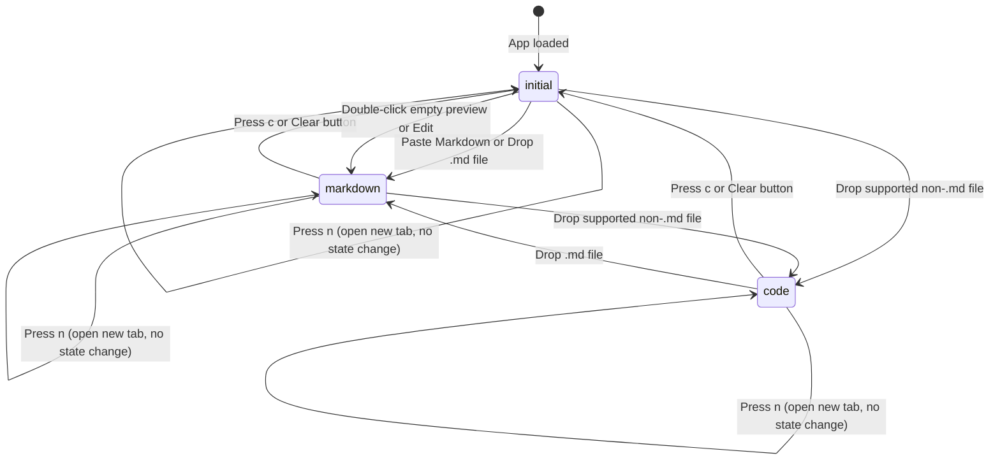

任意の状態から `.md` ドロップで `markdown` へ (ペーストによる自動描画は初期状態のみ)、非`.md` ファイルドロップで `code` へ遷移可能。ただし、BINARY_EXTENSIONS に該当する拡張子、または未知の拡張子で先頭8KBにヌルバイトを含むファイルはアラートで拒否し、状態遷移は発生しない (INV-18)。

コードビューの中のコード編集モード (INV-85) は `_viewState` を変えない (`code` のまま)。その出入りは 11-h の状態機械で決める (2026-10-29)。

**テーマステート:**

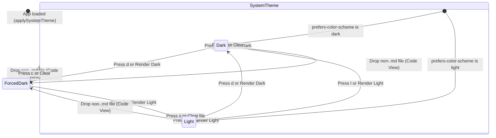

**11-b 状態遷移表の形式**

以下の表は、レビュー基準 (`spec/grsmd_review_standards_ja.md`) の「R4 状態機械」の推奨に従い、**行を出来事、列を今の状態** とする。交点には「→ 次の状態 [ガード] / 処理」を書き、変化しない交点は `—` とする。図は表のすべての遷移 (`—` 以外) を載せる。

**既知の制限 (図と表の原稿):** レビュー基準の「R4 状態機械」は、状態遷移図と状態遷移表を 1 つの原稿から作ることを求める。GRSMD はそうしていない (オーナーの裁定、2026-10-24)。

- 今の作り: 仕様の図 (Mermaid) と表 (Markdown) は手で書く。コードの表は、`stateTable.js` の補助 (`cell` / `row` / `choice`) で作るデータで、図は作らない。
- 理由: 1 つの原稿から図と表を作る仕組みは、別の作業になる。
- 影響: 仕様の図・仕様の表・コードの表の 3 つが、ずれうる。
- 回避: 図は表のすべての遷移を載せる (上の段落)。コードの表と仕様の表の一致は、全交点の試験で確かめる。レビューでは、3 つを G9 で照らす。

**11-c ブロック編集の状態機械**

定義の名前は `blockEditStateMachine`、今の状態を持つ変数は `blockEditState` (`BlockEditController` の `_blockEditState`)。状態: `browsingPreview` (編集モードでない)、`editModeIdle` (編集モード、編集欄なし)、`editingBlock` (編集モード、編集欄あり)、`editingCell` (編集モード、表のセルを編集中。INV-62)。コードビューのコード編集モード (11-h) の間は、編集パレットを `CodeEditController` が出すが、この状態機械は `browsingPreview` のまま (コードビューにはブロックが無い。2026-10-29)。

**Block edit state machine (図。表のすべての `—` 以外の遷移):**

```mermaid
stateDiagram-v2
    [*] --> browsingPreview : appStarted
    browsingPreview --> editModeIdle : paletteShown
    browsingPreview --> editingBlock : emptyDocumentStarted
    browsingPreview --> browsingPreview : fullRenderRequested
    browsingPreview --> editModeIdle : previewDoubleClicked if hasUnrenderedEditor
    browsingPreview --> editingCell : previewDoubleClicked if isCellTarget and isCellEditableTable
    browsingPreview --> editingBlock : previewDoubleClicked if isCellTarget
    browsingPreview --> editingBlock : previewDoubleClicked if isEmptyDocument
    browsingPreview --> editingBlock : previewDoubleClicked if isBlockTarget
    browsingPreview --> editModeIdle : previewDoubleClicked else
    editModeIdle --> browsingPreview : paletteHidden
    editModeIdle --> editingBlock : emptyDocumentStarted
    editModeIdle --> editingBlock : blockTapped
    editModeIdle --> editModeIdle : blockTappedWithUnrenderedEditor
    editModeIdle --> editingCell : cellTapped if isCellEditableTable
    editModeIdle --> editingBlock : cellTapped else
    editModeIdle --> editModeIdle : cellTappedWithUnrenderedEditor
    editModeIdle --> editingBlock : tableSourceTapped
    editModeIdle --> editModeIdle : tableSourceTappedWithUnrenderedEditor
    editModeIdle --> editModeIdle : escapePressed if hasBlockRange
    editModeIdle --> browsingPreview : escapePressed else
    editModeIdle --> editModeIdle : undoRequested
    editModeIdle --> editModeIdle : redoRequested
    editModeIdle --> editModeIdle : gapInsertRequested if hasUnrenderedEditor
    editModeIdle --> editingBlock : gapInsertRequested else
    editModeIdle --> browsingPreview : documentCleared
    editModeIdle --> browsingPreview : viewSwitchedToCode
    editModeIdle --> editModeIdle : fullRenderRequested
    editModeIdle --> editModeIdle : blockInsertRequested
    editModeIdle --> editingCell : insertedBlockRendered if isCellEditableTable
    editModeIdle --> editingBlock : insertedBlockRendered if isCellTarget
    editModeIdle --> editingBlock : insertedBlockRendered else
    editModeIdle --> editModeIdle : blockRangeDeleteRequested if hasUnrenderedEditor
    editModeIdle --> editModeIdle : blockRangeDeleteRequested else
    editModeIdle --> editModeIdle : blockRangeCutRequested if hasUnrenderedEditor
    editModeIdle --> editModeIdle : blockRangeCutRequested else
    editModeIdle --> editModeIdle : blockRangeCopyRequested
    editingBlock --> browsingPreview : paletteHidden
    editingBlock --> editingBlock : otherBlockTapped
    editingBlock --> editingCell : cellTapped if isCellEditableTable
    editingBlock --> editingBlock : cellTapped else
    editingBlock --> editingBlock : tableSourceTapped
    editingBlock --> editModeIdle : pointerPressedOutside
    editingBlock --> editModeIdle : escapePressed if isImeIdle
    editingBlock --> editModeIdle : undoRequested if hasUncommittedChange
    editingBlock --> editModeIdle : undoRequested else
    editingBlock --> editingBlock : redoRequested if hasUncommittedChange
    editingBlock --> editModeIdle : redoRequested else
    editingBlock --> editingBlock : gapInsertRequested
    editingBlock --> editModeIdle : saveRequested
    editingBlock --> editModeIdle : saveAsRequested
    editingBlock --> editModeIdle : searchReplaceRequested
    editingBlock --> editModeIdle : documentReplaced
    editingBlock --> browsingPreview : documentCleared
    editingBlock --> browsingPreview : viewSwitchedToCode
    editingBlock --> editModeIdle : fullRenderRequested
    editingBlock --> editModeIdle : editorFocused
    editingBlock --> editModeIdle : blockInsertRequested if canInsertBlock
    editingBlock --> editingBlock : blockInsertRequested else
    editingCell --> browsingPreview : paletteHidden
    editingCell --> editingBlock : otherBlockTapped
    editingCell --> editingCell : cellTapped if isInSessionTable and canKeepTableId
    editingCell --> editModeIdle : cellTapped if isInSessionTable
    editingCell --> editingCell : cellTapped if isCellEditableTable
    editingCell --> editingBlock : cellTapped else
    editingCell --> editingBlock : tableSourceTapped
    editingCell --> editingCell : nextCellRequested if hasNextCell and canKeepTableId
    editingCell --> editModeIdle : nextCellRequested if hasNextCell
    editingCell --> editingCell : previousCellRequested if hasPreviousCell and canKeepTableId
    editingCell --> editModeIdle : previousCellRequested if hasPreviousCell
    editingCell --> editingCell : cellBelowRequested if hasCellBelow and canKeepTableId
    editingCell --> editModeIdle : cellBelowRequested if hasCellBelow
    editingCell --> editModeIdle : cellBelowRequested else
    editingCell --> editingCell : tableOperationRequested if canApplyTableOperation and canKeepTableId
    editingCell --> editModeIdle : tableOperationRequested if canApplyTableOperation
    editingCell --> editModeIdle : pointerPressedOutside
    editingCell --> editModeIdle : escapePressed if isImeIdle
    editingCell --> editModeIdle : undoRequested if hasUncommittedChange
    editingCell --> editModeIdle : undoRequested else
    editingCell --> editingCell : redoRequested if hasUncommittedChange
    editingCell --> editModeIdle : redoRequested else
    editingCell --> editingBlock : gapInsertRequested
    editingCell --> editModeIdle : saveRequested
    editingCell --> editModeIdle : saveAsRequested
    editingCell --> editModeIdle : searchReplaceRequested
    editingCell --> editModeIdle : documentReplaced
    editingCell --> browsingPreview : documentCleared
    editingCell --> browsingPreview : viewSwitchedToCode
    editingCell --> editModeIdle : fullRenderRequested
    editingCell --> editModeIdle : editorFocused
```

| 出来事 \ 今の状態 | browsingPreview | editModeIdle | editingBlock | editingCell |
| --- | --- | --- | --- | --- |
| paletteShown | → editModeIdle | — | — | — |
| paletteHidden | — | → browsingPreview | → browsingPreview / commitBlock | → browsingPreview / commitCell, endTableSession |
| emptyDocumentStarted | → editingBlock / startEmptyDocument, showPalette, openBlockEditor | → editingBlock / startEmptyDocument, openBlockEditor | — | — |
| blockTapped | — (既存の閲覧操作) | → editingBlock / openBlockEditor | — | — |
| blockTappedWithUnrenderedEditor | — | → editModeIdle / renderFromEditor, showToast (INV-45) | — | — |
| otherBlockTapped | — | — | → editingBlock / commitBlock, resolveBlockById, openBlockEditor | → editingBlock / commitCell, endTableSession, resolveBlockById, openBlockEditor |
| cellTapped (INV-29 (a)) | — | [isCellEditableTable] → editingCell / startTableSession, openCell・[else] → editingBlock / openTableSourceWithToast | [isCellEditableTable] → editingCell / commitBlock, resolveBlockById, startTableSession, openCell・[else] → editingBlock / commitBlock, resolveBlockById, openTableSourceWithToast | [isInSessionTable かつ canKeepTableId] → editingCell / commitCell, openCell・[isInSessionTable] → editModeIdle / commitCell, endTableSession, showTableEditEndedToast・[isCellEditableTable] → editingCell / commitCell, endTableSession, resolveBlockById, startTableSession, openCell・[else] → editingBlock / commitCell, endTableSession, resolveBlockById, openTableSourceWithToast |
| cellTappedWithUnrenderedEditor | — | → editModeIdle / renderFromEditor, showToast (INV-45) | — | — |
| tableSourceTapped (INV-29 (b)、表のつまみ) | — | → editingBlock / openBlockEditor | → editingBlock / commitBlock, resolveBlockById, openBlockEditor | → editingBlock / commitCell, endTableSession, resolveBlockById, openBlockEditor |
| tableSourceTappedWithUnrenderedEditor | — | → editModeIdle / renderFromEditor, showToast (INV-45) | — | — |
| nextCellRequested (Tab、INV-64) | — | — | — | [hasNextCell かつ canKeepTableId] → editingCell / commitCell, moveToCell, openCell・[hasNextCell] → editModeIdle / commitCell, endTableSession, showTableEditEndedToast |
| previousCellRequested (Shift+Tab) | — | — | — | [hasPreviousCell かつ canKeepTableId] → editingCell / commitCell, moveToCell, openCell・[hasPreviousCell] → editModeIdle / commitCell, endTableSession, showTableEditEndedToast |
| cellBelowRequested (Enter) | — | — | — | [hasCellBelow かつ canKeepTableId] → editingCell / commitCell, moveToCell, openCell・[hasCellBelow] → editModeIdle / commitCell, endTableSession, showTableEditEndedToast・[else] → editModeIdle / commitCell, endTableSession |
| tableOperationRequested (INV-65) | — | — | — | [canApplyTableOperation かつ canKeepTableId] → editingCell / commitCell, applyTableOperation, openCell・[canApplyTableOperation] → editModeIdle / commitCell, applyTableOperation, endTableSession, showTableEditEndedToast |
| pointerPressedOutside | — | — | → editModeIdle / commitBlock | → editModeIdle / commitCell, endTableSession |
| escapePressed | — | [hasBlockRange] → editModeIdle / clearBlockRange (ブロックの範囲の選択を先に解く。INV-74、オーナーの裁定 D14)・[else] → browsingPreview [`#editor` にフォーカスが無い] / hidePalette (5.11、INV-53。`#editor` にフォーカスがある場合は INV-14 のガードで届かない) | → editModeIdle [isImeIdle] / commitBlock (反映して閉じる。INV-28、オーナーの裁定 D1) | → editModeIdle [isImeIdle] / commitCell, endTableSession (反映して表の編集を終える。ID を引き継げなくても同じ。R5) |
| saveRequested | — | — | → editModeIdle / commitBlock | → editModeIdle / commitCell, endTableSession |
| saveAsRequested | — | — | → editModeIdle / commitBlock | → editModeIdle / commitCell, endTableSession |
| searchReplaceRequested (検索と置換の [Replace] / [All]。INV-80) | — | — | → editModeIdle / commitBlock | → editModeIdle / commitCell, endTableSession |
| documentReplaced (Reload、`.md` ドロップ) | — | — | → editModeIdle / discardBlockEditor | → editModeIdle / discardCell, endTableSession |
| documentCleared | — | → browsingPreview / hidePalette | → browsingPreview / discardBlockEditor, hidePalette | → browsingPreview / discardCell, endTableSession, hidePalette |
| viewSwitchedToCode | — | → browsingPreview / hidePalette | → browsingPreview / discardBlockEditor, hidePalette | → browsingPreview / discardCell, endTableSession, hidePalette |
| fullRenderRequested (`#editor` からの全体描画: [Render Light] / [Render Dark] / `l` / `d`。テーマの切り替えを含む) | → browsingPreview / enqueueFullRender | → editModeIdle / enqueueFullRender | → editModeIdle / commitBlock, enqueueFullRender (INV-47、5.7 (3)) | → editModeIdle / commitCell, endTableSession, enqueueFullRender |
| editorFocused (`#editor` の `focusin`。キーボードによるフォーカスの移動を含む) | — | — | → editModeIdle / commitBlock (5.7 (5)。マウスでは先に pointerPressedOutside で確定しているので、この交点に来るのはキーボードの場合だけ) | → editModeIdle / commitCell, endTableSession |
| undoRequested (パレットの Undo、INV-59 (c) の Ctrl+Z) | — | → editModeIdle / undoLastUnit | [hasUncommittedChange] → editModeIdle / commitBlock, undoJustCommitted・[else] → editModeIdle / commitBlock, undoLastUnit | [hasUncommittedChange] → editModeIdle / commitCell, endTableSession, undoJustCommitted・[else] → editModeIdle / commitCell, endTableSession, undoLastUnit |
| redoRequested (INV-59 (c) の Redo のキー。オーナーの裁定 D5 / D7) | — | → editModeIdle / redoLastUnit | [hasUncommittedChange] → editingBlock (何もしない。Redo の記録は残す。R2)・[else] → editModeIdle / commitBlock, redoLastUnit | [hasUncommittedChange] → editingCell (何もしない。R2)・[else] → editModeIdle / commitCell, endTableSession, redoLastUnit |
| gapInsertRequested (すき間の点線の押下。INV-73、オーナーの裁定 B1) | — | [hasUnrenderedEditor] → editModeIdle / renderFromEditor, showToast (INV-45)・[else] → editingBlock / resolveBlockById, openBlockEditor | → editingBlock / commitBlock, resolveBlockById, openBlockEditor | → editingBlock / commitCell, endTableSession, resolveBlockById, openBlockEditor |
| previewDoubleClicked (INV-57) | [hasUnrenderedEditor] → editModeIdle / clearSelection, showPalette, renderFromEditor, showToast・[isCellTarget かつ isCellEditableTable] → editingCell / clearSelection, showPalette, startTableSession, openCell・[isCellTarget] → editingBlock / clearSelection, showPalette, openTableSourceWithToast (表がセルの編集の条件を満たさない。クリックと同じ。オーナーの裁定 Q-c)・[isEmptyDocument] → editingBlock / clearSelection, showPalette, openBlockEditor・[isBlockTarget] → editingBlock / clearSelection, showPalette, openBlockEditor・[else] → editModeIdle / clearSelection, showPalette | — | — | — |
| blockInsertRequested (Insert table / Mermaid の雛形 / 数式ボックス。INV-52) | — | → editModeIdle / insertBlock | [canInsertBlock] → editModeIdle / commitBlock, insertBlock・[else] → editingBlock / showInsertRefusedToast | — (ボタンは無効。W7) |
| insertedBlockRendered (挿入したブロックの描画の後。数式ボックスでは起こさない。INV-52) | — | [isCellEditableTable] → editingCell / startTableSession, openCell・[isCellTarget] → editingBlock / openTableSourceWithToast・[else] → editingBlock / openBlockEditor | — | — |
| blockRangeDeleteRequested (ブロックの範囲の削除: Delete / Backspace / 帯の削除。INV-74) | — | [hasUnrenderedEditor] → editModeIdle / renderFromEditor, showToast (INV-45)・[else] → editModeIdle / deleteBlockRange | — | — |
| blockRangeCutRequested (ブロックの範囲のカット: 主 + X / 帯のカット。INV-74) | — | [hasUnrenderedEditor] → editModeIdle / renderFromEditor, showToast (INV-45)・[else] → editModeIdle / cutBlockRange | — | — |
| blockRangeCopyRequested (ブロックの範囲のコピー: 主 + C / 帯のコピー / 範囲がある間のブラウザの `copy` の事象。INV-74) | — | → editModeIdle / copyBlockRange | — | — |

ガードは上から順に評価する (`・` で区切った順)。「A かつ B」は両方が真のとき (定義では `"A&&B"` と書き、図では `if A and B`)。ガードの無い交点の「ガードに外れた場合」は `—` (何もしない)。ガード (すべて `is` / `has` / `can` で始める): `isImeIdle` (IME の変換中でない。ブロック編集欄とセルの両方)、`hasUncommittedChange` (開いている編集欄・セルの内容が開いた時点と異なる。INV-62 の変更の判定)、`hasUnrenderedEditor` (`#editor` に未描画の変更がある。INV-45)、`isEmptyDocument` / `isBlockTarget` / `isCellTarget` (INV-57 の対象の分類。`BlockEditController.doubleClickTarget(event)` が `{kind: "empty"}` / `{kind: "block", id}` / `{kind: "cell", id, row, col, caret}` / `{kind: "none"}` を返し (表のブロックの余白とつまみは `{kind: "none"}`)、プレビューのスクロールバーでの押下 (`offsetX` / `offsetY` が `clientWidth` / `clientHeight` を超える。INV-30 の判定と同じ)、除外対象と図の内側では `null` を返して出来事を起こさない)、`isCellEditableTable` (押したセルの表が INV-62 の構造の確認の (1) を満たす。セルごとの描画の確認 (2) は `openCell` の中で行い、合わなければ原文のセルとして開く (遷移は変わらない))、`isInSessionTable` (押したセルが、今の表の編集の表のもの)、`canKeepTableId` (この交点で行うすべての確定 (開いているセルの確定と、INV-65 の操作の確定。確定が無い場合は真) の後で、表のブロック ID を引き継げる。`tableOperationRequested` では、セルの確定の後のモデルに操作を適用した最終の原文で `MarkdownBlockModel.planTableReplace` を求め、2 回の確定のどちらかで引き継げなければ偽。INV-42 / 62)、`hasNextCell` / `hasPreviousCell` / `hasCellBelow` (INV-64 の移動先がある)、`canApplyTableOperation` (INV-65 の制限 D2 を満たす)、`canInsertBlock` (開いている編集欄で、INV-52 の位置が決まる (断る場合に当たらない)。位置の計画は `MarkdownTextOps.planBlockInsert` で、押下ごとに 1 回求め、続く `insertBlock` が使う)、`hasBlockRange` (その時点の選択がブロックの範囲を作る。INV-74 (1)。`BlockRangeSelection.readRange()` で選択を読み直す。表示は変えない)。処理 `undoLastUnit` は、INV-45 の分岐を含む (`#editor` に未描画の変更があれば `renderFromEditor`、無ければ `RendererOrchestrator.undoLastCommit()`)。`undoJustCommitted` は、同じ交点の `commitBlock` / `commitCell` がモデルを変えた (変更の単位を作った) ときだけ `undoLastCommit()` を行う (確定が単位にならない場合 (例: 行末の空白だけを足し、INV-71 (6) で原文と同じになった) は、それより前の単位を戻さない。R1)。`redoLastUnit` は `undoLastUnit` と同じ INV-45 の分岐を持ち、無ければ `RendererOrchestrator.redoLastCommit()` (R3)。`gapInsertRequested` の `resolveBlockById` は、すき間を今のモデルの上で決め直す (INV-73: 文書の先頭と末尾のすき間はそのまま、ほかは上のブロックが残っていればその後ろ、無ければ下のブロックの前。どちらも無ければ `null` で何も開かない)。`openBlockEditor` は、すき間の対象 (`{kind: "gap", afterBlockId, beforeBlockId}`) なら、そのすき間に空のブロック編集欄を開く (INV-73)。`clearSelection` は、ダブルクリックでブラウザが作った選択を解除する。表の処理: `startTableSession` (表のブロックの保持を始める。INV-47) / `endTableSession` (保持を解く) / `openCell` (INV-62) / `commitCell` (変わっていれば確定、変わっていなければ退避した子要素を戻す) / `discardCell` (確定せずに捨て、退避した子要素を戻す) / `moveToCell` (INV-64 の移動先。開いているセルを閉じる前に求める) / `applyTableOperation` (INV-65) / `openTableSourceWithToast` (表の原文の編集欄を開き、トースト `messages.edit.tableNotCellEditable`) / `showTableEditEndedToast` (ID を引き継げずに表の編集を終えたことを知らせる。`messages.edit.tableEditEnded`)。ブロックの範囲の処理 (INV-74): `clearBlockRange` (選択を解き、枠と帯を消す)、`copyBlockRange` (INV-74 (4) のコピー)、`cutBlockRange` (INV-74 (4) のカット。書けたときだけ `deleteBlockRange` と同じく消す)、`deleteBlockRange` (INV-74 (3)。選択を解き、`RendererOrchestrator.deleteBlocks` で範囲を 1 つの変更の単位として消す)。どれも、出来事の対象 `{kind: "blockRange", firstId, lastId}` の ID が今のモデルに無ければ何もしない。コピーが `#editor` の未描画の変更で全体描画をしないことは INV-74 (6)。挿入の処理: `insertBlock` (INV-52。直前の `commitBlock` があれば、確定した文字列の中の計画の位置 (`MarkdownTextOps.insertOffset`) に、無ければ最後に開いたブロックの後ろに `RendererOrchestrator.insertBlock` で挿入する。割った上の部分の最後の行の、改行でなくなる行末の空白と `\` (`MarkdownTextOps.cutLineEndBreak`) は、同じ変更で除く (`removeBefore`)。挿入したブロックを最後に開いたブロックとする。描画の後に `insertedBlockRendered` を起こす) / `showInsertRefusedToast` (`messages.edit.insertNotPossible`)。`insertedBlockRendered` の対象は、表なら `{kind: "cell", id, row: 0, col: 0, selectAll: true}`、Mermaid なら `{kind: "block", id, caretLineEnd: 1}` (`openBlockEditor` がカーソルをその行の末尾に置く)。

注: `documentReplaced` / `documentCleared` は、INV-21 の確認で OK が選ばれた後にだけ起きる。`fullRenderRequested` は未保存の確認を出さない (INV-45)。`#editor` が空で本文が空でない場合は、INV-56 の確認で OK が選ばれた後にだけ `fullRenderRequested` が起きる (Cancel なら出来事は起きない)。`renderFromEditor` も、INV-56 の確認で Cancel なら `#editor` を本文に戻すだけで、全体描画もトーストも行わない (editModeIdle のまま)。編集欄を開いたまま、Tab または Shift+Tab などでフォーカスを編集欄の外 (本体) へ移した場合も (Tab はパレットへ移らない。INV-53)、キーは document に届く。そのときの `l` / `d` / [Render] (キーボードでの押下を含む) は `fullRenderRequested`、`e` は `paletteHidden`、`r` / `c` / ドロップは INV-21 の確認を経て `documentReplaced` / `documentCleared` / `viewSwitchedToCode` になる (裁定 T1)。本体にフォーカスがある間の Esc は、5.11 の「ブロック編集中」の列のとおり `escapePressed` (反映して閉じる) になる。`#editor` にフォーカスが入ると `editorFocused` で確定する (裁定 T19)。`emptyDocumentStarted` は INV-31。`blockTapped` と `blockTappedWithUnrenderedEditor` は、開始ジェスチャ (INV-29) の時点で `_editorChangedSinceRender` が偽か真かで分かれる。`cellTapped` / `cellTappedWithUnrenderedEditor`、`tableSourceTapped` / `tableSourceTappedWithUnrenderedEditor`、`previewDoubleClicked` の [hasUnrenderedEditor] も同じ。`#editor` に入力するとフォーカスで `editorFocused` が起きて editModeIdle になるので、`…WithUnrenderedEditor` は editModeIdle の列でだけ起きる。INV-56 の確認は `renderFromEditor` に含まれる。表のブロックの余白の押下は、編集中 (editingBlock / editingCell) なら `pointerPressedOutside`、editModeIdle なら何も起こさない (W6 / M1)。`pointerPressedOutside` は、マウスでは `pointerdown`、タッチとペンでは移動の少ない `pointerup` で起きる (INV-30)。editingCell では、表の編集の対象の `table` 要素の内側の押下は外側としない (同じ表の別のセルは `pointerup` で `cellTapped`。開いているセルの中の押下は何も起こさない)。Undo (パレットの Undo、INV-59 の (c) の Ctrl+Z) は `undoRequested`、Redo (INV-59 の (c) の Redo のキー) は `redoRequested` としてこの表を通す。browsingPreview では起きない (パレットが無く、Ctrl+Z / Redo のキーは横取りしない。裁定 Q3)。editingBlock の [hasUncommittedChange] の交点は、パレットの Undo か、編集欄の外にフォーカスがあるときの Ctrl+Z / Redo のキーから起きる (編集欄の中の Ctrl+Z (変更あり) と Redo のキー (いつも) はブラウザの文字単位の Undo / Redo。INV-59 の (b)、裁定 M5)。editingBlock の `redoRequested` の [else] の交点は、変更の無い編集欄に対し、フォーカスが欄の外にあるときの Redo のキーから起きる。editingCell では、セルの中の Ctrl+Z も単位の Undo (INV-59 の (c))、セルの中の Redo のキーは TableCellEditor が止めて `redoRequested` を起こす。`searchReplaceRequested` は、検索と置換の [Replace] / [All] の押下 (INV-80 (5)) で、置き換えの前に開いている編集欄・セルを確定する (`saveRequested` と同じ交点)。`gapInsertRequested` は、編集中なら先に開いている編集欄・セルを確定し (それ自体が 1 つの変更の単位)、すき間に空の編集欄を開く。すき間の編集欄の確定 (`commitBlock`) は、入れた文字があれば挿入 (`RendererOrchestrator.insertBlock`) を 1 つの変更の単位として行い、空 (空白だけ) なら何も変えない。`previewDoubleClicked` は browsingPreview の列にだけ交点がある (編集モードのダブルクリックは開始ジェスチャ 2 回)。`#editor` に未描画の変更があるときの Undo と挿入は、INV-45 により `fullRenderRequested` と同じ全体描画 (editModeIdle の自己遷移) になる。`commitBlock` と `commitCell` は同期でモデルを更新する (INV-47)。ID を引き継げるかは、確定の前にガード `canKeepTableId` で決める (`planTableReplace` の結果を `commitCell` / `applyTableOperation` が使い回す)。引き継げない枝の `commitCell` と `applyTableOperation` は、モデルの確定 (同期) だけを行い、INV-47 の例外の同期の描き直し (`writeHeldInterior`) をしない (ID が変わると保持の条件を外れるため)。DOM は、続く `endTableSession` で保持を解いた後の、キューの部分描画で更新される。引き継げない場合の行き先は表の交点 (editModeIdle、`showTableEditEndedToast`) で決まり、表の外で状態を変える経路は無い。editingCell から表の編集を終える他の交点 (外側の押下・保存など) は、引き継げるかによらず表の編集を終えるので、このガードを持たない。`openCell` でセルが開かなかった場合 (セルの要素が無い場合など) は、表の編集を終えて editModeIdle になる。ポップオーバーを開いている間の Esc は 11-f で処理し、この表の `escapePressed` は起きない (INV-53)。`blockInsertRequested` の editingBlock の交点は editModeIdle へ移り、描画の後の `insertedBlockRendered` で editingCell (表) または editingBlock (Mermaid) になる。`insertedBlockRendered` は、描画が終わった時点で、状態が editModeIdle のままで、ブロック編集欄もセルも開いておらず、モデルが挿入の時のままで、`#editor` に未描画の変更が無く、挿入したブロックがその種類のままのときだけ起こす (その間の操作を優先する。INV-52)。それまでの間、1 文字のショートカットは止める (INV-52)。`#editor` に未描画の変更があるときの挿入は、上のとおり INV-45 の全体描画になる (UIController が `blockInsertRequested` を起こさずに `renderFromEditor` を行う。ブロック編集中は `#editor` の変更が無いので当たらない)。

注: 閲覧中 (`browsingPreview`。パレットが出ていない) の Esc は、`escapePressed` を送らない (表の `—`)。UIController がその前に、検索の箱が出ていれば検索を閉じ、出ていなければ目次を閉じる (INV-80 (6)、INV-77 (4)。5.11)。パレットが出ているときの Esc は `escapePressed` だけを送り、検索と目次は閉じない (調整役の裁定 2026-10-25、レビュー 1 回目の Q2)。

通知の契約: 編集欄・セルを閉じる処理 (`commitBlock`、`discardBlockEditor`、`commitCell`、`discardCell`、`endTableSession`) は、`dispatch` の処理の途中で `BlockEditHost.onEditStateChanged()` と、確定でモデルが変わった場合の `onModelChanged` を呼ぶ。これらの通知は、`blockEditState` を表の次の状態に更新する **前** に出る。通知の受け手は `blockEditState` を読まず、編集欄・セルが開いているかどうか (`isEditing()`。編集欄・セルを閉じた時点で偽になる。セルはその確定のモデルの更新より前に閉じる) だけを読むこと。パレットのボタンの状態 (5.15.5) は、`dispatch` の途中 (`BlockEditController.isInTransition()` が真。`dispatch` の中の `dispatch` を含む) では更新せず、いちばん外側の `dispatch` の終わりに `BlockEditHost.onTransitionEnded()` で 1 回だけ更新する (未保存の印と状態の文字は途中でも更新する)。セルを閉じてから次のセルを開くまでの間の状態で開き手を無効と判定して、開いているポップオーバーを閉じないためである (11-f の `openerDisabled` は、遷移の後の状態で判定する)。

実装では、この表を `blockEditStateMachine` というデータとして持ち、出来事の入口 (`BlockEditController.dispatch`) が表を引いて動く。表の `enqueueFullRender` は、`dispatch` が戻った後で呼び出し側 (UIController) が行い、`showToast` は `renderFromEditor` に含まれる。`emptyDocumentStarted` は、全体描画が終わるまで editModeIdle に留まり、空の最初のブロックの編集欄を開いた時点で editingBlock になる。UI から到達しない交点 (例: editModeIdle × emptyDocumentStarted) も、`dispatch` を直接呼べば表のとおりに動く。

**11-d パレットのジェスチャの状態機械**

定義の名前は `paletteGestureStateMachine`、今の状態を持つ変数は `paletteGestureState` (`EditPalette` の `_paletteGestureState`)。状態: `idle` / `pressingButton` / `pressingGrip` / `draggingPalette` / `longPressHandled`。

**Palette gesture state machine:**

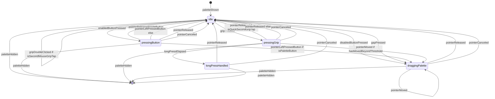

| 出来事 \ 今の状態 | idle | pressingButton | pressingGrip | draggingPalette | longPressHandled |
| --- | --- | --- | --- | --- | --- |
| enabledButtonPressed | → pressingButton / forgetGripTap, capturePointer | — | — | — | — |
| disabledButtonPressed (パレット本体) | → draggingPalette / forgetGripTap, capturePointer, rememberOffset | — | — | — | — |
| disabledPopoverButtonPressed | → idle / forgetGripTap (機能は実行しない。INV-34) | — | — | — | — |
| gripPressed | → pressingGrip / capturePointer, rememberOffset, startLongPressTimer | — | — | — | — |
| gapPressed (パレット本体の隙間・枠) | → draggingPalette / forgetGripTap, capturePointer, rememberOffset | — | — | — | — |
| popoverGapPressed | → idle / forgetGripTap | — | — | — | — |
| pointerPressedOutsidePalette (パレットとポップオーバーの外の `pointerdown`。11-f の同じ名前の出来事と同じ押下で起きる) | → idle / forgetGripTap | — | — | — | — |
| pointerMoved | — | — (押したボタンの内側) | [hasMovedBeyondThreshold] → draggingPalette / cancelLongPressTimer, forgetGripTap, movePaletteClamped | → draggingPalette / movePaletteClamped | — |
| longPressElapsed | — | — | → longPressHandled / forgetGripTap, requestMinimizeToggle (11-f の minimizeToggled) | — | — |
| gripDoubleClicked (パレット本体の `dblclick`) | [isSecondMouseGripTap] → idle / forgetGripTap, requestMinimizeToggle (11-f の minimizeToggled)。偽なら — | — | — | — | — |
| pointerLeftPressedButton | — | [isPaletteButton] → draggingPalette / rememberOffset・[else] → idle / releasePointer (ポップオーバーのボタンからずれたら機能を実行せず、ポインタの capture を解く) | — | — | — |
| pointerReleasedInsideButton | — | → idle / runButtonCommand | — | — | — |
| pointerReleased (押したボタンの矩形の外で離した、など) | — | → idle (機能は実行しない。INV-34) | [isQuickSecondGripTap] → idle / cancelLongPressTimer, forgetGripTap, requestMinimizeToggle (11-f の minimizeToggled)・[else] → idle / cancelLongPressTimer, rememberGripTap | → idle | → idle |
| pointerCanceled | — | → idle | → idle / cancelLongPressTimer, forgetGripTap | → idle | → idle |
| paletteHidden | → (終了) / forgetGripTap, releaseListeners | → (終了) / forgetGripTap, releasePointer, releaseListeners | → (終了) / cancelLongPressTimer, forgetGripTap, releasePointer, releaseListeners | → (終了) / forgetGripTap, releasePointer, releaseListeners | → (終了) / forgetGripTap, releasePointer, releaseListeners |

ガードは上から順に評価する (`・` で区切った順)。`hasMovedBeyondThreshold` は、押した位置からの移動が `CONFIG.pan.activationThresholdPx` を超えたこと。`isPaletteButton` は、押したボタンがパレット本体のボタン (ポップオーバーのボタンでない) であること。`pointerLeftPressedButton` は、`pointermove` の座標が押したボタンの矩形の外に出たときに起きる (pointer capture 中は `pointerleave` に頼らない)。機能を実行するのは `pointerReleasedInsideButton` の遷移だけである (INV-34)。`longPressElapsed` は `startLongPressTimer` の時間 (`CONFIG.edit.paletteLongPressMs`) が来たときに起き、11-f の `minimizeToggled` を起こす (2 つの状態機械の間は出来事で結ぶ)。長押しのタイマーは、移動の開始・`pointercancel`・離す・`hide()` で止める。

グリップのダブルクリック (INV-68): `rememberGripTap` は、グリップの押下をタップ (pressingGrip のまま離した押下) として、そのポインタの種類 (`pointerType`)・押した時刻・同じ種類のタップが続いた数を覚える。`forgetGripTap` はそれを忘れる (移動になった・長押しになった・`pointercancel`・グリップ以外のどこかを押した・`hide()`・切り替えた)。`isQuickSecondGripTap` は、今の押下がタッチかペンで、覚えているタップが同じ種類で、2 回の押下の間が `CONFIG.edit.paletteDoubleTapMs` 以下であること (`EditPalette.js` の純粋な関数 `isQuickSecondGripTap(lastTap, press)`)。マウスはここで切り替えず、パレット本体の `dblclick` で起きる `gripDoubleClicked` で切り替える (グリップの押下はパレット本体に pointer capture を掛けるので、ブラウザは `dblclick` をグリップではなくパレット本体に出す。グリップのタップかどうかはガードで見る)。`isSecondMouseGripTap` は、覚えているタップがマウスで、続いた数が 2 以上であること (ブラウザが `dblclick` を出したので、時間は OS の設定で決まっている)。タッチとペンの `dblclick` は、このガードが偽なので何もしない (1 回のダブルタップで 2 回切り替えない)。グリップ以外の押下は、どこでも覚えたタップを忘れる: パレット本体とポップオーバーの有効なボタン (`enabledButtonPressed`)、パレット本体の無効なボタン (`disabledButtonPressed`) と隙間 (`gapPressed`)、ポップオーバーの無効なボタン (`disabledPopoverButtonPressed`) と隙間 (`popoverGapPressed`)、パレットの外 (`pointerPressedOutsidePalette`。document の capture の `pointerdown` で、11-f の同じ名前の出来事と一緒に起こす)。ポップオーバーの 2 つとパレットの外は、ほかには何もしない (idle のまま)。これらの出来事は idle のときだけ動き、押している間 (pressingButton など) の別の指の押下では何もしない。

実装では、この表を `paletteGestureStateMachine` というデータとして持つ。paletteHidden の行き先「(終了)」は、定義では `[*]` とし、`hide()` の後は次の `show()` に備えて idle に戻る。ポップオーバーのボタンも同じ表で動くが、押したボタンの外へずらしても、パレットは移動しない (INV-35。`pointerLeftPressedButton` の [else])。`releaseListeners` は、`show()` で登録した document と window のリスナー (11-f の分を含む) をすべて外す。

**11-e 保存処理の状態機械**

「未保存」は状態機械ではなく **導出値** とする (用語集。`UIController._isDocumentDirty()` = `documents.hasSession() && (documents.isBodyChanged(orchestrator.getBody()) || blockEdit.hasUncommittedChange() || this._editorChangedSinceRender)`)。状態変数を持たないので、未保存の印は「本文または編集欄が変わりうる時点」(確定、Undo、挿入、編集欄の `input`、`#editor` の `input`、全体描画、読み込み、保存の成功) で再計算する (INV-50)。コードビューでは、`codeEdit.isDirty()` (コードの文書の文字が基準と違う。INV-85 (5)) も真にする (2026-10-29)。

保存の処理中かどうかだけを状態機械にする。定義の名前は `saveOperationStateMachine`、今の状態を持つ変数は `saveOperationState` (`DocumentLifecycle` が `_saveOperationState` に持ち、getter `saveOperationState` で読ませる。UIController は `documents.saveOperationState` / `documents.isSaving()` で読む)。

コードの文書の保存 (INV-90。2026-10-29) は、この状態機械に入れない。`CodeEditController` の真偽値 `_saving` が、文字コードの問いから書き終わり (または止まる・取り消す) までの間を表し、その間の Save / Save as は何もせずに無視し (Markdown の writingFile と同じ。INV-58、INV-90 (1)。レビュー 1 回目の L16)、`UIController._rejectWhileSaving()` はこれも見る (INV-54)。出来事は「始まる」と「終わる」の 2 つだけで、どちらも今の値によらず同じ結果 (始まる: 偽なら真にする、真なら何もしない。終わる: 偽にする) なので、表にしない (5.19.11)。
保存と GitHub への push (SC-28) の処理中かどうかだけを状態機械にする (`pushing` は 2026-10-29 に足した。レビューの M2)。定義の名前は `saveOperationStateMachine`、今の状態を持つ変数は `saveOperationState` (`DocumentLifecycle` が持つ。UIController は `documents.saveOperationState` / `documents.isSaving()` で読み、GitHubController は `documents.startPush()` / `finishPush()` で動かす)。

**Save operation state machine:**

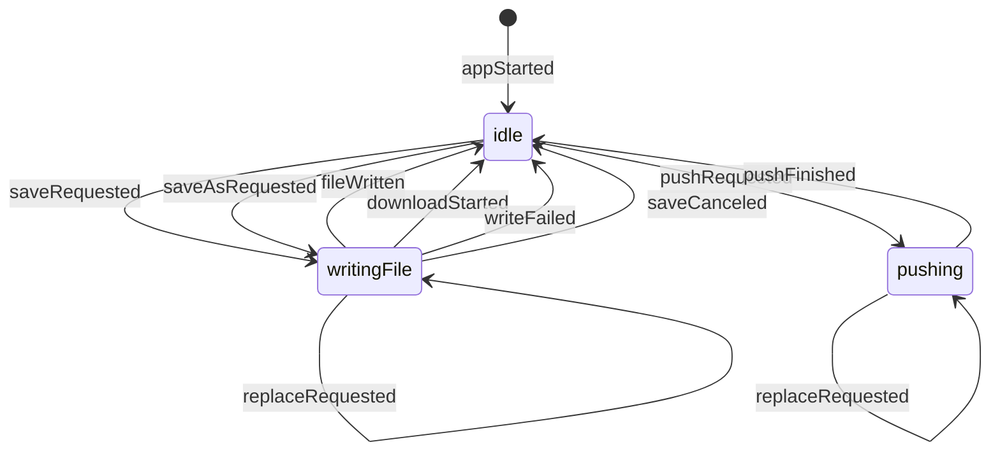

| 出来事 \ 今の状態 | idle | writingFile | pushing |
| --- | --- | --- | --- |
| saveRequested | → writingFile / startPermissionRequest, commitOpenBlock, applyEditorText, runSaveDocument | — (無視する。二重保存の防止) | — (無視する。GitHub の画面からも保存しない。INV-58) |
| saveAsRequested | → writingFile / startSavePicker, commitOpenBlock, applyEditorText, runSaveDocumentAs | — (無視する) | — (無視する) |
| fileWritten | — | → idle / applyOutcomeIfSameDocument, refreshDirtyMark, showSavedToast (トーストは文書 ID によらず出す) | — |
| downloadStarted | — | → idle / showDownloadStartedToast (基準は更新しない。INV-26) | — |
| writeFailed | — | → idle / showErrorToast | — |
| saveCanceled | — | → idle | — |
| replaceRequested (5.14.11 で文書を作り直す出来事。テーマの切り替えは含まない) | — (この状態機械は関与しない。INV-21 / INV-55 で処理する) | → writingFile / rejectReplace, showSavingToast (INV-54) | → pushing / rejectReplace, showSavingToast (INV-54、INV-96 (4)) |
| pushRequested ([Push]。INV-96 (3)) | → pushing / runPush | — (書き込み中は push を始めない。画面に `busy`) | — (別の push は始めない) |
| pushFinished | — | — | → idle / applyPushIfSameDocument, refreshDirtyMark, showPushedToast (トーストは成功のときだけ。失敗は画面に 5.20.4 の文) |

`saveRequested` / `saveAsRequested` は、`#editor` を取り込む場合 (`applyEditorText` が要る場合) に INV-56 の確認が要るなら、OK が選ばれた後にだけ起きる (Cancel なら `#editor` を本文に戻すだけで idle のまま、権限の要求も保存ダイアログも始めない。確認は同期なので、(1) の開始は最初の `await` より前のままである。INV-33)。writingFile の間の押下は、確認を出さずに無視する。`applyOutcomeIfSameDocument` は、`SaveOutcome.documentId` が現在の `DocumentSession.documentId` と一致するときだけ、セッションと保存先を置き換え、未保存の印を再計算する (INV-54)。保存のトースト (`messages.edit.saved`) は、別の文書の結果でも出す。ファイルは実際に書かれたので、それを知らせない方が利用者を惑わせるためである。実装では、この表を `saveOperationStateMachine` というデータとして持つ。

**push (SC-28。2026-10-29):** `pushRequested` は push の画面の [Push] で、PAT の形を確かめた後に起きる。`runPush` は `GitHubContentsClient.pushFile` を呼ぶ。`pushFinished` は成功でも失敗でも起き、idle に戻る。`applyPushIfSameDocument` は、push を始めたときの文書 ID が今の文書 ID と同じで、push が成功したときだけ、基準を送った本文にし、GitHub の版を新しくする (`DocumentLifecycle.finishPush`。INV-96 (5))。`pushing` の間の Save / Save as は writingFile の間と同じく無視し、文書の置き換えは断る (INV-54)。交点は 3 つの状態 × 9 の出来事で 27 (AT-SSM-08)。`isSaving()` は `replaceRequested` の交点が有るか (writingFile と pushing で真)。

**11-f パレットの表示とポップオーバーの状態機械**

定義の名前は `paletteDisplayStateMachine`、今の状態を持つ変数は `paletteDisplayState` (`EditPalette` の `_paletteDisplayState`)。表示の状態とポップオーバーを 1 つの列挙にする (最小化中と非表示ではポップオーバーは開かない)。状態: `hidden` / `expanded` (ポップオーバーなし) / `mermaidMenuOpen` / `formatMenuOpen` / `tableMenuOpen` / `minimized`。

**Palette display state machine:**

```mermaid
stateDiagram-v2
    [*] --> hidden : appStarted
    hidden --> expanded : paletteShown
    expanded --> hidden : paletteHidden
    mermaidMenuOpen --> hidden : paletteHidden
    formatMenuOpen --> hidden : paletteHidden
    tableMenuOpen --> hidden : paletteHidden
    minimized --> hidden : paletteHidden
    expanded --> minimized : minimizeToggled
    mermaidMenuOpen --> minimized : minimizeToggled
    formatMenuOpen --> minimized : minimizeToggled
    tableMenuOpen --> minimized : minimizeToggled
    minimized --> expanded : minimizeToggled
    expanded --> mermaidMenuOpen : mermaidButtonRun
    mermaidMenuOpen --> expanded : mermaidButtonRun
    formatMenuOpen --> mermaidMenuOpen : mermaidButtonRun
    tableMenuOpen --> mermaidMenuOpen : mermaidButtonRun
    expanded --> formatMenuOpen : formatButtonRun
    mermaidMenuOpen --> formatMenuOpen : formatButtonRun
    formatMenuOpen --> expanded : formatButtonRun
    tableMenuOpen --> formatMenuOpen : formatButtonRun
    expanded --> tableMenuOpen : tableOptionsButtonRun
    mermaidMenuOpen --> tableMenuOpen : tableOptionsButtonRun
    formatMenuOpen --> tableMenuOpen : tableOptionsButtonRun
    tableMenuOpen --> expanded : tableOptionsButtonRun
    mermaidMenuOpen --> expanded : popoverItemRun
    formatMenuOpen --> expanded : popoverItemRun
    tableMenuOpen --> expanded : popoverItemRun
    mermaidMenuOpen --> expanded : popoverEscapePressed
    formatMenuOpen --> expanded : popoverEscapePressed
    tableMenuOpen --> expanded : popoverEscapePressed
    mermaidMenuOpen --> expanded : pointerPressedOutsidePalette
    formatMenuOpen --> expanded : pointerPressedOutsidePalette
    tableMenuOpen --> expanded : pointerPressedOutsidePalette
    mermaidMenuOpen --> expanded : openerDisabled
    formatMenuOpen --> expanded : openerDisabled
    tableMenuOpen --> expanded : openerDisabled
    expanded --> expanded : viewportResized
    mermaidMenuOpen --> mermaidMenuOpen : viewportResized
    formatMenuOpen --> formatMenuOpen : viewportResized
    tableMenuOpen --> tableMenuOpen : viewportResized
    minimized --> minimized : viewportResized
```

| 出来事 \ 今の状態 | hidden | expanded | mermaidMenuOpen | formatMenuOpen | tableMenuOpen | minimized |
| --- | --- | --- | --- | --- | --- | --- |
| paletteShown | → expanded / placeAtBottomRight | — | — | — | — | — |
| paletteHidden | — | → hidden | → hidden / closePopover | → hidden / closePopover | → hidden / closePopover | → hidden / restoreExpandedLayout |
| minimizeToggled | — | → minimized / keepGripPosition | → minimized / closePopover, keepGripPosition | → minimized / closePopover, keepGripPosition | → minimized / closePopover, keepGripPosition | → expanded / keepGripPosition, clampIntoViewport |
| mermaidButtonRun | — | → mermaidMenuOpen / openPopover | → expanded / closePopover | → mermaidMenuOpen / closePopover, openPopover | → mermaidMenuOpen / closePopover, openPopover | — |
| formatButtonRun | — | → formatMenuOpen / openPopover | → formatMenuOpen / closePopover, openPopover | → expanded / closePopover | → formatMenuOpen / closePopover, openPopover | — |
| tableOptionsButtonRun | — | → tableMenuOpen / openPopover | → tableMenuOpen / closePopover, openPopover | → tableMenuOpen / closePopover, openPopover | → expanded / closePopover | — |
| popoverItemRun | — | — | → expanded / closePopover, runItemCommand | → expanded / closePopover, runItemCommand | → expanded / closePopover, runItemCommand | — |
| popoverEscapePressed | — | — | → expanded / closePopover | → expanded / closePopover | → expanded / closePopover | — |
| pointerPressedOutsidePalette | — | — | → expanded / closePopover | → expanded / closePopover | → expanded / closePopover | — |
| openerDisabled (開いているポップオーバーの開き手のボタンが無効になった) | — | — | → expanded / closePopover | → expanded / closePopover | → expanded / closePopover | — |
| viewportResized | — | → expanded / clampIntoViewport | → mermaidMenuOpen / clampIntoViewport, placePopover | → formatMenuOpen / clampIntoViewport, placePopover | → tableMenuOpen / clampIntoViewport, placePopover | → minimized / clampIntoViewport |

注: `popoverEscapePressed` は INV-53 の Esc (document の capture。IME の変換中を除く)。`viewportResized` では、ポップオーバーを閉じずに、パレットとポップオーバーの位置を INV-37 のとおり補正する (スマートフォンのアドレスバーや画面のキーボードの出し入れで閉じないため)。`openerDisabled` は、例えば書式のポップオーバーを開いたまま Ctrl+S で編集欄が確定して閉じ、書式のボタン (編集中だけ有効。5.15.5) が無効になった場合や、Align column のポップオーバーを開いたまま、最後の行の Enter や Ctrl+S で表の編集が終わり、Align column のボタンが無効になった場合 (`setButtonStates` が起こす)。ポップオーバーの中の各ボタン (色・リンクを貼る・リンクを外す・配置) の無効は、ポップオーバーを閉じない (押しても何もしない。INV-34)。ポップオーバーが開いた遷移の後、`EditPalette` は表の actions の外で `EditPaletteHost.onPopoverOpened(key)` を呼び、UIController は、開いたのが書式のポップオーバーなら、その時点でボタンの状態を判定し直す (リンクのボタンの判定は書式のポップオーバーが開いている間だけ行うため。5.15.5、INV-51)。状態の遷移は変えない。クリップボードの読み取りを待つ間は、11-f の状態を変えず、UIController が「リンクを貼る」を無効にし (5.15.5)、その間の押下を無視する (読み取りは 1 回に 1 つ)。読み終えた時点の対象の照合は INV-69 の `linkTarget` で行う。`*ButtonRun` は開き手のボタン (Mermaid / Format / Align column) の 11-d の `runButtonCommand`、`popoverItemRun` はポップオーバーの中のボタンの `runButtonCommand` で起きる。`minimizeToggled` は 11-d の `longPressElapsed`、グリップのダブルクリック (`gripDoubleClicked` [isSecondMouseGripTap])、タッチとペンのダブルタップ (pressingGrip × `pointerReleased` [isQuickSecondGripTap]) で起きる。

**コード編集モード (2026-10-29、INV-85 (4)):** `EditPalette.setMode("code")` は、ポップオーバーが開いていれば先に `popoverEscapePressed` で閉じてから、ボタンを入れ替える。コードのモードのパレットにはポップオーバーの開き手のボタンが無いので、`hidden` / `expanded` / `minimized` だけを通る。新しい出来事・状態は無く、この表は変えない。コード編集モードの出入りは 11-h。

表示は状態だけで決める: `hidden` ではパレットを隠し、`minimized` ではグリップだけを表示し (class `edit-palette-minimized`。`keepGripPosition` が付け外しする)、`*MenuOpen` ではその状態のポップオーバーだけを開く。`keepGripPosition` は、次の状態の配置 (最小化か、元の大きさか) に切り替え、その前と後でグリップの画面上の位置が同じになるようにパレットを動かす (ビューポートの中に収める。INV-37)。`restoreExpandedLayout` は、最小化の配置を外す (次に表示するときに元の大きさで出すため)。`closePopover` は前の状態のポップオーバーを、`openPopover` と `placePopover` は次の状態のポップオーバーを扱う。実装では、この表を `paletteDisplayStateMachine` というデータとして持つ。

**11-g 起動とライブラリの状態機械 (INV-81。オーナーの裁定 AQ2・AQ7、2026-10-29)**

起動には 2 つの状態機械がある。ページの状態 (1 つ) と、遅れて読むライブラリ 1 つの状態 (mermaid・hljs・katex・plantuml の 4 つが、同じ表を使う)。2 つは出来事で結ぶ: ライブラリの表の処理 `checkSettled` が、ページの表の `librariesSettled` を送る。**4 つのライブラリが決まったことをページに知らせる出来事は `librariesSettled`** (4 つが全部 ready か failed になった。ページは answering になり、待たせた PlantUML の図に答えてから settled になる)。前は、この状態が 7 つの入れ物 (受け口の `arrived` / `data` / `provided`、LibraryLoader の `_failed` / `_arrivals`、RendererOrchestrator の `_missingLibraries` / `_awaitedLibraries`) に分かれていた (監査の H8)。

**(1) ライブラリの状態機械**

定義の名前は `libraryStateMachine`、今の状態を持つ変数は `libraryState` (`LibraryLoader` の `_libraryStates`。名前 → 状態の 1 つの Map で、1 つのライブラリにつき 1 つの値)。状態: `notArrived` (データがまだ全部は届いていない)、`arrived` (データは届いた。まだ動かしていない)、`ready` (動いた。レンダラーに渡した)、`failed` (動かせない。このページの間はもう動かない)。`ready` と `failed` は終わりの状態 (出ていく遷移が無い)。

はじめの状態は、`LibraryLoader` を作るときに決める (上から順に): ライブラリをページが始めから持っている (`boot.provided` に在る。開発サーバー。5.17.2) なら `ready`、LibraryLoader より前に届いた知らせがある (受け口の `arrived`。本番では起きない。中核はデータより前にある) なら `arrived`、ほかは `notArrived`。

**Library state machine (図。表のすべての `—` 以外の遷移):**

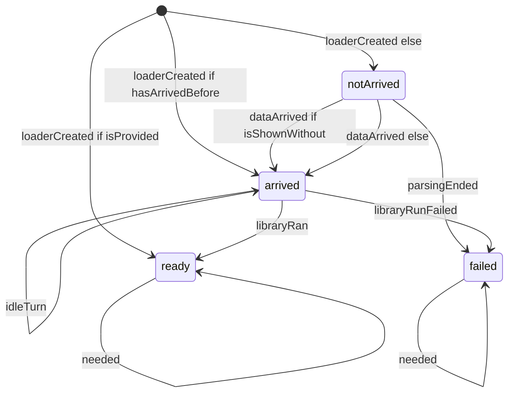

| 出来事 \ 今の状態 | notArrived | arrived | ready | failed |
| --- | --- | --- | --- | --- |
| dataArrived (データの後ろの知らせ `arrive(name, data)`。受け口の `onArrive` から) | [isShownWithout] → arrived / runLibrary (待っている描画があるので、すぐ動かす)・[else] → arrived / requestIdleTurn | — (2 度目の知らせ。起きない) | — (開発サーバーには知らせが無い) | — |
| needed (描画がそれを要った: 全体・部分の描画の `takeMissingLibraries`、コードビューの highlight.js の待ち) | — (届く前の表示のまま。ready に入るときに描き直す) | → arrived / runLibrary | → ready / handToRenderers, redrawShownWithout (開発サーバーの最初の描画など、まだ渡していないレンダラーに渡す) | → failed / showFailure (待たずに、すぐ失敗を出す) |
| idleTurn (ページの手が空き、このライブラリの順番が来た) | — | → arrived / runLibrary | — | — |
| libraryRan (`runLibrary` の結果: ライブラリが `provide` で自分を渡した) | — | → ready / handToRenderers, redrawShownWithout, settleWaiters, requestIdleTurn, checkSettled | — | — |
| libraryRunFailed (`runLibrary` の結果: データの塊が無い・CSP が止めた・例外) | — | → failed / logRunError, showFailure, settleWaiters, requestIdleTurn, checkSettled | — | — |
| parsingEnded (`DOMContentLoaded`。配布ファイルの解析が終わった。LibraryLoader を作った時に解析が終わっていれば (`document.readyState` が `loading` でない)、作る時にすぐ送る) | → failed / logNotArrived, showFailure, settleWaiters, checkSettled (知らせが来ないまま解析が終わった。データはもう来ない) | — | — | — |

ガードは上から順に評価する (11-b)。`isProvided` / `hasArrivedBefore` は上のはじめの状態の条件。`isShownWithout` は、そのライブラリを待つ届く前の表示が今の画面にあること (`RendererOrchestrator.isShownWithout(name)`。状態ではなく、レンダラーが自分で作った印から求める問い合わせ): katex は待ちの数式を含む HTML の集合 (5.17.3 の HTML のキャッシュ) が空でない、mermaid は `MermaidRenderer` が作った `.mermaid-loading` の枠がプレビューにある、hljs は色なしで出したコード (プレビューのコード、または色なしで出したコードビュー) がある、plantuml はいつも偽 (PlantUML は、エンコーダーではなく、4 つのライブラリが決まるのを待つ。下の (2))。迷う場合は真としてよい (早く動かすだけで、表示は変わらない)。

処理: `runLibrary` は、データの塊 (受け口が参照で持つもの。5.17.2) の文字を新しい `<script>` に入れて動かし、塊と足した要素を外す。その結果で `libraryRan` か `libraryRunFailed` を送る。処理が起こした出来事は、今の遷移の処理が全部済んだ後に、同じ `dispatch` の呼び出しの中で、起きた順に扱う (入れ子にしない。同じタスクの中)。`handToRenderers` は、4 つのレンダラー (`MarkdownRenderer`・`MermaidRenderer`・`PlantUMLRenderer`・`SourceFileRenderer`) の `useLibrary(name, library)` を呼ぶ。`redrawShownWithout` は、届く前の表示で描いた所を描き直す (5.17.3): hljs はプレビューの色の無いコード (`highlightPending`) と、色なしで出したコードビュー (`recolor`)、mermaid は「Loading diagram...」の枠 (`renderLoading`)、katex は数式のあるブロック (`_redrawMath`)、plantuml は何もしない。描くものが無ければ何もしない。`needed` の出所が描画の段 (全体・部分の描画) なら、その段の中で描き直す (同じタスク。届く前の表示のフレームを挟まない)。ほか (`dataArrived`・`idleTurn`) は描画の列 (render queue) に入れ、読んでいる位置は動かさない。どちらも、`dispatch` の中で LibraryLoader が描画の側 (ポート `LibraryHost`) を呼んで行う。描画の段の中の描き直しは、その結果 (`Promise`) を `dispatch` の戻り値にまとめる (描き直したら真)。描画の側の処理が例外を投げても (または `Promise` が reject されても)、LibraryLoader は `console.error` に出し、自分の処理 (`settleWaiters`・`requestIdleTurn`・`checkSettled`) と後の出来事を続ける (ページが必ず settled に向かうため)。`showFailure` は、mermaid なら枠に "The diagram library could not be loaded." を出し (`showLoadFailed`)、その後の描画でも同じ。katex は TeX のまま、hljs は色なし、plantuml は何も出さない (4 つが決まった後 (answering と settled) の PlantUML の段が、エンコードの失敗を出す)。`settleWaiters` は `get(name)` の Promise を解く (ready では解決、failed では reject)。`requestIdleTurn` は、ページの手が空いた時 (`requestIdleCallback`。無ければ `setTimeout` 0) に 1 回、`LIBRARY_NAMES` の並びで最初の arrived のライブラリに `idleTurn` を送る。予約は 1 つだけ (予約があれば新しく取らない)。arrived が無ければ送らない (届く順と並びは同じ。O2。オーナーの裁定 2026-10-25 の「手が空いた時に 1 つずつ」)。`checkSettled` は、4 つが全部 ready か failed なら、ページの表に `librariesSettled` を送る。`logRunError` / `logNotArrived` は `console.error` を 1 回出す。

**(2) ページの状態機械**

定義の名前は `pageStartupStateMachine`、今の状態を持つ変数は `pageStartupState` (`LibraryLoader` の `_pageStartupState`。getter `pageStartupState` と `isSettled()` で読ませる)。状態: `receiving` (受け口 (`boot.js`) だけが動いている)、`loading` (中核は動いた。ライブラリはまだ届く途中)、`answering` (4 つが全部 ready か failed になった。それまでに待たせた PlantUML の図に、描画の列で答える (`runWaitingPlantUml`) 前)、`settled` (待たせた図にも答えた。終わりの状態)。PlantUML の確認と送信は、4 つが決まってから (answering と settled) だけ行う。INV と FS の「4 つのライブラリが全部 ready か failed になってから」は、`librariesSettled` の後のこと。

`receiving` は中核が動く前から始まる。その間の状態は受け口のリスナーが表す (中核の変数はまだ無い)。中核は `pageStartupState` を `receiving` で作り、main.js の終わりの `coreStarted` で次へ進める。`earlyInputArrived` の行は受け口が行い、中核は受けない (`dispatchPage("earlyInputArrived")` は例外を投げる。表には仕様との一致のために置く)。 起動役 (SC-29) の起動の塊も、受け口が動き始めたときの `earlyInputArrived` (ハンドル無しのドロップ) として扱う (INV-104)。新しい状態と出来事は無い。

**Page startup state machine:**

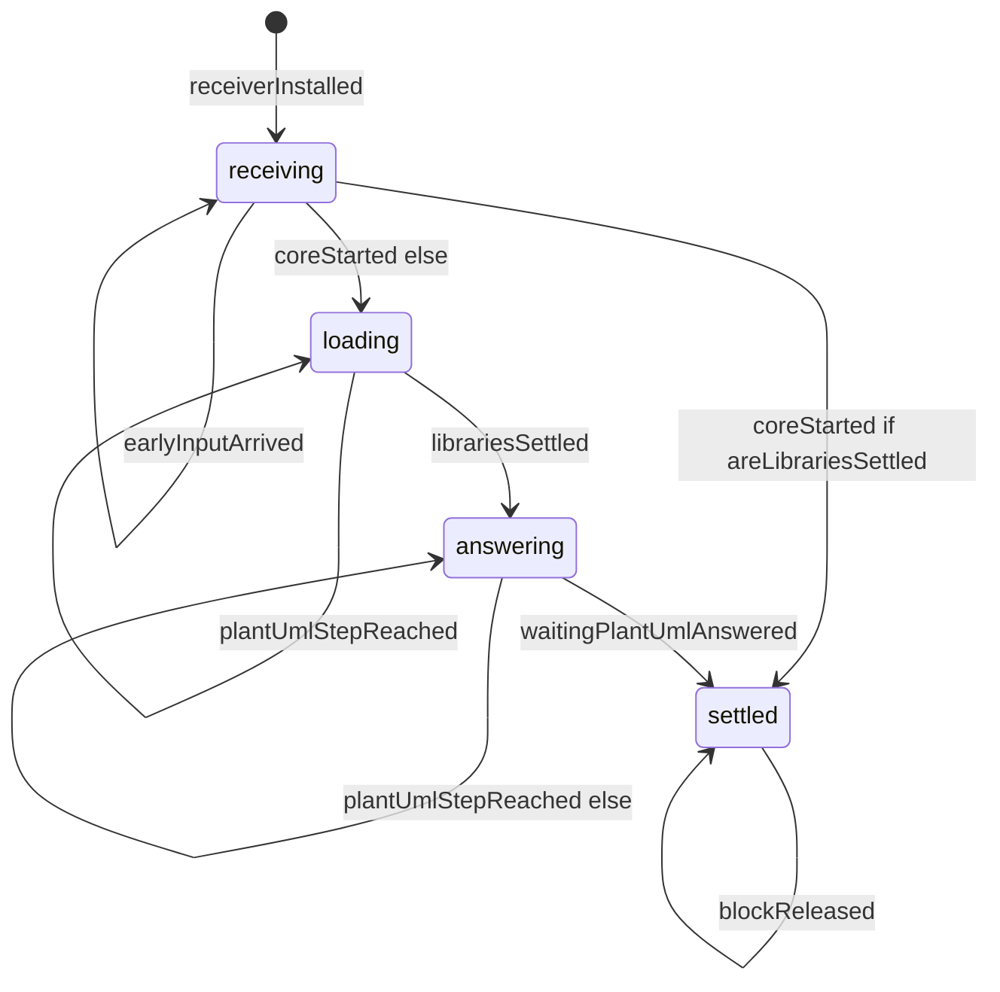

| 出来事 \ 今の状態 | receiving | loading | answering | settled |
| --- | --- | --- | --- | --- |
| earlyInputArrived (中核より前のドロップ・ペースト) | → receiving / keepLastInput (受け口 (`boot.js`) が行う。最後の 1 件だけ、メモリの上に。INV-81 (4)) | — (受け口のリスナーは外れた。UIController が受ける) | — | — |
| coreStarted (main.js が部品を組み終えた) | [areLibrariesSettled] → settled / takeEarlyInput, receiveEarlyInput, requestIdleTurn・[else] → loading / takeEarlyInput, receiveEarlyInput, requestIdleTurn | — | — | — |
| librariesSettled (ライブラリの表の `checkSettled`) | — (`coreStarted` のガードで見る) | → answering / runWaitingPlantUml | — (1 回だけ) | — |
| plantUmlStepReached (描画の PlantUML の段: 全体の描画、部分の描画 (確定・Undo・Redo・挿入・削除・置換、閉じた編集欄のブロック)、KaTeX が動いた後の描き直し) | — (描画は無い) | → loading / holdPlantUml (確認も送信もしない。描画の列は待たない) | [isConsentStep] → answering / holdPlantUml (待ちの組に入れる。確認は `runWaitingPlantUml` の 1 回)・[else] → answering / runPlantUmlStep (部分の描画は [Render]) | → settled / runPlantUmlStep |
| waitingPlantUmlAnswered (`runWaitingPlantUml` が待ちの枠を全部扱った。描画の側が送る) | — | — | → settled | — |
| blockReleased (編集欄が閉じ、ブロックの子を戻した。`RendererOrchestrator.releaseBlock` が送る) | — (編集欄は無い) | — (戻った枠は `runWaitingPlantUml` が扱う) | — (同じ) | → settled / turnHeldPlantUmlToRender |

ガード: `areLibrariesSettled` は、4 つが全部 ready か failed (開発サーバーでは始めから真)。`isConsentStep` は、段の `mode` が `"consent"` (全体の描画と、KaTeX が動いた後の描画の列の描き直し)。

処理: `keepLastInput` は INV-81 (4) の受け口の預かりで、受け口が行う。`takeEarlyInput` / `receiveEarlyInput` は、受け口のリスナーを外し、預かった入力をそのとき来たものとして UIController に渡す。`holdPlantUml` は、図の場所に「Loading diagram...」の枠 (`.plantuml-loading`。文は `CONFIG.messages.diagram.loading`) を出し、枠ごとに原文・テーマ・後の扱いを覚える。後の扱いは、全体の描画と、KaTeX が動いた後の描き直し (利用者の操作ではない) なら「確認」、部分の描画なら「[Render]」(INV-23)。ただし、KaTeX が動いた後の描き直しでも、描き直す前に「[Render]」を待っていた図 (待ちの枠か [Render] の枠。同じ原文とテーマ) は「[Render]」のまま (`keepRender`。描き直しの前に `heldForRender()` で読む)。確定などで足した図を、描き直しで確認だけで送らないため (INV-02、レビューの N1)。`runPlantUmlStep` の「確認」でも同じ。`runWaitingPlantUml` は、描画の列に 1 回だけ入れ、今のプレビューの、つながっている待ちの枠について PlantUML の段を行う: 「確認」の枠が 1 つ以上あれば確認 (CON-04) を 1 回出し、OK ならそれらを送り、Cancel なら "PlantUML diagram (not sent)" を出す (INV-03)。「[Render]」の枠は、送らずに INV-23 のプレースホルダにする。エンコーダーが failed なら、確認を出さず、どの枠もエンコードの失敗の表示にする (送れるものが無い)。読んでいる位置は動かさない (INV-81 (3))。枠を全部取り、確認を出し、送信を始めた後 (送信の終わりは待たない)、描画の側が `waitingPlantUmlAnswered` を送る。Clear・別の文書・コードビューで枠が外れていれば、何もせずに `waitingPlantUmlAnswered` を送る。`runPlantUmlStep` は今までの PlantUML の段 (全体の描画は 1 回の確認で送る。INV-02。部分の描画は INV-23 のプレースホルダ)。エンコーダーが failed なら、確認を出さず、エンコードの失敗の表示。answering と settled ではエンコーダーは ready か failed なので、エンコーダーを待つことは無い。answering の間 (`runWaitingPlantUml` がまだ動いていない) に来た「確認」の段は、`holdPlantUml` で待ちの組に入る (KaTeX が動いた後の描き直しは、4 つが決まる前に描画の列に入り、`runWaitingPlantUml` より先に動くことがある。全体の描画の PlantUML の段も、描画の途中で 4 つが決まれば answering の間に来る)。`runWaitingPlantUml` の 1 回の確認が、全部に答える (1 回の全体の描画に、確認は 1 回。G6・POLA)。settled には待ちの枠が無い。ただし、`runWaitingPlantUml` が動いた時に編集欄が開いていれば、その外した子 (5.14.6) の中の待ちの枠はプレビューに無く、扱われない。`turnHeldPlantUmlToRender` は、編集欄を閉じて子を戻した時 (`blockReleased`) に、その枠を確認を出さずに INV-23 のプレースホルダにする (エンコーダーが failed ならエンコードの失敗の表示。レビューの M2)。

注: KaTeX は PlantUML のエンコーダーより先に届き (INV-81 (1))、4 つが決まった後にライブラリの状態は変わらない。そのため、本番の KaTeX が動いた後の描き直しは 4 つが決まる前に描画の列に入り、PlantUML の図は `holdPlantUml` の枠になる。列が混んでいて answering の間に動いても、answering の `holdPlantUml` で同じ組に入り、確認は 1 回。開発サーバー (始めから settled) では、最初の描画の段の中で KaTeX を渡して描き直し、その段の決まり (全体の描画は自分の 1 回の確認、部分の描画は [Render]) に従う。どちらでも、確認なしに図を送ることは無い (前の `"repeat"` の送り直しは無くなった。AQ7)。同意の後に確認なしでサーバーへ取りに行くのは、図の [Copy SVG] / [Copy PNG] だけ (INV-02、FS-09)。遅い回線の初回の訪問では、確認が出るのが遅れる (4 Mbps で最大およそ 3 秒。オーナーが受け入れた)。

**実装:** 2 つの表は、`stateTable.js` の補助 (`cell` / `choice`) で作るデータ `libraryStateMachine` と `pageStartupStateMachine` として `LibraryLoader.js` が持つ (`DocumentLifecycle.js` の `saveOperationStateMachine` と同じ形)。入口は `LibraryLoader.dispatch(name, event, input)` と `dispatchPage(event, input)`。状態は、1 つのライブラリにつき `_libraryStates` の 1 つの値と、`_pageStartupState` の 1 つの値だけで持ち、ほかの Set・Map・真偽に分けない (R4 状態機械。待ちの枠にもう答えたかは `answering` と `settled` で表す。前の `PlantUMLRenderer._waitingAnswered` は無くした。レビューの M1)。`peek` / `isArrived` / `hasFailed` / `isSettled` は、この値から求める。受け口の `data` (データの塊の参照) と `provided` (ライブラリの値) はデータで、状態ではない。受け口の `arrived` は、LibraryLoader を作るときに 1 回だけ読む (`hasArrivedBefore`)。`get(name)` の Promise は待つ側のためのもので、ライブラリごとに 1 つを作り、`settleWaiters` で解く (状態ではない)。`get(name)` は `needed` を送ってから、その Promise を返す。描画の側 (`isShownWithout`・`handToRenderers`・`redrawShownWithout`・`showFailure`・`runWaitingPlantUml`・`holdPlantUml`・`runPlantUmlStep`・`turnHeldPlantUmlToRender`) は、RendererOrchestrator が実装するポート (`LibraryHost`) を通して行い、main.js が `coreStarted` より前に LibraryLoader とつなぐ。`waitingPlantUmlAnswered` (`runWaitingPlantUml` の中) と `blockReleased` (`releaseBlock`) は、RendererOrchestrator が `dispatchPage` で送る。`holdPlantUml` / `runPlantUmlStep` の入力の `keepRender` は、テーマ → 原文の集合の `Map` (`PlantUMLRenderer.heldForRender()` が作る)。

**試験 (G9):** 2 つの表の全交点 (ライブラリ 6 × 4 = 24、ページ 6 × 4 = 24。`—` とガードの枝を含む。ページの `earlyInputArrived` の行は受け口 (`installBoot`) で確かめる) を試験し、コードの表と仕様の表の一致を確かめる。はじめの状態の 3 つの枝 (`isProvided` / `hasArrivedBefore` / else) も試験する。11-b の既知の制限のとおり、図はこの表のすべての遷移を載せる。

**11-h コード編集モードの状態機械 (2026-10-29、INV-85。レビュー 1 回目の L1、調整役の裁定 Q3)**

定義の名前は `codeEditModeStateMachine` (`CodeEditController` が持つ)。状態: `viewing` (コードビューの表示) / `editing` (コード編集モード)。今の状態を持つ変数は置かない: `editing` は `CodeEditor` が動いている (`isActive()`。`#codeEditBody` が `#preview` にある) 間で、それ以外は `viewing` (変数を持つと DOM とずれうる)。入口は `CodeEditController._dispatch(event, input)`。(11-g の番号は別の作業が使うので、ここは 11-h とする。)

**Code edit mode state machine:**

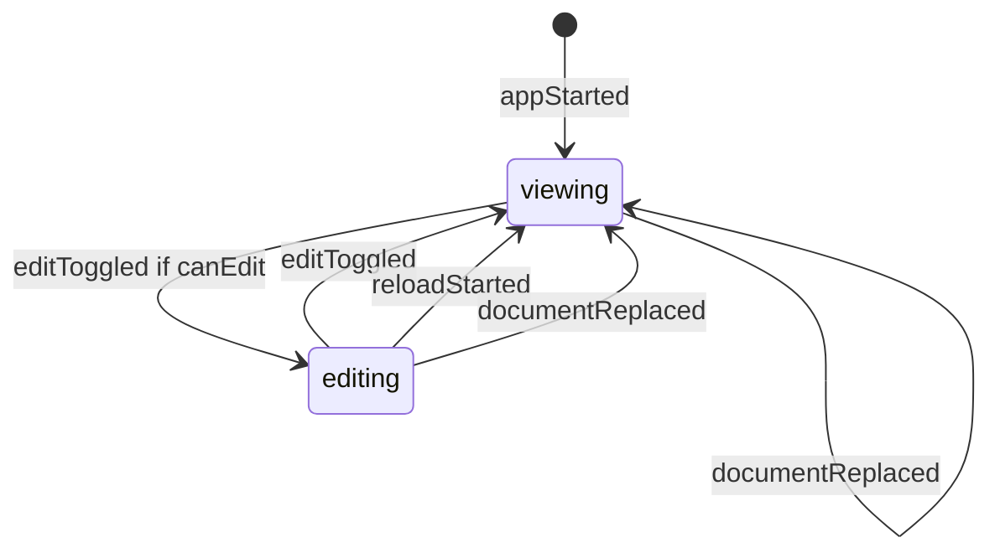

| 出来事 \ 今の状態 | viewing | editing |
| --- | --- | --- |
| editToggled ([Edit] / `e`。`toggleEdit`) | [canEdit] → editing / dropViewFolds, startEditor, showCodePalette (ガードが偽なら変化しない) | → viewing / stopEditor, keepEditedText, drawView, hideCodePalette |
| reloadStarted (Reload。INV-21 の確認の後。`stopEditing`) | — | → viewing / stopEditor, keepEditedText, hideCodePalette |
| documentReplaced (`opened`・`close`・Reload の `commit`) | → viewing / replaceDocument | → viewing / stopEditor, hideCodePalette, replaceDocument |

- ガード `canEdit`: 文書がある、かつ編集欄の作り手 (`createEditor`) がある (INV-85 (8))。
- 処理: `dropViewFolds` は表示の折りたたみ (`_displayText`) を捨てる (INV-92 (2))。`startEditor` は編集欄を (初めてなら作って) 文書の文字と履歴で始める。`showCodePalette` / `hideCodePalette` は `CodeEditHost.codeEditModeChanged(true / false)` (パレットのコードのモード、検索と目次の向き先。INV-85 (4))。`stopEditor` は編集欄を止めて、編集した文字を返す (開いている打つ手順を閉じる。INV-88 (1))。`keepEditedText` はその文字を文書に入れる (未保存はそのまま)。`drawView` は表示をその文字で描き直す (`showCodeText(text, true)`)。`replaceDocument` は世代を進め、表示の折りたたみと表示の 1 段の文字を捨て、履歴を新しい文書の文字で始め直し、新しい文書 (無ければ null) にする。
- reloadStarted は表示を描かない。Reload が読み直した文字で描く (INV-85 (3)。レビュー 1 回目の L5)。読めなかったときは、UIController が `showDocumentText` で今の文書の文字を描き直す。
- 保存 (`_saving`) は状態を変えない (編集のまま保存できる。INV-90 (7))。`_saving` は 11-e の注のとおり表にしない。
- コード編集モードの間、11-c は `browsingPreview` のまま (11-c の注)。パレットは 11-f の `hidden` / `expanded` / `minimized` だけを通る (11-f の注)。
- 試験: AT-CEM (`CodeEditController.stateMachine.test.js`。6 つの交点のすべて、ガード、図と表の一致)。結合は AT-CEC-26・27・30、AT-UI-85・88・99。

### 3.4 シーケンス図

**Markdownペースト→レンダリングフロー:**

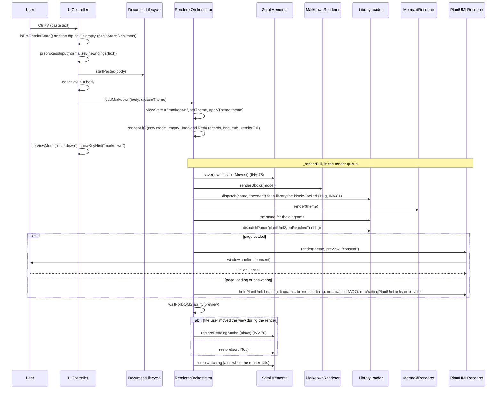

**コードビュー ファイルドロップフロー:**

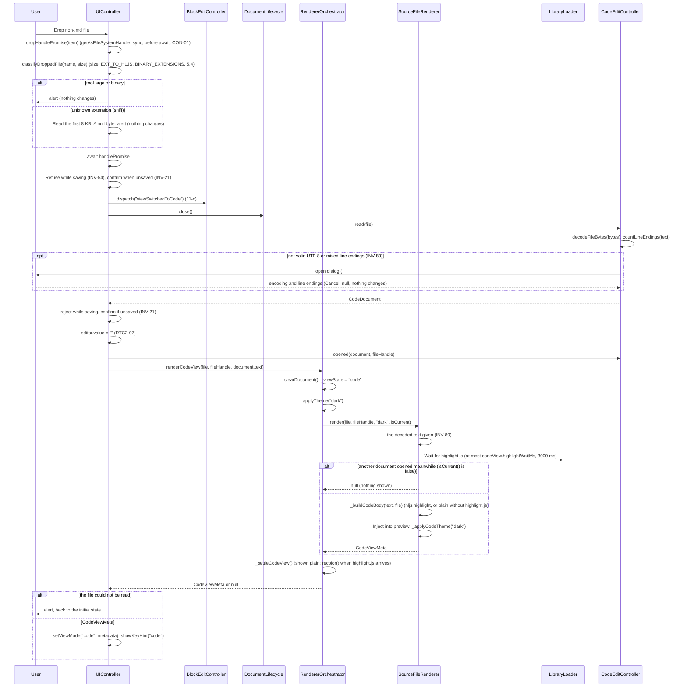

**コードビュー リロードフロー (`r` キーまたは [Reload]):**

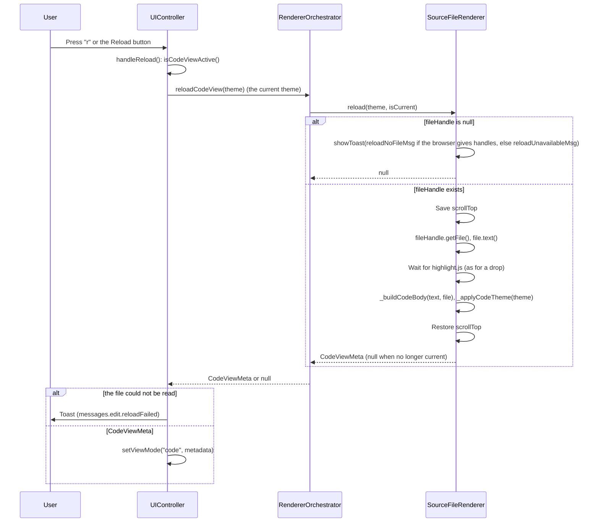

コードビューの `l` / `d` と [Render Light] / [Render Dark] は、テーマの CSS を変えるだけで、ファイルを読み直さない (`renderRouteFor` の `"theme"`。5.8)。

**完全レンダリングパイプライン（ボタンクリック、Markdown 表示中）:**

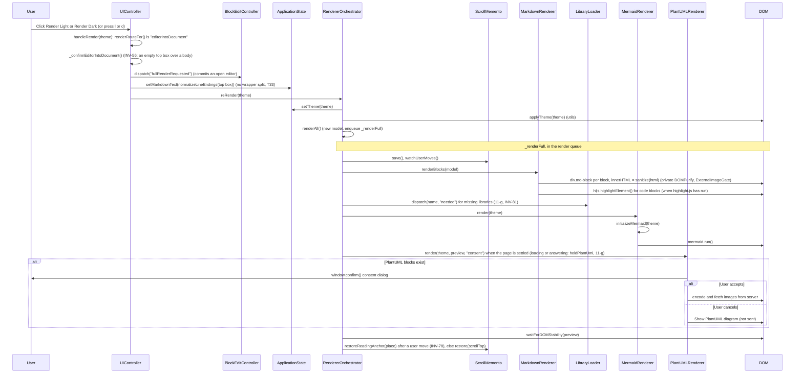

初期状態では、同じボタンは `renderRouteFor` の `"newDocument"` で、上のペーストと同じく `preprocessInput` を通して新しい文書を始める。Markdown 表示中は `preprocessInput` を通さない (改行の正規化だけ。裁定 T33、5.14.1)。

**起動と遅れて読むライブラリ (INV-81、5.17。状態は 11-g):**

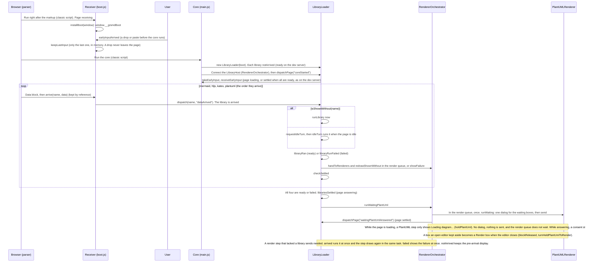

ライブラリ 1 つの状態とページの状態は、3.3 の 11-g の 2 つの表で決まる。この図は、ふつうの順 (知らせが届く順に動き、最後のエンコーダーで 4 つが決まり、answering を経て settled になる) を示す。4 つが決まる前に描画の列に入った KaTeX の後の描き直しが `runWaitingPlantUml` より先に動いても、その図は answering の `holdPlantUml` で待ちの枠に加わり、確認は 1 回。

**Block commit and partial re-render:**

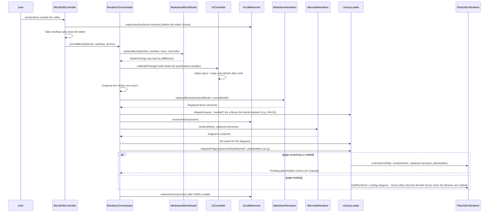

**Save with permission first and external change check:**

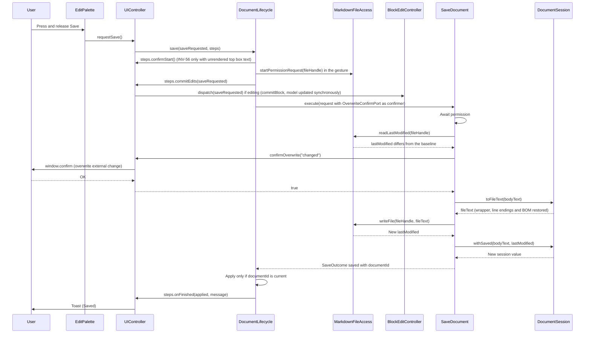

**Undo the last commit:**

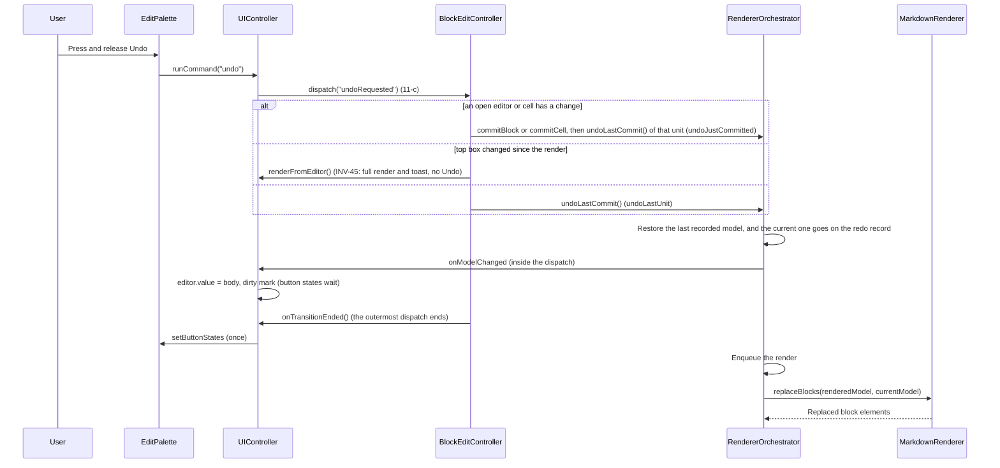

**Palette press turned into drag:**

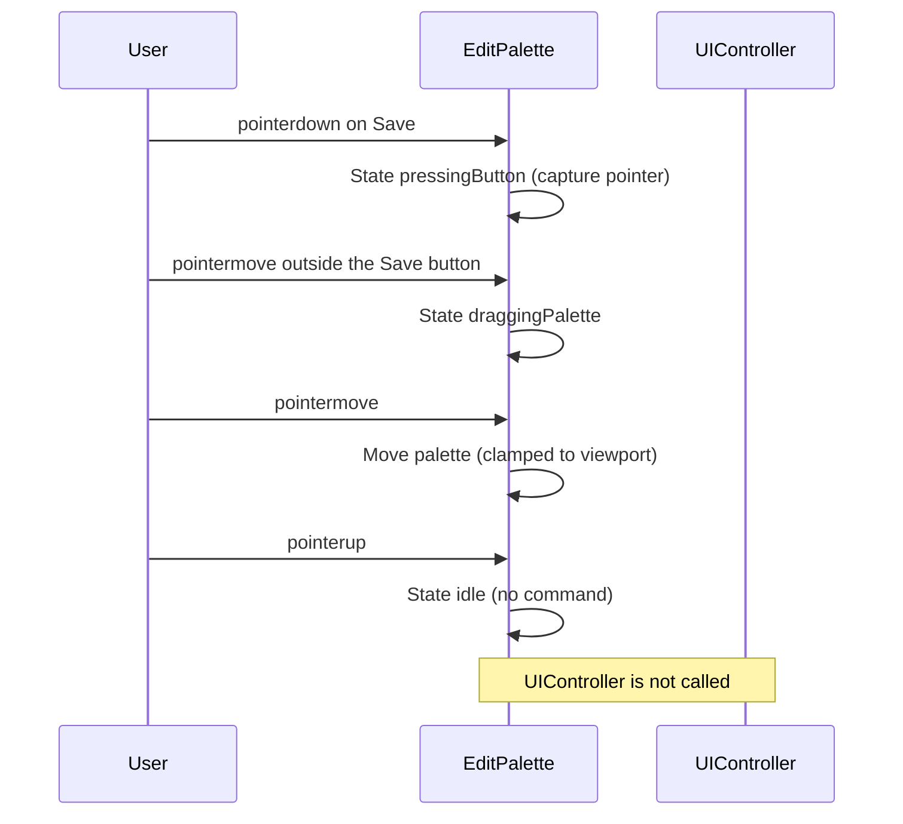

### 3.5 デバイス機能マトリクス

**デバイス検出と機能アクティベーション:**

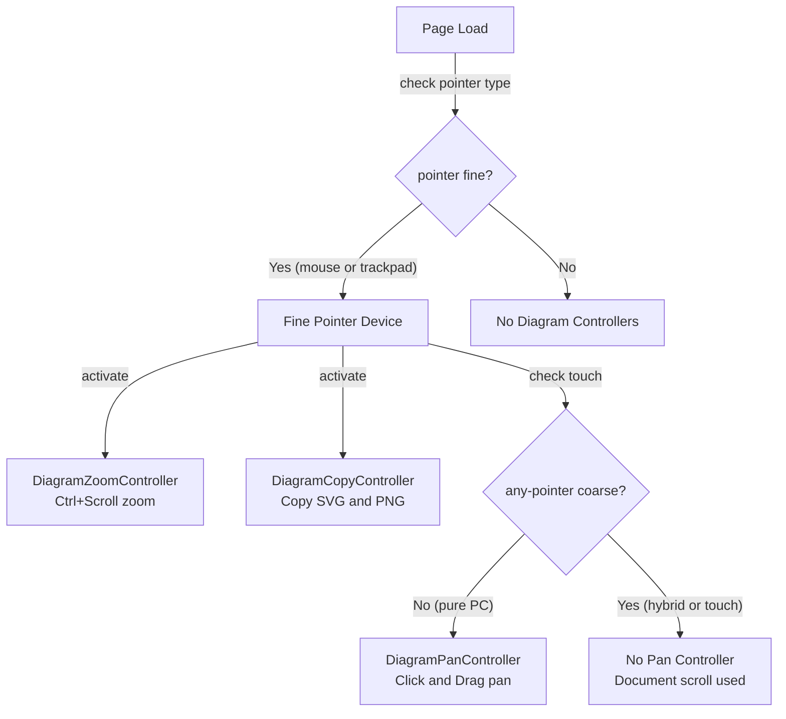

DiagramPanControllerは純粋なPC環境（fineポインターあり、かつcoarseポインターなし）でのみインスタンス化される。ハイブリッドデバイス（例: Surface）ではドキュメントスクロールとの競合を避けるためパンは無効化される。パンは、マウスのボタンを押している間だけ続く: `mouseup`・`pointerup`・`pointercancel` のどれか、またはボタンを押していない `mousemove` (`buttons` の左ボタンが 0) で終える (押した要素が DOM から外れると WebKit は `mouseup` を送らないため。図をクリックしてコードを開いた後に、マウスを動かすだけでプレビューが流れないこと。PRT-U20)。パンが始まるのは、押した位置からの移動が `CONFIG.pan.activationThresholdPx` (5px) を**超えた**とき (`utils.isPastActivation`。ブロックを開くタップとドラッグの区別 (INV-29)、パレットのグリップ (INV-68)、ブロックの範囲の離し (INV-74 (2)) と同じ 1 つの決まり)。2026-10-25 までは 5px ちょうどでも始まっていた (この 1 点だけが変わる。レビューの L4、調整役の裁定 Q3)。

**編集機能 (SC-22〜24) は全デバイスで有効。** 物理キーボードのないタッチ端末では、上部バーの [Edit] ボタン (`editBtn`) で編集モードに入る。パレットのジェスチャは Pointer Events で判定し、マウスとタッチで挙動を同じにする (INV-34 / INV-35)。タッチでは、ダブルタップで編集を始めない。空の初期状態でも Markdown の表示でも、ダブルタップはブラウザの拡大のままとする (オーナーの裁定 AQ3、2026-10-29)。タッチで編集を始めるのは [Edit] を押してからブロックをタップすること (INV-29。空の初期状態では [Edit] で空の文書を始める。INV-31)。マウスのダブルクリックと、ペンのダブルタップが編集を始める (INV-31、INV-57。判定は 5.14.6。ペンはオーナーに問うている間、裁定の前のとおりマウスと同じ)。パレットには `touch-action: none` を指定する **[要検証: iOS Safari]**。そのためパレットの上ではダブルタップで拡大せず、グリップのダブルタップ (タッチとペン) は最小化・復活になる (INV-68、オーナーの裁定 PD1)。これはパレットの上だけの操作で、プレビューのダブルタップ (AQ3) とは事象も判定も別である (プレビューの `dblclick` とパレットの `dblclick` は互いに届かない)。編集モードでは、図のブロックのクリックはコードを開く (図のダブルクリックによるズーム解除は、編集モードでない間に使う)。ドラッグによるパン (純粋な PC) は移動量が閾値を超えるので、編集の開始ジェスチャにはならない (INV-29)。上書き保存は Chrome / Edge のみで、そのほかはダウンロードにフォールバックする (INV-26)。

## 4. 機能シナリオ (Gherkin)

### FS-01: Markdownレンダリング

追跡 (要求 / 不変条件 / 手で行う試験): SC-01・SC-02・SC-04・SC-08・SC-10 / INV-05・INV-08・INV-09・INV-17・INV-81 / PRT-B01・C01・D01〜D03・F01・M01・M04・P01・AE02・AE05

```gherkin
Feature: Markdownレンダリング
  ユーザーとして
  Markdownテキストをペーストまたはドロップしてプレビューしたい
  ダイアグラム、数式、シンタックスハイライト付きで表示するために

  Scenario: プレレンダー状態でMarkdownテキストをペースト
    Given アプリケーションがプレレンダー状態である
    And エディタのテキストエリアが空である
    When ユーザーがクリップボードにMarkdownテキストがある状態でCtrl+Vを押す
    Then エディタのテキストエリアにペーストされたテキストが入力される
    And プレビューエリアにMarkdownがレンダリングされる
    And テーマがOSのカラースキーム設定に一致する
    And _viewStateが "markdown" になる

  Scenario: .mdファイルをドロップ
    Given アプリケーションが任意の状態である
    When ユーザーが .md ファイルをページにドロップする
    Then ファイル内容が読み取られる
    And プレビューエリアにMarkdownがレンダリングされる
    And _viewStateが "markdown" になる

  Scenario: ダークテーマでMarkdownを再レンダリング
    Given Markdownがレンダリング済みである (_viewStateが "markdown")
    When ユーザーが "d" キーを押す
    Then Markdownがダークテーマで再レンダリングされる
    And スクロール位置が保持される

  Scenario: ライトテーマでMarkdownを再レンダリング
    Given Markdownがレンダリング済みである (_viewStateが "markdown")
    When ユーザーが "l" キーを押す
    Then Markdownがライトテーマで再レンダリングされる
    And スクロール位置が保持される

  Scenario: コードビュー中に.mdファイルをドロップ
    Given コードビューがアクティブである (_viewStateが "code")
    When ユーザーが .md ファイルをページにドロップする
    Then コードビューが破棄される
    And ファイル内容がMarkdownプレビューにレンダリングされる
    And _viewStateが "markdown" になる

  Scenario: Markdownプレビュー中に非.mdファイルをドロップ
    Given Markdownがレンダリング済みである (_viewStateが "markdown")
    When ユーザーがサポート対象の非.mdファイルをドロップする
    Then Markdownプレビューがクリアされる
    And ファイルがコードビューで表示される
    And _viewStateが "code" になる

  Scenario: ライトテーマでレンダリング
    Given ユーザーがMarkdownテキストをエディタにペーストしている
    When ユーザーが Render Light ボタンをクリックする
    Then body要素に "dark" クラスが付与されていない
    And Markdownがパースされプレビューエリアに表示される
    And コードブロックにシンタックスハイライトが適用される
    And Mermaidダイアグラムがレンダリングされる

  Scenario: ダークテーマでレンダリング
    Given ユーザーがMarkdownテキストをエディタにペーストしている
    When ユーザーが Render Dark ボタンをクリックする
    Then body要素に "dark" クラスが付与される
    And MermaidがダークテーマでMermaidを初期化する
    And PlantUMLコードに "!theme cyborg" が注入される (未指定の場合)

  Scenario: レンダリング済みの状態でペースト
    Given プレビューエリアにレンダリング済みコンテンツがある
    When ユーザーがページ上でテキストをペーストする
    Then ブラウザのデフォルトペースト動作が行われる
    And 自動レンダリングは発生しない
    And 先に [Clear] を押して最初の画面に戻れば、ペーストでプレビューが始まる

  Scenario: 最初の画面でも上部の入力欄に文字があればペーストで描画しない (INV-08)
    Given アプリケーションがプレレンダー状態で、上部の入力欄 (#editor) に文字がある
    When ユーザーがプレビューの上でテキストをペーストする
    Then 自動レンダリングは発生しない

  Scenario: 図・数式・コードの色のライブラリが届く前に描く (INV-81)
    Given ページの読み込みの途中で、mermaid・KaTeX・highlight.js がまだ届いていない
    When ユーザーが Mermaid の図・数式・言語付きのコードブロックを含む Markdown をペーストする
    Then 本文はすぐ描画される
    And Mermaid の図の所には "Loading diagram..." の枠が出る
    And 数式は TeX の原文のまま出る
    And コードブロックは色なしで出る
    When それぞれのライブラリが届いて動く
    Then その図・数式・コードの色の所だけが描き直される (5.17.3)

  Scenario: 図のライブラリを動かせない
    Given mermaid のライブラリを動かせなかった
    Then Mermaid の図の所には "The diagram library could not be loaded." が出る

  # PlantUML の確認と送信の時期 (4 つのライブラリが決まってから) は FS-02 に置く
```

### FS-02: PlantUML同意フロー

追跡 (要求 / 不変条件 / 手で行う試験): SC-03 / INV-02・INV-03・INV-10・INV-23・INV-81 (3) / PRT-M02・AE09・AE12

```gherkin
Feature: PlantUML同意フロー
  ユーザーとして
  PlantUMLのレンダリング前に同意を求められたい
  プライバシーを保護するために

  Scenario: PlantUMLレンダリングに同意する
    Given MarkdownにPlantUMLコードブロックが含まれている
    When レンダリングパイプラインがPlantUMLフェーズに到達する
    Then 確認のダイアログ (`window.confirm`。文は `CONFIG.messages.plantuml.consent`) が表示される
    When ユーザーがOKをクリックする
    Then 各PlantUMLブロックがエンコードされPlantUMLサーバーに送信される
    And 結果のSVG画像がコードブロックを置き換える

  Scenario: PlantUMLレンダリングをキャンセル
    Given MarkdownにPlantUMLコードブロックが含まれている
    When レンダリングパイプラインがPlantUMLフェーズに到達する
    And ユーザーが同意ダイアログでキャンセルをクリックする
    Then PlantUMLサーバーにデータは送信されない
    And 各PlantUMLコードブロックに "PlantUML diagram (not sent)" が表示される
    And 他のMarkdownおよびMermaidコンテンツはレンダリング済みのまま維持される

  Scenario: PlantUML画像のタイムアウト
    Given ユーザーがPlantUMLレンダリングに同意した
    When PlantUML画像が5000ms以内にロードされない
    Then 画像が "The PlantUML server didn't answer in 5 seconds." エラー要素で置き換えられる

  Scenario: 4 つのライブラリが決まる前は確認も送信もしない (INV-81 (3)、11-g)
    Given ページの読み込みの途中で、遅れて読むライブラリのどれかが、まだ ready でも failed でもない
    When ユーザーが PlantUML のブロックを含む Markdown をペーストする
    Then 確認のダイアログは出ない
    And PlantUML サーバーへの通信は無い
    And 図の所には "Loading diagram..." の枠が出る
    And 本文・数式・Mermaid の図の描画は、PlantUML を待たずに進む
    When 4 つのライブラリが全部 ready か failed になる
    Then 確認のダイアログが 1 回だけ出る
    When ユーザーが OK をクリックする
    Then 待っていた図が送られて描かれる

  Scenario: 待っている間に確定した図は [Render] の枠になる (INV-23)
    Given 4 つのライブラリが決まる前に、ユーザーが PlantUML のブロックを確定した
    When 4 つのライブラリが全部 ready か failed になる
    Then その図は送られず、[Render] の枠になる

  Scenario: 決まった時に編集欄が開いていた図は、閉じた時に [Render] の枠になる (INV-23、11-g の turnHeldPlantUmlToRender)
    Given 4 つのライブラリが決まる前に、PlantUML の図を含むブロックの編集欄を開いた
    When 4 つのライブラリが全部 ready か failed になり、ほかの図について確認が 1 回出る
    And ユーザーが何も変えずに Esc で編集欄を閉じる
    Then その図は送られず、[Render] の枠になる
    And 確認はもう出ない

  Scenario: KaTeX が届いた後の描き直しでは送り直さない (オーナーの裁定 AQ7)
    Given 1 つのリストの項目の中に、数式と PlantUML の図がある
    When ページの読み込みの途中で KaTeX が動き、そのブロックが描き直される
    Then PlantUML サーバーへの通信は無い
    And 図の所は "Loading diagram..." の枠のまま、4 つのライブラリが決まるのを待つ

  Scenario: 決まるのと同じ時に来た描画でも、確認は 1 回 (INV-02、11-g の answering)
    Given 4 つのライブラリが決まる前に、全体の描画の途中で KaTeX と PlantUML のエンコーダーが動いた
    When その全体の描画が PlantUML の段に来て、続いて KaTeX の後の描き直しが動く
    Then 確認のダイアログは、待っていた図すべてについて 1 回だけ出る

  Scenario: PlantUML のエンコーダーを動かせない
    Given PlantUML のエンコーダーが failed になった
    When 4 つのライブラリが全部 ready か failed になる
    Then 確認のダイアログは出ない
    And 待っていた図の所には、エンコードの失敗の表示が出る
```

### FS-03: Quick Code View

追跡 (要求 / 不変条件 / 手で行う試験): SC-05・SC-09 / INV-18・INV-81 (3) / PRT-E01〜E03・K01・S01・AE05

```gherkin
Feature: Quick Code View
  開発者として
  任意のテキストファイルをドロップしてシンタックスハイライト付きで表示したい
  行番号付きでソースコードを読むために

  Scenario: Pythonファイルをドロップ
    Given アプリケーションがプレレンダー状態である
    When ユーザーが .py ファイルをページにドロップする
    Then ファイルがコードビューで表示される
    And Python用のシンタックスハイライトが適用される
    And 行番号が表示される
    And #fileInfo にファイルメタデータが表示される
    And テーマがダークモードに強制される
    And setViewMode("code", metadata) が呼ばれ body.view-code が設定される
    And _viewStateが "code" になる

  Scenario: .txtファイルをドロップ
    Given アプリケーションが任意の状態である
    When ユーザーが .txt ファイルをページにドロップする
    Then ファイルがコードビューで表示される (Markdownプレビューではない)
    And コンテンツが行番号付きプレーンテキストとして表示される

  Scenario: 未知拡張子のテキストファイルをドロップ (INV-18 段階4-5)
    Given アプリケーションが任意の状態である
    When ユーザーがEXT_TO_HLJSに未登録の拡張子 ".env" のテキストファイルをドロップする
    Then 先頭8KBのnullバイト検査が実行される
    And nullバイトがないためコードビューでplaintext表示される

  # バイナリの拒否 (INV-18 段階3・4。アラート "GRSMD can only open text files.") のシナリオは FS-13 に置く

  Scenario: 拡張子なしファイル (Dockerfile等) をドロップ
    Given アプリケーションが任意の状態である
    When ユーザーが "Dockerfile" をドロップする
    Then EXT_TO_HLJSのファイル名ルックアップで言語が解決される
    And ファイルがコードビューで表示される (hljs commonに含まれない言語はplaintext表示、highlightAutoは使わない)

  Scenario: 初回コードビュー読み込み時のキーボードヒント
    Given 非.mdファイルがドロップされた直後である
    When コードビューが表示される
    Then #keyHint にキーボードショートカットヒントが表示される
    And ヒントは CONFIG.keyHints.code で、"[F] Search" から始まる (コードビューに目次と編集は無いので "[I]" と "[E]" は無い)
    And CONFIG.codeView.keyHintDurationMs 後にヒントがフェードアウトする

  Scenario: highlight.js が届く前にファイルをドロップ (INV-81 (3))
    Given ページの読み込みの途中で、highlight.js がまだ届いていない
    When ユーザーが .py ファイルをページにドロップする
    Then コードビューは、highlight.js を最大 CONFIG.codeView.highlightWaitMs (3,000 ms) 待ってから 1 回で出る
    And 待つ間に届けば、色付きで出る
    And 届かなければ、行番号付きの色なしで出て、届いた後に今のスクロールの位置のまま色が付く
    And 待つ間に別のファイルを開いた場合は、前のファイルは出ない
    And highlight.js を動かせなければ、色なしのまま
```

### FS-04: コードビューリロード

追跡 (要求 / 不変条件 / 手で行う試験): SC-07 / INV-15 / PRT-F02・G01・G03・N02

```gherkin
Feature: コードビューリロード
  外部でファイルを編集する開発者として
  再ドロップせずにGRSMDでファイルをリロードしたい
  最新の変更を確認するために

  Scenario: FileSystemFileHandleサポートありでリロード
    Given fileHandleを持つファイルでコードビューがアクティブである
    When ユーザーが "r" キーまたは [Reload] を押す
    Then fileHandle.getFile() 経由でファイルがディスクから再読み取りされる
    And コンテンツが今のテーマのまま再ハイライトされる
    And スクロール位置が保持される
    And CodeViewMeta が返され、UIController が #fileInfo を更新する

  Scenario: fileHandleが無いときのリロード
    Given コードビューがアクティブだがfileHandleがnullである
    When ユーザーが "r" キーまたは [Reload] を押す
    Then ドロップでハンドルを取れるブラウザ (Chrome / Edge) では、トーストに "No file to reload. Drop a file first." が表示される
    And 取れないブラウザ (Safari / Firefox) では、トーストに "Reload works only in Chrome and Edge." が表示される
    And トーストが3000ms後に消える
    And 現在のビューは変更されない

  Scenario: コードビューの l / d はファイルを読み直さない
    Given コードビューがアクティブである
    When ユーザーが "l" または "d" キーを押す
    Then テーマの CSS だけが切り替わり、ファイルは読み直されない (5.8)
```

### FS-05: キーボードナビゲーション

追跡 (要求 / 不変条件 / 手で行う試験): SC-06 / INV-14・INV-80 / PRT-I01〜I03・J01・AB02・AD06

```gherkin
Feature: キーボードナビゲーション
  ユーザーとして
  キーボードショートカットを使いたい
  マウスなしで効率的にナビゲートするために

  Scenario: Markdownプレビューでの下方向スムーススクロール
    Given Markdownがレンダリング済みである (_viewStateが "markdown")
    And フォーカスがINPUTまたはTEXTAREAにない
    When ユーザーがArrowDownキーを押し続ける
    Then ページが加速しながら下方向にスクロールする
    And キーが離されるとスクロールが摩擦で減速する
    And 速度が0.005 px/msを下回るとスクロールが停止する

  Scenario: コードビューでのスムーススクロール
    Given コードビューがアクティブである (_viewStateが "code")
    When ユーザーがArrowUpを押す
    Then ページが上方向にスムーズにスクロールする

  Scenario: プレレンダー状態での矢印キー
    Given _viewStateが "initial" である
    When ユーザーがArrowDownを押す
    Then 何も起こらない (スクロールもエラーもなし)

  Scenario: エディタ入力中のキーボードショートカット
    Given フォーカスがエディタのテキストエリアにある
    When ユーザーが "l" を入力する
    Then 文字 "l" がテキストエリアに挿入される
    And テーマ切替は発生しない

  Scenario: 目次と検索の 1 キー (i / f)
    Given Markdownがレンダリング済みである (_viewStateが "markdown")
    And フォーカスがINPUTまたはTEXTAREAにない
    When ユーザーが "i" を押す
    Then 目次が開く (もう一度 "i" で閉じる。INV-77)
    When ユーザーが "f" を押す
    Then 検索の箱が開き、検索欄にフォーカスが移る ("f" は検索欄に入らない。INV-80)
    And 編集モードでは、ブロック編集欄の中からでも 主 + F で検索の箱が開く (INV-14 (2))

  Scenario: Ctrl+C でブラウザネイティブコピー (INV-14)
    Given テキストが選択されている
    And 編集モードでない、または編集モードでもブロックの範囲が無い (範囲があれば FS-17 のとおり原文をコピーする。INV-74 (4))
    And フォーカスがINPUTまたはTEXTAREAにない
    When ユーザーが Ctrl+C を押す
    Then ブラウザのネイティブコピー動作が実行される
    And doClear() は呼ばれない
```

### FS-06: テーマ管理

追跡 (要求 / 不変条件 / 手で行う試験): SC-08 / INV-12 / PRT-D01・D02・F01・F02・O01

```gherkin
Feature: テーマ管理
  ユーザーとして
  アプリがOSのテーマ設定を尊重しつつ手動オーバーライドもできるようにしたい

  Scenario: 初回読み込みがOS設定に従う
    Given ユーザーのOSがダークモードに設定されている
    When GRSMDページが読み込まれる
    Then bodyに class "dark" が設定される

  Scenario: コードビューが初回読み込みでダークを強制
    Given ユーザーのOSがライトモードに設定されている
    When ユーザーが .py ファイルをドロップする
    Then コードビューがダークモードで表示される
    And bodyに class "dark" が設定される

  Scenario: クリアでOS設定に復元
    Given ダークモードでコードビューがアクティブである
    And ユーザーのOSがライトモードに設定されている
    When ユーザーが "c" を押す
    Then テーマがライトモード (OS設定) に戻る

  Scenario: ダークテーマがMermaidに影響
    Given ユーザーがRender Darkをクリックした
    When Mermaidダイアグラムがレンダリングされる
    Then MermaidがダークテーマでMermaidを初期化する

  Scenario: ダークテーマがPlantUMLに影響
    Given ユーザーがRender Darkをクリックした
    And PlantUMLコードに "!theme" ディレクティブが含まれていない
    When PlantUMLブロックがレンダリングされる
    Then PlantUMLコードに "!theme cyborg" が注入される
```

### FS-07: クリアとリセット

追跡 (要求 / 不変条件 / 手で行う試験): SC-21 / INV-13・INV-77 (5)・INV-80 / PRT-H01・H02・N01・W10

```gherkin
Feature: クリアとリセット
  ユーザーとして
  アプリを初期状態にリセットしたい
  新しいファイルで作業を始めるために

  Scenario: Markdownプレビューからクリア
    Given プレビューにレンダリング済みコンテンツがある (_viewStateが "markdown")
    When ユーザーがClearボタンをクリックする
    Then エディタのテキストエリアが空になる
    And プレビューエリアがクリアされる
    And OSのカラースキーム設定が再適用される
    And setViewMode("initial") が呼ばれアフォーダンステキストが表示される
    And 編集パレット (ブロック編集欄・セルを含む) が閉じる (11-c の documentCleared)
    And 目次が閉じて [Index] が無効になり、検索の箱が閉じて [Search] が無効になる (INV-77 (5)、INV-80)
    And _viewStateが "initial" になる

  Scenario: コードビューからクリア
    Given コードビューがアクティブである (_viewStateが "code")
    When ユーザーが "c" を押す
    Then コードビューが破棄される (sourceFileRenderer.destroy())
    And エディタのテキストエリアがクリアされる
    And setViewMode("initial") が呼ばれアフォーダンステキストが表示される
    And 検索の箱が閉じて [Search] が無効になる (INV-80)
    And テーマがOS設定に戻る
    And _viewStateが "initial" になる
```

### FS-08: 新規タブ

追跡 (要求 / 不変条件 / 手で行う試験): SC-15 / (INV なし) / PRT-H03・H04

```gherkin
Feature: 新規タブ
  ユーザーとして
  GRSMDを新しいタブで開きたい
  並行して作業するために

  Scenario: 任意の状態から新規タブ
    Given アプリケーションが任意の状態である
    When ユーザーが "n" を押すかNew Tabボタンをクリックする
    Then 同じURLで新しいブラウザタブが開く
    And 現在のタブの状態は変更されない
```

### FS-09: ダイアグラムインタラクション (Fine Pointer デバイス)

追跡 (要求 / 不変条件 / 手で行う試験): SC-11・SC-12・SC-13 / INV-16・INV-16b・INV-02 (コピーの取り直し) / PRT-M03・M05

```gherkin
Feature: ダイアグラムインタラクション (Fine Pointer デバイス)
  マウスまたはトラックパッドを持つユーザーとして
  ダイアグラムのズーム、パン、コピーをしたい
  詳細を確認するために

  Scenario: Mermaidダイアグラムをズームイン
    Given Mermaidダイアグラムがレンダリング済みである
    And デバイスがpointer:fineを持つ
    When ユーザーがダイアグラム上でCtrl+上スクロールする
    Then ダイアグラムのSVG幅がベース幅の10%分拡大する
    And ズーム倍率が0.5xから5.0xの間にクランプされる

  Scenario: ダブルクリックでズームリセット
    Given ダイアグラムが2.0xにズームされている
    When ユーザーがダイアグラムをダブルクリックする
    Then ダイアグラムが1.0x (元のサイズ) に戻る

  Scenario: ズームされたダイアグラムをパン
    Given ダイアグラムがコンテナを超えてズームされている
    And デバイスがpointer:fineを持ちany-pointer:coarseでない
    When ユーザーが 5px を超えてクリックアンドドラッグする (3.5。ちょうど 5px では始まらない)
    Then ダイアグラムコンテナがドラッグに追従してスクロールする
    And カーソルが "grabbing" に変わる

  Scenario: MermaidダイアグラムをPNGとしてコピー
    Given Mermaidダイアグラムがレンダリング済みである
    When ユーザーが "Copy PNG" ボタンをクリックする
    Then SVGが2xキャンバスにレンダリングされる
    And PNGブロブがクリップボードにコピーされる
    And ボタンが250ms間 "Copied!" フィードバックを表示する

  Scenario: MermaidダイアグラムをSVGとしてコピー
    Given Mermaidダイアグラムがレンダリング済みである
    When ユーザーが "Copy SVG" ボタンをクリックする
    Then SVGがインラインスタイル付きでクローンされる
    And foreignObject要素がtext要素に変換される
    And シリアライズされたSVGがクリップボードにコピーされる

  Scenario: PlantUMLダイアグラムをコピー (INV-02 の例外。オーナーの裁定 AQ7)
    Given 確認で許したPlantUMLダイアグラムがレンダリング済みである
    When ユーザーが "Copy SVG" をクリックする
    Then 確認のダイアログは出ない
    And PlantUMLサーバーの /svg/ エンドポイントからSVGがフェッチされる
    And SVGテキストがクリップボードにコピーされる
    When ユーザーが "Copy PNG" をクリックする
    Then 確認のダイアログは出ない
    And PlantUMLサーバーの /png/ エンドポイントからPNGがフェッチされる
    And PNGブロブがクリップボードにコピーされる

  Scenario: Fine Pointerを持たないデバイスではズーム・パン・コピーなし
    Given デバイスが pointer:fine を持たない
    Then DiagramZoomControllerはインスタンス化されない
    And DiagramPanControllerはインスタンス化されない
    And DiagramCopyControllerはインスタンス化されない
```

### FS-10: ヘルプモーダル

追跡 (要求 / 不変条件 / 手で行う試験): SC-16 / INV-04・INV-14・INV-75 / PRT-L01・L03〜L08・AA02

```gherkin
Feature: ヘルプモーダル
  ユーザーとして
  使い方の説明を確認したい

  Scenario: ヘルプモーダルを表示
    Given アプリが実行中である
    When ユーザーが[?]ボタンを短くクリックする (押下時間 < 300ms)
    Then ヘルプモーダルが表示される
    And ブラウザの言語 (navigator.language) が "ja" または "ja-" で始まれば日本語、それ以外は英語の本文だけが表示される
    And 題名の行に "English" と "Japanese" のトグルがあり、表示中の言語のボタンが押された状態 (aria-pressed="true") である
    And 本文の先頭にダウンロードのボタン、短い説明 (3 文)、このファイルの版がある (1.7)
    And サンプルデータリンクが含まれる
    And 最後の章「Licenses」/「ライセンス」に、同梱する OSS の「名前 版 (ライセンス)」の一覧と、全文がこのファイルの最後のコメントにあることが書かれている (付録 A.2)
    And ヘルプの中の文字は 12px (ページの 75%。題名・ダウンロードのボタン・トグルも同じ割合) である
    And 「Editing」/「編集」の章は無く、Esc・Undo / Redo・すき間の挿入の行は「Details」/「詳細」にある
    And 「Details」/「詳細」の [Edit] の行の次に、編集の始め方の行がある (プレビューのダブルクリックで編集モードに入ってそのブロックを開く。スマートフォンやタブレットでは [Edit] を押してからブロックをタップする。オーナーの裁定 AQ4)

  Scenario: スクロールしても題名の行は上に残る
    Given ヘルプモーダルが開いている
    When ユーザーがヘルプを下までスクロールする
    Then 題名・言語のトグル・× の行は上に固定されて見え、トグルと × を押せる

  Scenario: 言語を切り替える
    Given ヘルプモーダルが英語で開いている
    When ユーザーが "Japanese" を押す
    Then 日本語の本文だけが表示され、"Japanese" が押された状態になる
    And ヘルプを閉じて開き直しても日本語のまま (同じページを開いている間)
    And 選んだ言語は localStorage・sessionStorage・Cookie に保存されない (CON-03)
    And ページを開き直すと、最初の言語はブラウザの言語に戻る

  Scenario: ヘルプモーダルを閉じる
    Given ヘルプモーダルが開いている
    When ユーザーが閉じるボタン (×。`<button>`)、背景のクリック、または Esc のどれかを行う
    Then ヘルプモーダルが非表示になる
    And フォーカスは [?] ボタンに戻り、隠れたモーダルの中に残らない

  Scenario: キーボードだけでヘルプを使う
    Given ヘルプモーダルを開いた直後である
    Then フォーカスは押されている言語のボタンにある (プロンプトのモーダルは ×)
    When ユーザーが Tab または Shift+Tab を何度押しても
    Then フォーカスはモーダルの中 (トグル、×、表示中の言語の本文のリンク) を回り、裏の文書やボタン ([Clear] など) へ出ない

  Scenario: ヘルプを開いている間はアプリの 1 キーの操作が効かない
    Given 文書を表示していて、ヘルプモーダル (またはプロンプトのモーダル) が開いている
    When ユーザーが修飾キーなしで c / d / l / r / n / e / i / f / 上下矢印キー を押す
    Then 裏のアプリはクリア・テーマの切り替え・再読込・新しいタブ・パレット・目次・検索・スクロールを行わない
    And Ctrl / Cmd / Alt を伴うキー (Ctrl+S など) は従来どおり
    And Tab・Enter・Space はモーダルの中のボタンで従来どおり働く

  Scenario: ダウンロードのボタン
    Given ヘルプモーダルが開いている
    When ユーザーがダウンロードのボタンを押す
    Then 新しいタブで GitHub の最新の Release の GRSMD.html が開かれる (保存される)
    And ページは押す前に何も送らず、押した後も fetch しない (CON-12)
```

### FS-11: MCBSMDプロンプトテンプレート

追跡 (要求 / 不変条件 / 手で行う試験): SC-17 / (INV なし) / PRT-L02

```gherkin
Feature: MCBSMDプロンプトテンプレート
  ユーザーとして
  MCBSMDフォーマットガイドをすぐにコピーしたい

  Scenario: 長押しでプロンプトモーダルを表示
    Given アプリが実行中である
    When ユーザーが[?]ボタンを長押しする (押下時間 >= 300ms)
    Then プロンプトモーダルが表示される
    And MCBSMDフォーマットガイドが含まれる
    And 指を離しても、プロンプトモーダルは開いたままである (タッチの touchend は常に preventDefault() し、互換の click がオーバーレイに当たって閉じない)

  Scenario: プロンプトテンプレートをコピー
    Given プロンプトモーダルが開いている
    When ユーザーがCopy to Clipboardボタンをクリックする
    Then MCBSMDテンプレートテキストがクリップボードにコピーされる
    And ボタンが一時的に "Copied!" を表示する
    And モーダルが250ms後に自動で閉じる
```

### FS-12: AI出力前処理

追跡 (要求 / 不変条件 / 手で行う試験): SC-19 / INV-17 / PRT-B02・C02・W18・W23

````gherkin
Feature: AI出力前処理
  ユーザーとして
  AIが生成したマークダウンフェンスを自動除去してほしい
  そのままレンダリングするために

  Scenario: マークダウンコードフェンスで囲まれた入力
    Given "```markdown" で始まり "```" で終わるテキストがある
    When 初期状態でそのテキストをペーストする、初期状態の #editor からそのテキストを描画する、またはそのテキストの .md を読み込む (ドロップ・Reload)
    Then 外側のマークダウンフェンスがパース前に除去される
    And 内側のMarkdownコンテンツが正常にレンダリングされる

  Scenario: Markdown 表示中の #editor からの描画では除去しない (裁定 T33)
    Given Markdown の表示中に、#editor の中身を "```markdown" で始まり "```" で終わるテキストに貼り替えた
    When ユーザーが [Render Light] を押す
    Then 外側のフェンスは除去されず、全体が 1 つのコードブロックとして表示される (除くには Clear してからペーストする。5.14.1)
````

### FS-13: ファイルサイズ検証

追跡 (要求 / 不変条件 / 手で行う試験): SC-09 / INV-11・INV-18 / PRT-E04・E05

```gherkin
Feature: ファイルサイズ検証
  システムとして
  大きすぎるファイルを拒否したい
  パフォーマンスを維持するために

  Scenario: 5MBを超えるファイルをドロップ
    Given 任意のアプリケーション状態
    When ユーザーが5MBを超えるファイルをドロップする
    Then アラートに "This file is too big. The limit is 5 MB." が表示される
    And ファイルは処理されない

  Scenario: BINARY_EXTENSIONSに該当するファイルをドロップ
    Given 任意のアプリケーション状態
    When ユーザーが .exe / .png 等 BINARY_EXTENSIONS に含まれる拡張子のファイルをドロップする
    Then アラートに "GRSMD can only open text files." が表示される
    And ファイルは処理されない
    And アプリケーション状態は変更されない

  Scenario: 未知の拡張子でヌルバイトを含むファイルをドロップ
    Given 任意のアプリケーション状態
    When ユーザーが未知の拡張子のファイルをドロップし先頭8KBにヌルバイトが検出される
    Then アラートに "GRSMD can only open text files." が表示される
    And ファイルは処理されない

  Scenario: 未知の拡張子でテキストファイルをドロップ
    Given 任意のアプリケーション状態
    When ユーザーが未知の拡張子のファイルをドロップし先頭8KBにヌルバイトがない
    Then ファイルがコードビューでプレーンテキストとして表示される

  Scenario: 拡張子を擬態したファイルをドロップ
    Given 任意のアプリケーション状態
    When ユーザーがEXT_TO_HLJSに登録済みの拡張子だが中身がバイナリのファイルをドロップする
    Then システムは特別な検出を行わずそのままコードビューで表示を試みる
```

### FS-14: 印刷サポート

追跡 (要求 / 不変条件 / 手で行う試験): SC-14 / INV-53・INV-74・INV-80 (8) / PRT-V13・Z08・AB04・AD09・AH01

```gherkin
Feature: 印刷サポート
  ユーザーとして
  レンダリング結果を印刷したい

  Scenario: ページを印刷する
    When ユーザーが印刷をトリガーする (Ctrl+P)
    Then トップバーが非表示になる
    And エディタのテキストエリアが非表示になる
    And プレビューが自動高さで完全に表示される
    And 画面がダークでも、本文・リンク・引用・表・コード・コードビューはライトの色で印刷される (図は描いたときの配色のまま。5.8.1)
    And 編集パレットとポップオーバー、すき間の点線、ブロックの範囲の帯と枠、目次と検索の箱 (#sidePanels)、検索の枠と色付け、キーのヒント、トースト、ブロック編集欄とセルの枠と印、表のつまみ、編集モードだけの帯は印刷されない
```

### FS-15: タッチデバイスレイアウト

追跡 (要求 / 不変条件 / 手で行う試験): SC-20 / (INV なし) / PRT-Q01

```gherkin
Feature: タッチデバイスレイアウト
  タッチデバイスのユーザーとして
  レスポンシブなレイアウトで使いたい

  Scenario: タッチデバイス向けレイアウト適用
    Given デバイスが "(any-pointer: coarse)" をtrueと報告する
    Then bodyが自動高さと `overflow: auto` を使用する
    And トップバーが上部にstickyとなる
    And プレビューがvisibleオーバーフローを使用する
    And ScrollMementoがwindow.scrollYで位置を追跡する
```

### FS-16: Touch Paste Assist

追跡 (要求 / 不変条件 / 手で行う試験): SC-21 / INV-08 / PRT-Q02〜Q06

```gherkin
Feature: Touch Paste Assist
  iPhone/iPad ユーザーとして
  プレレンダー状態でプレビュー領域をタッチしたとき
  エディタにフォーカスが移り、ペースト操作ができるようにしたい

  Background:
    Given タッチデバイス (ontouchstart in window && maxTouchPoints > 0) である

  Scenario: プレレンダー状態でプレビュー領域タッチ -> エディタフォーカス
    Given アプリがプレレンダー状態である
    And エディタが空である
    When ユーザーが #preview 領域のどこかをタッチする
    Then #editor に focus() が呼ばれる
    And ユーザーはそのまま長押しペースト操作を行える

  Scenario: レンダリング済み状態ではタッチアシスト無効
    Given アプリがMarkdownプレビュー状態 or コードビュー状態である
    When ユーザーが #preview 領域をタッチする
    Then エディタへのフォーカス移動は発生しない

  Scenario: エディタに既存内容がある場合はタッチアシスト無効
    Given アプリがプレレンダー状態である
    And エディタに既存テキストがある
    When ユーザーが #preview 領域をタッチする
    Then エディタへのフォーカス移動は発生しない

  Scenario: PCブラウザでも同様のクリック動作
    Given デバイスがPCブラウザである
    And アプリがプレレンダー状態である
    And エディタが空である
    When ユーザーが #preview 領域をクリックする
    Then #editor に focus() が呼ばれる
```

**実装方針 (v5: click-only + whitespace padding approach):**

iOS Safari はレンダリングされたコンテンツのない空白領域で click/touch イベントを発火しない。
`background-color` や `::after` 疑似要素では不十分であり、`<meta name="viewport">` の追加は既存レイアウトを破壊する。

対策:
1. `#affordanceText` を通常フロー配置（`padding-top: 40px` で上部寄せ）
2. アフォーダンステキストの後に空白行（`" \n"` x 50行）を付加し、プレビュー領域全体にレンダリング済みコンテンツを充填
3. `#preview` に `background-color` を明示指定（安全マージン）
4. `UIController.setupTouchPasteAssist()` で `click` イベントのみ監視
5. プレレンダー状態かつエディタ空の場合のみ `editor.focus()` を呼ぶ
6. `<meta name="viewport">` は追加しない（iPhone レイアウト崩壊の原因となるため）
7. `touchstart` は使用しない（ピンチアウト操作を阻害するため）

### FS-17: ブロック単位のその場編集

追跡 (要求 / 不変条件 / 手で行う試験): SC-22 / INV-27〜31・INV-40〜49・INV-57・INV-61〜67・INV-69〜74・INV-83・INV-84 / PRT-U01〜U37・X01〜X24・Y01〜Y09・Z01〜Z08・AG01〜AG04・Q07 (タッチのダブルタップは拡大で、編集を始めない。ペンはマウスと同じ (オーナーへの問 2-8 の答えを待つ)。INV-57)

```gherkin
Feature: ブロック単位のその場編集
  ユーザーとして
  プレビュー上で直したい箇所だけをその場で編集したい
  画面を切り替えずに誤りを直すために

  Scenario: 編集モードでブロックをクリックすると原文の編集欄になる
    Given _viewStateが "markdown" で、編集パレットが表示されている
    When ユーザーが段落ブロックをクリックする
    Then その段落の位置に原文の編集欄が表示される
    And 編集欄にフォーカスがある

  Scenario: 編集モードでなければクリックで開かない
    Given 編集パレットが表示されていない
    When ユーザーがリンクでない段落をクリックする
    Then 編集欄は開かない

  Scenario: リンクと選択は編集の開始にならない
    Given 編集パレットが表示されている
    When ユーザーがリンクをクリックする、または段落の文字をドラッグで選択する
    Then 編集欄は開かない

  Scenario: 内容を変えて外側をクリックすると確定される
    Given ブロックを編集中で内容を変更した
    When ユーザーがブロックの外側をクリックする
    Then 編集内容が確定される
    And 変わったブロックだけが再描画される
    And タブのタイトルの先頭に "* " が付く

  Scenario: Escで反映して閉じる
    Given ブロックを編集中で内容を変更した
    When ユーザーが Esc を押す
    Then 編集内容が確定されて編集欄が閉じ、変わったブロックが再描画される
    When ユーザーが続けて Ctrl+Z を押す
    Then 開く前の描画結果に戻る
    When ユーザーが Ctrl+Y (または Ctrl+Shift+Z) を押す
    Then 確定した内容に戻る

  Scenario: Undo と Redo は 30 回まで
    Given ブロックの確定を 35 回行った
    When ユーザーが Undo を繰り返す
    Then 最後の 30 回の確定が新しい順に戻り、それより前には戻らない
    And Redo で同じ 30 回をやり直せる

  Scenario: IMEの変換中のEscとShift+Enterは閉じたり<br>にならない
    Given 表のブロックを原文で編集中で、日本語を変換中である
    When ユーザーが Shift+Enter で変換を確定し、次の変換を Esc で取り消す
    Then "<br>" は挿入されず、編集欄も閉じない

  Scenario: 表の原文の Enter は改行、Shift+Enter は <br>
    Given 表のブロックを原文で編集中である
    When ユーザーが Enter を押す
    Then ふつうの改行が入る
    When ユーザーが Shift+Enter を押す
    Then "<br>" が入る

  Scenario: 一番下の図の下に新しい段落を入れる
    Given 編集モードで、末尾が Mermaid の図の文書を表示している
    When ユーザーが図の下のすき間にマウスを置く
    Then 点線と "+" が表示される
    When ユーザーが点線を押し、文字を入れて Esc を押す
    Then 図の下に新しい段落が入る
    When ユーザーが Ctrl+Z を押す
    Then 入れた段落だけが消える

  Scenario: すき間の空の編集欄は何も変えない
    Given すき間の点線を押して空の編集欄を開いた
    When ユーザーが何も入れずに Esc を押す (または外側を押す)
    Then 文書は変わらず、未保存にもならない

  Scenario: タッチでは 2 回のタップで入れる
    Given 編集モードで、マウスの無い端末を使っている
    When ユーザーがブロックのすき間をタップする
    Then 点線と "+" が表示され、ブロックは開かない
    When ユーザーが点線をタップする
    Then そのすき間に空の編集欄が開く

  Scenario: 選んだブロックをまとめて消す
    Given 編集モードで、ブロックを開いていない
    When ユーザーがプレビューの段落 A から段落 B までの文字をドラッグで選ぶ
    Then A から B までのブロックに枠が付き、選択のすぐ下に帯 [削除][カット][コピー] が出る
    And すき間の点線と "+" は出ない
    When ユーザーが Delete を押す
    Then A から B までのブロックが消え、確認もトーストも出ない
    When ユーザーが Ctrl+Z を押す
    Then 消したブロックがすべて戻る

  Scenario: 選んだブロックの原文を丸ごとコピーする
    Given 編集モードで、段落 A と段落 B の文字の一部を選んでいる
    When ユーザーが Ctrl+C を押す
    Then クリップボードに A と B の原文 (間の空行を含む) が入る
    And 帯のコピーのボタンが一瞬 ✓ になり、選択は残る
    And 文書は変わらない

  Scenario: 選んだブロックをカットして、すき間に貼る
    Given 編集モードで、表のブロックの文字を選んでいる
    When ユーザーが Ctrl+X を押す
    Then 表の原文がクリップボードに入り、表が消える
    When ユーザーが別のすき間の点線を押して Ctrl+V を押し、Esc を押す
    Then 表がそのすき間に入る

  Scenario: メニューや吹き出しのコピーも原文になる
    Given 編集モードで、段落 A と段落 B の文字を選んでいる
    When ユーザーが右クリックのメニュー (iPhone では OS の吹き出し) の「コピー」を押す
    Then クリップボードに A と B の原文が入り、帯のコピーのボタンが一瞬 ✓ になる

  Scenario: Shift+Delete も Delete と同じく消す
    Given 編集モードで、段落 A と段落 B の文字を選んでいる
    When ユーザーが Shift+Delete を押す
    Then A と B が消え、クリップボードは変わらない
    When ユーザーが Ctrl+Z を押す
    Then A と B が戻る

  Scenario: 範囲があるときの Esc はまず選択を解く
    Given 編集モードで、ブロックを選んでいる
    When ユーザーが Esc を押す
    Then 枠と帯が消え、パレットは出たままである
    When ユーザーがもう一度 Esc を押す
    Then パレットが閉じる

  Scenario: 全部を選んで消しても Undo で戻る
    Given 編集モードで、ブロックを開いていない
    When ユーザーが Ctrl+A を押してから Delete を押す
    Then 空のブロックが 1 つ表示される
    When ユーザーが Ctrl+Z を押す
    Then 文書がすべて戻る

  Scenario: 編集モードでないときの選択はブラウザのまま
    Given 編集モードでない
    When ユーザーがプレビューの文字を選んで Delete と Ctrl+C を押す
    Then 枠も帯も出ず、文書は変わらず、見えている文字がコピーされる

  Scenario: 別のブロックをクリックすると確定してから開く
    Given ブロックAを編集中である
    When ユーザーがブロックBをクリックする
    Then ブロックAが確定されて再描画される
    And ブロックBの編集欄が表示される

  Scenario: 確定でブロック数が変わっても、次に開くブロックは正しい
    Given ブロックAを編集中で、末尾に空行と "## New heading" を書き足した
    When ユーザーがその後ろのブロックCをクリックする
    Then ブロックAは段落と見出しの2つに分かれて再描画される
    And ブロックCの原文が編集欄に表示される

  Scenario: リストは全体で1ブロック
    Given 3項目のリストがある
    When ユーザーが2番目の項目をクリックする
    Then リスト全体の原文が編集欄に表示される

  Scenario: 複数ブロックにまたがる生HTMLは1ブロック
    Given "<details>" から "</details>" の間に空行を含む文書がある
    When ユーザーが details の中身をクリックする
    Then "<details>" から "</details>" までの原文が編集欄に表示される
    And 表示は従来の描画と同じである

  Scenario: 参照リンク定義は編集モードで帯として表示される
    Given 参照リンク定義を含む文書があり、編集パレットが表示されている
    When ユーザーが "Hidden link address" の帯をクリックする
    Then 定義の原文が編集欄に表示される

  Scenario: 図はコードで編集する
    Given Mermaidの図のブロックがあり、編集パレットが表示されている
    When ユーザーが図をクリックする
    Then Mermaidのコードが編集欄に表示される

  Scenario: PlantUMLのブロックを確定しても自動送信しない
    Given PlantUMLのブロックを編集中である
    When ユーザーが外側をクリックして確定する
    Then PlantUMLサーバーへの通信は発生しない
    And "[Render]" ボタン付きのプレースホルダが表示される

  Scenario: プレースホルダから明示的に送信する
    Given PlantUMLのプレースホルダが表示されている
    When ユーザーが [Render] を押す
    Then 同意ダイアログが表示される
    And OK の場合だけ図が描画される

  Scenario: 空の初期状態でダブルクリック
    Given 新規読み込み直後で #editor が空である
    When ユーザーがマウスでプレビューをダブルクリックする
    Then 編集パレットが表示され、空の最初のブロックの編集欄が開く
    And フォーカスは編集欄にある
    And _viewStateが "markdown" になる

  Scenario: 上部の入力欄に未描画の変更がある場合
    Given ユーザーが上部の #editor に文字を打ち込み、まだ Render を押していない
    And 編集パレットが表示されている
    When ユーザーがプレビューのブロックをクリックする
    Then ブロックは開かず、#editor の内容で全体が描画し直される
    And その旨がトーストで表示される
    And #editor に打ち込んだ文字は失われない

  Scenario: 確定しても見ていた位置がずれない
    Given 40行の Mermaid のコードを編集中である
    When ユーザーが外側をクリックして確定する
    Then 図に差し替わったブロックの上端は、画面上の同じ位置 (±1 px) にある

  Scenario: 直前の確定を取り消す
    Given ブロックを確定した直後である
    When ユーザーがパレットの Undo を押す
    Then 確定の前の内容に戻る
    And Undo の記録が 1 つ減り、Redo の記録が 1 つ増える (文書を開いてから最初の確定だったなら、開いている編集欄・セルに変更が無ければ Undo ボタンは無効になる)

  Scenario: 編集モードでないときのダブルクリックで開く
    Given _viewStateが "markdown" で、編集パレットが表示されていない
    When ユーザーが段落の語をダブルクリックする
    Then 編集パレットが表示され、その段落の編集欄が開く
    And 語の選択は残っていない

  Scenario: タッチのダブルタップでは編集を始めない (オーナーの裁定 AQ3)
    Given タッチ端末で、_viewStateが "markdown" で、編集パレットが表示されていない
    When ユーザーが段落をダブルタップする
    Then 編集パレットは表示されず、編集欄も開かない (ダブルタップはブラウザの拡大のまま)
    And 空の初期状態でダブルタップしても、空の文書は始まらない

  Scenario: タッチでは [Edit] を押してからブロックをタップする
    Given タッチ端末で、_viewStateが "markdown" である
    When ユーザーが上部バーの [Edit] を押し、段落をタップする
    Then 編集パレットが表示され、その段落の編集欄が開く

  Scenario: 余白のダブルクリックは編集モードに入るだけ
    Given 編集パレットが表示されていない
    When ユーザーがブロックの間の余白をダブルクリックする
    Then 編集パレットが表示され、編集欄は開かない

  Scenario: 図のダブルクリックはズームのリセットのまま
    Given 編集パレットが表示されていない
    When ユーザーがMermaidの図をダブルクリックする
    Then 図のズームがリセットされ、編集パレットは表示されない

  Scenario: 表のセルをその場で編集する
    Given 編集パレットが表示されている
    When ユーザーが表のセル "山田" をクリックして "太郎" を書き足し、Tab を押す
    Then 右のセルの編集が開く
    And 原文の表は "山田太郎" を含み、縦棒がそろっている
    And 表の外枠の要素は、編集の前と同じ要素のままである

  Scenario: 参照リンクのセルの表記を保つ
    Given セル "[Suzuki][s]" と定義 "[s]: https://example.com/suzuki" がある
    When ユーザーがリンクの文字 "Suzuki" の末尾 (リンクの中) に "!" を書き足して確定する
    Then 原文のセルは "[Suzuki!][s]" になる

  Scenario: 数式を含むセルは原文で編集する
    Given 編集パレットが表示されている
    When ユーザーが "$E=mc^2$" を含むセルをクリックする
    Then セルの中にそのセルの原文が表示される

  Scenario: 構造の合わない表はセルで開かない
    Given セルの中の HTML で表の構造が変わる表がある
    When ユーザーがそのセルをクリックする
    Then 表の原文の編集欄が開き、その旨がトーストで表示される

  Scenario: 編集モードの外から構造の合わない表のセルをダブルクリックする
    Given 編集パレットが表示されておらず、セルの中の HTML で表の構造が変わる表がある
    When ユーザーがそのセルをダブルクリックする
    Then 編集パレットが表示され、表の原文の編集欄が開き、その旨がトーストで表示される (クリックと同じ。オーナーの裁定 Q-c、2026-10-22)

  Scenario: セルの Esc はそのセルを反映して表の編集を終え、パレットは残る
    Given セル A を変更して Tab でセル B へ移り、セル B を変更した
    When ユーザーが Esc を押す
    Then セル B の変更も確定され、表の編集が終わる
    And 編集パレットは表示されたままである
    When ユーザーが Ctrl+Z を押す
    Then セル B の変更だけが戻る
    When ユーザーがもう一度 Ctrl+Z を押す
    Then セル A の変更も戻る

  Scenario: HTML の貼り付けは文字列になる
    Given セルを編集中である
    When ユーザーが外部の画像を含む HTML を貼り付ける
    Then 文字列だけが入り、外部への通信は発生しない

  Scenario: 上部の入力欄に未描画の変更があるときのセル
    Given ユーザーが上部の #editor に文字を打ち込み、まだ描画していない
    When ユーザーが表のセルをクリックする
    Then セルは開かず、#editor の内容で全体が描画し直される
    And #editor に打ち込んだ文字は失われない

  Scenario: 表の縦棒をそろえる
    Given 縦棒のそろっていない表の原文の編集欄を開いた
    When ユーザーが1文字直して外側をクリックする
    Then 原文の表の縦棒がそろう (全角は半角2文字分)

  Scenario: 内容を変えずに閉じた表はそろえない
    Given 縦棒のそろっていない表の原文の編集欄を開いた
    When ユーザーが何も変えずに外側をクリックする
    Then 原文は変わらない

  Scenario: 色の分割
    Given 段落 "bbbbaaaabbbb" の全体が赤である
    When ユーザーが "aaaa" を選び、書式から青を選ぶ
    Then 原文は赤の "bbbb"、青の "aaaa"、赤の "bbbb" の3つの span になり、span は入れ子にならない

  Scenario: 約物の前後の太字
    Given 段落 "日本語「太字」です" がある
    When ユーザーが "「太字」" を選んで Bold を押す
    Then 原文は "日本語「**太字**」です" になり、描画で "太字" が太字になる

  Scenario: 文字を選んで URL を貼るとリンクになる
    Given クリップボードに "https://example.com/" がある
    When ユーザーが段落の "例" を選び、Ctrl+V を押す
    Then 原文の "例" が "[例](https://example.com/)" になる
    And ブラウザのクリップボードの許可の確認は出ない

  Scenario: URL を選んで URL を貼ると置き換わる
    Given 段落に "https://old.example/" があり、クリップボードに "https://new.example/" がある
    When ユーザーが "https://old.example/" を選び、Ctrl+V を押す
    Then 原文の "https://old.example/" が "https://new.example/" に置き換わり、リンクの書き方にはならない

  Scenario: コードの中で URL を貼ってもリンクにしない
    Given コードブロックの編集欄で "foo" を選び、クリップボードに "https://example.com/" がある
    When ユーザーが Ctrl+V を押す
    Then "foo" が "https://example.com/" に置き換わり、"[foo](...)" にはならない

  Scenario: ボタンでリンクを貼る
    Given クリップボードに "https://example.com/" がある
    When ユーザーが段落の "例" を選び、書式から「リンクを貼る」を押す
    Then ブラウザが読み取りの許可を確かめることがあり、許可すると "例" がリンクになる

  Scenario: クリップボードを待つ間に対象が変わったら貼らない
    Given ユーザーが「リンクを貼る」を押し、ブラウザの許可の確認が出ている
    When ユーザーが外側をクリックして編集欄を閉じてから許可する
    Then 何も変わらず、その旨がトーストで表示される

  Scenario: 文字を選ばずにリンクを貼る
    Given クリップボードに URL だけがある
    When ユーザーが文字を選ばずに「リンクを貼る」を押す
    Then カーソルの位置に URL を文字とするリンクが入り、その文字が選ばれている

  Scenario: リンクを入れられない位置ではボタンが無効
    Given 見出し "# 題" の編集欄の行頭にカーソルがある
    When ユーザーが書式のポップオーバーを開く
    Then 「リンクを貼る」は無効で、カーソルを "題" の前に移すと有効になる

  Scenario: 裸の URL のリンクを外す
    Given 段落に "https://example.com/" がある
    When ユーザーがその URL の上にカーソルを置き、書式から「リンクを外す」を押す
    Then 原文は "https\://example.com/" になり、描画で URL がリンクにならない

  Scenario: 本文の Enter で改行する
    Given 段落の編集欄で "abc" の後ろにカーソルがある
    When ユーザーが Enter を押して "def" と打つ
    Then 原文は "abc  " と "def" の2行になり、描画では "abc" の後で改行される
    And 行末の空白2つには薄い背景の印が付いている

  Scenario: リストの項目の改行と新しい項目
    Given リスト "- a" の編集欄で "a" の後ろにカーソルがある
    When ユーザーが Enter を押して "- b" と打ち、外側をクリックする
    Then 原文は "- a" と "- b" の2行になり、"- a" の行末に空白は残らない

  Scenario: 引用の中の改行
    Given 引用 "> abc" の編集欄で "abc" の後ろにカーソルがある
    When ユーザーが Enter を押して "def" と打つ
    Then 原文は "> abc  " と "> def" の2行になる

  Scenario: Undo の単位 (セル)
    Given セル A を変更して Tab でセル B へ移り、セル B を変更した
    When ユーザーが Ctrl+Z を押す
    Then セル B の変更が取り消される
    When ユーザーがもう一度 Ctrl+Z を押す
    Then セル A の変更が取り消される

  Scenario: ブロック編集欄の Ctrl+Z は文字単位
    Given 段落の編集欄で "abc" と打った
    When ユーザーが Ctrl+Z を押す
    Then ブラウザの文字単位の Undo になり、編集欄は開いたままである

  Scenario: 変えずに閉じた確定はUndoの記録を変えない
    Given ブロックAを変更して確定した
    And ブロックBを開いて何も変えずに外側をクリックした
    When ユーザーがパレットの Undo を押す
    Then ブロックAの変更が取り消される

  Scenario: 確定の直後に上部の入力欄へ打ち込んでも消えない
    Given 重いMermaidの図を含む文書でブロックを編集中である
    When ユーザーが上部の #editor をクリックしてすぐに文字を打ち込む
    Then 打ち込んだ文字は残っている

  Scenario: タッチでスクロールしても確定しない
    Given タッチ端末でブロックを編集中である
    When ユーザーが編集欄の外から指で画面をスクロールする
    Then 編集欄は開いたままである

  Scenario: 内容を全部消して確定する
    Given 文書にブロックが1つだけある
    When ユーザーがその内容を全部消して確定する
    Then _viewState は "markdown" のままで、空のブロックが1つ表示される

  Scenario: 編集中はショートカットが効かない
    Given ブロックを編集中である
    When ユーザーが "c" を入力する
    Then 文字 "c" が編集欄に入力される
    And クリアは発生しない

  Scenario: 編集欄は表示と同じ字で開く (INV-83)
    Given 段落・見出し・コードブロックのある文書を表示している
    When ユーザーが見出しをダブルクリックする
    Then 編集欄に "## 見出し" が表示と同じ大きさ・太さで出る
    And 段落とコードブロックの編集欄も、それぞれ表示の本文とコードの字で出る
    And 表の原文の編集欄は等幅のままである

  Scenario: 押した字にカーソルが来て、その行は動かない (INV-84)
    Given 40 行のコードブロックの 30 行目が画面の中ほどに見えている
    When ユーザーが 30 行目の字をダブルクリックする
    Then カーソルはその字の所にあり、30 行目は画面の同じ高さにある
    When ユーザーが字を打ち、Esc を押す
    Then 確定の後も、30 行目は画面の同じ高さにある
```

### FS-18: 編集パレット

追跡 (要求 / 不変条件 / 手で行う試験): SC-23 / INV-32・INV-34〜37・INV-52・INV-53・INV-68 / PRT-V01〜V21

```gherkin
Feature: 編集パレット
  ユーザーとして
  小さなパレットから書式や挿入や保存を行いたい

  Scenario: Editボタンでパレットを表示する (タッチ端末を含む)
    Given _viewStateが "markdown" である
    When ユーザーが上部バーの [Edit] ボタンを押す
    Then パレットがビューポートの右下に表示される

  Scenario: eキーでパレットを表示する
    Given _viewStateが "markdown" で、フォーカスが入力欄にない
    When ユーザーが "e" を押す
    Then パレットがビューポートの右下に表示される

  Scenario: パレットの位置は記憶しない
    Given ユーザーがパレットを左上へ移動した
    When ユーザーがパレットを閉じて再び "e" を押す
    Then パレットはビューポートの右下に表示される

  Scenario: 押して離すとBoldが適用される
    Given ブロックを編集中で文字列 "word" を選択している
    When ユーザーがBoldボタンを押し、外に出ずに離す
    Then 選択範囲が "**word**" になる
    And 編集欄のフォーカスと選択は保たれる
    And ブロックは確定されない

  Scenario: Ctrl+B で Bold
    Given ブロックを編集中で文字列 "word" を選択している
    When ユーザーが Ctrl+B を押す
    Then 選択範囲が "**word**" になる

  Scenario: パレットはキーボードで操作しない
    Given ブロックを編集中である
    When ユーザーが Tab を押す
    Then フォーカスはパレットへ移らない

  Scenario: 無効なボタンを押してずらすとパレットが動く
    Given 編集していないので Bold が無効である
    When ユーザーが Bold を押したまま動かして離す
    Then パレットが移動する

  Scenario: グリップの長押しで最小化
    Given パレットが表示されている
    When ユーザーがグリップを 0.5 秒押し続ける
    Then パレットはグリップだけになり、グリップの位置は変わらない
    When もう一度 0.5 秒押し続ける
    Then パレットが元に戻る

  Scenario: グリップのダブルクリックで最小化
    Given ブロックを編集中で、パレットが表示されている
    When ユーザーがグリップをダブルクリックする (タッチとペンはダブルタップ)
    Then パレットはグリップだけになり、グリップの位置は変わらない
    And パレットの文字は選ばれず、編集欄のフォーカスと選択はそのまま
    When もう一度ダブルクリックする
    Then パレットが元に戻る

  Scenario: グリップを動かしてからのクリックでは最小化しない
    Given パレットが表示されている
    When ユーザーがグリップでパレットを動かし、すぐにグリップをクリックする
    Then パレットは最小化しない

  Scenario: ポップオーバーを開いたままの Esc
    Given ブロックを編集中で、書式のポップオーバーを開いている
    When ユーザーが Esc を押す
    Then ポップオーバーだけが閉じ、編集欄の内容は残る

  Scenario: 押したまま外に出るとパレットの移動になる
    Given パレットが表示されている
    When ユーザーがSaveボタンを押したままボタンの外へ動かして離す
    Then パレットが移動する
    And 保存は実行されない

  Scenario: 外に出てから戻って離しても実行しない
    Given パレットが表示されている
    When ユーザーがSaveボタンを押したまま外に出てボタンの上に戻って離す
    Then 保存は実行されない

  Scenario: パレットは画面の外に出ない
    Given パレットが表示されている
    When ユーザーがグリップをビューポートの外までドラッグする
    Then パレットはビューポートの端で止まる

  Scenario: 表の外では行・列の挿入と削除、Align column が無効
    Given 段落ブロックを編集中である
    Then Insert row・Delete row・Insert column・Delete column・Align column のボタンは無効表示である

  Scenario: 表と雛形の挿入位置
    Given 段落ブロック "Line one" と "Line two" の 2 行を編集中で、カーソルが 1 行目の途中にある
    When ユーザーが Insert table を押す
    Then 編集欄が確定され、段落は 1 行目の後ろで 2 つに割られ、その間に表の雛形が挿入される
    And 表の見出しの最初のセル Col1 が、文字を選んだ状態で開く
    And Undo を 1 回押すと表だけが消え、段落は 1 つに戻り、確定した書き換えは残る

  Scenario: コードの中では挿入を断る
    Given コードブロックを編集中で、カーソルがコードの中にある
    When ユーザーが Insert table を押す
    Then 挿入されず、トースト "Can't insert here. Try outside this block." が出る
    And 編集欄は開いたままで、文字は変わらない

  Scenario: 空の文書で表を作る
    Given 空の文書で [Edit] を押し、空のブロックの編集欄が開いている
    When ユーザーが Insert table を押す
    Then 文書は表の雛形だけになり、Col1 が文字を選んだ状態で開く

  Scenario: 数式を入れる (INV-52)
    Given 段落ブロックを編集中で、カーソルが文の途中にある
    When ユーザーが書式のポップオーバーの 2 段目で Insert inline math を押す
    Then カーソルの位置に行内の数式 (CONFIG.edit.inlineMathTemplate) が入り、編集欄は開いたままである
    When ユーザーが Insert math boxes を押す
    Then 編集欄が確定され、カーソルの行の境目に、3 つの数式の箱がそれぞれ名前の下に入る
    And 入れた後は何も開かず、Undo 1 回で 3 つの箱が消える

  Scenario: Mermaidの雛形を挿入する
    Given 編集パレットが表示されている
    When ユーザーがMermaidボタンを押し、ポップオーバーでSequence diagramを選ぶ
    Then シーケンス図の雛形が挿入される
    And ポップオーバーはビューポートの中に開き、選んだ後に閉じる
```

### FS-19: 保存

追跡 (要求 / 不変条件 / 手で行う試験): SC-24 / INV-24〜26・INV-33・INV-38・INV-39・INV-44・INV-58・INV-79 / PRT-W01〜W08・W13・W14・W18・W19・AC01・AC02

```gherkin
Feature: 保存
  ユーザーとして
  編集した内容を明示的に保存したい

  Scenario: 元ファイルへ上書き保存する (Chrome/Edge)
    Given .md ファイルをドロップして編集した
    When ユーザーがSaveを実行する
    Then 初回は書き込み権限の確認が表示される
    And 許可すると元ファイルに書き込まれる
    And タブのタイトルの "* " が消えて "Saved: <ファイル名>" のトーストが表示される
    And 外部への通信は発生しない

  Scenario: 編集中のブロックは保存前に確定される
    Given ブロックを編集中である
    When ユーザーがSaveを実行する
    Then ブロックが確定されてから保存される

  Scenario: ラッパーを元に戻して保存する
    Given 先頭が "```markdown" 末尾が "```" の .md をドロップした
    When ユーザーが編集して上書き保存する
    Then 保存されたファイルの先頭と末尾にラッパーが残っている

  Scenario: 改行コードがCRLFでmarkdownの後に空白のあるラッパーをペーストする
    Given クリップボードの文字列が CRLF で、先頭が "```markdown  " のラッパー付きである
    When 初期状態でペーストする
    Then ラッパーは除去されて描画される

  Scenario: markdownの例のコードブロックで始まる文書は壊さない
    Given 先頭が "```markdown" の例のコードブロックで、末尾は普通の段落で終わる .md である
    When ドロップする
    Then 先頭のコードブロックはそのまま表示される

  Scenario: コードブロックで終わる文書の閉じフェンスを保つ
    Given ラッパーが無く、コードブロックで終わる .md をドロップした
    When ユーザーが別のブロックを編集して上書き保存する
    Then 保存されたファイルの末尾の閉じフェンスは残っている

  Scenario: 改行コードとBOMを保つ
    Given CRLF で BOM 付きの .md をドロップした
    When ユーザーが1文字直して上書き保存する
    Then 保存されたファイルは CRLF で BOM 付きである
    And git の差分は直した1行だけである

  Scenario: 外部で変更されていた場合
    Given 読み込み後にファイルが外部で更新された
    When ユーザーがSaveを実行する
    Then 上書きするかの確認ダイアログが表示される
    And キャンセルした場合は書き込まれない

  Scenario: 保存先がない場合はSave asになる
    Given ペーストした文書を編集した
    When ユーザーがSaveを実行する
    Then Save as と同じ動作になる

  Scenario: 非対応ブラウザではダウンロードし、未保存の印は残す
    Given ブラウザがファイルの書き込みに対応していない
    When ユーザーがSave asを実行する
    Then 元のファイル名 (なければ untitled.md) でダウンロードが始まる
    And "Downloading: ..." のトーストが表示される
    And タブのタイトルの "* " は残る

  Scenario: 権限を拒否した場合
    Given 書き込み権限の確認が表示されている
    When ユーザーが拒否する
    Then 文書は変わらず、未保存のままで、エラーがトーストで表示される

  Scenario: 保存のダイアログは前に開いたファイルのフォルダから始まる (INV-79)
    Given Chrome / Edge で .md ファイルをドロップした
    When ユーザーが Save as を実行する
    Then 保存のダイアログは、ドロップしたファイルのフォルダから始まる
    And 保存のダイアログの無いブラウザでは、ダウンロードになる (INV-26)

  Scenario: Ctrl+S で保存する
    Given .md ファイルをドロップして編集した (パレットは閉じている)
    When ユーザーが Ctrl+S を押す
    Then Save と同じ動作になり、ブラウザの「ページを保存」は開かない
```

### FS-20: 未保存の保護

追跡 (要求 / 不変条件 / 手で行う試験): SC-24 / INV-21・INV-22・INV-50・INV-54 / PRT-W09〜W11・W15・W17・W20〜W22

```gherkin
Feature: 未保存の保護
  ユーザーとして
  未保存の編集を誤操作で失いたくない

  Scenario: 未保存のままReload
    Given Chrome / Edge で .md ファイルをドロップした文書 (Reload の対象がある) に、未保存の変更がある
    When ユーザーが "r" を押す
    Then 変更を破棄するかの確認ダイアログが表示される
    And キャンセルした場合は編集内容が保たれる

  Scenario: 未保存のままClear
    Given 未保存の変更がある
    When ユーザーが "c" を押す
    Then 変更を破棄するかの確認ダイアログが表示される

  Scenario: 未保存の変更がなければ確認しない
    Given 未保存の変更がない
    When ユーザーが "c" を押す
    Then 確認なしでクリアされる

  Scenario: 編集欄を開いたまま別のファイルをドロップ
    Given ブロック編集欄に入力したが、まだ確定していない
    When ユーザーが別の .md ファイルをドロップする
    Then 変更を破棄するかの確認ダイアログが表示される
    And キャンセルした場合は、編集欄と入力内容がそのまま残る

  Scenario: 編集欄を開いたままタブを閉じる
    Given ブロック編集欄に入力したが、まだ確定していない
    When ユーザーがタブを閉じようとする
    Then ブラウザの離脱確認が表示される

  Scenario: 保存中のドロップは拒否される
    Given 上書き保存の権限の確認が表示されている
    When ユーザーが別の .md ファイルをドロップする
    Then ドロップは実行されず、保存中である旨のトーストが表示される

  Scenario: Clearの後とコードビューでは未保存の印が出ない
    Given 未保存の変更があり、確認でOKを選んで .py ファイルをドロップした
    Then タブのタイトルに "* " は付いておらず、タブを閉じても離脱確認は出ない

  Scenario: 編集中にRender Darkを押す
    Given ブロックを編集中で内容を変更した
    When ユーザーが [Render Dark] を押す
    Then 編集内容が確定されてから、ダークテーマで全体が描画される
```

---

### FS-21: 目次 (Index)

追跡 (要求 / 不変条件 / 手で行う試験): SC-25 / INV-77・INV-78 / PRT-AB01〜AB07

```gherkin
Feature: 目次 (Index)
  文書を読む人として
  見出しの一覧から読みたい所へすぐ飛びたい

  Scenario: 目次を出して飛ぶ
    Given Markdown ビューで見出しのある文書を表示している
    When [Index] を押す
    Then 画面の右端に見出し h1〜h6 の一覧が浮いて出る
    And 一覧の地は 15% 透け、裏の本文が見える
    When 一覧の項目を押す
    Then その見出しが見えている範囲の上端に来る
    And 一覧は出たまま

  Scenario: 目次を消す
    Given 目次が出ている
    When [Index] をもう一度押す、または i を押す
    Then 目次が消える

  Scenario: Esc の順
    Given 編集モードで目次が出ている
    When Esc を押す
    Then パレットが隠れ、目次は出たまま
    When もう一度 Esc を押す
    Then 目次が消える

  Scenario: 書き換えると目次も変わる
    Given 目次が出ている
    When 見出しのブロックを書き換えて確定する
    Then 目次の項目も新しい見出しになる

  Scenario: 描画の途中で飛ぶ
    Given 図の多い文書を描画している
    When 図を描き終える前に目次の項目を押す
    Then 描き終えた後も、その見出しが見えている

  Scenario: 使えないとき
    Given 初期画面、または目次の無い言語 (.txt、.html など) のコードビュー
    Then [Index] は無効で、i は何もしない

  Scenario: コードビューの目次
    Given コードビューで .py を表示している
    When [Index] を押す
    Then class と def の一覧が出る (クラスの中の def は 1 段下げて)
    When 項目を押す
    Then その行が見えている範囲の上端に来る
```

### FS-22: 検索と置換

追跡 (要求 / 不変条件 / 手で行う試験): SC-26 / INV-80 / PRT-AD01〜AD11

```gherkin
Feature: 検索と置換
  文書を直す人として
  文字や正規表現で探して、まとめて置き換えたい

  Scenario: 探す
    Given Markdown ビューで文書を表示している
    When f を押して検索欄に文字を打つ
    Then 件数が出て、打つのを止めると最初の一致へ行く
    And 今の一致のブロックに枠が付き、そのブロックの中のほかの一致は黄、今の一致は橙で見える
    When 検索欄で ↓ を押す
    Then 次の一致へ行く
    And Enter を押しても何も起きない

  Scenario: 大きい表
    Given 同じ文字が多くの行にある大きい表
    When ↓ で何度も進める
    Then そのつど、原文で何番目かに当たる行の所へスクロールする

  Scenario: 正規表現
    Given 検索の箱で [.*] を入れている
    When 式を打って手を止める
    Then その式で探す
    And 不正な式なら「Invalid pattern」と出る

  Scenario: 置き換える (編集モード)
    Given 編集モードで検索の箱を出している
    When 置換欄に文字を打って [All] を押す
    Then すべての一致が置き換わり、件数がトーストで出る
    When Ctrl+Z を押す
    Then 置き換える前に戻る

  Scenario: 表示モードでは置き換えない
    Given 編集モードでない
    Then 置換欄と [Replace] と [All] は無効

  Scenario: Esc の順
    Given 編集モードで、検索の箱と目次を出し、フォーカスが箱の外にある
    When Esc を 3 回押す
    Then パレット、検索、目次の順に消える
    When 検索欄の中で Esc を押す
    Then すぐ検索の箱が消える

  Scenario: コードビュー
    Given コードビューで表示している (編集していない)
    Then 検索だけができ、置換の段は出ない

  Scenario: コードビューの編集中に置き換える
    Given コードビューで [Edit] を押して編集している
    When 検索の箱で探して [Replace] を押す
    Then 編集欄の中の今の一致が置き換わり、次の一致が選ばれる
    When 編集欄の外で Ctrl+Z を押す
    Then 置き換える前に戻る
```

### FS-23: .md 以外のファイルの編集

```gherkin
Feature: .md 以外のファイルの編集
  ソースや設定のファイルを直す人として
  コードビューでそのまま直して、元の形式で保存したい

  Scenario: 編集を始めて表示に戻る
    Given コードビューで .py ファイルを表示している
    When [Edit] を押す
    Then ファイル全体が行番号付きの 1 つの編集欄になり、ビューは動かない
    And パレットにはグリップ・Save・Save as・Undo・Redo・Search だけが 1 段で出る
    When 1 行打って、打つのを止める
    Then 0.2 秒ほどで色が付き直り、タブのタイトルに "* " が付く
    When 編集欄の外で e を押す
    Then 表示に戻り、打った文字が色付きで見え、"* " は残る

  Scenario: 大きいファイルは編集中だけ色なし
    Given 300 KB の .js ファイルを編集している
    Then 編集欄の字は色なしで出る
    When 表示に戻る
    Then 色が付く

  Scenario: 字下げと Esc
    Given 空白 2 つで字下げした .yaml を編集している
    When 3 行を選んで Tab を押す
    Then 3 行が空白 2 つずつ深くなり、Ctrl+Z 1 回で戻る
    When 字下げした行の末尾で Enter を押す
    Then 新しい行も同じだけ字下げされる
    When Esc を押してから Tab を押す
    Then フォーカスが編集欄の外へ移り、コード編集モードは続いている

  Scenario: Undo の区切り
    Given コードビューで編集している
    When 字を続けて打ち、1 秒止めて、また打つ
    Then Ctrl+Z 1 回で後の分だけが戻り、もう 1 回で前の分が戻る
    When ← でカーソルを動かしてから打つ
    Then そこからが新しい 1 回になる
    When Ctrl+Z を押す
    Then 後から打った分が消え、カーソルは打ち始めた所に戻る

  Scenario: Shift_JIS のファイルを開く
    When Shift_JIS の .txt をドロップする
    Then ダイアログに、推し量った文字コード "Shift_JIS"、"BOM: no"、先頭 5 行の見本、改行の数が出る
    When [Open] を押す
    Then ファイルが文字化けせずに出て、ファイル情報に "Shift_JIS" と改行コードが出る

  Scenario: 開くのをやめる
    Given Markdown の文書を表示している
    When Shift_JIS の .txt をドロップし、ダイアログで [Cancel] を押す
    Then 何も変わらない

  Scenario: 改行の混ざったファイル
    When CRLF と LF の混ざった UTF-8 のファイルをドロップする
    Then ダイアログに CRLF・LF・CR の数と [Unify to CRLF] [Unify to LF] [Keep as is] が出る
    When [Keep as is] を押して、真ん中の行を直して保存する
    Then 直さなかった前後の行は元の改行のまま書かれる

  Scenario: UTF-8 以外のファイルを保存する
    Given Shift_JIS のファイルを開いて直した
    When Ctrl+S を押す
    Then 「Shift_JIS で保存するか、UTF-8 で保存するか」を聞かれる
    When [Shift_JIS (original)] を押す
    Then Shift_JIS で上書きされ、次の Ctrl+S では聞かれない
    When Ctrl+Shift+S を押す
    Then また聞かれる

  Scenario: 書けない文字
    Given Shift_JIS のファイルの 3 行目に絵文字を入れた
    When 元の文字コードで保存しようとする
    Then 3 行目を示すメッセージが出て、保存のダイアログは開かず、何も書かれない

  Scenario: .md にして保存する
    Given Shift_JIS の notes.txt を開いた
    When Save as で名前を notes.md にして、元の文字コードを選んで保存する
    Then UTF-8 で書かれ、そのことがトーストで出る
    And notes.md が Markdown のビューで開き直される

  Scenario: JSON を畳む
    Given 何段にも入れ子の .json を表示している
    When Ctrl+← を押す
    Then 最も深い { } と [ ] がそれぞれ 1 行になり、"* " は付かない
    When Ctrl+→ を押す
    Then 1 段開く
    When 編集中に、編集欄の中で Ctrl+Shift+[ を押す
    Then 編集欄の文字が畳まれ、Ctrl+Z 1 回で戻る

  Scenario: 読めない JSON
    Given 末尾のカンマがある .json を表示している
    When Ctrl+← を押す
    Then "This JSON can't be read, so it wasn't folded." と出て、何も変わらない

  Scenario: コマンドパレット
    Given .json を表示している
    When p を押す (または [Commands] を押す)
    Then [Commands] の下に "Fold one level" と "Unfold one level" の箱が出る
    When "Fold one level" を 2 回押す
    Then 2 段畳まれ、箱は出たまま
    When Esc を押す
    Then 箱が消える

  Scenario: JSON でないファイル
    Given .py を表示している
    Then [Commands] は無効で、Ctrl+← は横取りされない
    When p を押す
    Then "Folding works on JSON files." と出る

  Scenario: 目次
    Given package の行の後に import が 12 行続く .java を表示している
    When [Index] を押す
    Then 先頭に "import (12)" が出て、型と関数が続く
    When "import (12)" を押す
    Then 最初の import の行が見えている範囲の上端に来る (package は数えない)

  Scenario: 編集中の検索と置換
    Given .js を編集している
    When Ctrl+F で検索の箱を出し、置換欄に打って [All] を押す
    Then 編集欄の文字が置き換わる
    When 編集欄の外で Ctrl+Z を押す
    Then 置き換える前に戻る

  Scenario: 未保存のまま置き換える
    Given コードビューで編集して未保存である
    When 別のファイルをドロップする
    Then 確認が出て、Cancel なら何も変わらない
```

### FS-24: GitHub 連携

```gherkin
Feature: GitHub の .md を直して push する
  GitHub の文書を直す人として
  GRSMD の描画を見ながら直し、途中は手元に保存し、できたら GitHub へ送りたい

  Scenario: 開いて、直して、push する
    Given PC のブラウザで GRSMD を開いている
    When [Open GitHub] を押し、github.com のファイルの URL を貼る
    Then リポジトリ・ブランチ・パス・PAT の欄が出る
    When PAT を貼るか、Token の欄をクリックしてブラウザの候補から選んで、[Open] を押す
    Then 文書が開き、ボタンが押せない表示の緑の [Push to GitHub] になる
    When 直す
    Then [Push to GitHub] が押せるようになる
    When Ctrl+S を押す
    Then 手元に保存され (最初は保存の画面)、GitHub には何も送られない
    When [Push to GitHub] を押し、メッセージを確かめて [Push] を押す
    Then 同じブランチにコミットされ、未保存の印が消え、ボタンは押せない表示に戻る

  Scenario: GitHub 側が先に変わっていた
    Given GitHub の文書を開いた後に、ほかの人が同じファイルを push した
    When 直して push する
    Then 「push しなかった (409)」と出て、本文は直したまま残る

  Scenario: 古い形式の PAT
    When push の画面で ghp_ で始まる PAT を入れて [Push] を押す
    Then 何も送らず、fine-grained の PAT を使うよう出る

  Scenario: 翌日に続ける
    Given 昨日、手元に下書きを保存した
    When GitHub の最新版を開き、下書きをドロップして「連携を続けたまま置き換える」を選ぶ
    Then 本文が下書きになり、[Push to GitHub] で GitHub へ送れる

  Scenario: 相対パスの画像とリンク
    Given 公開のリポジトリの文書に  と [次](b.md) がある
    When GitHub から開く
    Then 画像はクリックで読む代わりの表示になり、ホストは raw.githubusercontent.com
    And リンクの行き先は github.com のそのファイルのページ

  Scenario: タッチの端末
    Given iPad で GRSMD を開いている
    Then [Open GitHub] は出ず、o を押しても何も起きない
```

### FS-25: GitHub の編集のヘルプ

```gherkin
Feature: GitHub のファイルを編集しコミットする方法
  英語が苦手な利用者として
  GitHub の .md を GRSMD で直して push する手順を、絵で知りたい

  Scenario: ヘルプから開く
    Given PC のブラウザで、ヘルプモーダルが開いている
    When ダウンロードの枠の下の "How to Edit and Commit Files on GitHub" /「GitHubのファイルを編集しコミットする方法」を押す
    Then ヘルプの上に全画面の層が開き、ヘルプで選んでいる言語の本文だけが、先頭から表示される
    And 層の先頭は題名の行で、英語の題名・"English" と "Japanese" のトグル・× がある。スクロールしても上に残る
    And 本文の最初に、いつの GitHub の画面に基づくかが年と月まで書かれている (GHH-1)
    And 手順の図では、押す所が番号の丸と赤い囲みで示され、番号は全部の図で作業の順に 1 から 19 まで続く (GHH-5)

  Scenario: 図
    Then 図はインラインの SVG で描かれ、画像のファイル・外への通信・GitHub のロゴを使わない
    And 1 つの図は 1 回だけ定義され、英日の本文は同じ図を使う
    And 図の中の文字は GitHub と GRSMD の画面の英語の表記のままで、説明は図の外に英日で書く
    And ダークのテーマでは、図も暗い配色になる
    And 図には、言語ごとの代わりの文 (aria-label) がある

  Scenario: 閉じる
    Given GitHub の編集のヘルプの層が開いている
    When × か Esc を押す
    Then 層だけが閉じてヘルプが見え、フォーカスは入口のボタンに戻る
    When もう一度 Esc を押す
    Then ヘルプが閉じて、フォーカスは [?] に戻る
    And 層が開いている間、Tab は層の中を回り、アプリの 1 キーの操作は効かない (FS-10 と同じ)

  Scenario: GitHub 連携の無い所では入口が無い
    Given スマートフォンか iPad で開いているか、GRSMD がほかのページのフレームの中にある (INV-100)
    When ヘルプモーダルを開く
    Then 入口のボタンは、英日のどちらの本文にも表示されない
```

## 5. 実装仕様

### 5.1 UI要素マップ

#### 既存要素 (ID変更不可)

| 要素ID          | タグ     | 説明                                                                               |
| --------------- | -------- | ---------------------------------------------------------------------------------- |
| `topbar`        | div      | エディタとコントロールを含む固定トップバー                                         |
| `header-group`  | div      | タイトル＋著作権ラッパー                                                           |
| `title`         | div      | アプリケーションタイトル（リポジトリへのリンク `<a>` 付き）                        |
| `copyright`     | div      | リポジトリリンク付き著作権表示                                                     |
| `editor`        | textarea | Markdown 入力エリア。`placeholder="Paste Markdown..."`。`font-family` は 5.14.13 の等幅フォントの並び (INV-61) |
| `controls`      | div      | ボタングループコンテナ                                                             |
| `renderLight`   | button   | ラベル: "Render Light" — 両ビュー共用 (SC-08)                                      |
| `renderDark`    | button   | ラベル: "Render Dark" — 両ビュー共用 (SC-08)                                       |
| `reloadBtn`     | button   | ラベル: "Re-\nload" — fileHandleからファイルを再読込 (SC-07)                        |
| `newTabBtn`     | button   | GRSMDを新しいブラウザタブで開く                                                    |
| `editBtn`       | button   | ラベル: "Edit"。編集パレットの表示 / 非表示 (`e` キーと同じ)。`clearBtn` の前に置く。初期状態で `#editor` が空なら空の文書を開始する (INV-31)。コードビューでは、コード編集モードの出入り (INV-85。2026-10-29 に OS-06 を改めた。前は無効表示) (2026-10-10 追加) |
| `clearBtn`      | button   | エディタをクリアしプレレンダー状態にリセット                                       |
| `helpBtn`       | button   | ヘルプモーダルを開く (ラベル: "?"、`title="Help"`)。長押し (300 ms 以上) ではプロンプトのモーダルを開く (FS-11) |
| `preview`       | div      | メインコンテンツエリア: Markdownプレビュー / コードビュー / アフォーダンステキスト |
| `helpModal`     | div      | ヘルプダイアログモーダル（英語・日本語。言語ごとの本文 `.help-body[lang="en"]` / `[lang="ja"]` を `HelpLanguageSwitch` が `hidden` で切り替える。HTML の既定は英語を表示し日本語を `hidden`。両方の本文は同じ節 (`data-help-section`: download, about, usage, details, privacy, samples, licenses) を同じ順に持つ）。ショートカットキーは大文字表記 (I, F, L, D, R, N, C, E) |
| `promptModal`   | div      | MCBSMDプロンプトテンプレートオーバーレイ。見出しは `<h3>Prompt for AI Markdown Generation</h3>`。著作権表示 (&copy; 2026 GoodRelax. MIT License.) を含む   |
| `promptText`    | textarea | 読み取り専用MCBSMDテンプレートテキスト                                             |
| `copyPromptBtn` | button   | プロンプトをクリップボードにコピー                                                 |

#### 新規要素 (Gen2で追加)

| 要素ID           | タグ | 説明                                                                                                                                          |
| ---------------- | ---- | --------------------------------------------------------------------------------------------------------------------------------------------- |
| `fileInfo`       | div  | `#editor` の直後に配置。`mode=code` 時にファイルメタデータを表示、他モードでは非表示。UIController.setViewMode() が管理。                     |
| `keyHint`        | div  | `#preview` の直前 (兄弟) に置き、`position: fixed; top: 60px; left: 50%` (上部バーの下の中央) に重ねて表示。ショートカットヒントを表示。消去条件: 5秒経過 / キー押下 / プレビューのスクロール / クリック / タッチの移動 (5.7)。UIController.showKeyHint() が管理。 |
| `affordanceText` | div  | `_viewState === 'initial'` 時に `#preview` 内に表示されるデフォルトヒントテキスト。UIController.setViewMode('initial') で表示。               |
| `codeViewBody`   | div  | ハイライト済みコード＋行番号のスクロール可能領域。SourceFileRenderer.\_buildCodeBody() が生成。                                               |
| `.help-head` (ヘルプ) | div | ヘルプの題名の行: `<h2>GR Simple Markdown</h2>`、言語のトグル (`.help-lang`、`role="group"`、`aria-label="Language"`。`<button type="button" data-help-lang="en">English</button>` と `data-help-lang="ja"` の `Japanese`。押された方が `aria-pressed="true"`)、閉じるボタン (`<button type="button" class="close-btn" aria-label="Close">`)。キーの割り当ては無い (調整役の裁定 D4)。2026-10-23 追加 スクロールしても上に残るよう `position: sticky; top: 0` とし、地の色はモーダルの地を受け継ぐ (B4) |
| `.help-download` (ヘルプ) | div | 各言語の本文の先頭。`.help-download-btn` (最新の Release の `GRSMD.html` へのリンク。`target="_blank" rel="noopener noreferrer"`、`download` 属性なし。1.7.3)、1 文の説明、版の行 `.help-version[data-build-version]` (`data-build-kind="release"` と `"dev"` の見出しと空の `<time>`。ビルドが片方の見出しを残して時刻を書く。1.7.2)。2026-10-23 追加 |
| `promptModal` の閉じるボタン | button | `<button type="button" class="close-btn prompt-close" aria-label="Close">` (2026-10-23 に `<span>` から改める)。**R15:** ヘルプの本文・トグルの文字 ("English" / "Japanese")・閉じるボタンの `aria-label` ("Close") は `src/index.html` に置く (5.2 の R15 の注の「`src/index.html` に書いた文字は HTML に置く」に当たる。JS は文字を作らないので AT-STA-15 の対象外) |
| `toastContainer` | div  | トースト通知用の固定コンテナ (ビューポート上部中央, top: 60px)。幅は画面を超えず、長いトーストは折り返す (5.12)                                  |
| `editPalette` | div | 編集パレット。`position: fixed`。毎回ビューポートの右下に表示する (INV-32)。`role="toolbar"`、`aria-label="Edit palette"`。`body` の直下に置き、プレビューの中へは移さない (INV-53)。表示・最小化・ポップオーバーは 11-f。印刷では表示しない。EditPalette が生成・管理する。`role="toolbar"` は残す (INV-14 のガードが参照する)。フォーカスできる要素の無い toolbar は ARIA の型に合わないが、OS-16 の後退として受け入れる |
| `paletteGrip` | div | グリップ (移動できることを示すアフォーダンス)。押して動かすと移動 (INV-35)、長押しまたはダブルクリック (タッチとペンはダブルタップ) で最小化・復活 (INV-68) |
| `paletteBold` / `paletteItalic` / `paletteFormat` / `paletteMermaid` / `paletteSave` / `paletteSaveAs` / `paletteTable` / `paletteRow` / `paletteRowDelete` / `paletteColumn` / `paletteColumnDelete` / `paletteTableOptions` / `paletteUndo` | button | パレットのボタン。アイコン (インライン SVG) のみ。`title` と `aria-label` を必ず持つ。`tabindex="-1"` (INV-53)。機能は INV-34 の判定で実行する |
| `paletteMermaidMenu` | div | Mermaid の雛形のポップオーバー。Flowchart / Sequence diagram / State diagram / Class diagram の 4 ボタン |
| `paletteFormatMenu` | div | 書式のポップオーバー。1 段目: `paletteColorRed` / `paletteColorBlue` / `paletteColorGreen` / `paletteColorNone` / `paletteLinkPaste` / `paletteLinkRemove`。2 段目: `paletteInlineMath` (Insert inline math) / `paletteMathBox` (Insert math boxes) (INV-52。オーナーの裁定 2026-10-25) |
| `paletteTableMenu` | div | Align column のポップオーバー: `paletteAlignLeft` / `paletteAlignCenter` / `paletteAlignRight` / `paletteAlignNone`。今の列の配置に `aria-pressed="true"` |
| `paletteStatus` | div | パレット下端の状態表示。`<file name> * unsaved` / `<file name> - saved` (ASCII) |
| `.md-block` | div (クラス) | 描画結果の 1 ブロックの外枠。`data-block-id` を持つ。MarkdownRenderer が生成する (外枠は sanitize の対象外のコード生成で、中身は sanitize 済み) |
| `.md-block-hidden` | div (クラス) | 描画結果が空または不可視のブロックの帯。編集モードの間だけ表示し、ホバーで種類 ("Hidden link address" / "Hidden HTML") を出す (INV-41)。ホバーのカーソルは `pointer` (ブロックのホバーの `text` より優先する)。スタイルはプレビューの子 (ブロックの外枠。`#preview > .md-block-hidden`) にだけ当てる (文書の HTML が同じ class を書いても隠れない。`.md-block-empty` も同じ) |
| `.md-block-editor` | textarea (クラス) | ブロック編集欄。字は INV-83 (段落・見出し・リスト・引用・コードブロックは表示の字を写す。ほかは 5.14.13 の等幅フォントの並び、`#editor` と同じ。INV-61)。内側の余白と枠の線は無く、枠は `outline`。高さは自動 (INV-40) |
| `.md-invisible-overlay` | div (クラス) | ブロック編集欄の真後ろの印の層 (INV-70)。`inert`、`aria-hidden="true"`、`pointer-events: none`、文字は透明。InvisibleCharOverlay が作り、参照で持つ |
| `.grsmd-invisible` | span (クラス) | 見えない文字と改行の印 (INV-70)。背景だけ (文字の幅を変えない)。ライト `#fff8c5`、ダーク `#bb800926`。セルでは TableCellEditor が作り、参照で判定する |
| 表のつまみ (`.grsmd-table-tab`) | span | 種類が `table` の各ブロックの外枠の中の右上に、`MarkdownRenderer` が作る (`Markdown`)。押すと表の原文の編集欄を開く (INV-29 (b))。編集モードの間だけ表示 (タッチにはホバーが無いので常に)。判定は要素の参照で行う。class は見た目のためだけで、スタイルは表のブロックの外枠の子 (`#preview > .md-block-table > .grsmd-table-tab`) にだけ当てる。文書の HTML が同じ class を書いても、アプリのスタイルは当たらず (閲覧中に文字が隠れない)、押しても何も起きない。印刷では隠す。つまみを置くため、表のブロックの外枠に class `md-block-table` を付ける (`position: relative`)。つまみは高さ 16px (文字 10px) で、表のすぐ上のすき間 (外枠の上端から上へ 16px。`top: -16px`、右端) に置き、余白は取らない (見出しのセルに重ならない。編集モードの出入りでレイアウトを変えない。すき間は段落の後なら 16px で、表のすぐ後の表では 12px なので、そのときはつまみが上の表の下端に 4px 重なって見える。区切り線 (`---`。すき間 12px で、線の右端に 2px)、コードブロック (すき間 13px で、地に 3px)、マージンの無い HTML のブロック (右寄せの `<div>` なら最後の行の下端)、編集モードだけの帯 (`.md-block-hidden`) の後でも同じく重なる (オーナーの裁定 2026-10-23 の形の範囲)。重なった所の押下はつまみが受け (表の原文の編集欄が開く)、下のブロック・帯・セルには届かない。オーナーの裁定 2026-10-23。以前は編集モードの間だけ外枠の上に 20px の余白を取っていたが、WebKit は低くなったブロックより後ろを全部レイアウトし直すので、1 MB・表 121 個の文書で編集モードを出るのに約 190 ms かかった)。編集モードに出入りするときは、読んでいる位置を保つ (`RendererOrchestrator.keepReadingPosition`: 切り替えの前に、プレビューの表示の上端に掛かる最初のブロックの中身の上端を `ScrollMemento.captureReadingAnchor` で取り、切り替えの後にそこへ戻す。表示されていない子 (`display: none`。閲覧中の隠れたブロックなど) と、編集モードの間だけ見えるブロック (`.md-block-hidden` / `.md-block-empty`) は飛ばす。表示の上端は、Markdown の表示の上端 (タッチ端末で document がスクロールするときは、上に貼り付く `#topbar` の下端)。編集モードから出るときに確定したブロックのように、まだ描画していない部分描画の基準 (INV-46) は、切り替えの前の配置で測ってある。その基準の位置に掛かるブロックが切り替えで動いた分だけ、基準を動かす (動かさないと、その描画が読んでいる位置を戻してしまう)。Chrome と Firefox はスクロールの位置を自動で補うが、Safari (WebKit) は補わないため。タッチ端末で document がスクロールするとき、スクロールが刻みで止まるブラウザ (viewport の meta が無く縮めて表示する WebKit。刻みは、Playwright の WebKit の実測で画面の 1 px (縮尺の逆数。約 2.5 CSS px で、DPR によらない) で、切り捨てる。実機の刻みは PRT-X08 で記録する) でも、基準がいちばん近くに来る位置に止める (頼んだ位置から目標の側へ数 px の範囲を試す)。これにより、出るたびに元の位置へ戻り、何度出入りしても、ずれは溜まらない。編集モードの間のずれは、刻みの半分以内 (ブラウザが止められる、いちばん近い位置) に収まる。PRT-X08)。 |
| `.grsmd-cell-editing` / `.grsmd-cell-raw` | td / th (クラス) | 編集中のセルの枠 (ライト `#0969da`、ダーク `#1f6feb`。`white-space: pre-wrap`) / 原文のセルの地 (ライト `#fff8c5`、ダーク `#bb800926`。等幅フォント)。TableCellEditor が要素の参照で付け外しする。文書の HTML が同じ class を書いた場合も見た目が似るだけ。印刷では枠と地を出さない |
| `.grsmd-gap-insert` | div (クラス) | すき間の点線と「+」 (`.grsmd-gap-insert-plus`)。`body` の直下に 1 つ、`position: fixed`、`z-index: 200` (プレビューの上、トースト・パレット・モーダルの下)。`title` は `messages.edit.gapInsert`。破線はライト `#0969da`、ダーク `#4493f8`、「+」の地はライト `#0969da`、ダーク `#1f6feb`。編集モードの間だけ出し、印刷しない (INV-73) |
| `.md-block-gap` | div (クラス) | すき間に開いた空のブロック編集欄の外枠 (`.md-block.md-block-gap`、ID を持たない)。BlockEditController が作り、MarkdownRenderer が順に置く (INV-73) |
| `.grsmd-block-range-bar` | div (クラス、`role="toolbar"`) | ブロックの範囲の帯 (INV-74)。ボタン 3 つ (`.grsmd-block-range-btn`: 削除・カット・コピー。アイコンだけ (24 の viewBox、線幅 1.7。5.15.3 と同じ作りでボタンごとにインライン)、`title` / `aria-label` は `messages.blockRange`、`tabindex="-1"`)。`body` の直下に 1 つ、`position: fixed`、`z-index: 300` (すき間の点線の上、パレット・トースト・モーダルの下)。色はパレットと同じ (ライト `#f6f7f8` の地、ダーク `#151b23`)。コピーの ✓ の間はボタンに class `is-copied` (ライト `#0969da`、ダーク `#4493f8`)。BlockRangeSelection が作り、参照で持つ。編集モードの間だけ出し、印刷しない |
| `.md-block-range` | div (クラス) | ブロックの範囲の対象のブロックの外枠の枠 (`outline: 2px solid`、ライト `#0969da`、ダーク `#4493f8`。ホバーの点線より優先)。BlockRangeSelection が要素の参照で付け外しする。印刷では出さない (INV-74) |
| `indexBtn` | button | ラベル: "Index"。目次の表示 / 非表示 (`i` キーと同じ)。`#controls` の先頭 (`renderLight` の前)。初期状態と、目次の無い言語のコードビューでは無効 (INV-77 (5)、INV-91)。`aria-controls="indexPanel"`、`aria-expanded` (2026-10-25 追加) |
| `sidePanels` | div | 右端の列。`#preview` の直後 (兄弟)、`position: fixed`、`z-index: 350`、`pointer-events: none` (中のパネルだけが押下を受ける)。位置は `sidePanels.placeSidePanels` (INV-77 (6))。印刷では出さない |
| `searchBtn` | button | ラベル: "Search"。`indexBtn` の右。初期状態では無効。`aria-controls="searchPanel"`、`aria-expanded` (INV-80。2026-10-25 追加) |
| `commandsBtn` | button | ラベル: "Commands"。`searchBtn` の右。コードビューでだけ見え (`body:not(.view-code)` では `display: none`)、JSON のファイルでだけ有効。押すとコマンドパレットを出し入れする (`p` と同じ)。`aria-controls="codeCommandPalette"`、`aria-expanded` (INV-92 (5)。2026-10-29 追加) |
| `codeCommandPalette` | div | コマンドパレットの箱。`#sidePanels` の後 (`body` の中)、初めは `hidden`。`position: fixed` で [Commands] の下 4 px (右端をボタンにそろえ、ウィンドウの端から 8 px 内側)。`z-index: 360` (目次の列より上、パレットとモーダルより下)。`role="dialog"`、`aria-label="Commands"`。中は `button.code-command` 2 つ (`data-command` が `fold` / `unfold`)。CodeCommandPalette が作る。印刷では出さない (2026-10-29 追加) |
| `codeOpenModal` | div | 開くダイアログ (INV-89)。`.modal.code-file-modal`、`role="dialog"`、`aria-modal="true"`、`aria-labelledby="codeOpenTitle"` ("Open file")。中に `codeOpenFileName`、`codeOpenEncodingBox` (UTF-8 として読めないときだけ。"This file isn't valid UTF-8. Check its encoding."、`codeOpenEncoding` (select、ラベル "Encoding")、`codeOpenBom`、`codeOpenPreview` (`pre`、先頭 5 行))、`codeOpenLineCounts` ("Line endings: ...")、`codeOpenMixedNote` (混ざっているときだけ)、ボタン `codeOpenCrlfBtn` / `codeOpenLfBtn` / `codeOpenKeepBtn` (混ざっているときだけ) / `codeOpenBtn` (混ざっていないときだけ) / `codeOpenCancelBtn`。固定の英語の文は index.html (R15)、ファイルの部分は CodeFileDialog が `textContent` で入れる (2026-10-29 追加) |
| `codeSaveModal` | div | 保存の文字コードの問い (INV-90 (2))。`aria-labelledby="codeSaveTitle"` ("Save encoding")。`codeSaveQuestion`、`codeSaveOriginalBtn` (例 "Shift_JIS (original)")、`codeSaveUtf8Btn` ("UTF-8")、`codeSaveCancelBtn` (2026-10-29 追加) |
| `codeEditBody` | div | コードの編集欄 (INV-85)。コード編集モードの間だけ、`#preview` の中で `#codeViewBody` の代わりに置く。中は `.code-edit-gutter` (行番号、`aria-hidden`)、`.code-edit-stack` > `pre.code-edit-layer` (色の層、`aria-hidden`) と `textarea.code-edit-input` (`aria-label="Code editor"`)。色なしの間は class `code-edit-plain` (INV-86 (2))。CodeEditor が JS で作る (5.19.5。2026-10-29 追加) |
| `paletteRedo` / `paletteSearch` | button | コード編集モードのパレットだけのボタン (NE-2)。Redo (`title` / `aria-label` は "Redo (Ctrl+Shift+Z)"、Mac は Cmd) と Search ("Search (Ctrl+F)")。`EditPalette.setMode("code")` が 1 段目に入れ、`"markdown"` で外す (2026-10-29 追加) |
| `body.code-edit` | クラス | コード編集モードの間、`body` に付く (INV-85。2026-10-29 追加) |
| `searchPanel` | div | 検索の箱。`#sidePanels` の中の先頭 (目次の上)。`role="search"`、`aria-label="Search"`、初めは `hidden`。中に `searchInput` (`placeholder="Search"`、`aria-label="Search"`)、`searchCase` ("Aa"、`aria-pressed`、`title="Match case"`)、`searchRegex` (".*"、`aria-pressed`、`title="Regular expression"`)、`searchCount` (`aria-live="polite"`)、`searchPrev` (↑。`title="Previous (Up)"`、`aria-label="Previous"`)、`searchNext` (↓。`title="Next (Down)"`、`aria-label="Next"`)、`searchClose` (×。`title="Close (Esc)"`、`aria-label="Close"`)、`replaceRow` (コードビューでは `hidden`。`replaceInput` (`placeholder="Replace (edit mode)"`、`aria-label="Replace"`)、`replaceOneBtn` ("Replace")、`replaceAllBtn` ("All")。編集モードでないときは無効) |
| `.search-hit` | クラス | 今の一致のブロック (コードビューでは行) の枠 (INV-80 (4))。印刷では出さない |
| `indexPanel` | nav | 目次。`#sidePanels` の中。`aria-label="Index"`、初めは `hidden`。中身は `button.index-entry.index-h1`〜`index-h6`、または `p.index-empty` (INV-77) |
| `gitHubBtn` | button | 上部バーの [Commands] (`commandsBtn`。コードビューでだけ見える) と [Render Light] の間 (Markdown 表示では [Search] の右に見える)。`Open<br />GitHub` / GitHub の文書の間は `Push to<br />GitHub` (class `gh-push`、緑)。INV-100 で出さないときは `hidden` (SC-28。2026-10-29 追加) |
| `gitHubOpenDialog` | dialog | `<dialog>` の中の `<form>`: URL (`autocomplete="off"`)、リポジトリ (`name="username"`、`autocomplete="username"`、読むだけ)、ブランチ、パス、PAT (`type="password"`、`autocomplete="current-password"`。名前は欄の上の行の `Fine-grained personal access token`。D35。横に目のボタン。D28)、送る先の文、[Open] [Cancel] |
| `gitHubPushDialog` | dialog | 公開か非公開かの 1 行、リポジトリ (username)、ブランチ・パス (読むだけ)、メッセージ、PAT、送る先の文、[Push] [Cancel] |
| `gitHubReloadDialog` | dialog | リポジトリ (username)、ブランチとパス、PAT、送る先の文、[Reload] [Cancel] |
| `gitHubDropDialog` | dialog | 編集中・最後のコミット・ドロップしたもの・改行コードと BOM の違い、3 つのボタン |
| `githubHelpModal` | div | GitHub の編集のヘルプの層 (FS-25、INV-103、5.20.7)。`.modal.gh-help`。題名の行 (英語だけの題名 "How to Edit and Commit Files on GitHub"、English / Japanese のトグル、×) と英日の本文 (`.help-body[lang]`。層の `HelpLanguageSwitch`)。図は前に置いた隠した `<svg class="ghf-defs">` の `<symbol>` を `<use>` で使う。開くのは `helpModal` の英日の本文の入口のボタン (`[data-open-github-help]`、ダウンロードの枠の下) だけ |
| `.plantuml-pending` | div (クラス) | 未送信の PlantUML ブロックのプレースホルダ。[Render] ボタン付き (INV-23) |

**[要検証]** `#controls` のボタンが 8 個 (`indexBtn`・`searchBtn` を足して。`helpBtn` を含めると上部バーで 9 個) になるので、iPhone (幅 375px) で折り返しや欠けが起きないかを PRT-V11 で確認する。コードビューでは `commandsBtn` が加わって 9 個 (上部バーで 10 個) になるので、これも PRT-AJ13 で確かめる (2026-10-29)。
- 3 つの画面 (Open・Push・Reload) の PAT の欄は同じ形: 名前 `Fine-grained personal access token` (欄の上の行。D35)、目のボタン (押すと `type` を `password` と `text` で切り替える。画面を閉じるときと送った後は `password` に戻す。D28)。[Saved] のボタンは置かない (D34)。
- PAT の欄に入力があったら、その画面のエラーの行を消す (D37)。
- 送信は `preventDefault` で止める (`form-action 'none'` は変えない)。画面の中のキーは、アプリの 1 キーの操作に渡さない (主 + S は 5.20.6)。送っている間の Esc では閉じない。


### 5.2 CONFIG オブジェクト

**CONFIG 定義:**

```javascript
const CONFIG = {
  rendering: {
    stabilityTimeout: 1000, // DOM stability wait timeout (ms)
    stabilityDebounce: 50, // ResizeObserver debounce (ms)
    highlightDetectChars: 3072, // a code block without a language is detected from this many characters (5.14.4)
    highlightMaxChars: 20480, // a longer code block is not highlighted (5.14.4)
  },
  plantuml: {
    imageLoadTimeout: 5000, // Image load timeout (ms)
    serverUrl: "https://www.plantuml.com/plantuml/svg/",
    darkTheme: "cyborg",
  },
  ui: {
    longPressDuration: 300, // Long-press detection threshold (ms)
    copyFeedbackDuration: 250, // "Copied!" feedback display time (ms)
    maxTextSelection: 99999, // execCommand fallback selection range
  },
  zoom: {
    min: 0.5,
    max: 5.0,
    step: 0.1,
  },
  pan: {
    activationThresholdPx: 5,
  },
  // Updated: .txt removed from markdown path
  fileDrop: {
    markdownExtensions: [".md"],
    maxBytes: 5 * 1024 * 1024, // 5 MB
    messages: {
      tooLarge: "This file is too big. The limit is 5 MB.",
      readError: "Couldn't read this file.",
      binaryFile: "GRSMD can only open text files.",
    },
  },
  // Smooth scroll physics parameters (tuned via poc/smooth-scroll-poc.html)
  // All values are configurable constants; adjust and re-test if feel is wrong.
  scroll: {
    maxSpeed: 0.5, // px/ms  (peak scroll speed while key held)
    acceleration: 0.001, // px/ms^2 (ramp-up rate)
    friction: 0.5, // velocity multiplier per 60fps frame (lower = faster stop)
  },
  // New: Code View behavior settings
  codeView: {
    defaultTheme: "dark",
    keyHintDurationMs: 5000,
    toastDurationMs: 3000,
    reloadUnavailableMsg: "Reload works only in Chrome and Edge.",
    reloadNoFileMsg: "No file to reload. Drop a file first.",
    highlightWaitMs: 3000, // the code view waits this long for highlight.js, then shows the code plain (INV-81 (3))
  },
  // Editing non-.md files in the code view (SC-27)
  codeEdit: {
    highlightPauseMs: 200, // INV-86: the editor is colored again this long after typing stops
    // INV-86: a longer text is plain while editing. Measured (2026-10-29, spec 5.19.12): the
    // recolor when typing stops, measured back to back in WebKit, takes about 43 ms (JS) and
    // 90 ms to the next frame at 48 KB; at 96 KB it took 83 to 186 ms (JS), over 100 ms
    highlightMaxChars: 48 * 1024,
    undoPauseMs: 1000, // INV-88: a typing step ends after this long without typing
    defaultIndent: "    ", // INV-87: the indent unit when the file shows none
    sampleLines: 5, // INV-89: lines shown in the open dialog's preview
    maxListedLines: 10, // INV-90: line numbers listed when characters can't be saved
    downloadMimeType: "application/octet-stream", // INV-90: a code file downloaded (no write API)
  },
  // In-place Markdown editing (SC-22 to SC-24)
  edit: {
    paletteMarginPx: 16, // gap from viewport bottom-right (INV-32)
    paletteLongPressMs: 500, // grip long press toggles minimized (INV-68)
    paletteDoubleTapMs: 500, // max time between the presses of a touch / pen double tap on the grip (INV-68; a mouse uses the OS double-click time)
    textColors: { // INV-66; the light value is written in the source
      red: { light: "#CF222E", dark: "#F85149" },
      blue: { light: "#0550AE", dark: "#58A6FF" },
      green: { light: "#1A7F37", dark: "#3FB950" },
    },
    invisibleMarkMaxChars: 50000, // INV-70: no marks layer above this length
    invisibleMarkMaxMarks: 2000, // INV-70: ... nor above this many marks
    caretLineMaxChars: 20000, // INV-84: a wrapping text longer than this before the caret keeps the block's top
    linkSchemes: ["http:", "https:", "mailto:"], // a text that is a link URL (INV-69, INV-72 (a))
    maxPastedUrlLength: 2048, // INV-69
    defaultFileName: "untitled.md",
    savePickerId: "grsmd-markdown", // INV-79: the browser remembers the save dialog's last folder by this id
    commitBudgetMs: 300, // performance target for 1 MB (INV-51), used by tests
    editorSyncMaxChars: 100000, // longer bodies: #editor is written when it can be used (INV-47)
    diffMaxCells: 250000, // max LCS table cells for the middle range (INV-42)
    titleUnsavedPrefix: "* ", // document.title prefix while dirty (INV-50)
    undoMaxSteps: 30, // Undo and Redo keep this many units each; the oldest goes first (INV-48)
    gapHitPx: 6, // B1: the insert line shows within this distance of a gap between blocks (INV-73)
    blockRangeBarGapPx: 6, // INV-74: the bar of a block range is this far below (above) the selection's last line
    blockRangeBarMarginPx: 8, // INV-74: ... and at least this far inside the viewport
    tableTemplate:
      "| Col1 | Col2 | Col3 |\n|---|---|---|\n|  |  |  |\n|  |  |  |\n|  |  |  |",
    tableLineBreak: "<br>", // inserted on Shift+Enter inside a table's source (INV-27)
    // The palette's math (Text format, owner ruling 2026-10-25): inline math at
    // the caret, and the three math boxes, each under its name, in one insert.
    inlineMathTemplate: String.raw`$e = \lim_{n \to \infty} \left(1 + \frac{1}{n}\right)^{n} = \sum_{k=0}^{\infty} \frac{1}{k!}$`,
    mathBoxesTemplate: [
      "Maxwell's Equations",
      "",
      "$$",
      String.raw`\begin{aligned}`,
      String.raw`\nabla \cdot \mathbf{E} &= \frac{\rho}{\varepsilon_0} \\`,
      String.raw`\nabla \cdot \mathbf{B} &= 0 \\`,
      String.raw`\nabla \times \mathbf{E} &= -\frac{\partial \mathbf{B}}{\partial t} \\`,
      String.raw`\nabla \times \mathbf{B} &= \mu_0 \mathbf{J} + \mu_0 \varepsilon_0 \frac{\partial \mathbf{E}}{\partial t}`,
      String.raw`\end{aligned}`,
      "$$",
      "",
      "Einstein Field Equations and Christoffel Symbols",
      "",
      "$$",
      String.raw`\begin{aligned}`,
      String.raw`R_{\mu\nu} - \frac{1}{2} R \, g_{\mu\nu} + \Lambda g_{\mu\nu} &= \frac{8 \pi G}{c^{4}} T_{\mu\nu} \\`,
      String.raw`\Gamma^{\lambda}_{\mu\nu} &= \frac{1}{2} g^{\lambda\sigma} \left( \partial_{\mu} g_{\sigma\nu} + \partial_{\nu} g_{\sigma\mu} - \partial_{\sigma} g_{\mu\nu} \right)`,
      String.raw`\end{aligned}`,
      "$$",
      "",
      "Schroedinger Equation, Wavefunction Normalization, and Pauli Matrices",
      "",
      "$$",
      String.raw`\begin{aligned}`,
      String.raw`i\hbar \frac{\partial}{\partial t} \Psi(\mathbf{r}, t) &= \left[ -\frac{\hbar^{2}}{2m} \nabla^{2} + V(\mathbf{r}, t) \right] \Psi(\mathbf{r}, t) \\`,
      String.raw`\langle \Psi \mid \Psi \rangle &= \int \lvert \Psi \rvert^{2} \, d^{3}r = 1 \\`,
      String.raw`\sigma_x &= \begin{pmatrix} 0 & 1 \\ 1 & 0 \end{pmatrix}, \quad`,
      String.raw`\sigma_y = \begin{pmatrix} 0 & -i \\ i & 0 \end{pmatrix}, \quad`,
      String.raw`\sigma_z = \begin{pmatrix} 1 & 0 \\ 0 & -1 \end{pmatrix}`,
      String.raw`\end{aligned}`,
      "$$",
    ].join("\n"),
    mermaidSamples: {
      flowchart:
        "```mermaid\nflowchart TD\n    Start([Start]) -->|input| Check{Valid}\n    Check -->|yes| Process[Process_data]\n    Check -->|no| Error[Show_error]\n    Process -->|done| End([End])\n    Error -->|retry| Start\n```",
      sequence:
        "```mermaid\nsequenceDiagram\n    participant User\n    participant App\n    participant Server\n    User->>App: Click_button\n    App->>Server: Send_request\n    Server-->>App: Return_result\n    App-->>User: Show_result\n```",
      state:
        "```mermaid\nstateDiagram-v2\n    [*] --> Idle : start\n    Idle --> Running : run\n    Running --> Paused : pause\n    Paused --> Running : resume\n    Running --> Idle : stop\n    Idle --> [*] : exit\n```",
      class:
        "```mermaid\nclassDiagram\n    class Animal {\n        +String name\n        +move() void\n    }\n    class Dog {\n        +bark() void\n    }\n    class Owner {\n        +String name\n    }\n    Animal <|-- Dog : inherits\n    Owner \"1\" --> \"*\" Dog : owns\n```",
    },
  },
  // Editor background colors per view mode and theme (CSS-driven via body class)
  editorColors: {
    markdown: { light: "#FFF8F0", dark: "#2D2520" },
    code: { light: "#F0F4FF", dark: "#1A1E2E" },
  },
  // Keyboard hint text per view mode (2-line for narrow browsers)
  keyHints: {
    markdown: "[I] Index; [F] Search; [L] Light; [D] Dark; [R] Reload; [N] New Tab; [C] Clear; [E] Edit;\n[Up][Down] Scroll Up/Down;",
    code: "[I] Index; [F] Search; [P] Commands; [L] Light; [D] Dark; [R] Reload; [N] New Tab; [C] Clear; [E] Edit;\n[Up][Down] Scroll Up/Down; [Ctrl+Left][Ctrl+Right] Fold (JSON);",
    // a Mac: the fold keys are Option+Left / Right (INV-92, NE-23)
    codeApple: "[I] Index; [F] Search; [P] Commands; [L] Light; [D] Dark; [R] Reload; [N] New Tab; [C] Clear; [E] Edit;\n[Up][Down] Scroll Up/Down; [Option+Left][Option+Right] Fold (JSON);",
  },
  // Every text the user sees from JS (R15). Toasts and confirms use
  // contractions with the ASCII apostrophe (R13).
  messages: {
    plantuml: {
      // CON-04, INV-02: asked with window.confirm before anything is sent
      consent:
        "Is it OK to send your PlantUML diagram data to the official PlantUML server (www.plantuml.com)?",
      canceled: "PlantUML diagram (not sent)",
      encodingFailed: "Couldn't prepare this PlantUML diagram.",
      timeout: (seconds) => `The PlantUML server didn't answer in ${seconds} seconds.`,
      serverError: "Couldn't get the diagram from the PlantUML server.",
      diagramAlt: "PlantUML Diagram", // alt of the server image
    },
    externalImage: {
      // CON-12, INV-19: one fixed sentence; the hosts are on the placeholders
      consent: "Is it OK to get images from other sites?",
      placeholder: (alt, hosts) =>
        `Image from another site${alt ? `: ${alt}` : ""} (${hosts}) - click to show`,
      placeholderTitle: "Click to show images from other sites (asks you first)",
    },
    diagram: {
      tooltip: "Ctrl+wheel: zoom | Double-click: reset | Drag: move", // Mermaid and PlantUML
      copySvg: "Copy SVG", // DiagramCopyController buttons
      copyPng: "Copy PNG",
      copied: "Copied!",
      copyFailed: "Failed",
      loading: "Loading diagram...", // a Mermaid box before mermaid has run (INV-81)
      loadFailed: "The diagram library could not be loaded.",
    },
    index: {
      empty: "This document has no headings.", // DocumentIndex with no heading (INV-77)
      emptyCode: "Nothing to list in this file.", // the code view's Index with no entry (INV-91)
    },
    search: { // DocumentSearch: the count beside the query, and a toast (INV-80)
      count: (current, total) => (current > 0 ? `${current} / ${total}` : total),
      none: "No results",
      invalid: "Invalid pattern",
      stale: "Down: search again", // a regular expression after the text changed (INV-80 (3))
      replaced: (count) => `Replaced ${count}.`,
    },
    markdown: {
      parseError: (message) => `Couldn't read this Markdown: ${message}`, // marked threw
    },
    // Initial state hint in #preview (FS-16). The four steps are padded to
    // the same length (spec 5.10). Step 4: owner ruling AQ4.
    startScreen:
      "Get started:\n\n" +
      "  1. Paste Markdown (Ctrl+V)  ->  Markdown Preview                     \n" +
      "  2. Drop a .md file          ->  Markdown Preview                     \n" +
      "  3. Drop any text file       ->  Code View  (.py  .js  .json  .c  ...)\n" +
      "  4. Double-click a block     ->  Edit  (phone: press [Edit], tap)     ",
    fileInfo: { // #fileInfo of the code view
      lines: (count) => `${count} lines`,
      size: (kb) => `${kb} KB`,
      updated: (when) => `Updated: ${when}`,
      // INV-89: the second line also shows the encoding and the line endings
      encoding: (name, bom) => (bom ? `${name} BOM` : name),
      lineEndings: { "\r\n": "CRLF", "\n": "LF", "\r": "CR", keep: "Mixed (kept)" },
    },
    // Code files (SC-27): the open dialog (INV-89), the save encoding
    // question and the save stop (INV-90). The fixed labels are in index.html.
    codeEdit: {
      encodingNames: { "utf-8": "UTF-8", shift_jis: "Shift_JIS", "euc-jp": "EUC-JP", "utf-16le": "UTF-16LE", "utf-16be": "UTF-16BE" },
      bom: (has) => (has ? "BOM: yes" : "BOM: no"),
      lineEndingCounts: (counts) => `CRLF ${counts.crlf}, LF ${counts.lf}, CR ${counts.cr}`,
      saveQuestion: (name) => `This file is in ${name}. Save it in ${name} or in UTF-8?`,
      saveOriginal: (name) => `${name} (original)`,
      unencodable: (name, lines) =>
        `Not saved: some characters can't be written in ${name} (lines ${lines}). Change them, or save in UTF-8.`,
      fileType: (ext) => `${ext} file`, // the file type name in the save dialog (Save as, NE-8)
      savedMarkdownUtf8: "Saved in UTF-8: .md files are always UTF-8.", // NE-30
      editorLabel: "Code editor", // the aria-label of the editor's textarea (INV-85)
      // INV-92: JSON fold and unfold (toasts)
      foldJsonOnly: "Folding works on JSON files.",
      foldInvalid: "This JSON can't be read, so it wasn't folded.",
      nothingToFold: "Nothing more to fold.",
      nothingToUnfold: "Nothing more to unfold.",
    },
    // The command palette of the code view (INV-92, NE-13): [Commands] / p.
    // key is the fold modifier shown: Ctrl, or Option on Apple platforms.
    codeCommands: {
      title: "Commands",
      modifier: { apple: "Option", other: "Ctrl" },
      fold: (key) => `Fold one level (${key}+Left)`,
      unfold: (key) => `Unfold one level (${key}+Right)`,
    },
    copy: {
      failed: "Couldn't copy. Select the text and press Ctrl+C (Mac: Cmd+C).",
      blocked: "Your browser blocked copying. Select the text and press Ctrl+C (Mac: Cmd+C).",
    },
    prompt: { // the AI prompt dialog (long press on [?])
      copied: "Copied!",
      body: PROMPT_BODY, // const PROMPT_BODY above CONFIG in config.js: the MCBSMD output rules
    },
    edit: {
      unsavedConfirm: "You have unsaved changes. Discard them?",
      externalChangeConfirm:
        "Something outside GRSMD changed this file. Replace it with your version?",
      overwriteUnknownConfirm:
        "GRSMD can't tell if this file changed since your last save. Replace it with your version?",
      saved: (name) => `Saved: ${name}`,
      downloadStarted: (name) => `Downloading: ${name}. It's still not saved.`,
      savingInProgress: "Still saving. Try again in a moment.",
      reloadFailed: "Couldn't reload the file.",
      reloadCanceled: "Reload stopped: the document changed.",
      saveFailed: "Couldn't save. Your changes are kept.",
      saveDenied: "Save not allowed. Your changes are kept.",
      saveNotFound: "Couldn't find the file. Use Save as.",
      saveActivationLost: "Save couldn't start. Press Save again.",
      editorRenderedFirst: "Updated from the top box. Try again.", // INV-45: the pressed action did not run
      blockSplitFailed: "You'll edit this document as one block.",
      emptyEditorConfirm:
        "The top box is empty.\nOK: make the document empty.\nCancel: put the document back in the top box.",
      plantumlPending: "PlantUML diagram (not sent)",
      plantumlRenderButton: "Render",
      hiddenLinkDefinition: "Hidden link address",
      hiddenHtml: "Hidden HTML",
      tableTab: "Markdown", // the tab of a table block (7.1)
      saveFileType: "Markdown", // the file type name in the save dialog (Save as)
      tableSourceTab: "Edit the table as Markdown",
      tableNotCellEditable: "Can't edit by cell. Opened as Markdown.",
      tableEditEnded: "No longer a table. Table editing ended.",
      noUrlInClipboard: "Couldn't find a copied link.", // INV-69 (also when reading was refused)
      linkTargetChanged: "The text changed, so no link was added.", // INV-69
      linkNotPastable: "You can't paste a link here.", // INV-69 (owner ruling F-R2)
      formatNotApplicable: "You can't use this format here.", // INV-71 huge blocks (owner ruling Q-f)
      linkNotRemovable: "There's no link to remove here.", // INV-71 huge blocks (as Q-f)
      insertNotPossible: "Can't insert here. Try outside this block.", // an insert the block cannot take
      mathNotInsertable: "You can't insert math here.", // inline math that would not read as math there (INV-52)
      gapInsert: "Insert a block here", // the line and "+" between blocks (INV-73)
      statusUnsaved: (name) => `${name} * unsaved`,
      statusSaved: (name) => `${name} - saved`,
    },
    // The bar of a block range (INV-74, owner ruling U1): icons only, these
    // are their tooltips and aria-labels. mod as in palette.
    blockRange: {
      bar: "Selected blocks",
      delete: "Delete blocks (Delete)",
      cut: (mod) => `Cut blocks (${mod}+X)`,
      copy: (mod) => `Copy blocks (${mod}+C)`,
      copyFailed: "Couldn't copy the blocks.", // the clipboard refused the write (toast)
      cutFailed: "Couldn't cut the blocks. Nothing was deleted.", // ... so the cut deleted nothing (toast)
    },
    // Tooltips and aria-labels of the edit palette (5.15.3). mod is the
    // primary modifier shown ("Ctrl", or "Cmd" on Apple platforms).
    palette: {
      modifier: { apple: "Cmd", other: "Ctrl" }, // the primary modifier key in the tooltips (INV-14)
      root: "Edit palette",
      grip: "Move palette (double-click or long press: minimize / restore)", // INV-68
      bold: (mod) => `Bold (${mod}+B)`,
      italic: (mod) => `Italic (${mod}+I)`,
      format: "Text format", // the button and its popover
      mermaid: "Insert Mermaid sample",
      save: (mod) => `Save (${mod}+S)`,
      saveAs: (mod) => `Save as (${mod}+Shift+S)`,
      insertTable: "Insert table",
      insertRow: "Insert row",
      rowDelete: "Delete row",
      insertColumn: "Insert column",
      columnDelete: "Delete column",
      tableOptions: "Align column", // the button and its popover (R6)
      undo: (mod) => `Undo (${mod}+Z)`,
      redo: (mod) => `Redo (${mod}+Shift+Z)`, // the code editor's palette only (NE-2)
      search: (mod) => `Search (${mod}+F)`, // the code editor's palette only (NE-2)
      mermaidMenu: "Mermaid samples",
      flowchart: "Flowchart",
      sequence: "Sequence diagram",
      state: "State diagram",
      class: "Class diagram",
      colorRed: "Text color: Red",
      colorBlue: "Text color: Blue",
      colorGreen: "Text color: Green",
      colorNone: "Remove text color",
      linkPaste: "Paste copied link", // R5
      linkRemove: "Remove link",
      alignLeft: "Align left",
      alignCenter: "Align center",
      alignRight: "Align right",
      alignNone: "Remove alignment", // R6
      inlineMath: "Insert inline math: Euler's number (Napier's constant)", // owner ruling 2026-10-25
      mathBox: "Insert math boxes: Maxwell, Einstein, Schroedinger",
    },
  },
};
```

CONFIGはすべてのマジックナンバーとユーザー向けメッセージを集約する。変更はこのオブジェクトに局所化され、影響範囲を最小化する。

JS が画面に出す文言 (トースト・確認・alert・図とプレビューの中の文字・tooltip・aria-label・初期画面の案内・`#fileInfo`・AI 用プロンプトの本文) は、すべて `config.js` (`CONFIG.messages` と `fileDrop.messages`・`codeView` の 2 つのトースト) に置き、クラスの中に英文を書かない (オーナーの裁定 R15、2026-10-23。AT-STA-15 が検査する)。`console.*` と例外のメッセージは開発者向けなので対象外。`src/index.html` に書いた文字 (上部のボタン、placeholder、ヘルプ、AI 用プロンプトの画面の説明) は HTML に置く。文言は短いふだんの英語とし、短縮形 (it's, can't, couldn't, don't) を ASCII の `'` で書く (R13)。トーストはファイル名を除いて 40 文字以内を目安とする (R11)。外部画像の同意の文 (`messages.externalImage.consent`) は固定の 1 文で、ホスト名の一覧を含めない (R14。ホスト名は代替表示に出す)。

`MarkdownTextOps` は CONFIG を直接読まない。雛形や `tableLineBreak` は呼び出し側が引数で渡す (R7 外部読取の引き上げ。`MarkdownTextOps` を `pure` に保つ)。

`keyHints.markdown` に `[E] Edit;` を追加した (表記はこの 1 つに統一する)。`CONFIG.edit` と `messages.edit` の UI の文言はすべて ASCII の英語とする (CON-06。確認の文は `\n` で行を分けてよい)。`CONFIG.edit` の数値は仮の値で、実機で調整する (`commitBudgetMs` は INV-51 の値)。

**(コードの編集。2026-10-29 追記)** `CONFIG.codeEdit` の数値は SC-27 の値 (`highlightMaxChars` は 48 KB。NE-3 のとおり測って決めた。5.19.12)。Undo の回数は `CONFIG.edit.undoMaxSteps` (30) を共用する。`keyHints.code` に `[I] Index;`・`[P] Commands;`・`[E] Edit;` と折りたたみのキーを足した (Mac (INV-14 の判定式) では `keyHints.codeApple` を出し、折りたたみのキーを Option と書く。`showKeyHint` が選ぶ。レビュー 1 回目の L12)。開くダイアログと保存の問いの固定の文 (見出し・ボタンの名前) は `src/index.html` に置き (R15)、ファイルによって変わる部分 (文字コードの名前・見本・数・問い) だけを `messages.codeEdit` から入れる。

`CONFIG.github` (SC-28。2026-10-29 追加): `apiOrigin` (`https://api.github.com`)、`apiVersion` (`2026-03-10`)、`webOrigin`、`rawOrigin`、`maxBytes` (1 MiB)、`timeoutMs` (30,000)、`extensions` (`.md`、`.markdown`)、`tokenPrefix` (`github_pat_`)、`authScheme`、`pushedToastMs` (6,000。D36)、`labels` (ボタン・画面の文。PAT の欄の名前 `Fine-grained personal access token` と目のボタンの `aria-label` を含む)、`messages` (5.20.4。試作の `noSavedToken` は消す。D34)。ビルドの CSP は `apiOrigin` から作る (INV-20)。

### 5.3 EXT_TO_HLJS マッピング

以下のすべての言語IDは highlight.js 11.12.0 に対して定義済み。ただし、GRSMDはnpm依存としてバンドルした **commonビルド** (`highlight.js/lib/common`) を使用しており、36言語のみが同梱されている。commonビルドに含まれない言語 (scala, powershell, elixir, erlang, haskell, clojure, dart, groovy, vim, latex, protobuf, dockerfile) は `hljs.getLanguage(lang)` が未定義となるため、ハイライトせずプレーンテキスト (`escapeHtml` のみ) として表示する。`hljs.highlightAuto()` は使用しない (最大5MBの全文に対する自動検出は低速かつ推定が不安定なため。INV-18 段階5と同じ扱い)。非common言語の個別インポートはYAGNIとする (OS-17)。

`EXT_TO_HLJS` はシンタックスハイライト対象の定義テーブルとして機能する。ファイル受け入れ判定には `BINARY_EXTENSIONS` ブラックリストとnullバイト検査を併用する (INV-18)。

**EXT_TO_HLJS 定義:**

```javascript
const EXT_TO_HLJS = {
  // Python
  ".py": "python",
  ".pyw": "python",
  // JavaScript / TypeScript
  ".js": "javascript",
  ".mjs": "javascript",
  ".cjs": "javascript",
  ".jsx": "javascript",
  ".ts": "typescript",
  ".tsx": "typescript",
  // C / C++
  ".c": "c",
  ".h": "c",
  ".cpp": "cpp",
  ".cc": "cpp",
  ".cxx": "cpp",
  ".hpp": "cpp",
  ".hxx": "cpp",
  // C# / Java
  ".cs": "csharp",
  ".java": "java",
  // Go / Rust / Swift / Kotlin / Scala
  ".go": "go",
  ".rs": "rust",
  ".swift": "swift",
  ".kt": "kotlin",
  ".kts": "kotlin",
  ".scala": "scala",
  // Ruby / PHP / Perl
  ".rb": "ruby",
  ".php": "php",
  ".pl": "perl",
  ".pm": "perl",
  // Shell / PowerShell
  ".sh": "bash",
  ".bash": "bash",
  ".zsh": "bash",
  ".fish": "bash",
  ".ps1": "powershell",
  ".psm1": "powershell",
  // Data / Config
  ".json": "json",
  ".jsonc": "json",
  ".xml": "xml",
  ".svg": "xml",
  ".html": "xml",
  ".htm": "xml",
  ".yaml": "yaml",
  ".yml": "yaml",
  ".toml": "ini",
  ".ini": "ini",
  ".cfg": "ini",
  ".conf": "ini",
  // Web styles
  ".css": "css",
  ".scss": "scss",
  ".sass": "scss",
  ".less": "less",
  // Database
  ".sql": "sql",
  // Functional / System / Other
  ".r": "r",
  ".R": "r",
  ".lua": "lua",
  ".ex": "elixir",
  ".exs": "elixir",
  ".erl": "erlang",
  ".hrl": "erlang",
  ".hs": "haskell",
  ".lhs": "haskell",
  ".clj": "clojure",
  ".cljs": "clojure",
  ".dart": "dart",
  ".groovy": "groovy",
  ".gradle": "groovy",
  ".vim": "vim",
  ".tex": "latex",
  ".diff": "diff",
  ".patch": "diff",
  ".proto": "protobuf",
  ".graphql": "graphql",
  ".gql": "graphql",
  // Plain text (no color)
  ".txt": "plaintext",
  ".log": "plaintext",
  ".csv": "plaintext",
  ".tsv": "plaintext",
  ".md": "markdown", // Note: .md is routed to Markdown Preview; listed for completeness
  // Extensionless files (matched by filename)
  Dockerfile: "dockerfile",
  Makefile: "makefile",
  GNUmakefile: "makefile",
};
```

**\_buildDOM での拡張子検出:**

```javascript
const ext = fileName.includes(".")
  ? fileName.slice(fileName.lastIndexOf(".")).toLowerCase()
  : "";
const lang = EXT_TO_HLJS[ext] ?? EXT_TO_HLJS[fileName] ?? null;
```

2番目のルックアップ (`EXT_TO_HLJS[fileName]`) は `Dockerfile` のような拡張子なしファイルを処理する。

### 5.4 ファイルドロップルーティング

**ファイルドロップルーティング フローチャート:**

```mermaid
flowchart TD
    A([drop event]) -->|"file received"| B[getAsFileSystemHandle sync call before await]
    B -->|"Promise stored"| C{"file size exceeds limit?"}
    C -->|"yes"| D([alert tooLarge and abort])
    C -->|"no"| E{"extension check"}
    E -->|".md"| F[preprocessInput then load into editor textarea]
    E -->|"in EXT_TO_HLJS"| G[await handlePromise then SourceFileRenderer.render]
    E -->|"in BINARY_EXTENSIONS"| H([alert binaryFile and abort])
    E -->|"unknown extension"| K[read first 8KB and check null bytes]
    K -->|"null byte found"| H
    K -->|"no null byte"| G
    F -->|"auto render"| I(["_viewState = markdown"])
    G -->|"highlight or plaintext"| J(["_viewState = code"])
```

**BINARY_EXTENSIONS 定義:**

注: この一覧は 2026-10-29 の時点でコードと合っていない (コードの `config.js` の `BINARY_EXTENSIONS` が正)。beta3 で裁定 AQ1 のホワイトリストに置き換える。

```javascript
const BINARY_EXTENSIONS = new Set([
  // Images
  ".png",
  ".jpg",
  ".jpeg",
  ".gif",
  ".bmp",
  ".ico",
  ".webp",
  ".tiff",
  ".psd",
  // Audio
  ".mp3",
  ".wav",
  ".ogg",
  ".flac",
  ".aac",
  ".wma",
  // Video
  ".mp4",
  ".avi",
  ".mkv",
  ".mov",
  ".wmv",
  ".webm",
  // Archives
  ".zip",
  ".rar",
  ".7z",
  ".tar",
  ".gz",
  ".bz2",
  ".xz",
  // Executables / libraries
  ".exe",
  ".dll",
  ".so",
  ".dylib",
  ".msi",
  ".bin",
  // Documents (binary format)
  ".pdf",
  ".doc",
  ".docx",
  ".xls",
  ".xlsx",
  ".ppt",
  ".pptx",
  // Compiled / intermediate
  ".class",
  ".pyc",
  ".o",
  ".obj",
  ".wasm",
]);
```

**FileSystemFileHandle サポート確認 (起動時に1回実行):**

```javascript
const FILE_SYSTEM_HANDLE_SUPPORTED =
  typeof DataTransferItem !== "undefined" &&
  typeof DataTransferItem.prototype.getAsFileSystemHandle === "function";
```

**ドロップハンドラ スケルトン (CON-01 準拠, INV-18 5段階分類):**

```javascript
document.addEventListener("drop", async (e) => {
  e.preventDefault();
  const item = e.dataTransfer.items?.[0];

  // Synchronous call before any await (CON-01)
  const handlePromise = FILE_SYSTEM_HANDLE_SUPPORTED
    ? item?.getAsFileSystemHandle?.()
    : null;

  const file = e.dataTransfer.files[0];
  if (!file) return;
  if (file.size > CONFIG.fileDrop.maxBytes) {
    alert(CONFIG.fileDrop.messages.tooLarge);
    return;
  }

  const ext = file.name.includes(".")
    ? file.name.slice(file.name.lastIndexOf(".")).toLowerCase()
    : "";

  if (CONFIG.fileDrop.markdownExtensions.includes(ext)) {
    // (1) .md -> Markdown Preview (with preprocessInput)
    const fileHandle = handlePromise ? await handlePromise : null;
    const text = this.preprocessInput(await file.text());
    this.elements.editor.value = text;
    await orchestrator.loadMarkdown(text, systemTheme(), fileHandle);
  } else if (EXT_TO_HLJS[ext] || EXT_TO_HLJS[file.name]) {
    // (2) Known text extension -> Code View (highlight attempt)
    this.elements.editor.value = ""; // RTC2-07: clear editor before code view
    const fileHandle = handlePromise ? await handlePromise : null;
    const metadata = await orchestrator.renderCodeView(file, fileHandle);
    this.setViewMode("code", metadata);
    this.showKeyHint("code");
  } else if (BINARY_EXTENSIONS.has(ext)) {
    // (3) Known binary extension -> reject
    alert(CONFIG.fileDrop.messages.binaryFile);
  } else {
    // (4)/(5) Unknown extension -> null byte check on first 8KB
    const slice = file.slice(0, 8192);
    const bytes = new Uint8Array(await slice.arrayBuffer());
    if (bytes.some((b) => b === 0)) {
      alert(CONFIG.fileDrop.messages.binaryFile);
      return;
    }
    // Text file with unknown extension -> Code View (plaintext)
    this.elements.editor.value = ""; // RTC2-07: clear editor before code view
    const fileHandle = handlePromise ? await handlePromise : null;
    const metadata = await orchestrator.renderCodeView(file, fileHandle);
    this.setViewMode("code", metadata);
    this.showKeyHint("code");
  }
});
```

注 (読めない場合。リリース前の試験 N4): ハンドルの取得 (`getAsFileSystemHandle()`) の拒否は、呼んだその時に受け止め (`.catch(() => null)`)、ハンドル無しとして続ける (後の `await` の間に未処理の拒否を残さない)。`.md` の読み込み (先頭 3 バイトの BOM の判定と `file.text()`) と、未知の拡張子の先頭 8 KB の読み込みが失敗した場合は、確認の前なので、`fileDrop.messages.readError` を `alert` で出し、表示は変えない。コードビューに渡したファイルが読めない (`renderCodeView` が失敗する) 場合は、`fileDrop.messages.readError` を `alert` で出し、初期状態に戻す。コードビューの Reload でファイルが読めない場合は、トースト `messages.edit.reloadFailed` を出し、表示は変えない。

**(その場編集。2026-10-10 追記)** 判定の規則 (サイズ、拡張子、バイナリの拡張子、先頭 8 KB の NUL バイト) は、`UIController.js` のモジュール関数 `classifyDroppedFile(fileName, fileSize)` (`"tooLarge"` / `"markdown"` / `"code"` / `"binary"` / `"sniff"`) と `hasNullByte(bytes)` に切り出す。ドロップのハンドラは、入出力、`alert`、INV-21 の順序 (取得 → 判定と読み込み → 保存中の拒否 → 確認 → 置き換え) だけを持つ。`.md` の読み込みでは、先頭 3 バイトで BOM を判定する (5.14.1)。

**(コードの編集。2026-10-29 追記)** 種類が `"code"` のファイル (`"sniff"` で NUL バイトの無かったものも) は、判定と読み込みの段で `CodeEditController.read(file)` がバイト列を読み、文字コード・BOM・改行を読み取る。UTF-8 として読めないとき、または改行が混ざるときは開くダイアログを待ち (INV-89)、Cancel なら何もせずに終える。その後に保存中の拒否 (INV-54。コードの文書の保存中を含む) と未保存の確認 (INV-21。コードの文書の未保存を含む) を行い、OK なら `codeEdit.close()` → `codeEdit.opened(document, fileHandle)` → `renderCodeView(file, fileHandle, document.text)` (読んだ文字を渡す。SourceFileRenderer は `file.text()` を読まない) の順に置き換える。ファイル情報は `_showCodeFileInfo` が文字コードと改行を足して書く (INV-89 (5))。

### 5.5 SourceFileRenderer

**クラススケルトン:**

```javascript
class SourceFileRenderer {
  // hljs: highlight.js when it has run, else null (it comes later, INV-81 (3))
  // fileHandleSupported: a drop gives a file handle (CON-01; tests inject it)
  // loadHljs: () => Promise of highlight.js (LibraryLoader); null in tests
  constructor(config, previewEl, hljs, fileHandleSupported = FILE_SYSTEM_HANDLE_SUPPORTED, loadHljs = null) {
    this._cfg = config;
    this._fileHandleSupported = fileHandleSupported;
    this._previewEl = previewEl;
    this._hljs = hljs;
    this._loadHljs = loadHljs;
    this._shown = null; // { text, file } shown plain while highlight.js is awaited
    this._missing = false; // shown plain since the last takeMissingLibraries
    this._hljsWaits = 0; // how many renders and reloads wait for highlight.js now (they can overlap)
    this._fileHandle = null;
    this._fileName = "";
    this._lastScrollTop = 0;
  }

  /**
   * @param {Function} [isCurrent] - () => false when another document was opened meanwhile
   * @returns {Promise<CodeViewMeta|null>} null when it is no longer current
   */
  async render(file, fileHandle, theme, isCurrent = () => true) {
    const text = await file.text();
    await this._hljsReady(); // at most CONFIG.codeView.highlightWaitMs
    if (!isCurrent()) return null;
    this._fileHandle = fileHandle;
    this._fileName = file.name;
    this._lastScrollTop = 0;
    return this._show(text, file, theme);
  }

  /**
   * @returns {Promise<CodeViewMeta|null>} null if fileHandle is unavailable, or not current
   */
  async reload(theme, isCurrent = () => true) {
    if (!this._fileHandle) {
      // as the Markdown Reload: no file (handles supported) or the browser
      const codeView = this._cfg.codeView;
      showToast(
        this._fileHandleSupported ? codeView.reloadNoFileMsg : codeView.reloadUnavailableMsg,
        codeView.toastDurationMs,
      );
      return null;
    }
    this._lastScrollTop = window.scrollY;
    const file = await this._fileHandle.getFile();
    const text = await file.text();
    await this._hljsReady();
    if (!isCurrent()) return null;
    const metadata = this._show(text, file, theme);
    window.scrollTo(0, this._lastScrollTop);
    return metadata;
  }

  /** The code shown plain colored now, where the view is (INV-81 (3)). */
  recolor() {
    if (!this._shown || !this._hljs) return null;
    const { text, file } = this._shown;
    const scrollTop = window.scrollY;
    const metadata = this._show(text, file, null); // null: keep the theme
    window.scrollTo(0, scrollTop);
    return metadata;
  }

  /** ["hljs"] when the code was shown plain since the last call, else []. */
  takeMissingLibraries() {
    const names = this._missing ? ["hljs"] : [];
    this._missing = false;
    return names;
  }

  /** Waits for highlight.js, or shows code plain for want of it (11-g isShownWithout). */
  isWaitingForHljs() {
    return !this._hljs && (this._hljsWaits > 0 || this._shown !== null);
  }

  destroy() {
    this._previewEl.innerHTML = "";
    this._fileHandle = null;
    this._fileName = "";
    this._lastScrollTop = 0;
    this._shown = null;
  }

  /** LibraryLoader gives highlight.js when it has run (3.2). */
  useLibrary(name, library) {
    if (name === "hljs") this._hljs = library;
  }

  _show(text, file, theme) {
    const { html, lineCount, language } = this._buildCodeBody(text, file);
    this._previewEl.innerHTML = html;
    if (theme) this._applyCodeTheme(theme);
    const plain = !this._hljs && this._loadHljs !== null;
    this._shown = plain ? { text, file } : null;
    if (plain) this._missing = true;
    return {
      fileName: file.name,
      fileSize: file.size,
      lineCount,
      language,
      updatedAtStr: formatDateTime(file.lastModified),
    };
  }
}
```

public は `render` / `reload` / `recolor` / `takeMissingLibraries` / `isWaitingForHljs` / `destroy` / `useLibrary` の 7 つ。`_hljsReady()` は highlight.js を `CONFIG.codeView.highlightWaitMs` まで待ち (待っている描画と読み直しの数を `_hljsWaits` で数える。重なっても、先に終わった方が待ちを消さない)、過ぎたら (または読めなければ) 色なしで出す (5.17.3)。

**\_buildCodeBody(text, file) アルゴリズム:**

1. 拡張子を抽出: `fileName.slice(fileName.lastIndexOf('.')).toLowerCase()`
2. 言語を解決: `EXT_TO_HLJS[ext] ?? EXT_TO_HLJS[fileName] ?? null`
3. ハイライト: 言語が解決され、かつ `hljs.getLanguage(lang)` が存在する場合のみ `hljs.highlight(text, { language: lang })` を使用。未知の拡張子、およびcommonビルドに含まれない言語は `escapeHtml(text)` によるplaintext表示とし、`language` は `"plaintext"` を返す (INV-18 段階5)。`hljs.highlightAuto()` は使用しない
4. ハイライト済みHTMLを行に分割し、各行を `<span class="code-line">` で囲む。行境界をまたぐspanタグは閉じて再度開く処理を行う。
5. `#codeViewBody` のみを含むHTML文字列を返す (ヘッダー、ステータスバー、キーヒントは生成しない)
6. `{ html, lineCount, language }` オブジェクトを返す

**既知の制限 (コードビューの色付けの時間。オーナーの裁定 2026-10-25):**

- **理由:** コードビュー (最大 5 MB、CON-08) は、拡張子で決めた言語でファイルを丸ごと色付けする。highlight.js の言語の型には、中身がその言語らしくないと 2 乗の時間になるものがある。Markdown のコードブロックの上限 (5.14.4 の 20,480 文字) は、コードビューには当てない。当てると、普通の大きさのソースファイルの多くが色を失う。分けて色付けする案は、複数行のコメントや文字列の色がずれ、型によっては速くならないので採らない。
- **影響:** 中身がその言語らしくないファイルを開くと、表示まで長くかかる。測った例 (Node の highlight.js 11.12.0 を直に呼んだ、色付けだけの時間。画面の描画の時間ではない。レビューの記録 R2-12): `.js` で空行だけの 200 KB が 17.6 s、`.cs` で改行の無い文の 200 KB が 132 s。本物のコードは線形で、`.js` の 1 MB が 0.41 s、5 MB が 1.95 s。
- **回避:** 中身に合う拡張子のファイルを開く (色付けの要らない文字のファイルは `.txt` などにする)。
- TODO.md に載せている。

**(コードの編集。2026-10-29 追記)** `render` は 5 番目の引数で読んだ文字 (LF。INV-89) を受け、`reload` は 3 番目の引数 `readText(file)` で開いたときの文字コードで読む (どちらも無ければ今までどおり `file.text()`)。`showText(text)` は同じファイルの別の文字 (コード編集モードの後の文字、JSON の折りたたみの表示) を、スクロールの位置を保って描き直す。`retarget(file, fileHandle)` は保存の後に Reload の読む先を書いたファイルにし、名前・大きさ・日時を返す (描き直さない。Save as で言語が変わり、コード編集モードでなければ、UIController が続けて `showText` で描き直す。AT-CEC-38)。`highlightText(text, language)` はコードの編集欄の色付け (INV-86) に highlight.js の HTML を返す。拡張子から言語を引く処理はモジュール関数 `languageOfFileName(fileName)` にまとめ、`_buildCodeBody` と CodeEditController が使う。この既知の制限 (色付けの時間) は、コード編集モードの色付けし直し (打つのを止めるたびに全体) にも当たる (5.19.12)。

### 5.6 SmoothScrollEngine

**クラススケルトン:**

```javascript
class SmoothScrollEngine {
  /**
   * @param {object} config - CONFIG.scroll reference
   * @param {HTMLElement} [scrollTarget] - element to scroll (defaults to window)
   */
  constructor(config, scrollTarget) {
    this._cfg = config;
    this._scrollTarget = scrollTarget || null;
    this._velocity = 0;
    this._direction = 0; // +1: down, -1: up
    this._keyHeld = false;
    this._rafId = null;
    this._lastTs = null;
    this._loop = this._loop.bind(this);
  }

  startScroll(direction) {
    this._direction = direction;
    this._keyHeld = true;
    // Suppress hover highlight during scroll (INV-18b)
    if (this._scrollTarget) this._scrollTarget.classList.add("scrolling");
    if (!this._rafId) {
      this._lastTs = null;
      this._rafId = requestAnimationFrame(this._loop);
    }
  }

  stopScroll() {
    this._keyHeld = false;
  }

  destroy() {
    if (this._rafId) cancelAnimationFrame(this._rafId);
    this._rafId = null;
    this._velocity = 0;
    this._lastTs = null;
    // Remove scrolling class (INV-18b)
    if (this._scrollTarget) this._scrollTarget.classList.remove("scrolling");
  }

  _loop(ts) {
    if (this._lastTs !== null) {
      const dt = Math.min(ts - this._lastTs, 50);
      if (this._keyHeld) {
        this._velocity = Math.min(
          this._velocity + this._cfg.acceleration * dt,
          this._cfg.maxSpeed,
        );
      } else {
        this._velocity *= Math.pow(this._cfg.friction, dt / 16.67);
      }
      if (this._velocity > 0.005) {
        const target = this._scrollTarget || window;
        target.scrollBy(0, this._direction * this._velocity * dt);
      } else {
        this._velocity = 0;
        this._rafId = null;
        this._lastTs = null;
        // Remove scrolling class when animation stops (INV-18b)
        if (this._scrollTarget)
          this._scrollTarget.classList.remove("scrolling");
        return;
      }
    }
    this._lastTs = ts;
    this._rafId = requestAnimationFrame(this._loop);
  }
}
```

**物理モデル概要:**

| フェーズ   | 計算式                                                   |
| ---------- | -------------------------------------------------------- |
| キー押下中 | `velocity = min(velocity + acceleration * dt, maxSpeed)` |
| キー解放後 | `velocity = velocity * pow(friction, dt / 16.67)`        |
| 停止条件   | `velocity < 0.005` px/ms: rAFループをキャンセル          |

- `dt` (デルタタイム、ミリ秒): 連続するrequestAnimationFrameコールバック間の経過時間。フレームレートに依存しないアニメーションに使用する。
- `dt` は50msで上限クランプ。タブ切替やスリープ後のジャンプを防止する。
- 摩擦は `Math.pow(friction, dt / 16.67)` により60fpsベースラインに正規化される。
- 物理パラメータ (maxSpeed, acceleration, friction) は `poc/smooth-scroll-poc.html` で実機テスト済みの値。すべて CONFIG 経由で調整可能。

### 5.7 ビュー状態管理

既存の `isPreRenderState()` はDOMを直接検査する (`children.length === 0`)。`#affordanceText` が `#preview` の永続的な子要素として追加されるため、この方式は破綻する。フラグベースのアプローチへの移行が必要。

`_viewState === 'markdown'` の中には、ブロック編集の状態 (`blockEditState`: `browsingPreview` / `editModeIdle` / `editingBlock` / `editingCell`。3.3 の 11-c) がある。`_viewState` の値は増やさない。

`#editor` (上部の入力欄) はペーストの入口として残す。`#editor` と文書は次の規則で同期する: (1) ブロックの確定・Undo・挿入では、その操作のイベントハンドラの中で同期的にモデルを更新し、`onModelChanged` で UIController が `#editor.value` を本文で書き換え (本文が `CONFIG.edit.editorSyncMaxChars` を超える場合は、INV-47 のとおり `#editor` を使えるようになる前まで遅らせる)、`_editorChangedSinceRender` を下ろす (INV-47)。描画を待ってから書き換えることはしないので、確定の直後に `#editor` へ打ち込んだ文字は上書きされない。(2) `#editor` の `input` イベントで `_editorChangedSinceRender` を立てる。(3) `#editor` からの全体描画 ([Render] / `l` / `d`) は、開いている編集欄を同期的に確定してから行い (描画はキューに入れる)、未保存の確認は出さない (INV-45)。ただし `#editor` が空で本文が空でない場合は、確定より前に INV-56 の確認を出し、Cancel なら `#editor` を本文に戻して印を下ろすだけにする。システムが `#editor.value` を代入する場合の一つであり、(6) のガードはそのまま働く。`_editorChangedSinceRender` は、`#editor` の内容をモデルに取り込んだ時点で (同期。描画の完了は待たない) 下ろす。 また、システムが `#editor.value` を書き換えるとき (確定・Undo・挿入の `onModelChanged`、文書の作り直し (`.md` のドロップ、Reload、初期状態からのペーストと描画、空の文書の開始)、Clear、コードビューへの切り替え) にも同期的に下ろす (INV-45 の「最後の全体描画またはブロックの確定の後の `input`」の定義にそろえる)。その後の `#editor` の `input` は、描画中であっても印をもう一度立てる (裁定 T32)。(4) 編集モードでブロックの開始ジェスチャが行われたとき、`_editorChangedSinceRender` が立っていれば、先に `#editor` の内容で全体を描画し直す (INV-45)。 (5) ブロック編集欄を開いたまま `#editor` にフォーカスが入った場合 (Shift+Tab などのキーボード操作を含む) は、その `focusin` のハンドラの中で編集欄を同期的に確定する (`#editor` への入力が、後の確定による `#editor.value` の書き換えで失われないため。裁定 T19)。(6) ブラウザの Undo / Redo の履歴は、ページの中で 1 本である (Chromium では、ブロック編集欄の履歴が尽きた後の Ctrl+Z が、以前に入力した `#editor` に `historyUndo` として届き、フォーカスも `#editor` へ移る)。システムが `#editor.value` を代入すると、それより前の `#editor` の Undo の履歴は文書と対応しなくなる。そこで UIController は `#editor` の `beforeinput` で、`inputType` が `historyUndo` / `historyRedo` で、かつフォーカス (`document.activeElement`) が `#editor` でないものを `preventDefault()` する。また、システムが `#editor.value` を代入した後は (`onModelChanged`、文書の作り直し、Clear、コードビューへの切り替え、INV-56 の Cancel での戻し)、利用者が `#editor` に自分で入力する (`inputType` が `historyUndo` / `historyRedo` 以外の `input` が起きる) までの間、`#editor` の中で押した Undo / Redo も `preventDefault()` する (Chromium では、代入の前の履歴が代入の後の文字列に当てはめられ、本文が二重になることがある [検証済: INV-56 の Cancel の後])。それ以外の入力は妨げない。ブロック編集欄・パレット・本体での Ctrl+Z が、`#editor` と文書をずらすことはない (INV-45、INV-47、PRT-U36)。残る制限 (受容): 利用者が `#editor` に入力した後の Undo は、その入力を戻した後、代入より前の古い履歴まで進むことがある。

**RendererOrchestrator ビュー状態:**

```javascript
_viewState = 'initial'; // 'initial' | 'markdown' | 'code'

isPreRenderState() {
  return this._viewState === 'initial';
}

isCodeViewActive() {
  return this._viewState === 'code';
}
```

**\_viewState 更新ポイント:**

| 場所                                                          | 値           |
| ------------------------------------------------------------- | ------------ |
| アプリ初期化時                                                | `'initial'`  |
| `loadMarkdown()` 呼び出し時                                   | `'markdown'` |
| `renderCodeView()` / `SourceFileRenderer.render()` 呼び出し時 | `'code'`     |
| `clear()` 呼び出し時                                          | `'initial'`  |
| `startEmptyDocument()` 呼び出し時 (INV-31) | `'markdown'` |

注意: RendererOrchestrator の `_showAffordance()` / `_hideAffordance()` は削除済み。affordance 表示は UIController.setViewMode() が管理する。

**UIController.setViewMode(mode, metadata?) メソッド:**

```javascript
setViewMode(mode, metadata) {
  // Set body class: view-initial / view-markdown / view-code
  document.body.classList.remove("view-initial", "view-markdown", "view-code");
  document.body.classList.add(`view-${mode}`);

  const fileInfo = this.elements.fileInfo;
  const editor = this.elements.editor;
  const affordance = document.getElementById("affordanceText");
  this.elements.editBtn.disabled = mode === "code"; // OS-06
  this.documentIndex?.setAvailable(mode === "markdown"); // INV-77 (5): hidden and disabled elsewhere
  this.documentSearch?.setMode(mode); // INV-80: disabled and hidden in "initial"; no replace row in "code"

  switch (mode) {
    case "code":
      fileInfo.textContent = this._formatFileInfo(metadata);
      fileInfo.style.display = "block";
      editor.readOnly = true;
      editor.style.display = "none";
      if (affordance) affordance.style.display = "none";
      break;
    case "markdown":
      fileInfo.style.display = "none";
      editor.readOnly = false;
      editor.style.display = "";
      if (affordance) affordance.style.display = "none";
      break;
    case "initial":
      fileInfo.style.display = "none";
      editor.readOnly = false;
      editor.style.display = "";
      if (affordance) affordance.style.display = "block";
      break;
  }
}
```

**UIController.showKeyHint(mode) メソッド:**

```javascript
showKeyHint(mode) {
  const hint = this.elements.keyHint;
  if (!hint) return;
  // a Mac: the fold keys are Option+Left / Right (INV-92, NE-23)
  const text = mode === "code" && this._isApple ? CONFIG.keyHints.codeApple : CONFIG.keyHints[mode];
  if (!text) {
    hint.style.display = "none";
    return;
  }
  this._clearKeyHintDismiss(); // the previous listeners and timer
  hint.textContent = text;
  hint.style.opacity = "1";
  hint.style.display = "block";
  const showingEvent = window.event; // the click or key that showed the hint
  const dismiss = (e) => {
    if (e && e === showingEvent) return;
    hint.style.opacity = "0";
    this._clearKeyHintDismiss();
  };
  this._keyHintTimer = setTimeout(dismiss, CONFIG.codeView.keyHintDurationMs);
  this._keyHintDismissHandler = dismiss; // no { once: true }
  document.addEventListener("keydown", dismiss);
  this.elements.preview.addEventListener("scroll", dismiss);
  document.addEventListener("click", dismiss);
  document.addEventListener("touchmove", dismiss);
}
```

`_clearKeyHintDismiss()` はタイマーを止め、4 つのリスナーをすべて外す。

ヒントは、時間の経過のほか、`document` の `keydown` / `click` / `touchmove` とプレビューの `scroll` でも消える。ただし、ヒントを表示させたイベントそのもの (表示の時点の `window.event`) では消さない。その場編集では、[Render Light] / [Render Dark] / [Edit] のクリックの処理の中で同期的に描画を始めてヒントを表示するので (INV-47)、同じクリックが `document` まで伝わったときに消してはならないためである。消すリスナーは `{ once: true }` を使わずに登録し、消すときにすべて外す。

**UIController.\_formatFileInfo(metadata) メソッド:**

```javascript
_formatFileInfo(metadata) {
  if (!metadata) return "";
  const { fileName, fileSize, lineCount, updatedAtStr } = metadata;
  const text = CONFIG.messages.fileInfo;
  const sizeStr = text.size((fileSize / 1024).toFixed(2));
  const linesStr = text.lines(lineCount.toLocaleString());
  return `${fileName}  |  ${linesStr}  |  ${sizeStr}\n${text.updated(updatedAtStr)}`;
}
```

### 5.8 カラーモード管理

| トリガー                                   | アクション                                                |
| ------------------------------------------ | --------------------------------------------------------- |
| HTMLページ読み込み                         | `applySystemTheme()` が `prefers-color-scheme` を読み取る |
| コードファイルドロップ                     | `applyTheme('dark')` を強制適用                           |
| `l` キーまたは Render Light (コードビュー) | `applyTheme('light')` のみ (CSS切替、再読込なし)          |
| `d` キーまたは Render Dark (コードビュー)  | `applyTheme('dark')` のみ (CSS切替、再読込なし)           |
| `l` キーまたは Render Light (Markdown)     | `orchestrator.reRender('light')`                          |
| `d` キーまたは Render Dark (Markdown)      | `orchestrator.reRender('dark')`                           |
| `r` キーまたは Reload (コードビュー)       | `orchestrator.reloadCodeView(currentTheme)`               |
| `r` キーまたは Reload (Markdown)           | `documents.reloadTarget()` → `documents.readFile(target)` → `isStale`・保存中の拒否・未保存の確認 → `documents.reload(loaded)` → `loadMarkdown` (要fileHandle。INV-21 の Reload の順) |
| `c` キーまたは Clear                       | `uiController.doClear()`                                  |

設計根拠: hljs出力はCSSクラス (`hljs-keyword` 等) ベースであり、ライト/ダーク切替は `body.dark` のCSS切替のみで完結する。ファイル再読込・DOM再構築は不要。これによりコードビューの `l`/`d` は即時応答となる。

**UIController.handleRender() メソッド (ボタンとキーボードの両方で使用):**

```javascript
async handleRender(theme) {
  const route = renderRouteFor(
    this.orchestrator.isCodeViewActive(),
    this.orchestrator.isPreRenderState(),
  );
  if (route === "theme") {
    // Code view: CSS-only theme switch (no file re-read, no DOM rebuild)
    applyTheme(theme);
    this.state.setTheme(theme);
  } else if (route === "editorIntoDocument") {
    // Markdown view: the same document (INV-56 asks first for an empty #editor)
    if (!this._confirmEditorIntoDocument()) return;
    await this._renderEditorIntoDocument(theme); // commits an open editor, line endings only (T33)
  } else {
    // Initial state: a new document when #editor has content (5.14.1)
    await this._startPastedDocument(this.elements.editor.value, theme);
  }
}
```

`_renderEditorIntoDocument(theme)` は、11-c の `fullRenderRequested` で開いている編集欄を確定し、`#editor` の文字を改行の正規化だけでモデルに取り込み (`_takeEditorIntoModel` → `orchestrator.reRender(theme)`)、`setViewMode("markdown")` と `showKeyHint("markdown")` を行う。`_startPastedDocument(rawText, theme)` は、改行の正規化 → `preprocessInput` の後で空白だけなら何もせず、保存中なら断り (INV-54)、`documents.startPasted` で新しい文書を作って描く。

**UIController.handleReload() メソッド (Reload ボタンと `r` キーで使用):**

```javascript
async handleReload() {
  if (this.orchestrator.isPreRenderState()) return;
  const theme = this.state.currentTheme;
  if (this.orchestrator.isCodeViewActive()) {
    let metadata;
    try {
      metadata = await this.orchestrator.reloadCodeView(theme);
    } catch {
      this._toast(CONFIG.messages.edit.reloadFailed); // the file could not be read (N4)
      return;
    }
    if (metadata) this.setViewMode("code", metadata);
    return;
  }
  // Markdown view (INV-21 Reload order, INV-55): (1) read the file of the save
  // target first (DocumentLifecycle holds the only fileHandle)
  const target = this.documents.reloadTarget();
  if (!target) {
    const msg = FILE_SYSTEM_HANDLE_SUPPORTED
      ? CONFIG.codeView.reloadNoFileMsg
      : CONFIG.codeView.reloadUnavailableMsg;
    this._toast(msg);
    return;
  }
  let loaded;
  try {
    loaded = await this.documents.readFile(target);
  } catch {
    this._toast(CONFIG.messages.edit.reloadFailed);
    return;
  }
  // One synchronous step from here: nothing can change the document
  // between the stale check, the questions and the replace.
  if (this.documents.isStale(target)) {
    // the document or the save target changed while the file was read
    this._toast(CONFIG.messages.edit.reloadCanceled);
    return;
  }
  // (2) refuse while saving (INV-54), (3) ask when unsaved (INV-21)
  if (this._rejectWhileSaving() || !this._confirmDiscardIfDirty()) return;
  // (4) replace synchronously: a new session (BOM and line ending read again;
  // the wrapper is split by DocumentSession.fromFileText), the same target
  this.blockEdit.dispatch("documentReplaced");
  this.documents.reload(loaded);
  await this._showSessionBody(theme); // #editor, loadMarkdown, view mode, key hint
}
```

**RendererOrchestrator ファサードメソッド (LOD準拠):**

```javascript
async reRender(theme) {
  this.state.setTheme(theme);
  applyTheme(theme);
  await this.renderAll();
}

async reloadCodeView(theme) {
  const metadata = await this.sourceFileRenderer.reload(theme, this._codeViewIsCurrent());
  this._settleCodeView(); // highlight.js still missing: recolor when it comes (INV-81 (3))
  return metadata;
}

async renderCodeView(file, fileHandle) {
  this.clearDocument(); // no model, no Undo record (5.14.11)
  this._viewState = "code";
  applyTheme(CONFIG.codeView.defaultTheme);
  this.state.setTheme(CONFIG.codeView.defaultTheme);
  const metadata = await this.sourceFileRenderer.render(
    file, fileHandle, CONFIG.codeView.defaultTheme, this._codeViewIsCurrent(),
  ); // null when another document was opened meanwhile
  this._settleCodeView();
  return metadata;
}

async loadMarkdown(text, theme) {
  this._viewState = "markdown";
  this.state.setMarkdownText(text);
  this.state.setTheme(theme);
  applyTheme(theme);
  await this.renderAll();
}
```

注意: `renderCodeView()` は `preview.classList` 操作を行わない。body クラスの管理は UIController.setViewMode() に委譲される。

UIController は RendererOrchestrator のパブリックメソッドのみを呼び出し、内部の SourceFileRenderer に直接アクセスしない。

Markdown の Reload の保存先 (fileHandle) は、DocumentLifecycle (UseCase 層) が持つ `DocumentLocation` だけにある (INV-55)。ファイルは `DocumentLifecycle.readFile(target)` (`reloadTarget()` が記録した保存先) が `MarkdownFileAccess.readFile` で読み、読む間の変化は `isStale(target)` が判定する (5.14.11)。RendererOrchestrator は fileHandle を持たない (旧版の `_mdFileHandle` と `readMarkdownFile()` は廃止。コードビューの fileHandle は従来どおり SourceFileRenderer が持つ)。

**(その場編集。2026-10-10 追記)** `[Render]` / `l` / `d` の経路の判定は、純粋関数 `renderRouteFor(isCodeView, isPreRender)` に切り出す。`"theme"` (コードビュー: CSS の切り替えだけ)、`"editorIntoDocument"` (Markdown 表示中: 同じ文書。開いている編集欄を確定してから、改行の正規化だけを行って全体を描画する。裁定 T33)、`"newDocument"` (初期状態: 改行の正規化 → ラッパーの除去 → 新しい文書) の 3 つ。

### 5.8.1 配色 (テーマ別。2026-10-22 追記)

GitHub (Primer) の配色に合わせる。値は `@primer/primitives` 11.10.0 の `functional/themes/light.css` / `dark.css` (2026-10-21 に取得して確認) による。上部バー (`#topbar`) の地はライトでは変えない (ダークは下の表)。`#editor` / `#fileInfo` の地 (`CONFIG.editorColors`。5.9。初期状態の `#editor` のダークの地 `#444` を含む) はライト・ダークとも変えない。PlantUML の図は変えない。表に縞は付けない。等幅フォントの並びは 5.14.13。

**ダーク:**

| 部品 | 値 | Primer の名前 |
| --- | --- | --- |
| `body` の地 / 文字 | `#0d1117` / `#f0f6fc` | bgColor-default / fgColor-default |
| `#preview` の地 / 文字 | `#0d1117` / `#f0f6fc` | bgColor-default / fgColor-default |
| `#topbar` の地 / 下の線 | `#151b23` / `#3d444d` | bgColor-muted / borderColor-default |
| `#editor` の枠 / 文字 | `#3d444d` / `#f0f6fc` (地は `editorColors` のまま。初期状態の地 `#444` も変えない) | |
| `pre` の地 / 枠 | `#151b23` / `#3d444d` | bgColor-muted |
| コードの色分けの地 | 持たない (`pre` の `#151b23` が見える。差分の追加・削除の印だけは下の色分けの表の地) | |
| インラインのコードの地 | `#656c7633` | bgColor-neutral-muted |
| 本文のリンク、`#copyright a` | `#4493f8` | fgColor-accent |
| 引用の文字 / 線 | `#9198a1` / `#3d444d` | fgColor-muted / borderColor-default |
| 表の枠 | `#3d444d` | |
| モーダルの地 / 文字 / 枠 (見出しの下線を含む) | `#151b23` / `#f0f6fc` / `#3d444d` | |
| 閉じるボタン / ホバー | `#9198a1` / `#f0f6fc` | fgColor-muted |
| `#promptText` の地 / 枠 / 文字 | `#0d1117` / `#3d444d` / `#f0f6fc` | |
| PlantUML のエラー (地 / 文字 / 枠) | `#f851491a` / `#f85149` / `#da3633` | danger |
| 外部画像の代替表示・`.plantuml-pending` (地 / 文字 / 枠) | `#151b23` / `#9198a1` / `#656c76` | borderColor-emphasis |
| アフォーダンステキスト | `#9198a1` | |
| `#fileInfo` (地 / 文字 / 枠) | `#151b23` / `#9198a1` / `#3d444d` (コードビューの寒色の地 `#1A1E2E` は `editorColors` のまま。枠はコードビューでも `#3d444d`) | |
| キーのヒント・トースト | `#3d444d` / `#ffffff` | tooltip |
| 目次 (地 / 文字 / 枠 / 項目のホバーとフォーカス) | `rgba(21, 27, 35, 0.85)` / `#f0f6fc` / `#3d444d` / `rgba(56, 139, 253, 0.25)` | bgColor-muted の不透明度 85% (INV-77。検索の箱の地も同じ。ESF-6) |
| 検索の箱 (地 / 文字 / 枠) | 目次と同じ | (INV-80) |
| 今の一致のブロックの枠 (`.search-hit`) | `#d29922` 2px | attention |
| 一致の文字 / 今の一致の文字 (`::highlight(grsmd-search)` / `grsmd-search-current`) | 地 `#9e6a03` / `#bd561d`、文字 `#f0f6fc` | |
| コードビューの地 / 文字 / 行番号 / 行のホバー | `#0d1117` / `#f0f6fc` / `#9198a1` / `#151b23` | |
| コードの編集欄 (地 / 文字 / 行番号 / カーソル / 選択) | `#0d1117` / `#f0f6fc` / `#9198a1` / `#f0f6fc` / `rgba(56, 139, 253, 0.4)` (表示と同じ地と文字。INV-85。2026-10-29) | |
| コマンドパレット (地 / 文字 / 枠 / ボタンの地 / ボタンのホバーとフォーカス) | `#151b23` / `#f0f6fc` / `#3d444d` / `#0d1117` / `rgba(56, 139, 253, 0.25)` (INV-92 (5)) | |
| 開くダイアログの見本 (地 / 枠 / 文字)、ファイル名 | `#0d1117` / `#3d444d` / `#f0f6fc`、`#9198a1` (INV-89) | |
| 図のコピーボタン (地 / 枠 / 文字) | `#212830` / `#3d444d` / `#f0f6fc` | control-bgColor-rest |
| ブロック編集欄・編集中のセル (地 / 文字 / 枠) | `#010409` / `#f0f6fc` / `#1f6feb` (フォーカスの輪も `#1f6feb`。ブロック編集欄の枠は `outline`。INV-83) | bgColor-inset / borderColor-accent-emphasis |
| 原文のセルの地 | `#bb800926` | bgColor-attention-muted |
| 見えない文字の印 (INV-70) | `#bb800926` | bgColor-attention-muted |
| 編集モードのホバーの点線、帯の枠、空のブロックの枠 | `#656c76` | borderColor-emphasis |
| コードの色分け | 下の色分けの表のダークの列 (Primer の prettylights) | |
| Mermaid の図の容器 | 地を透明。配色は Mermaid の `dark` のまま | |

**ライト** (オーナーの裁定 2026-10-21。本文のプレビューとコードビューだけを GitHub に合わせる。表に無い部品は変えない):

| 部品 | 値 | Primer の名前 |
| --- | --- | --- |
| `#preview` の文字 | `#1f2328` (地は `#fff` のまま) | fgColor-default |
| 本文のリンク | `#0969da` (`#copyright a` は変えない) | fgColor-accent |
| `pre` の地 | `#f6f8fa` (枠なしのまま) | bgColor-muted |
| コードの色分けの地 | 持たない (`pre` の `#f6f8fa` が見える。差分の印は下の表) | |
| インラインのコードの地 | `#818b981f` | bgColor-neutral-muted |
| 引用の文字 / 線 | `#59636e` / `#d1d9e0` | fgColor-muted / borderColor-default |
| 表の枠 | `#d1d9e0` | borderColor-default |
| 目次 (地 / 文字 / 枠 / 項目のホバーとフォーカス) | `rgba(255, 255, 255, 0.85)` / `#1f2328` / `#d1d9e0` / `rgba(9, 105, 218, 0.15)` | 地は白の不透明度 85% (INV-77。検索の箱の地も同じ。ESF-6) |
| 検索の箱 (地 / 文字 / 枠)、[Aa] / [.*] が入っているとき | 目次と同じ。入っているボタンは地 `#0969da`、文字 `#fff` (ダークも同じ) | (INV-80) |
| 今の一致のブロックの枠 (`.search-hit`) | `#bf8700` 2px | |
| 一致の文字 / 今の一致の文字 (`::highlight(grsmd-search)` / `grsmd-search-current`) | 地 `#ffd33d` / `#ffa657`、文字 `#1f2328` | |
| コードビューの文字 / 行番号 | `#1f2328` / `#59636e` (地 `#ffffff` と行のホバーは変えない) | fgColor-default / fgColor-muted |
| コードの編集欄 (地 / 文字 / 行番号 / カーソル / 選択) | `#ffffff` / `#1f2328` / `#59636e` / `#1f2328` / `rgba(9, 105, 218, 0.3)` (表示と同じ地と文字。INV-85。2026-10-29) | |
| コマンドパレット (地 / 文字 / 枠 / ボタンの地 / ボタンのホバーとフォーカス) | `#f6f8fa` / `#1f2328` / `#d1d9e0` / `#ffffff` / `rgba(9, 105, 218, 0.15)` (INV-92 (5)) | |
| 開くダイアログの見本 (地 / 枠 / 文字)、ファイル名 | `#f4f4f4` / `#ccc` / `#333`、`#59636e` (INV-89) | |
| ブロック編集欄・編集中のセルの枠とフォーカスの輪 | `#0969da` (地 `#fffdf5` は変えない。ブロック編集欄の枠は `outline`。INV-83) | |
| 原文のセルの地、見えない文字の印 (INV-70) | `#fff8c5` | bgColor-attention-muted |
| コードの色分け | 下の色分けの表のライトの列 (Primer の prettylights) | |
| Mermaid の図の容器 | 地を透明。配色は Mermaid の `default` のまま | |

インラインのコード (`#preview` の中の、`pre` の中に無い `code`。選択子は `#preview code:not(pre code)`) は、両テーマとも角を `6px` 丸め、上下 `0.2em`・左右 `0.4em` の余白を付ける (オーナーの裁定 2026-10-21)。`pre` の中のコード (`<pre><b><code>` のような入れ子を含む) には地を付けない。

コードブロック (`pre`) の内側の余白は、両テーマとも `16px` (GitHub と同じ。オーナーの裁定 2026-10-22)。highlight.js のテーマの CSS を読まないので、`pre` の中の `code` には余白が付かない (余白は `pre` の `16px` だけ)。

**印刷はライトの色 (オーナーの裁定 2026-10-22)**: 画面がダークでも、印刷ではライトの列の色で出す。本文・リンク・引用・表・コード・色分け・コードビュー・外部画像と PlantUML の代替表示・図のコピーボタン・ブロック編集欄・表のセルの編集の印 (`grsmd-cell-*`)・文字色の読み替え (INV-66) のダークの規則は、`style.css` で `@media screen` の中にだけ書く (ライトの規則は `@media` の外)。背景を印刷しないブラウザで、ダークの淡い文字が白い紙に出るのを避けるため **[確認済: Chromium の PDF では、この対処の前、ダークの本文が `#a0a4a8` (白の上で 2.51) で出た]**。上部バー・パレット・モーダルなど印刷しない部品のダークの規則は `@media` の外に置いてよい。**既知の制約 (オーナーの裁定 2026-10-22)**: Mermaid と PlantUML の図は、描いたときの配色 (ダークなら Mermaid の `dark`、PlantUML の `CONFIG.plantuml.darkTheme` (`cyborg`)) のまま印刷される。ダークで描いた図は、白い紙の上で線が淡く (Mermaid の矢印の線は対比 1.50 **[確認済: Chromium の印刷の表示]**)、ノードは暗い箱になる。図の描き直しは非同期で、印刷の直前には間に合わないため、CSS では直さない。図をライトで印刷するには、`l` でライトにしてから印刷する。

印刷では、両テーマとも、ブロック編集欄の地・枠・フォーカスの輪を出さない (INV-53。フォーカスの `.md-block-editor:focus` の規則も `@media print` で打ち消す)。一時的な画面の表示であるキーのヒント (`#keyHint`) とトースト (`#toastContainer`) も、印刷では隠す (`display: none !important`。`showKeyHint` が書くインラインの `display` に勝つため)。見えない文字の印 (`.grsmd-invisible`。INV-70) は、印刷では印の地と影だけを消す (`background: none`、`box-shadow: none`。両テーマ)。セルでは印の要素が文字そのものを包むので、要素は隠さない (文字は印刷に残る)。

`pre` の中の色の付かない文字 (`.hljs`) は、本文の文字と同じ (ライト `#1f2328`、ダーク `#f0f6fc`)。

**コードの色分け (オーナーの裁定 2026-10-22)**: highlight.js のテーマの CSS (`highlight.js/styles/*.css`) は読み込まない。`style.css` が、highlight.js のクラスに Primer 11.10.0 の `prettylights-syntax-*` の値を当てる。クラスの組み分けは highlight.js の `github.css` に従う。規則は `#preview` に限らないので、コードビュー (`#codeViewBody` の中の `hljs-*` の `span`) にも同じ色が付く。テーマの CSS を誤って読み込んだら、`vite.config.js` の PostCSS の検査 `no-hljs-theme-css` がビルドを失敗させる (グローバルな `.hljs` の規則が混ざらないため)。

| クラス | Primer の名前 (`prettylights-syntax-`) | ライト | ダーク |
| --- | --- | --- | --- |
| `.hljs` (色の付かない文字) | — (fgColor-default) | `#1f2328` | `#f0f6fc` |
| `hljs-doctag` / `keyword` / `meta .hljs-keyword` / `template-tag` / `template-variable` / `type` / `variable.language_` | keyword | `#cf222e` | `#ff7b72` |
| `hljs-title` / `title.class_` / `title.class_.inherited__` / `title.function_` | entity | `#6639ba` | `#d2a8ff` |
| `hljs-attr` / `attribute` / `literal` / `meta` / `number` / `operator` / `variable` / `selector-attr` / `selector-class` / `selector-id` | constant | `#0550ae` | `#79c0ff` |
| `hljs-regexp` / `string` / `meta .hljs-string` | string | `#0a3069` | `#a5d6ff` |
| `hljs-built_in` / `symbol` | variable | `#953800` | `#ffa657` |
| `hljs-comment` / `code` / `formula` | comment | `#59636e` | `#9198a1` |
| `hljs-name` / `quote` / `selector-tag` / `selector-pseudo` | entity-tag | `#0550ae` | `#7ee787` |
| `hljs-subst` | storage-modifier-import | `#1f2328` | `#f0f6fc` |
| `hljs-section` (太字) | markup-heading | `#0550ae` | `#1f6feb` |
| `hljs-bullet` | markup-list | `#3b2300` | `#f2cc60` |
| `hljs-emphasis` (斜体) | markup-italic | `#1f2328` | `#f0f6fc` |
| `hljs-strong` (太字) | markup-bold | `#1f2328` | `#f0f6fc` |
| `hljs-addition` (文字 / 地) | markup-inserted | `#116329` / `#dafbe1` | `#aff5b4` / `#033a16` |
| `hljs-deletion` (文字 / 地) | markup-deleted | `#82071e` / `#ffebe9` | `#ffdcd7` / `#67060c` |

対比 (WCAG 2): ライトは `#f6f8fa` (`pre`) と `#ffffff` (コードビュー) の上、ダークは `#151b23` と `#0d1117` の上で、すべて 4.5 以上 (単体テストで確かめる)。**既知の制約**: ダークの `hljs-section` (Markdown の見出しなど) の `#1f6feb` は、`#151b23` の上で 3.74、`#0d1117` の上で 4.08 で、4.5 に届かない (Primer の値のまま。オーナーの裁定 2026-10-22)。

### 5.9 コードビュー UIレイアウトとCSS

**コードビューレイアウト (ASCII):**

```
+------------------------------------------------------------------+
| #topbar (position: fixed; top: 0)                                |
|  [editor textarea (hidden in code view)]                         |
|  [#fileInfo: hello.c | 1,234 lines | 48.20 KB                 ] |
|  [          Updated: 2026-03-05 12:34:56                       ] |
|  [Index] [Search] [Render Light] [Render Dark] [Re-load]        |
|  [New Tab] [Edit] [Clear] [?]   ([Index] [Edit]: disabled)      |
+------------------------------------------------------------------+
| #keyHint (position: fixed; top: topbar bottom edge; overlay)     |
|  [F] Search; [L] Light; [D] Dark; [R] Reload; [N] New Tab;      |
|  [C] Clear;                                                     |
|  [Up][Down] Scroll Up/Down;                                      |
+------------------------------------------------------------------+
|                                                                  |
| #preview (flex: 1; overflow: auto; position: relative)           |
|                                                                  |
|  +------------------------------------------------------------+  |
|  | #codeViewBody                                               |  |
|  |                                                            |  |
|  |   1  #include <stdio.h>                                    |  |
|  |   2  #include <stdlib.h>                                   |  |
|  |   3                                                        |  |
|  |   4  int main(int argc, char *argv[]) {                    |  |
|  |  ...                                                       |  |
|  +------------------------------------------------------------+  |
|                                                                  |
+------------------------------------------------------------------+
| #toastContainer  (position: fixed; top: 60px; center)            |
|  [  Reload works only in Chrome and Edge.  ]          |
+------------------------------------------------------------------+
```

**レイアウト変更点:**

- `#codeViewHeader` と `#codeViewStatusBar` を廃止。ファイルメタデータは `#fileInfo` (topbar 内) に統合。
- `#codeViewKeyHint` を廃止。キーヒントは `#keyHint` (`#preview` 先頭にオーバーレイ) に統合。
- `#keyHint` は `position: fixed; top: 60px` (上部バーの下の中央) でプレビューに重ねて表示。
- [Re-load] ボタンを [Render Dark] と [New Tab] の間に追加。
- コードビュー時、`#editor` は `display: none` + `readOnly = true`。
- `#fileInfo` は UIController.setViewMode() が管理。`#keyHint` は UIController.showKeyHint() が管理。

**エディタ背景色 (CSS, body クラスベース):**

```css
body.view-markdown[data-theme="light"] #editor {
  background: #fff8f0;
}
body.view-markdown[data-theme="dark"] #editor {
  background: #2d2520;
}
body.view-code[data-theme="light"] #editor {
  background: #f0f4ff;
}
body.view-code[data-theme="dark"] #editor {
  background: #1a1e2e;
}
```

**行番号CSS (CSSカウンターアプローチ):**

```css
#codeViewBody {
  counter-reset: line;
  font-family: monospace;
  font-size: 13px;
  line-height: 1.6;
  white-space: pre;
}

.code-line {
  display: block;
  counter-increment: line;
}

.code-line::before {
  content: counter(line);
  display: inline-block;
  width: 4em;
  text-align: right;
  margin-right: 1.5em;
  color: #59636e; /* light; dark #9198a1 in @media screen (5.8.1) */
  user-select: none;
  -webkit-user-select: none;
}
```

**#fileInfo:** `#editor` の直後に配置。コードビュー時にファイルメタデータを2行で表示する。フォーマット: `<filename>  |  <lines> lines  |  <KB> KB\nUpdated: <YYYY-MM-DD HH:MM:SS>` (文字は `CONFIG.messages.fileInfo`)。コードの文書 (INV-89) では 2 行目に文字コードと改行を足す: `Updated: <YYYY-MM-DD HH:MM:SS>  |  <文字コード>  |  <改行>` (例 `UTF-8 BOM`・`Shift_JIS`、`CRLF`・`Mixed (kept)`。2026-10-29)。`white-space: pre-line` で改行を反映。setViewMode("code", metadata) で表示、他モードで非表示。コードビュー時の背景色は `#editor` と同じ寒色系 (Light: #F0F4FF, Dark: #1A1E2E) を適用する。

**#keyHint:** `position: fixed; top: 60px; left: 50%` (上部バーの下の中央) でプレビューに重ねて表示。CSS `opacity` トランジションによるフェードアウト。`white-space: pre` で改行を反映（2行表示対応）。showKeyHint(mode) で表示。消去条件: CONFIG.codeView.keyHintDurationMs (5秒) 経過 / キー押下 / プレビューのスクロール / クリック / タッチの移動 (5.7)。いずれかが発生した時点でフェードアウト開始。

### 5.10 アフォーダンステキスト

`_viewState === 'initial'` の場合、`#preview` に `#affordanceText` を表示する:

```
Get started:

  1. Paste Markdown (Ctrl+V)  ->  Markdown Preview
  2. Drop a .md file          ->  Markdown Preview
  3. Drop any text file       ->  Code View  (.py  .js  .json  .c  ...)
  4. Double-click a block     ->  Edit  (phone: press [Edit], tap)
```

各行を最長行（3行目: 71文字）と同じ文字数に末尾スペースでパディングする (4 行目も 71 文字にそろえる)。4 行目は編集の始め方 (マウスのダブルクリック。スマートフォンやタブレットでは [Edit] を押してからブロックをタップ。INV-31、INV-57) で、オーナーの裁定 AQ4 (2026-10-29) で足した。`text-align: center` + `white-space: pre` の下で行の左端を揃えるため。文は `CONFIG.messages.startScreen` に置く (5.2、R15)。

**アフォーダンスCSS:**

```css
#affordanceText {
  white-space: pre;
  font-family: monospace;
  font-size: 14px;
  line-height: 2;
  color: #555; /* light; dark #9198a1 (5.8.1) */
  text-align: center;
  padding-top: 40px;
  user-select: none;
}
```

注意: 旧仕様では `position: absolute; top: 50%; transform: translate(-50%, -50%); pointer-events: none` を使用していたが、
iOS Safariで `#preview` のコンテンツ高さが実質ゼロになりタッチイベントが発火しない問題 (FS-16) の根本原因となったため、通常フロー配置に変更。
`pointer-events: none` も削除し、affordanceText上のタッチ/クリックがpreviewに伝播するようにした。
`padding-top` は `20vh` から `40px` に変更（上部寄せ配置）。テキスト後に空白行（50行）を付加し、プレビュー領域全体にレンダリング済みコンテンツを充填する (FS-16)。

**ライフサイクル (UIController.setViewMode() が管理):**

| イベント                        | `#affordanceText` 状態 |
| ------------------------------- | ---------------------- |
| `setViewMode('initial')`        | 表示 (display: block)  |
| `setViewMode('markdown')`       | 非表示 (display: none) |
| `setViewMode('code', metadata)` | 非表示 (display: none) |

注意: RendererOrchestrator の `_showAffordance()` / `_hideAffordance()` は廃止。アフォーダンスの表示/非表示は UIController.setViewMode() に一元化。main.js の初期化時は `orchestrator._showAffordance()` の代わりに UIController 初期化内で `setViewMode('initial')` を呼ぶ。

### 5.10.1 Touch Paste Assist (FS-16)

プレレンダー状態で `#preview` 領域をクリック/タップすると `#editor` にフォーカスを移動する。
UIController.setupTouchPasteAssist() で設定する。

```javascript
setupTouchPasteAssist() {
  const preview = this.elements.preview;
  const editor = this.elements.editor;

  preview.addEventListener("click", (e) => {
    if (!this.orchestrator.isPreRenderState()) return;
    if (editor.value.trim() !== "") return;
    editor.focus();
  });
}
```

**iOS Safari 対策:**
- アフォーダンステキストの後に空白行（`" \n"` x 50行）を `textContent` に付加する。iOS Safari はレンダリングされたコンテンツのない領域で click を発火しないため、プレビュー領域全体を「描画済み」にする必要がある。
- `#affordanceText` の CSS は `padding-top: 40px` で上部寄せ。`white-space: pre` により空白行がそのまま高さとして描画される。
- `#preview` に `background-color` を明示的に指定する (`#fff` / dark: `#0d1117`。5.8.1)。安全マージンとして維持。
- `<meta name="viewport">` は追加しない。追加すると iPhone の既存レイアウトが崩壊するため。

**設計判断:**
- `click` イベントのみ使用する。`touchstart` は使用しない
- `click` は iOS Safari でもユーザージェスチャとして認識され `focus()` が成功する (PoC v4 で iPad 実機検証済み)
- `click` はピンチ・スクロールジェスチャでは発火しないため、ピンチアウト操作を阻害しない。`touchstart` + `preventDefault()` 方式ではピンチの1本目の指で `focus()` が発火しキーボードが出るため、ピンチ操作が不可能になる問題があった
- 条件チェック (`isPreRenderState()` + editor空) により、レンダリング済み状態では無干渉

### 5.11 キーボードショートカット対応表

| キー      | プレレンダー               | Markdownプレビュー             | コードビュー                            |
| --------- | -------------------------- | ------------------------------ | --------------------------------------- |
| ArrowUp   | 無動作                     | スムーススクロール↑            | スムーススクロール↑                     |
| ArrowDown | 無動作                     | スムーススクロール↓            | スムーススクロール↓                     |
| `i`       | 無動作                     | 目次の表示 / 非表示 (INV-77)   | 目次のある言語なら目次の表示 / 非表示 (INV-91)。ほかは無動作 ([Index] は無効) |
| `f`       | 無動作                     | 検索の箱を出す (INV-80)        | 検索の箱を出す (置換の段はコード編集モードだけ。INV-80 (5)) |
| `o` | 「Open GitHub」の画面を開く (INV-93) | 同じ。GitHub の文書の間は無動作 | 同じ (画面を開いてもコードの文書は残る。GitHub のファイルを読めて置き換えるときに、コードの文書を閉じる。未保存なら先に聞く。INV-21・INV-94 (3)) |
| `p`       | 無動作                     | 無動作                         | コマンドパレットの表示 / 非表示 (JSON。ほかはトースト。INV-92 (5)) |
| `l`       | `#editor` に文字があれば、それを新しい文書としてライトで描画 (5.14.1)。空なら無動作 | Markdownをライトでレンダリング | ライトテーマに切替 (CSS切替のみ、即時)  |
| `d`       | `#editor` に文字があれば、それを新しい文書としてダークで描画 (5.14.1)。空なら無動作 | Markdownをダークでレンダリング | ダークテーマに切替 (CSS切替のみ、即時)  |
| `r`       | 無動作                     | fileHandleからファイル再読込   | fileHandleからファイル再読込            |
| `n`       | 新規タブを開く             | 新規タブを開く                 | 新規タブを開く                          |
| `c`       | `#editor` を空にする (空なら変化なし)  | クリアしてリセット             | コードビューを破棄してリセット          |
| Ctrl+C    | ブラウザネイティブコピー   | ブラウザネイティブコピー (編集モードでブロックの範囲があれば、その原文。下の表と INV-74 (4)) | ブラウザネイティブコピー                |
| Ctrl+V    | `#editor` が空ならペースト＋自動レンダリング (INV-08)。文字があればブラウザデフォルト | 無動作 (ブラウザデフォルト)    | 無動作 (ブラウザデフォルト)             |
| Ctrl+← / Ctrl+→ (Mac は Option+← / →) | ブラウザ既定 | ブラウザ既定 | JSON なら 1 段畳む / 開く (INV-92 (4))。ほかはブラウザ既定 |

注意: 修飾キー (Ctrl / Meta / Alt) が押されている場合、ショートカットハンドラをバイパスしてブラウザネイティブ動作を優先する (INV-14)。フォーカスが `#editor` などの入力欄にある間は、1 キーの操作はその欄の文字になる (INV-14。プレレンダーの列は、フォーカスが入力欄の外にあるとき)。ブロックの挿入の後、そのセルか原文の編集欄が開くまでの間 (`BlockEditController.isInsertPending()`) は、1 キーのショートカット (i, f, l, d, r, n, c, e) を受けない (打った文字がショートカットにならない。INV-52、オーナーの裁定 D5)。

**モーダルを開いている間 (2026-10-23 追加):** ヘルプ (`helpModal`) またはプロンプト (`promptModal`) を開いている間は、Ctrl / Meta / Alt を伴わないキーをアプリのショートカット (この表と下の編集機能の表の 1 キーの操作。`Esc` を含む) に渡さない。`Esc` はそのモーダルを閉じる (既定の動作も止める)。`Tab` / `Shift+Tab` は既定の動作を止め、モーダルの中の、隠れていない (`[hidden]` の中でない) リンク・ボタン・入力欄を順に回す (最後の次は最初。フォーカスがモーダルの外にあれば最初 (Shift なら最後) へ)。それ以外のキーは既定の動作を止めないので、Enter・Space はモーダルの中のボタンで働く。**フォーカス:** 開くとき (`ModalController.show(modal, opener)`)、押されている (`aria-pressed="true"`) ボタン (ヘルプの表示中の言語) へ、無ければ × へフォーカスを移す。閉じるとき (×・背景・Esc・コピーの後)、フォーカスがモーダルの中 (または無い) なら、開いたボタン (`opener`。UIController は [?] を渡す) へ戻す (レビューの M1、調整役の裁定 2026-10-23)。Ctrl / Meta / Alt を伴うキーは従来どおり (主 + S など)。`ModalController.setupModal` が document の capture の段で `keydown` を受け、伝播だけを止める (UIController の `keydown` は bubble の段なので届かない)。 **重なったモーダル (2026-10-30。FS-25):** モーダルの上にモーダルを開いたとき (ヘルプの上の GitHub の編集のヘルプの層)、キーは一番上のモーダルだけが受ける。Esc の 1 回目で上の層が閉じてフォーカスは入口へ、2 回目でヘルプが閉じてフォーカスは [?] へ戻る。

**GitHub 連携のキー (SC-28。2026-10-29 追加):**

- `r` の行に注: GitHub の文書の間は Reload の画面を出す (INV-97)。
- 画面 (`<dialog>`) を開いている間は、1 キーの操作を渡さない。
- キーのヒント (`CONFIG.keyHints`) に `[O] GitHub;` を足す。INV-100 で出すとき (PC) だけ。iPad では足さない (D33)。

**編集機能のキー (SC-22〜24。2026-10-10 追加):**

| キー | プレレンダー | Markdownプレビュー | ブロック編集中 | セルの編集中 | コードビュー |
| --- | --- | --- | --- | --- | --- |
| `e` / [Edit] | `#editor` が空なら空の文書を開始、空でなければ `#editor` の内容を描画して編集モードにする (INV-31) | 編集パレットの表示 / 非表示 | (文字入力。[Edit] ボタンは有効) | (文字入力) | コード編集モードの出入り (INV-85。編集欄の中の `e` は文字) |
| `Esc` | 無動作 | ブロックの範囲があれば選択を解く (INV-74 (5))、無ければ編集パレットを閉じる。パレットが出ていなければ検索の箱、それも無ければ目次を閉じる (INV-80 (6)、INV-77 (4))。検索の箱の中ではすぐ検索を閉じる (パレットのポップオーバーが開いていれば、最初の Esc はポップオーバーだけを閉じる。INV-53、INV-80 (6)) | 反映して閉じる (IME の変換中を除く。INV-28。すき間の空の編集欄は何も変えない。INV-73) | セルを反映して表の編集を終える (INV-64。パレットは閉じない) | コマンドパレット、検索の箱、目次の順に閉じる (INV-80 (6))。コードの編集欄の中では、編集欄から抜ける (INV-87 (3)。コード編集モードは続く) |
| `Esc` (ポップオーバーを開いている) | — | ポップオーバーだけを閉じる (INV-53) | ポップオーバーだけを閉じる (INV-53) | ポップオーバーだけを閉じる (INV-53) | — |
| `Tab` / `Shift+Tab` | — | — | ブラウザ既定 (INV-53) | 右 / 左のセル (INV-64) | コードの編集欄の中: 選んだ行の字下げ (INV-87 (1)。何も変わらなくてもフォーカスは移らない)。外: ブラウザ既定 |
| Delete / Backspace (Shift と一緒でも) | ブラウザ既定 | 編集モードでブロックの範囲があれば、そのブロックを消す (INV-74 (3)。Shift+Delete も同じ。押し続けても 1 回)。それ以外はブラウザ既定 | ブラウザ既定 (文字の削除) | セルの文字の削除 (INV-63) | ブラウザ既定 |
| 主 + C / 主 + X (Shift なし)。メニュー・吹き出しのコピー | ブラウザ既定 | 編集モードでブロックの範囲があれば、そのブロックの原文を丸ごとコピー / カット (INV-74 (4)。メニューと吹き出しはコピーだけ)。それ以外はブラウザ既定 | ブラウザ既定 | ブラウザ既定 | ブラウザ既定 |
| Enter / Shift+Enter | — | — | 段落・リスト・引用では改行の印 (空白 2 つ + 改行。INV-71)。表のブロックの原文では Enter は普通の改行、Shift+Enter は `<br>` (INV-27)。それ以外 (見出し、コード、数式、HTML) と、Ctrl / Alt / Meta との組み合わせは普通の改行。IME の変換中を除く | 下のセル (最後の行では表の編集を終える) / `<br>` (INV-64)。Ctrl / Alt / Meta との組み合わせは何もしない | コードの編集欄の中: Enter は字下げを引き継ぐ改行 (INV-87 (2))、Shift+Enter と修飾キー付きはブラウザ既定 |
| ダブルクリック (マウスとペン。タッチのダブルタップはブラウザの拡大のまま。オーナーの裁定 AQ3。ペンはオーナーに問うている) | INV-31 | 編集モードでなければ INV-57、編集モードでは開始ジェスチャ 2 回 | — | — | — |
| 主 + S / 主 + Shift + S | 止めて何もしない (INV-58) | Save / Save as (INV-58。パレットが閉じていても) | Save / Save as | Save / Save as | コードの文書の Save / Save as (INV-90。表示でもコード編集モードでも) |
| 主 + Z | ブラウザ既定 | 編集モードでなければブラウザ既定 (裁定 Q3)、編集モードなら Undo (INV-59 (c)) | 変更あり: フォーカスが編集欄の中ならブラウザ既定 (文字単位)、外なら反映してそれを戻す (INV-48 (1)) / 変更なし: Undo (INV-59) | 変更あり: セルを反映してそれを戻す / 変更なし: Undo (INV-59 (c)) | コード編集モードなら自前の Undo (INV-88。検索欄など入力要素の中はブラウザ既定)。表示ではブラウザ既定 |
| 主 + Shift + Z / Ctrl+Y (Mac 以外) | ブラウザ既定 | 編集モードでなければブラウザ既定 (裁定 Q3)、編集モードなら Redo (INV-59 (c)) | フォーカスが編集欄の中なら、変更の有無によらずブラウザ既定 (文字単位。裁定 M5) / 外なら、変更ありは止めて何もしない (R2)、変更なしは閉じて Redo (INV-59) | 変更あり: 止めて何もしない / 変更なし: 表の編集を終えて Redo (INV-59、INV-64) | コード編集モードなら自前の Redo (INV-88。入力要素の中はブラウザ既定)。表示ではブラウザ既定 |
| 主 + B / I (Shift なし) | ブラウザ既定 | ブラウザ既定 | Bold / Italic (INV-60。フォーカスが検索の箱など、ほかの入力要素にあればブラウザ既定) | Bold / Italic (INV-60。同じ) | ブラウザ既定 |
| 主 + F (Shift なし) | ブラウザ既定 | 編集モードでなければブラウザ既定、編集モードなら検索の箱を出す (INV-80 (7)。裁定 S6) | 検索の箱を出す | 検索の箱を出す | コード編集モードなら検索の箱を出す (INV-80 (7))。表示ではブラウザ既定 |
| Ctrl+Shift+[ / ] (Mac は Cmd+Option+[ / ]) | ブラウザ既定 | ブラウザ既定 | ブラウザ既定 | ブラウザ既定 | コードの編集欄の中で、JSON なら 1 段畳む / 開く (INV-87 (5)、INV-92)。ほかはブラウザ既定 |
| 検索の箱の中 (INV-80 (4)(6)) | — | 検索欄の ↓ / ↑ で次 / 前、Esc で閉じる (パレットのポップオーバーが開いていれば、最初の Esc はポップオーバーだけを閉じる。INV-53)。検索欄と置換欄の Enter は何もしない (裁定 S7・S12)。主 + Z / Y はその欄のブラウザの Undo / Redo | 同じ | 同じ | 同じ (置換欄はコード編集モードだけ) |
| 主 + V (貼り付け。文脈メニューの貼り付けも) | ペースト＋自動レンダリング (現行) | ブラウザ既定 | INV-69 の (i)〜(iv) を満たせばリンク (権限は使わない)、それ以外はブラウザ既定 (コードの中・リンクの行き先・URL を選んだ置き換えなど) | INV-69 の (i)〜(iv) を満たせばリンク、それ以外は文字として貼る (INV-63) | ブラウザ既定 |

「主」は INV-14 の判定式 (Mac は Cmd、それ以外は Ctrl)。横取りする場面でキーを押し続けた繰り返し (`event.repeat`) は、既定の動作だけを止め、機能は実行しない (INV-14。コードの編集欄の中の主 + Z / Redo のキーと折りたたみのキーも同じ。INV-87 (4)(5))。Esc の繰り返しは、どの列でも何もしない (INV-14 の (3)。オーナーの裁定 Q-a)。`#editor` にフォーカスがあるときの主 + Z / Redo のキー / B / I は、どの列でもブラウザ既定。`#editor` にフォーカスがある間の Esc は、パレットを閉じない (INV-14 のガード)。

**キーボードハンドラ スケルトン (UIController.setupKeyboard() 内):**

```javascript
document.addEventListener("keydown", (e) => {
  if (e.defaultPrevented) return; // INV-14 (1): an editor already handled it
  if (this._handlePrimaryShortcut(e)) return; // INV-14 (2), INV-58 to INV-60 (shortcutLetter)
  const active = document.activeElement;
  const tag = active?.tagName;
  if (
    tag === "INPUT" ||
    tag === "TEXTAREA" ||
    active?.isContentEditable ||
    active?.closest?.('[role="toolbar"]')
  )
    return; // INV-14 (the same check is also applied to e.target)
  if (e.ctrlKey || e.metaKey || e.altKey) return; // INV-14: modifier guard

  switch (e.key) {
    case "ArrowUp":
      e.preventDefault();
      if (!this.orchestrator.isPreRenderState())
        this.scrollEngine.startScroll(-1);
      break;
    case "ArrowDown":
      e.preventDefault();
      if (!this.orchestrator.isPreRenderState())
        this.scrollEngine.startScroll(+1);
      break;
    case "i":
      this.documentIndex?.toggle(); // INV-77
      break;
    case "f":
      e.preventDefault(); // INV-80: the f is not typed into the search box
      this.documentSearch?.open();
      break;
    case "l":
      this.handleRender("light");
      break;
    case "d":
      this.handleRender("dark");
      break;
    case "r":
      this.handleReload();
      break;
    case "n":
      window.open(window.location.href, "_blank");
      break;
    case "c":
      this.doClear();
      break;
    case "e":
      this.toggleEditPalette(); // SC-23
      break;
    case "Delete":
    case "Backspace":
      this._deleteBlockRange(e); // INV-74 (3): edit mode with a block range only
      break;
    case "Escape":
      // Markdown view: take a block range away (INV-74), hide the palette, or
      // apply and close the open block editor when the focus is outside it
      // (11-c escapePressed). A repeat of a held Esc does nothing (owner
      // ruling Q-a, 2026-10-22).
      if (e.repeat) break;
      if (this.orchestrator.isPreRenderState()) break;
      // The order (owner rulings 2026-10-25): the block editor, the popover,
      // the block range and the palette (11-c), then Search (INV-80 (6)),
      // then the Index (INV-77 (4)). The code view has no palette.
      if (this.palette.isShown()) this.blockEdit.dispatch("escapePressed");
      else if (this.documentSearch?.isShown()) this.documentSearch.hide();
      else if (this.documentIndex?.isShown()) this.documentIndex.hide();
      break;
  }
});

document.addEventListener("keyup", (e) => {
  if (e.key === "ArrowUp" || e.key === "ArrowDown")
    this.scrollEngine.stopScroll();
});
```

**UIController.doClear() メソッド:**

```javascript
doClear() {
  // saving: refuse (INV-54); unsaved: ask first (INV-13, INV-21)
  if (this._rejectWhileSaving() || !this._confirmDiscardIfDirty()) return;
  this._resetToInitial();
}

_resetToInitial() {
  this.blockEdit.dispatch("documentCleared"); // closes the editor, the cell and the palette (11-c)
  this.documents.close();
  this._editorChangedSinceRender = false;
  this.scrollEngine.destroy();
  this.orchestrator.clear();
  this._setEditorText("");
  applySystemTheme();
  this._showAffordance();
  this.setViewMode("initial"); // also closes and disables Index and Search
  this._refreshDirtyMark();
}
```

Render Light / Render Dark ボタンのクリックハンドラは `this.handleRender('light')` / `this.handleRender('dark')` を呼び出す。
Reload ボタンのクリックハンドラは `this.handleReload()` を呼び出す。

ブロック編集欄の Esc / Enter は、BlockEditController が編集欄自身の `keydown` で処理する。ヘルプモーダル (`helpModal`) の「Details」/「詳細」に `[Edit]` / `E` の行を追加する (日英併記。CON-06 の例外。表の中で縦棒を文字として書くときの注記は、2026-10-23 に「編集」の章とともに消した)。その場編集の UI の改善 (2026-10-23) では、「Details」/「詳細」に Ctrl+S / Ctrl+Shift+S の行を足し、「Editing」/「編集」に、ダブルクリック、Undo と Ctrl+Z (INV-48 / 59)、ショートカット (INV-58〜60。Mac は Cmd)、パレットの並びとキーボードで操作しないこと (INV-53) とグリップの長押し (INV-68)、表のセルの編集とキー (INV-62〜65)、表のつまみと原文の Enter (INV-27)、書式 (文字色、リンクを貼る・外す。Ctrl+V の方式と、ボタンの許可の及ぶ範囲と取り消し方。CON-12 の注)、本文の改行とリストの新しい項目・ゆるいリスト (INV-71)、見えない文字の印 (INV-70) を書き、「ブロックから Tab でパレットへ移れます」を削った (オーナーの裁定 2026-10-22)。ヘルプの改善 (2026-10-23。SC-16) では、英語と日本語を言語のトグルで分け (節の見出しの "(Japanese)" を外し、日本語に「サンプルデータ」を足して両方の節をそろえる)、本文の先頭にダウンロードの枠を置き、「About GRSMD」/「概要」を "viewer and editor" / 「ビューワー兼エディター」と新しい名前にして旧名の 1 文を足し (裁定 D8)、「Basic Usage」/「基本的な使い方」にタッチのペースト (FS-16。裁定 D6)、「Details」/「詳細」に Reload の (Chrome / Edge)・`Esc` (11-c の escapePressed)・図の `Copy SVG` / `Copy PNG` (PC。SC-13。DiagramCopyController は `(pointer: fine)` のときだけ作る)・印刷 (SC-14) を足し、`[?]` の行に「`Esc` で閉じる」を足し、「Editing」/「編集」を 6 つの小見出し (Start and apply / 開始と反映、Palette / パレット、Tables / 表、Text format and links / 書式とリンク、Line breaks and marks / 改行と印、Saving and more / 保存とその他) に分けて (文は変えない。裁定 D5)、パレットに Insert table と Mermaid の雛形の挿入の位置 (INV-52) を足し、「リンクを貼る」の許可の行に「goodrelax.github.io で開いているとき」を前置きし (CON-12)、「Privacy & Security」/「プライバシーとセキュリティ」にダウンロードのボタンの行き先を足した (裁定 D7)。UI の直し (2026-10-23) では、「Editing」/「編集」の章を日英とも消し (オーナーの裁定 B5。以前の「canonical の 7.4 のとおり」の裁定を上書きする)、「Details」/「詳細」の `[Edit]` / `Ctrl+S` の行から「「編集」を参照」を外し、`Esc` の行を「反映して閉じる」に改め、Undo / Redo のキー (30 回まで、Mac は Cmd) とすき間の挿入 (INV-73。ブロックの間に加え、最初のブロックの上と最後のブロックの下にも出ること。レビューの L5) の行を足した (調整役の裁定: キーの一覧は「詳細」にあるので、そこへ入れる)。「Editing」/「編集」にあった、クリップボードの許可の開示 (CON-12 の注、INV-69) の 1 項目だけを「Privacy & Security」/「プライバシーとセキュリティ」へ移した (調整役の裁定。オーナーは以前この文を「わかりやすく書け」と決めているので、開示は消さない)。ゆるいリストの注 (INV-71) と表の原文の `\|` の注はヘルプから消した。ほかの章は変えない。ヘルプの題名の行は `position: sticky` で上に固定し (地の色はモーダルの地。B4)、ヘルプのモーダル (`#helpModal .modal-content`) の中の文字は `font-size: 75%` とする (固定の px で書いた所は em に。プロンプトのモーダルは変えない。B6)。監査の直し (2026-10-29) では、「Basic Usage」/「基本的な使い方」に、ペーストでプレビューが始まるのは最初の画面で上部の入力欄が空のときだけで、文書の表示中は先に `[Clear]` を押すこと (INV-08) と、ドロップできるファイルは 5 MB までであること (CON-08) を足し、数式の行を「3 つの数式の箱を、それぞれ名前の下に」(英: "three math boxes ..., each under its name") とした。あわせて、オーナーの裁定 AQ4 (2026-10-29) で、「Details」/「詳細」の `[Edit]` の行の次に、編集の始め方の 1 行を足す。英: "Double-click the preview to enter edit mode and open that block. On a phone or tablet, press [Edit], then tap a block."。日: 「プレビューをダブルクリックすると、編集モードに入り、そのブロックを開きます。スマートフォンやタブレットでは、[Edit] を押してからブロックをタップします。」。B5 で消した「Editing」/「編集」の章は戻さない (この 1 行だけ。初期画面の 4 行目にも同じ案内を置く。5.10)。

**UIController.showKeyHint(mode):** 骨組みと消える条件は 5.7 のとおり (`{ once: true }` を使わず、表示させたイベントそのものでは消さない)。ここには書かない。

### 5.12 ユーティリティ関数

以下のユーティリティ関数は、`utils.js` のモジュール関数 (クラスに属さない) とする。UI のメソッドにしない。

**showToast(message, durationMs):**

```javascript
function showToast(msg, durationMs) {
  const container = document.getElementById("toastContainer"); // in src/index.html (5.1)
  if (!container) return;
  const toast = document.createElement("div");
  toast.className = "toast";
  toast.textContent = msg;
  container.appendChild(toast);
  setTimeout(() => toast.remove(), durationMs); // removed at once, no fade
}
```

トーストは画面の中で折り返す (オーナーの裁定 R11、2026-10-23)。`.toast` は `white-space: normal; max-width: calc(100vw - 32px); text-align: center; overflow-wrap: anywhere` (長いファイル名も折る)。`#toastContainer` は `left: 50%` の固定配置なので、幅を `width: max-content; max-width: calc(100vw - 32px)` とする (縮める幅が画面の半分で止まらないように)。`<meta name="viewport">` は足さない。

**applyTheme(theme) / systemTheme() / applySystemTheme():**

```javascript
function applyTheme(theme) {
  // body.dark only; the caller keeps ApplicationState (state.setTheme)
  if (theme === "dark") document.body.classList.add("dark");
  else document.body.classList.remove("dark");
}

function systemTheme() {
  return window.matchMedia("(prefers-color-scheme: dark)").matches ? "dark" : "light";
}

function applySystemTheme() {
  applyTheme(systemTheme());
}
```

3 つとも `ApplicationState` に触れない。テーマを覚えるのは呼ぶ側 (`RendererOrchestrator.reRender` などの `state.setTheme`)。

**formatDateTime(ms):**

```javascript
function formatDateTime(ms) {
  const d = new Date(ms);
  const pad = (n) => String(n).padStart(2, "0");
  return (
    `${d.getFullYear()}-${pad(d.getMonth() + 1)}-${pad(d.getDate())} ` +
    `${pad(d.getHours())}:${pad(d.getMinutes())}:${pad(d.getSeconds())}`
  );
}
```

**waitForDOMStability(element, timeout = CONFIG.rendering.stabilityTimeout):**

```javascript
async function waitForDOMStability(element, timeout = CONFIG.rendering.stabilityTimeout) {
  return new Promise((resolve) => {
    let resizeTimer;
    let timeoutTimer;
    const cleanup = () => {
      resizeObserver.disconnect();
      clearTimeout(resizeTimer);
      clearTimeout(timeoutTimer);
    };
    const resizeObserver = new ResizeObserver(() => {
      clearTimeout(resizeTimer);
      resizeTimer = setTimeout(() => {
        cleanup();
        resolve(true); // stable
      }, CONFIG.rendering.stabilityDebounce);
    });
    resizeObserver.observe(element);
    timeoutTimer = setTimeout(() => {
      cleanup();
      console.warn("DOM stability timeout after", timeout, "ms (continuing anyway)");
      resolve(false); // timed out
    }, timeout);
  });
}
```

戻り値は、大きさが `stabilityDebounce` の間変わらなければ `true`、`timeout` を過ぎたら `false`。呼ぶ側は、どちらでも続ける。

**その場編集で足した関数 (`utils.js`):**

| 関数 | 決めごと |
| --- | --- |
| `isApplePlatform(nav)` | `@purity pure`。INV-14 の Mac の判定 (`nav.userAgentData?.platform === "macOS"`、無ければ `/Mac\|iPhone\|iPad/.test(nav.platform)`)。main.js が `navigator` を渡し、UIController・EditPalette・TableCellEditor が同じ値を使う |
| `shortcutLetter(e, isApple)` | `@purity pure`。INV-14 の判定式で、主の修飾キーの組み合わせの文字 (`a`〜`z`) を返す。当たらなければ `null` (UIController と TableCellEditor の Redo の判定で共有する) |
| `isTypingTarget(el)` | `@purity semi-pure-b`。INV-14 の入力要素の判定 (`input`・`textarea`・`contenteditable`・`role="toolbar"` の中)。同じ判定でブロックの範囲 (INV-74 (1)) を作らない |
| `isPastActivation(from, to)` | `@purity pure`。押した点からの移動が `CONFIG.pan.activationThresholdPx` を超えたか (ちょうどは超えない)。タップとドラッグを分ける 1 つの決まり (INV-29、INV-68、INV-74 (2)、図のパン。3.5) |
| `diagramControllersFor({fine, anyCoarse})` | `@purity pure`。`main.js` が作る図の部品を、ポインタの問い合わせ (`(pointer: fine)` と `(any-pointer: coarse)` の結果) から決める。`zoomAndCopy` は `fine` (INV-16)、`pan` は `fine` かつ `anyCoarse` でない (INV-16b) |
| `nextFrame(cb)` / `cancelFrame(id)` | `@purity non-pure`。次の描画のフレームで `cb` を呼ぶ (`requestAnimationFrame`。無い環境 (jsdom など) では短いタイマー) / その取消。INV-51 と INV-70 の「1 フレームに 1 回」と、パレットの大きさが変わったときの右下の角の確認 (INV-32。`EditPalette`) に使う |

**その他の関数 (`utils.js`):**

| 関数 | 決めごと |
| --- | --- |
| `escapeHtml(str)` | `@purity pure`。`&` `<` `>` `"` `'` を実体参照にする (コードビューの plaintext、5.5) |
| `queryAllIn(roots, selector)` | `@purity semi-pure-b`。1 つの根または根の配列の下の、選択子に合う要素の配列 |
| `replaceCodeBlock(block, newElement)` | `@purity non-pure`。コードブロックの要素を (親が `pre` なら `pre` ごと) 差し替える (図の描画) |
| `formatTime(date)` | `@purity semi-pure-a`。`HH:MM:SS`。製品のコードからは使わない (`utils.test.js` だけが使う) |

**ホイールを渡す関数 (`wheelForwarding.js`。オーナーの裁定 AQ8、2026-10-29):** すき間の点線 (INV-73 (2)) と範囲の帯 (INV-74 (2)) の上のホイールを、プレビューに渡す。`BlockGapInsert` と `BlockRangeSelection` が、受け身でない (`passive: false`) `wheel` のリスナーから呼ぶ。

| 関数 | 決めごと |
| --- | --- |
| `WHEEL_LINE_PX` | 行単位の回転 (`DOM_DELTA_LINE`) の 1 行の画素 (40。Chromium の 1 行と同じ) |
| `wheelScrollDelta(wheel, page)` | `@purity pure`。回転をスクロールの量 `{left, top}` (画素) に直す。Shift で横の量が 0 なら、まず縦の量を横に移す。行は `WHEEL_LINE_PX` 倍、ページは横の量を `page.width`、縦の量を `page.height` 倍 (`page` はスクロールする要素の `clientWidth` と `clientHeight`) |
| `isScrollingElement(el)` | `@purity semi-pure-b`。要素が自分でスクロールする (`overflow` が `auto` か `scroll` で、中身が見える大きさより大きい) か |
| `forwardWheel(e, scroller)` | `@purity non-pure`。Ctrl が押されていず、`scroller` が自分でスクロールするときだけ、既定の動作を止めて (`preventDefault`)、`wheelScrollDelta` の量だけ `scroller.scrollBy` する (渡したら `true`)。ほか (Ctrl+ホイールの拡大、ページがスクロールするタッチの配置) はブラウザに任せる |

### 5.13 AI出力前処理 (preprocessInput)

UIController.preprocessInput() は、AIツールが出力する外側のMarkdownフェンス (ラッパー) を除去する。処理は純粋関数 `splitMarkdownWrapper(text)` (新設の `src/js/textTransforms.js`、`@purity pure`。DOM と CONFIG に依存しない純粋な文字列関数だけを置くファイルで、5.14.1 の改行コードと BOM の変換関数も置く。R7 構造の分離（ファイル）。裁定 T8) に委ね、`body` を返す。

**`splitMarkdownWrapper(text)` は `{ prefix, body, suffix }` を返す:**

入力は LF に正規化済みの文字列とする (すべての経路で「改行の正規化 → split」の順。5.14.1)。

1. 先頭の空行 (空白だけの行を含む) に続いて、3 個以上のバッククォート、`markdown` (大文字小文字を区別しない)、任意の空白、改行、が並ぶ部分を `prefix` の候補とする (現行コードの `markdown\s*\n` と同じ範囲)。先頭の空行は 1 行ずつ (改行以外の空白 + 改行) 読み、判定の時間を空行の数に比例させる (空行の並びを何通りにも分けられる正規表現は、ラッパーの無い文書で空行 1 行ごとに時間が 2 倍になる。ReDoS。AT-WRAP-20〜22、AT-STA-18)。
2. 末尾にある「改行 + 候補と **同じ数** のバッククォート + 任意の空白と改行」を `suffix` の候補とする。
3. **両方の候補が揃った場合だけ** 除去する (`prefix` と `suffix` に入れる)。片方しか無い場合は何も除去しない (`markdown` 言語の例のコードブロックで始まる普通の文書や、コードブロックで終わる普通の文書を壊さないため)。
4. `prefix + body + suffix === text` が常に成り立つ (除去したものをすべて正確に返す)。`trim` はしない。

**現行からの動作の変化:** (a) ラッパーが無いのにコードブロックで終わる文書の閉じフェンスを除去しなくなる (不具合の修正)。(b) 閉じフェンスの無い (途中で切れた) AI 出力は除去しなくなる (先頭のフェンスが残り、全体がコードブロックとして表示される。両端が揃うことを要件とした旧 5.13 と同じ動作)。 **残る限界:** `markdown` 言語の例のコードブロックで始まり、普通のコードブロックで終わる文書は、両端が揃って見えるので除去される (表示が崩れるが、保存では `prefix` と `suffix` を戻すので内容は失われない。現行のコードと旧 5.13 も同じ動作)。「先頭のフェンスが末尾より前で閉じていれば除去しない」という条件は、外側と内側に同じ数のバッククォートを使った AI 出力 (よくある形) の除去を止めてしまうので採らない。

- ネストされた内部のコードブロックは除去しない。
- `.md` の読み込み (D&D と Reload)、初期状態からの Ctrl+V のペースト、初期状態の `#editor` からの描画で適用する (INV-17)。Markdown 表示中の `#editor` からの描画と、保存のときの `#editor` の取り込みでは適用しない (改行の正規化だけ。5.14.1、INV-33)。
- 保存時は、記録した `prefix` と `suffix` を付け直す (INV-38)。

### 5.14 Markdown その場編集

#### 5.14.1 読み込みと保存の変換 (純粋関数)

読み込み (ファイル): バイト列 → BOM の検出 (先頭 3 バイトが `EF BB BF`) → デコード (`File.text()`。BOM は除かれる) → 改行コードの記録と正規化 (CRLF と単独の CR を LF に。INV-44) → `splitMarkdownWrapper` (5.13) → 本文 → モデル。初期状態からのペーストと `#editor` からの描画も、同じく「改行の正規化 → `splitMarkdownWrapper`」の順とする (ペーストした文書の改行コードは LF として扱う)。**Markdown 表示中の `#editor` からの描画と、保存のときの取り込み (`applyEditorText`) では、改行の正規化だけを行い、`splitMarkdownWrapper` をかけない** (`#editor` には既にラッパーを除いた本文が入っているので、もう一度除くと、`markdown` の例で始まりコードブロックで終わる本文の両端のフェンスを失う。main の `handleRender` は Markdown 表示中も `preprocessInput` を通すので、動作の変更になる。利用者から見ると、Markdown 表示中に `#editor` の中身をラッパー付きの AI 出力に貼り替えて [Render] すると、ラッパーは除去されず、全体が 1 つのコードブロックとして表示される。ラッパーを除くには、Clear してからペーストする (PRT-W23)。裁定 T33)。保存はその逆順: 本文 → `prefix + body + suffix` → 記録した改行コードへ変換 → BOM を付ける → 書き込み。`DocumentSession.toFileText(bodyText)` がこの逆変換を行う。

関数は `textTransforms.js` の `detectLineEnding` / `normalizeLineEndings` / `convertLineEndings` / `hasUtf8Bom` (5.13 の `splitMarkdownWrapper` と同じファイル。すべて `@purity pure`)。初期状態からのペーストと描画では、ラッパーを除いた本文を `#editor` にも書き戻す (書き戻さないと、後の Markdown 表示中の描画で T33 により除去されず、`#editor` とモデルがずれる)。空白だけのペーストは横取りしない (ブラウザの既定の動作に任せる)。

#### 5.14.2 ブロックモデル (`MarkdownBlockModel`, `@purity pure`)

- `fromBody(bodyText, lexer)`: 最上位トークンからブロックの列を作る。開始タグが閉じていない `html` トークンは、タグが閉じるまでの後続トークンと合わせる (INV-41。タグの釣り合いは `html` トークンの中の非 void 要素の開始タグと終了タグを数えて判定する)。`space` トークンは直前のブロックの `separatorAfter` に入れる (先頭の `space` は先頭の空ブロックの区切りとして保持する)。
- 不変条件: `toBody() === 全ブロックの (raw + separatorAfter) の連結` (INV-41)。
- 原文との突き合わせ: marked は、ラベルが既に定義された参照リンク定義 (大文字小文字を区別しない) をトークンに積まずに読み飛ばし、その後の改行を直前のトークンの `raw` に足す [検証済: marked 18.1.0]。そこで `fromBody` / `withBody` は、本文全体を 1 回字句解析し、各トークンの `raw` を本文の該当位置と突き合わせる (`raw` の末尾の、本文に無い改行は除く)。一致しない位置 (読み飛ばされた定義の区間) では、その位置から次の空行まで (定義のタイトルは空行を含まないので、定義はそこで終わる) の短い区間だけをそれだけで字句解析し、先頭のトークンが `def` (または空行) なら、それを 1 つのトークンとして補い、元のトークン列の突き合わせを区間の後ろから続ける。読み飛ばされた定義は、1 つずつ独立した `def` ブロックになる (marked が定義 1 つにトークン 1 つを作るのと同じ単位にし、編集欄で 1 つずつ開けるようにするため)。区間が空行までに 4,096 文字を超える場合と、先頭のトークンが `def` でも空行でもない場合は、その位置から後ろの本文全体を改めて字句解析して続ける (まれな場合だけ)。字句解析する文字数は、重複の数によらずほぼ本文 1 回分である (INV-51)。`links` は、本文全体を 1 回で解析した場合と同じく、先に出た定義を優先する。`links` の各項目は `{href, title}` の凍結した写しとし、marked のオブジェクトを共有しない。
- 退避: それでもブロックの連結が本文と一致しない場合と、字句解析が例外を投げた場合は、本文全体を 1 つのブロック (種類 `document`) とし、`isWholeDocument` を真にする (本文を書き換えない)。そのブロックの描画は、ブロック単位の描画と同じ経路で行い、解析の例外は従来どおり `messages.markdown.parseError` の文 (`Couldn't read this Markdown: ...`) として表示する。モデルが 1 ブロックの扱いに変わったとき、RendererOrchestrator は `console.error` に記録し、`ModelChangedPort.onBlockSplitFailed()` を呼ぶ (UIController がトーストを出す)。空の本文は退避ではない (ブロック 0 個)。
- ブロック ID: `fromBody(bodyText, lexer, firstBlockId)` は `firstBlockId` から振る (新しい文書では、RendererOrchestrator が持つアプリ全体のカウンタ `_nextBlockId` の値を渡す。起動時は 1。ID はアプリ全体で単調に増え、文書をまたいでも、Clear やコードビューの後でも再利用しない。INV-48)。`withBody` / `replaceBlock` / `insertAfter` は新しい本文を字句解析し、`BlockDiff.diffBlocks` で前の列と対応付け、対応したブロックは ID を引き継ぎ、それ以外には `nextBlockId` から新しい ID を振る。自身は変更せず、`ModelChange` (新しいモデルと、本文が変わったかどうか) を返す (R7 純粋側クラスの不変性)。
- `diffBlocks(oldBlocks, newBlocks, maxCells)` (`@purity pure`): (1) 先頭から原文の一致するブロックを除く。(2) 末尾から同様に除く。(3) 残った区間の大きさが k × m のとき、k·m が `maxCells` (`CONFIG.edit.diffMaxCells`) 以下なら、その区間だけを LCS で対応付ける。超える場合は、区間のブロックをすべて新しいブロックとして扱う。計算量は O(n + k·m) で、k·m は上限で抑えられる。1 回の確定で変わるブロックは通常 1〜数個なので、k と m は小さい。1 MB の文書 (約 9,300 ブロック) でも、(1) と (2) は線形の比較で済む。
- 末尾の改行: トークンの種類によって `raw` が末尾の改行を含むかが異なる [検証済]。編集欄に表示するときは末尾の改行を除き、確定時に付け直す。

#### 5.14.3 部分再描画 (`RendererOrchestrator.commitBlock`)

同期の部分 (操作のイベントハンドラの中、最初の `await` より前):

1. 対象ブロックの要素で `ScrollMemento.captureAnchor` を取る (上端の画面上の位置。INV-46)。BlockEditController の確定では、編集欄を閉じる前に取って `commitBlock` に渡す (ブロックの上端は、自分の中身が変わっても動かない。閉じた後に取ると、プレビュー全体のレイアウトが強制される)。
2. `replaceBlock` で `ModelChange` (新しいモデル、`isChanged`、新しいモデルでの基準のブロック ID `anchorBlockId`) を作る。`isChanged` が偽 (原文が変わらない) なら、ここで終える (モデル・DOM・Undo の記録・未保存の印を変えない。INV-48)。
3. 前の現在のモデルを Undo の記録 (`_undoModels`。`CONFIG.edit.undoMaxSteps` 件まで。古いものから捨てる) に積み、Redo の記録を空にし、新しいモデルを現在のモデルにする。
4. `onModelChanged` を呼ぶ (UIController が `#editor.value` と未保存の印を更新する)。
5. 描画をキューに入れる。

非同期の部分 (描画のキューの中。INV-47):

6. `MarkdownRenderer.replaceBlocks(_renderedModel, _currentModel, heldBlockId)`: ブロック ID で対応付け、原文と参照リンク定義の署名が同じブロックは DOM をそのまま残す。ブロック編集欄が開いているブロック (`holdBlock`) は、HTML が変わっても外枠を残し、古い描画として記録する。編集欄が閉じたとき (`releaseBlock`) に古い描画なら、そのブロックだけを部分描画し直す (INV-47)。HTML が変わったブロックと新しいブロックだけ `wrapper.innerHTML = sanitize(html)` で作り直す。消えたブロックの要素は外す。sanitize 後の文字列を連結してもう一度パースすることはしない。キャッシュから、現在のモデルに無いキーを捨てる。
7. 差し替えた要素に対して hljs → `ExternalImageGate.apply(root)` → Mermaid → PlantUML (`mode: "placeholder"`) を行う。
8. 差し替えの直後と、DOM の安定後 (`waitForDOMStability`) に `restoreAnchor` を行う (基準の要素は `anchorBlockId` で探す。まとまった描画では最後の要求のアンカーを使う)。ただし、差し替えたのが基準のブロック 1 つだけで、ブロックの数が変わらない場合は、基準より上は動いていないので、差し替えの直後の補正は行わない (DOM の安定後の補正は行う。直後の補正は、プレビュー全体のレイアウトを強制する)。`_renderedModel` を、この描画で使った現在のモデルにする。

計測の目印 (PRT-U25): `commitBlock` の同期の部分の始めに `performance.mark("grsmd-commit-start")` を置き (直前の同名の mark を消してから)、その確定を含む部分描画の `replaceBlocks` の直後に `performance.measure("grsmd-commit", "grsmd-commit-start")` を作る (直前の同名の measure を消してから作り、作った後で mark を消す。最後の 1 件だけが残る)。原文の変わらない確定では mark を消す。どちらも通信も保存もしない。

複数の確定がキューに溜まった場合も、各描画は「最後に描画したモデル」から「その時点の現在のモデル」へ更新するので、中間のモデルを描画する必要はない。参照リンクの定義が変わった場合は署名が変わるので、全ブロックの HTML を作り直して比べる (変わったものだけ差し替える。この場合は INV-51 の 300 ms の対象外とする)。

文書が作り直された場合 (`DocumentSession.documentId` が変わった場合) は、キューの中の、それより前の部分描画とアンカーを捨て、新しい文書の全体描画だけを行う (INV-47)。文書が無くなった場合 (Clear、コードビュー) も、キューの中の部分描画とアンカーを捨てる (全体描画は行わない)。ブロック ID は文書をまたいで再利用しないので、描画の待ちの間に画面に残った古い文書の要素の ID は、新しいモデルに存在せず、クリックしても開かない (INV-29)。

#### 5.14.4 全体描画 (`renderAll`) の変更

全体描画 (初回、ドロップ、Reload、`l` / `d`、`#editor` からの描画) でも、ブロックごとに `.md-block` を作って描画する。生 HTML のまとめ (INV-41) によって、`<details>` などの表示は従来の `marked.parse` と同じになる。PlantUML は従来どおり `mode: "consent"` で描画する。全体描画では HTML のキャッシュと Undo の記録を空にする。全体描画も、キューに入れた時点の描画の世代を持ち、実行の時点で世代が進んでいれば何もしない (続けて入った全体描画は最後の 1 回だけが描き、PlantUML の確認も 1 回だけ出る)。空の文書 (ブロックが 0 個) では、ID を持たない空のブロック (`.md-block.md-block-empty`) を 1 つ置く (INV-49)。編集モードでそれを開いた編集欄の確定は、本文が空白だけでなければ `insertAfter(null, text)` で入れ、空白だけなら何もしない。

**コードブロックの色付けの上限 (全体描画と部分再描画の両方。`MarkdownRenderer._highlight`。オーナーの裁定 2026-10-25):** Markdown の表示のコードブロック (Mermaid と PlantUML を除く) は、次のとおり highlight.js で色付けする。大きさはコードの文字列の長さ (`textContent.length`。UTF-16 の単位。marked が付ける最後の改行を含む) で数える。

1. 長さが 20,480 文字 (約 20 KB。`CONFIG.rendering.highlightMaxChars`) を超えるブロックは、言語の有無にかかわらず色付けせず、文字のまま (エスケープしたまま) にする (`hljs` の class だけを付け、地の色をほかのコードブロックとそろえる)。highlight.js の言語の型には、長いブロックで 2 乗の時間になるものがある (JavaScript の `'use strict'` の型は空行 25 KB で 270 ms、C# の関数の宣言の型は 10 KB で 340 ms)。上限の内では、1 ブロックの最悪は約 1.25 s。
2. 言語の指定 (`language-*` / `lang-*`、または言語の名の class。highlight.js の `languageDetectRe` と同じ読み方で、情報文字列が `-` だけのフェンスの `language--` は言語の指定にならない) が無いブロックは、先頭の 3,072 文字 (約 3 KB。`CONFIG.rendering.highlightDetectChars`) だけで言語を判定し (`hljs.highlightAuto`)、判定した言語でブロック全体を色付けする。判定できなければ plaintext とする。言語の判定は、すべての言語の型をその文字列に当てるため、ブロック全体に当てると長いブロックで止まる (空行 10 万行で数十秒)。判定の時間は約 40 ms まで。
3. 言語の指定があるブロックは、上限の内なら従来どおりその言語で色付けする。

コードビュー (5.5) はこの上限の対象外 (5.5 の既知の制限。オーナーの裁定 2026-10-25)。

#### 5.14.5 テキスト操作 (`MarkdownTextOps`, `@purity pure`)

CONFIG を読まず、必要な値は引数で受け取る。`formatRange(text, selStart, selEnd, op, {lexBlocks, lexInline, colors})` (Bold / Italic / 文字色 / リンク。INV-66 / 67 / 69。5.14.14 / 5.14.15)、`insertLink(text, caret, label, link, context)` / `canInsertLink(text, caret, context)` (オーナーの裁定 F-R1 の位置の判定と、marked での読み直しの照合)、`insertInlineMath(text, caret, math, context)` / `canInsertInlineMath(text, caret, context)` (行内の数式。F-R1 と同じ位置の判定、前後の空白、読み直しの照合。`canInsertInlineMath` は位置だけを見る。INV-52) / `removeLink(text, selStart, selEnd, context)` / `canRemoveLink(text, selStart, selEnd, context)` (外して読み直しまで通るか) (INV-69。5.14.15)、`canFormatRange(text, selStart, selEnd, lexBlocks)` (5.15.5)、`insertHardBreak(text, selStart, selEnd, {lexBlocks, lexInline})` (INV-71 の (1)〜(5))、`stripMeaninglessHardBreaks(raw, lexFull, walkTokens)` (INV-71 の (6))、`hardBreakLines(text, lexBlocks)` (INV-70 の行末の印を付ける行)、`lineBreakSpaceCount(text)` (1 行の末尾の、行の割り込みの空白の数。2 個以上ならその数、そうでなければ 0。末尾から数える。`hardBreakLines`・確定の後始末・`cutLineEndBreak` と、`InvisibleCharOverlay` の行末の印の空白は、この 1 つの決まりで求める)、`insertTableRow` / `insertTableColumn` (列はバックスラッシュの付かない縦棒だけで区切る。コードスパンの中の縦棒も区切りとして数える。区切り行にも区切りのセルを足し、配置指定は既定とする)、`insertBlockText` (前後に空行が無ければ補って挿入する。`MarkdownBlockModel.insertAt` が使う。INV-52)、`planBlockInsert(text, caret, blockType, {lexBlocks, lexInline, maxInlineChars})` (INV-52 の挿入の位置: `{kind: "above" | "below" | "split", line}` (境目の行) か `{kind: "refuse"}`。ブロックだけの字句解析で、リストの項目と引用の中を、行の番号を数えながらたどる) / `insertOffset(text, plan)` (確定した文字列の中の、その境目の位置。割るときは境目の前の行の終わり。末尾の改行は含めない) / `cutLineEndBreak(text, plan, lexBlocks)` (割った上の部分の最後の行の、改行でなくなる行末の空白の数、または `\` の改行の 1。その行がコード・HTML・数式の中なら 0。確定した文字列の全体の、ブロックだけの字句解析 1 回)、`insertTextAt` (`<br>` の挿入に使う)、`splitTableRow(line)` (表の行をセルに分ける。逃がされていない縦棒で区切り、`{segments, first, last}` を返す。`MarkdownTable` と共有する)、`changedRange(before, after)` (2 つの文字列の共通の先頭と末尾を除いた、置き換える 1 つの区間 `{start, end, text}`。5.14.6 の Undo の対象にする挿入に使う)。

- 行の文脈: `lexBlocks` (モデルと同じブロックだけの字句解析) のトークンを、リストの項目と引用の中までたどり、行ごとに、その行が属する末端のブロック (段落、リストの項目の文字、見出し、コード、HTML、数式、表など) と、行の先頭のリスト・引用の印の長さを求める。末端のブロックの行が編集欄の行の末尾に見つからない場合 (行末の空白を除いて比べる) は、その行の文脈は不明とする (書式は無効、Enter は普通の改行)。
- インラインの範囲 (INV-67 (6)): 選択の両端が同じ末端のブロックにあり、その種類が段落・リストの項目の文字・見出し・表である場合だけ。段落は各行のリスト・引用の印の後ろ、見出しは `#` の印と閉じの `#` を除いた文字 (セットテキストは下線の行を除く)、表は 1 つのセル (区切り行を除く。前後の空白とタブを除く)。選択の端の改行は除き、行の印の上の端はその隣の文字へ寄せる。
- `insertHardBreak`: カーソルの行の文脈が段落の文字のときだけ働き、それ以外は `null` (ブラウザの改行)。カーソルの前に、空白・タブと引用の印 (`>`) 以外があれば「空白 2 つ + 改行」と、引用の中ならその行の先頭の引用の印 (`>` と空白の並び) を入れる。無ければ (空の行、または段落の行の先頭)、前の行が段落の文字なら、その行の末尾の 2 つ以上の空白を除き、改行と、カーソルの前の引用の印を入れる (段落の区切り)。選択は置き換える。 カーソル (選択の両端) が INV-71 (1) の (i)〜(xi) の場所にあれば `null` (段落を `lexInline` で解析し、1 つの部品として扱うトークンの内側と、強調・リンクの文字を囲む記号の内側の端を除く。裁定 R4 / R5)。
- `stripMeaninglessHardBreaks`: 候補 (行末の 2 つ以上の空白。末端のブロックがコード・HTML・数式などインラインでない行と、文脈の不明な行は候補にしない) について、その空白を除いた本文を `lexFull` で字句解析し、`br` の数 (空白の `br` の数も。`abc\` の後ろの空白を除くと逃がしの `br` に変わるため) と、`text` と `space` を除く各トークンの `type` と、`raw` 以外の文字列・数値・真偽の属性 (子のトークンを持つトークンの `text` を除く) の列が、除く前と同じなら除く (INV-71 (6))。空白の `br` の数が候補の数と同じなら (どの候補も改行を生じている)、くり返さずに返す。そうでなければ、候補を「段落の文字の、段落の最後でない行」(改行を生じるはず) とそれ以外に分け、それぞれをまとめて試し、同じでなければ半分ずつに分けて試す (1 行まで)。ふつうのブロックは 2〜3 回の字句解析で済む。字句解析は 1 つのブロックで 8 回まで (`STRIP_MAX_LEXES`) とし、それまでに決まらなかった候補はそのまま残す (表示は変わらない側。INV-51。取り除けない候補の多い最悪の場合も含め、1,000 行のブロックで 300 ms 以内を単体テストで確かめる)。

#### 5.14.6 編集の開始ジェスチャと「外側」(BlockEditController)

- 別のブロックへ移るときのアンカー (INV-46): タップしたブロックの外枠と画面上の位置は `pointerdown` の時点で記録する (マウスでは、そこで前の編集欄が確定して閉じ、レイアウトが変わる)。編集欄を開いた後でその位置へ戻し、`RendererOrchestrator.retargetPendingAnchor(blockId)` で、確定の部分描画の基準を開いたブロックに替える。キューで待っている部分描画だけでなく、実行中 (DOM の安定を待っている間) の部分描画の基準も替える (マウスでは `pointerdown` で確定し、その描画が `pointerup` で開く時点で既に始まっていることがあるため)。部分描画のアンカーが無ければ何もしない。上にスクロールできる量が足りない場合 (文書の先頭に近い場合) は、位置を保てないことがある。
- 開始ジェスチャ (INV-29): 編集モードの間に、プレビュー内で主ボタンの `pointerdown` から `pointerup` までの移動が `CONFIG.pan.activationThresholdPx` 以下で、`pointerup` の時点で `window.getSelection()` が空で、対象が INV-29 の除外対象の内側でない場合 (除外対象の列挙は INV-29 だけに置く)。ブロック ID は `pointerdown` の時点で取る (INV-29)。
- 外側 (INV-30): ブロック編集欄、編集パレット、ポップオーバー以外の要素 (上部バー、スクロールバー以外のプレビュー、モーダル、トーストを含む)。マウスでは `pointerdown` で、タッチとペン (`pointerType !== "mouse"`) では移動が閾値以下の `pointerup` で確定する (指でのスクロールでは確定しない)。
- 確定 (11-c の `commitBlock`) は同期でモデルを更新する (描画の完了は待たない。INV-47)。確定・Undo・Redo は `dispatch` で表を通してだけ行う (表の外で状態を変える入口は持たない)。
- `#editor` の `focusin` は UIController が受け (`#editor` を持つのは UIController)、ブロック編集中なら `BlockEditController.dispatch("editorFocused")` で確定する (5.7 (5)、INV-30)。
- `getSelectionRange()` / `applyTextEdit(edit)` で選択範囲と文字列だけを受け渡し、編集欄の要素は外へ渡さない (LoD)。
- 編集欄の Undo の対象 (INV-52、OS-18): `applyTextEdit` (パレットの書式・挿入・リンクを貼る・外す)、INV-69 の Ctrl+V のリンク、表の原文の中の Shift+Enter (`<br>`)、段落・リスト・引用の Enter / Shift+Enter (INV-71 の改行の印) は、`MarkdownTextOps.changedRange` で変わる区間だけを `setSelectionRange` で選び、`document.execCommand("insertText", false, text)` で入れる (ブラウザの編集欄の Undo の履歴に載る。非推奨の API だが代わりが無い)。`execCommand` が無い、`false` を返す、例外を投げる、または入れた結果が求める文字列と違う場合は、`value` の代入にフォールバックする (その場合はその変更を Ctrl+Z で戻せない)。その後で選択範囲を `edit` のとおりにする。
- IME: `compositionstart` から `compositionend` までと、`event.isComposing` が真、または `keyCode === 229` の `keydown` は処理しない (INV-27 / INV-28)。

- 編集欄は外枠 (`.md-block`) の中に置き、外枠の元の子要素は退避して、閉じるときに戻す (外枠は残るので、ブロックの特定は変わらない)。編集中の外枠には `.md-block-editing` を付ける (`position: relative`。INV-70 の層の基準)。`font-family` は CSS (5.14.13)。`overflow-y: hidden` は CSSOM で設定し、高さは `scrollHeight` に枠の幅を足した値にする (CSS は `box-sizing: border-box`、`width: 100%`。INV-40)。
- INV-29 の除外対象の「入力要素」は `input`、`textarea`、`select` とする。編集中のブロックの外枠そのものの上の押下は、編集欄の内側として扱う。
- スクロールバーの判定: 押下の対象が `#preview` または `document.documentElement` で、`offsetX > clientWidth` または `offsetY > clientHeight` のとき、スクロールバーの上とみなす (外側としない。INV-30)。
- `pointerType` が `"mouse"` 以外 (空文字を含む) の押下は、タッチとペンの扱いにする。
- 見えない文字の印 (INV-70): 編集欄を開くと `InvisibleCharOverlay` を作り (`createOverlay`)、閉じると外す。層は編集欄の直前の兄弟で、編集欄と同じ位置・大きさ (`offsetTop` / `offsetLeft` / `offsetWidth` / `offsetHeight`)、同じフォント・大きさ・行の高さ・`padding`・枠の幅 (透明)・`white-space: pre-wrap`・`overflow-wrap: break-word` で、地は編集欄の地 (編集欄の地は透明にし、層を `z-index` で後ろに置く)。最初の描画は開いた次のフレーム。描き直しは編集欄の `input` で、`requestAnimationFrame` で 1 フレームに 1 回にまとめる (`applyTextEdit` で値を代入した場合も描き直す)。編集欄の大きさの変化 (`ResizeObserver`。無ければウィンドウの `resize`) では、同じフレームに描き直しが無ければ、層の位置と大きさだけを合わせる。行末の印は、種類が段落・リスト・引用のブロックで、`MarkdownTextOps.hardBreakLines` が真の行だけ。文字数が `CONFIG.edit.invisibleMarkMaxChars` を超えたら、または印の数が `CONFIG.edit.invisibleMarkMaxMarks` を超えたら層を外す (地は編集欄に戻る)。印が 1 つも無いときも同じ (印が入れば次のフレームで層を作り、無くなれば外す)。0 幅の文字の印は、背景の代わりに `box-shadow` (同じ色、幅 1px) で見える。
- 確定のときの後始末 (INV-71 (6)): 種類が段落・リスト・引用のブロックは、`commitBlock` の前に `stripMeaninglessHardBreaks` を通す。その結果が開いた時点の原文と同じなら確定しない (表の整形 (INV-61) の結果が同じ場合も同じ)。
- ダブルクリック (INV-31、INV-57) は、プレビューの `dblclick` の事象で判定し、マウスとペンのものを扱う。UIController はプレビューの `pointerdown` ごとにその `pointerType` を覚え、`dblclick` の時点で覚えた値が `"mouse"` でも `"pen"` でもなければ (タッチ・空文字) 何もしない (ブラウザの拡大などの既定の動作は止めない)。プレビューの `pointerdown` がまだ 1 度も無い `dblclick` (スクリプトが起こした事象だけがこうなる) は、マウスのダブルクリックとして扱う (`UIController._isMouseOrPenDoubleClick`)。ペンをマウスと同じに扱うのは、裁定 AQ3 がタッチだけを名指しているため。ペンの扱いはオーナーに問うており (問 2-8)、答えが出るまでは裁定の前のとおりとする (調整役の裁定 2026-10-29、レビューの M3)。ダブルタップを `pointerup` の間隔で数える判定 (旧 `BlockEditController.isDoubleTap` と `CONFIG.edit.doubleTapMaxIntervalMs` / `doubleTapMaxDistancePx`) は持たない (タッチもペンも。ペンのダブルタップはブラウザの `dblclick` で受ける。オーナーの裁定 AQ3、2026-10-29。タッチの編集の開始は [Edit] の後のタップ。INV-29)。

#### 5.14.7 保存 (`SaveDocument` / `SaveDocumentAs`、UseCase 層)

- 押下のハンドラの中で同期的に、(`#editor` を取り込む場合は先に INV-56 の確認を出し、Cancel なら `#editor` を本文に戻して、何も始めずに終える) `MarkdownFileAccess.startPermissionRequest(location.fileHandle)` (Save) または `startSavePicker(location.fileName)` (Save as) を始め、続けて開いている編集欄を確定し、`#editor` に未描画の変更があればそれをモデルに取り込む (`applyEditorText`。どちらも同期。INV-33)。その後で `SaveRequest` (セッション、保存先、本文、権限またはダイアログの Promise、`confirmOverwrite` ポート) を組み立てて `execute` に渡す。アクティベーションが失効していた場合 (`SecurityError` 等) は `failed` とし、`saveActivationLost` のトーストを出す (INV-25)。
- SaveDocument は UI を直接扱わない。外部変更の確認は、`SaveRequest.confirmer` (UIController が実装する `OverwriteConfirmPort`) の `confirmOverwrite(reason)` (`Promise<boolean>` を返す) を通して行う (INV-39)。`reason` は、ファイルの更新日時が基準と異なる場合は `"changed"`、基準が不明な場合は `"unknown"` とする。不明な場合に「外部で変更された」と出すと、事実でないことがあり利用者を誤らせるので、文言を分ける。
- Save: 保存先 (`location.fileHandle`) が無い、または書き込み API が無い場合は Save as と同じ動作にする。権限 → `readLastModified` (`NotFoundError` は `failed`) → 基準と異なれば `confirmOverwrite` → `toFileText` → `writeFile` → `withSaved`。
- Save as: 保存ダイアログで得た handle と名前で、新しい `DocumentLocation` を返す (以後の Save と Reload の対象)。書き込み API が無い場合は `startDownload` で Blob (`text/markdown;charset=utf-8`) をダウンロードし、`downloadStarted` を返す。ダウンロードでは保存先も基準も変えない (INV-26)。Blob URL は `<a>` の click の 60 秒後に `URL.revokeObjectURL` する (すぐに無効にする必要は無く、ブラウザが blob を読むのに時間がかかっても足りるようにする保険)。ダウンロードは、押下のハンドラの中で、確定 (同期) に続けて同期的に始める (INV-33。ユーザーアクティベーションの中で始まる)。それでも止められた場合 **[一般知識・未検証: iOS Safari など]** は、INV-26 により基準は変わらず、安全側に倒れる (PRT-W06 を iOS Safari でも行う)。
- `SaveOutcome` は保存を始めたときの `documentId` を持ち、DocumentLifecycle は現在の文書 ID と一致するときだけ反映する (INV-54)。保存中 (`writingFile`) は、文書の置き換えを拒む (INV-54)。
- 書き込みの可否は `MarkdownFileAccess.canWriteInPlace()` (`typeof window.showSaveFilePicker === "function"`) で判定する (SaveDocument・SaveDocumentAs・DocumentLifecycle が使う。3.2)。ドロップでハンドルを取れるかの `FILE_SYSTEM_HANDLE_SUPPORTED` (5.4) とは別にする。
- 5 MB (CON-08) を超えた文書も保存できる (読み込みの上限は変えない)。
- 保存のダイアログの始まりのフォルダ (INV-79): `startSavePicker` は `{id: CONFIG.edit.savePickerId, suggestedName, types}` に、このタブで覚えたファイルがあれば `startIn` (そのハンドル) を足して `showSaveFilePicker` を呼ぶ。`startIn` のハンドルは `id` の記憶より先に効く (ブラウザの決まり)。選んだファイルを `noteFile` で覚える。`DocumentLifecycle.openFile` はドロップした `.md` のハンドルを `noteFile` に渡す。**[要検証]** `startIn` に渡したファイルが動かされた・消されたときに、ブラウザが既定のフォルダに戻すか (例外にしないか) を Chrome / Edge で確かめる (PRT-AC01)。
- 保存先は `DocumentLocation` だけを正とする (`RendererOrchestrator._mdFileHandle` は廃止。INV-55)。`DocumentSession` は fileHandle を持たない。

- 保存先が無い Save は、仮の保存先 `DocumentLocation(defaultFileName, null)` で、保存ダイアログを使う Save as と同じに動く。書き込み API が無い場合は、権限の要求もダイアログも始めず (`permissionOrPicker` は無し)、ダウンロードにする。
- use case が想定外の例外を投げた場合は、`failed` (`saveFailed`) として扱う (未保存のまま)。
- `MarkdownFileAccess.writeFile`: `write()` または `close()` が失敗したら `abort()` してから元のエラーを投げる (`abort()` 自体の失敗は無視し、元のエラーを隠さない)。書き込みと `close()` が成功した後の `lastModified` の読み直しが失敗した場合は、エラーではなく `null` を返す (保存は成功で、`saved` とする)。そのとき `DocumentSession.withSaved` は基準の `lastModified` を「不明」(`LAST_MODIFIED_UNKNOWN`。`DocumentSession.js` が公開する専用の値で、`null` (ファイルに由来しない文書) とも、どの更新日時とも等しくない) として記録する。`SaveDocument` は、基準が不明なら、ファイルの更新日時によらず必ず INV-39 の確認を出す。基準が `null` の文書 (ペースト・空の文書) を Save as で初めて保存した場合も同じである。次の保存が成功して更新日時を読めれば、基準は改めて記録される。

#### 5.14.8 未保存の判定とタブのタイトル

`_isDocumentDirty()` は導出値 (3.3 の 11-e)。真の間は `document.title` を `CONFIG.edit.titleUnsavedPrefix + 元のタイトル` にし、偽になったら元に戻す (ファイル名は入れない。INV-50)。`beforeunload` のハンドラは起動時に 1 度だけ登録し、`_isDocumentDirty()` が真のときだけ `event.preventDefault()` を呼ぶ (INV-22)。

パレットの状態表示 (`paletteStatus`) は、セッションが無ければ空とし、保存先が無ければ名前に `CONFIG.edit.defaultFileName` を使う。`EditPalette.setStatusText` は、文字が変わらなければ何もしない。表示中に文字が変わって大きさが変わったら、変わる前の右下の角に合わせて位置を直す (ビューポートの中に収める。INV-32)。大きさの確認は次のフレーム (`requestAnimationFrame`) で行う (確定の中で読むと、プレビュー全体のレイアウトが強制されるため)。

**既知の制約 (bfcache):** `beforeunload` のリスナーは起動時から常に登録されている。Firefox などは、このリスナーがあるページを bfcache (戻る・進むのキャッシュ) に入れないので、戻る・進むでページが読み込み直されることがある。未保存でない間だけリスナーを外す方式は採らない。

#### 5.14.9 Undo と Redo (INV-48)

パレットの Undo と INV-59 (c) の Ctrl+Z は、UIController が 11-c の `undoRequested` を起こす。開いているブロック編集欄に変更があれば確定して閉じ (`commitBlock`)、開いているセルに変更があればそのセルを確定して表の編集を終え (`commitCell`、`endTableSession`)、その確定がモデルを変えたときだけそれを戻す (`undoJustCommitted`。R1)。そうでなければ変更なしで閉じてから (ブロック編集欄は `commitBlock`、セルは `commitCell` と `endTableSession`。どちらも内容が変わっていないので変更の単位にならない) `undoLastUnit` (`#editor` に未描画の変更があれば INV-45 の全体描画、無ければ `RendererOrchestrator.undoLastCommit()`) を行う。INV-59 (c) の Redo のキー (セルの中では TableCellEditor が受ける。ブロック編集欄の中ではいつもブラウザの Redo。裁定 M5) は `redoRequested` を起こし、変更のある編集欄・セルでは何もせず、そうでなければ変更なしで閉じてから `redoLastUnit` (`RendererOrchestrator.redoLastCommit()`、または INV-45 の全体描画) を行う。Undo ボタンは、記録があるとき、または開いている編集欄・セルに変更があるときに有効 (R8)。Redo のボタンは無い。

`_undoModels` に、変更の単位 (用語集) の前のモデルを古い順に `CONFIG.edit.undoMaxSteps` (30) 件まで持ち、`_redoModels` に Undo で離れたモデルを持つ。どちらも `MarkdownBlockModel.withoutJoinedBody()` の値を積む (本文全体の写しを持たず、ブロックの値と参照リンクの定義を前後のモデルと共有する。1 MB の文書で 30 件 約 2.0 MiB (参照リンクの定義が先頭にある文書、先頭に空行が多い文書でも同じ。AT-PERF-11)。共有しないと約 95 MB、先頭の空行と参照リンクの文字列を自前にしないと約 30 MiB だった)。Undo は、`_undoModels` の最後を取り出し、現在のモデルを `_redoModels` に積む。Redo は、`_redoModels` の最後を取り出し、現在のモデルを `_undoModels` に積む。どちらも、同期で基準のアンカー (戻す範囲の最初のブロックの上端。その要素がまだ描画されていない場合は、DOM に残っている対応する位置の要素 (確定前のブロックの要素) の上端。どちらも無ければアンカーを取らず、補正しない) を取り、取り出したモデルに現在の `nextBlockId` を引き継いだモデルを現在のモデルにして (ID を再利用しない。INV-48)、`anchorBlockId` を戻した範囲の最初のブロックとし (戻した結果、文書が空なら `anchorBlockId` は無しとし、補正しない。INV-49)、`onModelChanged` を呼び、描画をキューに入れる (5.14.3 の手順 6〜8。戻したモデルが最後に描画したモデルと同じ値でも部分描画を行う)。新しい変更の単位は `_redoModels` を空にする。全体描画・作り直し・Clear は両方を空にする。原文の変わらない確定と、編集中の挿入 (編集欄の文字列の変更) は、記録を変えない。

#### 5.14.10 CSP との整合 (INV-20)

インラインのイベントハンドラ属性は使わない。パレットのアイコンはインライン SVG (DOM 生成) とし、外部の画像を読まない。`blob:` のダウンロードが CSP の下で動くことを PRT-W06 で確認する。

#### 5.14.11 文書の作り直しとセッション (INV-55)

| 出来事 | DocumentSession | DocumentLocation | 外部画像の同意 | Undo / Redo の記録 | 備考 |
| --- | --- | --- | --- | --- | --- |
| `.md` のドロップ | `fromFileText` (新しい文書 ID) | ファイル名とドロップで得た handle | 失効 (`resetExternalImageConsent`。INV-43) | 空 | INV-21 の順序で  |
| Reload | `fromFileText` (新しい文書 ID。BOM と改行コードを読み直す。INV-21 の Reload の順序で) | 変えない | 維持 | 空 | `MarkdownFileAccess.readFile` で読む  |
| 初期状態からのペースト / `#editor` からの描画 | `fromPastedText` (新しい文書 ID) | 無し (ファイル名は `defaultFileName`) | 維持 (初期状態では既に失効している) | 空 |  |
| Markdown 表示中の `#editor` からの描画 | 変えない (基準も変えない) | 変えない | 維持 | 空 | `#editor` の内容は同じ文書の編集とみなす  |
| 空の文書の開始 (INV-31) | `fromPastedText("")` (新しい文書 ID) | 無し | 維持 | 空 |  |
| Clear | 無し | 無し | 失効 | 空 | 未保存は偽になる  |
| 非 `.md` のドロップ (コードビュー) | 無し | 無し | 維持 (CON-12) | 空 | モデルを無しにし (INV-47)、`state.markdownText` を空にする。未保存は偽になる  |
| 保存の成功 | `withSaved` (文書 ID は同じ) | Save as なら新しい保存先 | 維持 | 変えない | 同じ文書 ID のときだけ反映 (INV-54)  |
| ダウンロード | 変えない | 変えない | 維持 | 変えない | INV-26  |

#### 5.14.12 表のセルの編集 (INV-62〜65、INV-72)

- セルの特定は、`MarkdownRenderer.getTableElement(blockId)` が返す `table` の `rows[r].cells[c]` の参照で行う (`TableCellEditor.cellAt`)。`closest("td")` は使わない (入れ子の表のセルを拾うため)。表のつまみは `MarkdownRenderer.isTableTab` (参照)、それ以外の表のブロックの内側は余白 (INV-29 (c))。
- 構造の確認の比較: `inlineHtml(raw)` の文字列を inert な `<template>` に入れて `innerHTML` を読み、セルの `innerHTML` と比べる (DOM には入れない)。開くセルだけを比べる (INV-51)。外部画像のあるセルは、代替表示と描画が一致しないので原文のセルになる。
- 退避と写し: 開く時点のセルの子要素は、そのものを退避し (外部画像の代替表示などの状態ごと戻せる)、編集にはその写し (`cloneNode(true)`) を入れる。閉じて変わっていなければ、退避した子要素を戻す。
- 写し (`snapshotNodes`) は要素の種類 (許可した要素)、`a` の参照の番号、`span` の `style` の値、文字だけを持つ。`InlineRuns.fromNodes` は写しだけを読む (`@purity pure`)。リンクの表記 (INV-72 (a)) は、セルの原文 (`\|` → `|` の後) を `lexInline` で字句解析し、`InlineRuns.linksOf` の順に、写しの `a` (文書順) と対応付ける (数が違うか、表記の分からないリンクがあれば原文のセル)。書式の適用でセルを描き直した後は、並びのリンクの順に、`href` が一致する新しい `a` と対応付け直す (利用者が打った URL が marked でリンクになった `a` は、並びのリンクに数えない)。照合 (INV-67 (8)) に失敗して元に戻すときは、リンクの対応付けも戻す。
- 書き出しの選択肢: `inTableCell: true` (`|` とコードの中の `|`、リンクの行き先・ラベル・元の文字、`<URL>`・裸の URL の文字の、逃がされていない `|` を `\|`。`InlineRuns.escapeCellPipes`。原文のセルの自動の修正も同じ関数を使う)。`<URL>`・裸の URL の文字を変えた場合の「同じ形」は、新しい文字が INV-69 の URL の条件 (`ClipboardLink.isLinkableUrl`) を満たし、空白を含まず、その文字が裸の URL としても `<…>` としても 1 つのリンクに字句解析されるときに限る (それ以外は `[文字](元の URL)`)。
- 編集中のセルは `white-space: pre-wrap` とする (`.grsmd-cell-editing` の CSS。ブラウザが空白を U+00A0 で入れないため **[要検証: Chrome / Firefox / Safari]**)。
- `contenteditable="plaintext-only"` が使えない (例外、または読み戻した値が違う) 場合は `"true"` とし、INV-63 の許可の列挙で守る。閉じるときは、先にセルの中の選択を外してフォーカスを外し (フォーカスのある編集できる要素を編集できなくすると、ブラウザがその場で表の配置を計算し直すため)、それから属性を外す。
- INV-46: 編集欄・セルが開いている間に、別のブロック・セル・表のつまみを押した場合は、押した時点 (`pointerdown`) の表の外枠の位置を記録し、表の編集を始めるときにその位置へ戻す (`retargetPendingAnchor` も表へ向ける)。何も開いていないときは記録しない (何も動かないため)。前の確定で押した表が無くなった場合 (`resolveBlockById` が `null`) は、何も開かず、トーストも出さない。
- セルの書式 (INV-66 / 67): WYSIWYG のセルは、選択の位置 (セルの文字の中の位置。`br` は 0) で `InlineRuns.apply` を行い、書き出しの `inlineHtml` で描き直し (`writeHeldInterior`)、描き直した DOM から読んだ並びの `signature` が意図と一致しなければ元に戻して何もしない (INV-67 (8))。原文のセルは、セルの文字 (`br` は改行) に `MarkdownTextOps.formatRange` を行い、文字として書き直す。どちらもセルの変更で、確定しない。
- 見えない文字の印 (INV-70): 開いた時点と、描き直した後と、入力で印が合わなくなったときに (カーソルの位置を保って) 付け直す。印の `span` は参照で覚え、写しでは文字として扱う。閉じるときに外す。
- 計画の使い回し: 11-c のガード `canKeepTableId` (`TableCellEditor.planFor`) が作った計画 (セルの確定と INV-65 の操作の `planTableReplace`) は、セルがその後変わらず、計画の元のモデルが今のモデルである限り、続く `commitCell` / `applyTableOperation` が使う (本文全体の字句解析を 2 回しない)。表の解析 (`MarkdownTable.parse`) は、同じ原文なら使い回す。
- 性能 (INV-51): セルの確定は、開いているセルだけを `inlineHtml` で描き直し、表全体の HTML は作らない (`markWrittenInPlace`。続く部分描画もその表の HTML を作らない)。INV-65 の操作は、変わる行・セルだけを書き換える。計画 (`planTableReplace`) は、多くの場合、表の原文だけを字句解析する (3.2)。スクロールの基準を取らない (`replaceTableBlock`)。Chromium での実測 (2026-10-22。1 MB の文書の中の 1,000 行 × 5 列の表。押下から次の描画のフレームまで (部分描画、配置の計算、描画を含む)): 最初のセルを開く約 80 ms、セルの確定から次のセル (Tab) まで約 125 ms、同じ表の別のセルの押下まで約 150 ms、行の追加約 155 ms、列の追加約 130 ms、配置約 130 ms、書式の適用約 80 ms (PRT-X23。e2e の `GRSMD_PERF=1`)。

#### 5.14.13 表の整形 (INV-61)

- 対象: 種類が `table` のブロックの原文の編集欄を、内容を変えて確定したとき (BlockEditController の `commitBlock`)。編集欄の文字列を `RendererOrchestrator.formatTableText(text)` に通し、その中の表のブロック (字句解析のトークンの種類が `table`) だけを `MarkdownTable.format(MarkdownTable.parse(raw))` で整える (編集で表の後ろに段落を足すなど、複数のブロックに分かれた場合も、表のブロックだけ)。トークンの `raw` をつなぐと元の文字列にならない場合は、何も変えない。内容を変えずに閉じた場合と、表でないブロックを表に書き換えた場合は整えない。整えた結果も 1 回の確定 (1 つの変更の単位。INV-48)。セルの確定と INV-65 の操作 (INV-62、INV-65) も同じ整形を使う。
- `MarkdownTable` (`@purity pure`): `parse(raw)` は `{aligns, rows, extras}` または `null` (見出しの行と区切り行のセルの数が同じで、区切り行の各セルが `:?-+:?` のときだけ表)。セルの分割は `MarkdownTextOps.splitTableRow` と同じ規則 (共通の関数) (逃がされていない `|` で分ける。コードスパンの中の `|` も区切り。marked と同じ)。セルの前後の空白とタブだけを除き、全角の空白 (U+3000) や U+00A0 はセルの内容として残す。`rows` は見出しの列数にそろえ (足りないセルは空)、余るセルは `extras` に元のまま持つ。`format(table)` は INV-61 の形で書き、余るセルは整えた列の後ろにそのまま続ける。`insertRow` / `deleteRow` / `insertColumn` / `deleteColumn` / `setAlignment` は INV-65 の操作 (見出しの行と、列が 1 つのときの列は削除できず `null`。D2)。
- 幅 (`textWidth.js` の `displayWidth(text)`、`@purity pure`): コードポイントごとに、East_Asian_Width が F / W なら 2、General_Category が Mn / Me、または Cf (表示される前置の結合記号 U+0600〜U+0605・U+06DD・U+070F・U+0890・U+0891・U+08E2・U+110BD・U+110CD を除く) なら 0、それ以外 (Ambiguous、タブ、制御文字を含む) は 1。両方に当たる文字 (U+3099 など) は 0。範囲表は Unicode 16.0.0 の `EastAsianWidth.txt` と `DerivedGeneralCategory.txt` から開発時に 1 回だけ作った定数 (製品は実行時に通信しない)。版と作り方は `textWidth.js` の冒頭に書く。セルの幅は書かれたとおりの文字列 (`\|` は 2) で数える (等幅フォントで原文を見たときにそろうため)。
- 幅の数え方の既知の制約: (1) 和文の等幅フォントは Ambiguous の文字 (○ ① α ※ × など) を全角で描くことがあり、その場合は縦棒がずれる。(2) 絵文字の ZWJ の列と、肌の色の修飾 (U+1F3FB〜U+1F3FF、W) の付いた絵文字は W を足し合わせて数えるので、表示 (2) より広く数える。(3) VS16 の付いた絵文字 (❤️ など) は 1 と数えるが、表示は 2。(4) タブは 1 と数える。いずれも縦棒の見た目がずれるだけで、表の意味は変わらない。
- 列の幅の既知の制約 (INV-61、オーナーの裁定 Q-e): 列の幅はその列のいちばん広いセルに合わせるので、長いセル (`CONFIG.edit.maxPastedUrlLength` までの URL のリンクなど) があると、その列のすべての行が広がり、本文が大きくなる (例: 300 行 × 2 列の表の 1 つのセルに 2,048 字の URL を貼って確定すると、本文は約 4,600 字から約 62 万字になる。Ctrl+Z で戻る)。
- 等幅フォント: `#editor` と、INV-83 (2) で等幅のままとするブロック編集欄 (表の原文・数式・図・HTML・見えないブロック。`.md-block-editor` の既定) は `"BIZ UDGothic", "MS Gothic", "Osaka-Mono", "Noto Sans Mono CJK JP", monospace` (システムのフォントだけ。`@font-face` は使わない)。段落・見出し・リスト・引用・コードブロックの編集欄は、表示の字を写す (INV-83 (1))。合否の基準と既知の制約は PRT-X07。

#### 5.14.14 書式の正規形と文字色 (INV-66 / 67 / 72)

- 並び (`InlineRuns`、`@purity pure`): インラインの書式を、1 文字・1 つのコードスパン・1 つの改行・1 つの「そのままの片」(インラインの HTML、画像、数式など。原文のまま書く) の要素の並びとして持つ。各要素は書式 `{color, link, del, strong, em}` を持ち、リンクは同じリンクの要素で 1 つの値 (表記の情報。INV-72 (a)) を共有する。原文から作った要素は原文の表記 (`src`) を持ち、書き出しではそれをそのまま使う (逃がし `\*` や実体参照は変わらない)。表記の無い新しい文字 (セル、単位 E) は INV-72 (d) で逃がす。
- 色の `span`: `<span style="color: #RRGGBB">` の形で、値が `CONFIG.edit.textColors` のライトの値 (大文字・小文字を問わない) のものだけを色として読み、書いたときの値のまま持つ。それ以外の `span` と、対になる閉じのタグの無いものは、そのままの片として残す。
- 適用 (`apply` / `applyUnits`): 範囲の端がリンクの途中なら、そのリンク全体へ広げる (コードスパンとそのままの片は 1 つの要素なので、途中から選んでも全体)。Bold / Italic は、範囲の空白以外の文字がすべてその書式なら外し、そうでなければ範囲全体に付ける (空白だけなら何もしない)。文字色は範囲に値を入れる (「色を外す」は空)。その後、強調の記号 (`~~` / `**` / `*`) の内側の端の空白と改行を記号の外へ出し、`**` / `*` が CommonMark の左右の区切りの規則 (前後の文字を `[\s\p{P}\p{S}]` で判定。続く `*` は 1 つの区切りの並び。並びの外の文字は書き出しの周りの原文 `context.before` / `after`) を満たさない端は、その端の 1 要素から書式を外すことを、満たすまでくり返す (INV-67 (4)(5))。
- 書き出し (`serialize`): 外から 色 → リンク → 取り消し線 → 太字 → 斜体 の順に、同じ書式の隣り合う要素をまとめて書く (同じ種類は入れ子にしない)。リンクは、普通のリンクと完全参照は元の行き先・ラベルを保ち、省略形の参照・`<URL>`・裸の URL は、文字の書き出しが元と同じなら元の形、違えば省略形の参照は `[新しい文字][元の文字]`、`<URL>` と裸の URL は `[文字](元の URL)` (新しい文字が URL の条件 `isLinkableUrl` を満たし書式が無ければ元の形)。
- 原文の編集欄 (`MarkdownTextOps.formatRange`): インラインの範囲 (5.14.5) を `lexInline` (文書の参照リンクの定義を入れた字句解析) で解析し、選択に重なる最上位のトークン (色の `span` は開きから閉じまでを 1 組) だけを書き直す。選択の端がトークンの端にあり、書式を付けるときに、その隣の要素が同じ書式 (Bold / Italic ではその書式、色では同じ色) を持つときだけ、隣のトークンも書き直す (まとめるため。INV-67 (2))。それ以外の隣と、書き直した範囲の外の文字は、表記も変えない (INV-67 (7))。ただし、そのままでは下の照合に合わない場合 (例: `__a__**b**` の `b` の Bold を外すと `__a__b` になり、marked は `a` を太字と読まない) に限り、その書式を持つ隣も書き直してもう一度試す (`**a**b`)。書き直したインラインの範囲を `lexInline` で解析し直し、`InlineRuns.signature` (marked が示す文字・書式・リンクの区切りだけの列) が意図と一致しなければ適用しない (`null`。INV-67 (8))。書き直した結果は 1 回の `execCommand("insertText")` で入れる (Ctrl+Z で戻せる)。選択は、書式を適用した文字 (記号の内側) にする。書式を付けた場合は、その書式を持つ文字だけ (INV-67 (4)(5) で外した端の空白・約物を除く) を選ぶ。同じボタンをもう一度押すと外れ、元に戻る。
- 切らないもの (INV-67 (6)、`InlineRuns.expandRange`): リンク、コードスパン、そのままの片、実体参照 (`&amp;`、`&#x41;` など。1 つの要素)、インラインの HTML の要素 (開きと閉じのタグを名前で対にし、範囲が片方に触れれば両方を含める。`br` などの空要素と `/>` で閉じるタグは対にしない)。
- 正規形の帰結: 裸の URL と `<URL>` に書式を付けると、リンクを外側に置くため普通のリンク (`[**https://x.example/**](https://x.example/)`) になる。約物だけの範囲も、記号が効く位置 (行の端、空白の隣) なら書式が付く (INV-67 (5)。`「」` だけの段落の Bold は `**「」**`)。

正規形の例 (marked 18.1.0 で描画が意図どおり。単体テストで確かめる):

| 書式の並び | 書き出し |
| --- | --- |
| 太字の中に斜体 | `**a *b* c**` |
| 太字かつ斜体 | `***x***` |
| 取り消し線の中に太字 | `~~**x**~~` |
| 色の中に太字 | `<span style="color: #0550AE">**AA**</span>bb` |
| 色の範囲が太字の境界をまたぐ | `**bb**<span style="color: #0550AE">**AA**cc</span>` |
| リンクの中に太字 | `[**a**](u)` |
| 色の中にリンク | `<span style="color: #0550AE">[a](u)</span>` |
| 約物の前後 (E1) | `日本語「**太字**」です` |
| コードを太字 | `` **`x`** `` |

| 色 | ライト (原文に書く値) | `#ffffff` / `#fffdf5` / `#f6f8fa` 上 | ダーク (表示) | `#0d1117` / `#010409` / `#151b23` 上 |
| --- | --- | --- | --- | --- |
| 赤 | `#CF222E` | 5.36 / 5.26 / 5.03 | `#F85149` | 5.65 / 6.13 / 5.16 |
| 青 | `#0550AE` | 7.59 / 7.46 / 7.13 | `#58A6FF` | 7.49 / 8.13 / 6.85 |
| 緑 | `#1A7F37` | 5.08 / 4.99 / 4.77 | `#3FB950` | 7.45 / 8.08 / 6.82 |

色は GitHub (Primer) の値 (オーナーの裁定 B3、2026-10-23。以前の `#B84F00` / `#0072B2` / `#007A58` は白地で赤が茶に、青と緑がどちらも青緑に見え、見分けにくかった)。以前の 3 色は特別に扱わない: 手で書いたほかの色と同じく、そのままの片として表示し、パレットの色の変更・「色を外す」・ダークの読み替えは効かない。コントラスト比は WCAG の式による (単体テストで、すべて 4.5 以上を確かめる)。ダークの読み替えは `body.dark #preview span[style*="#CF222E" i] { color: #F85149 !important; }` の形 (3 色分。`url()` を含まない)。原文は変えない。

#### 5.14.15 リンクを貼る・外す (INV-69)

- Ctrl+V / Cmd+V (主の方法。権限なし): ブロック編集欄の `paste` (BlockEditController) と、セルの `paste` (TableCellEditor。INV-63 の貼り付けより先) で、選択があり、`ClipboardLink.urlFromPasteEvent` が URL を返し、選んだ文字そのものが URL でなく (裁定 Q6)、`ClipboardLink.linkOp(url, true)` の適用が `null` でないときだけ、`preventDefault()` して適用する。リンクにする形は、下のボタンの「選択があれば」と同じ (既存のリンクの中なら URL を置き換え、参照リンクは普通のリンクに、裸の URL・`<URL>` の一部を選んでいれば文字も新しい URL にする。AT-FR-44 / 45)。ブロック編集欄は `MarkdownTextOps.formatRange` の結果を `execCommand("insertText")` で入れる (ブラウザの文字単位の Undo。5.14.6)。セルは、WYSIWYG なら `InlineRuns.apply` (セルの書式の適用と同じ)、原文のセルなら `formatRange`。`strictEnds` は、選択の端がコードスパン・インラインの HTML のタグ・画像・インラインの数式・エスケープ・実体参照・リンクの行き先やラベル (リンクの文字の `]` の後) の中にあれば `null` とする (WYSIWYG のセルでは、コードスパンなど 1 つの要素の途中。画像と数式はオーナーの裁定 F-R3)。どれかに当たれば、ブロック編集欄はブラウザの既定の貼り付け、セルは INV-63 の文字の貼り付けになる。
- ボタン: UIController は、押した時点で `BlockEditController.linkTarget()` を記録し、`ClipboardLink.readUrlAndText(clipboard, ClipboardLink.urlOptions())` をボタンの `pointerup` の中で始める (ユーザーアクティベーション)。読み終えた時点で、URL が無ければ (拒否・失敗を含む) `noUrlInClipboard`、対象が変わっていれば (`UIController.isSameLinkTarget`) `linkTargetChanged` のトーストを出し、何も変えない。同じなら `pasteLink(url, text)`: 選択があれば、その文字をリンクにする (既存のリンクの中なら URL を置き換え、参照リンクは普通のリンクに、裸の URL・`<URL>` は文字も新しい URL にする)。選択が無ければ、カーソルの位置に `[文字](URL)` を入れ、その文字を選ぶ (`insertLink`。文字は、クリップボードの HTML のリンクの文字、無ければ URL。その文字では書けない (読み直すと別のリンクになるなど) 場合は、URL を文字として入れる。入れられる位置はオーナーの裁定 F-R1: 1 つのインラインの範囲の文字の中で、コードスパン・HTML のタグ・リンク・画像・数式・エスケープ・実体参照・強調の記号の中でない。表の行では、先頭の `|` の前と末尾の `|` の後ろには入れない。WYSIWYG のセルでは、直前の語 (空白までの文字。裸の URL を含む) がリンクを飲み込む位置 (URL の直後など) にも入れない。行の外の空の行も入れられ、新しい段落になる (行の空白を除き、前後にブロックがあれば空行を補う。前後のブロックが変わらないことをブロックの字句解析で確かめる。リストの項目の間など、変わってしまう場所には入れない)。直前の `!` は `\!`。入れた結果を marked で読み直して照合する)。付けられなかった場合は `linkNotPastable` のトースト (オーナーの裁定 F-R2)。
- 書く形: 普通のリンク `[文字](行き先)`。行き先は `ClipboardLink.toDestination(url)` (確かめた文字列そのもの。実体参照の形は書いたとおりに残すが、marked が文字に解く。既知の制約)。リンクの文字は INV-72 (d) で逃がす。リンクにする範囲の生の `[` `]` は `\[` `\]` と書く。表のセル (WYSIWYG のセルと、表の原文の編集欄の表の行) では、行き先の `|` も `\|` と書く。原文のセルは INV-63 の自動の修正で `\|` になる。
- リンクを外す (`removeLink`): カーソルのあるリンク (リンクの文字の上。両端を含む。ブロック編集欄では、その原文の中も) または選択が触れるすべてのリンクを外す。外した文字は自動リンクにならないよう、スキームの後の `:`、`www.` の `.`、`@` を逃がす。WYSIWYG のセルでは、外した文字をセル (`literals`) に覚え、閉じるときの DOM からの書き出し (`InlineRuns.serialize` の `literalUrls`) でも同じく逃がす。
- 有効・無効は 5.15.5 (`canPasteLink` / `canRemoveLink`)。判定は、選択を含むインラインの範囲だけを字句解析し、書式のポップオーバーが開いている間だけ行う (開いた時点 (`EditPaletteHost.onPopoverOpened`) と、その後のフレームごと。閉じている間は無効として扱う。INV-51)。
- WYSIWYG のセルのカーソルの位置は、改行を 1 と数えて要素の番号に直す (`InlineRuns.runIndexAt`。2 行目の先頭なら改行の後に入れる)。
- 通信: クリップボードの読み取りはブラウザの中だけ。ページの題名を取りに行かない (裁定 V2)。`text/html` は inert な文書で解析し、DOM には入れない (画像を読まない)。

### 5.15 編集パレット

#### 5.15.1 配置

7 列 × 2 段の格子。1 段目は [grip][Bold][Italic][Format][Mermaid][Save][Save as]、2 段目は [Insert table][Insert row][Delete row][Insert column][Delete column][Align column][Undo]。区切りは置かない。グリップもボタンと同じ 28px の枠に置く。ボタンは 28px 角、角丸 6px、アイコン 17px、線幅 1.7 前後のアウトライン。下端に状態表示 (`paletteStatus`)。Mermaid / Format / Align column のボタンには右下に小さな三角 (サブメニューの印) を付け、押すとポップオーバー (`paletteMermaidMenu` / `paletteFormatMenu` / `paletteTableMenu`) を、パレットの左右のうちビューポートに収まる側に開く (INV-37)。開閉は 11-f。ポップオーバーは、項目を選んだとき、開き手をもう一度押したとき、別の開き手を押したとき、Esc、ポップオーバーとパレットの外での `pointerdown`、開き手が無効になったとき、最小化したとき、パレットを閉じたときに閉じる。ポップオーバーのボタンにも INV-34 / INV-36 を適用する (INV-35 の移動はしない)。Text format のポップオーバーは 2 段とし、1 段目に文字色の 4 つとリンクの 2 つ、2 段目に `Insert inline math` (`paletteInlineMath`) と `Insert math boxes` (`paletteMathBox`) を置く (オーナーの裁定 2026-10-25。どちらも 1 回の押下で入れ、入れ子のポップオーバーは作らない。三角の印も付けない)。段は `edit-palette-popover-row` (横に並べる)、2 段のポップオーバーには `edit-palette-popover-rows` (段を縦に積む) を付ける。Mermaid と Align column のポップオーバーは 1 段のまま。最小化の間はグリップだけを表示し (class `edit-palette-minimized`)、未保存なら右上に点を付ける (class `edit-palette-unsaved`)。

ポップオーバーも `role="toolbar"` (`aria-label` は `Mermaid samples` / `Text format` / `Align column`) とし、フォーカスがある間は INV-14 のガードを効かせる。開き手のボタンは `aria-expanded` (開いていれば `true`) だけを持ち、`aria-haspopup` は付けない (`aria-haspopup="true"` は menu を意味し、ポップオーバーは toolbar のため)。ポップオーバーはパレットの右に 4 px の間隔で開き、ビューポートに収まらなければ左に開く。縦はパレットの上端にそろえ、ビューポートの中に収める。CSS の class は `edit-palette` / `edit-palette-row` / `edit-palette-btn` / `edit-palette-grip` / `edit-palette-status` / `edit-palette-popover` / `edit-palette-submenu` / `edit-palette-swatch` (`edit-palette-swatch-red` / `-blue` / `-green`) / `edit-palette-minimized` / `edit-palette-unsaved` / `edit-palette-popover-rows` / `edit-palette-popover-row`。

**[要検証]** ボタンの 28px は、タッチ端末の操作の目安 (44px 前後とされる [一般知識]) より小さい。タッチ端末 (`any-pointer: coarse`) では 36px 以上に広げるかを PRT-V09 で確認して決める。

#### 5.15.2 色 (テーマ別)

ダークは GitHub (Primer) の配色 (5.8.1)。

| 要素 | Dark | Light |
| --- | --- | --- |
| パレット地 / 枠 | `#151b23` / `#3d444d` | `#f6f7f8` / `#d9dbde` |
| ボタン地 / 枠 / アイコン (グリップのアイコンを含む) | `#212830` / `#3d444d` / `#f0f6fc` | 透明 / `#c4c7cb` / `#1f2328` |
| ボタンのホバー | `#262c36` | `rgba(0, 0, 0, 0.06)` |
| 有効中 (`aria-pressed="true"`) | 地 `#1f6feb`、アイコン `#ffffff` | 地 `#0969da`、アイコン `#ffffff` |
| 無効 | アイコン `#656c76`、枠 `#3d444db3`、地 透明 | アイコン `#b5b8bc`、枠 `#e1e3e6` |
| 状態表示 | `#9198a1` | `#57606a` |
| 最小化中の未保存の点 | `#1f6feb` | `#0969da` |
| 文字色の見本 | 5.14.14 (`CONFIG.edit.textColors`) のダークの値 | 同 ライトの値 |

「有効中」の色は、`aria-pressed="true"` のボタン (Align column のポップオーバーの、今の列の配置のボタン) に当てる。ホバーの色は、無効なボタンと有効中のボタンには当てない (有効中の地を保つ)。

#### 5.15.3 アイコン

次の SVG シンボル (`viewBox="0 0 24 24"` (`i-submenu` だけは `0 0 6 6`)、`stroke="currentColor"`。色はテーマ側の CSS で決める) を用いる。各ボタンの中にインラインで書く (`<use>` は使わない)。最小化のシンボル (`i-min`) は使わない。Flowchart のアイコンは `i-mermaid` を兼ねる。

tooltip / aria-label: `Bold (Ctrl+B)`、`Italic (Ctrl+I)`、`Text format`、`Undo (Ctrl+Z)`、`Save (Ctrl+S)`、`Save as (Ctrl+Shift+S)`、`Insert table`、`Insert row`、`Delete row`、`Insert column`、`Delete column`、`Align column`、`Insert Mermaid sample`、`Move palette (double-click or long press: minimize / restore)` (グリップ。オーナーの裁定 PD3)。ポップオーバーは、Mermaid が `Flowchart` / `Sequence diagram` / `State diagram` / `Class diagram`、書式が `Text color: Red` / `Text color: Blue` / `Text color: Green` / `Remove text color` / `Paste copied link` / `Remove link` / `Insert inline math: Euler's number (Napier's constant)` / `Insert math boxes: Maxwell, Einstein, Schroedinger` (オーナーの裁定 2026-10-25。行内の数式は文書に式だけを入れ、名前は tooltip だけに出す。数式ボックスは名前も入れる)、Align column が `Align left` / `Align center` / `Align right` / `Remove alignment`。Mac (INV-14 の判定式) では `Ctrl` を `Cmd` と表示する。

```xml
<symbol id="i-bold" viewBox="0 0 24 24" fill="none" stroke="currentColor" stroke-width="2.3" stroke-linejoin="round"><path d="M7 5h5.5a3.5 3.5 0 0 1 0 7H7zM7 12h6.5a3.5 3.5 0 0 1 0 7H7z"/></symbol>
<symbol id="i-italic" viewBox="0 0 24 24" fill="none" stroke="currentColor" stroke-width="1.9" stroke-linecap="round"><path d="M11 5h7M6 19h7M15 5l-6 14"/></symbol>
<symbol id="i-format"><path d="M6.5 16L12 3.5 17.5 16M8.6 11.5h6.8"/><path d="M4 20.5h16" stroke-width="2.6"/></symbol>
<symbol id="i-table" viewBox="0 0 24 24" fill="none" stroke="currentColor" stroke-width="1.7" stroke-linejoin="round"><rect x="3.5" y="5" width="17" height="14" rx="1.5"/><path d="M3.5 9.5h17M3.5 14.2h17M9.2 5v14M14.8 5v14"/></symbol>
<symbol id="i-row" viewBox="0 0 24 24" fill="none" stroke="currentColor" stroke-width="1.7" stroke-linecap="round" stroke-linejoin="round"><rect x="3.5" y="3" width="17" height="10" rx="1.5"/><path d="M3.5 8h17M9.2 3v10M14.8 3v10M12 15.5v6M9 18.5h6"/></symbol>
<symbol id="i-row-delete"><rect x="3.5" y="3" width="17" height="10" rx="1.5"/><path d="M3.5 8h17M9.2 3v10M14.8 3v10M8.5 18.5h7"/></symbol>
<symbol id="i-col" viewBox="0 0 24 24" fill="none" stroke="currentColor" stroke-width="1.7" stroke-linecap="round" stroke-linejoin="round"><rect x="3" y="3.5" width="10" height="17" rx="1.5"/><path d="M8 3.5v17M3 9.2h10M3 14.8h10M15.5 12h6M18.5 9v6"/></symbol>
<symbol id="i-col-delete"><rect x="3" y="3.5" width="10" height="17" rx="1.5"/><path d="M8 3.5v17M3 9.2h10M3 14.8h10M15 12h7"/></symbol>
<symbol id="i-table-options"><path d="M4 6h16M7 10h10M4 14h16M7 18h10"/></symbol>
<symbol id="i-mermaid" viewBox="0 0 24 24" fill="none" stroke="currentColor" stroke-width="1.7" stroke-linecap="round" stroke-linejoin="round"><rect x="9" y="3" width="6" height="5" rx="1"/><rect x="3" y="16" width="6" height="5" rx="1"/><rect x="15" y="16" width="6" height="5" rx="1"/><path d="M12 8v4M6 16v-4h12v4"/></symbol>
<symbol id="i-save" viewBox="0 0 24 24" fill="none" stroke="currentColor" stroke-width="1.7" stroke-linecap="round" stroke-linejoin="round"><path d="M5 4h11l3 3v12a1 1 0 0 1-1 1H6a1 1 0 0 1-1-1V5a1 1 0 0 1 1-1z"/><path d="M8 4v5h7V4M8 20v-6h8v6"/></symbol>
<symbol id="i-saveas" viewBox="0 0 24 24" fill="none" stroke="currentColor" stroke-width="1.7" stroke-linecap="round" stroke-linejoin="round"><path d="M11.5 20H6a1 1 0 0 1-1-1V5a1 1 0 0 1 1-1h10l3 3v3.5"/><path d="M8 4v5h7V4M8 20v-6h4"/><path d="M14 21l.7-2.8 4.8-4.8a1.4 1.4 0 0 1 2 2l-4.8 4.8z"/></symbol>
<symbol id="i-grip" viewBox="0 0 24 24" fill="currentColor"><circle cx="9" cy="6" r="1.5"/><circle cx="15" cy="6" r="1.5"/><circle cx="9" cy="12" r="1.5"/><circle cx="15" cy="12" r="1.5"/><circle cx="9" cy="18" r="1.5"/><circle cx="15" cy="18" r="1.5"/></symbol>
<symbol id="i-seq" viewBox="0 0 24 24" fill="none" stroke="currentColor" stroke-width="1.7" stroke-linecap="round" stroke-linejoin="round"><rect x="2.5" y="2.5" width="7" height="4" rx="1"/><rect x="14.5" y="2.5" width="7" height="4" rx="1"/><path d="M6 6.5v15M18 6.5v15" stroke-dasharray="2 2"/><path d="M6 11h11.5M15.5 9l2 2-2 2M18 17H6.5M8.5 15l-2 2 2 2"/></symbol>
<symbol id="i-state" viewBox="0 0 24 24" fill="none" stroke="currentColor" stroke-width="1.7" stroke-linecap="round" stroke-linejoin="round"><rect x="2.5" y="3.5" width="9" height="6" rx="3"/><rect x="12.5" y="14.5" width="9" height="6" rx="3"/><path d="M11.5 6.5h5a3 3 0 0 1 3 3v3M17.5 10.5l2 2 2-2M12.5 17.5h-5a3 3 0 0 1-3-3v-3M2.5 13.5l2-2 2 2"/></symbol>
<symbol id="i-submenu" viewBox="0 0 6 6" fill="currentColor"><path d="M6 0v6H0z"/></symbol>
<symbol id="i-class" viewBox="0 0 24 24" fill="none" stroke="currentColor" stroke-width="1.7" stroke-linecap="round" stroke-linejoin="round"><rect x="7" y="2.5" width="10" height="9" rx="1"/><path d="M7 5.5h10M7 8.5h10"/><rect x="2.5" y="16" width="7" height="5.5" rx="1"/><rect x="14.5" y="16" width="7" height="5.5" rx="1"/><path d="M12 11.5l-1.7 2.6h3.4z"/><path d="M12 14.1v.4M6 16v-1.5h12V16"/></symbol>
<symbol id="i-undo" viewBox="0 0 24 24" fill="none" stroke="currentColor" stroke-width="1.7" stroke-linecap="round" stroke-linejoin="round"><path d="M9 14L4 9l5-5"/><path d="M4 9h10.5a5.5 5.5 0 0 1 0 11H11"/></symbol>
<symbol id="i-color-none"><path d="M6.5 18L12 5.5 17.5 18M8.6 13.5h6.8M4 21L20 3"/></symbol>
<symbol id="i-color-swatch"><circle cx="12" cy="12" r="7"/></symbol>
<symbol id="i-link-paste"><path d="M10 14a4 4 0 0 0 5.66 0l3-3a4 4 0 0 0-5.66-5.66l-1 1"/><path d="M14 10a4 4 0 0 0-5.66 0l-3 3a4 4 0 0 0 5.66 5.66l1-1"/></symbol>
<symbol id="i-link-remove"><path d="M10 14a4 4 0 0 0 5.66 0l3-3a4 4 0 0 0-5.66-5.66l-1 1"/><path d="M14 10a4 4 0 0 0-5.66 0l-3 3a4 4 0 0 0 5.66 5.66l1-1"/><path d="M4 4l16 16"/></symbol>
<symbol id="i-align-left"><path d="M4 6h16M4 10h10M4 14h16M4 18h10"/></symbol>
<symbol id="i-align-center"><path d="M4 6h16M7 10h10M4 14h16M7 18h10"/></symbol>
<symbol id="i-align-right"><path d="M4 6h16M10 10h10M4 14h16M10 18h10"/></symbol>
<symbol id="i-align-none"><path d="M3 12h4M10 12h4M17 12h4"/></symbol>
<symbol id="i-math-inline"><path d="M17 5H7l5.5 7L7 19h10"/></symbol>
<symbol id="i-math-box"><rect x="3.5" y="3.5" width="17" height="17" rx="2"/><path d="M15.5 8h-7l4 4-4 4h7"/></symbol>
```

属性を書いていないシンボル (`i-format` 以降の追加分) は、`viewBox="0 0 24 24"`、`fill="none"`、`stroke="currentColor"`、線幅 1.7、`stroke-linecap` / `stroke-linejoin` は `round` とする。`i-color-swatch` だけは `fill="currentColor"`、`stroke="none"` とし、色は見本の class (`edit-palette-swatch-red` など) の CSS で決める。

#### 5.15.4 ジェスチャ

3.3 の 11-d に従う。`pointerdown` で `setPointerCapture` し、`preventDefault()` で編集欄のフォーカスと選択を保つ (INV-36)。移動中は、パレットとポップオーバーの矩形がビューポートに収まるように位置を補正する (INV-37)。グリップの長押しとダブルクリック (タッチとペンはダブルタップ) は INV-68。`dblclick` のリスナーはコンストラクタでパレット本体に登録する (パレットの要素と同じ寿命。非表示の間は `paletteHidden` の後の idle で、覚えたタップが無いので何もしない)。タッチでは `contextmenu` を止め (パレットとポップオーバー)、`-webkit-touch-callout: none` とする。

#### 5.15.5 有効・無効

| ボタン | 有効になる条件 |
| --- | --- |
| Bold / Italic / 文字色 / 色を外す | 編集中 (ブロック編集欄、セル) で、選択範囲があり、INV-67 の (6) の条件を満たす |
| Format (書式のポップオーバーの開き手) | 編集中 |
| リンクを貼る | 編集中で、選択があって INV-67 の (6) の条件を満たすか、選択が無く、カーソルがリンクを入れられる位置にある (INV-69 (b)。オーナーの裁定 F-R1)。クリップボードの読み取りを待つ間は無効 (読み取りは 1 回ずつ。待つ間の押下は無視する。編集モードを出ると待ちを解き、その読み取りの結果は捨てる (何も変えず、トーストも出さない)) |
| リンクを外す | 編集中で、カーソルまたは選択がリンクの上にあり、外せる (ブロック編集欄と原文のセルでは、外した結果を marked で読み直して意図と合う。WYSIWYG のセルでは、選択がリンクに触れるか、カーソルがリンクの文字の上にあるか (`InlineRuns.hasLinkAt`) だけで判定する。適用の時点で INV-67 (8) の照合に落ちれば何も変えない) |
| Insert inline math | ブロック編集欄を編集中 (セルの編集中は無効。オーナーの裁定 2026-10-25) で、カーソル (選択があれば選択の終わり) が行内の数式を入れられる位置にある (INV-52 の行内の数式。判定は位置だけで、入れた結果の照合は押した時点で行い、合わなければトースト `mathNotInsertable`)。大きなブロックでは無効 (字句解析しない) |
| Mermaid / Insert table / Insert math boxes | セルの編集中でない (コード・数式・HTML・表の原文の中でも有効とし、押下を断ってトーストで知らせる。INV-52、INV-35) |
| Save / Save as | 常に有効 (処理中の二重押しは 11-e で無視する) |
| Undo | Undo の記録があるか、開いている編集欄・セルに変更がある (INV-48) |
| Insert row / Insert column | 表のブロックの原文を編集中、またはセルの編集中 |
| Delete row | セルの編集中で、今の行が見出しの行でない |
| Delete column | セルの編集中で、列が 2 つ以上 |
| Align column (とその配置) | セルの編集中 |

リンクを貼る・外すと行内の数式の判定は、書式のポップオーバーが開いている間だけ行う (5.14.15。INV-51)。編集欄の文字数が `CONFIG.edit.invisibleMarkMaxChars` を超えるブロックでは、Bold / Italic / 文字色 / 色を外す / リンクを貼る / リンクを外すは、選択があれば有効とし (字句解析しない)、押した時点で確かめる。カーソルだけでは、リンクを貼る・外すとも無効 (INV-71 の上限。オーナーの裁定 2026-10-23)。Bold / Italic / 文字色 / 色を外す (ボタンと Ctrl+B / Ctrl+I) を押して付けられなかった場合は `messages.edit.formatNotApplicable`、リンクを外すで外すリンクが無かった場合は `messages.edit.linkNotRemovable` をトーストで出す (裁定 Q-f。リンクを貼るで付けられなかった場合は INV-69 の `linkNotPastable`)。

`EditPalette.setButtonStates(states)` は、この表の判定の結果を、キー `bold` / `italic` / `format` / `textColor` / `linkPaste` / `linkRemove` / `insertTable` / `insertMermaid` / `undo` / `insertRow` / `insertColumn` / `rowDelete` / `columnDelete` / `tableOptions` / `insertInlineMath` / `insertMathBox` の真偽と、`alignment` (今の列の配置。`left` / `center` / `right` / `none`、または `null`) で受け取る。判定は UIController が行う。ボタンの有効・無効は、未保存の印を更新するたびと、編集欄の選択範囲が変わるたび (document の `selectionchange` を capture で受ける) に更新する。編集欄の入力と選択の変化では次のフレームに 1 回 (`_schedulePaletteStates`)、編集欄の開閉・確定などでは、その場で更新する。判定は INV-51 のとおり、`requestAnimationFrame` で 1 フレームに 1 回にまとめて行う。編集中の挿入 (Insert table / Mermaid の雛形 / 数式ボックス) は、編集欄を確定し、カーソル (選択の終わり) の行の境目に入れる (INV-52)。Bold / Italic / 文字色の判定 (INV-67 (6)) は `BlockEditController.canFormatSelection()` で、編集欄の文字列のブロックの字句解析だけを使う (同じ文字列の解析は使い回す。インラインの字句解析はしない)。ブロック編集欄の Bold / Italic / 文字色は `formatSelection` で、`MarkdownTextOps.formatRange` が `null` なら何もしない。

#### 5.15.6 キーボード操作とタブ順

パレット (`role="toolbar"`) は `body` の直下に置き、プレビューの中へは移さない (確定でブロックの要素が外れても影響を受けず、プレビューに委譲されたリスナーもパレットの操作を受け取らない)。パレットとポップオーバーのボタンは `tabindex="-1"` とし、キーボードでは操作しない (INV-53、OS-16)。ロービングタブインデックス、矢印キー、Enter / Space は扱わない。ポップオーバーを開いている間の Esc は 11-f の `popoverEscapePressed` (document の capture。IME の変換中を除く)。INV-14 の `role="toolbar"` のガードは残す。`@media print` でパレット・ポップオーバー・不可視ブロックの帯と空のブロック・表のつまみ・セルの編集の枠と原文のセルの地・見えない文字の印を隠す (INV-53)。

#### 5.15.7 資源の生存期間

パレットの `pointermove` / `pointerup` / `pointercancel` / `pointerdown` (capture) / `keydown` (capture。ポップオーバーの Esc) / `resize` のリスナーは `show()` で登録し、`hide()` で外す。長押しのタイマーは `hide()` と `pointercancel` で止める。ブロック編集欄のリスナーは編集欄を開いたときに登録し、閉じたときに外す。Clear とコードビューへの切り替えではパレットを閉じる (11-c)。

### 5.16 SW設計原則 準拠確認

| 原則         | 本設計での準拠状況                                                                                                                                                                                                                                                                                                  |
| ------------ | ------------------------------------------------------------------------------------------------------------------------------------------------------------------------------------------------------------------------------------------------------------------------------------------------------------------- |
| **KISS**     | SourceFileRendererのpublicメソッドは7個 (`render` / `reload` / `recolor` / `takeMissingLibraries` / `isWaitingForHljs` / `destroy` / `useLibrary`。`recolor`・`takeMissingLibraries`・`isWaitingForHljs`・`useLibrary` は遅れて届く highlight.js のため。INV-81 (3)、11-g)。SmoothScrollEngineは約100行 (96 行)。過度な抽象化なし。                                                                                                                                                                                                                             |
| **YAGNI**    | 差分、プラグインシステム、マルチファイルタブは実装しない (検索と置換はオーナーの依頼で SC-26 として加えた。単語単位・選択範囲の中だけ・置換の確認は要望に無いので持たない)。指定された機能のみ実装する。                                                                                                                                                                                                                        |
| **DRY**      | EXT_TO_HLJSは単一のルックアップテーブル。テーマ適用は `applyTheme()`。トーストは `showToast()`。`handleRender()` はキーとボタンで共用。                                                                                                                                                                             |
| **SoC**      | SourceFileRenderer: コード本体レンダリングのみ（UI chrome は UIController に委譲）。SmoothScrollEngine: アニメーション物理のみ。UIController: イベント配線 + ビューモード管理（setViewMode, showKeyHint）。DocumentLifecycle: 文書のライフサイクル (セッション・保存先・保存の状態) だけで、UI に触れない。RendererOrchestrator: レンダリングパイプライン調整のみ（DOM classList 操作なし）。CONFIG: 全定数を集約。 |
| **SRP**      | 各クラスは変更理由がちょうど1つ。SourceFileRendererはコード描画変更時のみ変更。UIControllerはUI表示変更時のみ変更。RendererOrchestratorはパイプライン変更時のみ変更。 **(その場編集。2026-10-10 追記)** MarkdownBlockModel: 本文とブロックの対応だけ。BlockDiff: ブロック列の対応付けだけ。MarkdownTextOps: 文字列の書式操作だけ。MarkdownTable: 表の解析と整形だけ (幅は textWidth.js)。InlineRuns: インラインの書式の並びと書き出しだけ。InvisibleCharOverlay: 編集欄の後ろの印の層だけ。DocumentSession: 保存に関わる値だけ。SaveDocument / SaveDocumentAs: 保存の手順だけ。DocumentLifecycle: 文書の作り直しと保存の状態だけ (5.14.11、11-e)。MarkdownFileAccess: ローカルファイルへの入出力だけ。BlockEditController: ブロック編集の UI イベントだけ。EditPalette: パレットの表示とジェスチャだけ (機能の実行はコールバックで UIController へ)。BlockRangeSelection: 編集モードの選択を、ブロックの範囲 (枠と帯) として示すことだけ (範囲への操作は host を通して 11-c が行う。帯の位置の計算は純粋な `floatingPlacement.placementNearLine`。2026-10-25)。TableCellEditor: セルの編集の UI イベントと DOM だけ (INV-62〜65)。BlockGapInsert: すき間の当たり判定と点線の表示だけ (挿入は host を通して 11-c。INV-73)。ClipboardLink: クリップボードの文字がリンクにできる URL かの判定とリンクの文字列だけ (INV-69)。ExternalImageGate: 外部画像の同意の門 (sanitize のフックと代替表示) だけ (INV-19。MarkdownRenderer が持つ)。DocumentIndex: 目次の表示と飛ぶことだけ (INV-77)。DocumentSearch: 検索の箱と置換の UI だけ (探す計算は純粋な `textSearch.js`。INV-80)。LibraryLoader: 遅れて読むライブラリのデータを動かして配ることだけ (INV-81)。ModalController: モーダルの開閉・キー・フォーカスだけ (5.11)。HelpLanguageSwitch: ヘルプの言語の切り替えだけ (SC-16) |
| **OCP**      | EXT_TO_HLJSへの拡張子追加にロジック変更は不要。新レンダラーはUIControllerを変更せずRendererOrchestratorに追加可能。                                                                                                                                                                                                 |
| **LSP**      | MermaidRendererとPlantUMLRendererは共にDiagramRendererを継承し、互換性のある `render()` インターフェースを持つ。                                                                                                                                                                                                    |
| **ISP**      | 不要なインターフェースへの依存を強制するクラスはない。SourceFileRendererはダイアグラムレンダリングインターフェースに依存しない。                                                                                                                                                                                    |
| **DIP**      | UIControllerはRendererOrchestrator抽象に依存し、具象レンダラーには直接依存しない。CONFIGはコンストラクタ経由でクラスに注入される。                                                                                                                                                                                  |
| **SLAP**     | 各メソッドは単一の抽象レベルで動作する。`render()` は `_buildCodeBody()` と `_applyCodeTheme()` に委譲し CodeViewMeta を返す。`setViewMode()` はモードごとのUI設定に委譲する。                                                                                                                                      |
| **LOD**      | UIControllerはRendererOrchestratorのパブリックメソッド (`reRender()`、`loadMarkdown()`、`reloadCodeView()`、`renderCodeView()`、`clear()`、`getBody()`、`keepReadingPosition()` など) のみを呼び出す。内部のSourceFileRendererへの直接アクセスは禁止。委譲深度は1レベル。 **(その場編集。2026-10-10 追記)** BlockEditController は編集欄の要素を外へ渡さず、`getSelectionRange()` / `applyTextEdit()` で値だけを受け渡す |
| **CQS**      | `isPreRenderState()` / `isCodeViewActive()` は純粋なクエリ（副作用なし）。`render()` / `reload()` はコマンド + CodeViewMeta 返却（CQS の実用的例外: レンダリング副作用とメタデータ返却を分離すると呼び出し側が複雑化するため）。`destroy()` / `setViewMode()` は純粋なコマンド。 **(その場編集。2026-10-10 追記)** `isBodyChanged()` / `toFileText()` / `diffBlocks()` / `toBody()` は副作用の無いクエリ。`isEditing()` / `hasUncommittedChange()` / `canUndo()` は副作用は無いが可変の状態を読むクエリ (純粋ではない) |
| **POLA**     | `L` = ライト、`D` = ダーク — 両ビューで一貫。`C` = 常にクリア。`N` = 常に新規タブ。Ctrl+C = ブラウザネイティブコピー（修飾キーガードにより bare key ショートカットと衝突しない）。`setViewMode()` で全ビュー切替を統一API化。リロードはファイルが読み込まれている場合のみ発火。 **(その場編集。2026-10-10 追記)** パレットのボタンは「押して離した」ときだけ動き、ずらすと移動になる。Esc は常に「閉じる」(ブロック編集欄・セルは反映して閉じる。D1)。閲覧中 (編集モードでない) のプレビューの操作は従来どおり |
| **PIE**      | 自己説明的な命名: SourceFileRenderer、SmoothScrollEngine、EXT_TO_HLJS、keyHintDurationMs。CONFIGのキーは自然な英語として読める。                                                                                                                                                                                    |
| **CA**       | 依存の方向は内側へ: Framework(UIController) → UseCase(Orchestrator) → Entity(Renderers, ApplicationState)。Renderers はドメインコアレンダリングのため Entity に分類。循環依存なし。CONFIGは境界上の純粋データオブジェクト。**意図的逸脱:** ScrollMemento は Adapter 層だが UseCase(Orchestrator) が直接所有する。2メソッドのクラスに対して Interface を挟むのはオーバーエンジニアリングのため、実用上許容する。 **(その場編集。2026-10-10 追記)** Entity: MarkdownBlockModel / BlockDiff / MarkdownTextOps / MarkdownTable / InlineRuns / DocumentSession (文書の値だけで、ブラウザの型を持たない)。UseCase: RendererOrchestrator / DocumentLifecycle / SaveDocument / SaveDocumentAs / DocumentLocation (保存先の値。fileHandle は不透明な参照として扱い、Entity からは使わない)。Adapter: MarkdownFileAccess / ScrollMemento。Framework: BlockEditController / EditPalette / UIController / InvisibleCharOverlay。UseCase の SaveDocument は UI を直接扱わず、`confirmOverwrite` のポートを通す。依存は内向き。BlockRangeSelection は Framework 層 (DOM の選択・枠・帯を扱う。範囲への操作は BlockEditController の 11-c を通す。2026-10-25)。TableCellEditor・BlockGapInsert・DocumentIndex・DocumentSearch・ModalController・HelpLanguageSwitch は Framework 層 (DOM のイベントと要素を扱う)。ExternalImageGate は Framework 層 (DOMPurify のフックと DOM の代替表示。MarkdownRenderer が持つ)。LibraryLoader は Adapter 層 (ページの `<script>` を足してライブラリを動かし、RendererOrchestrator へ渡す。INV-81)。ClipboardLink は URL の判定 (`pure`) とクリップボードの読み取りを持つ Adapter 層 |
| **純粋性 (R7)** | **(その場編集。2026-10-10 追加)** `pure`: MarkdownBlockModel / BlockDiff / MarkdownTextOps / MarkdownTable / InlineRuns / DocumentSession (不変の値) / `splitMarkdownWrapper` 等の変換関数 / `textWidth.js` の `displayWidth`。`semi-pure-b`: `ScrollMemento.captureAnchor`、`MarkdownFileAccess.readLastModified`。`non-pure`: 状態を持つコントローラ、書き込み、DOM の更新。純粋な core と非純粋な shell は別ファイル (R7 構造の分離（ファイル）)。`floatingPlacement.js` の `placementNearLine` は `pure` (INV-74 の帯の位置。DOM を読む `BlockRangeSelection` から分けた。2026-10-25)。`caretMatching.js` (描画された字と原文の対応) は `pure` で、DOM を読み測る `BlockCaretMap` から分けた (INV-84。2026-10-29)。`textSearch.js` (検索の一致と置換の計算) は `pure` で、DOM を扱う `DocumentSearch` から分けた (INV-80)。`wheelForwarding.js` の `wheelScrollDelta` (ホイールの回転の量の計算) は `pure` で、同じファイルの `isScrollingElement` (`semi-pure-b`) と `forwardWheel` (`non-pure`) は事象と DOM を扱う。2 つのクラスが共有する小さなモジュール関数で、純粋な計算を先に置く (R7 構造の分離（並び順）。INV-73 (2)、INV-74 (2)。2026-10-29)。`BlockCaretMap` の測りは見えない写しを文書に足して外すので `non-pure`。**(コードの編集。2026-10-29)** `textEncoding.js`・`indentText.js`・`jsonFold.js`・`codeOutline.js` と `CodeDocument` は `pure` (逆引きの表をモジュールに持つ `encodeText` と `CodeDocument.toBytes` だけ `semi-pure-a`、表を作って持つ内部の関数は `non-pure`)。`CodeEditHistory` は状態を持つので `non-pure` (問いは `semi-pure-b`)。DOM に触れる `CodeEditor`・`CodeFileDialog`・`CodeCommandPalette`・`CodeEditController` は別のファイル |
| **EARS** | **意図した逸脱 (2026-10-25、調整役の裁定 Q2):** 1 つの要求の文に応答は 1 つ、という EARS の書き方から外れ、INV-73・INV-74 などは番号付きの細目に多くの応答を書く。2 章の決まりのとおり、細目は頭の EARS の文の応答を詳しくするもので、別の要求ではない。1 つずつの INV に分けると、互いの細目 (表示・削除・コピー・Esc) の参照が増えて読みにくくなるため |
| **命名規則** | CSS: 既存のcamelCase ID規約を維持。JS: メソッドはcamelCase、クラスはPascalCase、モジュールレベル定数はUPPER_SNAKE。                                                                                                                                                                                                 |

#### 5.16.1 最小構成との比較 (レビュー基準の「R2 最小構成との比較」)

| 構成 | 内容 | 採否と理由 |
| --- | --- | --- |
| 最小構成 | 確定のたびに全体を描き直し (PlantUML はプレースホルダ)、編集したブロックの上端でスクロールを補正する。ブロックの識別は描画のたびに振り直す番号 | 不採用 (裁定 A1)。確定のたびに文書中のすべての Mermaid を描き直し (sample-data-2.md では Mermaid が 17 個。コードブロックは 44 個)、図のズーム状態が失われ、INV-51 (1 MB で 300 ms) を満たしにくい |
| 採用した構成 | 部分再描画 (変わらないブロック ID、LCS による対応付け、HTML のキャッシュ、直列のキュー、スクロールのアンカー) | 採用。増えた要素とその理由: ブロック ID と、前後を除いた区間の LCS (確定でブロック数が変わっても、次に開くブロックと残す DOM を正しく決める。計算量は 5.14.2 で上限を置く。INV-30 / INV-42)、同期のモデル更新と描画のキューの分離 (INV-47。`#editor` との同期の遅れによる消失を防ぐ)、HTML のキャッシュ (INV-51)、直列のキュー (非同期の描画と操作の競合を防ぐ。INV-47)、アンカー (INV-46)、生 HTML のまとめ (ブロック単位の sanitize で構造が壊れるのを防ぐ。INV-41) |
| 最小構成 (表) | 表もセルの原文を編集欄で編集する (WYSIWYG にしない)。縦棒そろえだけを足す | 不採用 (裁定 8 / W1)。オーナーが「Excel・PowerPoint・Confluence のようにセルを編集したい」とした。増えた要素とその理由: `TableCellEditor` (セルの開閉・キー・退避と戻し)、`InlineRuns` (DOM と Markdown の往復。正規形と表記の保持で、逆変換による表記の喪失を抑える。OS-13)、`MarkdownTable` (整形と行・列の操作)、`textWidth` (全角の幅)、`replaceTableBlock` と INV-47 の例外 (セルを続けて確定しても DOM を保つ)、11-c の `editingCell` |
| 最小構成 (書式) | Bold / Italic を `**` で囲むだけ (前の `toggleWrap`) | 不採用 (裁定 10 / F1〜F4 / E1 / L3)。文字色とリンクの追加、入れ子にしない分割・結合、約物の前後の扱いのため、書式の並び (`InlineRuns`) を原文の編集欄にも使う |
| 最小構成 (パレット) | 2 段のまま、ボタンを足す | 不採用 (裁定 D1 / M2)。7 × 2 の格子と、最小化・ポップオーバー 3 つを 11-f の状態機械で持つ |
| 最小構成 (複数ブロック) | キー (Delete) だけで消し、帯も枠も無い | 不採用 (D1・D5・D10・D11)。タッチにはキーが無く、どのブロックが消えるかを枠で示す必要がある。増えた要素とその理由: `BlockRangeSelection` (選択をブロックの範囲に解決し、枠と帯を出す。枠は増減した分だけ、ビューポートの近くだけに付ける (1 MB の Ctrl+A の 1 フレームを 50 ms 以内にするため。INV-74 (性能))。ボタンを押している間は帯を出さない (帯がポインタの先に来て選択を止めないため))、`floatingPlacement.placementNearLine` (帯の位置の決まりを純粋に試すため)、書き込みの 2 つの口 `writeClipboardNow` / `writeClipboardLater` (読み取りの権限を使わずに書き、ブラウザが断ったときだけ予備を使う。裁定 2)、ブラウザの `copy` の事象を受ける口 (メニュー・吹き出しのコピーも原文にする。オーナーの裁定 2026-10-25) |
| 最小構成 (検索) | ブラウザの検索 (Ctrl+F) に任せ、置換だけを原文の欄で行う | 不採用 (裁定 S1〜S3)。ブラウザの検索は図の原文・数式の原文・リンク先を探せず、正規表現も置換も無い。原文を探し、描画された文字の n 番目に色を付ける (DOM を変えない Custom Highlight)。行く所を数えるのを 10,000 件で止め、移動を 1 フレームに 1 回にまとめて、1 MB でも 1 キーを 4 ms 以下にする |
| 最小構成 (目次) | 見出しに ID を付けて `<a href="#...">` の一覧にし、開いたら閉じない固定の欄にする | 不採用 (裁定 T1〜T8)。ID は利用者の ID とぶつかり、DOMPurify の clobbering の対策にもかかる。要素を直接持ち、押下でスクロールする。重ねて浮かせ (要望)、開いている間だけ `MutationObserver` で作り直す (閉じている間の費用は 0) |
| 最小構成 (高速起動) | 今の `type="module"` のスクリプトを classic にして本文の後ろに置くだけ (案 B)、または重い部分を gzip＋Base64 で埋め込み、起動の後で展開する (案 C) | 不採用 (オーナーの決定 2026-10-21)。案 B は画面が 0.72 s で出るが、ライブラリを含む 1 本のスクリプトを全部受け取って動かすまで使えず、4 Mbps・RTT 100 ms で使えるまで 3.08 s (目標 1 秒)。案 C は配信の gzip で転送量が変わらず (mermaid は 891 KB のまま)、展開の後のコンパイルと実行も減らず、ソースを読んで確かめられなくなる。採用した構成 (案 D') で増えた要素とその理由: 受け口 (`boot.js`。中核より前のドロップでページを離れないため)、`LibraryLoader` とデータの塊 (届いても動かさず、要るとき・手が空いた時に 1 回だけ動かすため。classic で埋めると解析だけで時間を使う。試作の lazy は 0.22 s → 効果が小さかった)、4 つの別々のビルド (中核と分けて後ろに置くため)、CSP の検査の追加 (データも script として動くので、ハッシュに載せ、`</script` と字句解析の状態を確かめるため)、届く前の表示と描き直し (届く前にも文書を読めるようにするため) |
| 最小構成 (表記) | 手で書く NOTICE の 1 ファイル、またはビルドで node_modules の LICENSE だけを並べる | 不採用 (裁定 Q4 の (c)、レビューの H1・M1)。手で書くと依存の更新で古くなり、node_modules の LICENSE だけでは、ほかの道具が dist に束ねたコード (langium・pako・roughjs の中の 4 つなど) が漏れる。増やしたのは、印の検査・宣言した依存の検査・dist の確かめの記録 (`EMBEDDED`・`IGNORED_MARKS`・`IGNORED_DEPENDENCIES`・`DIST_RECORDS`)、`PACKAGE_OVERRIDES`、保存した文 (`tools/third-party-licenses/`)、版の検査、待ちの文、ヘルプの一覧。どれも「依存が変わったときに表記が黙って欠けない」ためで、ビルドの時だけ動き、ページの実行時のコードは増えない |
| 最小構成 (ベータ版) | 本番のビルドの出力を写し、robots の meta の 1 行だけを置き換える | 採用 (調整役の裁定、レビューの M1・L4)。最初の実装は、それだけの Vite の mode とプラグインでベータ版をビルドした。mode で中身が変わると、本番と違う script と CSP でもビルドが通ったので、この最小構成に改めた。足したのは `tools/buildBeta.mjs` の検査 (robots の meta がちょうど 1 つで本番の値、違う行がその 1 行だけ、script が同じ、書く先の名前) だけで、どれも「本番と違う物を試さない」ためのもの |
| 最小構成 (編集欄の字とスクロール) | 編集欄の字だけを表示に合わせ (CSS で本文と同じ字に)、カーソルは原文の末尾、基準はブロックの上端のまま。または、押した点の行の高さだけを保ち、カーソルは末尾 | 不採用 (オーナーの裁定 ESF-5: 押した字にカーソルを置き、その行を開く前後・閉じる前後で ±1 px に保つ)。カーソルが末尾だと、長いブロックで最初に打った字が末尾へ飛ぶ。行の高さだけを保つと、閉じるときにカーソルの行が分からない。増えた要素とその理由: `caretMatching.js` (描画された字と原文の対応。書式の印・リンクの行き先・行頭の印を飛ばす推測で、pure に分けて単体で試す)、`BlockCaretMap` (押した点の字・行の上端・編集欄の中の行の上端を DOM から読む)、速い道 3 つ (コードは原文をそのまま見せるので 1 回の比較で位置を移す、折り返しの無い字は行を数える、押したときに読んだ字を使い回す。INV-84 (7) の 50 ms のため)、`CONFIG.edit.caretLineMaxChars` (20,000 字を超える折り返す字は測らない。写しの配置が編集欄と同じだけかかるため。調整役の了承 2026-10-28)、`editorTextStyle.js` (編集欄と印の層が同じ並びの性質を写す。片方だけに足すと印が字とずれる)、`ScrollMemento.noteScrolls` / `isPulledBackFrom` (打つたびに文書全体の配置を増やさずに、ブラウザが詰めたスクロールだけを戻す。INV-40) |
| 最小構成 (コードの編集) | コードビューの表示を、色も行番号も無い 1 つの textarea に替え、UTF-8 で読み書きし、Undo はブラウザ、保存は Markdown の Save / Save as をそのまま使う (ダイアログも折りたたみも目次も無し) | 不採用 (オーナーの裁定 NE-1〜NE-30)。色と行番号は編集中も要り (NE-1・NE-3・NE-4)、UTF-8 以外のファイルを UTF-8 で書くと壊す (NE-6・NE-24)。増えた要素とその理由: `CodeEditor` (textarea を色の層に重ねる。依存を足さない。NE-1)、`CodeEditHistory` (字下げ・折りたたみ・置換は textarea の値を入れ替えるのでブラウザの Undo が切れる。1 回の単位も決めたい。NE-7・NE-18)、`textEncoding.js` (表を同梱すると大きさが増えるので、`TextDecoder` から逆に作る。NE-24)、`CodeFileDialog` (読めないときと改行の混在だけ聞く。NE-15・NE-25)、`CodeDocument` (文字コード・改行・覚えた答えを 1 つの不変の値にし、単体で試す)、`jsonFold.js` (NE-10・NE-21)、`codeOutline.js` (構文を解かない行の推測。パーサを同梱しない。NE-9)、`CodeCommandPalette` (タッチの折りたたみ。NE-13・NE-14)、`CodeEditController` (コードビューの文書の流れを UIController から分ける。R2 SRP) |
| 最小構成 (GitHub 連携) | GitHub の Web の編集の画面で直し、GRSMD は描画を見るだけ。または、GRSMD で直してダウンロードし、GitHub の Web の画面に貼る | 不採用 (オーナーの裁定 D1・D2・D3・D25 ほか)。オーナーは、GitHub の `.md` を GRSMD の描画を見ながらその場で直し、開いたのと同じブランチへ push することを求めた (D1)。途中の保存 (Ctrl+S) は手元へ、GitHub へ送るのは [Push to GitHub] だけと分け (D2)、PAT はブラウザのパスワードマネージャーに持たせる (D3・D25)。増えた要素とその理由: 4 つのクラス (`GitHubFileRef`: ファイルの値、`GitHubLink`: GitHub の版と 409 の基準の `sha`、`GitHubContentsClient`: 固定の 1 つのオリジンへの要求、`GitHubController`: ボタンと画面)、2 つのモジュール (`gitHubUrl.js`: URL・相対パス・PAT の形、`base64Text.js`: Contents API の Base64 と厳密な UTF-8)、4 つの画面 (Open・Push・Reload: 送る前の毎回の確認 (CON-12)、ドロップ: 翌日に下書きで続ける (INV-98))、ブラウザのパスワードマネージャーへの保存の依頼 (D25)。11-e に `pushing` を足し、push の間の保存と置き換えを表で断る (レビューの M2) |

#### 5.16.2 `@purity` の検査 (CON-15)

数える対象: クラスのメソッド (コンストラクタ、getter、setter を含む)、`function` 宣言と関数式、本体が `{ }` のブロックであるアロー関数。数えない対象: テストコード、自動生成コード、ベンダリングコード、本体が単一の式のアロー関数。検査: Node の小さなスクリプト (新しい依存を使わない) で、対象の関数の直前の JSDoc に `@purity` がちょうど 1 つあることを数え、付与率を出力する。スクリプトの置き場は実装時に決める。付与率は 100% でなければならない。

---

**(その場編集。2026-10-10 追記)** 静的な検査 (保存と通信の API、非 ASCII、インラインのハンドラ、Entity の純粋さ、廃止した API、`contenteditable`、印刷用の CSS) は、vitest のテスト `src/__tests__/staticChecks.test.js` に置く (新しい依存は使わない。AST は `vite` の `parseAst`)。

### 5.17 高速起動 (INV-81。2026-10-26)

オーナーの決定 (2026-10-21) は案 D' (最小の中核を先に、ほかはすべて要るときに)。届く前の表示と、先に動かすことは、オーナーの裁定 (2026-10-25)。検討の記録は、メインの checkout の `temp/fast-startup/` (git の外)。

#### 5.17.1 配布ファイルの並び (O2)

`tools/fastStartup.mjs` の `layoutForFastStartup` が、vite-plugin-singlefile の出力を次の順に並べ替える。累計は gzip (level 6) で、先頭からの量 (2026-10-26 のビルド)。

| # | 中身 | 累計 (gzip) |
|---|---|---|
| 1 | `<meta charset>`、CSP の `<meta>` (CSP のプラグインが足す)、title・説明の meta・JSON-LD、差し込み口の印 (INV-104 (5)) | 約 2 KiB |
| 2 | `<style>`: アプリ・KaTeX の CSS (`@font-face` を除く) | 約 10 KiB |
| 3 | 本文の部品 (ヘルプを含む) | 約 19 KiB |
| 4 | 受け口 (`src/js/boot.js` を IIFE にしたもの) | 約 19 KiB |
| 5 | 中核 (アプリ・marked・DOMPurify・marked-katex-extension の字句解析)。**ここで使える** | 約 118 KiB |
| 6 | mermaid (データ) と、届いた知らせ | 約 996 KiB |
| 7 | highlight.js (common) (データ) と、届いた知らせ | 約 1,047 KiB |
| 8 | KaTeX (データ) と、届いた知らせ | 約 1,122 KiB |
| 9 | `<style>`: KaTeX の `@font-face` (woff2 の data URI) | 約 1,377 KiB |
| 10 | plantuml-encoder (データ) と、届いた知らせ | 約 1,393 KiB |
| 11 | 同梱 OSS の表記 (コメント。付録 A.2) | 約 1,408 KiB |

- 合計の大きさは、ほぼ変わらない (Vite の表示で gzip 1,456.83 kB。当時の上限 1,460 kB。今の上限は 1,510 kB (オーナーの裁定 D38。レビュー基準 T4))。
- 受け口と中核は classic script。今までの `type="module"` は、ファイル全体を解析し終わるまで動かないため。
- 遅れて読むライブラリは、それぞれ別に Vite のライブラリのビルド (IIFE、圧縮、分割なし) でまとめる (`vite.config.js` の `fastStartup`)。入口は `src/js/lazy/<名前>.js`。

#### 5.17.2 ライブラリの受け渡し

- グローバルは `window.__grsmdBoot` の 1 つだけ。受け口が作る。
  - `arrive(name, data)`: データの後ろの 1 行のスクリプトが呼ぶ (`performance.mark("grsmd-arrived-<名前>")`)。`data` は直前の要素 (`document.currentScript.previousElementSibling`) で、`type="text/plain"` で名に合う id の `<script>` のときだけ `data` (名 → 要素) に持つ。
  - `provide(name, library)`: ライブラリの IIFE が、動いたときに呼ぶ。
  - `shared.dompurify`: 中核の DOMPurify。mermaid のビルドでは `dompurify` をこれに向ける (同梱は 1 つ。今までの重複の除き方と同じ)。
  - `takeEarlyInput()`: 中核が、受け口の預かった入力を受け取る (受け口のリスナーはここで外れる)。
- `LibraryLoader` (API は 3.2 の表) が、受け口の持つデータの塊の文字を新しい `<script>` に入れて足し、動かす。データの塊を id で探さない (レビューの C1: プレビューは本物の塊より前にあるので、`getElementById` は文書の同じ id の要素を返し、その文字が CSP のハッシュに載った文と同じなら動いた)。データの要素と、足した要素は、動かした後に外す。動いたら `performance.mark("grsmd-ran-<名前>")`。
- 中核が動き終わったら `performance.mark("grsmd-core-ready")` (性能の試験は、これを「使える」とする)。
- KaTeX: 中核の marked-katex-extension は、ビルドで `katex` を差し替えたもの (`katexStandIn`) を使う。描くのは `src/js/lazyMath.js` で、`useKatex` で KaTeX が渡されてから、marked-katex-extension と同じ呼び方で描く。それまでは TeX の原文 (エスケープ済み) を `.math-pending` の `span` (ブロックは `div`) で出す。
- 開発サーバー (`npm run dev`) にはデータが無い。`src/js/lazy/dev.js` が受け口を動かし、4 つのライブラリを始めから `provide` する (`devLibraries` プラグイン)。

#### 5.17.3 各所がどう待つか

ライブラリ 1 つの状態とページの状態は 3.3 の 11-g の表で決まる。この表は、それを使う所ごとにまとめたもの。

| 使う所 | 待ち方 |
|---|---|
| 全体の描画 (文書を開く・ペースト・テーマの切り替え・Reload・N) | 描いた後、足りなかったライブラリを調べ (`takeMissingLibraries`)、それぞれに `needed` を送る (11-g)。データが届いていれば (arrived)、その場で動かし、同じタスクの中で描き直す。届いていなければ (notArrived)、届く前の表示のまま描画を終え、ready になったときに描画の列 (render queue) で描き直す |
| 部分の描画 (ブロックの確定・挿入・Undo・置換) | 全体の描画と同じ。描き直しで外れたブロックには、図を描かない |
| 数式 | 数式のあるブロックだけを描き直す (`replaceBlocks`。ほかのブロックは要素ごと残る)。開いている編集欄のブロックは、閉じるまで古いまま (Q-d1)。その場で書いた表 (INV-51) も描き直す。描画の列の描き直し (KaTeX が手が空いた時に動いた) のブロックの PlantUML は、4 つのライブラリが決まる前なので、送らずに「Loading diagram...」の枠にし、4 つが決まるのを待つ (11-g の `holdPlantUml`。後の扱いは「確認」。確定などで「[Render]」を待っていた図は「[Render]」のまま)。描き直しが answering の間 (4 つが決まった後で、待ちの枠の段 `runWaitingPlantUml` より先) に動いても、図は待ちの枠になり、その段の 1 回の確認に入る (11-g の answering の `holdPlantUml`)。部分の描画の段の中の描き直し (その段の `needed` で KaTeX が動いた) の図は、その段と同じく [Render] (INV-23)。全体の描画の段の中の描き直しは、続くその全体の描画の PlantUML の段が扱う。前の送り直し (`"repeat"`) は無くした (オーナーの裁定 AQ7) |
| HTML のキャッシュ (5.14.3) | KaTeX が動いた時に 1 回だけ、待ちの数式を含む HTML を無効にする: `_htmlCache` の項目、ブロックの今の HTML (`_htmlById`)、その場で書いたブロック (`_writtenKeys`)。選び方は文字の一致ではなく、作った時に覚えた集合 (`lazyMath.pendingCount` が増えた HTML と、その場で書いたブロックの ID)。文書が自分で `class="math-pending"` を書いても選ばれない。集合は、全体の描画とキャッシュの刈り込みで小さくなる |
| コードの色 | プレビューの色の無いコードに、色を付ける (`highlightPending`) |
| 図 (Mermaid) | 「Loading diagram...」の枠に、取っておいた原文を戻して描く (`renderLoading`)。文書が自分で書いた `.mermaid-loading` は描かない |
| PlantUML | エンコーダーではなく、4 つのライブラリが決まるのを待つ (11-g の `librariesSettled`。オーナーの裁定 AQ7)。その前 (loading) は、確認も送信もせず、「Loading diagram...」の枠 (`.plantuml-loading`) を出し、描画の列では待たない。4 つが決まったら (answering)、描画の列で 1 回だけ、待っている枠について確認を 1 回出して送る (確定・Undo などで待たせた図は [Render] の枠)。その段より先に動いた「確認」の段は、確認を出さずに待ちの枠に加わる (1 回の全体の描画に確認は 1 回)。その段の時に編集欄が開いていて外れていた枠は、編集欄を閉じた時に [Render] の枠になる (11-g の `blockReleased`)。エンコーダーを動かせなければ、確認を出さず、エンコードの失敗の表示。settled の後は、今までどおり、文書を描くたび (全体の描画) に確認する。部分の描画の図は [Render] を押した時に確認する (INV-02、INV-23) |
| コードビュー | highlight.js を最大 `CONFIG.codeView.highlightWaitMs` (3,000 ms) 待ってから 1 回で出す。過ぎたら色なしで出し、届いたら今のスクロールの位置のまま色を付け直し、上の欄 (`#fileInfo`) も書き直す (`recolor`、`onCodeViewRecolored`。`#fileInfo` に言語名は出さない。5.7)。待っている間に別の文書を開いたら、出さない (描画の世代で見る)。動かせなければ色なし |
| 目次 (Index) | 待たない。見出しの数式は、届く前も後も INV-77 と同じ区切りなしの TeX で出す (届く前は `.math-pending` の `data-tex`)。描き直されたブロックの項目は、作り直される (INV-77 (2)) |
| 検索と置換 | 待たない (Markdown の原文を探す)。今の当たりのブロックが描き直されたら、その色は次の移動で付く |
| その場での編集 | 待たない (原文はモデルから取る)。確定した数式・図は、上の決まりで描く |
| 印刷 | 待たない (ブラウザの印刷は待てない)。手が空いた時に 4 つとも動くので、ふつうは描き終わっている |
| 先に動かす (手が空いた時) | 届いた順に 1 つずつ動かす (11-g の `requestIdleTurn` / `idleTurn`)。届く前の表示で描いた所があれば描き直す (`redrawShownWithout`)。無ければ描き直さない。最後の 1 つが ready か failed になると、ページが answering になり (`librariesSettled`)、待たせた PlantUML の図に答えて settled になる |

#### 5.17.4 計測

- 11-g の 2 つの表は、全交点の試験を持つ (G9。ライブラリ 24、ページ 24、はじめの状態の 3 つの枝)。コードの表と仕様の表の一致も確かめる。
- 単体テスト: `src/__tests__/LibraryLoader.test.js`、`fastStartup.render.test.js`、`fastStartup.build.test.js`、`UIController.earlyInput.test.js` (AT-FAST-01〜61)。11-g の表と PlantUML の待ちは `LibraryLoader.stateMachine.test.js` と `fastStartup.render.test.js` (AT-LSM-01〜16・18〜25。17 は e2e)。実際のビルドで、並び・ハッシュ・中核の小ささを確かめる (AT-FAST-39)。
- e2e: `e2e/fastStartup.e2e.js`。届く前の表示 (目次と検索も)、早いドロップ、文書の `grsmd-` の id がライブラリの代わりにならないこと (レビューの C1)、KaTeX が届いた後の描き直しで PlantUML が送られないこと (N1。AQ7 の後は、4 つのライブラリが決まる前に確認も送信も無いこと) を、3 つのブラウザで確かめる。配信は試験の中の 127.0.0.1 の小さなサーバー (`e2e/pausedServer.js`) で、最初のデータの塊 (または中核) の手前で止め、試験が続けさせる (回線の模擬に頼らない。調整役の裁定 Q5)。`GRSMD_PERF=1` のときだけ、4 Mbps・RTT 100 ms の初回と、新しいタブ (CPU 4 倍遅い) の「使える」までの時間を測り、1 秒未満を確かめる (PRT-AE04、PRT-AE07)。
- DevTools の模擬は TCP の立ち上がりを含まない。実際の回線では、数百 ms ほど遅くなる見込み。


### 5.18 ベータ版のビルド (INV-82。2026-10-26)

オーナーの決定 (2026-10-25): main へリリースする前に、オーナーが iPad で https://goodrelax.github.io/gr-simple-md-renderer/grsmd-beta.html を開き、develop を試す。ローカルのサーバーは使わない。外の HTML プレビューの仕組みは、プライバシーの理由で使わない。

| 項目 | 決めごと |
|---|---|
| 作り方 | develop (またはその feature ブランチ) の上で `npm run build:beta`。本番と同じビルド (mode `production`) を `output/beta/` (git の管理の外) に作り、`node tools/buildBeta.mjs output/beta/index.html docs/grsmd-beta.html` が `docs/grsmd-beta.html` を書く。`docs/index.html` は書かない。ベータ版だけの mode・プラグインは無い (INV-82 (1)) |
| 本番との違い | robots の meta が `noindex` であること (本番は `index, follow`) だけ。BETA の印もヘルプの違いも無い (オーナーの裁定 2026-10-26: 印は要らない、ヘルプは変えない)。CSP・script・origin (GitHub Pages) は本番と同じ |
| 大きさ | 本番と同じ。gzip の上限 (レビュー基準 T4) は本番の `docs/index.html` に掛かり、ベータ版はその数に入らない |
| 置き場 | main の `docs/grsmd-beta.html`。調整役が、develop の統合のコミットから `npm run build:beta` で作り、オーナーの許可を得て、このファイルだけを 1 つのコミットで main に置く (develop のほかの中身は main に入れない)。リリースの後も、ベータ版の置き場として残す |
| develop の上 | ビルドした `docs/grsmd-beta.html` は develop にはコミットしない。試した後は、develop で追跡していなければ消し、追跡していれば `git checkout -- docs/grsmd-beta.html` で戻す (リリースの手順 (1.7.4 の 5) で main を develop へ合流した後は、develop でもこのファイルを追跡する)。`.gitignore` には入れない (main で追跡するため) |
| 試験 | 単体テスト: `src/__tests__/betaBuild.test.js` (AT-BETA-01〜08)。`package.json` の `build` と `build:beta` を試験の中で同じように流し (書く先は一時のフォルダ)、ベータ版が本番の robots の meta だけを変えたものであること、`docs/index.html` を書かないこと (AT-BETA-06・07)、コードが mode を読んでもベータ版の script と CSP が本番と同じであること (AT-BETA-08。レビューの M1 の再現) を確かめる。e2e: `e2e/beta.e2e.js` (`npm run build:e2e` が `output/e2e/` に本番を作り、`tools/buildBeta.mjs` でベータ版を作る)。手で行う試験: PRT-AF01〜AF03 |

### 5.19 .md 以外のファイルの編集 (SC-27、INV-85〜INV-92。2026-10-29)

オーナーの裁定 NE-0〜NE-30 (2026-10-27〜29)。NE-0 は検討の間の決めごと (試作・ビルド・仕様の編集をしない) で、実装は NE-28 (beta2 に入れる) で決まった。要求は INV-85〜INV-92、場面は FS-23。

#### 5.19.1 部品と流れ

| 部品 | 層 | 責務 |
| --- | --- | --- |
| `CodeDocument` | Entity (不変の値、`pure`) | 開いた .md 以外のファイル 1 つ: LF の文字、基準の文字、文字コード・BOM・改行の扱い (`keep` の元の行と改行)、Save で選んだ文字コード、ファイルの大きさ (`fileBytes`。NE-32。読み込み・Reload は読んだバイト数、Save の後は書いたバイト数)。`toBytes` で書くバイト列と書けない行を出す。fileHandle は持たない |
| `CodeEditHistory` | Entity (状態を持つ。DOM・CONFIG・時計を使わない。時計 `now` は CodeEditController が渡す。AT-STA-05 の対象) | 自前の Undo / Redo (INV-88。5.19.7) |
| `textEncoding.js`・`indentText.js`・`jsonFold.js`・`codeOutline.js` | 純粋な関数 | 文字コードと改行 (5.19.2・5.19.3)、字下げ (5.19.7)、折りたたみ (5.19.8)、目次 (5.19.9) |
| `CodeFileDialog` | UI | 開くダイアログと保存の文字コードの問い (5.19.4) |
| `CodeEditor` | UI | 編集欄の DOM・色付け・キー (5.19.5・5.19.7) |
| `CodeCommandPalette` | UI | [Commands] の箱 (5.19.10) |
| `CodeEditController` | UI | コードビューの間のコードの文書: 読む (ダイアログ)、Reload、Save / Save as (5.19.6)、コード編集モードの出入り、折りたたみ。UIController へは `CodeEditHost` で知らせる |

UIController は道を分けるだけ (ドロップ・Reload・保存・[Edit] / `e`・Undo / Redo・折りたたみのキー・`p` を CodeEditController へ)。`main.js` が `createCodeEdit(host)` (CodeFileDialog・CodeEditor・`SourceFileRenderer.highlightText` を組む) と `createCodeCommands(host)` を `services` に渡す。どちらも無い構成では、コードビューは今までどおり UTF-8 で読み、編集も保存もしない (試験の構成の一部がこれを使う)。

#### 5.19.2 文字コード (`textEncoding.js`)

- 扱うのは 5 つ (WHATWG の名前): `utf-8`、`shift_jis`、`euc-jp`、`utf-16le`、`utf-16be` (`TEXT_ENCODINGS`)。画面の名前は `CONFIG.messages.codeEdit.encodingNames`。
- **読む** (`decodeFileBytes`): BOM (UTF-8 `EF BB BF`、UTF-16LE `FF FE`、UTF-16BE `FE FF`) があれば、その文字コードで読む (BOM は除く)。BOM の後が壊れていれば置換文字 (U+FFFD) で読み、正しくないとする (ダイアログが出る)。BOM が無ければ UTF-8 で厳密に (`fatal: true`) 読み、読めればそれ (正しい)。読めなければ Shift_JIS と EUC-JP を両方とも厳密に試す。両方読めれば、半角カナ (U+FF61〜U+FF9F) の少ない方 (EUC-JP の仮名と漢字を Shift_JIS で読むと半角カナの並びになるため。同じ数なら Shift_JIS)。片方だけならそれ。どちらも読めなければ Shift_JIS で置換文字を許して読む。「正しい」は UTF-8 (BOM の有無によらず) をエラー無く読めたときだけ。
- ダイアログで選び直したときと Reload は `decodeAs(bytes, encoding)` (置換文字を許す。その文字コードの BOM は除く)。
- **書く** (`encodeText(text, encoding, bom)`): UTF-8 は `TextEncoder`。UTF-16 は手で書く (サロゲートの対は 2 つの単位のまま)。Shift_JIS と EUC-JP は逆引きの表で書く。表は同梱しない (NE-24): その文字コードで初めて保存するときに 1 度だけ、ブラウザの `TextDecoder` (置換文字を許す) で 1 バイトと 2 バイトのすべての並びを小さい順に読み、1 つの文字になる最初の並びを残す (約 7,000 項目ずつ。モジュールに持つ)。
  - Shift_JIS: 1 バイトは 0x00〜0x80 と 0xA1〜0xDF。2 バイトは先頭 0x81〜0x9F・0xE0〜0xFC × 後 0x40〜0x7E・0x80〜0xFC。先頭 0xED〜0xEF (NEC 選定 IBM 拡張。WHATWG の符号器が書かない番号 8272〜8835) は飛ばす (同じ字は先にある NEC の 13 区か IBM 拡張の並びで書く)。
  - EUC-JP: 1 バイトは 0x00〜0x7F、0x8E + 0xA1〜0xDF (半角カナ)、2 バイトは 0xA1〜0xFE × 0xA1〜0xFE。3 バイトの 0x8F (JIS X 0212) は WHATWG の符号器と同じく書かない。
  - 両方に WHATWG の符号器の決まりを足す: U+00A5 は 0x5C、U+203E は 0x7E、U+2212 は U+FF0D として書く。1 つの文字にならない読み、U+FFFD になる読みは残さない。
- **書けない文字:** 表に無い文字 (Shift_JIS・EUC-JP) と、対の無いサロゲート (UTF-8・UTF-16。`TextEncoder` は U+FFFD に替えてしまうため) のある行を、1 から数えた行番号 (LF・CRLF・CR をどれも 1 つの改行と数えた行。LF にそろえた文字の行と同じで、改行の扱い (CR・`keep` を含む) によらない。レビュー 1 回目の L3) で返し、バイト列は空にする (呼ぶ側は書かない)。
- **BOM:** UTF-8 と UTF-16 で、文書と同じ文字コードで書くときだけ元の有無を保つ (`CodeDocument.toBytes`)。別の文字コードで書いたら付けない。Shift_JIS・EUC-JP には BOM は無い。

#### 5.19.3 改行コード

- 開くときに数える (`countLineEndings`。CRLF は 1 つの `crlf` と数え、`cr` にも `lf` にも数えない)。2 種類以上が 1 つ以上あれば混ざっている (`hasMixedLineEndings`)。
- 文書の文字は LF にそろえて持つ (`normalizeLineEndings`)。改行の扱い (`lineEndingMode`) は `"\r\n"` / `"\n"` / `"\r"` / `"keep"`。ファイル情報の名前は `CRLF` / `LF` / `CR` / `Mixed (kept)`。
- **書く** (`applyLineEndings(lfText, mode, original)`): 1 種類なら、すべての LF をそれにする。`keep` (NE-25 の [Keep as is]) は、開いたとき (保存の後は、そのとき書いた文字) の行と、各行の後の改行 (`lineEndingsOf`) を覚えておく。先頭から同じ行が続く所 (共通の前の部分) と、末尾から同じ行が続く所 (共通の後ろの部分。前の部分と重ならない) の行は、元の改行を保つ。それ以外の改行は、元の改行の多い方 (同じ数なら LF、次に CRLF、次に CR) にする。最後の行の後の改行は、文字が LF で終わるときだけ付く。
- [Unify to CRLF] / [Unify to LF] を選んだときは、その改行で書く。Reload は改行の扱いを保ち、`keep` の元はファイルから読み直す。

#### 5.19.4 開くダイアログと保存の問い (`CodeFileDialog`)

- どちらも `ModalController` のモーダル (`#codeOpenModal` / `#codeSaveModal`)。モーダルを開いている間のキー (Tab を中で回す、Esc で閉じる。5.11) は、ほかのモーダルと同じ。ボタンは答えを記録してからモーダルを閉じ、閉じたときに `setupModal` の `onHide` が、記録した答え (無ければ null) で約束を果たす。Cancel・Esc・外の押下は null。
- 開くダイアログ: ファイル名、文字コードの部分 (`codeOpenEncodingBox`。UTF-8 として正しく読めたときは隠す)、改行の数、混ざっているときの文と 3 つのボタン、混ざっていないときの [Open]、[Cancel]。開くと、混ざっていれば [Keep as is]、そうでなければ [Open] にフォーカスを置く。`select` で文字コードを替えると `decodeAs` で読み直し、BOM の有無 (その文字コードの BOM があるか)・先頭 5 行の見本・改行の数・ボタン (混ざっているか) を替える。答えは `{encoding, lineEndingMode}` (混ざっていないときの [Open] は、その 1 種類の改行。無ければ LF)。
- 保存の問い: "This file is in <名前>. Save it in <名前> or in UTF-8?"、[<名前> (original)] [UTF-8] [Cancel]。答えは `"original"` / `"utf-8"` / null。開くと [<名前> (original)] にフォーカスを置く。
- UTF-8 で保存するかの問い (`askSaveUtf8(encoding, lines)`。NE-31、INV-90 (3)): 同じ `#codeSaveModal` で、文を "<名前> can't write some characters (lines <行>). Save in UTF-8?"、[<名前> (original)] を隠し、UTF-8 のボタンの字を "Save in UTF-8" (`messages.codeEdit.saveInUtf8`) にする。答えは真 ([Save in UTF-8]) / 偽 (Cancel・Esc・外の押下)。開くと [Save in UTF-8] にフォーカスを置く。保存の問いは、出すたびに 2 つのボタンと字を戻す。
- 前の問いが答えられないまま次の問いが来たら、前の問いは null で終える。

#### 5.19.5 編集欄 (`CodeEditor`)

```
#preview
  div#codeEditBody            flex; width max-content, min-width 100%; monospace 13px,
  |                           line-height 1.6, tab-size 4 (the same as #codeViewBody)
  +- div.code-edit-gutter     line numbers; aria-hidden; user-select none;
  |                           written only when the number of lines changes
  +- div.code-edit-stack      position relative
     +- pre.code-edit-layer   aria-hidden; > code: highlight.js HTML, or plain text
     +- textarea.code-edit-input
                              absolute over the layer (top 0, left 0, 100% x 100%);
                              transparent text, visible caret (caret-color);
                              wrap off; no scroll of its own
```

- 編集欄は、表示の本体 (`#codeViewBody`) と入れ替わる (`#preview` の子)。字・大きさ・行の高さ・上の余白 (8 px)・下の余白 (36 px) は表示と同じで、最初の行が表示の最初の行と同じ所に来る。層と textarea は同じ字・余白・`tab-size` を持ち、層の色付きの字が透明な textarea の字の真下に来る。
- textarea は自分ではスクロールしない (`overflow: hidden`)。打つ間に足した場所より長い行・多い行で textarea がスクロールしたら (`scroll` の事象)、stack の最小の大きさを textarea の `scrollHeight` / `scrollWidth` + 64 px にし、スクロールを 0 に戻し、カーソルが窓の外に出る分だけページをスクロールする。大きさは層 (文字) が決め、ページ (`#preview`) がスクロールする。打った所を見せるスクロールはブラウザに任せる (Enter も `execCommand("insertText")` でブラウザの入力として入れる。使えないブラウザでは `setRangeText`)。
- 始める (`start(text, history)`): DOM を作り、`#preview` の中身と替え (表示の行は最後の行から外す。`releaseCodeView`。WebKit では最初の行から外すと行の数の 2 乗の時間がかかり、1 MB で約 40 s かかった。レビュー 1 回目の M1)、`window.scrollY` を保つ。色付けをすぐ行い、1 段の文字を推し量り (INV-87 (1))、カーソルを見えている範囲の上端の行の頭に置いて、フォーカスを移す (`preventScroll`)。ファイルの大きさ (`CodeDocument.fileBytes`。読み込み・Reload では読んだバイト数、Save の後は書いたバイト数 (`withSaved`) で、ファイル情報の行に出す大きさと同じ。レビュー 3 回目の P4) が `CONFIG.codeEdit.slowEditBytes` (200 × 1024) 以上なら、トースト `messages.codeEdit.slowEdit` ("This file is 200 KB or larger. Showing and editing it may take time.") を 1 回出す (オーナーの裁定 NE-32。文書ごとに 1 回: 同じ文書でコード編集モードを出入りしても出さず、別のファイル・Reload の後はまた出す。Save で 200 KB 以上になり、まだ出していなければ、次に入るときに出す。CodeEditController の `startEditor` の処理)。編集できる大きさの上限は置かない (読み込みの上限 5 MB、CON-08 まで)。
- 打つ (`input`): 履歴に打つ手順として記録し (文字は比べない。INV-88)、打った改行の数 (入力の事象の `data`・`inputType`、貼り付けは前の選択からカーソルまでの文字。全体は数えない) だけ stack の下に場所を足し (CSS の `--code-extra-lines`)、class `code-edit-typing` で textarea の字を見せて層を隠す。1 打鍵では、層・行番号を書かず、全体の文字を数える・比べる処理と layout の読みをしない (INV-86 の性能)。
- 操作・Undo・Redo (字下げ・`setText`・`undo()`・`redo()`): 変わった部分だけを textarea に書く (`setRangeText`。値の全体を入れ替えない。レビュー 2 回目の N1、調整役の裁定 Q7)。字下げは触れる行だけを切り出して作り (`indentChange`)、Undo / Redo は履歴の差分 `{at, removed, inserted}` をそのまま書き戻し (`undo(edit)` / `redo(edit)`)、置換・折りたたみ (全体の新しい文字を渡す `setText`) は前と後ろの共通の部分をブロックの比べで求めて (`textChange`。5.19.7)、その間だけを書く。履歴には変わった部分を渡し、文字は比べない (`recordOperation(text, selStart, selEnd, before, change)`)。足した改行は変わった部分だけで数え、操作で消した改行の分の場所は戻す (打って消した改行は数えないので、場所が足りなくなることはない)。`setRangeText` は入力の事象を出さないので、打つ手順にも 1 打鍵の処理にもならず、ブラウザ自身の Undo の記録も使わない (INV-88)。その後は打つのと同じく textarea の字を見せ、止まったときに層・行番号・検索・目次・未保存の印を合わせる。textarea の書き換えそのもの (ブラウザの処理) は、変わる部分が数行でも、Chromium・WebKit とも値の全体の入れ替えとほぼ同じ時間がかかる (同じ textarea で 3 行を書き換えて測った。1 MB で Chromium 約 33 ms (次のフレームまで約 220 ms)、WebKit 約 6 ms (同 約 100 ms)。`execCommand("insertText")` は Chromium で約 140 ms、WebKit で約 350 ms と遅い)。
- 打つのが止まる (`highlightPauseMs` = 200 ms。1 つのタイマー): 履歴を整え (`settle`。打つ手順を比べ、閉じた手順を差分にする)、層を書き直し (`host.highlight(text)` = `SourceFileRenderer.highlightText(text, language)`。highlight.js の `highlight(text, {language})` の HTML。言語が無い・その言語が highlight.js に無い・まだ届いていないときは null で、色の無い文字)、行の数が変わっていたら行番号を書き直し、足した場所を戻して `code-edit-typing` を外す。その後に `onTextSettled` (検索・目次・未保存の印・パレットのボタンを合わせる)。Undo・Redo・操作 (`setText`) も、打つのと同じく止まったときに層を書く。
- 色付けし直す (`recolor()`): 止まるのを待たずに、止まったときの処理をすぐ行う (Save as で言語が変わったとき。INV-90 (7))。
- 色なし (`highlightMaxChars` を超える。INV-86 (2)): `#codeEditBody.code-edit-plain`。textarea の字を見せ (`color: inherit`)、画面の層は空 (印刷の前 `beforeprint` に文字を入れ、後 `afterprint` に空に戻す)。高さは行の数 (`--code-lines`) から CSS で決め、幅は止まったときに stack の最小の幅を textarea の `scrollWidth` に合わせる (長い行が切れないように。1 回読む)。
- 止める (`stop()`): タイマーを止め、開いている打つ手順を閉じ (Undo の区切り)、履歴を整え、DOM を外し、文字を返す (表示は呼ぶ側が描く)。
- 印刷: textarea を隠し、層を出す (表示と同じ字)。色付けを待っていれば、印刷の前に済ませる。画面だけの色 (ダーク) は `@media screen` に置く。

#### 5.19.6 保存の順 (`CodeEditController._save`)

1. 文書が無ければ何もしない。保存中なら何もせずに終える (Markdown の 11-e と同じ。INV-90 (1))。`_saving` を真にし、文書の世代を覚える。
2. 文字コード: UTF-8 の文書は UTF-8。Save で答えを覚えていれば、それ (`original` は文書の文字コード)。ほかは保存の問い (5.19.4) を待つ。ダイアログのボタンの押下が新しいユーザーアクティベーションになる。null、または待つ間に別の文書になっていれば終える。
3. 書き込みの API が無い: 書けない文字を手順 4 のとおり調べ (聞いて UTF-8 にするか、終える)、ダウンロード (`startDownload(name, bytes, "application/octet-stream")`) とトースト `downloadStarted`。基準は変えない (INV-26)。Save で問いに答えていれば、その答えを覚える (`withSaveEncoding`。次の Save では聞かない。レビュー 1 回目の L20)。
4. 書けない文字を調べる: Save で保存先があればその名前で (`.md` なら UTF-8。コードビューの文書の名前は `.md` でないので、実際には選んだ文字コードで)、書き込みの API が無ければ文書の名前で、ほかは選んだ文字コードで。あれば (権限の確認も保存のダイアログも始めずに) UTF-8 で保存するかを聞き (`askSaveUtf8`。NE-31、INV-90 (3))、答えが偽か、待つ間に別の文書になっていれば終える。真なら、選んだ文字コードを UTF-8 にして (Save で問いに答えていれば、覚える答えも UTF-8) 作り直し、手順 3 または 5 へ続ける (このボタンの押下が新しいユーザーアクティベーション)。選んだのが UTF の文字コードなら聞かずに `alert` で終える (対の無いサロゲート。UTF-8 でも書けない)。手順 3 (ダウンロード) もこの後に行う。
5. 同期のまま (INV-33)、権限の確認 (`startPermissionRequest`) か、保存のダイアログ (`startSavePicker(offered, types)`。`offered` は今の名前の拡張子を開いたときの拡張子にしたもの。NE-8、INV-90 (4)) を始める。
6. 上書き: 権限が `granted` でなければトースト `saveDenied` で終える。ファイルの更新日時 (`readLastModified`) が基準と同じでなければ (基準が分からなければ `unknown`) INV-39 の確認 (No なら終える)。保存のダイアログ: 選んだ名前が `.md` で、選んだ文字コードが UTF-8 でなければ、UTF-8 で作り直す (NE-30。ここで書けないのは対の無いサロゲートだけ)。
7. 書く (`writeFile(handle, bytes)`)。
8. 同じ世代の文書なら `withSaved` (基準・名前・日時・文字コード・大きさ) とし、Save で聞いて元の文字コードで書けたら答えを覚える (`withSaveEncoding("original")`)。トースト `saved`。UTF-8 でない文字コードを選んでいて NE-30 で UTF-8 で書いたら `savedMarkdownUtf8` も (UTF-8 を選んでいたら出さない。INV-90 (6))。トーストは、その間に別の文書を開いていても出す (11-e と同じ)。
9. 名前が `.md` でなければ、書き終えたその場で (`_saving` は真のまま。同じ世代の文書のときだけ)、言語が変わったら編集欄をすぐ色付けし直し (`recolor`)、`codeFileSaved(file, handle, languageChanged)`: `SourceFileRenderer.retarget`、ファイル情報、目次とコマンドパレットの有無 (言語)、未保存の印。名前が `.md` なら、`_saving` を偽に戻した後に `reopenAsMarkdown(file, handle)` (書いたバイト列の `File` を、ドロップの道で開く。NE-19)。開き直しは文書を作り直すので、保存中に置くと INV-54 で断られる。`codeFileSaved` は文書を作り直さないので、保存中のままでよい (Markdown の 11-e の `saved` のトーストと同じく、書き終えた処理の続き)。この順は実装 (`CodeEditController._write` と `_save` の `finally` の後) のとおり (レビュー 2 回目の N4)。
10. 失敗: 保存のダイアログを閉じた (`AbortError`) ときは何も出さない。ほかはトースト (`saveActivationLost` / `saveNotFound` / `saveFailed`)。

`MarkdownFileAccess` は写さずに広げて使う: `startSavePicker(suggestedName, types?)` (コードのファイルは、その拡張子の 1 つの種類 `{description: "<EXT> file", accept: {"text/plain": [".ext"]}}`。拡張子が無い・`/^\.[A-Za-z0-9+]{1,15}$/` に合わないときは種類を出さない。どちらでも「すべてのファイル」を選べる)、`writeFile(handle, data)` (バイト列)、`startDownload(name, data, mimeType)`。保存のダイアログの `id` は Markdown と共通なので、開くフォルダも共通 (INV-79)。

#### 5.19.7 キーと Undo

| キー | コードの編集欄の中 | 編集欄の外 (コード編集モード) | コードビューの表示 |
| --- | --- | --- | --- |
| Tab / Shift+Tab | 字下げ (INV-87 (1)。何も変わらなくても既定の動作は止める) | ブラウザ既定 (フォーカスの移動) | ブラウザ既定 |
| Enter | 字下げを引き継ぐ改行 (INV-87 (2)) | — | — |
| Esc | 編集欄から抜ける (INV-87 (3)) | コマンドパレット → 検索 → 目次 (INV-80 (6)) | 同じ |
| `e` | 文字 | 表示に戻る (INV-85 (3)) | コード編集モードに入る |
| `p` | 文字 | コマンドパレット (INV-92 (5)) | 同じ |
| `o` | 文字 | 「Open GitHub」の画面 (INV-93。INV-100 で出すときだけ。GitHub のファイルを読めて置き換えるときに、コードの文書を閉じる。未保存なら先に聞く。INV-21・INV-94 (3)) | 同じ |
| 主 + Z / 主 + Shift + Z / Ctrl+Y (Mac 以外) | 自前の Undo / Redo (押し続けても 1 回) | 自前の Undo / Redo (入力要素の中はブラウザ既定) | ブラウザ既定 |
| Ctrl+Shift+[ / ] (Mac: Cmd+Option+[ / ]。Shift は無し) | JSON: 1 段畳む / 開く (`event.code`) | ブラウザ既定 | ブラウザ既定 |
| Ctrl+← / → (Mac: Option+← / →) | ブラウザ既定 (1 語ずつ) | JSON: 1 段畳む / 開く (編集欄の文字) | JSON: 1 段畳む / 開く (見せ方) |
| 主 + S / 主 + Shift + S | Save / Save as (INV-90) | 同じ | 同じ |
| 主 + F | 検索の箱 (INV-80 (7)) | 同じ | ブラウザ既定 |

- 字下げの 1 段 (`inferIndentUnit`): 字下げした行のうち、タブで始まる行が空白で始まる行より多ければタブ。そうでなければ、空でない行から次の空でない行への行頭の空白の増え方のうち 2・4・8 だけを数え、最も多いもの (同じ数なら小さい方)。どれも無ければ `defaultIndent` (空白 4 つ)。編集を始めるときに 1 回決める (`CodeEditor.indentUnit`。編集中に JSON を開くときもこれを使う。5.19.8)。
- 字下げ (`indentLines` / `outdentLines`): 触れる行は、選択の始まりの行から終わりの行まで (選択が行の頭で終わるなら、その行は含めない。カーソルだけならその行)。深くするとき、複数の行なら空の行には足さない。浅くするときは、1 段、無ければタブ 1 つ、無ければ 1 段の幅までの空白を除く。選択は同じ行の上に保ち (複数の行なら最初の行の頭から)、カーソルは自分の字と一緒に動く。何も変わらなければ記録しない。
- Enter (`leadingIndentAt`): カーソルの行の頭の空白とタブのうち、カーソルより前の分。
- 押し続けた折りたたみのキーと Undo / Redo のキー (`repeat`) は 1 回だけ働く (既定の動作は止める。INV-14 (2))。
- **Undo** (`CodeEditHistory`): 打つ手順は、前の打つ記録から `pauseMs` (1 s) 以上たって次の記録が来たとき、またはカーソルを動かした (`noteCaretMove`: 矢印・Home・End・PageUp・PageDown のキー、編集欄の中の `pointerdown`、`select`・`moveCaretToLine`) 後に、新しい手順になる (時間はタイマーではなく、次の記録の時に比べる)。手順の前の選択は、打つ手順はその最初の入力の直前の選択 (`beforeinput` で読む)、操作はその操作の直前の選択で、Undo はそれを戻す。Redo は手順の後の選択にする (レビュー 1 回目の M2)。コード編集モードを終えると、開いている打つ手順を閉じる。操作 (`recordOperation`: 字下げ・折りたたみ・置換・すべて置換) は、直前の打つ手順を閉じて、それだけで 1 回。編集欄は操作の変わった部分 (`change`) を渡すので、文字は比べない (渡されなければ `textChange` で比べる)。Undo / Redo は、差分を編集欄に書き戻させ (`undo(edit)` / `redo(edit)`: `edit(at, removed, inserted)` が書いた後の文字を返す)、全体の文字を作らない (レビュー 2 回目の N1)。`textChange` は、前と後ろの共通の部分を、256 字から倍々に大きくするブロックを文字列として比べて求め (合わなければ半分に戻す)、1 字ずつ比べるのは最後の 256 字まで (5 MB の文字の真ん中の 1 字の違いで、字の読みは数回)。文字が変わらない記録は手順を足さない (1 打鍵では比べず、打つのが止まったとき (`settle`) に比べる。それまでは、何も変えなかった打つ手順でも Undo は有効)。閉じた手順は差分 `{at, removed, inserted}` だけを持つ (打っている間に閉じた手順は、止まったときに差分にする)。開いている打つ手順は、その前の文字を持つ (1 キーごとに差分を作らない)。選択は 1 打鍵では読まず、手順の始まりと貼り付けのときだけ読む (WebKit では、選択を読む時間が文字の長さとともに増える)。時計 (`now`) は CodeEditController が渡す。上限 (`undoMaxSteps` = 30) は手順が閉じるときに当て、古いものから捨てる。新しい記録で Redo は消える。
- ブラウザのメニューの元に戻す / やり直し (`beforeinput` の `historyUndo` / `historyRedo`) は止めて、自前の Undo / Redo にする。

#### 5.19.8 JSON の折りたたみ (`jsonFold.js`)

- LF の文字の上で、文字列 (`\` のエスケープを含む) を飛ばして `{ }` / `[ ]` の組を探す。一番外の値の組の深さを 0 とする。どちらも先に `JSON.parse` で確かめ、読めなければ `{error: "invalid"}` (トースト。INV-92 (3))。
- **畳む** (`foldJsonOnce`): 開き括弧と閉じ括弧が別の行にある組のうち、深さが最大 (1 以上) のものを、どれも 1 行にする。変わるのは、その組の開き括弧から閉じ括弧までの文字だけ: 開き括弧、空白 1 つ、一番上の要素 (入れ子の組と文字列の外のカンマで分け、前後の空白を除く) を `, ` でつないだもの、空白 1 つ、閉じ括弧 (`{ "a":1, "b":2 }`。要素の無い組は `[ ]`)。要素はそれぞれの書き方のまま。何行にもわたる要素 (例 `"k":` の次の行に値) は、行の前後の空白を除き、空の行を落とし、空白 1 つでつなぐ。組の外 (開き括弧の前と閉じ括弧の後ろの文字、ほかの行の行末の空白) は変えない (レビュー 1 回目の M3)。カンマを行頭に書く JSON でも結果は同じ (NE-22 の「`, ` でつなぐ」。レビュー 1 回目の L26)。1 つの行を前の組の閉じ括弧と次の組の開き括弧が分けていても、どちらも 1 行にする。
- **開く** (`unfoldJsonOnce(text, unit)`): 両方の括弧が 1 行にあり、要素が 1 つ以上ある組のうち、深さが最小のもの (一番外も含む) を開く。開き括弧はその場に残して行を終え、一番上の要素 (入れ子の組と文字列の外のカンマで分け、前後の空白を除く。入れ子の 1 行の組は 1 行のまま) を 1 つずつ、その組の行の字下げ + `unit` の行に、`,` を付けて置く。閉じ括弧は、その行の字下げの行に置き、後ろの文字を続ける。1 つの行に同じ深さの組がいくつあっても、右から順に 1 回で開く。`unit` は、コード編集モードでは編集を始めたときに決めた 1 段 (`CodeEditor.indentUnit`)、表示では文書ごとに 1 回、文書の文字 (畳んだ表示の文字ではない) から推し量る (5.19.7。無ければ空白 4 つ。レビュー 1 回目の L24)。空の `{}` / `[]` は開かない。
- オーナーの例 (NE-10。2 段目の 2 つの `{ }` が、それぞれ 1 行になる) は、1 回畳むとその形になり、それを 1 回開くと元の文字に戻る (AT-JFO-01・02)。
- 表示では、畳んだ文字を `_displayText` に持ち、`SourceFileRenderer.showText` で描く (ファイル情報の行数は変えない)。コード編集モードに入る・Reload・開く・閉じるで捨てる。コード編集モードでは `CodeEditor.setText` (操作 1 回)。
- 拡張子 `.jsonc` も EXT_TO_HLJS で `json` なので、折りたたみと目次の対象になる。コメントのある文字は `JSON.parse` で読めないので、折りたたみはいつもトースト `foldInvalid` (目次はコメントを飛ばして作る。5.19.9)。

#### 5.19.9 目次の拾い方 (`codeOutline.js`)

行ごとの推測で、構文は解かない。どんな文字でも投げない。行番号は 0 から。ブロックのコメント (`/* */`) と Python の三重引用符の文字列の中は飛ばす。

| 言語 | 1 段目 | 2 段目 | 表示 |
| --- | --- | --- | --- |
| Python | 字下げの無い `class X` / `def f` / `async def f` | 1 段目の class の本体の最初の文の字下げにある `def` / `async def` | `class X`、`def f()`、`async def f()` |
| JavaScript / TypeScript | 行頭 (前に `export`・`default`・`async`・`declare`・`abstract` があってよい) の `function f`、`class X`、`const` / `let` / `var f = (...) =>`・`= function`・`= async`、TS の `interface X`・`type X =`・`enum X` (`const enum X` も) | 1 段目の class の本体のメソッド (`name(`。前に `static`・`async`・`get`・`set`・`public`・`private` などがあってよい。`if`・`for`・`while`・`switch`・`return`・`catch` などは除く) | `function f()`、`class X`、`const f()` (書いた語のまま)、`interface X`、`type X`、`enum X`、メソッドは `f()` |
| JSON | 行の頭にある、深さ 1 (一番外の要素) のキー | 深さ 2 のキー | キーの文字 (引用符なし)。その深さの配列の要素は `[0]`・`[1]`…。`//`・`/* */` のコメントは飛ばす。1 行の JSON は空 |
| YAML | 字下げの無い `key:` | その下の次の字下げのキー (`- key:` はダッシュの字下げで数える) | キー。コメント・`---` / `...`・`%` の指示・ブロックの文字 (`\|` / `>`) の中は飛ばす。字下げ 0 のキーでない行で 1 段目の続きは終わる |
| C・C++・C#・Java・Go | import の並び・型・関数 (1 段だけ。NE-9) | — | `import (N)`、`class X` など、`name()` |

C の仲間の決まり:
- **import:** `#include` (C・C++)、C++ の `import`、C# の `using` の指示 (`global using` も。`using (`・`using var` の文は除く)、Java・Go の `import`。続いた並び (間の空行・コメントと、C・C++・C# のほかの `#` の行 (`#define`・`#nullable`・`#region`・`#if`・`#pragma` など) は並びを切らず、数えもしない) を 1 項目 `import (N)` (N は import の行の数。Go の `import ( ... )` の中の行は 1 行ずつ数える) にして、最初の import の行を指す (NE-20)。Java・Go の `package` は import ではない: 数えず、並びを始めも切りもしない (レビュー 1 回目の L14・L15)。
- **型:** `class`・`struct`・`interface`・`enum`・`record`・`union` の宣言 (前に `public`・`private`・`static`・`abstract`・`final`・`sealed`・`partial` などがあってよい)、Go の `type X struct` / `type X interface` (表示 `type X`)。
- **関数:** 型の語か修飾の語 (または `::`) の後の `name(...)` で、`;`・`{`・行末で終わる宣言と定義 (波括弧が次の行でもよい)。`if`・`for`・`while`・`switch`・`return`・`else`・`new`・`throw` などの制御の語で始まる行と、呼び出しは除く。関数の本体の中は見ない (波括弧を数える)。字下げはあってよい (クラスの中のメソッド)。Go は `func name(` と `func (r T) name(` (関数の値 `func(` は除く)。C++ のクラスの中のコンストラクタの宣言 (`Stack();`) は型の語が無いので拾わない (既知の限り)。

#### 5.19.10 コマンドパレット・目次・検索

- **コマンドパレット** (`CodeCommandPalette`): [Commands] (`commandsBtn`) の下 4 px に、右端をボタンにそろえて出す (ウィンドウの端から 8 px 内側に収める。ウィンドウの大きさが変わったら置き直す)。ボタンはコードビューでだけ見え (CSS)、`setAvailable` (UIController の `_updateCodeTools`: コードビューで言語が `json`) で有効になる。`p` は `_toggleCodeCommands` (JSON でなければトースト)。命令は `host.runCommand("fold" | "unfold")` = `codeEdit.fold`。押しても閉じない。
- **目次** (INV-91): `DocumentIndex.setCodeOutline({entries, place, picked})`。`entries()` は `buildCodeOutline(codeEdit.shownText(), codeEdit.language())`、`place(line)` は編集欄の `linePlace` (表示では null で、n 番目の `.code-line`)、`picked(line)` は編集欄の `moveCaretToLine`。作り直しは `refresh()` (表示の折りたたみ・コード編集モードの出入り・打つのが止まったとき。コード編集モードの折りたたみは、その後に打つのが止まったとき)。作り直しは、前と後ろの変わらない項目 (段と文字が同じもの) の DOM を残して行だけを付け替え、その間の項目だけを作る (目次の DOM を全部作り直すと、1 MB の JS で約 5,500 項目を作ることになり、打つのを止めるたびに 200 ms を超えていた。レビュー 2 回目の N2)。残すときは目次のスクロールを読まない (layout を強いない)。目次を隠すと残した項目を捨て、次に出すときは全部作る。言語は保存の後にも見直す (Save as で拡張子が変わることがある)。
- **検索** (INV-80): 表示では今までどおり `#codeViewBody` の行の文字を探す (折りたたみの表示ならその文字)。コード編集モードの間は `DocumentSearch.setCodeEditor(editor)` と `setReplaceEnabled(true)` で、編集欄の文字を探して置き換える。一致は `editor.select` で選び、`editor.rangeOf` の範囲に今の一致の色 (CSS Custom Highlight) を付け (打っている間と色なしでは `rangeOf` が null で色は付けず、打つのが止まったときに付ける)、色の付いた `span` を横にも見せ、`editor.placeOf` の行を見えている範囲の上端から 1/4 (8 px 以上) の所へスクロールする。置換は `editor.setText(text, offset, offset)` (Undo 1 回)。

#### 5.19.11 コード編集モードの状態

状態機械は 3.3 の 11-h (`codeEditModeStateMachine`。2 つの状態 `viewing` / `editing`、3 つの出来事 `editToggled` / `reloadStarted` / `documentReplaced`) に置く (レビュー 1 回目の L1、調整役の裁定 Q3。前はここに文の表で置き、`stateTable.js` の表のデータにしていなかった)。編集かどうかは、`CodeEditor` の DOM (`#codeEditBody`) があるか (`isActive()`) だけで決め、別の状態の変数は持たない (持つと DOM とずれうる)。`toggleEdit`・`stopEditing` (Reload)・`opened`・`close`・Reload の `commit` は、11-h の表の交点を `_dispatch` で通す。保存 (`_saving`) は状態を変えない (編集のまま保存できる。INV-90 (7))。

#### 5.19.12 大きさと既知の制限

- ファイルの大きさの上限は Markdown と同じ 5 MB (CON-08。変えない)。編集もその大きさまででき、200 KB 以上のファイルで編集を始めるとトーストで知らせる (NE-32。5.19.5)。
- 配布ファイルの大きさ: gzip 1,482.59 kB、生 4,786.90 kB (Vite の表示。2026-10-29、develop `2103868` の取り込みと NE-32 のヘルプの 1 文の後。上限 1,490 kB、オーナーの裁定 NE-33。余りは約 7.4 kB)。その前のレビュー 2 回目の直しの後は gzip 1,479.99 kB (当時の上限 1,480 kB、NE-29)。依存の追加はない。
- **[要検証] 実機で確かめていないもの:** iPad (Safari) で色の層と字がずれないこと (NE-14。ずれたら、タッチの機械だけ編集中の色付けを止める)。IME の変換中に色の層が遅れても字が読めること、確定の後に色が合うこと。Tab・Undo・折りたたみ・置換で文字を入れ替えた後に、カーソルの行が見える所にあること (打つときのスクロールはブラウザに任せている)。Ctrl+Shift+[ / ]・Cmd+Option+[ / ]・Option+← / → がブラウザ・OS の操作とぶつからないこと (NE-23・NE-27)。Chromium の保存のダイアログで、「すべてのファイル」を選んで拡張子を変えられること (偽の picker の e2e では見られない)。PRT-AJ06・AJ07・AJ09・AJ16 で確かめる。
- **打鍵の時間 (2026-10-29 の実測。レビュー 1 回目の M1 の直しの後):** 実装の側が Playwright (Windows、ヘッドレス) で測った値 (`perf-edit.mjs`)。JS のファイルを編集して打つ。「アプリの JS」は 1 打鍵のアプリの処理 (INV-86 の性能の目標の対象)、「合計」はキーの事象から次のフレームまで。どちらも中央値 / 95 パーセンタイル。レビュー 2 回目の調べ 3 も、ほぼ同じ値だった。

| ブラウザ | 大きさ | 編集を始める | アプリの JS | 合計 |
| --- | --- | --- | --- | --- |
| Chromium | 100 KB | 185 ms | 0.1 / 0.3 ms | 2.5 / 3.5 ms |
| Chromium | 200 KB | 171 ms | 0.2 / 0.3 ms | 4.1 / 6.3 ms |
| Chromium | 1 MB | 700 ms | 0.3 / 0.4 ms | 19.5 / 33 ms |
| Chromium | 5 MB | 5.3 s | 0.6 / 1.1 ms | 131 / 225 ms |
| WebKit | 100 KB | 265 ms | 1 / 1 ms | 12 / 41 ms |
| WebKit | 200 KB | 236 ms | 1 / 2 ms | 23 / 48 ms |
| WebKit | 1 MB | 1.0 s | 0 / 2 ms | 116 / 209 ms |
| WebKit | 5 MB | 7.9 s | 1 / 13 ms | 809 / 1,816 ms |

  - アプリの JS は、どの大きさでも中央値が 4 ms 以下 (INV-86 の目標。中央値で数える。調整役の裁定 Q9)。WebKit の 5 MB の 95 パーセンタイルは 13 ms (記録。レビュー 2 回目の N5)。
  - 合計は、約 200 KB (Chromium)・約 50 KB (WebKit) より大きいと 4 ms を超える。その大部分はブラウザ自身の textarea の編集の時間: アプリの処理の無い textarea でも、1 MB で 1 打鍵 22 ms (Chromium)・84 ms (WebKit) だった。
  - **[要検証]** iPad・Mac の Safari の実機の値 (上の WebKit は Windows の Playwright の WebKit)。PRT-AJ17 で測る。
- **打鍵と操作のアプリの処理 (2026-10-29 の実測。レビュー 2 回目の N1・N2・N5 の直しの後。調整役の求め):** 実装の側が Playwright (Windows、ヘッドレス。e2e のビルドを偽の起点から読み、ほかの要求は止めた) で測った (`perf-ops.mjs`)。JS のファイル (100 KB の列は、前の上限 100 KB で色の付いた 96 KB のファイル。今の上限 48 KB では色なし。`needle` を 100 か所に置いた) と、折りたたみは JSON のファイル。値は中央値 / 95 パーセンタイル (ms)。「アプリ」は、操作の事象 (キー・入力・押下) の window の捕捉から泡立ちまでの時間から、ブラウザの textarea の API (`value`・`setRangeText`・`setSelectionRange`・選択の読み・`execCommand`) と layout の読み (`getBoundingClientRect`・`getComputedStyle`・スクロールの大きさ) の中の時間を除いたもの (入れ子の事象は、その中の API の時間を除いて数える)。WebKit の `performance.now` は 1 ms 刻み。貼り付けは 1 KB を、貼り付けの事象 (`insertFromPaste`) と `setRangeText` で入れた (この起点ではクリップボードの API が使えない)。Tab・Shift+Tab は真ん中の 3 行、すべて置換は 100 か所。

| 操作 | Chromium 100 KB | Chromium 1 MB | Chromium 5 MB | WebKit 100 KB | WebKit 1 MB | WebKit 5 MB |
| --- | --- | --- | --- | --- | --- | --- |
| 字 | 0.2 / 0.4 | 0.3 / 0.5 | 0.3 / 0.7 | 1 / 2 | 1 / 3 | 1 / 2 |
| Enter | 0.2 / 0.4 | 0.2 / 0.7 | 1.1 / 11.8 | 1 / 2 | 0.5 / 1 | 1 / 1 |
| Tab | 0.2 / 0.7 | 0.5 / 18.6 | 0.5 / 34.6 | 1 / 3 | 1 / 3 | 1 / 2 |
| Shift+Tab (3 行) | 0.3 / 0.6 | 0.3 / 4.9 | 0.4 / 0.9 | 2 / 2 | 1.5 / 4 | 0 / 3 |
| Undo | 0.3 / 0.4 | 0.3 / 8.2 | **12.8** / 32.9 | 1 / 4 | 1 / 2 | 1 / 3 |
| Redo | 0.2 / 0.5 | 0.3 / 5.0 | 0.4 / 0.6 | 2 / 4 | 1 / 2 | 1 / 2 |
| 貼り付け (1 KB) | 0.3 / 0.6 | 1.9 / 2.4 | **11.6** / 28.6 | 1.5 / 3 | 0.5 / 3 | 0 / 1 |
| 置換 (1 か所) | 0.9 / 1.0 | **10.8** / 27.9 | **59.5** / 113.7 | 1.5 / 8 | **4.5** / 8 | 3 / 15 |
| すべて置換 (100 か所) | 0.9 / 1.3 | **10.8** / 11.4 | **40.8** / 46.5 | 3 / 4 | 2.5 / 3 | **9** / 15 |
| 折りたたみ (畳む) | **4.9** / 7.8 | **33.1** / 35.6 | **62.3** / 68.4 | **5** / 11 | **17** / 26 | **76** / 88 |
| 折りたたみ (開く) | 4.0 / 4.8 | **25.6** / 41.9 | **52.7** / 71.2 | **5** / 10 | **15** / 17 | **67** / 72 |

  - 太字は中央値が 4 ms を超えたもの。字・Enter・字下げ・Undo・Redo・貼り付けは、Chromium の 5 MB の Undo と貼り付けのほかは中央値 2 ms 以下。Chromium の 5 MB の Undo と貼り付けの超えは、5 MB の文字 (`value` を読むたびの新しい文字列) の V8 のごみ集め: CPU のプロファイル (5 MB の Undo / Redo) では、ごみ集めが 1 回あたり 11 ms、アプリの関数は合わせて 2 ms 未満。
  - 置換・すべて置換・折りたたみの超えは、操作の中身が文字の全体を読むため (INV-86 の性能のただし書き): 置換は、置き換えた後に次の一致を探し直す (INV-80 (3)。正規表現の一致は前後の文字で変わりうるので、全体を探す)、すべて置換は全体を置き換える、折りたたみは `JSON.parse` で読めるかを確かめ、組を全体から探す (INV-92 (3))。編集欄への書き込みは、どれも変わった部分だけ (N1)。置換は、このほかに次の一致へのスクロール (行の位置を読む) が、ブラウザの layout を強いる (中央値: Chromium 17 / 318 / 1,396 ms、WebKit 11 / 184 / 425 ms。100 KB / 1 MB / 5 MB)。これはブラウザが編集した textarea を並べ直す時間で、読まなくても次のフレームで同じだけかかる。
  - 5 MB の折りたたみの列は、読み込みの上限 (5 MiB = 5,242,880 バイト、CON-08) の手前の 5,119 KB (5,241,862 バイト) の JSON で測った (各 5 回)。前は 5,120 KB の指定で 5,242,885 バイトの JSON を作っており、上限を 5 バイト超えたので、アプリは仕様どおり alert で断っていた (Playwright が alert を黙って閉じ、測る台本が表示を待ち続けた。不具合ではない)。ブラウザ自身の textarea の書き換え (アプリの外。中央値) は、畳む・開くで Chromium 1,421 / 2,047 ms、WebKit 32 / 23 ms。
  - ブラウザ自身の textarea の書き換え (アプリの外。中央値): Tab で Chromium 37 / 441 / 2,439 ms、WebKit 1 / 19 / 34 ms (100 KB / 1 MB / 5 MB)。変わる部分が 3 行でも、Chromium では値の全体の入れ替えと同じだけかかる (5.19.5。`execCommand("insertText")` は Chromium で約半分になるが、WebKit で 3〜50 倍遅く、フォーカスの無い編集欄 (検索の置換) には使えない)。
- **打つのが止まった後の 1 回 (2026-10-29 の実測。レビュー 2 回目の N2。目安は約 100 ms、調整役の裁定 Q8):** 打つのを止めてからの 200 ms のタイマーの処理 (色付けし直し・行番号・Undo の整理・検索・目次・未保存の比べ) の JS と、その始まりから次のフレームまで。中央値 / 95 パーセンタイル (ms)。上と同じ測り方。目次の作り直しの時間は、目次を出したときと閉じたときの差。

| ブラウザ | 大きさ | 目次を出したまま: JS | 同: 次のフレームまで | 目次を閉じて: JS | 同: 次のフレームまで | 目次の作り直し (差) | 直す前 (レビュー 2 回目の調べ 3、目次あり) |
| --- | --- | --- | --- | --- | --- | --- | --- |
| Chromium | 100 KB (色付き) | 47.9 / 52.8 | 104.9 / 123.5 | 46.1 / 91.9 | 102.8 / 187.4 | 約 2 | 47 |
| Chromium | 1 MB | 31.1 / 47.0 | 31.3 / 47.2 | 1.1 / 1.5 | 1.6 / 1.9 | 約 30 | 232 |
| Chromium | 5 MB | 83.7 / 247.8 | 83.9 / 248.1 | 2.8 / 3.1 | 3.0 / 3.4 | 約 81 | 407 |
| WebKit | 100 KB (色付き) | 186 / 195 | 320 / 332 | 176 / 183 | 311 / 342 | 約 10 | 62 |
| WebKit | 1 MB | 20.5 / 40 | 46.5 / 53 | 1 / 1 | 28.5 / 30 | 約 20 | 298 |
| WebKit | 5 MB | 194 / 261 | 223.5 / 280 | 3 / 3 | 31 / 32 | 約 191 | 1,756 |

  - 目次の作り直しは、変わらない項目を残すようにして (5.19.10、INV-91 (2))、1 MB で Chromium 232 → 31 ms、WebKit 298 → 47 ms (次のフレームまで) になった。5 MB の WebKit (約 27,000 項目の目次。`buildCodeOutline` だけで約 90 ms (node)) は約 200 ms で目安を超える。超える大きさは NE-32 (編集はでき、200 KB 以上でトーストで知らせる) で扱う。
  - 色付き (上の表では 100 KB 以下) の止まった後は、色付けし直しが大半。上の表の WebKit の 176〜186 ms は `perf-ops.mjs` の続けての測りの中の値で、負荷の無いときに `perf-pause.mjs` で測ると 96 KB で 95 ms (中央値) だった。続けて測ると 2 倍近くになりうるので、色なしの上限を下げた (次の項)。
  - 色なしの上限 (`highlightMaxChars` = 48 KB。調整役の裁定、レビュー 2 回目の後: iPad (WebKit) を重く見て、WebKit で続けて測っても約 100 ms 以下になる値まで下げる): 同じビルドを WebKit で 2 回続けて (96 → 16 KB の順に 1 回ずつ) 測った、打つのが止まった後の 1 回 (目次を閉じて。中央値 / 最大、ms) は次のとおり。48 KB は、2 回とも JS が 56 ms 以下・次のフレームまで 90 ms 以下で、上の表の 2 倍近くの揺れが来ても約 100 ms に収まる。前の 100 KB は、続けて測ると JS だけで 100 ms を超えた (上の表の 176〜186 ms)。

| 大きさ | 1 回目 JS | 1 回目 次のフレームまで (中央値) | 2 回目 JS | 2 回目 次のフレームまで (中央値) |
| --- | --- | --- | --- | --- |
| 96 KB | 82.5 / 98 | 152 | 83.5 / 87 | 148.5 |
| 80 KB | 82 / 97 | 164.5 | 68.5 / 75 | 126.5 |
| 64 KB | 60 / 87 | 117.5 | 58.5 / 69 | 116 |
| 48 KB | 43 / 45 | 82.5 | 42 / 44 | 76.5 |
| 32 KB | 30 / 30 | 66.5 | 29.5 / 30 | 65 |
| 16 KB | 14.5 / 25 | 33.5 | 15 / 17 | 40 |

  - 目次を出したままでも、48 KB は JS 45 / 56 ms・次のフレームまで 90.5 ms (1 回目)、43.5 / 49 ms・82 ms (2 回目)。
- **色付けの時間:** 5.5 の既知の制限 (highlight.js の言語の型には、中身がその言語らしくないと 2 乗の時間になるものがある) は、コード編集モードの色付けし直しにも当たる。48 KB 以下でも、言語らしくない中身のファイルでは、打つのを止めるたびに時間がかかりうる。
- **書けない文字と `.md`:** 選んだ文字コードで書けない文字があれば、保存のダイアログの前に UTF-8 で保存するかを聞く (NE-31。`.md` の名前にするつもりでも同じ。INV-90 (3))。前の「止まる」振る舞い (レビュー 1 回目の L2) は、オーナーの答え (質問票の問 18) で改めた。
- **改行の `keep`:** 共通の前と後ろの部分の外の改行は、多い方の改行になる (行ごとの元の改行は、行を動かすと追えない)。

#### 5.19.13 ヘルプと README (2026-10-29。レビュー 1 回目の L11)

ヘルプ (`src/index.html` の英日、同じ順) と README (英日) に、コードビューのことを次のとおり書く。gzip の上限 (NE-29) があるので、ヘルプは短い句だけにする。

- [Index] / `I` の行: コードビューではクラスや関数の一覧 (10 の言語)。
- コードビューの行 (ヘルプ): [Edit] / `E` でファイル全体を編集、Tab / Shift+Tab の字下げ、Enter の字下げ、Esc で入力欄から抜ける。Save は文字コード・BOM・改行を保ち、UTF-8 でなければ保存の文字コードを聞き、書けない字があれば UTF-8 で保存するかを聞く (INV-90 (2)(3)、NE-31)。200 KB 以上のファイルは表示や編集に時間がかかること (編集を始めるときにトーストで知らせる。NE-32) も書く (gzip の上限を 1,490 kB にしたオーナーの裁定 NE-33 で入れた。AT-HLP-14)。Save as で拡張子を変えられ、`.md` は UTF-8 で Markdown として開き直す。読み方の分からないファイルは開くときに聞く。JSON の折りたたみのキーと [Commands] / `P`。
- [Search] / `F` の行: コードビューではファイルを探す。
- `Esc` の行: コードビューの入力欄の中では入力欄から抜けるだけで、外では [Commands]、検索、目次の順に隠す (INV-87 (3)、INV-80 (6))。
- Undo / Redo の行: コードビューの編集では、入力欄の中も自前の Undo / Redo (INV-88)。
- README は、キーの表の Index・Search・Edit・`Ctrl+S`・`Tab`・`Ctrl+Left` / `Right`・`Esc`・`Ctrl+Z`・`Ctrl+Y` の行と、Mac のキーの文に同じことを書く (`Ctrl+Z` の行には Undo の区切りも)。

### 5.20 GitHub 連携 (SC-28、INV-93〜INV-100。2026-10-29)

#### 5.20.1 部品

| 名前 | 層 | 役目 |
| --- | --- | --- |
| `gitHubUrl.js` (関数) | Entity (pure) | `parseGitHubFileUrl`、`hasMarkdownExtension`、`resolveRelativeUrl`、`classifyToken`、`hasUnsafeSegment` (区切りに空・`.`・`..` があるか。CON-16 (4)。レビューの L2)、`encodePath` |
| `base64Text.js` (関数) | Entity (pure) | UTF-8 の文字列と Base64 の行き来 (BOM は U+FEFF として保つ。分けて `btoa`)、厳密な UTF-8 と NUL の検査 |
| `GitHubFileRef` | Entity | owner・repo・branch・path (不変) |
| `GitHubLink` | UseCase の値 | GitHub の版: ファイル、blob の `sha`、その版のファイルの文字列、公開か非公開か、最後のコミット (不変)。`DocumentLifecycle` が今の 1 つを持つ (手元の保存先 `DocumentLocation` と並べる。INV-55 は変えない) |
| `GitHubContentsClient` | Adapter | `openFile`・`lastCommit`・`pushFile`。`fetch` は注入。`cache: "no-store"`、`credentials: "omit"`、`referrerPolicy: "no-referrer"`、30 秒で打ち切る。例外を外へ投げない。owner・repo・ブランチ・パスに `hasUnsafeSegment` が当たれば、何も送らずに `unsafePath` を返す (`lastCommit` は null) |
| `GitHubController` | Framework | ボタンと 4 つの画面、`GitHubHost` (UIController。3.2) を通して文書を変える。push は `DocumentLifecycle.startPush` / `finishPush` で 11-e を通す |
| `DocumentLifecycle` (足す) | UseCase | `gitHub`、`openGitHub`、`reloadGitHub`、`openFile(..., keepGitHub)`、`fileTextOf`、`startPush` / `finishPush` (11-e の `pushRequested` / `pushFinished`。状態 `pushing` の間は `isSaving()` も真。レビューの M2) |
| `MarkdownRenderer` (足す) | Adapter | `setRelativeUrlResolver` (INV-99。`afterSanitizeAttributes` のフックで、外部画像の同意の前) |

- 依存の追加は無い (`fetch`・`TextEncoder` / `TextDecoder`・`btoa` / `atob`)。

#### 5.20.2 読むときの要求 (INV-94)

| # | 要求 | 使うもの |
| --- | --- | --- |
| 1 | `GET /repos/{o}/{r}/contents/{path}?ref={branch}` | `type`・`size`・`encoding`・`content`・`sha` |
| 2 | `GET /repos/{o}/{r}/commits?path={path}&sha={branch}&per_page=1` | 1 件目の `sha`・`commit.message` (1 行目)・`commit.author.name` / `date`・`html_url` |
| 3 | `GET /repos/{o}/{r}` | `private` |

- ヘッダー: `Accept: application/vnd.github+json`、`X-GitHub-Api-Version: 2026-03-10`、PAT があれば `Authorization: Bearer …`。
- 既知の限界: 1 と 2 の間に別の push があると、最後のコミットは新しい方を見せ、`sha` は古い方のまま (push は 409 で止まるので、中身は失われない)。

#### 5.20.3 push の要求 (INV-96)

`PUT /repos/{o}/{r}/contents/{path}`、本文 `{ message, content, sha, branch }`。応答の `content.sha` を新しい GitHub の版に、`commit.sha` をトーストに使う。

#### 5.20.4 失敗の文 (英語だけ。D18)

| 応答 | 文 (`CONFIG.github.messages`) |
| --- | --- |
| 401 | `unauthorized`: トークンと期限を確かめる |
| 403 (回数の上限でない) | `forbidden`: 権限とブランチの保護を確かめる + GitHub の文 |
| 403 / 429 (回数の上限) | `rateLimited`: `retry-after` か `x-ratelimit-reset` から、いつ試せるか |
| 404 | `notFound`: リポジトリ・ブランチ・パス・読めるトークンか |
| 409 | `conflict`: GitHub 側が変わったか、ブランチが保護されている + GitHub の文 + 手元に保存して開き直し、ドロップで置き換える手順 |
| 422 | `invalid` + GitHub の文 |
| ほか | `failed (番号)` |
| GET の通信の失敗・時間切れ | `network` |
| PUT の通信の失敗・時間切れ、200 で応答が読めないか `sha` が無い | `pushUnknown`: GitHub の答えが届かなかった。push は済んだかもしれないので、開き直して確かめる (レビューの L1) |
| (送る前) owner・repo・ブランチ・パスの区切りに空・`.`・`..` | `unsafePath` (CON-16 (4)。レビューの L2) |

- GitHub の文 (`message`) は 200 字までにし、`textContent` で出す。
- 「Nothing was changed」(`failed`・`network`) は、GET と、失敗の番号の応答だけに出す。PUT は、答えが届かなければ `pushUnknown` にする (レビューの L1)。

#### 5.20.5 ヘルプに書くこと (ヘルプのセッションへ渡す)

- **2026-10-30:** 下の 2 つ (保存したトークンの消し方と使い方) は、GitHub の編集のヘルプの層 (5.20.7) に入れた。3 つ目のキーのヒントの `[O] GitHub;` は層ではなく本体の側 (`CONFIG.keyHints`)。ヘルプの「Details」/「詳細」には `[Open GitHub]` / `O` の行を足し、`[Reload]` / `R` の行に「GitHub から開いた文書は、確かめの画面の後に GitHub から読み直す」(INV-97) を足した (英日。レビュー (3 回目) の L6)。
- 保存したトークンの消し方 (D30): Chrome と Edge それぞれ、設定の URL を開く方法とメニューを操作する方法を並べる。絵は付けない。Chrome は `chrome://password-manager`、Edge は `edge://settings/autofill/passwords` (左の欄「パスワードとオートフィル」→「Microsoft パスワード マネージャー」)。Edge は 5 分さわらないと鍵が掛かり、PIN などを求めることがある。
- 保存したトークンの使い方 (D34): Token の欄をクリックし、ブラウザの候補から選ぶ。
- キーのヒントの `[O] GitHub;` (D33)。
- **プライバシーの開示 (レビューの M1。この変更で済み):** ヘルプ (日英) の「Privacy & Security」/「プライバシーとセキュリティ」に 1 項目: GitHub 連携 (PC だけ) は、画面の [Open]・[Reload]・[Push] を押したときだけ、毎回、`api.github.com` にだけ送る。Open と Reload は、リポジトリ・ブランチ・パスと fine-grained personal access token を送る。Push は、文書の本文の全部・コミットのメッセージ・トークンを送る。トークンは要求のヘッダーにだけ載せ、GRSMD は送る間だけ持つ。要求が成功すると、GRSMD はブラウザにトークンの保存を頼む (保存するかはブラウザが聞き、ブラウザのパスワードの設定で消せる)。About (日英)・meta の description・head のコメントにも、GitHub 連携は確かめた後に `api.github.com` にだけ送ると書く (CON-12)。

#### 5.20.6 画面の中のキーと閉じるとき (レビューの M3・L3。2026-10-29)

- 4 つの画面 (Open・Push・Reload・ドロップ) の中のキーは、アプリの 1 キーの操作に渡さない (`keydown` を画面で止める)。
- 画面の中の主 + S と主 + Shift + S (INV-14 の判定式) は、ブラウザの既定の動作 (ページを保存) を止め、何もしない。画面からは保存しない (INV-58。調整役の裁定 2026-10-29: 送る画面の中で保存が走らないため)。
- 送っている間の Esc では閉じない (結果は画面に出す)。
- 画面を閉じるとき (Cancel・Esc・送った後) は、PAT の欄を空にし、目のボタンを伏字に戻す (CON-16 (2)。D28。レビューの L3)。

#### 5.20.7 GitHub の編集のヘルプの層 (FS-25、INV-103。2026-10-30)

オーナーの裁定 GHH-1〜GHH-9 (2026-10-26〜29)。ヘルプを先に書き、オーナーはヘルプだけを見て GitHub 連携を使う (使い勝手の試しを兼ねる。GHH-5)。

| 場所 | 中身 |
| --- | --- |
| `src/index.html` の [?] のヘルプ | 英日の本文の、ダウンロードの枠 (`.help-download`) のすぐ下に入口のボタン (`<button type="button" class="help-github-btn" data-open-github-help>`)。「Details」/「詳細」の [Search] の行の次に `[Open GitHub]` / `O` の行 (開いている間はボタンが `[Push to GitHub]`、PC だけ (Chrome / Edge)。D33) |
| `src/index.html` の図 | 隠した `<svg class="ghf-defs" aria-hidden="true">` に `<symbol>` 6 つ: `ghf-tokens` (トークンの一覧。1・2)、`ghf-newtoken` (新しいトークン。3〜8)、`ghf-open` (GRSMD の Open GitHub。9・10・12・13)、`ghf-file` (GitHub のファイルのページ。11)、`ghf-save` (ブラウザの保存の吹き出し。汎用の図。14。GHH-4)、`ghf-push` (GRSMD の Push to GitHub。15〜19) |
| `src/index.html` の層 | `#githubHelpModal` (`.modal.gh-help`)。題名の行 (`.help-head`: 英語だけの題名、English / Japanese、×) と、英日の本文 (`.help-body[lang]`) |
| `src/css/style.css` | 入口 (`.help-github-btn`。`[hidden]` では `display: none`)、層 (`#githubHelpModal`)、図の色 (`--ghf-*` の変数。ダークでは `.dark .ghf` で暗い色) |
| `ModalController` | 開いているモーダルの積み重ね (`openModals`。`show` で積み、`hide` で外す)。キー (Esc・Tab・1 キーの止め) は一番上のモーダルだけが受ける (5.11) |
| `UIController.setupModals` | `githubHelpModal` も `setupModal` する (× で閉じる) |
| `main.js` | 層の `HelpLanguageSwitch` を 1 つ足す。入口は `hidden = !gitHubEnabled` (INV-100 の判定と同じ値)。押すと、層の言語をヘルプの言語にし、入口を opener にして開き、層を先頭までスクロールする |

本文の構成 (英日とも同じ並び):

| 節 | 中身 | 図の番号 |
| --- | --- | --- |
| 冒頭 | いつの GitHub の画面か (年と月まで。GHH-1)。送り先は `api.github.com` だけ。PC の Chrome か Edge だけ | なし |
| 1. トークンを作る (最初の 1 回だけ) | Fine-grained tokens → Generate new token → 名前・期限・Only select repositories・Contents を Read and write → コピー (ほかをコピーする前に貼る) | 1〜8 |
| 2. ファイルを開く (初回) | Open GitHub → トークンの欄に貼る → GitHub で作業用のブランチの .md の URL をコピー → URL に貼って Open → ブラウザで保存 (Edge は聞かずに保存することがある。ユーザー名は `owner/repo`。D31) | 9〜14 |
| 3. 直して push する | ふつうに直す (Ctrl+S (Mac は Cmd+S) は手元に保存するだけ) → Push to GitHub → メッセージ → トークンの欄をクリックしてブラウザの候補から選ぶ (D34) → Push。main へは GitHub で PR と merge (D26) | 15〜19 |
| 2 回目から | URL をコピー → Open GitHub → トークンの欄で候補を選ぶ → URL を貼る → Open | なし |
| 保存したトークンを消す | Chrome と Edge。設定の URL を開く方法と、メニューの方法 (D30。絵なし)。確かめていないメニューの名前 (Chrome の英日、Edge の英語) には、英 "(TBD)"・日「（仮）」を付け、beta3 でオーナーが確かめたら外す (GHH-8) | なし |
| 注意 | ブランチで作業する (ブランチの作り方は文だけ。GHH-2)、公開のリポジトリの push は残る、GRSMD は何も保存しない、トークンの範囲、保護されたブランチ、1 MB まで | なし |

- トークンの欄の図は、本体の画面に合わせる: 欄の上の行に `Fine-grained personal access token`、横に目のボタン (D35・D28)。Open の画面ではトークンの欄が一番上 (D24)。
- 図の番号は、全部の図で作業の順の通し番号 (段落が変わっても 1 に戻さない。番号の順に絵だけを見て作業するため。GHH-5)。本文の参照は (N) / （N）。
- GitHub の画面を確かめ直したら、冒頭の月を書き換える (GHH-1)。保存の吹き出しの図は、実機で見た目が大きく違えば直す (GHH-4)。

## 付録 A: バンドル依存ライブラリ

### A.1 直接の依存

| ライブラリ             | バージョン | 取込方法                          |
| ---------------------- | ---------- | --------------------------------- |
| marked.js              | 18.1.0     | バンドル (npm)                    |
| Mermaid.js             | 11.17.2    | バンドル (npm)                    |
| highlight.js           | 11.12.0    | バンドル (npm, JS のみ。`highlight.js/lib/common`。テーマの CSS は読まない。5.8.1) |
| KaTeX                  | 0.18.11    | バンドル (npm, CSS + woff2フォント) |
| marked-katex-extension | 5.1.13     | バンドル (npm)                    |
| plantuml-encoder       | 1.4.0      | バンドル (npm)                    |
| DOMPurify              | 3.4.16     | バンドル (npm、mermaidと同一コピーを共有) |

2026-07-16より全ライブラリをnpm依存としてViteビルドに内包する (単一ファイル)。実行時のCDN取得およびSRIは廃止。バージョンを変更する場合は機能検証を行うこと (CON-02, CON-10)。外部通信はPlantUMLサーバ (同意付き) と、同意の後の外部画像 (INV-19) のみ。

**開発の依存 (devDependencies。配布物には入らない):** vite、vite-plugin-singlefile、vitest、jsdom、@playwright/test (版は `package.json`)。

**npm のスクリプト (`package.json`):**

| スクリプト | 中身 |
| --- | --- |
| `dev` | 開発サーバー (`vite`。5.17.2) |
| `build` / `build:release` | 本番のビルド (`docs/index.html`)。`build:release` は mode `release` (付録 A.2 の待ちの文で失敗させる) |
| `build:beta` | ベータ版 (5.18) |
| `preview` | ビルドした物を見る (`vite preview`) |
| `test` / `test:watch` | 単体テスト (vitest。1 回 / 見張り) |
| `build:e2e` | e2e 用のビルド (`output/e2e/`) |
| `test:e2e` / `test:e2e:firefox` | `build:e2e` の後に Playwright (Chromium・WebKit / Firefox の設定) |

### A.2 同梱 OSS の著作権とライセンスの表記 (INV-75、INV-76、2026-10-24)

MIT・ISC・BSD・Apache-2.0・OFL などは、配布物に著作権の表記と許諾の文を含めることを求める。単一の HTML の中に、次の 3 つを書く。

| 置き場所 | 中身 | 書き手 |
| --- | --- | --- |
| `</body>` の直前のコメント | `THIRD-PARTY SOFTWARE NOTICES` で始まり、「名前 版 (ライセンス)」の一覧の後に、各パッケージの著作権とライセンスの文を続ける。同じ文 (空白の違いを除く) は 1 回だけ書き、それを持つすべての項目の名前を上に並べる | ビルドのプラグイン `thirdPartyNotices` (`vite.config.js`、関数は `tools/notices.mjs`) |
| `<meta charset>` と CSP の後 | `<!-- Third-party notices: see the comment at the end of this file. -->` | 同上 |
| ヘルプの最後の章 (`data-help-section="licenses"`、日英) | 全文の場所と読み方の 1 段落 (`src/index.html` に書く) と、「名前 版 (ライセンス)」をコンマで並べた一覧 (空の `<p data-third-party-list>` に、ビルドが文字として書く。dev のサーバーでは空) | 同上 |

**数え方:** バンドルのチャンクのモジュール (`renderChunk` の `modules`) のうち、描画されたコードを持つもの (renderedLength が 0 より大きいもの) と CSS を、id の最後の `node_modules/<name>` でパッケージに分ける (入れ子の別の版は別の項目)。これに次を足す。

- `tools/third-party-extras.mjs` の `EMBEDDED`: ほかのツールで、パッケージの dist の中に束ねられたコード。項目ごとに、入っている場所 (`in`。host のパッケージごとに 1 つ) と、そこにあると分かる印を持つ。例: @mermaid-js/parser の中の langium・chevrotain・vscode-*・lodash-es、mermaid の中の js-yaml、plantuml-encoder の中の pako、roughjs の中の path-data-parser・points-on-curve・points-on-path・hachure-fill、@upsetjs/venn.js の中の fmin、cytoscape の中の lodash・heap・jQuery の event・gl-matrix など、layout-base 2.x の中の JamaJS の SVD。ほかの道具が入れた補助も同じに扱う: Babel の補助 (DOMPurify・cytoscape・cytoscape-fcose・layout-base)、webpack の runtime (layout-base・cose-base・cytoscape-cose-bilkent・cytoscape-fcose)、browserify の prelude (plantuml-encoder)、esbuild の補助 (mermaid・@mermaid-js/parser)、@rollup/plugin-commonjs の補助 (cytoscape、mermaid の中の js-yaml)
- `BUILD_HELPERS`: バンドラーが足す仮想モジュール (Rolldown の runtime、Vite の modulepreload の polyfill と preload の補助)
- KaTeX のフォント: KaTeX の CSS が入るとき、同じ KaTeX の `dist/fonts/*.ttf` の name テーブル (ID 13) から、書体ごとの著作権の表記を取る (OFL-1.1)

アプリ自身のコード (`src/`) は数えない。Primer の色の値 (`style.css`) は値だけなので含めない (調整役の裁定 Q2)。

**文の出どころ:** パッケージの根の `LICENSE`・`LICENCE`・`COPYING`・`NOTICE` (拡張子 `.md` / `.txt` / `.markdown` も)。足りないものは `PACKAGE_OVERRIDES` で補う (fastdom は README の License の節、khroma は package.json に license の欄が無い (`published: null`)、DOMPurify は Apache-2.0 を選び dist の頭の著作権の行を足す、Vite は LICENSE.md の自身の部分だけ、Rolldown は THIRD-PARTY-LICENSE も)。ネットワークからは取らない。パッケージが `node_modules` に無いもの (dist に束ねられたコードの元のパッケージ、heap・jQuery・Babel の補助、OFL の全文) の文は、オーナーの OK (裁定 Q1、2026-10-24) を得て `npm pack <name>@<version>` で 1 回だけ取り、tarball のライセンスのファイルをそのまま `tools/third-party-licenses/<name>-<version>/` に写した (`{ saved }`。由来の表は同じフォルダーの README.md)。OFL の全文は、@fontsource/inter 5.3.0 の LICENSE の「SIL OPEN FONT LICENSE Version 1.1」の行から後 (許諾の文だけ。その前にある Inter の著作権の行は含めない) を使う (Inter の書体は同梱しない)。KaTeX のフォントの著作権の行は、katex のパッケージの `dist/fonts/*.ttf` の name テーブルから取る (katex の README と LICENSE には、フォントについての注は無い)。jQuery の event を写した元の版は分からないので、jQuery 3.7.1 の LICENSE を使う。heap 0.2.7 の LICENSE には著作権の行が無いので、そのまま載せる。cytoscape の中の 3 つの小さなコード (Thenable・Bezier・spring) は、コードの中の著作権の行に、MIT の許諾と免責の文 (KaTeX の LICENSE の「Permission is hereby granted」から後) を添える。roughjs の中の 4 つは、それぞれの `node_modules/<name>/LICENSE` を使い、版は入っている版を書く (裁定 Q-B)。esbuild の補助は、Rolldown の THIRD-PARTY-LICENSE の中の esbuild の MIT の文を使う (Rolldown の項目と同じ部分なので、1 回だけ書かれる)。@rollup/plugin-commonjs の補助 (`getDefaultExportFromCjs`) は、@rollup/plugin-commonjs 28.0.9 と 29.0.3 の LICENSE (2 つは同じバイト列) を、オーナーの OK (裁定 Q-E、2026-10-25) を得て npm pack で取った (レビューの 2 回目の N1。前は rollup 本体の文を当てていた)。fmin と gl-matrix の文は、オーナーの OK (裁定 Q-A、2026-10-25) を得て npm pack で取った (fmin は 0.0.4。venn.js はそれに自前の patch を当てて束ねる。gl-matrix は 3.4.4 の LICENSE で、項目には版を付けない)。webpack の runtime の文は、webpack 2.7.0 と 5.112.2 の LICENSE (dist を作った webpack の 2 系と 5 系。2 つは改行だけが違う)、browserify の prelude の文は browser-pack 6.1.0 の LICENSE (著作権の行が無いので、そのまま載せる) を、オーナーの OK (裁定 Q-C、2026-10-25) を得て npm pack で取った。

**ビルドを失敗させる条件:**

1. ライセンスが `ALLOWED_LICENSES` (`0BSD`、`Apache-2.0`、`BSD-2-Clause`、`BSD-3-Clause`、`ISC`、`MIT`、`(MIT AND Zlib)`、`OFL-1.1`、`Zlib`) に無い (GPL・LGPL・AGPL・MPL だけのものなど)。package.json の license の欄が文字列でない (古い形の `{type}` や `licenses` の配列) ときも失敗させる。上書きは、package.json の license が上書きの `published` (欄が無いときは `null`) と同じときだけ効く
2. ライセンスの文が見つからない
3. 束ねたファイルに、ほかのコードを持つ印 (esbuild の `// node_modules/<name>/...` のパスのコメント、束ねたパッケージを指さない `require("<name>")`、`/*!` や `@license`・`copyright` を含む法的なコメント) があり、`EMBEDDED` と `IGNORED_MARKS` のどれにも当たらない
4. `EMBEDDED` と `IGNORED_MARKS` の印が、もう見つからない (一覧が古い)。pnpm のパスのコメントが示す版が、`EMBEDDED` の `versions` と違う (保存した文が古いまま残らないように)
5. バンドラーの仮想モジュールが `BUILD_HELPERS` に無い
6. 文に `-->`・`--!>`・`<!--` がある (文は書き換えない)
7. ヘルプの一覧の置き場所が、空の `data-third-party-list` でちょうど 2 つではない
8. (宣言した依存) 束ねたパッケージが `dependencies` に書いたパッケージが、バンドルの module に無く、`EMBEDDED` の `declared` (dist の中にある) にも `IGNORED_DEPENDENCIES` (型だけ・CLI だけ・使われず消えた、など理由付き) にも無い。どちらかの一覧が、もう当たらない
9. (dist の確かめの記録) 読み込むファイルが作られた側のもの (`dist`・`build`・`bundled`・`lib`・`esm`・`es`・`umd`・`cjs` の中、または束ねる道具を devDependencies に持つパッケージの `src/` の外) であるパッケージ、または `EMBEDDED` が host に名指すパッケージに、その `name@version` の記録 (`DIST_RECORDS`) が無い。記録のある版がバンドルに無い。あるパッケージの記録 (どの版のものも) が挙げる名前と、`EMBEDDED` がそのパッケージの中にあると書く名前が食い違う

**待ちの文:** 文の出どころの無い項目は `{ pending }` と書け、それが残る間は `npm run build:release` (mode `release`) を失敗させ、ほかのビルドでは警告を出す。今は 0 件。

**検査で見つけるもの (INV-76 の範囲):** 束ねられたコードは、次の 3 つのどれかで見つける。(i) 印 (条件 3・4): パスのコメント、束ねたパッケージを指さない `require`、法的なコメント、`contains` の文字列。(ii) 宣言した依存 (条件 8): 依存として書かれているのに module として入っていないもの。(iii) dist の確かめの記録 (条件 9): 作られた dist は、版ごとに人が中を読んで、中にあるもの (無ければ空) を記録する。印も依存の宣言も無い形 (devDependencies を印なしで束ねた fmin・gl-matrix など) は、(iii) の記録で止める: その版を初めて入れたとき、記録が無いのでビルドが落ち、人が中を読む。記録のある版の中身を人が読み落とした場合と、`src/` のままのパッケージ (作られた dist でない) の中の写しは、検査では見つけない。

**CSP との関係 (INV-20):** 書くのはコメントと HTML の文字だけで、スクリプトは変えないので、CSP の hash は変わらない。プラグインは `viteSingleFile` の後、`contentSecurityPolicy` の前に動く。

**分からないこと (法律の判断。推測で決めない):** 1 つの HTML の中のコメントで、MIT・ISC の「含める」と BSD-3-Clause の「配布物に付ける資料で再現する」を満たすか。束ねた先の中の小さなコードや補助関数にまで表記が要るか。(chevrotain と @chevrotain/* 11.1.2 の tarball に NOTICE ファイルは無かった。)OFL のフォントの表記が、フォントの name テーブルとこのコメントで足りるか。jQuery の event を写した元の版 (と、その版の著作権の行)。roughjs が束ねたときの path-data-parser・points-on-curve・points-on-path・hachure-fill の版 (node_modules の版の文を使う)。cytoscape が束ねた gl-matrix の版 (devDependencies は `^3.4.3`。文は 3.4.4 の LICENSE で、著作権の年 (2015-2025) は束ねた版のものと違うかもしれない)。webpack の runtime と browserify の prelude を作った webpack・browser-pack の版 (devDependencies の範囲の中の最新の版の文を使う)。cytoscape が使った @rollup/plugin-commonjs の版 (devDependencies は `^28.0.2`。28 系の最新 28.0.9 の文を使う。js-yaml 4.3.0 は 29.0.3)。browser-pack の著作権の行 (LICENSE に無い)。

**大きさ:** gzip で約 +15.5 kB (2026-10-25 の実測。develop `d077a24` を取り込み、レビューの 2 回目の N1 を直した後で 1,445.64 kB。その時点の上限は 1,450 kB)。今の上限はレビュー基準 T4 の 1,510 kB (オーナーの裁定 D38、2026-10-30) で、最新の実測は 5.19.12 にある。

**試験:** AT-OSS-01〜07 (`notices.test.js`。07 は本物のビルドの module の一覧で、`EMBEDDED`・`IGNORED_MARKS`・`IGNORED_DEPENDENCIES`・`DIST_RECORDS` の項目を 1 つずつ外すと、どれでも検査が落ちることを確かめる)、e2e の `notices.e2e.js`、PRT-AA01 / AA02。
