# GRSMD Gen2 ソフトウェア仕様書

**バージョン:** Gen2 v0.5
**日付:** 2026-03-05
**ステータス:** 統合仕様書 (Spec①②③ 統合 + アーキテクチャレビュー反映 + UI改善 + Reload/テーマ分離 + preprocessInput/トースト修正)

**改訂:** 2026-07-02 — CDN依存を最新安定版へ更新 (marked 17.0.1->18.0.5 / mermaid 11.12.2->11.16.0 / KaTeX 0.16.28->0.17.0 / marked-katex-extension 5.1.6->5.1.10)。plantuml-encoder (1.4.0) と highlight.js (11.11.1) は据置で、plantuml-encoder は jsdelivr /+esm の上流再ビルドに伴いSRIハッシュのみ再計算。あわせてMarkdown表に薄グレー罫線を追加。

**改訂:** 2026-07-16 — 全描画ライブラリ (marked / mermaid / highlight.js / KaTeX / marked-katex-extension / plantuml-encoder) をCDNから外し、npm依存としてViteビルドに**バンドル(単一ファイルへ内包)**。実行時にCDNから取得しない。外部通信はPlantUMLサーバ (同意付き) のみ。これにより jsdelivr /+esm のSRI破綻は原理的に解消し、SRIハッシュの保守は不要になった。KaTeXフォントはwoff2形式のみをdata URIで内包 (字形の網羅性は不変、woff/ttfフォールバックは削除)。単一ファイルは約54KB->約4.37MB (gzip約1.38MB)。

**改訂:** 2026-10-10 — Markdown出力のHTMLサニタイズを導入。marked (v18) にはサニタイズ機能が存在しないため、DOMPurify 3.4.12 (mermaid の推移的依存として既に内包されていたものを直接依存に昇格) で全出力をサニタイズしてからDOMへ挿入する (OS-14)。パース失敗時のエラーメッセージもエスケープし、`escapeHtml` はシングルクォートもエスケープするよう修正。外部画像読込の同意とCSPは同日の後続改訂 (INV-19, INV-20) で対応済み。

**改訂:** 2026-10-10 — バンドル依存を同一メジャー内の最新へ更新 (marked 18.0.5->18.1.0 / mermaid 11.16.0->11.17.2 / highlight.js 11.11.1->11.12.0 / KaTeX 0.17.0->0.18.11 / marked-katex-extension 5.1.10->5.1.13 / DOMPurify 3.4.12->3.4.16)。plantuml-encoder (1.4.0) は最新のため据置。KaTeX は 0.19.0 が最新だが、marked-katex-extension 5.1.13 の peerDependencies が `katex <0.19` のため 0.18.x に留める。KaTeX 0.18 は内部CSSクラスに接頭辞を付与した (例: `base`->`katex-base`) が、GRSMDが参照する `.katex` / `.katex-display` / `.katex-html` は不変。フォント構成 (20書体) も不変で、woff2のみ内包は維持。highlight.js 11.12.0 の commonビルドは36言語のまま (追加の `freedesktop` は非common) で、OS-17 / 5.3 の記述は不変。

**改訂:** 2026-10-10 — 外部画像の同意制とCSPを導入。Markdown内の外部画像はクリックで同意するまで読み込まない (CON-12, INV-19)。同意はメモリ上のみで保持し、[Clear] または新しいファイルのドロップで失効する。ビルド成果物にはインラインスクリプトのSHA-256ハッシュを用いた `<meta>` CSP を注入する (INV-20)。mermaid のラベル内 `` も同意なしの通信になるため除去する。

**改訂:** 2026-10-10 — 開発ツールのメジャー更新 (vite 7.3.7->8.3.4 / vitest 4.1.11->5.0.3)。バンドル依存 (付録A) は不変。jsdom は 28.1.0 に据置 (jsdom 30 は Node `^22.22.2 || ^24.15.0 || >=26.0.0` を要求し、現行の開発環境 Node 24.12.0 が範囲外のため)。vite 8 (Rolldown/Oxc) で `vite.config.js` のオプション変更は不要だが、Oxc の minify が `import(...)` の指定子をテンプレートリテラルで出力するため、`no-external-imports` は `` import(`https://...`) `` も検出するよう拡張した (INV-07)。単一ファイルは約4.38MB->約4.33MB (gzip約1.39MB->約1.37MB)。mermaid 12.1.0 は評価の上で見送り: ELK レイアウトの内包で約+0.5MB (gzip) 増え、フローチャート・状態図・クラス図・要求図の配置が変わるため。

**改訂:** 2026-xx-xx — Markdown のその場編集を追加。上部バーの [Edit] (または `e`) で編集パレットを表示している間 (編集モード) は、プレビュー上のブロックをクリックすると原文の編集欄に切り替わり、確定すると変わったブロックだけを再描画する (SC-22, INV-29, INV-41, INV-42)。編集パレット (アイコンのみ、移動可能。SC-23)、明示保存 (上書き / 名前を付けて保存。SC-24)、直前 1 回の確定の Undo (INV-48) を追加。自動保存はしない (CON-13)。保存で通信しない (CON-14)。PlantUML はブロックの確定では自動送信しない (INV-23)。改行コード・BOM・ラッパーを保存時に保つ (INV-38, INV-44)。OS-06 / OS-11 / OS-13 を改訂し、OS-18 を追加。INV-02 / INV-09 / INV-13 / INV-14 / INV-17 を改訂。5.13 (preprocessInput) を修正 (ラッパーは両端が揃う場合だけ除去し、除去した部分を記録する。ラッパーの無いコードブロックで終わる文書の閉じフェンスを除去しなくなる)。**既存の動作の変更 (裁定 T33):** Markdown 表示中の `#editor` からの描画 ([Render Light] / [Render Dark] / `l` / `d`) では、`preprocessInput` のラッパーの除去をかけず、改行の正規化だけを行う。Markdown 表示中に `#editor` の中身をラッパー付きの AI 出力に貼り替えて描画すると、ラッパーは除去されず全体が 1 つのコードブロックとして表示される (除去するには Clear してからペーストする。5.14.1、PRT-W23)。製品コードの全関数に `@purity` タグを付ける (CON-15)。5.14 (SW設計原則 準拠確認) を 5.16 へ移動。依存の追加はない (付録A 不変)。

---

## 目次

1. 基盤
   - 1.1 背景
   - 1.2 課題
   - 1.3 目標
   - 1.4 解決方針（ディレクトリ構成含む）
   - 1.5 スコープ
   - 1.6 制約事項
2. 不変要件 (EARS)
3. 構造設計
   - 3.1 コンポーネント図
   - 3.2 クラス図
   - 3.3 状態遷移図
   - 3.4 シーケンス図
   - 3.5 デバイス機能マトリクス
4. 機能シナリオ (Gherkin)
5. 実装仕様
   - 5.1 UI要素マップ
   - 5.2 CONFIG オブジェクト
   - 5.3 EXT_TO_HLJS マッピング
   - 5.4 ファイルドロップルーティング
   - 5.5 SourceFileRenderer
   - 5.6 SmoothScrollEngine
   - 5.7 ビュー状態管理
   - 5.8 カラーモード管理
   - 5.9 コードビュー UIレイアウトとCSS
   - 5.10 アフォーダンステキスト
   - 5.10.1 Touch Paste Assist (FS-16)
   - 5.11 キーボードショートカット対応表
   - 5.12 ユーティリティ関数
   - 5.13 AI出力前処理 (preprocessInput)
   - 5.14 Markdown その場編集
   - 5.15 編集パレット
   - 5.16 SW設計原則 準拠確認

付録 A: バンドル依存ライブラリ

---

## 用語集

| 用語                     | 定義                                                                                                                                                                                                        |
| ------------------------ | ----------------------------------------------------------------------------------------------------------------------------------------------------------------------------------------------------------- |
| GRSMD                    | GoodRelax Simple Markdown Renderer。単一ファイル (index.html) のクライアントサイド Markdown レンダラー＆ビューア。                                                                                          |
| コードビュー (Code View) | 非.mdファイル用の表示モード。シンタックスハイライトと行番号付きでソースコードを表示する。正式名称: Quick Code View。                                                                                        |
| Markdownプレビュー       | 既存の表示モード。.mdファイルまたはペーストされたMarkdownテキストをmarked.js経由でHTMLとしてレンダリングする。                                                                                              |
| プレレンダー状態         | アプリケーションの初期状態。エディタtextareaが空で、何もレンダリングされていない。`_viewState === 'initial'`。                                                                                              |
| fileHandle               | ドラッグ＆ドロップイベントから取得する FileSystemFileHandle インスタンス（Chrome/Edge 86+）。再ドロップなしにファイルリロードを可能にする。                                                                 |
| SourceFileRenderer       | 新設JSクラス。コードビューのコード本体レンダリングを担当: シンタックスハイライト、行番号。CodeViewMeta を返す。UI chrome (ヘッダー、ステータスバー、キーヒント) は UIController が管理する。                |
| CodeViewMeta             | SourceFileRenderer が返すデータ転送オブジェクト (DTO)。fileName, fileSize, lineCount, language, lastModified, updatedAtStr を含む。updatedAtStr は file.lastModified を formatDateTime() で整形した文字列。 |
| setViewMode              | UIController のメソッド。ビュー状態に応じた UI chrome (body クラス、#fileInfo、#editor 状態) を一元管理する。                                                                                               |
| showKeyHint              | UIController のメソッド。#keyHint 要素にショートカットヒントを表示し、一定時間後にフェードアウトする。                                                                                                      |
| SmoothScrollEngine       | 新設JSクラス。requestAnimationFrame による速度＋摩擦モデルのキーボードスクロールアニメーション。                                                                                                            |
| ScrollMemento            | 既存クラス。Markdownの再レンダリング時にスクロール位置を保存・復元する。                                                                                                                                    |
| UIController             | 既存クラス。すべてのUIイベント（キーボード、ドラッグ＆ドロップ、ボタン）を配線し、各レンダラーに委譲する。                                                                                                  |
| RendererOrchestrator     | 既存クラス。レンダラーインスタンスを所有し、ビュー状態を管理し、レンダリングパイプラインを調整する。DOM classList 操作は行わず、CodeViewMeta を返す。                                                       |
| CONFIG                   | index.html 上部付近に宣言される中央集権的な設定オブジェクト。すべての調整可能な定数はここに集約する。                                                                                                       |
| EXT_TO_HLJS              | ファイル拡張子から highlight.js 言語IDへのルックアップテーブル。                                                                                                                                            |
| \_viewState              | RendererOrchestrator 内部の状態フラグ。列挙値: 'initial' / 'markdown' / 'code'。                                                                                                                            |
| 速度＋摩擦モデル         | スクロールの物理モデル。キー押下中は速度がmaxSpeedまで加速し、キー解放後はフレームごとの摩擦係数で速度が減衰する。物理パラメータの詳細は 5.6 を参照。                                                       |
| トースト (Toast)         | ビューポート上部 (top: 60px) に表示される、時間経過で自動消去される短い通知オーバーレイ。                                                                                                                   |
| SRI                      | Subresource Integrity。CDNリソースが改ざんされていないことをハッシュ値で検証する仕組み。                                                                                                                    |
| ブロック                 | Markdown の原文を `marked.lexer()` で字句解析したときの最上位トークン 1 つ (生 HTML は INV-41 の例外でまとめる) に対応する範囲。見出し・段落・表・コードフェンス (Mermaid / PlantUML を含む)・`$$` 数式・リスト (全体で 1 つ)・引用・水平線・生 HTML・参照リンク定義。ブロック間の空行 (`space` トークン) はブロックではない |
| ブロック ID              | ブロックを識別する、文書の中で一意の整数。確定で内容が変わらなかったブロックは ID を引き継ぐ (`data-block-id`) |
| 編集モード               | 編集パレットを表示している状態。この間だけ、ブロックのクリックで編集欄を開く (INV-29) |
| ブロック編集欄           | ブロックの描画結果の位置に表示する textarea (`.md-block-editor`)。そのブロックの原文を編集する |
| 編集パレット             | 上部バーの [Edit] または `e` キーで表示する、アイコンだけの小さな操作盤 (`#editPalette`) |
| 未保存 (dirty)           | 導出値。セッションがあり、かつ (a) 確定済みの本文が、最後に読み込んだ時点または保存した時点の本文 (基準) と異なる、または (b) 開いているブロック編集欄の内容が、開いた時点の原文と異なる、または (c) `#editor` に未描画の変更がある (`_editorChangedSinceRender` が真。INV-45)、のどれかが真であること。セッションが無い (Clear の後、コードビュー) ときは偽 (INV-21 / INV-55) |
| 本文 (bodyText)          | LF に正規化し、ラッパーを除いた原文。モデル・比較・描画はすべて本文で行う |
| ファイル文字列 (fileText) | 保存するときの文字列。本文にラッパー・改行コード・BOM を戻したもの |
| DocumentSession          | 新設 JS クラス (Entity、不変の値)。編集中の文書の値を持つ: 文書 ID、ラッパー、改行コード、BOM の有無、基準の本文、基準の更新日時。ブラウザの型 (fileHandle) は持たない |
| DocumentLocation         | 新設の値 (UseCase 層)。保存先を表す: ファイル名と fileHandle (どちらも無い場合がある)。UIController が現在の値を 1 つだけ持つ (保存先の唯一の正。INV-55) |
| 文書 ID                  | 文書を作り直すたびに増える整数 (`DocumentSession.documentId`)。保存の結果を、保存を始めたときと同じ文書にだけ反映するために使う (INV-54) |

---

## 1. 基盤

### 1.1 背景

開発者やテクニカルライターは、作業中にMarkdown、Mermaidダイアグラム、PlantUML、LaTeX数式のプレビューを頻繁に必要とする。既存のオンラインツールは大きく2つに分類される:

- **サーバーサイドレンダラー**（例: HackMD、StackEdit）: アカウント作成が必要で、ユーザーコンテンツを外部サーバーに送信する。機密文書には不適。
- **デスクトップアプリケーション**（例: Typora、VS Code拡張機能）: インストールと設定が必要。共有マシンやロックダウンされたマシンでは常に利用可能とは限らない。

ブラウザ上で完全に動作し、インストール不要で、ユーザーが明示的にオプトインしない限りコンテンツがデバイス外に出ないツールには、依然としてギャップがある。

加えて、Markdownドキュメントと並行してソースコードをレビューする開発者には、ツールを切り替えることなくシンタックスハイライト付きでコードを閲覧できる軽量な手段が必要である。キーボード駆動のナビゲーションも、効率的なコードレビューとドキュメント閲覧に不可欠である。

### 1.2 課題

| ID     | 課題                                                                                                               |
| ------ | ------------------------------------------------------------------------------------------------------------------ |
| ISS-01 | オンラインMarkdownレンダラーはユーザーコンテンツをサーバーに送信するため、機密文書のプライバシー要件に違反する。   |
| ISS-02 | デスクトップツールはインストールと設定が必要であり、共有マシンや制限されたマシンでは障壁となる。                   |
| ISS-03 | 多くのMarkdownプレビューアはMermaid、PlantUML、LaTeX数式を同時にサポートしていない。                               |
| ISS-04 | PlantUMLは仕様上サーバーレンダリングが必要だが、ほとんどのツールはユーザーに外部通信の事実を通知しない。           |
| ISS-05 | Markdownと並行して、行番号付きのシンタックスハイライト済みソースコードを表示できる軽量ブラウザツールが存在しない。 |
| ISS-06 | キーボード駆動のワークフローへの対応が不十分。スクロールやテーマ切替にマウスが必須となっている。                   |
| ISS-07 | .txtファイルが以前はMarkdownとして扱われていたが、プレーンテキストやログファイルとしては不正確である。             |

### 1.3 目標

| ID   | 目標                                                                                                                 |
| ---- | -------------------------------------------------------------------------------------------------------------------- |
| G-01 | **プライバシー優先**: ユーザーの明示的同意なしに、一切のデータを外部に送信しない。                                   |
| G-02 | **即時性**: ペーストまたはドロップから数秒以内にプレビューを表示する。                                               |
| G-03 | **ゼロインストール**: ブラウザを開くだけで利用可能。サーバー不要、プラグイン不要。                                   |
| G-04 | **単一ファイル配布**: 単一HTMLファイルで全機能を提供する。                                                           |
| G-05 | **マルチフォーマット**: Markdown、Mermaid、PlantUML、LaTeX (KaTeX)、シンタックスハイライトを統一的にサポートする。   |
| G-06 | **Quick Code View**: 非.mdファイルに対し、行番号付きシンタックスハイライト対応コードビューを提供する。               |
| G-07 | **キーボードナビゲーション**: スムーススクロール（矢印キー）とショートカット（l/d/n/c）を両ビューで提供する。        |
| G-08 | **テーマ**: OS自動検出付きのライト/ダークテーマをサポートする。                                                      |
| G-09 | **ライブリロード**: FileSystemFileHandle 経由でファイルシステムからソースファイルをリロードする（Chrome/Edge 86+）。 |
| G-10 | **その場編集**: 編集モードの間、プレビュー上でブロック単位に Markdown の原文を直し、明示的に保存できる。画面の切り替えや分割は行わない。 |

### 1.4 解決方針

**ランタイムスタック:**

| レイヤー               | 技術                                                 | 備考                                             |
| ---------------------- | ---------------------------------------------------- | ------------------------------------------------ |
| 言語                   | JavaScript (ES6+ クラス)                             | 当面TypeScriptは使用しない                       |
| ランタイム             | ブラウザのみ（クライアントサイド SPA）               | バックエンドなし、Node.jsなし                    |
| Markdownパーサー       | marked.js v18.1.0 (UMD, バンドル)                    | ビルドに内包                                     |
| ダイアグラム描画       | Mermaid.js v11.17.2 (バンドル)                       | クライアントサイドのみ                           |
| PlantUMLエンコード     | plantuml-encoder v1.4.0 (バンドル)                   | エンコードのみ。描画は同意付き外部サーバー       |
| シンタックスハイライト | highlight.js v11.12.0 (バンドル)                     | Markdownコードブロックとコードビューの両方で使用 |
| 数式描画               | KaTeX v0.18.11 + marked-katex-extension v5.1.13 (バンドル) | LaTeX数式サポート                            |
| HTMLサニタイズ         | DOMPurify v3.4.16 (バンドル)                         | Markdown出力をDOM挿入前に必ずサニタイズ (OS-14)。MarkdownRenderer の私用のインスタンスには、設定 (`PURIFY_CONFIG`) を `setConfig` で 1 度だけ与える (呼び出しごとに設定を渡すと、DOMPurify が毎回それを複製して解析し、1 MB の文書の約 15,000 ブロックでは、それがサニタイズそのものより重かった。規則は同じ) |

**ビルド戦略:**

| レイヤー       | 技術                               | 備考                                               |
| -------------- | ---------------------------------- | -------------------------------------------------- |
| 開発ビルド     | Vite + vite-plugin-singlefile      | マルチファイル開発、単一ファイルリリース           |
| リリース成果物 | 単一HTMLファイル (docs/index.html) | CSS/JSはvite-plugin-singlefileでインライン化       |
| ライブラリ取込 | npm依存をViteでバンドル            | 全描画ライブラリを単一ファイルに内包 (実行時CDNなし) |
| ホスティング   | GitHub Pages                       | https://goodrelax.github.io/gr-simple-md-renderer/ |

**アーキテクチャ:** ES6クラスベースのSPA。Rendererパターン + Orchestratorによる協調制御。本番ではすべてのクラス、設定、スタイル、HTMLを単一ファイルに統合する。開発時はViteのマルチファイルソースを使用する。

**ディレクトリ構成:**

```
gr-simple-md-renderer/
├── src/                          # Vite source (multi-file dev)
│   ├── index.html                # HTML template (Vite entry)
│   ├── css/
│   │   └── style.css             # extracted from <style> block
│   └── js/
│       ├── main.js               # entry point + init block
│       ├── config.js             # CONFIG, EXT_TO_HLJS, FILE_SYSTEM_HANDLE_SUPPORTED
│       ├── utils.js              # utility functions (applyTheme, showToast, etc.)
│       └── classes/
│           ├── ApplicationState.js
│           ├── ScrollMemento.js
│           ├── MarkdownRenderer.js
│           ├── DiagramRenderer.js
│           ├── MermaidRenderer.js
│           ├── PlantUMLRenderer.js
│           ├── SourceFileRenderer.js
│           ├── SmoothScrollEngine.js
│           ├── RendererOrchestrator.js
│           ├── ModalController.js
│           ├── UIController.js
│           ├── DiagramZoomController.js
│           ├── DiagramPanController.js
│           └── DiagramCopyController.js
├── docs/                         # GitHub Pages source (Vite build output)
│   ├── index.html                # single-file release (vite-plugin-singlefile)
│   ├── sample-data.md            # test sample (help modal links)
│   ├── sample-data.txt
│   ├── sample-data-2.md
│   └── sample-data-2.txt
├── spec/                         # specifications
│   └── grsmd_gen2_spec_ja.md
├── trial/                        # alpha/beta versions (manual, e.g. try1.html)
├── bat/                          # Windows launch helper scripts
├── py/                           # build / verify scripts
├── vite.config.js
├── package.json
├── CLAUDE.md
├── LICENSE
├── README.md
└── .gitignore
```

- GitHub Pages のソースディレクトリは `docs/` に設定する（URL変更なし）。
- `sample-data.*` は `docs/` に配置する。ヘルプモーダル内のリンクが相対パスで参照するため。
- クラスファイルに番号プレフィックスは付けない（例: `01_Foo.js` は不可）。
- 描画ライブラリ (mermaid, hljs, katex 等) はnpm依存としてバンドルし、vite-plugin-singlefile で単一ファイルにインライン化する (2026-07-16改訂)。外部URLインポートは禁止で、出力に残っている場合はビルドを失敗させる (INV-07)。

### 1.5 スコープ

#### スコープ内

| ID    | 機能                                                                                            |
| ----- | ----------------------------------------------------------------------------------------------- |
| SC-01 | Markdownレンダリング（marked.js）＋シンタックスハイライト                                       |
| SC-02 | Mermaidダイアグラム描画（クライアントサイド）                                                   |
| SC-03 | PlantUMLレンダリング（必須のユーザー同意付き）                                                  |
| SC-04 | LaTeX数式レンダリング（KaTeX）                                                                  |
| SC-05 | Quick Code View: 行番号付きシンタックスハイライト対応ソースビューア                             |
| SC-06 | キーボードナビゲーション: スムーススクロール（矢印）、テーマ（l/d）、クリア（c）、新規タブ（n） |
| SC-07 | FileSystemFileHandle ライブリロード（Chrome/Edge 86+）                                          |
| SC-08 | OS自動検出付きライト/ダークテーマ                                                               |
| SC-09 | ファイルドラッグ＆ドロップ: .md → Markdown、その他 → コードビュー                               |
| SC-10 | クリップボードペースト自動レンダリング（Ctrl+V）                                                |
| SC-11 | ダイアグラムズーム（Ctrl+スクロール、0.5x〜5.0x、PCのみ）                                       |
| SC-12 | ダイアグラムパン（クリック＆ドラッグ、純粋PCのみ）                                              |
| SC-13 | ダイアグラムコピー（SVG/PNGをクリップボードへ）                                                 |
| SC-14 | 印刷サポート（トップバー非表示、プレビュー表示）                                                |
| SC-15 | マルチタブ対応（New Tabボタン）                                                                 |
| SC-16 | ヘルプモーダル（英語/日本語バイリンガル）                                                       |
| SC-17 | MCBSMDプロンプトテンプレート（[?]長押し）                                                       |
| SC-18 | 再レンダリング時のスクロール位置保持                                                            |
| SC-19 | AI出力前処理（マークダウンフェンス除去）                                                        |
| SC-20 | タッチデバイスレスポンシブレイアウト                                                            |
| SC-21 | プレレンダー状態のアフォーダンステキスト                                                        |
| SC-22 | ブロック単位のその場編集: 編集モードの間、Markdown プレビュー上のブロックをクリック (タップ) すると原文の編集欄に切り替わる。外側のクリックで確定、Esc で取消。確定すると変わったブロックだけを再描画する。直前 1 回の確定は Undo できる |
| SC-23 | 編集パレット: 上部バーの [Edit] ボタン (`editBtn`) または `e` キーで表示・非表示を切り替える。アイコンのみ。ドラッグで移動できる (位置は記憶しない)。グリップの長押しで最小化・復活 (INV-68)。キーボードでは操作しない (INV-53)。表示中は編集モードになる |
| SC-24 | 明示保存: Save (元ファイルへ上書き。Chrome/Edge) と Save as (保存ダイアログ。非対応ブラウザはダウンロード) |

#### スコープ外

| ID    | 除外機能                                                      | 理由                                                                                                                  |
| ----- | ------------------------------------------------------------- | --------------------------------------------------------------------------------------------------------------------- |
| OS-01 | バックエンド / サーバーサイド処理                             | プライバシー優先原則                                                                                                  |
| OS-02 | ユーザーアカウント / 認証                                     | 設計上データ永続化なし                                                                                                |
| OS-03 | localStorage / sessionStorage / Cookie へのユーザーデータ保存 | プライバシー制約 (CON-03)                                                                                             |
| OS-04 | マルチタブ / マルチファイル編集                               | YAGNI; 単一ファイルビューアのスコープ                                                                                 |
| OS-05 | コードビュー内ページ内検索                                    | YAGNI; ブラウザのCtrl+Fで十分                                                                                         |
| OS-06 | コードビューでのコード編集 / 修正                             | コードビューは読み取り専用ビューアである。**Markdown の編集は SC-22 によりスコープ内 (2026-xx-xx 改訂)**             |
| OS-07 | コンテンツによるファイルタイプ検出（マジックバイト全解析）    | 先頭8KBのnullバイト検査で十分（5.4参照）。フルマジックバイト解析はYAGNI。                                             |
| OS-08 | TypeScript移行                                                | 将来のフェーズに延期                                                                                                  |
| OS-09 | プラグインシステム                                            | YAGNI                                                                                                                 |
| OS-10 | 差分 / 比較ビュー                                             | YAGNI                                                                                                                 |
| OS-11 | ファイル保存 / エクスポート（クリップボードコピー以外）       | YAGNI。**ただし Markdown の編集内容の明示保存 (SC-24) はスコープ内 (2026-xx-xx 改訂)**。HTML / PDF 等への書き出しはスコープ外のまま |
| OS-12 | リアルタイムコラボレーション                                  | スコープ外                                                                                                            |
| OS-13 | 描画済み HTML を直接編集する WYSIWYG (contenteditable で編集し、Markdown へ逆変換する方式) | 逆変換で Markdown の表記が失われ、図や数式の原文を復元できない。**SC-22 は原文を編集する方式なので、これには当たらない。ただし表のセルに限り、描画されたまま編集する (INV-62)。逆変換は、(1) 開く時点で表の構造が原文と一致する表 (INV-62 の構造の確認 (1))、(2) そのセルの描画が原文と一致し、書き出した Markdown を描画すると今の表示と一致するセル (同 (2))、に限る。それ以外のセルは原文で開く。変更していないセルの内容 (前後の空白を除く) は変えない (縦棒そろえで前後の空白は変わる。INV-61)。変更したセルの書き出しでは、次の表記が変わる: `__x__` → `**x**`、`_x_` → `*x*`、実体参照 → 文字 (`&nbsp;` は U+00A0)、逃がしの付け方。リンクの表記 (普通・参照・`<URL>`・裸の URL) は保つ (INV-72) (2026-xx-xx 改訂)** |
| OS-14 | HTMLサニタイゼーション（DOMPurify）                           | **スコープ外から除外 (2026-10-10、実装済み)。** 旧記述「marked.js のビルトインサニタイズに依存、DOMPurify不要、リスク受容」は前提が誤り: marked (v18) にはサニタイズ機能が存在せず、Markdown中の生HTML (例: ``) がそのままDOM化されスクリプトが実行され得た。現行: `MarkdownRenderer` は marked の全出力を DOMPurify (npm依存としてバンドル、`main.js` からコンストラクタ注入) で `sanitize()` してから `innerHTML` に挿入する。設定は既定値に、KaTeX の MathML 出力用として `semantics` / `annotation` タグと `encoding` 属性のみを追加 (追加しないと `annotation` 内のTeXソースが `<math>` 直下の裸テキストとして残る)。`annotation-xml` は禁止のまま。`language-mermaid` / `language-plantuml` / `language-puml` クラス、KaTeXの `style` 属性、タスクリストのチェックボックス、表は既定設定で保持される。**関連 (2026-10-10 実装済み):** 外部画像読込の同意は CON-12 / INV-19、CSP は INV-20 を参照。DOMPurify の `afterSanitizeAttributes` フック (`ExternalImageGate.neutralize`) は MarkdownRenderer 専用の DOMPurify インスタンス (`DOMPurify(window)`) に登録し、mermaid が共有するバンドル版 DOMPurify には影響させない。`<style>` 要素は `FORBID_TAGS` で除去する (外部CSS取得とアプリ全体の書き換えを防ぐ。GitHub も除去する)。 |
| OS-15 | オフラインPWA                                                 | スコープ外                                                                                                            |
| OS-16 | アクセシビリティ（ARIA、スクリーンリーダー対応）              | 将来のフェーズに延期。現時点ではキーボードナビゲーションのみ対応。                                                    |
| OS-17 | highlight.js 非common言語の個別インポート                     | YAGNIとする。バンドルした `highlight.js/lib/common` (36言語) で十分。非common言語はplaintext表示のみ (highlightAutoは使わない。5.3参照)。 |
| OS-18 | 確定済みのブロック編集の多段の Undo / Redo                    | YAGNI。直前 1 回の確定の Undo (INV-48) のみ提供する。確定前の編集欄の中では、ブラウザ標準の Undo (Ctrl+Z) が使える |

### 1.6 制約事項

| ID     | 制約                                                                                                                                                                                      |
| ------ | ----------------------------------------------------------------------------------------------------------------------------------------------------------------------------------------- |
| CON-01 | `DataTransferItem.getAsFileSystemHandle()` はdropイベントハンドラ内で、最初の `await` よりも前に同期的に呼び出す必要がある。返されたPromiseは保存し、後でawaitする。                      |
| CON-02 | highlight.js 11.12.0、marked.js 18.1.0、mermaid 11.17.2、plantuml-encoder 1.4.0、KaTeX 0.18.11、marked-katex-extension 5.1.13、DOMPurify 3.4.16 はnpm依存としてバンドルする。バージョンを変更する場合は機能検証を行うこと。2026-07-16よりCDN/SRI運用は廃止した。 |
| CON-03 | ユーザーデータ（ファイル内容、ファイル名、メタデータ）をlocalStorage、sessionStorage、Cookieに保存してはならない。                                                                        |
| CON-04 | 既存のPlantUML同意ダイアログ（window.confirm）を削除またはバイパスしてはならない。                                                                                                        |
| CON-05 | 本番リリースは単一HTMLファイルでなければならない。マルチファイル構成は開発時（Viteソース）のみ許容され、リリース前に統合すること。                                                        |
| CON-06 | すべてのソースコード、UIテキスト、コメント、インラインドキュメントはASCII英語のみとする。例外: (a) [?]ヘルプモーダルのコンテンツ（バイリンガル）、(b) PlantUML同意ダイアログ。            |
| CON-07 | 明示的な承認なしに新しいCDN依存を追加してはならない。                                                                                                                                     |
| CON-08 | 受け入れ可能な最大ファイルサイズはMarkdownパス・コードビューパスの両方で5 MBとする。                                                                                                      |
| CON-09 | JavaScriptはES6+クラスベースで記述すること。                                                                                                                                              |
| CON-10 | バンドルしたライブラリ (npm依存) のバージョン変更は機能検証を必須とする。                                                                                                                 |
| CON-11 | バックエンドを追加してはならない（サーバー処理、APIエンドポイント、Node.jsサーバー一切不可）。                                                                                            |
| CON-12 | PlantUML以外の外部サーバー通信を追加してはならない（PlantUMLはユーザー同意が前提）。**例外 (2026-10-10): Markdown内の外部画像**も同意制とする。`` / 生の `` / `srcset` の外部URL (http(s)・`//host`・相対パス。相対パスもアプリの配信元へのリクエストになるため外部扱い) は、同意前は読み込まず、代替表示 (alt と ホスト名、クリックで同意ダイアログ) を出す。同意UIは PlantUML と同じ `window.confirm`。同意は PlantUML とは**別**で、メモリ上にのみ保持し (INV-04)、[Clear] または新しい `.md` ファイルのドロップで失効する ([Reload]・テーマ切替では維持)。`data:` / `blob:` は外部扱いしない。画像以外の外部参照 (`<video>`/`<audio>`/`<source>`/`<track>` の `src`・`srcset`、`poster`、`<input type=image>`、`background` 属性、style属性やSVGプレゼンテーション属性の `url()`・`image-set()` 等、SVG `<image>` の外部 `href`) は同意の対象とせず常に除去する。mermaid のラベル内 `` も mermaid の `dompurifyConfig` で常に除去する (mermaid が計測のためラベルを直接DOMへ挿入するので同意制にできない。`%%{init}%%` で緩められないよう `secure` に追加)。**クリップボードの読み取り (INV-69) は外部との通信ではない。ただし「リンクを貼る」のボタンは、ブラウザの読み取りの許可 (`navigator.clipboard`) を使う。Chrome などは許可をオリジンごとに記憶するので、GRSMD で許可すると、同じオリジン `https://goodrelax.github.io` の他のページ (gr-scheduler など) も、確認なしにクリップボードを読めるようになる **[要検証: ブラウザごとの記憶のしかた]**。許可はブラウザのサイトの設定で取り消せる。このため、許可の要らない Ctrl+V の方式を主とし (裁定 Q5)、ボタンは押したときだけ許可を使う。このことをヘルプ (日英) に書く (2026-xx-xx)。** |
| CON-13 | 編集内容を自動保存してはならない。localStorage、sessionStorage、Cookie、IndexedDB、Origin Private File System、Cache Storage のいずれにも、編集内容・ファイル名・パレットの位置・パレットの最小化の状態を書いてはならない。保存はユーザーの明示操作 (SC-24) によるローカルファイルへの書き込み、またはダウンロードに限る。`document.title` にファイル名を入れてはならない (ブラウザの履歴に残るため。INV-50) |
| CON-14 | 保存処理はネットワーク通信を行ってはならない。File System Access API の書き込み、または `blob:` URL によるダウンロードのみを用いる |
| CON-15 | 製品コード (`src/js/`) のすべての関数とメソッドは、JSDoc のコメント内に `@purity` タグをちょうど 1 つ持つこと。値は `pure` / `semi-pure-a` / `semi-pure-b` / `non-pure` の 4 値とする (レビュー規約 R7.1 / R7.6)。既存コードにも適用する。数え方と検査の方法は 5.16 に定める |

---

## 2. 不変要件 (EARS)

EARS (Easy Approach to Requirements Syntax) 形式: `<トリガー>の場合、システムは<応答>を行うこと。`

| ID      | 種別         | 要件                                                                                                                                                                                                                                                                                                                                                                                                                                                                         |
| ------- | ------------ | ---------------------------------------------------------------------------------------------------------------------------------------------------------------------------------------------------------------------------------------------------------------------------------------------------------------------------------------------------------------------------------------------------------------------------------------------------------------------------- |
| INV-01  | 常時         | システムはユーザーデータ（ファイル内容、ファイル名、メタデータ）をユーザーの明示的同意なく外部サーバーに送信してはならない。唯一の例外はPlantUMLダイアグラムデータであり、ダイアログでのユーザー確認後にのみ送信する。                                                                                                                                                                                                                                                       |
| INV-02 | イベント駆動 | レンダリング中にPlantUMLコードブロックが検出された場合、システムはPlantUMLサーバーにデータを送信する前に確認ダイアログを表示すること。**ブロックの確定による部分描画では、送信せずに INV-23 のプレースホルダを表示する (送信は INV-23 の [Render] の後に限る)。** |
| INV-03  | イベント駆動 | ユーザーがPlantUML同意ダイアログをキャンセルした場合、システムはサーバーにデータを送信せず、各PlantUMLブロックの代わりに「Rendering Canceled」を表示すること。                                                                                                                                                                                                                                                                                                               |
| INV-04  | 常時         | システムはユーザー入力をlocalStorage、sessionStorage、Cookieに保存してはならない。                                                                                                                                                                                                                                                                                                                                                                                           |
| INV-05  | 常時         | システムはMarkdown、Mermaid、シンタックスハイライト、KaTeX数式をすべてクライアントサイドでレンダリングすること。                                                                                                                                                                                                                                                                                                                                                             |
| INV-06  | 常時         | 本番成果物はすべてのCSS、JavaScript、HTMLをインラインに含む単一HTMLファイルとすること。                                                                                                                                                                                                                                                                                                                                                                                      |
| INV-07  | 常時         | システムは実行時にCDNからコードを取得しないこと (全ライブラリはバンドル済み)。ビルド出力に外部URLのimport (`import ... from "https://..."`、`import("https://...")`。動的importはテンプレートリテラルの指定子も含む) または文字列 `cdnjs` が残っている場合、ビルドは失敗すること (vite.config.js の `no-external-imports` プラグイン)。2026-07-16以前のSRI要件は廃止。                                                                                                                                                                                  |
| INV-08  | 状態駆動     | プレレンダー状態（エディタ空、レンダリング済みコンテンツなし）において、ペーストまたはファイルドロップはシステムテーマで自動レンダリングをトリガーすること。                                                                                                                                                                                                                                                                                                                 |
| INV-09 | イベント駆動 | レンダリングがトリガーされた場合、システムはレンダリングパイプライン完了後にスクロール位置を保存・復元すること。**ブロックの確定・Undo による部分描画では、INV-46 に従う。** |
| INV-10  | 異常系       | PlantUML画像が5秒以内にロードできなかった場合、システムはダイアグラムの代わりにタイムアウトエラー要素を表示すること。                                                                                                                                                                                                                                                                                                                                                        |
| INV-11  | イベント駆動 | ファイルがドロップされた場合、システムはCONFIG.fileDrop.maxBytes (5 MB) に対してファイルサイズを検証し、超過ファイルはアラートで拒否すること。                                                                                                                                                                                                                                                                                                                               |
| INV-12  | 常時         | システムは初回ページロード時およびクリア時にOSのカラースキーム設定（prefers-color-scheme）を適用すること。                                                                                                                                                                                                                                                                                                                                                                   |
| INV-13 | イベント駆動 | ユーザーが [Clear] ボタンまたは `c` キーを押した場合、システムはプレレンダー状態にリセットすること: エディタtextareaクリア、現在のビュー破棄、OSカラースキーム復元、アフォーダンステキスト表示。**ただし INV-21 の確認でユーザーがキャンセルした場合は、何も変更しない。** |
| INV-14 | イベント駆動 | キーボードショートカットキー (l, d, r, n, c, e, Esc, ArrowUp, ArrowDown) が、INPUT 要素、TEXTAREA 要素 (ブロック編集欄を含む)、`isContentEditable` が真の要素、または編集パレット (`role="toolbar"`) の内側にフォーカスがある状態で押された場合、システムはそのキーイベントを document のショートカットとしてインターセプトしないこと。修飾キー (Ctrl, Meta, Alt) が同時に押されている場合もインターセプトしないこと (例: Ctrl+C はブラウザのネイティブコピー動作に委ねる)。この判定は、フォーカスのある要素に加えて、キーの事象の対象 (`event.target`) にも行うこと (ブロック編集欄の Esc で編集欄が閉じてフォーカスが外れた後に、同じキーが document に届いても、ショートカットとして動かないため)。次の 2 点を加える。(1) ブロック編集欄・セル・パレットの処理が既に処理したキーの事象 (`event.defaultPrevented` が真) は、document のショートカットとして扱わない。(2) INV-58〜60 の修飾キーの組み合わせは、この INV のガードより先に、次の判定式で処理する。主の修飾キーは、Mac (`navigator.userAgentData?.platform === "macOS"`、無ければ `/Mac|iPhone|iPad/.test(navigator.platform)`) では `metaKey && !ctrlKey`、それ以外では `ctrlKey && !metaKey`。`altKey` が真なら処理しない (Windows の AltGr は Ctrl+Alt として届くため)。`event.repeat` が真 (キーを押し続けた繰り返し) なら、横取りする場面ではブラウザの既定の動作だけを止め、機能は実行しない (押し続けても機能は 1 回。オーナーの裁定 2026-10-21)。(3) Esc を押し続けた繰り返し (`event.repeat` が真) は、document の Esc (パレットを閉じる・編集の取消) でも、ブロック編集欄とセルの Esc (取消) でも何もしない (ブロック編集欄とセルでは既定の動作だけを止める)。押し続けても、編集の取消の後に編集モードまで抜けない (オーナーの裁定 Q-a、2026-10-22)。文字は `event.key` を小文字にしたもので比べ、それがラテン文字 (`a`〜`z`) でない場合 (ロシア語などの配列) だけ `event.code` (`KeyS` など) で比べる。IME の変換中 (`isComposing` または `keyCode === 229`) は処理しない。 |
| INV-15  | 異常系       | ブラウザがFileSystemFileHandleをサポートしていない場合、システムはグレースフルデグレードすること: コードビューはファイルを通常通り表示し、ユーザーがリロードを試みた場合にのみトースト通知を表示する。                                                                                                                                                                                                                                                                       |
| INV-16  | 状態駆動     | デバイスが `pointer: fine` を持つ場合、ダイアグラムのズーム (DiagramZoomController) およびコピー (DiagramCopyController) をアクティブにすること。`pointer: fine` を持たないデバイスではこれらをインスタンス化しないこと。                                                                                                                                                                                                                                                    |
| INV-16b | 状態駆動     | ダイアグラムのパンコントローラー (DiagramPanController) は、デバイスが `pointer: fine` を持ち、かつ `any-pointer: coarse` を持たない場合（純粋PC環境）にのみアクティブにすること。                                                                                                                                                                                                                                                                                           |
| INV-17 | イベント駆動 | `.md` ファイルがドロップされた場合、システムはそれをMarkdownプレビューにルーティングすること。その際 `preprocessInput` を適用してからレンダリングすること。非`.md` ファイルについてはINV-18のファイル分類ルールに従いコードビューにルーティングすること。**ただし INV-21 の確認でユーザーがキャンセルした場合は、何も変更しない。** |
| INV-18  | イベント駆動 | ファイルドロップ時の分類は以下の5段階で行うこと: (1) `.md` → Markdownプレビュー、(2) `EXT_TO_HLJS` に登録済み → コードビュー（ハイライト試行）、(3) `BINARY_EXTENSIONS` に該当 → アラートで拒否、(4) 上記いずれにも該当しない場合は先頭8KBを読みnullバイト検査 → nullバイトあり → アラートで拒否、(5) nullバイトなし → コードビュー（plaintext表示）。拡張子を擬態したファイル（登録済み拡張子だが中身がバイナリ等）に対しては特別な対処を行わず、そのまま表示を試みること。 |
| INV-18b | 状態駆動     | コードビューでキーボードスクロール中は、`.code-line:hover` によるハイライトを一時的に無効化すること（ちらつき防止）。                                                                                                                                                                                                                                                                                                                                                        |
| INV-19  | 状態駆動     | 外部画像の同意がない間、システムはMarkdown内の外部画像 (CON-12) をネットワークから取得してはならない。サニタイズ時に `src` / `srcset` を `data-external-src` / `data-external-srcset` へ退避し、代替表示 (`.external-image-placeholder`、alt とホスト名) を表示すること。ユーザーが代替表示をクリック (またはEnter/Space) し、ホスト名一覧を示す確認ダイアログで同意した場合、システムは現在のプレビュー内の保留中の画像をすべて復元し、同意が有効な間は以後の描画で直ちに読み込むこと。キャンセル時は代替表示を維持すること。文書自身が書いた `data-external-*` 属性は無視 (除去) すること。同意は localStorage / sessionStorage / Cookie に保存してはならない (INV-04)。 |
| INV-20  | 常時         | ビルド成果物 (単一HTML) は `<meta http-equiv="Content-Security-Policy">` を `<meta charset>` の直後 (全スクリプトより前) に持つこと。値: `default-src 'none'; script-src 'sha256-<インライン化したモジュールスクリプトのハッシュ>'; style-src 'self' 'unsafe-inline'; img-src 'self' data: blob: <PlantUMLサーバ> https:; font-src data:; connect-src <PlantUMLサーバ>; base-uri 'none'; form-action 'none'`。ハッシュは vite.config.js の `content-security-policy` プラグインが viteSingleFile のインライン化の後 (`generateBundle`) に計算して注入する。PlantUMLサーバのオリジンは `CONFIG.plantuml.serverUrl` から導く。`<script src>` が残っている、またはインラインスクリプトが無い場合はビルドを失敗させる。JSON-LD などの実行されないスクリプトはハッシュ対象外。開発サーバ (`npm run dev`) には適用しない (build only)。**制約:** `<meta>` のCSPは実行時に変更できないため、同意後の外部画像 (INV-19) を表示できるよう `img-src` に `https:` を含める。同意前に外部画像を読み込ませない役目は INV-19 のゲートが担い、CSPは スクリプト実行・fetch (PlantUML以外)・メディア・フォント・フレーム・`http:` 画像を遮断する多重防御である。`http:` の外部画像は同意後もCSPで遮断される。`frame-ancestors` は `<meta>` では無効なので含めない。 |
| INV-21 | 状態駆動 + イベント駆動 | 未保存 (用語集の定義。開いているブロック編集欄とセルの未確定の変更を含む) の間に、Reload、Clear (ボタンまたは `c` キー)、`.md` または非 `.md` のファイルドロップ、のいずれかで文書が置き換えられようとした場合、システムは置き換える前に確認ダイアログ (`window.confirm`) を表示すること。キャンセルされた場合は、文書・ブロック編集欄・ビュー状態を変更しないこと。OK の場合は、開いているブロック編集欄を確定せずに破棄してから置き換えること。未保存でない場合は確認しないこと。ファイルドロップの処理は次の順とする: (1) 同期的に fileHandle の Promise と File を取る (CON-01。最初の `await` より前) → (2) サイズとバイナリの判定 (INV-11 / INV-18) と、ファイルの内容の読み込み → (3) 保存中なら拒否 (INV-54) → (4) 未保存なら確認 → (5) OK なら、確認の直後に同期的に編集欄を破棄し、`.md` のドロップでは、モデル・セッション・保存先を置き換え、外部画像の同意を失効させ (INV-43)、全体描画をキューに入れる。非 `.md` のドロップでは、モデル・セッション・保存先を無しにし、キューの中の部分描画とそのアンカーを捨て、コードビューを描画する (Markdown の全体描画はキューに入れない。INV-47)。Reload は、(a) 読み込みの開始時の文書 ID と保存先を記録して、内容の読み込み (`MarkdownFileAccess.readFile`) を先に完了し (読み込みに失敗した場合は、何も変えずにトースト `messages.edit.reloadFailed` を表示して終える。読み込みの間に文書 ID または保存先が変わっていた場合は、何も変えずにトースト `messages.edit.reloadCanceled` を表示して終える) → (b) 保存中なら拒否 (INV-54) → (c) 未保存なら確認 → (d) OK なら確認の直後に同期的に置き換え、全体描画をキューに入れる。Clear は、(b) 保存中なら拒否 → (c) 未保存なら確認 → (e) OK なら確認の直後に同期的に、編集欄を破棄し、モデル・セッション・保存先を無しにし、キューの中の部分描画とそのアンカーを捨て、プレレンダー状態に戻す (全体描画はキューに入れない。INV-13 / INV-47)。どの場合も、描画の完了を待ってから置き換えることはしない。 |
| INV-22 | 状態駆動 | 未保存 (INV-21 と同じ定義) の間にページを離れようとした場合、システムは `beforeunload` でブラウザの離脱確認を表示すること。未保存でない場合は表示しないこと。 |
| INV-23 | イベント駆動 | ブロックの確定または Undo による部分描画で PlantUML ブロックを描画する場合、システムは PlantUML サーバーへ自動では送信せず、プレースホルダ (`.plantuml-pending`、[Render] ボタン付き) を表示すること。ユーザーが [Render] を押し、INV-02 の確認ダイアログで同意した場合に限り送信すること。差し替えなかったブロックの PlantUML の描画結果は変更せず、再送信もしないこと (INV-42)。 |
| INV-24 | イベント駆動 | ファイルへの書き込み (上書き、または保存ダイアログで選んだファイルへの書き込み) に成功した場合、システムは基準を保存した本文に更新し (未保存の印は INV-50 により消える)、保存先のファイル名をトーストで表示すること。 |
| INV-25 | 異常系 | 保存で、書き込み権限が拒否された場合、保存ダイアログがキャンセルされた場合、ユーザーアクティベーションが失効していた場合、ファイルが見つからない場合 (`NotFoundError`)、または書き込みに失敗した場合、システムは文書を変更せず、基準を更新しないこと (未保存のまま)。キャンセル以外は、理由をトーストで表示すること (アクティベーションの失効では「もう一度 Save を押す」案内を出す)。 |
| INV-26 | イベント駆動 | 書き込み API が無いためにダウンロードで保存した場合、システムはダウンロードの開始だけを伝え、未保存の印が残ることも伝えるトースト (`messages.edit.downloadStarted`) を表示し、基準を更新しないこと (未保存の印は消さず、INV-22 の離脱確認も残る)。 |
| INV-27 | イベント駆動 | 表のブロックを編集中に Enter が押された場合、IME の変換中 (`event.isComposing` が真、または `keyCode === 229`) でなければ、システムは改行の代わりに `<br>` をカーソル位置に挿入すること。IME の変換中の Enter は処理しないこと。Ctrl / Alt / Meta と同時に押された Enter は処理せず、ブラウザの既定 (普通の改行) とする (5.11 の Enter の行と同じ。オーナーの裁定 Q-b、2026-10-22)。この INV は表のブロックの原文の編集欄に適用する。セルの編集 (INV-62) の Enter は INV-64、表以外のブロックの編集欄の Enter / Shift+Enter は INV-71 に従う。 |
| INV-28 | イベント駆動 | ブロック編集中に Esc が押された場合、IME の変換中でなければ、システムはそのブロックの原文を開いた時点の内容に戻し、編集欄を閉じて元の描画結果を表示すること。IME の変換中の Esc は処理しないこと。 |
| INV-29 | イベント駆動 | 編集モードの間 (パレットの表示中)、プレビュー上でブロック編集の開始ジェスチャ (5.14.6 の定義: 主ボタンの押下から解放までの移動が `CONFIG.pan.activationThresholdPx` 以下、解放時に選択範囲が空、対象がリンク・ボタン・入力要素・`summary`・`[role=button]`・`.external-image-placeholder`・`.plantuml-pending`・図のコピーボタン・編集パレット・ポップオーバー・ブロック編集欄の内側でない) が行われた場合、システムはそのブロックの編集欄を開くこと。対象のブロック ID は `pointerdown` の時点のポインタの下の要素から取り、`pointerup` ではその ID と移動量・選択範囲だけを判定すること (その間に配置が動いても、押したブロックを開く)。その ID が現在のモデルに無い場合 (描画の待ちの間に残った古い要素など) は開かないこと。編集モードでない間は、プレビューのクリックで編集欄を開かず、既存の操作 (リンク、選択、外部画像の同意、図のパン・ズーム解除・コピー) をそのまま動かすこと。ブロック ID は MarkdownRenderer が作った外枠 (`#preview` の直下の `.md-block`) だけから取り、ブロック編集欄と編集パレット (ポップオーバーを含む) の内側かどうかは要素の参照で判定すること (利用者の HTML に書かれた `class` や `data-block-id` は sanitize を通るので、開くブロックの ID の決定と、編集欄・パレットの内側かどうかの判定 (INV-30 の「外側」と INV-36) に影響させてはならない。上に列挙した除外対象の判定と、INV-14 の `role="toolbar"` のガードは、列挙した要素・class・role のままとする)。ただし、ブロックの種類が `table` のブロック (モデルの種類で判定する。退避の `document` と、生 HTML でまとめたブロックの中の表は含まない) では、(a) 対象が、描画が作った `table` 要素の `rows[r].cells[c]` のいずれか (要素の参照で判定する。入れ子の表の中のセルは含まない) ならそのセルの編集を開き (INV-62)、(b) 対象が、描画が作った表のつまみの要素 (要素の参照で判定する。class では判定しない) なら表の原文の編集欄を開き、(c) それ以外 (表のブロックの余白) では何も開かないこと。開いているセルの内側の押下は、開始ジェスチャとしない (カーソルの移動・選択として扱う)。セルの開始ジェスチャでは、`pointerdown` の時点でブロック ID と行・列 (r, c) を記録し、`pointerup` の時点では、その ID と (r, c) からセルの要素を解決し直すこと。 |
| INV-30 | イベント駆動 | ブロック編集中に「外側」(ブロック編集欄、編集パレット、パレットのポップオーバー、以外の要素) で、マウスでは `pointerdown` が、タッチとペンでは `pointerdown` から `pointerup` までの移動が `CONFIG.pan.activationThresholdPx` 以下の `pointerup` が起きた場合 (タッチでのスクロールの開始では確定しない)、システムは編集中のブロックを確定すること。ブロック編集中に `#editor` にフォーカスが入った場合 (キーボード操作を含む) も、その時点で確定すること (5.7 (5))。その対象が別のブロックで、INV-29 のジェスチャが成立した場合は、確定の後で、クリックされたブロックをブロック ID でモデル上の位置に解決し直してから、その編集欄を開くこと (確定で消えたブロックなら開かない)。セルの編集中は、「外側」を、表の編集の対象の `table` 要素、編集パレット、ポップオーバー以外とする。同じ表の別のセルの押下は外側としない (`pointerup` の開始ジェスチャで `cellTapped` になる。11-c)。表のブロックの余白と表のつまみの押下は外側とする (W6 / M1)。 |
| INV-31 | イベント駆動 | 初期状態 (`_viewState === 'initial'`) で `#editor.value.trim() === ""` のときに、プレビューがダブルクリックまたはダブルタップされた場合、または [Edit] が押された場合、システムは空の文書を開始し (`startEmptyDocument`)、編集パレットを表示し、空の最初のブロックの編集欄を開いてフォーカスを移し、`_viewState` を `"markdown"` にすること。1 回目のクリックで FS-16 により `#editor` へ移ったフォーカスは、ブロック編集欄へ移し直すこと。初期状態で `#editor` が空でないときに [Edit] または `e` が押された場合は、`#editor` の内容をシステムテーマで描画してから編集パレットを表示すること (ダブルクリック / ダブルタップは、`#editor` が空のときだけ扱う)。 |
| INV-32 | イベント駆動 | 編集パレットを表示する場合、システムは毎回ビューポートの右下 (`CONFIG.edit.paletteMarginPx` の余白) に表示すること。表示中に状態表示の文字が変わってパレットの大きさが変わった場合は、パレットの右下の角の位置を保つこと (空の文書を始めた直後に状態表示が入る場合を含む)。移動後の位置を記憶してはならない (CON-13)。パレットを表示するたびに、最小化していない状態で表示すること (11-f)。 |
| INV-33 | イベント駆動 | Save または Save as が押された場合、システムは、押下のハンドラの中で同期的に、(0) INV-56 の確認が要る場合はそれを表示し (Cancel なら以降を何も行わない)、(1) 書き込み権限の要求 (`requestPermission`) または保存ダイアログ (`showSaveFilePicker`) を開始し、(2) 開いているブロック編集欄を確定してモデルを更新し (INV-47 によりモデルの更新は同期)、続けて `#editor` に未描画の変更があれば、その内容 (改行の正規化だけを行った文字列。`splitMarkdownWrapper` はかけない。5.14.1) を同期的にモデルに取り込み (Markdown 表示中の `#editor` からの描画と同じ扱い。セッションは変えず、全体描画はキューに入れる)、その後で (3) 権限またはダイアログの結果を待って書き込むこと。書き込み API が無い場合のダウンロードは、(2) に続けて同じハンドラの中で同期的に始めること。描画のキューの完了は待たない。 |
| INV-34 | イベント駆動 | 編集パレット (ポップオーバーを含む) のボタンが押された場合、システムは押した時点では機能を実行しないこと。押されてから離されるまでの間、ポインタが一度もそのボタンの外に出なかったときに限り、離された時点で機能を実行すること。ブラウザ標準の `click` イベントで機能を実行してはならない。パレットのボタンはキーボードのフォーカスを受けない (INV-53)。パレット本体の無効なボタンの押下は、機能を実行せず、パレットの移動として扱うこと (INV-35)。ポップオーバーの無効なボタンの押下では、何もしないこと。 |
| INV-35 | イベント駆動 | 編集パレット本体の有効なボタンが押されたまま、ポインタがそのボタンの外に出た場合、システムはパレットの移動に切り替え、離されるまでパレットをポインタに追従させ、離された時点で機能を実行しないこと (元のボタンの上に戻ってから離した場合も実行しない)。ポップオーバーの有効なボタンの場合は、移動に切り替えず、離された時点で機能を実行しないこと (11-d)。グリップ (長押しは INV-68)、パレット本体の無効なボタン、またはボタン以外の部分 (隙間・枠) が押された場合は、最初から移動として扱うこと。ポップオーバーの無効なボタンと隙間は移動にしない。 |
| INV-36 | 常時 | 編集パレットとポップオーバーの操作 (押す・離す・移動) は、ブロック編集の「外側」として扱わないこと。編集欄のフォーカスと選択範囲を保ったまま機能を適用すること。 |
| INV-37 | 常時 | 編集パレットとポップオーバーはビューポートの外に出さず、移動をビューポートの端で止めること。ビューポートの大きさが変わった場合も、ビューポート内に収まるよう位置を補正すること。ポップオーバーは、パレットの左右のうちビューポートに収まる側に開くこと。 |
| INV-38 | イベント駆動 | 保存する場合、システムは、ファイルから読み込んだ文書 (`.md` のドロップと Reload) について、読み込み時に `splitMarkdownWrapper` が除去した `prefix` と `suffix` を、本文の前後に元どおりに付け直して書き込むこと (5.13)。初期状態からのペーストと初期状態の `#editor` からの描画で除去したラッパーは戻さない (保存するのは本文だけ。ペーストした AI 出力をラッパー無しで保存できる。Markdown 表示中の `#editor` からの描画では除去しない。5.14.1)。Markdown 表示中の `#editor` からの描画では、セッションのラッパー (ファイルから読み込んだもの) を変えない。 |
| INV-39 | イベント駆動 | 上書き保存の直前に、ファイルの更新日時 (`getFile().lastModified`) が基準の更新日時 (読み込み時、Reload 時、または前回の保存時) と異なる場合、システムは「外部で変更されている」旨の確認ダイアログを表示すること。基準の更新日時が不明な場合 (前回の保存で書き込みの後に読み直せなかった場合。5.14.7) は、「前回の保存から変更されたかを確かめられなかった」旨の確認ダイアログを表示すること。キャンセルなら書き込まず、未保存のままとすること。 |
| INV-40 | 常時 | ブロック編集欄の高さは、内容の行数に合わせて自動で伸縮し、編集欄の内部にスクロールバーを出さないこと。 |
| INV-41 | 常時 | ブロックは `marked.lexer()` の最上位トークン 1 つとすること。ただし、開始タグが閉じていない `html` トークンは、そのタグが閉じるまでの後続のトークンと合わせて 1 ブロックとすること (文書の末尾まで閉じなければ末尾まで)。リストは全体で 1 ブロックとする。`space` トークンはブロックとして表示も編集もしない。描画結果が不可視のブロック (参照リンク定義 (`def`)、sanitize 後の HTML が空白だけになるもの、HTML コメントだけのもの、の 3 種) は、編集モードの間だけ細い帯 (`.md-block-hidden`) として表示し、開けるようにすること (編集モードでない間と印刷では表示しない)。開始タグが文書の末尾まで閉じない場合 (終了タグがインライン HTML にある場合や、終了タグを省略できる要素を含む) は、末尾までを 1 ブロックとすることを許容する (表示は全体描画と同じで、編集の単位が大きくなるだけである)。本文の先頭の空行は先頭のブロックの前の区切りとして保持し、ブロックとして表示しない。すべてのブロックの原文と `space` を順につなげた文字列は、本文と一致しなければならない (往復の不変条件)。 |
| INV-42 | イベント駆動 | ブロックの確定または Undo が行われた場合、システムは新しい本文全体を字句解析し直し、ブロックの列を前の列と原文の一致で対応付けること (前後の一致を先に除き、残りの区間だけを LCS で対応付ける。区間の表が `CONFIG.edit.diffMaxCells` を超える場合は、その区間を全部置き換えとして扱う。5.14.2)。対応したブロックはブロック ID と DOM を引き継ぎ、描画結果の HTML が変わったブロックだけ DOM を差し替えること。Mermaid と PlantUML の処理は差し替えた範囲だけに行うこと。差し替えなかったブロックの DOM (描画済みの図、ズーム状態、PlantUML の画像を含む) は変更しないこと。ただし、表のセルの確定と INV-65 の操作による確定 (`replaceTableBlock`。INV-62) では、対応付けの後で、前後の一致を除いた区間が「元の表のブロック 1 個 × 新しいブロック 1 個」で、新しいブロックの種類が `table` の場合に限り、新しいブロックに元のブロック ID を引き継がせること (`MarkdownBlockModel.planTableReplace`)。それ以外 (区間がそれと違う) は通常の対応付けのままとし、表の編集を終えること (INV-62、11-c)。 |
| INV-43 | イベント駆動 | 部分描画で差し替えるブロックにも、INV-19 の外部画像の同意制を適用すること (同じ sanitize のフックと代替表示)。ブロックの編集・確定・Undo によって外部画像の同意を失効させてはならない。失効は従来どおり Clear と新しい `.md` ファイルのドロップに限り、`.md` のドロップでは置き換えの手順 (INV-21 の (5)) の中で `markdownRenderer.resetExternalImageConsent()` を明示的に呼ぶこと。Reload、`#editor` からの描画、保存、非 `.md` のドロップでは同意を維持すること (CON-12。5.14.11 の表)。 |
| INV-44 | イベント駆動 | ファイルを読み込んだ場合、システムは UTF-8 の BOM の有無と改行コード (CRLF と LF の出現数の多い方。同数なら LF) を記録し、CRLF と単独の CR を LF に正規化してから扱うこと。保存時には、記録した改行コードに変換し、BOM があった場合は先頭に付け直して書き込むこと。単独の CR が主だったファイルは LF で保存する。ペーストした文書は LF・BOM なしとして扱う。 |
| INV-45 | イベント駆動 | 編集モードでブロックの開始ジェスチャ、セルの開始ジェスチャ、表のつまみの押下、または編集モードでないときのダブルクリック (INV-57) が行われたとき、`#editor` に未描画の変更がある (最後の全体描画またはブロックの確定の後に `#editor` で `input` イベントが起きた) 場合、システムはそれを開かず (INV-56 の確認が要る場合は、その確認の後。Cancel なら全体描画もトーストも行わない)、`#editor` の内容で全体を描画し直し、その旨をトーストで表示すること。`#editor` からの全体の描画 ([Render] / `l` / `d`) では、未保存であっても確認ダイアログを表示しないこと (`#editor` の内容が文書そのものであるため。ただし `#editor` が空の場合は INV-56)。パレットの Undo と INV-59 (c) の Ctrl+Z、または編集中でないときの挿入 (Insert table / Mermaid の雛形) が押されたときも、`#editor` に未描画の変更があれば、システムはその操作を行わず、`#editor` の内容で全体を描画し直し、同じトーストを表示すること (全体描画で Undo の記録は空になる。裁定 T31)。 |
| INV-46 | イベント駆動 | ブロック編集欄を開くとき、ブロックを確定して差し替えるとき、および Undo のとき、システムは基準のブロックの上端の画面上の位置が、前後で ±1 px 以内に保たれるようにスクロール位置を補正すること。基準は、開く・確定するブロックとする (確定で分割されたら最初のブロック、削除されたら次のブロック、次が無ければ前のブロック)。確定と Undo の結果 (`ModelChange`) は、新しいモデルでの基準のブロック ID (`anchorBlockId`) を返し、描画の時点ではその ID の要素を基準にすること。複数の確定が 1 回の描画にまとまった場合は、最後の要求のアンカーを使うこと。Mermaid などの非同期の描画で高さが後から変わる場合は、DOM が安定した後にもう一度補正すること。編集中でないときの挿入 (`insertAfter`) では、挿入の位置の前のブロック (挿入の基準のブロック) を基準とする。ブロック編集欄を開いたまま別のブロックをタップした場合 (前の編集欄を閉じ、確定して、タップしたブロックを開く) は、タップしたブロックを基準とし、前の編集欄を閉じる前 (マウスでは確定の起きる `pointerdown` の時点) の画面上の位置に保つこと。その確定による部分描画も、開いたブロックを基準にすること。基準のブロックが無い場合 (先頭や末尾への挿入で、基準のブロックが無いとき) は、挿入したブロックを基準とする。表の編集の間の確定 (セルの確定、INV-65 の操作) では、スクロールの基準を取らず、補正もしない (保持中の表は内側だけが変わり、その上端も、その上のブロックも動かないため。大きな表の配置を読むと、その場で表の配置の計算が走る。INV-51)。直前の確定が残した基準 (表の編集を始める前の確定のもの) は、そのまま残す。表の編集を始めるときの基準は 5.14.12 のとおり。 |
| INV-47 | 常時 | システムは、ブロックの確定・挿入・Undo によるモデルの更新と、それに伴う `#editor.value` の書き換えと未保存の印の更新を、その操作のイベントハンドラの中で同期的に行うこと (後から遅れて `#editor` を書き換えない)。ただし、本文が `CONFIG.edit.editorSyncMaxChars` (100,000 文字) を超える場合は、`#editor.value` の書き換えを、利用者が `#editor` を使えるようになる前 (`#editor` の `focusin`、`dragenter`) まで遅らせてよい (1 MB の文字を表示中の textarea に入れ直すと、確定のたびに約 0.5 秒のレイアウトがかかるため)。その間 `#editor` は古い文字を表示し、システムは `#editor` の内容として本文 (モデル) を読むこと (`#editor` からの描画、INV-56 の確認)。フォーカスもドラッグも無いまま `#editor` に入力が来た場合は、それを拒んで本文を書き込むこと (古い文字への入力を防ぐ)。DOM の描画 (全体描画と部分描画) だけを 1 本の直列のキューで処理し、前の描画が完了するまで次の描画を始めないこと。各描画は、最後に描画したモデルから、その時点の現在のモデルへ、ブロック ID で対応付けて DOM を更新すること。Reload、`.md` のドロップは INV-21 の順序に従い、確認の直後にモデル・セッション・保存先を同期的に置き換え、全体描画をキューに入れること (描画のキューの完了を待ってから置き換えない)。Clear と非 `.md` のドロップ (文書が無くなる場合) は、確認の直後に同期的にモデル・セッション・保存先を無しにし、キューの中の部分描画とそのアンカーを捨て、DOM は既存の処理 (アフォーダンスの表示、コードビューの描画) で置き換えること (全体描画はキューに入れない)。Render (`l` / `d`) とパレットを閉じる操作は、開いている編集欄を同期的に確定してから処理し、Render の全体描画はキューに入れること。文書を作り直した後 (文書 ID が変わった後) の最初の描画は全体描画とし、それより前に入っていた部分描画とそのアンカーは捨てること。文書を作り直さない全体描画 (Markdown 表示中の `l` / `d` / [Render]) も、同じく描画の世代を進め、それより前に入っていた部分描画とそのアンカーを捨てること。ブロック編集欄が開いている間は、そのブロックの外枠 (INV-41 の `.md-block`) を部分描画で差し替えないこと (別のブロックの確定で、参照リンクの定義が変わるなどしてそのブロックの HTML が変わっても、外枠を残し、古い描画であることを記録する)。編集欄を閉じたとき (確定でも取消でも) に古い描画になっていれば、そのブロックだけを部分描画し直すこと。ただし例外として、表の編集の間は、保持中の表のブロックの内側 (セルの子要素、および INV-65 の操作の後の `table` 要素とその行・セル) だけを、キューの外で同期に書き換えてよい (`RendererOrchestrator.writeHeldInterior`)。書き換えは marked → DOMPurify の結果 (`inlineHtml` / `blockHtml`) を 1 回だけ `innerHTML` に入れる方法 (INV-65 の行・列の操作では、小さな表の `blockHtml` で作った行・セルを入れ、残るセルの子要素はそのまま移す。行・列の削除は要素を取り除くだけ)、開いた時点に退避した子要素を戻す方法 (INV-62) に限り、外枠の要素・ブロックの順序・他のブロックには触れないこと。marked → DOMPurify の結果を入れた場合は、続けてその範囲 (セル、または `table` 要素) に `ExternalImageGate.apply` を行い、外部画像を同意の代替表示にすること (INV-43)。退避した子要素を戻す場合は、開いた時点の代替表示がそのまま戻るので行わない。書き換えた後、そのブロックは今のモデルを表示しているものとして記録し、続くキューの部分描画で作り直さない (表全体の HTML は、確定の中ではなく、その部分描画で 1 回だけ作る)。キューの描画は保持中のブロックの DOM を変えない (現行)。表の編集を終えて保持を解いたとき、保持中に古い描画になっていれば、キューで部分描画すること (現行)。 |
| INV-48 | イベント駆動 | パレットの Undo、またはセルの中の Ctrl+Z、またはブロック編集欄の外と変更の無いブロック編集欄での Ctrl+Z (INV-59) が押された場合 (`#editor` に未描画の変更があるときは INV-45 に従い、Undo を行わない)、システムは次のとおりにすること。(1) ブロック編集欄またはセルが開いていて、その内容を開いた時点から変えている場合 (ブロック編集欄では、パレットの Undo と、フォーカスが編集欄の外にあるときの Ctrl+Z。編集欄の中の Ctrl+Z はブラウザの文字単位の Undo になる。INV-59) は、その変更を取り消して閉じる (Esc と同じ。セルなら表の編集も終える)。Undo の記録は変えない。(2) それ以外は、開いているブロック編集欄・セルを (変更なしで) 閉じてから、モデルを直前 1 回の変更の単位 (用語集) の直前のモデルに戻し、INV-42 の部分描画を行い、Undo の記録を空にすること。Undo の記録は 1 件だけ保持し、変更の単位のたびに上書きし、全体描画・文書の作り直し (INV-55)・Clear で空にすること。ブロック ID はアプリ全体で単調に増やし、文書をまたいでも、Undo の後でも再利用しないこと (Undo で戻したモデルにも現在の `nextBlockId` を引き継ぐ。ID のカウンタは RendererOrchestrator が持つアプリ全体の値 (`_nextBlockId`) とし、新しい文書のモデルはそこから振り始め、モデルを作るたびにカウンタを進める (Clear やコードビューの後も、カウンタは戻さない))。原文の変わらない確定は確定として数えず、モデル・DOM・Undo の記録・未保存の印を変えないこと。Undo ボタンは、記録があるとき、または開いている編集欄・セルに変更があるときに有効とすること。 |
| INV-49 | イベント駆動 | 確定によって本文が空 (ブロックが 0 個) になった場合、システムは `_viewState` を `"markdown"` のまま保ち、編集モードの間は空の最初のブロックを 1 つ表示すること。 |
| INV-50 | 状態駆動 | 未保存の間、システムは `document.title` の先頭に `* ` を付け、未保存でなくなったら外すこと。`document.title` にファイル名を入れてはならない (CON-13)。パレット下端の状態表示 (`paletteStatus`) も同じ判定で更新すること。 |
| INV-51 | 常時 | 1 MB の文書で、ブロックの確定から DOM の差し替えの完了までを 300 ms 以内とすること (Mermaid と PlantUML の描画を除く。最新の Chrome、一般的な PC で計測する)。 |
| INV-52 | イベント駆動 | パレットの各機能は次のとおり振る舞うこと (編集中でないときの挿入で、`#editor` に未描画の変更があるときは INV-45 に従い、挿入を行わない)。Bold / Italic / 書式 (色・リンク): INV-66 / 67 / 69 に従う (選択の条件は 5.15.5)。Insert table / Mermaid の雛形: ブロック編集中ならカーソル位置に、そうでなければ最後に開いたブロックの後ろに、それも無ければ文書の末尾に挿入し、前後に空行が無ければ補うこと。Insert row / Insert column: 表のブロックの編集中だけ有効とし、カーソルのある行の下・列の右に空のセルを挿入すること (列はバックスラッシュの付かない縦棒だけで区切る)。ブロック編集中の挿入は編集欄の文字列の変更とし (確定しない。編集欄の Ctrl+Z の対象)、編集中でないときの挿入は 1 回のモデルの変更として扱う (INV-48 の Undo の対象)。 |
| INV-53 | イベント駆動 | 編集パレットの要素は、プレビューの外 (`body` の直下) に置き、移動しないこと。パレットとポップオーバーのボタンは `tabindex="-1"` とし、キーボードのフォーカスを受けず、キーボードで操作しないこと (Tab での移動、矢印キー、Enter / Space を扱わない)。ブロック編集欄の Tab は横取りしない (ブラウザの既定)。ポップオーバーを開いている間の Esc は、IME の変換中 (`isComposing` または `keyCode === 229`) でなければ、ポップオーバーだけを閉じ (11-f)、その事象をブロック編集欄・document に渡さないこと (document の capture で処理して `preventDefault()` と `stopPropagation()`)。IME の変換中の Esc は横取りしない (変換の取消になる)。印刷ではパレット、ポップオーバー、ブロック編集欄の枠、不可視ブロックの帯、見えない文字の印 (INV-70) を表示しないこと。 |
| INV-54 | イベント駆動 | 保存処理中 (`saveOperationState` が `writingFile`) に、文書を作り直す出来事 (5.14.11 で新しい文書 ID になるもの、または文書が無くなるもの: `.md` と非 `.md` のドロップ、Reload、初期状態からのペーストと `#editor` からの描画、空の文書の開始、Clear) が要求された場合 (テーマの切り替えと、Markdown 表示中の `#editor` からの描画は対象外)、システムはそれを実行せず、保存中である旨をトーストで表示すること。保存の結果 (`SaveOutcome`) は、保存を始めたときの文書 ID が現在の文書 ID と一致する場合に限り反映すること。 |
| INV-55 | イベント駆動 | 文書を作り直す出来事 (`.md` のドロップ、Reload、初期状態からのペーストまたは `#editor` からの描画、空の文書の開始、Clear、非 `.md` のドロップ) では、システムは 5.14.11 の表のとおりに `DocumentSession` と `DocumentLocation` を作り直す (または無しにする) こと。保存先は `DocumentLocation` だけを正とし、ほかの場所に fileHandle を持たないこと。 |
| INV-56 | イベント駆動 | `#editor` の内容をモデルに取り込む操作 (Markdown 表示中の [Render Light] / [Render Dark] / `l` / `d`、INV-45 の自動の全体描画 (ブロックの開始ジェスチャ、パレットの Undo、編集中でないときの挿入)、Save / Save as での取り込み (INV-33)) の前に、`#editor` が空 (空白文字だけを含む場合を含む) で、現在の本文が空でない (空白文字以外を含む) 場合、システムは、何かを変える前に確認ダイアログ (`messages.edit.emptyEditorConfirm`) を表示すること。OK ならその操作を従来どおり行い (本文は空になる)、Cancel なら `#editor` を現在の本文に戻し (値の代入。`input` イベントは起きない)、`#editor` の未描画の変更の印を下ろし、未保存の印を再計算すること。それ以外は何も変えないこと (モデル、開いているブロック編集欄、テーマ、保存の状態を変えず、トーストも出さず、権限の要求も保存ダイアログも始めない)。Cancel の後は `#editor` に未描画の変更が無いので、同じ操作をもう一度行うと確認なしに進む。`#editor` が空でも本文も空なら、確認を表示しないこと。Save / Save as では、`#editor` を取り込まない場合 (未描画の変更が無い場合) は確認を表示しないこと。 |
| INV-57 | イベント駆動 | Markdown 表示中で編集モードでないときに、プレビューがダブルクリックまたはダブルタップされた場合、対象が INV-29 の除外対象と図 (Mermaid の図、PlantUML の図とプレースホルダ) の内側でなければ、システムはブラウザが作った選択を解除し、11-c の `previewDoubleClicked` のとおりにすること: `#editor` に未描画の変更があれば INV-45。対象がセル (INV-29 の (a)) で、その表がセルの編集の条件 (INV-62 の構造の確認) を満たせば、編集パレットを表示してそのセルの編集を開く (カーソルはダブルクリックの位置)。満たさなければ、編集モードの中のクリックと同じく、編集パレットを表示して表の原文の編集欄を開き、トースト (`messages.edit.tableNotCellEditable`) で知らせる (INV-62 の (1)。オーナーの裁定 Q-c、2026-10-22)。対象がブロック (表のブロックの余白を除く) なら、編集パレットを表示してそのブロックの編集欄を開く (カーソルの位置は現行の開始ジェスチャと同じ)。文書が空 (ブロックが 0 個) なら、編集パレットを表示して空のブロックの編集欄を開く。それ以外 (ブロックの外の余白、表のブロックの余白) なら、編集パレットを表示するだけとする。図の上のダブルクリックは従来どおり (ズームのリセット)。 |
| INV-58 | イベント駆動 | Markdown 表示中に主の修飾キー + S (INV-14 の判定式) が押された場合、システムはブラウザの既定の動作を止め、[Save] と同じ処理 (INV-33) を行うこと。Shift も押されていれば [Save as] と同じ処理を行うこと。パレットが表示されていなくても行うこと。初期状態とコードビューでも、主の修飾キー + S と主 + Shift + S はブラウザの既定の動作 (ページを保存) を止め、何もしないこと (GRSMD のタブでは常に占有する。オーナーの裁定 2026-10-21)。保存処理中は 11-e のとおり無視すること。**[要検証]** `keydown` の中で始めた `requestPermission` / `showSaveFilePicker` がユーザーアクティベーションの不足で拒まれないこと (PRT-W01 / W08) |
| INV-59 | イベント駆動 | 編集モードの間 (パレットの表示中。最小化を含む) に主の修飾キー + Z (Shift なし) が押された場合、システムは次のとおりにすること。(a) フォーカスが `#editor`、またはブロック編集欄・セル以外の入力要素にあれば、横取りしない (ブラウザの既定)。(b) ブロック編集欄にあり、その内容が開いた時点の原文と異なれば、横取りしない (ブラウザの文字単位の Undo。裁定 Q2)。(c) それ以外 (ブロック編集欄で変更が無い、セルの中、編集欄の外) は、ブラウザの既定の動作を止め、パレットの Undo と同じ処理 (11-c の `undoRequested`) を行うこと。セルの中では、主の修飾キー + Shift + Z と Ctrl+Y (Mac 以外) も止め、何もしないこと (Redo は無い。OS-18)。編集モードでないときは横取りしない (裁定 Q3)。 |
| INV-60 | イベント駆動 | ブロック編集欄またはセルの編集中に主の修飾キー + B / I (Shift なし。主 + Shift + B / I はブラウザの既定のまま。オーナーの裁定 2026-10-21) が押された場合、システムはブラウザの既定の動作を止め、選択が 5.15.5 の条件を満たせば Bold / Italic (INV-67) を行うこと (満たさなければ何もしない)。編集中でないときと `#editor` では横取りしないこと。 |
| INV-61 | イベント駆動 | 種類が `table` のブロックを、原文の編集欄の確定、セルの確定、または INV-65 の操作で本文を変えて確定する場合、確定の結果が GFM の表として解釈できるなら、システムは表を次の形に整えてからモデルに入れること: 各行の両端に縦棒を置き、セルの前後に空白を 1 つ置き、列ごとに最も幅の広いセルに合わせて右に空白を足す。幅は East Asian Width の F / W を 2、結合文字 (Mn / Me) と幅 0 の文字 (Cf の一部、異体字セレクタ) を 0、それ以外 (Ambiguous、タブを含む) を 1 として数える。区切り行は列の幅 (最小 3) の `-` で作り、配置の `:` を保つ。セルの数が見出しより少ない行は空のセルを補い、多い行は余るセルを元のまま後ろに残す。内容を変えずに閉じた場合は整えないこと。幅の数え方の限界 (5.14.13) は既知の制約とする。 |
| INV-62 | イベント駆動 | 編集モードの間に、種類が `table` のブロックのセルで開始ジェスチャ (INV-29 の (a)) が行われた場合、システムは次のとおりにすること。**(構造の確認。2 段)** (1) 表の編集を始める時点で、描画が作った `table` の行数と各行のセルの数 (`rows` / `cells` の数) が `MarkdownTable.parse` の結果 (見出しの列数にそろえたもの) と一致することを確かめる (11-c のガード `isCellEditableTable`)。一致しなければ、セルの編集をせず、表の原文の編集欄を開いてトースト (`messages.edit.tableNotCellEditable`) で知らせる。(2) セルを開くたびに、そのセルの `innerHTML` が、そのセルの原文の `inlineHtml` の結果と一致することを確かめる (比較は inert な `<template>` の中で行い、DOM には入れない)。一致しなければ、そのセルを原文のセルとして開く (セルの位置は (1) で確かめた `rows[r].cells[c]` なので、原文のセルとして書き戻しても他のセルを壊さない)。全セルの確認は行わない (INV-51)。**(開き方)** 開く時点で、セルの子要素を退避し (子要素そのもの。文字列への変換と再解析をしない)、編集にはその写し (`cloneNode(true)`) を入れる。(2) を満たし、セルのリンクの数が原文のリンクのトークンの数と一致すれば、その写しを INV-67 の書式の並びに変換する。その並びを書き出した Markdown (INV-67、INV-72) の `inlineHtml` がセルの今の表示と一致すれば WYSIWYG のセルとして開き (`contenteditable="plaintext-only"` (使えなければ `"true"`)、`white-space: pre-wrap`)、一致しなければセルの中にそのセルの原文を文字として入れて原文のセルとして開く (class `grsmd-cell-raw`)。ただし、一致しなくても、セルの子要素が太字 (`strong` / `b`)・斜体 (`em` / `i`)・リンク (開く時点のリンクのトークンと対応する `a`)・パレットの文字色 (`style` がちょうど `color: #RRGGBB` で、その値が `CONFIG.edit.textColors` のライトの値の `span`)・見えない文字の印・改行だけでできていて、どの要素も決まった属性しか持たず (`a` の `href` と `title`、色の `span` の `style` だけ。`<strong title="…">` などは原文のセル)、書き出しの `inlineHtml` を同じく並びに変換したものと、文字ごとの太字・斜体・色・リンク先が一致すれば (入れ子の順だけが違う。例: `**<span style="color: …">x</span>**`)、WYSIWYG のセルとして開く (オーナーの裁定 2026-10-22。色は一般の利用者もよく使うため)。セルの原文は、セルを変えたときだけ正規形で書き直す (変えなければ退避した子要素を戻し、原文は変わらない)。セルの原文に脚注の参照 (`[^…]`。`\[` と逃がしたものを除く) があれば、(2) の結果によらず原文のセルとして開き、原文を保つ (marked は脚注の記法を持たないので、WYSIWYG で書き出すと `\[^1\]` になり、GitHub で脚注が効かなくなる。オーナーの裁定 2026-10-22、PRT-X02)。セルの原文に HTML のコメント (`<!--`) があるときも原文のセルとする (DOMPurify がコメントを除くので (2) の照合は一致するが、WYSIWYG で書き出すとコメントが黙って消えるため)。カーソルは押した位置 (`caretPositionFromPoint` / `caretRangeFromPoint`。無ければセルの末尾)。押した時点 (`pointerdown`、`dblclick`、ダブルタップ) のセルの上端を記録し、開く時点 (セルの子を差し替える前) の上端との差だけ押した点を補正してから使う (編集モードに入ったときのつまみの余白、上の編集欄の確定、同じ表の前のセルの確定でセルが動くため)。**(変更の判定)** 「変わった」は、閉じる時点の書き出し (WYSIWYG は INV-63 の変換の後の並びの書き出し、原文のセルは INV-63 の自動修正の後の文字列。どちらも、表がセルを持つときと同じく前後の空白とタブを除く (`MarkdownTable.trimCell`。U+3000 と U+00A0 は内容として残す)) と、開いた時点の書き出しが異なることとする。確定の計画とセルの描き直しにも、この前後を除いた文字列を使う (セルの前後に空白を打っても、表の整形 (INV-61) は 1 回で落ち着き、セルの表示は全体の描き直しと一致する)。**(閉じる)** 変わっていれば、表のセルの原文をその書き出しで置き換え、INV-61 で整え、`replaceTableBlock` で表のブロックを確定し (同じ ID のまま。INV-42)、セルの子要素を `inlineHtml` の結果で描き直す (INV-47 の例外。ExternalImageGate を含む)。変わっていなければ、退避した子要素を戻す。取消 (Esc、INV-48 の (1)) では、退避した子要素を戻す。**(ID の引き継ぎ)** セルの確定・INV-65 の操作が ID を引き継げるかは、確定の前に純粋な関数 (`MarkdownBlockModel.planTableReplace`) で求め、11-c のガード `canKeepTableId` とする。引き継げない場合は、その確定を行ったうえで表の編集を終え、トースト (`messages.edit.tableEditEnded`) を出す (11-c の表の交点。状態遷移表の外で状態を変えない)。**(表の編集を終える)** 表の外の押下 (INV-30)、表のつまみ、別のブロック、保存などで表の編集を終え、保持を解く (INV-47)。 |
| INV-63 | 常時 | セルの編集では、システムは `beforeinput` を許可の列挙で扱うこと: `insertText`、`insertCompositionText`、`insertReplacementText`、`deleteContentBackward`、`deleteContentForward`、`deleteWordBackward`、`deleteWordForward`、`deleteSoftLineBackward`、`deleteSoftLineForward`、`deleteHardLineBackward`、`deleteHardLineForward`、`deleteByCut` だけを許し、それ以外 (`insertParagraph`、`insertLineBreak`、`insertFromPaste`、`insertFromDrop`、`insertFromYank`、`insertLink`、`format*`、`history*` など) は止めること (改行は INV-64、貼り付けは `paste` の事象で行う)。貼り付けはクリップボードの `text/plain` だけを、改行を空白に置き換えて入れること (`execCommand("insertText")`。使えなければ選択を置き換える)。セルへの文字のドロップは入れない (ファイルのドロップは従来どおり INV-17 / INV-21 で文書の置き換えとして扱う)。閉じるときの DOM から書式の並びへの変換では、許可した要素 (`strong` / `b`、`em` / `i`、`del` / `s`、`code`、`a`、`br`、INV-70 の印の要素、`span`) だけを書式として読み、それ以外の要素はその中の文字だけを取ること。属性は読まないこと。ただし、`a` は開いた時点に存在した要素だけをリンクとし (要素の参照で開いた時点の写しのリンクの情報 (INV-72) を引く)、`span` の `style` は `color: ` と `CONFIG.edit.textColors` のライトの 3 値のどれかに完全に一致するときだけ色とする。文字の中の改行は `br` として読む。原文のセルでは、自動の修正として、逃がされていない `|` を `\|` に、改行 (`br`) を `<br>` にすること (それ以外の文字は変えない。裁定 L2)。 |
| INV-64 | イベント駆動 | セルの編集中に、IME の変換中でなければ、システムは次のとおりにすること (いずれも `preventDefault()` する)。Tab: 右のセル (行の末尾なら次の行の先頭) へ移る。最後のセルでは何もしない (行は足さない)。Shift+Tab: 左のセル (行の先頭なら前の行の末尾) へ移る。最初のセル (見出しの行の先頭) では何もしない。Enter: 同じ列の 1 つ下のセルへ移る。最後の行では表の編集を終える。Shift+Enter: カーソル位置に改行 (`br`) を入れる (セルの末尾では、新しい行を表示するための埋め草の `br` を足す。埋め草は参照で覚え、書き出しでは読まない)。Ctrl / Alt / Meta + Enter: 何もしない。Esc: そのセルの変更を取り消し、表の編集を終える (パレットは閉じない)。主の修飾キー + Shift + Z と Ctrl+Y (Mac 以外): 何もしない (INV-59)。上下の矢印はブラウザの既定 (セルの中のカーソルの移動) とする。主 + Z / B / I は document の INV-59 / INV-60 に任せる (止めない)。 |
| INV-65 | イベント駆動 | セルの編集中に、Insert row / Delete row / Insert column / Delete column / 列の配置が押された場合、システムは開いているセルを閉じ (INV-62。変わっていれば確定)、その操作を 1 つの変更の単位として表のブロックを `replaceTableBlock` で確定し (INV-61、INV-48)、保持中の `table` 要素を同期に描き直し (INV-47 の例外。変わる行・セルだけを、marked → DOMPurify で作った要素で書き換える。それができない場合 (本文の最後の行の削除など) は `table` 要素を `blockHtml` の結果で置き換える)、次のセルを開くこと。今と同じ配置を押した場合は何もしない (原文を変えず、変更の単位も数えず、同じセルを開いたままにする)。Insert row: 今の行の下 (見出しの行なら本文の先頭) に空の行を入れ、その行の同じ列を開く。Delete row: 今の行を削除し、同じ列の 1 つ上のセルを開く (見出しの行は削除できない)。Insert column: 今の列の右に空の列 (配置は指定なし) を入れ、その列を開く。Delete column: 今の列を削除し、同じ行の 1 つ左のセル (先頭の列なら新しい先頭の列) を開く (列が 1 つなら削除できない)。列の配置: 区切り行の今の列を、左 (`:--`)・中央 (`:-:`)・右 (`--:`)・指定なし (`---`) にし、同じセルを開く。セルの確定と操作の確定は、それぞれ 1 つの変更の単位とする (Undo は最後の操作を戻す。W3)。セルの編集中でないときの Insert row / Insert column は INV-52 (表の原文の編集欄の文字列の変更)。 |
| INV-66 | イベント駆動 | ブロック編集欄またはセルで文字を選び、書式のポップオーバーで色を選んだ場合、システムは選んだ文字だけに INV-67 の規則で文字色を付けること (「色を外す」では外す)。原文には `<span style="color: #RRGGBB">…</span>` と書き、値は `CONFIG.edit.textColors` のライトの値 (5.14.14) とすること。ダークでは、その 3 値を CSS でダークの値に読み替えて表示すること (原文は変えない)。DOMPurify・ExternalImageGate・CSP は変更しないこと **[確認済: `style` 属性は DOMPurify の既定で通り、`url()` などを含む `style` は ExternalImageGate が除く]**。GitHub では `style` が除かれるので、色は消え、文字は残る **[確認済: レビュー UIR-38]**。文書の利用者が書いた任意の `style` 属性は改訂の前から通る (今回は広げも絞りもしない。絞る件は範囲外として別に検討する。裁定 Q4)。 |
| INV-67 | イベント駆動 | Bold / Italic / 文字色 / リンクを適用する場合、システムは次の規則で書式の並びを変え、書き出すこと。(1) **正規形**: 書式の種類を外から順に、色 → リンク → 取り消し線 → 太字 → 斜体 とし、コード・改行・文字は最も内側に置く。同じ種類の書式は入れ子にしない (分割と結合で扱う)。違う種類の入れ子は、この順でだけ作る (例と書き方は 5.14.14 の表)。(2) 隣り合う同じ書式はまとめる。(3) Bold / Italic は、選んだ範囲の文字がすべてその書式なら外し、そうでなければ範囲全体に付ける。(4) 強調の記号 (`**` / `*` / `~~`) の内側の両端に空白を置かない (端の空白は記号の外に出す)。(5) **約物**: 強調の範囲の端の文字が、CommonMark 0.31.2 の左右の区切りの規則 (Unicode の空白と、Unicode の P / S に属する約物で判定する。marked も同じ判定 **[確認済: marked 18.1.0 の `[\s\p{P}\p{S}]`]**) を満たさず記号が効かない場合は、その端の文字を 1 文字ずつ範囲から外し、効くようになるまで繰り返す。範囲が空になれば、その書式を付けない。HTML (`<strong>` など) では書かない (裁定 E1)。WYSIWYG のセルでは、適用した時点でこの結果を表示に反映する。(6) **範囲**: 選択の端がコードスパンまたはリンクの途中にある場合は、範囲をそのコードスパン・リンク全体に広げる。選択が 1 つのインラインの範囲 (用語集) に収まらない場合は、適用せず、ボタンを無効にする (空行をまたぐ選択を含む)。(7) **原文の編集欄**では、選択を含むインラインの範囲を字句解析し、選択に重なるトークンの範囲だけを (1)〜(5) の形で書き直し、それ以外の文字は変えない。(8) **検証**: 書き出した結果を marked で解析し直し、並びが意図と一致することを単体テストで確かめる (5.14.14 の表のすべての例)。 |
| INV-68 | イベント駆動 | 編集パレットのグリップが `CONFIG.edit.paletteLongPressMs` 以上押され、その間の移動が `CONFIG.pan.activationThresholdPx` 以下だった場合、システムは 11-f の `minimizeToggled` を起こすこと (時間が来た時点で切り替え、離すまで移動しない。11-d)。それより前に閾値を超えて動いた場合は移動とすること。最小化している間はグリップだけを表示し、未保存なら印 (点) を付けること。グリップの画面上の位置は変えないこと (ビューポートの外に出る場合は INV-37 で補正する)。最小化しても編集モード、開いている編集欄、ショートカットはそのままとすること。最小化の状態は記憶しないこと (CON-13)。タッチの長押しで文脈メニューや選択が出ないようにすること (`contextmenu` を止め、`-webkit-touch-callout: none`)。 |
| INV-69 | イベント駆動 | システムは、ブロック編集欄またはセルの編集中に、次の 2 つの方法でリンクを貼れるようにすること (裁定 Q5)。**(主: Ctrl+V)** 貼り付け (`paste` の事象。Ctrl+V / Cmd+V、文脈メニューの貼り付けを含む) が起きたとき、次の (i)〜(iv) をすべて満たす場合に限り、ブラウザの既定の貼り付けを止め、選んだ文字をその URL へのリンクにすること (権限は使わない。同期に処理する)。(i) 文字を選んでいる。(ii) `clipboardData` の `text/plain` が下の URL の条件を満たす。(iii) 選択が 5.15.5 の「リンクを貼る」の条件 (INV-67 の (6)。1 つのインラインの範囲にあり、コードブロック・数式・HTML のブロック・参照リンクの定義の中でない) を満たし、かつ、リンクの行き先 `(…)`・コードスパン・インラインの HTML のタグ・画像 (`` の文字と行き先)・インラインの数式・エスケープ・実体参照の中でない (選択の両端を、その範囲の字句解析の結果で判定する。画像と数式はオーナーの裁定 F-R3 (2026-10-22)。端から全体を選べば、その全体をリンクで包む)。(iv) 選んだ文字そのものが URL の条件を満たさない (選んだ文字が URL なら、普通の貼り付けと同じく置き換える。裁定 Q6)。どれかを満たさない場合は、従来どおりの貼り付けとする (セルは INV-63、ブロック編集欄はブラウザの既定。`preventDefault()` しない)。セルでは、この判定を INV-63 の貼り付けの規則より先に行う。リンクにする場合の入れ方は、ブロック編集欄では 5.14.6 の `execCommand("insertText")` の方式 (ブラウザの文字単位の Undo の履歴に載る。裁定 Q2)、セルでは INV-67 の適用 (`TableCellEditor` の書式の適用と同じ) とする。**(ボタン)** 書式のポップオーバーの「リンクを貼る」が押された場合は、クリップボードを読み (`navigator.clipboard.read()`。使えなければ `readText()`)、URL の条件を満たせば、(a) 文字を選んでいれば、その文字をリンクにし (既存のリンクの中なら、そのリンクの URL を置き換える。参照リンクは普通のリンク `[文字](URL)` に変える (定義は変えない)。裸の URL・`<URL>` は、文字と URL を新しい URL にする)、(b) 文字を選んでいなければ、カーソルの位置にリンクを入れ、その文字を選んだ状態にする。ただし (b) は、カーソルが 1 つのインラインの範囲の文字の中 (行の印 (`- `・`# `・`> ` など) の上でない) にあり、コードスパン・インラインの HTML のタグ・リンク (文字と行き先)・画像・インラインの数式・エスケープ・実体参照・強調の記号の中でないときに限る (行の外の空の行では、新しい段落になる)。カーソルの直前の `!` は `\!` と書く (画像にしない)。それ以外の位置ではボタンを無効にする (オーナーの裁定 F-R1 (2026-10-22))。文字は、クリップボードの `text/html` に `href` が同じ URL の `a` 要素が 1 つだけあればその文字 (`textContent`、改行を空白に、前後の空白を除く)、無ければ URL とする。`text/html` は `DOMParser` (inert な文書) で解析し、文字だけを取り、DOM には入れない。ボタンを押すと、ブラウザが読み取りの許可を確かめることがあり、許可は同じオリジンの他のページと共有されうる (CON-12 の注。ヘルプ (日英) に書く)。**(待つ間の競合)** ボタンを押した時点で、対象 (ブロック編集欄ならブロック ID、セルなら表のブロック ID と (r, c))、選択の範囲 (開始と終了の位置)、編集の世代 (`editGeneration`。ブロック編集欄・セルを開くたび・閉じるたびと、その内容が変わるたびに進む番号) を記録し、読み終えた時点でそのすべてが今と一致するときだけ適用すること。一致しなければ何も変えず、トースト (`messages.edit.linkTargetChanged`) で知らせること。**(URL の条件)** `text/plain` の前後の空白を除いた文字列が、制御文字 (タブを含む C0、DEL、C1)・空白類 (`\s`。NBSP、U+3000、U+2028 / 2029 を含む)・ソフトハイフン・双方向の制御文字 (U+061C、U+200E / 200F、U+202A〜202E、U+2066〜2069)・廃止された書式の文字 (U+206A〜206F)・U+180E・幅 0 の文字 (U+200B〜200D、U+2060〜2064)・U+FEFF を含まず (`new URL()` はこれらを除くか符号化して受け入れるので、確かめた文字列と書く文字列が違ってしまう。見えない文字で URL の見た目を偽れる)、`new URL()` で解釈でき、スキームが `CONFIG.edit.linkSchemes` (`http:` / `https:` / `mailto:`) のどれかで、長さが `CONFIG.edit.maxPastedUrlLength` 以下であること。URL でない場合は、ボタンでは何も変えず「クリップボードに URL がありません」(`messages.edit.noUrlInClipboard`) をトーストで示すこと (読み取りが拒まれた場合も同じ)。URL はあるが、その選択・カーソルにリンクを付けられない場合 (書き出しを marked で読み直して意図と合わない場合を含む) は、何も変えず「ここにはリンクを貼れません」(`messages.edit.linkNotPastable`) をトーストで示すこと (オーナーの裁定 F-R2 (2026-10-22))。**(原文に書く形)** URL は利用者の文字列 (前後の空白を除いたもの。`new URL().href` に正規化しない) を書く。`\` は `%5C` にし、`<`・`>`・括弧の不釣り合いを含む場合は `<` `>` を `%3C` `%3E` にして `<…>` で囲む (空白は URL の条件で含まない) **[確認済: marked 18.1.0]**。URL の中の実体参照の形 (`&amp;` など) は書いたとおりに残すが、marked が描画で文字に解く (`\&` と書いても同じ。既知の制約) **[確認済: marked 18.1.0]**。リンクの文字は INV-72 (d) で逃がす。表のセル (WYSIWYG のセル、原文のセル、表の原文の編集欄の表の行) では、URL の中の `|` を `\|` と書く (marked の表は `\|` を `|` に戻してからセルを解析する。INV-72 (d) と同じ。Ctrl+V とボタンの両方。原文のセルは INV-63 の自動の修正で `\|` になる)。クリップボードの読み取りはブラウザの中だけで行い、外部への通信をしないこと (ページの題名を取りに行かない。裁定 V2)。**(リンクを外す)** 「リンクを外す」が押された場合は、カーソルのあるリンク (リンクの文字の上。両端を含む。ブロック編集欄では、その原文の中も) または選択が触れるすべてのリンクを外し、文字と他の書式は残すこと。外したリンクの文字 (裸の URL・`<URL>` と、文字が URL やメールアドレスの形の普通のリンク) が再び自動リンクにならないよう、スキームの後の `:` を `\:`、`www.` の `.` を `\.`、`@` を `\@` と書くこと。WYSIWYG のセルでは、外した文字をそのセルの編集の間覚えておき、閉じるときに DOM から書き出し直すときも同じく書くこと **[確認済: marked 18.1.0 で自動リンクにならない。`www.` と `@` は、その前の `:` を逃がしても自動リンクになるので、それぞれ逃がす]**。**[要検証]** ボタンの `pointerup` の中でクリップボードを読めること (ユーザーアクティベーション、Chrome の許可の確認、Firefox / Safari の貼り付けのボタン。PRT-X18) |
| INV-70 | 状態駆動 | ブロック編集欄またはセルの編集中、システムは次の文字に薄い背景の印を付けて表示すること: U+00A0、U+2007、U+202F、U+200B、U+200C、U+2060、U+FEFF、U+00AD、および INV-71 の対象のブロック (段落・リスト・引用) の編集欄の行末の 2 つ以上の空白 (改行の印)。コードブロック・HTML などの行末の空白には印を付けない。U+200D (ZWJ) と異体字セレクタは、絵文字の表示を崩さないため印を付けない。印は文字の幅を変えない (背景だけ)。**(ブロック編集欄)** `textarea` の文字には色を付けられないので、同じ文字列を同じフォント・幅・折り返しで描いた背景の層を編集欄の真後ろに重ね、その層の印の位置に背景を付ける。層は `textContent` と要素の生成だけで作り (利用者の文字を HTML として解釈しない)、`inert`、`aria-hidden="true"`、`pointer-events: none`、文字の色を透明にする (支援技術とページ内検索に二重に当たらないため。**[要検証: ブラウザのページ内検索が `inert` の中を除くこと]**。除かない場合は既知の制約とする)。最初の描画も作り直しも `requestAnimationFrame` で次のフレームに行い、1 フレームに 1 回にまとめる (編集欄を開く処理の中で、全体のレイアウトをもう 1 回起こさないため。INV-51)。編集欄の大きさだけが変わった場合 (文字は同じ) は、層の位置と大きさだけを合わせ、描き直さない。編集欄の文字数が `CONFIG.edit.invisibleMarkMaxChars` (50,000) を超える場合、または印の数 (隣り合う印の文字は 1 つと数える) が `CONFIG.edit.invisibleMarkMaxMarks` (2,000) を超える場合は層を作らない (大きなブロックや印の多いブロックで打鍵を遅くしないため。印は出ない)。**(セル)** 印の文字を、描画側が作った要素で囲む (要素の参照で判定し、書き出しでは文字として扱う。INV-63)。ファイルには文字のまま書くこと (実体参照に変えない。裁定 V1)。プレビュー・印刷・編集モードでない表示では印を付けないこと。 |
| INV-71 | イベント駆動 | 種類が段落・リスト・引用のブロックの編集欄で、IME の変換中でなく、Enter または Shift+Enter (修飾キーは Shift だけ) が押された場合、システムは次のとおりにすること (編集欄の文字数が `CONFIG.edit.invisibleMarkMaxChars` (50,000。INV-70 と同じ上限) を超える場合は、この INV を行わず、ブラウザの普通の改行とする。大きなブロックで、打鍵のたびにブロック全体を字句解析しないため。同じブロックでは、Bold / Italic / 文字色 / リンクのボタンの可否も字句解析で判定せず、選択があれば有効とし、押した時点で確かめる (付けられなければ文字を変えず、トースト `messages.edit.formatNotApplicable` を出す。選択の「リンクを外す」で外すリンクが無ければ、`messages.edit.linkNotRemovable` を出す。50,000 字以下ではボタンが無効なので、これらのトーストは出ない。オーナーの裁定 Q-f、2026-10-23。カーソルだけの「リンクを貼る」「リンクを外す」は無効。5.15.5)。オーナーの裁定 2026-10-23)。(1) **文脈**: 編集欄の文字列を字句解析し (`lexer`)、カーソルの行が段落の文字 (リストの項目・引用の中の段落を含む) にある場合だけ、(2)〜(5) を行う。コードブロック (フェンス・インデント。リスト・引用の中を含む)、HTML、数式のブロックの行では、普通の改行とする。字句解析の結果が編集欄の文字列に戻らず、行の文脈が決まらない場合も、普通の改行とする。段落の文字の行でも、カーソル (選択の両端) が次の場所にある場合は、普通の改行とする (空白 2 つを入れない。コードや属性の値、URL に空白を入れないため): (i) コードスパンの中、(ii) インラインの HTML のタグの中、(iii) インラインの数式の中 (以上、オーナーの裁定 R4、2026-10-22)、(iv) 実体参照の途中、(v) エスケープ (`\*` など) の途中、(vi) 自動リンク (`<URL>` と裸の URL) の途中、(vii) リンクの行き先 `(…)` と参照のラベル `[…]` (リンクの文字の `]` の直後から、閉じの括弧まで)、(viii) 強調の記号 (`**` / `*` / `~~`) の途中と、そのすぐ内側の端、(ix) 画像 (``) の途中、(x) リンクの文字の括弧のすぐ内側 (`[` の直後と `]` の直前)、(xi) そのほか 1 つの部品として扱うトークン (改行 `br` など) の途中と、1 つの文字 (サロゲートの組) の途中 (利用者の操作では起きない) (以上、オーナーの裁定 R5、2026-10-22)。行の先頭 (カーソルの前が空白と引用の印だけ) の Enter でも、カーソルが (i)〜(xi) の場所 (行をまたぐコードスパンや属性の値の中など) にあれば、普通の改行とする (前の行の末尾の空白も取り除かない)。選択の両端が別の段落 (リストの別の項目、引用の別の段落など) にある場合と、カーソルが行の先頭のリストの印の中またはその直後 (段落の文字の前) にある場合も、普通の改行とする。(2) **選択**: 選択が空でなければ、選択した文字を消してから (3) を行う (選択を置き換える)。(3) **改行の印**: カーソルの前の、その行の部分が空白以外を含めば「空白 2 つ + 改行」を入れる。空 (空白だけ、または引用の印 `>` と空白だけ) なら改行だけを入れ、前の行の末尾の 2 つ以上の空白 (改行の印) を取り除く (段落の区切りになる)。(4) **引用**: カーソルの行が引用の中なら、改行の後に、その行の先頭の引用の印 (`> `、入れ子なら `> > ` など、行の先頭の `>` と空白の並びをそのまま) を補う。(5) **リスト**: 項目の印は補わない (新しい項目は利用者が `- ` などを打つ。項目の自動の継続は次の改善。裁定 UIR-47)。(6) **確定のときの後始末**: 種類が段落・リスト・引用のブロックを確定するとき、行末の 2 つ以上の空白のうち、改行 (`br`) を生じていないものだけを取り除く。判定は候補ごとに行い、その行末の空白だけを取り除く前と後の本文を同じ lexer で字句解析し、`marked.walkTokens` で `type === "br"` のトークンを数え、その数が変わらない候補だけを取り除く (行末の空白はトークンの `text` に残るので、トークンの列の一致では判定できない **[確認済: marked 18.1.0]**)。ただし、行末がコードスパン・インラインの HTML・リンクや画像の題名などの中にある候補は取り除かない (行をまたぐコードスパンの中身や、行をまたぐ属性の値が変わるため)。判定は、同じ `walkTokens` で、`type` が `text` と `space` のトークン (どちらもトークンごと除く。行末の空白が独立した `text` のトークンや、リストの最後の行の後ろの `space` のトークンとして現れ、取り除くとトークンが消えて列が変わるため) を除くすべてのトークンについて、`type` と、`raw` 以外の文字列・数値・真偽の属性 (子のトークン (`tokens`) を持つトークンの `text` を除く。`codespan` の `text`、`html` の `text`、`link` / `image` の `href` と `title` を含む) を出現順に集めた列を、取り除く前と後で比べ、一致しない候補は取り除かないことで行う (型を列挙せずに一般化する。拡張のトークン (KaTeX など) も含まれ、取りこぼした場合も空白を残す側に倒れる)。字句解析の対象は、確定するブロックの原文だけでよい (ブロックが大きい場合も、本文全体を解析しない)。例 **[確認済: marked 18.1.0]**: `- a␣␣` / `- b`、`abc␣␣` / 空行 / `def`、`abc␣␣` (最後の行)、`abc␣␣` / `# H` は `br` が 0 のまま変わらないので取り除く。`abc␣␣` / `2. x`、`abc␣␣` / `def`、`> a␣␣` / `> b`、`- a␣␣` / `␣␣b` は `br` が 1 から 0 に変わるので残す (改行の意味がある)。行をまたぐコードスパン (`` x `a␣␣`` / ``b` y ``。中身は `a   b` で、取り除くと `a b` になる) と、行をまたぐ HTML の属性の値 (`x <span title="a␣␣` / `b">y</span> z`) は、`br` は 0 のままだが、コードスパン・HTML の列が変わるので残す。同じ行に閉じたコードスパンがあるだけの行 (`` x `c` d␣␣`` / `- e`) は列が変わらないので取り除く。行をまたぐリンク・画像の題名 (`[a](u "t␣␣` / `x")`、``) は、`br` は 0 のままだが `title` が変わるので残す **[確認済: marked 18.1.0 (KaTeX の拡張あり)]**。ブロックの最後の行がリストの項目の場合 (`- a` / `- b␣␣`、`- b␣␣`、`1. a` / `2. b␣␣`) は、取り除く **[確認済: 同]**。コードブロックの中の行は変えない。(7) 入れ方は 5.14.6 の `execCommand("insertText")` の方式 (ブラウザの Undo の履歴に載る) とする。表のブロックの編集欄は INV-27、それ以外の種類 (見出し、コードブロック、数式、HTML、参照リンクの定義) の編集欄では、普通の改行とすること。空行を入れるとリストが「ゆるいリスト」 (各項目が段落になり、間が空く) になるのは Markdown の通常の動きとし、ヘルプ (日英) に書く。 |
| INV-72 | 常時 | WYSIWYG のセルの書き出しでは、システムは表記を次のとおり保つこと。(a) リンク: 開く時点で、セルの原文をインラインの字句解析し、リンクのトークンを出現順に描画の `a` 要素と対応付け (数が合わなければ原文のセルにする)、要素ごとに種類と元の表記 (普通 `[文字](URL)`・参照 `[文字][ラベル]` / `[文字][]` / `[文字]`・`<URL>`・裸の URL) を記録する。書き出しでは、普通のリンクは `[文字](URL)`、参照リンクは `[文字][ラベル]` (省略形で文字が変わった場合は元の文字をラベルとして `[新しい文字][元の文字]`)、`<URL>` と裸の URL は、文字が変わっていなければ元の表記、変わっていれば新しい文字を URL として同じ形 (新しい文字が INV-69 の URL の条件を満たさなければ `[文字](元の URL)`) とする。INV-69 で作ったリンクは普通のリンクとする。(b) 実体参照は文字として書く (`&nbsp;` は U+00A0)。(c) 見えない文字は文字のまま書く (INV-70)。(d) 文字の逃がし: `\`、`` ` ``、`*`、`_` (単語の中を除く)、`[`、`]`、`<`、`|`、`~`、`$`、`&` を `\` で逃がす (リンクの文字の中で、逃がした `]` の直後の `(` は `\(` と書く (marked はリンクの文字の `\[` `\]` を括弧に戻してから読むので、`\[x\](y)` が中のリンクになる)。リンクの直前の `!` も `\!` と書く。画像にしない。新しいリンクの直前に文字として書かれた `*` `_` `~` も `\` で逃がす。`[` が続くと強調を閉じうるため。単位 F) **[確認済: `\$` は KaTeX の拡張を入れた marked で数式にならない]**。表のセルでは、コードスパンの中の `|` も `\|` と書く (marked の表は `\|` を `|` に戻してからセルを解析する **[確認済]**。`inlineHtml` も同じ前処理をする)。 |

---

## 3. 構造設計

### 3.1 コンポーネント図

**CA レイヤー凡例 (コンポーネント図・クラス図 共通):** Entity(橙) = ドメインデータ＋コアレンダリング / Use Case(金) = ビジネスロジック調整 / Adapter(緑) = ブラウザAPI適合 / Framework(青) = UIイベント・デバイス入力

**GRSMDコンポーネントアーキテクチャ:**

```mermaid
graph TB
    subgraph Legend["CA Layer Legend"]
        direction LR
        L_E["Entity"]:::entity
        L_U["Use Case"]:::usecase
        L_A["Adapter"]:::adapter
        L_F["Framework"]:::framework
    end

    subgraph Browser
        subgraph GRSMD_SPA["GRSMD Single Page Application"]
            UI["UIController<br/>(Event Wiring)"]:::framework
            ORCH["RendererOrchestrator<br/>(Coordination)"]:::usecase
            STATE["ApplicationState<br/>(Theme + Text)"]:::entity
            MD["MarkdownRenderer<br/>(marked.js + DOMPurify + hljs)"]:::entity
            MERM["MermaidRenderer<br/>(mermaid.js)"]:::entity
            PUML["PlantUMLRenderer<br/>(plantuml-encoder)"]:::entity
            SRC["SourceFileRenderer<br/>(hljs Code View)"]:::entity
            SCROLL["SmoothScrollEngine<br/>(RAF Physics)"]:::adapter
            SMGR["ScrollMemento<br/>(Position Save and Restore)"]:::adapter
            MODAL["ModalController<br/>(Help + Prompt)"]:::adapter
            ZOOM["DiagramZoomController<br/>(Ctrl+Scroll)"]:::framework
            PAN["DiagramPanController<br/>(Drag)"]:::framework
            COPY["DiagramCopyController<br/>(SVG and PNG)"]:::framework
            BLOCKEDIT["BlockEditController<br/>(In-place block editing)"]:::framework
            PALETTE["EditPalette<br/>(Palette and gestures)"]:::framework
            SAVEDOC["SaveDocument and SaveDocumentAs<br/>(Save use cases)"]:::usecase
            PORTS["ModelChangedPort and OverwriteConfirmPort<br/>(Ports owned by use cases)"]:::usecase
            BLOCKMODEL["MarkdownBlockModel<br/>(Source as blocks)"]:::entity
            TEXTOPS["MarkdownTextOps<br/>(Pure text edits)"]:::entity
            TABLE["MarkdownTable and textWidth<br/>(Pure table format, INV-61)"]:::entity
            INLINE["InlineRuns<br/>(Pure inline formats, INV-67)"]:::entity
            MARKS["InvisibleCharOverlay<br/>(Marks behind the editor, INV-70)"]:::framework
            SESSION["DocumentSession<br/>(Document values)"]:::entity
            SAVER["MarkdownFileAccess<br/>(Local file read and write)"]:::adapter
        end
        subgraph CDN_Libs["Bundled Libraries"]
            MARKED["marked.js v18.1.0"]
            MERMAIDJS["mermaid.js v11.17.2"]
            HLJS["highlight.js v11.12.0"]
            KATEX["KaTeX v0.18.11"]
            PUMLENC["plantuml-encoder v1.4.0"]
            PURIFY["DOMPurify v3.4.16"]
        end
    end
    PUML_SERVER["PlantUML Server<br/>(External, consent required)"]
    LOCALFS["Local File System<br/>(user permission per file)"]

    UI -->|"delegates render"| ORCH
    UI -->|"reads and writes"| STATE
    UI -->|"scroll commands"| SCROLL
    UI -->|"modal commands"| MODAL
    ORCH -->|"markdown pipeline"| MD
    ORCH -->|"diagram pipeline"| MERM
    ORCH -->|"diagram pipeline"| PUML
    ORCH -->|"code view"| SRC
    ORCH -->|"scroll save and restore"| SMGR
    MD -->|"uses"| MARKED
    MD -->|"sanitizes with"| PURIFY
    MD -->|"uses"| HLJS
    MERM -->|"uses"| MERMAIDJS
    SRC -->|"uses"| HLJS
    PUML -->|"encodes with"| PUMLENC
    PUML -->|"sends data (with consent)"| PUML_SERVER
    UI -->|"wires callbacks"| PALETTE
    UI -->|"wires block events"| BLOCKEDIT
    UI -->|"runs save use cases"| SAVEDOC
    BLOCKEDIT -->|"commits blocks"| ORCH
    BLOCKEDIT -->|"format edits"| TEXTOPS
    ORCH -->|"align tables (INV-61)"| TABLE
    TABLE -->|"split cells"| TEXTOPS
    TEXTOPS -->|"rewrites formats (INV-67)"| INLINE
    BLOCKEDIT -->|"marks layer (INV-70)"| MARKS
    PALETTE -->|"invokes commands"| UI
    ORCH -->|"owns"| BLOCKMODEL
    ORCH -->|"notifies through"| PORTS
    ORCH -->|"anchor and restore"| SMGR
    SAVEDOC -->|"reads and updates"| SESSION
    SAVEDOC -->|"asks overwrite through"| PORTS
    UI -->|"implements"| PORTS
    UI -->|"undo and full render"| ORCH
    SAVEDOC -->|"writes through"| SAVER
    SAVER -->|"reads and writes with permission"| LOCALFS

    classDef entity fill:#FF8C00,stroke:#333,color:#000
    classDef usecase fill:#FFD700,stroke:#333,color:#000
    classDef adapter fill:#90EE90,stroke:#333,color:#000
    classDef framework fill:#87CEEB,stroke:#333,color:#000
```

UIControllerがユーザーイベントを受け取り、RendererOrchestratorに処理を委譲する。OrchestratorはMarkdown、Mermaid、PlantUMLのパイプラインを逐次実行し、スクロール位置を復元する。Diagram系コントローラ（Zoom/Pan/Copy）はRendererOrchestratorとの直接のコード依存はなく、`#preview` DOM要素を共有して監視・操作する（図中に矢印なし）。SourceFileRendererとSmoothScrollEngineはMarkdownパイプラインとは独立してコードビューパスを処理する。

編集モード (パレットの表示中) の間だけ、BlockEditController がプレビューのクリックを編集の開始として扱う。確定・挿入・Undo によるモデルの更新は同期的に行い、RendererOrchestrator が `ModelChangedPort` を通して知らせる (UIController がそのポートを実装する。ソースの依存は UI から UseCase への内向き)。DOM の描画だけを直列のキューで処理する (INV-47)。保存の手順 (権限、外部変更の確認、書き込み、基準の更新) は UseCase 層の SaveDocument / SaveDocumentAs が持ち、確認ダイアログは `OverwriteConfirmPort` (UIController が実装) を通して出す。保存先は UIController が持つ `DocumentLocation` だけを正とする (INV-55)。MarkdownFileAccess はローカルファイルの読み込み (Reload) と書き込み (保存) だけを行い、通信しない (CON-14)。

### 3.2 クラス図

**GRSMDクラス構造:**

```mermaid
classDiagram
    direction TB

    class ApplicationState {
        +currentTheme : string
        +markdownText : string
        +setTheme(theme) : void
        +setMarkdownText(text) : void
    }

    class ScrollMemento {
        -container : HTMLElement
        -useDocumentScroll : boolean
        +save() : number
        +restore(pos) : void
    }

    class MarkdownRenderer {
        -preview : HTMLElement
        -marked : object
        -hljs : object
        -purify : object
        +render(markdownText) : Promise
        +inlineHtml(cellRaw, links) string
        +getTableElement(blockId) HTMLTableElement
        +isTableTab(node) boolean
        +applyImageGate(root) void
        +markWrittenInPlace(block, links) void
        +cachedBlockHtml(block, links) string
    }

    class DiagramRenderer {
        <<abstract>>
        +render(theme, skipRendering) : Promise
    }

    class MermaidRenderer {
        -preview : HTMLElement
        -mermaid : object
        +render(theme) : Promise
        -initializeMermaid(theme) : void
        -renderMermaid() : Promise
        -convertCodeBlockToContainer(block) : HTMLElement
    }

    class PlantUMLRenderer {
        -preview : HTMLElement
        -encoder : object
        +render(theme) : Promise
        -renderSingleBlock(block, theme) : Promise
        -applyTheme(code, theme) : string
        -createImage(code) : HTMLImageElement
        -createWrapper(img) : HTMLDivElement
        -waitForImageLoad(img, timeout) : Promise
        -createErrorElement(message) : HTMLDivElement
    }

    class SmoothScrollEngine {
        -_cfg : object
        -_velocity : number
        -_direction : number
        -_keyHeld : boolean
        -_rafId : number
        -_lastTs : number
        +startScroll(direction) : void
        +stopScroll() : void
        +destroy() : void
        -_loop(ts) : void
    }

    class CodeViewMeta {
        <<DTO>>
        +fileName : string
        +fileSize : number
        +lineCount : number
        +language : string
        +lastModified : number
        +updatedAtStr : string
    }

    class SourceFileRenderer {
        -_cfg : object
        -_fileHandleSupported : boolean
        -_previewEl : HTMLElement
        -_fileHandle : FileSystemFileHandle
        -_fileName : string
        -_lastScrollTop : number
        +render(file, fileHandle, theme) : Promise~CodeViewMeta~
        +reload(theme) : Promise~CodeViewMeta~
        +destroy() : void
        -_buildCodeBody(text, file, loadedAt) : object
        -_splitHighlightedLines(html) : string_array
        -_applyCodeTheme(theme) : void
    }

    class RendererOrchestrator {
        -state : ApplicationState
        -markdownRenderer : MarkdownRenderer
        -mermaidRenderer : MermaidRenderer
        -plantumlRenderer : PlantUMLRenderer
        -scrollManager : ScrollMemento
        -preview : HTMLElement
        -sourceFileRenderer : SourceFileRenderer
        -_viewState : string
        +isPreRenderState() : boolean
        +isCodeViewActive() : boolean
        +loadMarkdown(text, theme) : Promise
        +renderCodeView(file, fileHandle) : Promise~CodeViewMeta~
        +renderAll() : Promise
        +reRender(theme) : Promise
        +reloadCodeView(theme) : Promise~CodeViewMeta~
        +clear() : void
        +planTableReplace(blockId, newRaw, base) object
        +replaceTableBlock(blockId, change) Promise
        +writeHeldInterior(blockId, write) boolean
    }

    class ModalController {
        <<static>>
        +setupModal(modal, closeTriggers)$ : void
        +show(modal)$ : void
        +hide(modal)$ : void
    }

    class DiagramZoomController {
        -preview : HTMLElement
        -scales : WeakMap
        -baseWidths : WeakMap
        -origMaxWidths : WeakMap
        +setupListeners() : void
        +findDiagramAt(target) : Element
        +zoom(el, direction) : void
        +resetZoom(el) : void
        +applyScale(el, scale) : void
    }

    class DiagramPanController {
        -preview : HTMLElement
        -panState : object
        +setupListeners() : void
        +findScrollContainerAt(target) : HTMLElement
        +setCursor(container, active) : void
        +endPan() : void
    }

    class DiagramCopyController {
        -preview : HTMLElement
        -observer : MutationObserver
        +attachBars() : void
        +attachBar(container) : void
        +inlineSvgStyles(svg) : SVGSVGElement
        +convertForeignObjects(svgClone, svgOrig) : void
        +prepareSvg(svg) : SVGSVGElement
        +showFeedback(btn, msg, reset, ms) : void
        +copyAsSvg(container, btn) : Promise
        +copyAsPng(container, btn) : Promise
    }

    class UIController {
        -orchestrator : RendererOrchestrator
        -state : ApplicationState
        -elements : object
        -scrollEngine : SmoothScrollEngine
        -longPressTimer : number
        -isLongPress : boolean
        +setupEventListeners() : void
        +preprocessInput(rawText) : string
        +handleRender(theme) : void
        +doClear() : void
        +applyTheme(theme) : void
        +applySystemTheme() : void
        +setViewMode(mode, metadata) : void
        +showKeyHint(mode) : void
        -_formatFileInfo(metadata) : string
        -setupRenderButtons() : void
        -setupUtilityButtons() : void
        -setupFileDrop() : void
        -setupAutoRenderOnPaste() : void
        -setupKeyboard() : void
        -setupHelpButton() : void
        -setupPromptButton() : void
        -setupModals() : void
        -setupPromptText() : void
    }

    class MarkdownBlockModel {
        -blocks : MarkdownBlock[]
        -nextBlockId : number
        +links : object
        +isWholeDocument : boolean
        +fromBody(bodyText, lexer, firstBlockId)$ MarkdownBlockModel
        +withBody(bodyText, lexer, maxCells) ModelChange
        +replaceBlock(blockId, newRaw, lexer, maxCells) ModelChange
        +insertAfter(blockId, raw, lexer, maxCells) ModelChange
        +getBlocks() MarkdownBlock[]
        +findIndexById(blockId) number
        +toBody() string
        +toEditableText(raw)$ string
        +getNextBlockId() number
        +withNextBlockId(nextBlockId) MarkdownBlockModel
        +planTableReplace(blockId, newRaw, lexer, maxCells) ModelChange
    }
    class ModelChange {
        +model : MarkdownBlockModel
        +isChanged : boolean
        +anchorBlockId : number
        +keptId : boolean
    }
    class MarkdownBlock {
        +id : number
        +type : string
        +raw : string
        +separatorAfter : string
    }
    class BlockDiff {
        +diffBlocks(oldBlocks, newBlocks, maxCells)$ BlockMatch[]
    }
    class BlockMatch {
        +oldIndex : number
        +newIndex : number
    }
    class MarkdownTextOps {
        +formatRange(text, selStart, selEnd, op, context)$ TextEdit
        +canFormatRange(text, selStart, selEnd, lexBlocks)$ boolean
        +insertHardBreak(text, selStart, selEnd, lexers)$ TextEdit
        +stripMeaninglessHardBreaks(raw, lexFull, walkTokens)$ string
        +hardBreakLines(text, lexBlocks)$ boolean[]
        +insertTableRow(tableRaw, caretOffset)$ TextEdit
        +insertTableColumn(tableRaw, caretOffset)$ TextEdit
        +insertBlockText(text, caretOffset, blockText)$ TextEdit
        +insertTextAt(text, caretOffset, insertText)$ TextEdit
        +changedRange(before, after)$ object
        +insertLink(text, caret, label, link, context)$ TextEdit
        +canInsertLink(text, caret, context)$ boolean
        +removeLink(text, selStart, selEnd, context)$ TextEdit
        +canRemoveLink(text, selStart, selEnd, context)$ boolean
    }
    class InlineRuns {
        +fromTokens(tokens, options)$ object[]
        +apply(runs, start, end, op, context)$ object
        +applyUnits(runs, from, to, op, context)$ object
        +expandRange(runs, from, to)$ object
        +serialize(runs, options)$ string
        +layout(runs, options)$ object
        +signature(runs)$ object[]
        +unitRangeOfSource(runs, srcFrom, srcTo)$ object
        +fromNodes(tree, linkInfo, options)$ object[]
        +linksOf(tokens)$ object[]
        +linkOf(token)$ object
        +inlineLink(destination)$ object
        +hasLinkAt(runs, start, end)$ boolean
        +insertLinkAt(runs, i, label, link, context)$ object
        +canInsertLinkAt(runs, i)$ boolean
        +runIndexAt(runs, at, brWidth)$ number
        +escapeCellPipes(text, options)$ string
    }
    class InvisibleCharOverlay {
        +attach() void
        +detach() void
        +refresh() void
        +segments(text, lineEndFlags)$ object[]
    }
    class MarkdownTable {
        +parse(raw)$ object
        +format(table)$ string
        +formatTablesIn(text, lexer)$ string
        +insertRow(table, r)$ object
        +deleteRow(table, r)$ object
        +insertColumn(table, c)$ object
        +deleteColumn(table, c)$ object
        +setAlignment(table, c, align)$ object
    }
    class TextEdit {
        +text : string
        +selStart : number
        +selEnd : number
    }
    class DocumentSession {
        +documentId : number
        +wrapperPrefix : string
        +wrapperSuffix : string
        +lineEnding : string
        +hasBom : boolean
        +baselineBodyText : string
        +baselineLastModified : number
        +fromFileText(fileText, hasBom, lastModified, documentId)$ DocumentSession
        +fromPastedText(bodyText, documentId)$ DocumentSession
        +getBodyText() string
        +isBodyChanged(bodyText) boolean
        +withSaved(bodyText, lastModified) DocumentSession
        +toFileText(bodyText) string
    }
    class DocumentLocation {
        +fileName : string
        +fileHandle : object
    }
    class SaveRequest {
        +session : DocumentSession
        +location : DocumentLocation
        +bodyText : string
        +permissionOrPicker : Promise
        +confirmer : OverwriteConfirmPort
    }
    class ModelChangedPort {
        +onModelChanged(change) void
        +onBlockSplitFailed() void
    }
    class OverwriteConfirmPort {
        +confirmOverwrite(reason) Promise~boolean~
    }
    class SaveDocument {
        +SaveDocument(fileAccess, messages, defaultFileName)
        +execute(request) Promise~SaveOutcome~
    }
    class SaveDocumentAs {
        +SaveDocumentAs(fileAccess, messages, defaultFileName)
        +execute(request) Promise~SaveOutcome~
        +outcome(request, status, message) SaveOutcome
        +failureMessage(error) string
    }
    class SaveOutcome {
        +status : string
        +documentId : number
        +session : DocumentSession
        +location : DocumentLocation
        +message : string
    }
    class MarkdownFileAccess {
        +MarkdownFileAccess(win)
        +startPermissionRequest(fileHandle) Promise~string~
        +startSavePicker(suggestedName) Promise~object~
        +readFile(fileHandle) Promise~LoadedFile~
        +readLastModified(fileHandle) Promise~number~
        +writeFile(fileHandle, fileText) Promise~number~
        +startDownload(suggestedName, fileText) void
        +canWriteInPlace() boolean
    }
    class LoadedFile {
        +bytesHead : Uint8Array
        +text : string
        +lastModified : number
    }
    class BlockEditController {
        -blockEditState : string
        +isEditing() boolean
        +hasUncommittedChange() boolean
        +getSelectionRange() TextEdit
        +applyTextEdit(edit) void
        +canFormatSelection() boolean
        +formatSelection(op) boolean
        +editGeneration : number
        +linkTarget() object
        +canPasteLink() boolean
        +canRemoveLink() boolean
        +pasteLink(url, label) boolean
        +removeLink() boolean
        +dispatch(event, target) Promise
        +isInTransition() boolean
        +isEditingTable() boolean
        +isEditingCell() boolean
        +cellState() object
        +isCellElement(node) boolean
        +getLastOpenedBlockId() number
        +isDoubleTap(first, second, limits)$ boolean
    }
    class TableCellEditor {
        +editGeneration : number
        +isCellEditableTable(blockId) boolean
        +startSession(blockId) void
        +endSession() void
        +openCell(row, col, caret) boolean
        +commitCell() boolean
        +revertCell() void
        +discardCell() void
        +planFor(op) boolean
        +applyTableOperation(op) object
        +neighbour(direction) object
        +canApplyOperation(op) boolean
        +hasUncommittedChange() boolean
        +cellState() object
        +canFormatSelection() boolean
        +applyFormat(op) boolean
        +linkTarget() object
        +canPasteLink() boolean
        +canRemoveLink() boolean
        +pasteLink(url, label) boolean
        +removeLink() boolean
        +cellAt(table, node)$ object
        +cellAfter(op, at)$ object
    }
    class ClipboardLink {
        +isLinkableUrl(text, schemes, maxLength)$ boolean
        +urlOptions()$ object
        +linkOp(url, strictEnds)$ object
        +urlFromPasteEvent(event, options)$ string
        +readUrlAndText(clipboard, options)$ Promise
        +linkTextOf(html, url, parseHtml)$ string
        +toDestination(url)$ string
    }
    class BlockEditHost {
        +showPalette() void
        +hidePalette() void
        +isPaletteNode(node) boolean
        +isEditorChangedSinceRender() boolean
        +renderFromEditor() void
        +onEditorInput() void
        +onEditStateChanged() void
        +onTransitionEnded() void
        +showToast(message) void
        +isApple : boolean
    }
    class EditPaletteHost {
        +runCommand(command, arg) void
    }
    class EditPalette {
        -paletteGestureState : string
        -paletteDisplayState : string
        +show() void
        +hide() void
        +isShown() boolean
        +isMinimized() boolean
        +setButtonStates(states) void
        +setStatusText(text) void
        +setUnsaved(isUnsaved) void
        +contains(node) boolean
        +dispatch(event, input) void
        +dispatchDisplay(event, input) void
    }

    namespace Legend {
      class entity
      class usecase
      class adapter
      class framework
    }

    DiagramRenderer <|-- MermaidRenderer : extends
    DiagramRenderer <|-- PlantUMLRenderer : extends
    UIController --> RendererOrchestrator : delegates to
    UIController --> ApplicationState : reads and writes
    UIController --> SmoothScrollEngine : scroll commands
    UIController ..> ModalController : static calls
    RendererOrchestrator --> ApplicationState : owns
    RendererOrchestrator --> MarkdownRenderer : owns
    RendererOrchestrator --> MermaidRenderer : owns
    RendererOrchestrator --> PlantUMLRenderer : owns
    RendererOrchestrator --> ScrollMemento : owns
    RendererOrchestrator --> SourceFileRenderer : owns
    RendererOrchestrator ..> CodeViewMeta : returns
    SourceFileRenderer ..> CodeViewMeta : creates
    UIController ..> CodeViewMeta : consumes
    MarkdownBlockModel *-- MarkdownBlock : contains
    MarkdownBlockModel ..> ModelChange : returns
    MarkdownBlockModel ..> BlockDiff : uses to keep ids
    BlockDiff ..> BlockMatch : returns
    MarkdownTextOps ..> TextEdit : returns
    SaveDocument ..> SaveRequest : receives
    SaveDocumentAs ..> SaveRequest : receives
    SaveDocument ..> SaveOutcome : returns
    SaveDocumentAs ..> SaveOutcome : returns
    SaveDocument --> MarkdownFileAccess : writes through
    SaveDocumentAs --> MarkdownFileAccess : writes through
    MarkdownFileAccess ..> LoadedFile : returns
    SaveDocument ..> DocumentSession : reads and replaces
    SaveDocumentAs ..> DocumentSession : reads and replaces
    SaveDocument ..> DocumentLocation : reads and replaces
    SaveDocumentAs ..> DocumentLocation : reads and replaces
    BlockEditController --> RendererOrchestrator : commits blocks
    BlockEditController ..> MarkdownTextOps : uses
    RendererOrchestrator ..> MarkdownTable : formats tables
    MarkdownTable ..> MarkdownTextOps : splitTableRow
    MarkdownTextOps ..> InlineRuns : rewrites formats
    BlockEditController --> InvisibleCharOverlay : marks layer
    RendererOrchestrator --> ModelChangedPort : notifies
    SaveDocument --> OverwriteConfirmPort : asks
    UIController ..|> ModelChangedPort : implements
    UIController ..|> OverwriteConfirmPort : implements
    EditPalette ..> UIController : calls back commands
    UIController --> BlockEditController : owns
    UIController --> EditPalette : owns
    UIController --> SaveDocument : owns
    UIController --> SaveDocumentAs : owns
    UIController --> DocumentSession : holds current value
    UIController --> DocumentLocation : holds current value
    UIController --> RendererOrchestrator : undo and full render
    RendererOrchestrator --> MarkdownBlockModel : owns current and rendered
    BlockEditController --> MarkdownRenderer : finds block wrappers
    BlockEditController --> ScrollMemento : anchors on open
    BlockEditController --> BlockEditHost : calls back
    BlockEditController --> TableCellEditor : owns, drives by 11-c
    TableCellEditor --> RendererOrchestrator : plans and commits tables
    TableCellEditor --> MarkdownRenderer : tables, cell HTML, image gate
    TableCellEditor ..> InlineRuns : DOM copy to Markdown
    TableCellEditor ..> MarkdownTable : parses and operates
    TableCellEditor ..> ClipboardLink : URL condition, Ctrl+V link
    BlockEditController ..> ClipboardLink : Ctrl+V link
    UIController ..> ClipboardLink : reads the clipboard (button)
    ClipboardLink ..> InlineRuns : link op
    EditPalette --> EditPaletteHost : calls back
    UIController ..|> BlockEditHost : implements
    UIController ..|> EditPaletteHost : implements

    style ApplicationState fill:#FF8C00,stroke:#333,color:#000
    style CodeViewMeta fill:#FF8C00,stroke:#333,color:#000
    style RendererOrchestrator fill:#FFD700,stroke:#333,color:#000
    style MarkdownRenderer fill:#FF8C00,stroke:#333,color:#000
    style MermaidRenderer fill:#FF8C00,stroke:#333,color:#000
    style PlantUMLRenderer fill:#FF8C00,stroke:#333,color:#000
    style DiagramRenderer fill:#FF8C00,stroke:#333,color:#000
    style SourceFileRenderer fill:#FF8C00,stroke:#333,color:#000
    style ScrollMemento fill:#90EE90,stroke:#333,color:#000
    style SmoothScrollEngine fill:#90EE90,stroke:#333,color:#000
    style ModalController fill:#90EE90,stroke:#333,color:#000
    style UIController fill:#87CEEB,stroke:#333,color:#000
    style DiagramZoomController fill:#87CEEB,stroke:#333,color:#000
    style DiagramPanController fill:#87CEEB,stroke:#333,color:#000
    style DiagramCopyController fill:#87CEEB,stroke:#333,color:#000
    style MarkdownBlockModel fill:#FF8C00,stroke:#333,color:#000
    style MarkdownTable fill:#FF8C00,stroke:#333,color:#000
    style InlineRuns fill:#FF8C00,stroke:#333,color:#000
    style InvisibleCharOverlay fill:#87CEEB,stroke:#333,color:#000
    style ModelChange fill:#FF8C00,stroke:#333,color:#000
    style MarkdownBlock fill:#FF8C00,stroke:#333,color:#000
    style BlockDiff fill:#FF8C00,stroke:#333,color:#000
    style BlockMatch fill:#FF8C00,stroke:#333,color:#000
    style MarkdownTextOps fill:#FF8C00,stroke:#333,color:#000
    style TextEdit fill:#FF8C00,stroke:#333,color:#000
    style DocumentSession fill:#FF8C00,stroke:#333,color:#000
    style DocumentLocation fill:#FFD700,stroke:#333,color:#000
    style SaveRequest fill:#FFD700,stroke:#333,color:#000
    style ModelChangedPort fill:#FFD700,stroke:#333,color:#000
    style OverwriteConfirmPort fill:#FFD700,stroke:#333,color:#000
    style SaveDocument fill:#FFD700,stroke:#333,color:#000
    style SaveDocumentAs fill:#FFD700,stroke:#333,color:#000
    style SaveOutcome fill:#FFD700,stroke:#333,color:#000
    style MarkdownFileAccess fill:#90EE90,stroke:#333,color:#000
    style LoadedFile fill:#90EE90,stroke:#333,color:#000
    style BlockEditController fill:#87CEEB,stroke:#333,color:#000
    style TableCellEditor fill:#87CEEB,stroke:#333,color:#000
    style ClipboardLink fill:#87CEEB,stroke:#333,color:#000
    style EditPalette fill:#87CEEB,stroke:#333,color:#000
    style BlockEditHost fill:#87CEEB,stroke:#333,color:#000
    style EditPaletteHost fill:#87CEEB,stroke:#333,color:#000

    style entity fill:#FF8C00,stroke:#333,color:#000
    style usecase fill:#FFD700,stroke:#333,color:#000
    style adapter fill:#90EE90,stroke:#333,color:#000
    style framework fill:#87CEEB,stroke:#333,color:#000
```

**CA レイヤーの色分けはコンポーネント図 (3.1) の凡例と同一。** Diagram系コントローラ（Zoom/Pan/Copy）は `#preview` DOM要素を共有するが、RendererOrchestratorへの直接の依存はないため矢印なし。

**既存クラスに追加するメンバ:**

| クラス | 追加するメンバ |
| --- | --- |
| `RendererOrchestrator` | `+commitBlock(blockId, newRaw, anchor?) Promise` (`anchor` は BlockEditController が編集欄を閉じる前に取ったもの。無ければ自分で取る) / `+insertAfter(blockId, raw) Promise` / `+undoLastCommit() Promise` / `+canUndo() boolean` / `+startEmptyDocument() Promise` / `+clearDocument() void` / `+getBody() string` / `+setModelChangedListener(listener) void` / `+retargetPendingAnchor(blockId) void` (INV-46) / `-_currentModel` / `-_renderedModel` / `-_previousModel` / `-_renderQueue : Promise` / `-_nextBlockId : number` (アプリ全体のブロック ID のカウンタ) (INV-47 / INV-48)。`commitBlock` / `insertAfter` / `undoLastCommit` は、最初の `await` より前の同期の部分でモデルを更新して `onModelChanged` を呼び、描画だけをキューに入れて、描画の完了で解決する Promise を返す。**`_mdFileHandle` は廃止する** (INV-55) |
| `RendererOrchestrator.readMarkdownFile` / `loadMarkdown` | `readMarkdownFile` は廃止し、Reload は `MarkdownFileAccess.readFile(location.fileHandle)` で `LoadedFile` (先頭のバイト列、デコード済みの文字列、更新日時) を読む (BOM と改行コードを読み直すため。INV-44 / INV-55)。`loadMarkdown(text, theme, fileHandle)` の第 3 引数は廃止する |
| `MarkdownRenderer` | `+renderBlocks(model) void` (全体描画。ブロックごとに `div.md-block` を作り、`wrapper.innerHTML = sanitize(html)` で代入する) / `+replaceBlocks(renderedModel, currentModel, keepBlockId) HTMLElement[]` (ブロック ID で対応付け、HTML が変わったブロックだけ差し替える。参照リンクは `model.links`。`keepBlockId` は編集欄が開いているブロックで、外枠を差し替えない。INV-47) / `-_htmlCache : Map` (キー: 原文 + 参照リンク定義の署名。描画のたびに、現在のモデルに無いキーを捨てる。全体描画・文書の作り直し・Clear で空にする) |
| `MermaidRenderer` | `render(theme, root)` (描画範囲を引数で取る。省略時は preview 全体) |
| `PlantUMLRenderer` | `render(theme, root, mode)` (`mode` は `"consent"` か `"placeholder"`。INV-23) / `+renderPending(placeholder, theme) Promise` |
| `ExternalImageGate` | `apply(root)` (適用範囲を引数で取る。省略時は preview 全体。INV-43) |
| `ScrollMemento` | `+captureAnchor(element) ScrollAnchor` (`@purity semi-pure-b`。要素の上端の画面上の位置を読む) / `+captureReadingAnchor()` / `+restoreReadingAnchor(saved)` / `+capturePlaceAt(top)` / `+movedBy(saved)` (読んでいる位置: 表示の上端に掛かる最初の子の中身の上端。表示の上端は、Markdown の表示の上端 (タッチ端末で document がスクロールするときは、上に貼り付く `#topbar` の下端)。子を半分ずつ探し、各子を読むのは高々 1 回。表示されていない子 (`display: none`。閲覧中の隠れたブロックなど) と、編集モードの間だけ見えるブロック (`.md-block-hidden` / `.md-block-empty`) は飛ばす。戻す時点で基準の要素が表示されていなければ、何もしない。`capturePlaceAt(top)` は、その位置がブロックの中なら、そこに掛かる流れの中の表示中の子 (表のつまみは流れの外なので選ばない。無ければブロック) を、ブロックの間 (編集モードだけの帯や余白) なら、その前のブロックの下端を返す。5.1 の表のつまみ、PRT-X08) / `+restoreAnchor(anchor, element) void` (基準の要素は呼び出し側が `anchorBlockId` で探して渡す。要素が無いか、箱を持たない (閲覧中の隠れたブロックなど) なら補正しない。タッチ端末で document がスクロールするとき、スクロールが刻みで止まるブラウザ (viewport の meta が無く縮めて表示する WebKit。刻みは、Playwright の WebKit の実測で画面の 1 px (縮尺の逆数。約 2.5 CSS px で、DPR によらない) で、切り捨てる。実機の刻みは PRT-X08 で記録する) でも、基準がいちばん近くに来る位置に止める (頼んだ位置から目標の側へ数 px の範囲を試す)。これにより、出るたびに元の位置へ戻り、何度出入りしても、ずれは溜まらない。編集モードの間のずれは、刻みの半分以内 (ブラウザが止められる、いちばん近い位置) に収まる。試す範囲は刻み (画面の 1 px) と 1 px (`1 / 縮尺` の切り上げ + 1。2〜32 px。`devicePixelRatio` は、Playwright の WebKit では縮尺を含んだ値になり、実機での出方も分からないので使わない)。最初の 1 回で動かず、範囲の先でも動かなければ、文書の端として止める。`restore(pos)` も同じく、`save()` が読んだ位置に戻るまで、範囲の中で試す) (INV-46。タッチ端末では document のスクロールを使う既存の切り替えに従う) |
| `ScrollAnchor` (新しい値の型) | `{ offsetTop : number }` (押下・確定の時点の、基準のブロックの上端の画面上の位置)。描画の時点の基準の要素は `ModelChange.anchorBlockId` で決める (INV-46) |
| `UIController` | `+toggleEditPalette() void` / `+requestSave() Promise` / `+requestSaveAs() Promise` / `+confirmOverwrite(reason) Promise~boolean~` (`OverwriteConfirmPort` の実装。`reason` が `"changed"` なら `externalChangeConfirm`、`"unknown"` なら `overwriteUnknownConfirm` の文言で `window.confirm` を出す) / `+onModelChanged(change) void` (`ModelChangedPort` の実装。同期で `#editor.value` を本文で書き換え、`_editorChangedSinceRender` を下ろし、未保存の印を更新する) / `+onBlockSplitFailed() void` (`ModelChangedPort` の実装。本文をブロックに分けられず全体を 1 ブロックにしたことを `messages.edit.blockSplitFailed` のトーストで知らせる。5.14.2) / `-_confirmDiscardIfDirty() boolean` / `-_isDocumentDirty() boolean` / `-_session : DocumentSession` / `-_location : DocumentLocation` / `-_nextDocumentId : number` / `-_editorChangedSinceRender : boolean` (INV-45) |

**実装で確定したメンバと決めごと (その場編集):**

| クラス / モジュール | メンバと決めごと |
| --- | --- |
| `textTransforms.js` | `splitMarkdownWrapper(text)` / `detectLineEnding(text)` / `normalizeLineEndings(text)` / `convertLineEndings(lfText, lineEnding)` / `hasUtf8Bom(bytes)`。すべて `@purity pure` (5.13、5.14.1) |
| `textWidth.js` | `displayWidth(text)` / `codePointWidth(cp)` (`@purity pure`。INV-61、5.14.13。範囲表は Unicode 16.0.0 から作った定数) |
| `MarkdownTable` | `+parse(raw)$` / `+format(table)$` / `+formatTablesIn(text, lexer)$` / `+trimCell(text)$` (セルの前後の空白とタブを除く。`parse` とセルの確定で同じ規則) / `+insertRow$` / `+deleteRow$` / `+insertColumn$` / `+deleteColumn$` / `+setAlignment$` (すべて `@purity pure`。5.14.13) |
| `InlineRuns` | `+fromTokens(tokens, {colors, offset})$` (marked のインラインのトークンから並びを作る。各要素に原文の位置 `srcFrom` / `srcTo` と最上位のトークンの番号 `top`) / `+apply(runs, start, end, op, context)$` (表示の文字の位置で。セル用) / `+applyUnits(runs, from, to, op, context)$` (要素の番号で。原文の編集欄用) / `+expandRange(runs, from, to)$` (INV-67 (6) の切らないものを含むように範囲を広げる) / `+serialize(runs, options)$` / `+layout(runs, options)$` (書き出しと、各要素と強調の記号の位置) / `+signature(runs)$` (marked が示すものだけの列。書き直しの照合に使う) / `+unitRangeOfSource(runs, srcFrom, srcTo)$` / `+fromNodes(tree, linkInfo, {colors})$` (セルの DOM の写し (`snapshotNodes`) から並びを作る。INV-63。すべて原文なし (`src: null`) の新しい文字) / `+linksOf(tokens)$` (インラインのトークンのリンクを出現順に、その表記 (INV-72 (a)) と共に) / `+linkOf(token)$` (1 つのリンクのトークンの表記) / `+inlineLink(destination)$` (INV-69 で作る普通のリンク。`href` は行き先から `<>` を除いたもの) / `+hasLinkAt(runs, start, end)$` (選択がリンクに触れるか、カーソルがリンクの文字の上 (両端を含む) か。5.15.5) / `+insertLinkAt(runs, i, label, link, context)$` (要素の番号 `i` の前に新しいリンク。文字は `label`、他の書式は前の要素 (無ければ後の要素) のもの。リンクの中なら `null`。直前の `!` は `\!`。INV-69 (b)、オーナーの裁定 F-R1) / `+canInsertLinkAt(runs, i)$` / `+runIndexAt(runs, at, brWidth)$` (表示の位置の要素の番号。改行を `brWidth` と数える (セルのカーソルは 1)。コードスパンなどの途中なら -1)。リンクの文字に `\[` / `\]` があるリンク (marked はそれを括弧として読んでから字句解析する) も、原文の位置に戻して読む (戻せなければ、そのまま書く 1 つの片)。`apply` / `applyUnits` の `op.kind` に `link` (`{link, url, strictEnds}`。範囲全体を `link` にし、範囲の中の裸の URL・`<URL>` は文字も `url` にする。`strictEnds` (Ctrl+V) では、端がコードスパンなど 1 つの要素の途中なら `null`) と `unlink` (範囲のリンクを外し、外した文字を自動リンクにしないよう逃がす。カーソルだけ (`start === end`) なら、その上のリンク) を加える。`layout` / `serialize` の `options.literalUrls` (WYSIWYG のセルで外した URL の文字。リンクの外にあるものは自動リンクにならないよう書く。INV-69)。すべて `@purity pure`、CONFIG を読まない (色の値は引数)。5.14.14 |
| `InvisibleCharOverlay` | コンストラクタ `(textarea, {maxChars, maxMarks, lineEndMarks(text), requestFrame})` (`maxChars` / `maxMarks` は `CONFIG.edit.invisibleMarkMaxChars` / `invisibleMarkMaxMarks`)。`attach()` (最初の描画も次のフレーム) / `detach()` / `refresh()` (次のフレームで 1 回だけ描き直す。大きさだけの変化では位置を合わせるだけ) / `+segments(text, lineEndFlags)$` (`@purity pure`)。INV-70、5.14.6 |
| `MarkdownBlockModel` | `+toEditableText(raw)$` (末尾の改行を除いた、編集欄に入れる文字列。`replaceBlock` が元の末尾の改行を付け直す) / `+getNextBlockId()` / `+withNextBlockId(nextBlockId)` (Undo で戻したモデルに現在のカウンタを引き継ぐ。INV-48) / `+planTableReplace(blockId, newRaw, lexer, maxCells)` (`@purity pure`。`replaceBlock` と同じく本文全体を作り直して字句解析し、前後の一致 (BlockDiff と同じく原文の一致) を除いた区間が「元の表 1 × 種類が `table` の新しいブロック 1」なら、そのブロックに元の ID を与える。`{model, isChanged, anchorBlockId, keptId}` を返し、自身は変えない (R7.5)。表が空行の後 (または先頭) にあり、新しい原文を単独で字句解析して表 1 個だけになるときは、本文全体を字句解析せずに、その表の原文だけを差し替えたモデルを作る (本文全体の解析と同じ結果になる。表の原文は、前のブロックの終わりも自分の終わりも決めず、参照リンクの定義も持たないため。INV-51)。INV-42、11-c の `canKeepTableId`) |
| `MarkdownRenderer` | `+lex(src)` (RendererOrchestrator がモデルを作るときの lexer。ブロックの字句解析だけを行い、インラインの解析はしない。ブロックの境界と参照リンクの定義は全体の解析と同じ。各ブロックの HTML は `blockHtml` がそのブロックを全体で解析して作る) / `+lexInline(src, links)` / `+lexFull(src)` / `+walkTokens(tokens, fn)` (同じ marked の設定。INV-67 / INV-71) / `+documentHtml(markdownText)` / `+blockHtml(raw, links)` (どちらも `{html, error}` を返し、DOM に書かない) / `+findBlockIdAt(node) number\|null` / `+getBlockElement(blockId) HTMLElement\|null` / `+getEmptyBlockElement() HTMLElement\|null` (ブロックの特定は、レンダラーが作った外枠の参照だけで行う。INV-29) / `+isStale(blockId) boolean` (編集中で差し替えなかった外枠が古い描画のままか。INV-47) / `+inlineHtml(cellRaw, links) string` (表のセル用。`\|` → `|` の前処理の後、同じ marked の設定 (KaTeX を含む) のインラインの字句解析と `Parser.parseInline`、同じ私的な DOMPurify とフック。DOM に書かない。INV-62) / `+getTableElement(blockId) HTMLTableElement\|null` (種類が `table` のブロックの外枠の直下の、描画が作った `table`) / `+isTableTab(node) boolean` (描画が作った表のつまみか。参照で判定。INV-29 (b)) / `+applyImageGate(root)` (書き換えた範囲への ExternalImageGate。INV-47 の例外) / `+markWrittenInPlace(block, links)` (保持中の外枠をその原文で書いたことを記録する。その原文と参照リンクの定義が変わらない間、部分描画はその外枠を今の描画とみなし、そのブロックの HTML を作らない。原文が変われば、変わったブロックとして描く) / `+cachedBlockHtml(block, links) string` (キャッシュを通した `blockHtml`)。種類が `table` のブロックの外枠には、右上に表のつまみ (`span.grsmd-table-tab`、文字 `Markdown`、`title` は `messages.edit.tableSourceTab`) を作り、参照を保持する。外枠の印: 不可視のブロックは `.md-block-hidden` と `data-hidden-kind` (`link` / `html`) と `title` (`messages.edit.hiddenLinkDefinition` / `hiddenHtml`)。空の文書は ID を持たない `.md-block.md-block-empty`。編集中は `.md-block-editing` |
| `PlantUMLRenderer` | `+askConsent()` / `+createPendingElement(code, theme)` (`.plantuml-pending`: `messages.edit.plantumlPending` の文と `plantumlRenderButton` のボタン)。[Render] の確認で Cancel を選んだ場合は、プレースホルダを残す (もう一度押せる) |
| `DiagramRenderer` / `MermaidRenderer` / `PlantUMLRenderer` | `render(theme, root)` の `root` は `Element` または `Element[]` (省略時は preview 全体)。要素の収集は `utils.queryAllIn(roots, selector)`。Mermaid は変換したコンテナだけを `mermaid.run` に渡す |
| `RendererOrchestrator` | `+textLexers()` (`{lexBlocks, lexInline, lexFull, walkTokens}`: ブロックだけ (モデルと同じ)、文書の参照リンクの定義を入れたインライン、ブロックとインライン、`marked.walkTokens`。INV-67 / INV-71) / `+formatTableText(text) string` (表のブロックの編集欄の文字列の中の表を整える。モデルと同じ lexer で、その文字列だけを字句解析する。INV-61) / `+getModel() MarkdownBlockModel\|null` / `+resetExternalImageConsent() void` (`.md` のドロップで UIController が呼ぶ。INV-43) / `+holdBlock(blockId)` / `+releaseBlock()` (編集中のブロック・表の編集の表のブロックの外枠の保持。INV-47) / `+planTableReplace(blockId, newRaw, base) object\|null` (`MarkdownBlockModel.planTableReplace` を base (既定は今のモデル。INV-65 の操作はセルの確定の後のモデル) で求め、`base` を添えて返す) / `+replaceTableBlock(blockId, change) Promise` (`commitBlock` の表版。計画の `base` が今のモデルのときだけ、同期でモデルを更新し (1 つの変更の単位)、部分描画をキューに入れる。スクロールの基準は取らない (保持中の表は内側だけが変わり、上端は動かない。大きな表の配置を読むと、その場で表の配置の計算が走る。INV-46 / 51)。前の確定が残した基準はそのまま残す。INV-47 / 48) / `+writeHeldInterior(blockId, write) boolean` (INV-47 の例外の入口。保持中のブロックのときだけ `write()` を呼び、`markWrittenInPlace` を記録する) / `+keepReadingPosition(change)` (編集モードの切り替え (`change`) の前後で、読んでいる位置を保つ。Markdown 表示中だけ。編集モードから出るときに確定したブロックのように、まだ描画していない部分描画の基準 (INV-46) は、切り替えの前の配置で測ってある。その基準の位置に掛かるブロックが切り替えで動いた分だけ、基準を動かす (動かさないと、その描画が読んでいる位置を戻してしまう)。5.1)。`clear()` は `clearDocument()` を呼ぶ。`renderCodeView()` も最初に `clearDocument()` を呼ぶ (`state.markdownText` は `""` になる) |
| `BlockEditController` | コンストラクタ `(preview, orchestrator, blockLocator, scrollMemento, host, createOverlay)`。`blockLocator` は MarkdownRenderer、`host` は `BlockEditHost`、`createOverlay(textarea, options)` は INV-70 の層を作る (既定は `InvisibleCharOverlay`)。`canFormatSelection()` (5.15.5) / `formatSelection(op)` (INV-66 / 67。編集欄の文字列の変更で、確定しない。セルが開いていればセルの選択に対して `TableCellEditor` が行う)。`editGeneration` (編集欄を開く・閉じる・内容が変わるたびに進む番号。INV-69) / `linkTarget()` (INV-69 のボタンの待つ間の対象: 編集欄ならブロック ID、セルなら表のブロック ID と (r, c)、選択の開始と終了、編集の世代。何も開いていなければ `null`) / `canPasteLink()` / `canRemoveLink()` (5.15.5) / `pasteLink(url, label)` / `removeLink()` (INV-69。編集欄の文字列の変更で、確定しない。セルが開いていれば `TableCellEditor` が行う)。編集欄の `paste` で INV-69 の Ctrl+V の方式を判定する (5.14.15)。表のセルの編集は、このクラスが持つ `TableCellEditor` が行い、このクラスの 11-c が動かす。`isEditingCell()` / `cellState()` (`{row, col, columns, alignment, kind}`。5.15.5) / `isCellElement(node)` (開いているセルの内側か。INV-59 (c))。11-c の遷移表を `blockEditStateMachine` (出来事 → 状態 → `{to, actions, guard}`) として持ち、出来事の入口は `dispatch(event, target)` 1 つとする。`isInTransition()` は `dispatch` の処理の途中か (11-c の通知の契約)。`emptyDocumentStarted` だけは、全体描画の後で編集欄を開くまでの Promise を返す (それまでの状態は editModeIdle)。`isEditing()` は編集欄またはセルが開いているかどうかを返す。`hasUncommittedChange()` はセルの変更を含む (11-e)。`isEditorElement(node)` は開いている編集欄の textarea かどうか (参照で判定。INV-59 (b))。`doubleClickTarget(event)` は INV-57 の対象 (11-c。ダブルクリックの `dblclick`、またはダブルタップの 2 回目の `pointerup` を受ける)。`isDoubleTap(first, second, limits)` は `CONFIG.edit` の値で判定する (INV-31) |
| `BlockEditHost` (UIController が実装するポート) | `isPaletteNode(node)` はパレットと 3 つのポップオーバーを参照で判定する。`renderFromEditor()` は INV-45 の全体描画とトーストを行う。`onEditorInput()` は編集欄・セルの `input` で、`onEditStateChanged()` は編集欄・セルの開閉で呼ばれる (未保存の印とパレットのボタンを更新する)。`onTransitionEnded()` は、いちばん外側の `dispatch` の終わりに呼ばれる (途中で遅らせたボタンの状態を更新する。11-c の通知の契約)。`showToast(message)` は 11-c の表のトースト (`tableNotCellEditable` / `tableEditEnded`)。`isApple` は INV-14 の判定式の主の修飾キーが Cmd か (UIController の値) |
| `EditPalette` | コンストラクタ `(host, {isApple})` (`isApple` は tooltip を `Cmd` で書くか。INV-14 の判定式で main.js が `utils.isApplePlatform(navigator)` から決める)。7 列 × 2 段、ポップオーバー 3 つ (`paletteMermaidMenu` / `paletteFormatMenu` / `paletteTableMenu`)。11-d の遷移表を `paletteGestureStateMachine`、11-f の遷移表を `paletteDisplayStateMachine` として持ち、入口は `dispatch(event, input)` (11-d) と `dispatchDisplay(event, input)` (11-f)。`openPopoverKey()` は開いているポップオーバーのキー (無ければ `null`)。表示・最小化・ポップオーバーは 11-f の状態 (`paletteDisplayState`) だけで決める。`setButtonStates(states)` は 5.15.5 の表の値をそのまま受け取る (キーが無ければ無効。Save / Save as と Mermaid の雛形は常に有効。`alignment` は配置のボタンの `aria-pressed`)。`setUnsaved(isUnsaved)` は最小化中の未保存の点。`isMinimized()`。`contains(node)` はパレットとポップオーバーを参照で判定する (`isPaletteNode` の実体)。無効なボタンは `disabled` 属性ではなく `aria-disabled="true"` で示す (パレット本体の無効なボタンの押下を移動にするため、ポインタの事象を受ける必要がある。INV-35)。キーボードの処理は持たない (INV-53)。表示中は `body` に class `edit-mode` を付ける (帯と空のブロックを編集モードの間だけ見せる CSS のため) |
| `EditPaletteHost` (UIController が実装するポート) | `runCommand(command, arg)` と、任意の `onPopoverOpened(key)` (ポップオーバー (`format` / `mermaid` / `table`) が開いた直後に呼ぶ。UIController は `format` のとき、リンクのボタンの状態を決める。5.15.5、INV-51)。`command` は `bold` / `italic` / `undo` / `save` / `saveAs` / `insertTable` / `insertRow` / `rowDelete` / `insertColumn` / `columnDelete` / `insertMermaid` / `textColor` / `linkPaste` / `linkRemove` / `alignColumn`。`arg` は `insertMermaid` のときの `CONFIG.edit.mermaidSamples` のキー、`textColor` のときの `red` / `blue` / `green` / `none`、`alignColumn` のときの `left` / `center` / `right` / `none` |
| `TableCellEditor` (UI 層) | コンストラクタ `(orchestrator, renderer, host, {isApple})`。`host` は `{dispatch(event), onCellInput()}` (BlockEditController)。`isApple` は BlockEditHost の `isApple` (UIController と同じ値。セルの Redo のキーの判定)。表のセッション (表のブロック ID) と、開いているセル `{row, col, element, saved, raw, kind: "wysiwyg" \| "raw", links, linkInfo, openedMarkdown, literals}` (`literals` は、そのセルで外したリンクの文字。INV-69)、`editGeneration` (開く・閉じる・変わるたびに進む。INV-69) を持つ。`isCellEditableTable(blockId)` (INV-62 (1)) / `startSession(blockId)` / `endSession()` / `openCell(row, col, caret)` / `commitCell()` / `revertCell()` / `discardCell()` / `applyTableOperation(op)` (INV-65。次に開くセルを返す) / `planFor(op)` (11-c の `canKeepTableId`。計画を覚え、続く確定で使い回す) / `neighbour(direction)` (INV-64) / `canApplyOperation(op)` (D2) / `hasUncommittedChange()` / `cellState()` / `canFormatSelection()` / `applyFormat(op)` / `linkTarget()` / `canPasteLink()` / `canRemoveLink()` / `pasteLink(url, label)` / `removeLink()` (INV-69。セルの `paste` では、INV-63 の貼り付けより先に Ctrl+V の方式を判定する) / `containsNode(node)` / `isInSessionTable(node)` / `cellAt(table, node)$` (INV-29 (a)) / `cellAfter(op, at)$`。モジュール関数 `snapshotNodes(root, refs)` (`@purity semi-pure-b`。INV-63) / `fixRawCellText(text)` (`@purity semi-pure-a`。INV-63 の自動の修正。`CONFIG.edit.tableLineBreak` を読む)。`contentEditable` を設定してよい唯一のファイル (AT-STA-07) |
| `ClipboardLink` (UI 層) | `+isLinkableUrl(text, schemes, maxLength)$` (`@purity pure`。INV-69 の URL の条件。制御文字・空白類・見えない文字 (双方向の制御文字、廃止された書式の文字、幅 0 の文字、U+FEFF など) を含む文字列は通さない。INV-72 (a) の `<URL>`・裸の URL の文字の変更の判定にも使う) / `+urlOptions()$` (`@purity semi-pure-a`。`CONFIG.edit.linkSchemes` と `maxPastedUrlLength`) / `+linkOp(url, strictEnds)$` (リンクを付ける書式の操作。`toDestination(url)` を行き先とする普通のリンク) / `+urlFromPasteEvent(event, options)$` (Ctrl+V の方式。`clipboardData` の `text/plain` だけを同期に読む。権限は要らない) / `+readUrlAndText(clipboard, options)$` (ボタン。`clipboard` は `navigator.clipboard` (テストでは偽物)。`read()` があればそれを、無ければ `readText()` を使い、拒否・失敗で読み直さない。URL でなければ、または拒否・失敗なら `null`。`text/html` は `DOMParser` の inert な文書で解析し (スクリプトは動かず、画像も読まない。DOM には入れない)、`href` が同じ URL の `a` がちょうど 1 つならその文字を返す) / `+linkTextOf(html, url, parseHtml)$` / `+toDestination(url)$` (`@purity pure`。利用者の文字列のまま (`new URL().href` にしない)。`\` → `%5C`。`<`・`>`・括弧の不釣り合いがあれば `<…>` (`<` `>` は `%3C` `%3E`)。表のセルの `|` → `\|` は書き出し (`InlineRuns`) が行う)。外部へ通信しない (CON-12) |
| `UIController` | コンストラクタの第 5 引数 `services` = `{fileAccess, isApple, createPalette(host), createBlockEdit(host), clipboard}` (main.js が組み立てる。`isApple` は `utils.isApplePlatform(navigator)`。`clipboard` は INV-69 のボタンが読むもので、省略すれば押した時点の `navigator.clipboard`。テストでは偽物を渡す)。`isSameLinkTarget(a, b)$` (`@purity pure`。INV-69 の待つ間の対象の比較)。`utils.shortcutLetter(event, isApple)` (`@purity pure`。TableCellEditor の Redo の判定と共有する) は INV-14 の判定式で主の修飾キーの文字 (`a`〜`z`) か `null` を返す。SaveDocument / SaveDocumentAs は `fileAccess` から UIController が作る。11-e の遷移表を `saveOperationStateMachine` として持ち、`SaveOutcome.status` を出来事に対応させる (`saved` → fileWritten、`downloadStarted` → downloadStarted、`failed` → writeFailed、`canceled` → saveCanceled)。モジュール関数: `classifyDroppedFile(fileName, fileSize)` (`@purity semi-pure-a`。5.4) / `hasNullByte(bytes)` / `renderRouteFor(isCodeView, isPreRender)` (`@purity pure`。5.8) |
| `SaveDocument` / `SaveDocumentAs` | コンストラクタ `(fileAccess, messages, defaultFileName)`。SaveDocument は、保存先 (handle) か書き込み API が無いときは、内部の SaveDocumentAs に任せる。`outcome(request, status, message)` はセッションと保存先を変えない結果を作る。`failureMessage(error)` は `SecurityError` → `saveActivationLost`、`NotFoundError` → `saveNotFound`、それ以外 → `saveFailed`。`SaveOutcome.status` は `saved` / `downloadStarted` / `canceled` / `failed` の 4 つ |
| `MarkdownFileAccess` | コンストラクタ `(win = window)`。書き込み API の有無 (`canWriteInPlace`) は `win.showSaveFilePicker` の有無で判定する |

### 3.3 状態遷移図

**アプリケーションビューステート (\_viewState):**

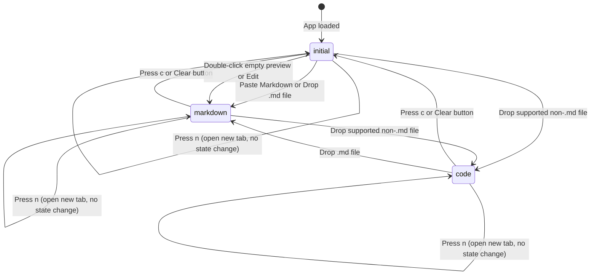

任意の状態から `.md` ドロップで `markdown` へ (ペーストによる自動描画は初期状態のみ)、非`.md` ファイルドロップで `code` へ遷移可能。ただし、BINARY_EXTENSIONS に該当する拡張子、または未知の拡張子で先頭8KBにヌルバイトを含むファイルはアラートで拒否し、状態遷移は発生しない (INV-18)。

**テーマステート:**

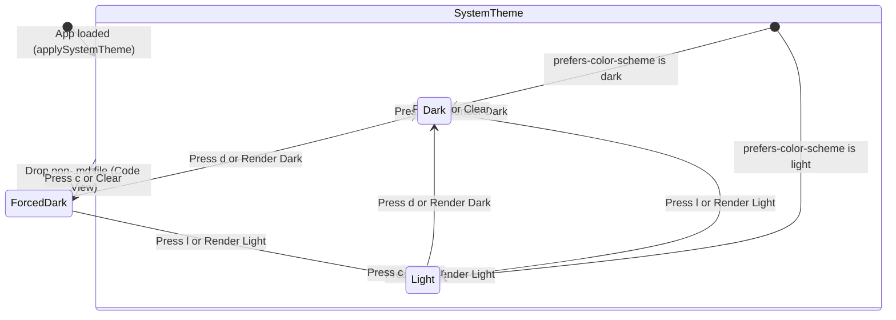

**11-b 状態遷移表の形式**

以下の表は、レビュー規約 B の R4.4 に従い、**行を出来事、列を今の状態** とする。交点には「→ 次の状態 [ガード] / 処理」を書き、変化しない交点は `—` とする。図は表のすべての遷移 (`—` 以外) を載せる。

**11-c ブロック編集の状態機械**

定義の名前は `blockEditStateMachine`、今の状態を持つ変数は `blockEditState` (`BlockEditController` が持つ)。状態: `browsingPreview` (編集モードでない)、`editModeIdle` (編集モード、編集欄なし)、`editingBlock` (編集モード、編集欄あり)、`editingCell` (編集モード、表のセルを編集中。INV-62)。

**Block edit state machine (図。表のすべての `—` 以外の遷移):**

```mermaid
stateDiagram-v2
    [*] --> browsingPreview : appStarted
    browsingPreview --> editModeIdle : paletteShown
    browsingPreview --> editingBlock : emptyDocumentStarted
    browsingPreview --> browsingPreview : fullRenderRequested
    browsingPreview --> editModeIdle : previewDoubleClicked if hasUnrenderedEditor
    browsingPreview --> editingCell : previewDoubleClicked if isCellTarget and isCellEditableTable
    browsingPreview --> editingBlock : previewDoubleClicked if isCellTarget
    browsingPreview --> editingBlock : previewDoubleClicked if isEmptyDocument
    browsingPreview --> editingBlock : previewDoubleClicked if isBlockTarget
    browsingPreview --> editModeIdle : previewDoubleClicked else
    editModeIdle --> browsingPreview : paletteHidden
    editModeIdle --> editingBlock : emptyDocumentStarted
    editModeIdle --> editingBlock : blockTapped
    editModeIdle --> editModeIdle : blockTappedWithUnrenderedEditor
    editModeIdle --> editingCell : cellTapped if isCellEditableTable
    editModeIdle --> editingBlock : cellTapped else
    editModeIdle --> editModeIdle : cellTappedWithUnrenderedEditor
    editModeIdle --> editingBlock : tableSourceTapped
    editModeIdle --> editModeIdle : tableSourceTappedWithUnrenderedEditor
    editModeIdle --> browsingPreview : escapePressed
    editModeIdle --> editModeIdle : undoRequested
    editModeIdle --> browsingPreview : documentCleared
    editModeIdle --> browsingPreview : viewSwitchedToCode
    editModeIdle --> editModeIdle : fullRenderRequested
    editingBlock --> browsingPreview : paletteHidden
    editingBlock --> editingBlock : otherBlockTapped
    editingBlock --> editingCell : cellTapped if isCellEditableTable
    editingBlock --> editingBlock : cellTapped else
    editingBlock --> editingBlock : tableSourceTapped
    editingBlock --> editModeIdle : pointerPressedOutside
    editingBlock --> editModeIdle : escapePressed if isImeIdle
    editingBlock --> editModeIdle : undoRequested if hasUncommittedChange
    editingBlock --> editModeIdle : undoRequested else
    editingBlock --> editModeIdle : saveRequested
    editingBlock --> editModeIdle : saveAsRequested
    editingBlock --> editModeIdle : documentReplaced
    editingBlock --> browsingPreview : documentCleared
    editingBlock --> browsingPreview : viewSwitchedToCode
    editingBlock --> editModeIdle : fullRenderRequested
    editingBlock --> editModeIdle : editorFocused
    editingCell --> browsingPreview : paletteHidden
    editingCell --> editingBlock : otherBlockTapped
    editingCell --> editingCell : cellTapped if isInSessionTable and canKeepTableId
    editingCell --> editModeIdle : cellTapped if isInSessionTable
    editingCell --> editingCell : cellTapped if isCellEditableTable
    editingCell --> editingBlock : cellTapped else
    editingCell --> editingBlock : tableSourceTapped
    editingCell --> editingCell : nextCellRequested if hasNextCell and canKeepTableId
    editingCell --> editModeIdle : nextCellRequested if hasNextCell
    editingCell --> editingCell : previousCellRequested if hasPreviousCell and canKeepTableId
    editingCell --> editModeIdle : previousCellRequested if hasPreviousCell
    editingCell --> editingCell : cellBelowRequested if hasCellBelow and canKeepTableId
    editingCell --> editModeIdle : cellBelowRequested if hasCellBelow
    editingCell --> editModeIdle : cellBelowRequested else
    editingCell --> editingCell : tableOperationRequested if canApplyTableOperation and canKeepTableId
    editingCell --> editModeIdle : tableOperationRequested if canApplyTableOperation
    editingCell --> editModeIdle : pointerPressedOutside
    editingCell --> editModeIdle : escapePressed if isImeIdle
    editingCell --> editModeIdle : undoRequested if hasUncommittedChange
    editingCell --> editModeIdle : undoRequested else
    editingCell --> editModeIdle : saveRequested
    editingCell --> editModeIdle : saveAsRequested
    editingCell --> editModeIdle : documentReplaced
    editingCell --> browsingPreview : documentCleared
    editingCell --> browsingPreview : viewSwitchedToCode
    editingCell --> editModeIdle : fullRenderRequested
    editingCell --> editModeIdle : editorFocused
```

| 出来事 \ 今の状態 | browsingPreview | editModeIdle | editingBlock | editingCell |
| --- | --- | --- | --- | --- |
| paletteShown | → editModeIdle | — | — | — |
| paletteHidden | — | → browsingPreview | → browsingPreview / commitBlock | → browsingPreview / commitCell, endTableSession |
| emptyDocumentStarted | → editingBlock / startEmptyDocument, showPalette, openBlockEditor | → editingBlock / startEmptyDocument, openBlockEditor | — | — |
| blockTapped | — (既存の閲覧操作) | → editingBlock / openBlockEditor | — | — |
| blockTappedWithUnrenderedEditor | — | → editModeIdle / renderFromEditor, showToast (INV-45) | — | — |
| otherBlockTapped | — | — | → editingBlock / commitBlock, resolveBlockById, openBlockEditor | → editingBlock / commitCell, endTableSession, resolveBlockById, openBlockEditor |
| cellTapped (INV-29 (a)) | — | [isCellEditableTable] → editingCell / startTableSession, openCell・[else] → editingBlock / openTableSourceWithToast | [isCellEditableTable] → editingCell / commitBlock, resolveBlockById, startTableSession, openCell・[else] → editingBlock / commitBlock, resolveBlockById, openTableSourceWithToast | [isInSessionTable かつ canKeepTableId] → editingCell / commitCell, openCell・[isInSessionTable] → editModeIdle / commitCell, endTableSession, showTableEditEndedToast・[isCellEditableTable] → editingCell / commitCell, endTableSession, resolveBlockById, startTableSession, openCell・[else] → editingBlock / commitCell, endTableSession, resolveBlockById, openTableSourceWithToast |
| cellTappedWithUnrenderedEditor | — | → editModeIdle / renderFromEditor, showToast (INV-45) | — | — |
| tableSourceTapped (INV-29 (b)、表のつまみ) | — | → editingBlock / openBlockEditor | → editingBlock / commitBlock, resolveBlockById, openBlockEditor | → editingBlock / commitCell, endTableSession, resolveBlockById, openBlockEditor |
| tableSourceTappedWithUnrenderedEditor | — | → editModeIdle / renderFromEditor, showToast (INV-45) | — | — |
| nextCellRequested (Tab、INV-64) | — | — | — | [hasNextCell かつ canKeepTableId] → editingCell / commitCell, moveToCell, openCell・[hasNextCell] → editModeIdle / commitCell, endTableSession, showTableEditEndedToast |
| previousCellRequested (Shift+Tab) | — | — | — | [hasPreviousCell かつ canKeepTableId] → editingCell / commitCell, moveToCell, openCell・[hasPreviousCell] → editModeIdle / commitCell, endTableSession, showTableEditEndedToast |
| cellBelowRequested (Enter) | — | — | — | [hasCellBelow かつ canKeepTableId] → editingCell / commitCell, moveToCell, openCell・[hasCellBelow] → editModeIdle / commitCell, endTableSession, showTableEditEndedToast・[else] → editModeIdle / commitCell, endTableSession |
| tableOperationRequested (INV-65) | — | — | — | [canApplyTableOperation かつ canKeepTableId] → editingCell / commitCell, applyTableOperation, openCell・[canApplyTableOperation] → editModeIdle / commitCell, applyTableOperation, endTableSession, showTableEditEndedToast |
| pointerPressedOutside | — | — | → editModeIdle / commitBlock | → editModeIdle / commitCell, endTableSession |
| escapePressed | — | → browsingPreview [`#editor` にフォーカスが無い] / hidePalette (5.11、INV-53。`#editor` にフォーカスがある場合は INV-14 のガードで届かない) | → editModeIdle [isImeIdle] / restoreOriginalRaw | → editModeIdle [isImeIdle] / revertCell, endTableSession |
| saveRequested | — | — | → editModeIdle / commitBlock | → editModeIdle / commitCell, endTableSession |
| saveAsRequested | — | — | → editModeIdle / commitBlock | → editModeIdle / commitCell, endTableSession |
| documentReplaced (Reload、`.md` ドロップ) | — | — | → editModeIdle / discardBlockEditor | → editModeIdle / discardCell, endTableSession |
| documentCleared | — | → browsingPreview / hidePalette | → browsingPreview / discardBlockEditor, hidePalette | → browsingPreview / discardCell, endTableSession, hidePalette |
| viewSwitchedToCode | — | → browsingPreview / hidePalette | → browsingPreview / discardBlockEditor, hidePalette | → browsingPreview / discardCell, endTableSession, hidePalette |
| fullRenderRequested (`#editor` からの全体描画: [Render Light] / [Render Dark] / `l` / `d`。テーマの切り替えを含む) | → browsingPreview / enqueueFullRender | → editModeIdle / enqueueFullRender | → editModeIdle / commitBlock, enqueueFullRender (INV-47、5.7 (3)) | → editModeIdle / commitCell, endTableSession, enqueueFullRender |
| editorFocused (`#editor` の `focusin`。キーボードによるフォーカスの移動を含む) | — | — | → editModeIdle / commitBlock (5.7 (5)。マウスでは先に pointerPressedOutside で確定しているので、この交点に来るのはキーボードの場合だけ) | → editModeIdle / commitCell, endTableSession |
| undoRequested (パレットの Undo、INV-59 (c) の Ctrl+Z) | — | → editModeIdle / undoLastUnit | [hasUncommittedChange] → editModeIdle / restoreOriginalRaw・[else] → editModeIdle / commitBlock, undoLastUnit | [hasUncommittedChange] → editModeIdle / revertCell, endTableSession・[else] → editModeIdle / commitCell, endTableSession, undoLastUnit |
| previewDoubleClicked (INV-57) | [hasUnrenderedEditor] → editModeIdle / clearSelection, showPalette, renderFromEditor, showToast・[isCellTarget かつ isCellEditableTable] → editingCell / clearSelection, showPalette, startTableSession, openCell・[isCellTarget] → editingBlock / clearSelection, showPalette, openTableSourceWithToast (表がセルの編集の条件を満たさない。クリックと同じ。オーナーの裁定 Q-c)・[isEmptyDocument] → editingBlock / clearSelection, showPalette, openBlockEditor・[isBlockTarget] → editingBlock / clearSelection, showPalette, openBlockEditor・[else] → editModeIdle / clearSelection, showPalette | — | — | — |

ガードは上から順に評価する (`・` で区切った順)。「A かつ B」は両方が真のとき (定義では `"A&&B"` と書き、図では `if A and B`)。ガードの無い交点の「ガードに外れた場合」は `—` (何もしない)。ガード (すべて `is` / `has` / `can` で始める): `isImeIdle` (IME の変換中でない。ブロック編集欄とセルの両方)、`hasUncommittedChange` (開いている編集欄・セルの内容が開いた時点と異なる。INV-62 の変更の判定)、`hasUnrenderedEditor` (`#editor` に未描画の変更がある。INV-45)、`isEmptyDocument` / `isBlockTarget` / `isCellTarget` (INV-57 の対象の分類。`BlockEditController.doubleClickTarget(event)` が `{kind: "empty"}` / `{kind: "block", id}` / `{kind: "cell", id, row, col, caret}` / `{kind: "none"}` を返し (表のブロックの余白とつまみは `{kind: "none"}`)、プレビューのスクロールバーでの押下 (`offsetX` / `offsetY` が `clientWidth` / `clientHeight` を超える。INV-30 の判定と同じ)、除外対象と図の内側では `null` を返して出来事を起こさない)、`isCellEditableTable` (押したセルの表が INV-62 の構造の確認の (1) を満たす。セルごとの描画の確認 (2) は `openCell` の中で行い、合わなければ原文のセルとして開く (遷移は変わらない))、`isInSessionTable` (押したセルが、今の表の編集の表のもの)、`canKeepTableId` (この交点で行うすべての確定 (開いているセルの確定と、INV-65 の操作の確定。確定が無い場合は真) の後で、表のブロック ID を引き継げる。`tableOperationRequested` では、セルの確定の後のモデルに操作を適用した最終の原文で `MarkdownBlockModel.planTableReplace` を求め、2 回の確定のどちらかで引き継げなければ偽。INV-42 / 62)、`hasNextCell` / `hasPreviousCell` / `hasCellBelow` (INV-64 の移動先がある)、`canApplyTableOperation` (INV-65 の制限 D2 を満たす)。処理 `undoLastUnit` は、INV-45 の分岐を含む (`#editor` に未描画の変更があれば `renderFromEditor`、無ければ `RendererOrchestrator.undoLastCommit()`)。`clearSelection` は、ダブルクリックでブラウザが作った選択を解除する。表の処理: `startTableSession` (表のブロックの保持を始める。INV-47) / `endTableSession` (保持を解く) / `openCell` (INV-62) / `commitCell` (変わっていれば確定、変わっていなければ退避した子要素を戻す) / `revertCell` (退避した子要素を戻す) / `discardCell` (確定せずに捨てる) / `moveToCell` (INV-64 の移動先。開いているセルを閉じる前に求める) / `applyTableOperation` (INV-65) / `openTableSourceWithToast` (表の原文の編集欄を開き、トースト `messages.edit.tableNotCellEditable`) / `showTableEditEndedToast` (ID を引き継げずに表の編集を終えたことを知らせる。`messages.edit.tableEditEnded`)。

注: `documentReplaced` / `documentCleared` は、INV-21 の確認で OK が選ばれた後にだけ起きる。`fullRenderRequested` は未保存の確認を出さない (INV-45)。`#editor` が空で本文が空でない場合は、INV-56 の確認で OK が選ばれた後にだけ `fullRenderRequested` が起きる (Cancel なら出来事は起きない)。`renderFromEditor` も、INV-56 の確認で Cancel なら `#editor` を本文に戻すだけで、全体描画もトーストも行わない (editModeIdle のまま)。編集欄を開いたまま、Tab または Shift+Tab などでフォーカスを編集欄の外 (本体) へ移した場合も (Tab はパレットへ移らない。INV-53)、キーは document に届く。そのときの `l` / `d` / [Render] (キーボードでの押下を含む) は `fullRenderRequested`、`e` は `paletteHidden`、`r` / `c` / ドロップは INV-21 の確認を経て `documentReplaced` / `documentCleared` / `viewSwitchedToCode` になる (裁定 T1)。本体にフォーカスがある間の Esc は、5.11 の「ブロック編集中」の列のとおり `escapePressed` (編集の取消) になる。`#editor` にフォーカスが入ると `editorFocused` で確定する (裁定 T19)。`emptyDocumentStarted` は INV-31。`blockTapped` と `blockTappedWithUnrenderedEditor` は、開始ジェスチャ (INV-29) の時点で `_editorChangedSinceRender` が偽か真かで分かれる。`cellTapped` / `cellTappedWithUnrenderedEditor`、`tableSourceTapped` / `tableSourceTappedWithUnrenderedEditor`、`previewDoubleClicked` の [hasUnrenderedEditor] も同じ。`#editor` に入力するとフォーカスで `editorFocused` が起きて editModeIdle になるので、`…WithUnrenderedEditor` は editModeIdle の列でだけ起きる。INV-56 の確認は `renderFromEditor` に含まれる。表のブロックの余白の押下は、編集中 (editingBlock / editingCell) なら `pointerPressedOutside`、editModeIdle なら何も起こさない (W6 / M1)。`pointerPressedOutside` は、マウスでは `pointerdown`、タッチとペンでは移動の少ない `pointerup` で起きる (INV-30)。editingCell では、表の編集の対象の `table` 要素の内側の押下は外側としない (同じ表の別のセルは `pointerup` で `cellTapped`。開いているセルの中の押下は何も起こさない)。Undo (パレットの Undo、INV-59 の (c) の Ctrl+Z) は `undoRequested` としてこの表を通す。browsingPreview では起きない (パレットが無く、Ctrl+Z は横取りしない。裁定 Q3)。editingBlock の [hasUncommittedChange] の交点は、パレットの Undo か、編集欄の外にフォーカスがあるときの Ctrl+Z から起きる (編集欄の中の Ctrl+Z はブラウザの文字単位の Undo。INV-59 の (b))。editingCell では、セルの中の Ctrl+Z も単位の Undo (INV-59 の (c))。`previewDoubleClicked` は browsingPreview の列にだけ交点がある (編集モードのダブルクリックは開始ジェスチャ 2 回)。`#editor` に未描画の変更があるときの Undo と挿入は、INV-45 により `fullRenderRequested` と同じ全体描画 (editModeIdle の自己遷移) になる。`commitBlock` と `commitCell` は同期でモデルを更新する (INV-47)。ID を引き継げるかは、確定の前にガード `canKeepTableId` で決める (`planTableReplace` の結果を `commitCell` / `applyTableOperation` が使い回す)。引き継げない枝の `commitCell` と `applyTableOperation` は、モデルの確定 (同期) だけを行い、INV-47 の例外の同期の描き直し (`writeHeldInterior`) をしない (ID が変わると保持の条件を外れるため)。DOM は、続く `endTableSession` で保持を解いた後の、キューの部分描画で更新される。引き継げない場合の行き先は表の交点 (editModeIdle、`showTableEditEndedToast`) で決まり、表の外で状態を変える経路は無い。editingCell から表の編集を終える他の交点 (外側の押下・保存など) は、引き継げるかによらず表の編集を終えるので、このガードを持たない。`openCell` でセルが開かなかった場合 (セルの要素が無い場合など) は、表の編集を終えて editModeIdle になる。ポップオーバーを開いている間の Esc は 11-f で処理し、この表の `escapePressed` は起きない (INV-53)。

通知の契約: 編集欄・セルを閉じる処理 (`commitBlock`、`restoreOriginalRaw`、`discardBlockEditor`、`commitCell`、`revertCell`、`discardCell`、`endTableSession`) は、`dispatch` の処理の途中で `BlockEditHost.onEditStateChanged()` と、確定でモデルが変わった場合の `onModelChanged` を呼ぶ。これらの通知は、`blockEditState` を表の次の状態に更新する **前** に出る。通知の受け手は `blockEditState` を読まず、編集欄・セルが開いているかどうか (`isEditing()`。編集欄・セルを閉じた時点で偽になる。セルはその確定のモデルの更新より前に閉じる) だけを読むこと。パレットのボタンの状態 (5.15.5) は、`dispatch` の途中 (`BlockEditController.isInTransition()` が真。`dispatch` の中の `dispatch` を含む) では更新せず、いちばん外側の `dispatch` の終わりに `BlockEditHost.onTransitionEnded()` で 1 回だけ更新する (未保存の印と状態の文字は途中でも更新する)。セルを閉じてから次のセルを開くまでの間の状態で開き手を無効と判定して、開いているポップオーバーを閉じないためである (11-f の `openerDisabled` は、遷移の後の状態で判定する)。

実装では、この表を `blockEditStateMachine` というデータとして持ち、出来事の入口 (`BlockEditController.dispatch`) が表を引いて動く。表の `enqueueFullRender` は、`dispatch` が戻った後で呼び出し側 (UIController) が行い、`showToast` は `renderFromEditor` に含まれる。`emptyDocumentStarted` は、全体描画が終わるまで editModeIdle に留まり、空の最初のブロックの編集欄を開いた時点で editingBlock になる。UI から到達しない交点 (例: editModeIdle × emptyDocumentStarted) も、`dispatch` を直接呼べば表のとおりに動く。

**11-d パレットのジェスチャの状態機械**

定義の名前は `paletteGestureStateMachine`、今の状態を持つ変数は `paletteGestureState` (`EditPalette` が持つ)。状態: `idle` / `pressingButton` / `pressingGrip` / `draggingPalette` / `longPressHandled`。

**Palette gesture state machine:**

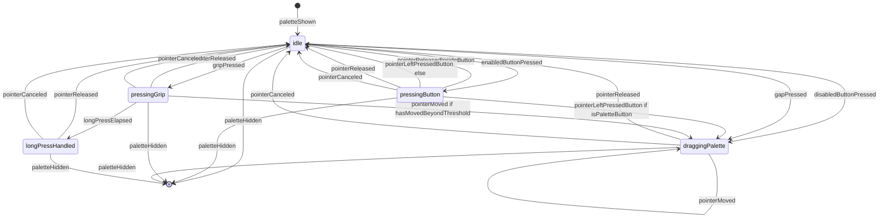

| 出来事 \ 今の状態 | idle | pressingButton | pressingGrip | draggingPalette | longPressHandled |
| --- | --- | --- | --- | --- | --- |
| enabledButtonPressed | → pressingButton / capturePointer | — | — | — | — |
| disabledButtonPressed (パレット本体) | → draggingPalette / capturePointer, rememberOffset | — | — | — | — |
| disabledPopoverButtonPressed | — (何もしない。INV-34) | — | — | — | — |
| gripPressed | → pressingGrip / capturePointer, rememberOffset, startLongPressTimer | — | — | — | — |
| gapPressed (パレット本体の隙間・枠) | → draggingPalette / capturePointer, rememberOffset | — | — | — | — |
| popoverGapPressed | — | — | — | — | — |
| pointerMoved | — | — (押したボタンの内側) | [hasMovedBeyondThreshold] → draggingPalette / cancelLongPressTimer, movePaletteClamped | → draggingPalette / movePaletteClamped | — |
| longPressElapsed | — | — | → longPressHandled / requestMinimizeToggle (11-f の minimizeToggled) | — | — |
| pointerLeftPressedButton | — | [isPaletteButton] → draggingPalette / rememberOffset・[else] → idle / releasePointer (ポップオーバーのボタンからずれたら機能を実行せず、ポインタの capture を解く) | — | — | — |
| pointerReleasedInsideButton | — | → idle / runButtonCommand | — | — | — |
| pointerReleased (押したボタンの矩形の外で離した、など) | — | → idle (機能は実行しない。INV-34) | → idle / cancelLongPressTimer | → idle | → idle |
| pointerCanceled | — | → idle | → idle / cancelLongPressTimer | → idle | → idle |
| paletteHidden | → (終了) / releaseListeners | → (終了) / releasePointer, releaseListeners | → (終了) / cancelLongPressTimer, releasePointer, releaseListeners | → (終了) / releasePointer, releaseListeners | → (終了) / releasePointer, releaseListeners |

ガードは上から順に評価する (`・` で区切った順)。`hasMovedBeyondThreshold` は、押した位置からの移動が `CONFIG.pan.activationThresholdPx` を超えたこと。`isPaletteButton` は、押したボタンがパレット本体のボタン (ポップオーバーのボタンでない) であること。`pointerLeftPressedButton` は、`pointermove` の座標が押したボタンの矩形の外に出たときに起きる (pointer capture 中は `pointerleave` に頼らない)。機能を実行するのは `pointerReleasedInsideButton` の遷移だけである (INV-34)。`longPressElapsed` は `startLongPressTimer` の時間 (`CONFIG.edit.paletteLongPressMs`) が来たときに起き、11-f の `minimizeToggled` を起こす (2 つの状態機械の間は出来事で結ぶ)。長押しのタイマーは、移動の開始・`pointercancel`・離す・`hide()` で止める。

実装では、この表を `paletteGestureStateMachine` というデータとして持つ。paletteHidden の行き先「(終了)」は、定義では `[*]` とし、`hide()` の後は次の `show()` に備えて idle に戻る。ポップオーバーのボタンも同じ表で動くが、押したボタンの外へずらしても、パレットは移動しない (INV-35。`pointerLeftPressedButton` の [else])。`releaseListeners` は、`show()` で登録した document と window のリスナー (11-f の分を含む) をすべて外す。

**11-e 保存処理の状態機械**

「未保存」は状態機械ではなく **導出値** とする (用語集。`UIController._isDocumentDirty()` = `session.isBodyChanged(orchestrator.getBody()) || blockEdit.hasUncommittedChange() || this._editorChangedSinceRender`)。状態変数を持たないので、未保存の印は「本文または編集欄が変わりうる時点」(確定、Undo、挿入、編集欄の `input`、`#editor` の `input`、全体描画、読み込み、保存の成功) で再計算する (INV-50)。

保存の処理中かどうかだけを状態機械にする。定義の名前は `saveOperationStateMachine`、今の状態を持つ変数は `saveOperationState` (`UIController` が持つ)。

**Save operation state machine:**

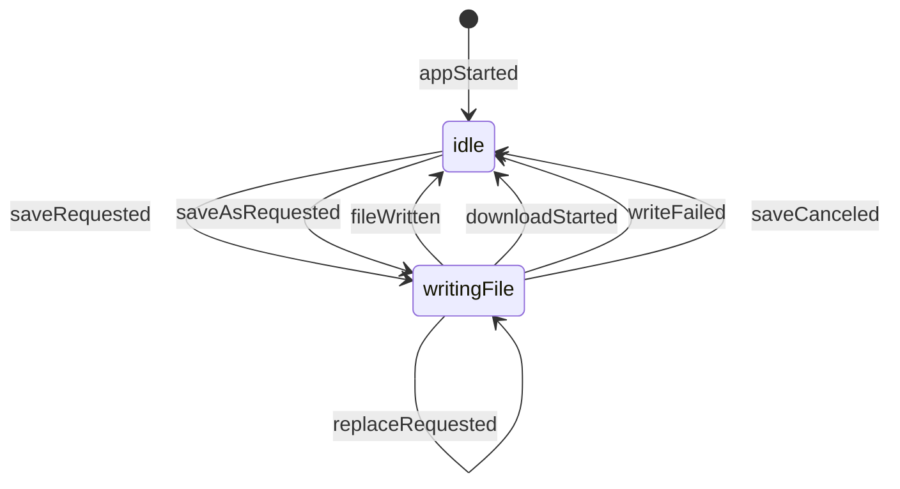

| 出来事 \ 今の状態 | idle | writingFile |
| --- | --- | --- |
| saveRequested | → writingFile / startPermissionRequest, commitOpenBlock, applyEditorText, runSaveDocument | — (無視する。二重保存の防止) |
| saveAsRequested | → writingFile / startSavePicker, commitOpenBlock, applyEditorText, runSaveDocumentAs | — (無視する) |
| fileWritten | — | → idle / applyOutcomeIfSameDocument, refreshDirtyMark, showSavedToast (トーストは文書 ID によらず出す) |
| downloadStarted | — | → idle / showDownloadStartedToast (基準は更新しない。INV-26) |
| writeFailed | — | → idle / showErrorToast |
| saveCanceled | — | → idle |
| replaceRequested (5.14.11 で文書を作り直す出来事。テーマの切り替えは含まない) | — (この状態機械は関与しない。INV-21 / INV-55 で処理する) | → writingFile / rejectReplace, showSavingToast (INV-54) |

`saveRequested` / `saveAsRequested` は、`#editor` を取り込む場合 (`applyEditorText` が要る場合) に INV-56 の確認が要るなら、OK が選ばれた後にだけ起きる (Cancel なら `#editor` を本文に戻すだけで idle のまま、権限の要求も保存ダイアログも始めない。確認は同期なので、(1) の開始は最初の `await` より前のままである。INV-33)。writingFile の間の押下は、確認を出さずに無視する。`applyOutcomeIfSameDocument` は、`SaveOutcome.documentId` が現在の `DocumentSession.documentId` と一致するときだけ、セッションと保存先を置き換え、未保存の印を再計算する (INV-54)。保存のトースト (`messages.edit.saved`) は、別の文書の結果でも出す。ファイルは実際に書かれたので、それを知らせない方が利用者を惑わせるためである。実装では、この表を `saveOperationStateMachine` というデータとして持つ。

**11-f パレットの表示とポップオーバーの状態機械**

定義の名前は `paletteDisplayStateMachine`、今の状態を持つ変数は `paletteDisplayState` (`EditPalette` が持つ)。表示の状態とポップオーバーを 1 つの列挙にする (最小化中と非表示ではポップオーバーは開かない)。状態: `hidden` / `expanded` (ポップオーバーなし) / `mermaidMenuOpen` / `formatMenuOpen` / `tableMenuOpen` / `minimized`。

**Palette display state machine:**

```mermaid
stateDiagram-v2
    [*] --> hidden : appStarted
    hidden --> expanded : paletteShown
    expanded --> hidden : paletteHidden
    mermaidMenuOpen --> hidden : paletteHidden
    formatMenuOpen --> hidden : paletteHidden
    tableMenuOpen --> hidden : paletteHidden
    minimized --> hidden : paletteHidden
    expanded --> minimized : minimizeToggled
    mermaidMenuOpen --> minimized : minimizeToggled
    formatMenuOpen --> minimized : minimizeToggled
    tableMenuOpen --> minimized : minimizeToggled
    minimized --> expanded : minimizeToggled
    expanded --> mermaidMenuOpen : mermaidButtonRun
    mermaidMenuOpen --> expanded : mermaidButtonRun
    formatMenuOpen --> mermaidMenuOpen : mermaidButtonRun
    tableMenuOpen --> mermaidMenuOpen : mermaidButtonRun
    expanded --> formatMenuOpen : formatButtonRun
    mermaidMenuOpen --> formatMenuOpen : formatButtonRun
    formatMenuOpen --> expanded : formatButtonRun
    tableMenuOpen --> formatMenuOpen : formatButtonRun
    expanded --> tableMenuOpen : tableOptionsButtonRun
    mermaidMenuOpen --> tableMenuOpen : tableOptionsButtonRun
    formatMenuOpen --> tableMenuOpen : tableOptionsButtonRun
    tableMenuOpen --> expanded : tableOptionsButtonRun
    mermaidMenuOpen --> expanded : popoverItemRun
    formatMenuOpen --> expanded : popoverItemRun
    tableMenuOpen --> expanded : popoverItemRun
    mermaidMenuOpen --> expanded : popoverEscapePressed
    formatMenuOpen --> expanded : popoverEscapePressed
    tableMenuOpen --> expanded : popoverEscapePressed
    mermaidMenuOpen --> expanded : pointerPressedOutsidePalette
    formatMenuOpen --> expanded : pointerPressedOutsidePalette
    tableMenuOpen --> expanded : pointerPressedOutsidePalette
    mermaidMenuOpen --> expanded : openerDisabled
    formatMenuOpen --> expanded : openerDisabled
    tableMenuOpen --> expanded : openerDisabled
    expanded --> expanded : viewportResized
    mermaidMenuOpen --> mermaidMenuOpen : viewportResized
    formatMenuOpen --> formatMenuOpen : viewportResized
    tableMenuOpen --> tableMenuOpen : viewportResized
    minimized --> minimized : viewportResized
```

| 出来事 \ 今の状態 | hidden | expanded | mermaidMenuOpen | formatMenuOpen | tableMenuOpen | minimized |
| --- | --- | --- | --- | --- | --- | --- |
| paletteShown | → expanded / placeAtBottomRight | — | — | — | — | — |
| paletteHidden | — | → hidden | → hidden / closePopover | → hidden / closePopover | → hidden / closePopover | → hidden / restoreExpandedLayout |
| minimizeToggled | — | → minimized / keepGripPosition | → minimized / closePopover, keepGripPosition | → minimized / closePopover, keepGripPosition | → minimized / closePopover, keepGripPosition | → expanded / keepGripPosition, clampIntoViewport |
| mermaidButtonRun | — | → mermaidMenuOpen / openPopover | → expanded / closePopover | → mermaidMenuOpen / closePopover, openPopover | → mermaidMenuOpen / closePopover, openPopover | — |
| formatButtonRun | — | → formatMenuOpen / openPopover | → formatMenuOpen / closePopover, openPopover | → expanded / closePopover | → formatMenuOpen / closePopover, openPopover | — |
| tableOptionsButtonRun | — | → tableMenuOpen / openPopover | → tableMenuOpen / closePopover, openPopover | → tableMenuOpen / closePopover, openPopover | → expanded / closePopover | — |
| popoverItemRun | — | — | → expanded / closePopover, runItemCommand | → expanded / closePopover, runItemCommand | → expanded / closePopover, runItemCommand | — |
| popoverEscapePressed | — | — | → expanded / closePopover | → expanded / closePopover | → expanded / closePopover | — |
| pointerPressedOutsidePalette | — | — | → expanded / closePopover | → expanded / closePopover | → expanded / closePopover | — |
| openerDisabled (開いているポップオーバーの開き手のボタンが無効になった) | — | — | → expanded / closePopover | → expanded / closePopover | → expanded / closePopover | — |
| viewportResized | — | → expanded / clampIntoViewport | → mermaidMenuOpen / clampIntoViewport, placePopover | → formatMenuOpen / clampIntoViewport, placePopover | → tableMenuOpen / clampIntoViewport, placePopover | → minimized / clampIntoViewport |

注: `popoverEscapePressed` は INV-53 の Esc (document の capture。IME の変換中を除く)。`viewportResized` では、ポップオーバーを閉じずに、パレットとポップオーバーの位置を INV-37 のとおり補正する (スマートフォンのアドレスバーや画面のキーボードの出し入れで閉じないため)。`openerDisabled` は、例えば書式のポップオーバーを開いたまま Ctrl+S で編集欄が確定して閉じ、書式のボタン (編集中だけ有効。5.15.5) が無効になった場合や、Table options のポップオーバーを開いたまま、最後の行の Enter や Ctrl+S で表の編集が終わり、Table options のボタンが無効になった場合 (`setButtonStates` が起こす)。ポップオーバーの中の各ボタン (色・配置) の無効は、ポップオーバーを閉じない (押しても何もしない。INV-34)。`*ButtonRun` は開き手のボタン (Mermaid / Format / Table options) の 11-d の `runButtonCommand`、`popoverItemRun` はポップオーバーの中のボタンの `runButtonCommand` で起きる。`minimizeToggled` は 11-d の `longPressElapsed` で起きる。

表示は状態だけで決める: `hidden` ではパレットを隠し、`minimized` ではグリップだけを表示し (class `edit-palette-minimized`。`keepGripPosition` が付け外しする)、`*MenuOpen` ではその状態のポップオーバーだけを開く。`keepGripPosition` は、次の状態の配置 (最小化か、元の大きさか) に切り替え、その前と後でグリップの画面上の位置が同じになるようにパレットを動かす (ビューポートの中に収める。INV-37)。`restoreExpandedLayout` は、最小化の配置を外す (次に表示するときに元の大きさで出すため)。`closePopover` は前の状態のポップオーバーを、`openPopover` と `placePopover` は次の状態のポップオーバーを扱う。実装では、この表を `paletteDisplayStateMachine` というデータとして持つ。

### 3.4 シーケンス図

**Markdownペースト→レンダリングフロー:**

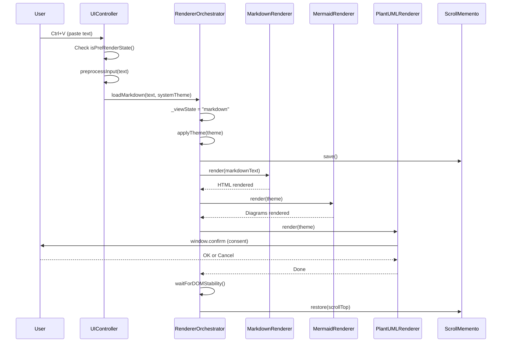

**コードビュー ファイルドロップフロー:**

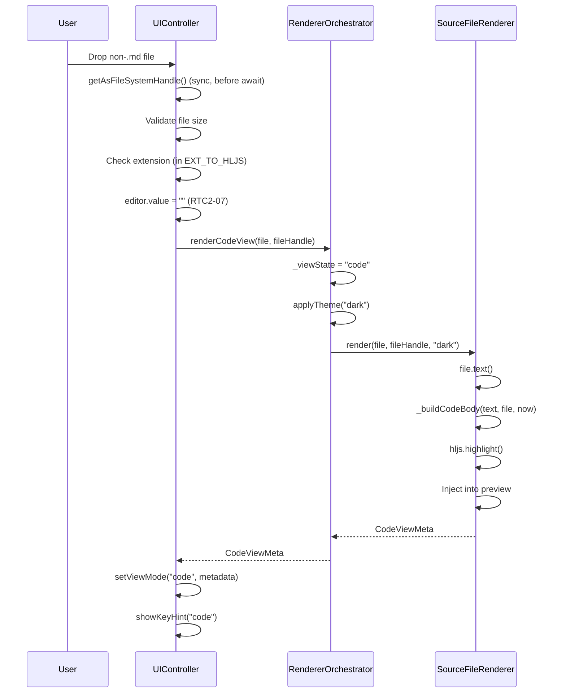

**コードビュー リロードフロー (l/dキー):**

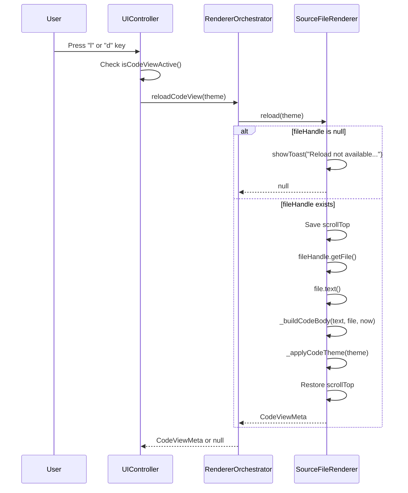

**完全レンダリングパイプライン（ボタンクリック）:**

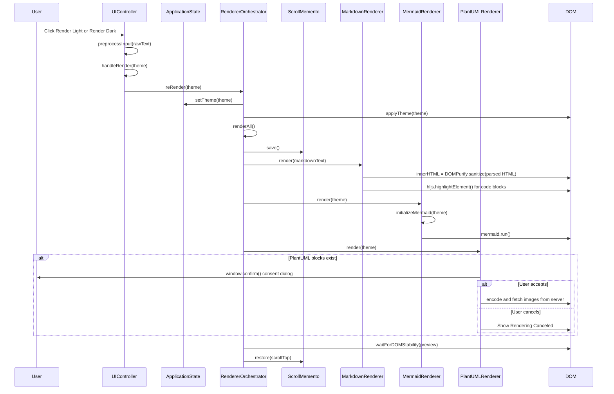

**Block commit and partial re-render:**

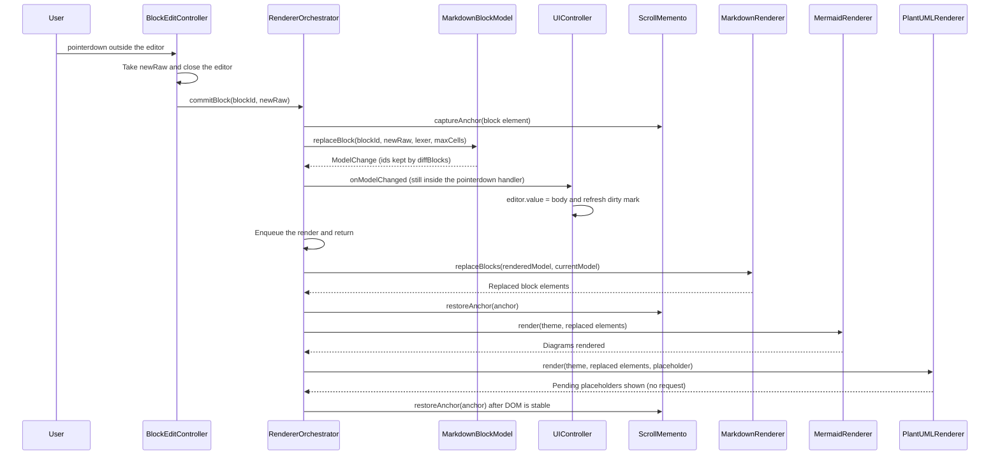

**Save with permission first and external change check:**

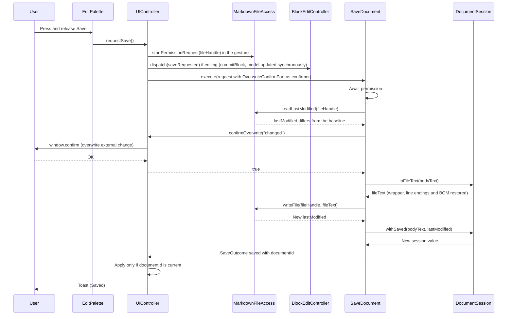

**Undo the last commit:**

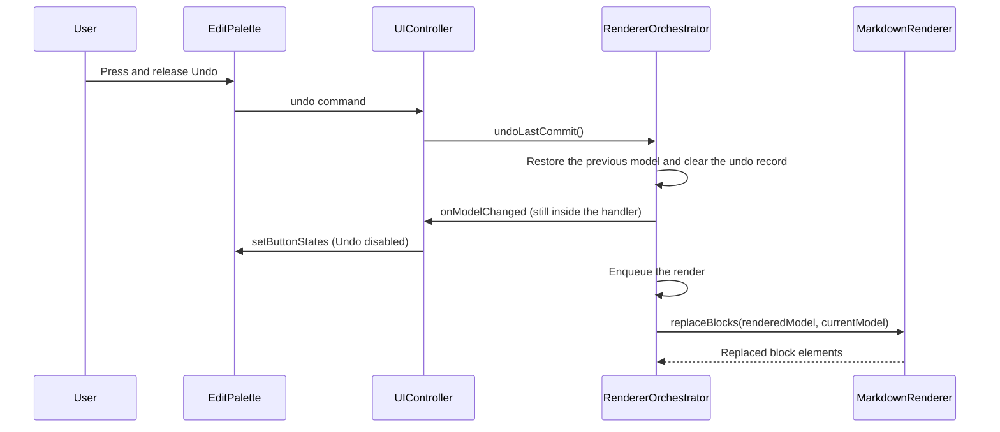

**Palette press turned into drag:**

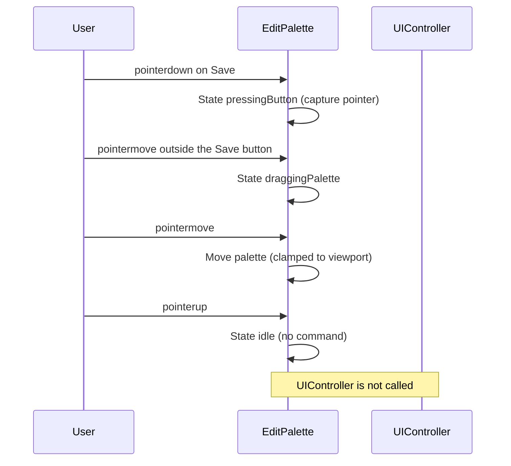

### 3.5 デバイス機能マトリクス

**デバイス検出と機能アクティベーション:**

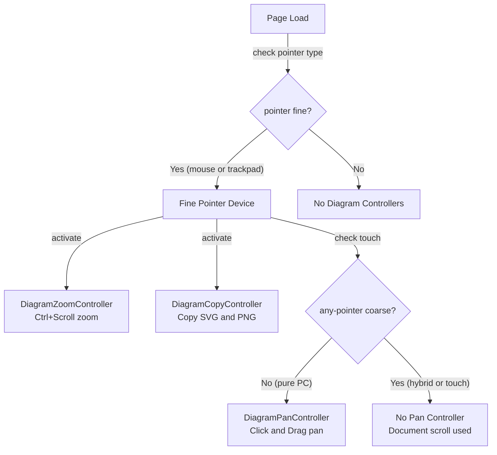

DiagramPanControllerは純粋なPC環境（fineポインターあり、かつcoarseポインターなし）でのみインスタンス化される。ハイブリッドデバイス（例: Surface）ではドキュメントスクロールとの競合を避けるためパンは無効化される。パンは、マウスのボタンを押している間だけ続く: `mouseup`・`pointerup`・`pointercancel` のどれか、またはボタンを押していない `mousemove` (`buttons` の左ボタンが 0) で終える (押した要素が DOM から外れると WebKit は `mouseup` を送らないため。図をクリックしてコードを開いた後に、マウスを動かすだけでプレビューが流れないこと。PRT-U20)。

**編集機能 (SC-22〜24) は全デバイスで有効。** 物理キーボードのないタッチ端末では、上部バーの [Edit] ボタン (`editBtn`) で編集モードに入る。パレットのジェスチャは Pointer Events で判定し、マウスとタッチで挙動を同じにする (INV-34 / INV-35)。タッチ端末では、空の初期状態でのダブルタップを `pointerup` 2 回の間隔と距離 (`CONFIG.edit.doubleTapMaxIntervalMs` / `doubleTapMaxDistancePx`) で判定する (INV-31)。プレビューには `touch-action: manipulation` を、パレットには `touch-action: none` を指定する **[要検証: iOS Safari]**。編集モードでは、図のブロックのクリックはコードを開く (図のダブルクリックによるズーム解除は、編集モードでない間に使う)。ドラッグによるパン (純粋な PC) は移動量が閾値を超えるので、編集の開始ジェスチャにはならない (INV-29)。上書き保存は Chrome / Edge のみで、そのほかはダウンロードにフォールバックする (INV-26)。

## 4. 機能シナリオ (Gherkin)

### FS-01: Markdownレンダリング

```gherkin
Feature: Markdownレンダリング
  ユーザーとして
  Markdownテキストをペーストまたはドロップしてプレビューしたい
  ダイアグラム、数式、シンタックスハイライト付きで表示するために

  Scenario: プレレンダー状態でMarkdownテキストをペースト
    Given アプリケーションがプレレンダー状態である
    And エディタのテキストエリアが空である
    When ユーザーがクリップボードにMarkdownテキストがある状態でCtrl+Vを押す
    Then エディタのテキストエリアにペーストされたテキストが入力される
    And プレビューエリアにMarkdownがレンダリングされる
    And テーマがOSのカラースキーム設定に一致する
    And _viewStateが "markdown" になる

  Scenario: .mdファイルをドロップ
    Given アプリケーションが任意の状態である
    When ユーザーが .md ファイルをページにドロップする
    Then ファイル内容が読み取られる
    And プレビューエリアにMarkdownがレンダリングされる
    And _viewStateが "markdown" になる

  Scenario: ダークテーマでMarkdownを再レンダリング
    Given Markdownがレンダリング済みである (_viewStateが "markdown")
    When ユーザーが "d" キーを押す
    Then Markdownがダークテーマで再レンダリングされる
    And スクロール位置が保持される

  Scenario: ライトテーマでMarkdownを再レンダリング
    Given Markdownがレンダリング済みである (_viewStateが "markdown")
    When ユーザーが "l" キーを押す
    Then Markdownがライトテーマで再レンダリングされる
    And スクロール位置が保持される

  Scenario: コードビュー中に.mdファイルをドロップ
    Given コードビューがアクティブである (_viewStateが "code")
    When ユーザーが .md ファイルをページにドロップする
    Then コードビューが破棄される
    And ファイル内容がMarkdownプレビューにレンダリングされる
    And _viewStateが "markdown" になる

  Scenario: Markdownプレビュー中に非.mdファイルをドロップ
    Given Markdownがレンダリング済みである (_viewStateが "markdown")
    When ユーザーがサポート対象の非.mdファイルをドロップする
    Then Markdownプレビューがクリアされる
    And ファイルがコードビューで表示される
    And _viewStateが "code" になる

  Scenario: ライトテーマでレンダリング
    Given ユーザーがMarkdownテキストをエディタにペーストしている
    When ユーザーが Render Light ボタンをクリックする
    Then body要素に "dark" クラスが付与されていない
    And Markdownがパースされプレビューエリアに表示される
    And コードブロックにシンタックスハイライトが適用される
    And Mermaidダイアグラムがレンダリングされる

  Scenario: ダークテーマでレンダリング
    Given ユーザーがMarkdownテキストをエディタにペーストしている
    When ユーザーが Render Dark ボタンをクリックする
    Then body要素に "dark" クラスが付与される
    And MermaidがダークテーマでMermaidを初期化する
    And PlantUMLコードに "!theme cyborg" が注入される (未指定の場合)

  Scenario: レンダリング済みの状態でペースト
    Given プレビューエリアにレンダリング済みコンテンツがある
    When ユーザーがページ上でテキストをペーストする
    Then ブラウザのデフォルトペースト動作が行われる
    And 自動レンダリングは発生しない
```

### FS-02: PlantUML同意フロー

```gherkin
Feature: PlantUML同意フロー
  ユーザーとして
  PlantUMLのレンダリング前に同意を求められたい
  プライバシーを保護するために

  Scenario: PlantUMLレンダリングに同意する
    Given MarkdownにPlantUMLコードブロックが含まれている
    When レンダリングパイプラインがPlantUMLフェーズに到達する
    Then セキュリティ警告付きの確認ダイアログが表示される
    When ユーザーがOKをクリックする
    Then 各PlantUMLブロックがエンコードされPlantUMLサーバーに送信される
    And 結果のSVG画像がコードブロックを置き換える

  Scenario: PlantUMLレンダリングをキャンセル
    Given MarkdownにPlantUMLコードブロックが含まれている
    When レンダリングパイプラインがPlantUMLフェーズに到達する
    And ユーザーが同意ダイアログでキャンセルをクリックする
    Then PlantUMLサーバーにデータは送信されない
    And 各PlantUMLコードブロックに "Rendering Canceled" が表示される
    And 他のMarkdownおよびMermaidコンテンツはレンダリング済みのまま維持される

  Scenario: PlantUML画像のタイムアウト
    Given ユーザーがPlantUMLレンダリングに同意した
    When PlantUML画像が5000ms以内にロードされない
    Then 画像が "PlantUML timeout (5s)" エラー要素で置き換えられる
```

### FS-03: Quick Code View

```gherkin
Feature: Quick Code View
  開発者として
  任意のテキストファイルをドロップしてシンタックスハイライト付きで表示したい
  行番号付きでソースコードを読むために

  Scenario: Pythonファイルをドロップ
    Given アプリケーションがプレレンダー状態である
    When ユーザーが .py ファイルをページにドロップする
    Then ファイルがコードビューで表示される
    And Python用のシンタックスハイライトが適用される
    And 行番号が表示される
    And #fileInfo にファイルメタデータが表示される
    And テーマがダークモードに強制される
    And setViewMode("code", metadata) が呼ばれ body.view-code が設定される
    And _viewStateが "code" になる

  Scenario: .txtファイルをドロップ
    Given アプリケーションが任意の状態である
    When ユーザーが .txt ファイルをページにドロップする
    Then ファイルがコードビューで表示される (Markdownプレビューではない)
    And コンテンツが行番号付きプレーンテキストとして表示される

  Scenario: 未知拡張子のテキストファイルをドロップ (INV-18 段階4-5)
    Given アプリケーションが任意の状態である
    When ユーザーがEXT_TO_HLJSに未登録の拡張子 ".env" のテキストファイルをドロップする
    Then 先頭8KBのnullバイト検査が実行される
    And nullバイトがないためコードビューでplaintext表示される

  Scenario: バイナリ拡張子のファイルをドロップ (INV-18 段階3)
    Given アプリケーションが任意の状態である
    When ユーザーが ".exe" ファイルをドロップする
    Then アラートに "This file appears to be binary and cannot be displayed." が表示される
    And ファイルは処理されない

  Scenario: 未知拡張子のバイナリファイルをドロップ (INV-18 段階4)
    Given アプリケーションが任意の状態である
    When ユーザーがEXT_TO_HLJSに未登録かつBINARY_EXTENSIONSにも未登録の拡張子のバイナリファイルをドロップする
    Then 先頭8KBのnullバイト検査でnullバイトが検出される
    And アラートに "This file appears to be binary and cannot be displayed." が表示される

  Scenario: 拡張子なしファイル (Dockerfile等) をドロップ
    Given アプリケーションが任意の状態である
    When ユーザーが "Dockerfile" をドロップする
    Then EXT_TO_HLJSのファイル名ルックアップで言語が解決される
    And ファイルがコードビューで表示される (hljs commonに含まれない言語はplaintext表示、highlightAutoは使わない)

  Scenario: 初回コードビュー読み込み時のキーボードヒント
    Given 非.mdファイルがドロップされた直後である
    When コードビューが表示される
    Then #keyHint にキーボードショートカットヒントが表示される
    And CONFIG.codeView.keyHintDurationMs 後にヒントがフェードアウトする
```

### FS-04: コードビューリロード

```gherkin
Feature: コードビューリロード
  外部でファイルを編集する開発者として
  再ドロップせずにGRSMDでファイルをリロードしたい
  最新の変更を確認するために

  Scenario: FileSystemFileHandleサポートありでリロード
    Given fileHandleを持つファイルでコードビューがアクティブである
    When ユーザーが "l" キーを押す
    Then fileHandle.getFile() 経由でファイルがディスクから再読み取りされる
    And コンテンツがライトテーマで再ハイライトされる
    And スクロール位置が保持される
    And CodeViewMeta が返され、UIController が #fileInfo を更新する

  Scenario: FileSystemFileHandleサポートなしでリロード
    Given コードビューがアクティブだがfileHandleがnullである
    When ユーザーが "d" キーを押す
    Then トーストに "Reload not available (Chrome/Edge 86+ required)" が表示される
    And トーストが3000ms後に消える
    And 現在のビューは変更されない
```

### FS-05: キーボードナビゲーション

```gherkin
Feature: キーボードナビゲーション
  ユーザーとして
  キーボードショートカットを使いたい
  マウスなしで効率的にナビゲートするために

  Scenario: Markdownプレビューでの下方向スムーススクロール
    Given Markdownがレンダリング済みである (_viewStateが "markdown")
    And フォーカスがINPUTまたはTEXTAREAにない
    When ユーザーがArrowDownキーを押し続ける
    Then ページが加速しながら下方向にスクロールする
    And キーが離されるとスクロールが摩擦で減速する
    And 速度が0.005 px/msを下回るとスクロールが停止する

  Scenario: コードビューでのスムーススクロール
    Given コードビューがアクティブである (_viewStateが "code")
    When ユーザーがArrowUpを押す
    Then ページが上方向にスムーズにスクロールする

  Scenario: プレレンダー状態での矢印キー
    Given _viewStateが "initial" である
    When ユーザーがArrowDownを押す
    Then 何も起こらない (スクロールもエラーもなし)

  Scenario: エディタ入力中のキーボードショートカット
    Given フォーカスがエディタのテキストエリアにある
    When ユーザーが "l" を入力する
    Then 文字 "l" がテキストエリアに挿入される
    And テーマ切替は発生しない

  Scenario: Ctrl+C でブラウザネイティブコピー (INV-14)
    Given テキストが選択されている
    And フォーカスがINPUTまたはTEXTAREAにない
    When ユーザーが Ctrl+C を押す
    Then ブラウザのネイティブコピー動作が実行される
    And doClear() は呼ばれない
```

### FS-06: テーマ管理

```gherkin
Feature: テーマ管理
  ユーザーとして
  アプリがOSのテーマ設定を尊重しつつ手動オーバーライドもできるようにしたい

  Scenario: 初回読み込みがOS設定に従う
    Given ユーザーのOSがダークモードに設定されている
    When GRSMDページが読み込まれる
    Then bodyに class "dark" が設定される

  Scenario: コードビューが初回読み込みでダークを強制
    Given ユーザーのOSがライトモードに設定されている
    When ユーザーが .py ファイルをドロップする
    Then コードビューがダークモードで表示される
    And bodyに class "dark" が設定される

  Scenario: クリアでOS設定に復元
    Given ダークモードでコードビューがアクティブである
    And ユーザーのOSがライトモードに設定されている
    When ユーザーが "c" を押す
    Then テーマがライトモード (OS設定) に戻る

  Scenario: ダークテーマがMermaidに影響
    Given ユーザーがRender Darkをクリックした
    When Mermaidダイアグラムがレンダリングされる
    Then MermaidがダークテーマでMermaidを初期化する

  Scenario: ダークテーマがPlantUMLに影響
    Given ユーザーがRender Darkをクリックした
    And PlantUMLコードに "!theme" ディレクティブが含まれていない
    When PlantUMLブロックがレンダリングされる
    Then PlantUMLコードに "!theme cyborg" が注入される
```

### FS-07: クリアとリセット

```gherkin
Feature: クリアとリセット
  ユーザーとして
  アプリを初期状態にリセットしたい
  新しいファイルで作業を始めるために

  Scenario: Markdownプレビューからクリア
    Given プレビューにレンダリング済みコンテンツがある (_viewStateが "markdown")
    When ユーザーがClearボタンをクリックする
    Then エディタのテキストエリアが空になる
    And プレビューエリアがクリアされる
    And OSのカラースキーム設定が再適用される
    And setViewMode("initial") が呼ばれアフォーダンステキストが表示される
    And _viewStateが "initial" になる

  Scenario: コードビューからクリア
    Given コードビューがアクティブである (_viewStateが "code")
    When ユーザーが "c" を押す
    Then コードビューが破棄される (sourceFileRenderer.destroy())
    And エディタのテキストエリアがクリアされる
    And setViewMode("initial") が呼ばれアフォーダンステキストが表示される
    And テーマがOS設定に戻る
    And _viewStateが "initial" になる
```

### FS-08: 新規タブ

```gherkin
Feature: 新規タブ
  ユーザーとして
  GRSMDを新しいタブで開きたい
  並行して作業するために

  Scenario: 任意の状態から新規タブ
    Given アプリケーションが任意の状態である
    When ユーザーが "n" を押すかNew Tabボタンをクリックする
    Then 同じURLで新しいブラウザタブが開く
    And 現在のタブの状態は変更されない
```

### FS-09: ダイアグラムインタラクション (Fine Pointer デバイス)

```gherkin
Feature: ダイアグラムインタラクション (Fine Pointer デバイス)
  マウスまたはトラックパッドを持つユーザーとして
  ダイアグラムのズーム、パン、コピーをしたい
  詳細を確認するために

  Scenario: Mermaidダイアグラムをズームイン
    Given Mermaidダイアグラムがレンダリング済みである
    And デバイスがpointer:fineを持つ
    When ユーザーがダイアグラム上でCtrl+上スクロールする
    Then ダイアグラムのSVG幅がベース幅の10%分拡大する
    And ズーム倍率が0.5xから5.0xの間にクランプされる

  Scenario: ダブルクリックでズームリセット
    Given ダイアグラムが2.0xにズームされている
    When ユーザーがダイアグラムをダブルクリックする
    Then ダイアグラムが1.0x (元のサイズ) に戻る

  Scenario: ズームされたダイアグラムをパン
    Given ダイアグラムがコンテナを超えてズームされている
    And デバイスがpointer:fineを持ちany-pointer:coarseでない
    When ユーザーが5px以上クリックアンドドラッグする
    Then ダイアグラムコンテナがドラッグに追従してスクロールする
    And カーソルが "grabbing" に変わる

  Scenario: MermaidダイアグラムをPNGとしてコピー
    Given Mermaidダイアグラムがレンダリング済みである
    When ユーザーが "Copy PNG" ボタンをクリックする
    Then SVGが2xキャンバスにレンダリングされる
    And PNGブロブがクリップボードにコピーされる
    And ボタンが250ms間 "Copied!" フィードバックを表示する

  Scenario: MermaidダイアグラムをSVGとしてコピー
    Given Mermaidダイアグラムがレンダリング済みである
    When ユーザーが "Copy SVG" ボタンをクリックする
    Then SVGがインラインスタイル付きでクローンされる
    And foreignObject要素がtext要素に変換される
    And シリアライズされたSVGがクリップボードにコピーされる

  Scenario: PlantUMLダイアグラムをコピー
    Given PlantUMLダイアグラムがレンダリング済みである
    When ユーザーが "Copy SVG" をクリックする
    Then PlantUMLサーバーの /svg/ エンドポイントからSVGがフェッチされる
    And SVGテキストがクリップボードにコピーされる

  Scenario: Fine Pointerを持たないデバイスではズーム・パン・コピーなし
    Given デバイスが pointer:fine を持たない
    Then DiagramZoomControllerはインスタンス化されない
    And DiagramPanControllerはインスタンス化されない
    And DiagramCopyControllerはインスタンス化されない
```

### FS-10: ヘルプモーダル

```gherkin
Feature: ヘルプモーダル
  ユーザーとして
  使い方の説明を確認したい

  Scenario: ヘルプモーダルを表示
    Given アプリが実行中である
    When ユーザーが[?]ボタンを短くクリックする (押下時間 < 300ms)
    Then ヘルプモーダルが表示される
    And 英語と日本語のセクションが含まれる
    And サンプルデータリンクが含まれる

  Scenario: ヘルプモーダルを閉じる
    Given ヘルプモーダルが開いている
    When ユーザーが閉じるボタンまたは背景をクリックする
    Then ヘルプモーダルが非表示になる
```

### FS-11: MCBSMDプロンプトテンプレート

```gherkin
Feature: MCBSMDプロンプトテンプレート
  ユーザーとして
  MCBSMDフォーマットガイドをすぐにコピーしたい

  Scenario: 長押しでプロンプトモーダルを表示
    Given アプリが実行中である
    When ユーザーが[?]ボタンを長押しする (押下時間 >= 300ms)
    Then プロンプトモーダルが表示される
    And MCBSMDフォーマットガイドが含まれる
    And 指を離しても、プロンプトモーダルは開いたままである (タッチの touchend は常に preventDefault() し、互換の click がオーバーレイに当たって閉じない)

  Scenario: プロンプトテンプレートをコピー
    Given プロンプトモーダルが開いている
    When ユーザーがCopy to Clipboardボタンをクリックする
    Then MCBSMDテンプレートテキストがクリップボードにコピーされる
    And ボタンが一時的に "Copied!" を表示する
    And モーダルが250ms後に自動で閉じる
```

### FS-12: AI出力前処理

````gherkin
Feature: AI出力前処理
  ユーザーとして
  AIが生成したマークダウンフェンスを自動除去してほしい
  そのままレンダリングするために

  Scenario: マークダウンコードフェンスで囲まれた入力
    Given エディタに "```markdown" で始まり "```" で終わるテキストがある
    When レンダリングがトリガーされる
    Then 外側のマークダウンフェンスがパース前に除去される
    And 内側のMarkdownコンテンツが正常にレンダリングされる
````

### FS-13: ファイルサイズ検証

```gherkin
Feature: ファイルサイズ検証
  システムとして
  大きすぎるファイルを拒否したい
  パフォーマンスを維持するために

  Scenario: 5MBを超えるファイルをドロップ
    Given 任意のアプリケーション状態
    When ユーザーが5MBを超えるファイルをドロップする
    Then アラートに "Dropped file is too large. Maximum file size is 5 MB." が表示される
    And ファイルは処理されない

  Scenario: BINARY_EXTENSIONSに該当するファイルをドロップ
    Given 任意のアプリケーション状態
    When ユーザーが .exe / .png 等 BINARY_EXTENSIONS に含まれる拡張子のファイルをドロップする
    Then アラートに "Binary file is not supported." が表示される
    And ファイルは処理されない
    And アプリケーション状態は変更されない

  Scenario: 未知の拡張子でヌルバイトを含むファイルをドロップ
    Given 任意のアプリケーション状態
    When ユーザーが未知の拡張子のファイルをドロップし先頭8KBにヌルバイトが検出される
    Then アラートに "Binary file is not supported." が表示される
    And ファイルは処理されない

  Scenario: 未知の拡張子でテキストファイルをドロップ
    Given 任意のアプリケーション状態
    When ユーザーが未知の拡張子のファイルをドロップし先頭8KBにヌルバイトがない
    Then ファイルがコードビューでプレーンテキストとして表示される

  Scenario: 拡張子を擬態したファイルをドロップ
    Given 任意のアプリケーション状態
    When ユーザーがEXT_TO_HLJSに登録済みの拡張子だが中身がバイナリのファイルをドロップする
    Then システムは特別な検出を行わずそのままコードビューで表示を試みる
```

### FS-14: 印刷サポート

```gherkin
Feature: 印刷サポート
  ユーザーとして
  レンダリング結果を印刷したい

  Scenario: ページを印刷する
    When ユーザーが印刷をトリガーする (Ctrl+P)
    Then トップバーが非表示になる
    And エディタのテキストエリアが非表示になる
    And プレビューが自動高さで完全に表示される
```

### FS-15: タッチデバイスレイアウト

```gherkin
Feature: タッチデバイスレイアウト
  タッチデバイスのユーザーとして
  レスポンシブなレイアウトで使いたい

  Scenario: タッチデバイス向けレイアウト適用
    Given デバイスが "(any-pointer: coarse)" をtrueと報告する
    Then bodyが自動高さとvisibleオーバーフローを使用する
    And トップバーが上部にstickyとなる
    And プレビューがvisibleオーバーフローを使用する
    And ScrollMementoがwindow.scrollYで位置を追跡する
```

### FS-16: Touch Paste Assist

```gherkin
Feature: Touch Paste Assist
  iPhone/iPad ユーザーとして
  プレレンダー状態でプレビュー領域をタッチしたとき
  エディタにフォーカスが移り、ペースト操作ができるようにしたい

  Background:
    Given タッチデバイス (ontouchstart in window && maxTouchPoints > 0) である

  Scenario: プレレンダー状態でプレビュー領域タッチ -> エディタフォーカス
    Given アプリがプレレンダー状態である
    And エディタが空である
    When ユーザーが #preview 領域のどこかをタッチする
    Then #editor に focus() が呼ばれる
    And ユーザーはそのまま長押しペースト操作を行える

  Scenario: レンダリング済み状態ではタッチアシスト無効
    Given アプリがMarkdownプレビュー状態 or コードビュー状態である
    When ユーザーが #preview 領域をタッチする
    Then エディタへのフォーカス移動は発生しない

  Scenario: エディタに既存内容がある場合はタッチアシスト無効
    Given アプリがプレレンダー状態である
    And エディタに既存テキストがある
    When ユーザーが #preview 領域をタッチする
    Then エディタへのフォーカス移動は発生しない

  Scenario: PCブラウザでも同様のクリック動作
    Given デバイスがPCブラウザである
    And アプリがプレレンダー状態である
    And エディタが空である
    When ユーザーが #preview 領域をクリックする
    Then #editor に focus() が呼ばれる
```

**実装方針 (v5: click-only + whitespace padding approach):**

iOS Safari はレンダリングされたコンテンツのない空白領域で click/touch イベントを発火しない。
`background-color` や `::after` 疑似要素では不十分であり、`<meta name="viewport">` の追加は既存レイアウトを破壊する。

対策:
1. `#affordanceText` を通常フロー配置（`padding-top: 40px` で上部寄せ）
2. アフォーダンステキストの後に空白行（`" \n"` x 50行）を付加し、プレビュー領域全体にレンダリング済みコンテンツを充填
3. `#preview` に `background-color` を明示指定（安全マージン）
4. `UIController.setupTouchPasteAssist()` で `click` イベントのみ監視
5. プレレンダー状態かつエディタ空の場合のみ `editor.focus()` を呼ぶ
6. `<meta name="viewport">` は追加しない（iPhone レイアウト崩壊の原因となるため）
7. `touchstart` は使用しない（ピンチアウト操作を阻害するため）

### FS-17: ブロック単位のその場編集

```gherkin
Feature: ブロック単位のその場編集
  ユーザーとして
  プレビュー上で直したい箇所だけをその場で編集したい
  画面を切り替えずに誤りを直すために

  Scenario: 編集モードでブロックをクリックすると原文の編集欄になる
    Given _viewStateが "markdown" で、編集パレットが表示されている
    When ユーザーが段落ブロックをクリックする
    Then その段落の位置に原文の編集欄が表示される
    And 編集欄にフォーカスがある

  Scenario: 編集モードでなければクリックで開かない
    Given 編集パレットが表示されていない
    When ユーザーがリンクでない段落をクリックする
    Then 編集欄は開かない

  Scenario: リンクと選択は編集の開始にならない
    Given 編集パレットが表示されている
    When ユーザーがリンクをクリックする、または段落の文字をドラッグで選択する
    Then 編集欄は開かない

  Scenario: 内容を変えて外側をクリックすると確定される
    Given ブロックを編集中で内容を変更した
    When ユーザーがブロックの外側をクリックする
    Then 編集内容が確定される
    And 変わったブロックだけが再描画される
    And タブのタイトルの先頭に "* " が付く

  Scenario: Escで取消
    Given ブロックを編集中で内容を変更した
    When ユーザーが Esc を押す
    Then 編集欄が閉じて元の描画結果が表示される

  Scenario: IMEの変換中のEscとEnterは取消や<br>にならない
    Given 表のブロックを編集中で、日本語を変換中である
    When ユーザーが Enter で変換を確定し、次の変換を Esc で取り消す
    Then "<br>" は挿入されず、編集欄も閉じない

  Scenario: 別のブロックをクリックすると確定してから開く
    Given ブロックAを編集中である
    When ユーザーがブロックBをクリックする
    Then ブロックAが確定されて再描画される
    And ブロックBの編集欄が表示される

  Scenario: 確定でブロック数が変わっても、次に開くブロックは正しい
    Given ブロックAを編集中で、末尾に空行と "## New heading" を書き足した
    When ユーザーがその後ろのブロックCをクリックする
    Then ブロックAは段落と見出しの2つに分かれて再描画される
    And ブロックCの原文が編集欄に表示される

  Scenario: リストは全体で1ブロック
    Given 3項目のリストがある
    When ユーザーが2番目の項目をクリックする
    Then リスト全体の原文が編集欄に表示される

  Scenario: 複数ブロックにまたがる生HTMLは1ブロック
    Given "<details>" から "</details>" の間に空行を含む文書がある
    When ユーザーが details の中身をクリックする
    Then "<details>" から "</details>" までの原文が編集欄に表示される
    And 表示は従来の描画と同じである

  Scenario: 参照リンク定義は編集モードで帯として表示される
    Given 参照リンク定義を含む文書があり、編集パレットが表示されている
    When ユーザーが "link definition" の帯をクリックする
    Then 定義の原文が編集欄に表示される

  Scenario: 図はコードで編集する
    Given Mermaidの図のブロックがあり、編集パレットが表示されている
    When ユーザーが図をクリックする
    Then Mermaidのコードが編集欄に表示される

  Scenario: PlantUMLのブロックを確定しても自動送信しない
    Given PlantUMLのブロックを編集中である
    When ユーザーが外側をクリックして確定する
    Then PlantUMLサーバーへの通信は発生しない
    And "[Render]" ボタン付きのプレースホルダが表示される

  Scenario: プレースホルダから明示的に送信する
    Given PlantUMLのプレースホルダが表示されている
    When ユーザーが [Render] を押す
    Then 同意ダイアログが表示される
    And OK の場合だけ図が描画される

  Scenario: 空の初期状態でダブルクリック
    Given 新規読み込み直後で #editor が空である
    When ユーザーがプレビューをダブルクリックする
    Then 編集パレットが表示され、空の最初のブロックの編集欄が開く
    And フォーカスは編集欄にある
    And _viewStateが "markdown" になる

  Scenario: 上部の入力欄に未描画の変更がある場合
    Given ユーザーが上部の #editor に文字を打ち込み、まだ Render を押していない
    And 編集パレットが表示されている
    When ユーザーがプレビューのブロックをクリックする
    Then ブロックは開かず、#editor の内容で全体が描画し直される
    And その旨がトーストで表示される
    And #editor に打ち込んだ文字は失われない

  Scenario: 確定しても見ていた位置がずれない
    Given 40行の Mermaid のコードを編集中である
    When ユーザーが外側をクリックして確定する
    Then 図に差し替わったブロックの上端は、画面上の同じ位置 (±1 px) にある

  Scenario: 直前の確定を取り消す
    Given ブロックを確定した直後である
    When ユーザーがパレットの Undo を押す
    Then 確定の前の内容に戻る
    And Undo の記録は空になる (開いている編集欄・セルに変更が無ければ Undo ボタンは無効)

  Scenario: 編集モードでないときのダブルクリックで開く
    Given _viewStateが "markdown" で、編集パレットが表示されていない
    When ユーザーが段落の語をダブルクリックする
    Then 編集パレットが表示され、その段落の編集欄が開く
    And 語の選択は残っていない

  Scenario: 余白のダブルクリックは編集モードに入るだけ
    Given 編集パレットが表示されていない
    When ユーザーがブロックの間の余白をダブルクリックする
    Then 編集パレットが表示され、編集欄は開かない

  Scenario: 図のダブルクリックはズームのリセットのまま
    Given 編集パレットが表示されていない
    When ユーザーがMermaidの図をダブルクリックする
    Then 図のズームがリセットされ、編集パレットは表示されない

  Scenario: 表の縦棒をそろえる
    Given 縦棒のそろっていない表の原文の編集欄を開いた
    When ユーザーが1文字直して外側をクリックする
    Then 原文の表の縦棒がそろう (全角は半角2文字分)

  Scenario: 内容を変えずに閉じた表はそろえない
    Given 縦棒のそろっていない表の原文の編集欄を開いた
    When ユーザーが何も変えずに外側をクリックする
    Then 原文は変わらない

  Scenario: 色の分割
    Given 段落 "bbbbaaaabbbb" の全体が赤である
    When ユーザーが "aaaa" を選び、書式から青を選ぶ
    Then 原文は赤の "bbbb"、青の "aaaa"、赤の "bbbb" の3つの span になり、span は入れ子にならない

  Scenario: 約物の前後の太字
    Given 段落 "日本語「太字」です" がある
    When ユーザーが "「太字」" を選んで Bold を押す
    Then 原文は "日本語「**太字**」です" になり、描画で "太字" が太字になる

  Scenario: 文字を選んで URL を貼るとリンクになる
    Given クリップボードに "https://example.com/" がある
    When ユーザーが段落の "例" を選び、Ctrl+V を押す
    Then 原文の "例" が "[例](https://example.com/)" になる
    And ブラウザのクリップボードの許可の確認は出ない

  Scenario: URL を選んで URL を貼ると置き換わる
    Given 段落に "https://old.example/" があり、クリップボードに "https://new.example/" がある
    When ユーザーが "https://old.example/" を選び、Ctrl+V を押す
    Then 原文の "https://old.example/" が "https://new.example/" に置き換わり、リンクの書き方にはならない

  Scenario: コードの中で URL を貼ってもリンクにしない
    Given コードブロックの編集欄で "foo" を選び、クリップボードに "https://example.com/" がある
    When ユーザーが Ctrl+V を押す
    Then "foo" が "https://example.com/" に置き換わり、"[foo](...)" にはならない

  Scenario: ボタンでリンクを貼る
    Given クリップボードに "https://example.com/" がある
    When ユーザーが段落の "例" を選び、書式から「リンクを貼る」を押す
    Then ブラウザが読み取りの許可を確かめることがあり、許可すると "例" がリンクになる

  Scenario: クリップボードを待つ間に対象が変わったら貼らない
    Given ユーザーが「リンクを貼る」を押し、ブラウザの許可の確認が出ている
    When ユーザーが外側をクリックして編集欄を閉じてから許可する
    Then 何も変わらず、その旨がトーストで表示される

  Scenario: 文字を選ばずにリンクを貼る
    Given クリップボードに URL だけがある
    When ユーザーが文字を選ばずに「リンクを貼る」を押す
    Then カーソルの位置に URL を文字とするリンクが入り、その文字が選ばれている

  Scenario: リンクを入れられない位置ではボタンが無効
    Given 見出し "# 題" の編集欄の行頭にカーソルがある
    When ユーザーが書式のポップオーバーを開く
    Then 「リンクを貼る」は無効で、カーソルを "題" の前に移すと有効になる

  Scenario: 裸の URL のリンクを外す
    Given 段落に "https://example.com/" がある
    When ユーザーがその URL の上にカーソルを置き、書式から「リンクを外す」を押す
    Then 原文は "https\://example.com/" になり、描画で URL がリンクにならない

  Scenario: 本文の Enter で改行する
    Given 段落の編集欄で "abc" の後ろにカーソルがある
    When ユーザーが Enter を押して "def" と打つ
    Then 原文は "abc  " と "def" の2行になり、描画では "abc" の後で改行される
    And 行末の空白2つには薄い背景の印が付いている

  Scenario: リストの項目の改行と新しい項目
    Given リスト "- a" の編集欄で "a" の後ろにカーソルがある
    When ユーザーが Enter を押して "- b" と打ち、外側をクリックする
    Then 原文は "- a" と "- b" の2行になり、"- a" の行末に空白は残らない

  Scenario: 引用の中の改行
    Given 引用 "> abc" の編集欄で "abc" の後ろにカーソルがある
    When ユーザーが Enter を押して "def" と打つ
    Then 原文は "> abc  " と "> def" の2行になる

  Scenario: ブロック編集欄の Ctrl+Z は文字単位
    Given 段落の編集欄で "abc" と打った
    When ユーザーが Ctrl+Z を押す
    Then ブラウザの文字単位の Undo になり、編集欄は開いたままである

  Scenario: 変えずに閉じた確定はUndoの記録を変えない
    Given ブロックAを変更して確定した
    And ブロックBを開いて何も変えずに外側をクリックした
    When ユーザーがパレットの Undo を押す
    Then ブロックAの変更が取り消される

  Scenario: 確定の直後に上部の入力欄へ打ち込んでも消えない
    Given 重いMermaidの図を含む文書でブロックを編集中である
    When ユーザーが上部の #editor をクリックしてすぐに文字を打ち込む
    Then 打ち込んだ文字は残っている

  Scenario: タッチでスクロールしても確定しない
    Given タッチ端末でブロックを編集中である
    When ユーザーが編集欄の外から指で画面をスクロールする
    Then 編集欄は開いたままである

  Scenario: 内容を全部消して確定する
    Given 文書にブロックが1つだけある
    When ユーザーがその内容を全部消して確定する
    Then _viewState は "markdown" のままで、空のブロックが1つ表示される

  Scenario: 編集中はショートカットが効かない
    Given ブロックを編集中である
    When ユーザーが "c" を入力する
    Then 文字 "c" が編集欄に入力される
    And クリアは発生しない
```

### FS-18: 編集パレット

```gherkin
Feature: 編集パレット
  ユーザーとして
  小さなパレットから書式や挿入や保存を行いたい

  Scenario: Editボタンでパレットを表示する (タッチ端末を含む)
    Given _viewStateが "markdown" である
    When ユーザーが上部バーの [Edit] ボタンを押す
    Then パレットがビューポートの右下に表示される

  Scenario: eキーでパレットを表示する
    Given _viewStateが "markdown" で、フォーカスが入力欄にない
    When ユーザーが "e" を押す
    Then パレットがビューポートの右下に表示される

  Scenario: パレットの位置は記憶しない
    Given ユーザーがパレットを左上へ移動した
    When ユーザーがパレットを閉じて再び "e" を押す
    Then パレットはビューポートの右下に表示される

  Scenario: 押して離すとBoldが適用される
    Given ブロックを編集中で文字列 "word" を選択している
    When ユーザーがBoldボタンを押し、外に出ずに離す
    Then 選択範囲が "**word**" になる
    And 編集欄のフォーカスと選択は保たれる
    And ブロックは確定されない

  Scenario: Ctrl+B で Bold
    Given ブロックを編集中で文字列 "word" を選択している
    When ユーザーが Ctrl+B を押す
    Then 選択範囲が "**word**" になる

  Scenario: パレットはキーボードで操作しない
    Given ブロックを編集中である
    When ユーザーが Tab を押す
    Then フォーカスはパレットへ移らない

  Scenario: 無効なボタンを押してずらすとパレットが動く
    Given 編集していないので Bold が無効である
    When ユーザーが Bold を押したまま動かして離す
    Then パレットが移動する

  Scenario: グリップの長押しで最小化
    Given パレットが表示されている
    When ユーザーがグリップを 0.5 秒押し続ける
    Then パレットはグリップだけになり、グリップの位置は変わらない
    When もう一度 0.5 秒押し続ける
    Then パレットが元に戻る

  Scenario: ポップオーバーを開いたままの Esc
    Given ブロックを編集中で、書式のポップオーバーを開いている
    When ユーザーが Esc を押す
    Then ポップオーバーだけが閉じ、編集欄の内容は残る

  Scenario: 押したまま外に出るとパレットの移動になる
    Given パレットが表示されている
    When ユーザーがSaveボタンを押したままボタンの外へ動かして離す
    Then パレットが移動する
    And 保存は実行されない

  Scenario: 外に出てから戻って離しても実行しない
    Given パレットが表示されている
    When ユーザーがSaveボタンを押したまま外に出てボタンの上に戻って離す
    Then 保存は実行されない

  Scenario: パレットは画面の外に出ない
    Given パレットが表示されている
    When ユーザーがグリップをビューポートの外までドラッグする
    Then パレットはビューポートの端で止まる

  Scenario: 表の外では行・列の挿入と削除、Table options が無効
    Given 段落ブロックを編集中である
    Then Insert row・Delete row・Insert column・Delete column・Table options のボタンは無効表示である

  Scenario: 表と雛形の挿入位置
    Given 段落ブロックを編集中で、カーソルが段落の途中にある
    When ユーザーが Insert table を押す
    Then カーソル位置に、前後に空行を補った表の雛形が挿入される

  Scenario: Mermaidの雛形を挿入する
    Given 編集パレットが表示されている
    When ユーザーがMermaidボタンを押し、ポップオーバーでSequence diagramを選ぶ
    Then シーケンス図の雛形が挿入される
    And ポップオーバーはビューポートの中に開き、選んだ後に閉じる
```

### FS-19: 保存

```gherkin
Feature: 保存
  ユーザーとして
  編集した内容を明示的に保存したい

  Scenario: 元ファイルへ上書き保存する (Chrome/Edge)
    Given .md ファイルをドロップして編集した
    When ユーザーがSaveを実行する
    Then 初回は書き込み権限の確認が表示される
    And 許可すると元ファイルに書き込まれる
    And タブのタイトルの "* " が消えて "Saved" のトーストが表示される
    And 外部への通信は発生しない

  Scenario: 編集中のブロックは保存前に確定される
    Given ブロックを編集中である
    When ユーザーがSaveを実行する
    Then ブロックが確定されてから保存される

  Scenario: ラッパーを元に戻して保存する
    Given 先頭が "```markdown" 末尾が "```" の .md をドロップした
    When ユーザーが編集して上書き保存する
    Then 保存されたファイルの先頭と末尾にラッパーが残っている

  Scenario: 改行コードがCRLFでmarkdownの後に空白のあるラッパーをペーストする
    Given クリップボードの文字列が CRLF で、先頭が "```markdown  " のラッパー付きである
    When 初期状態でペーストする
    Then ラッパーは除去されて描画される

  Scenario: markdownの例のコードブロックで始まる文書は壊さない
    Given 先頭が "```markdown" の例のコードブロックで、末尾は普通の段落で終わる .md である
    When ドロップする
    Then 先頭のコードブロックはそのまま表示される

  Scenario: コードブロックで終わる文書の閉じフェンスを保つ
    Given ラッパーが無く、コードブロックで終わる .md をドロップした
    When ユーザーが別のブロックを編集して上書き保存する
    Then 保存されたファイルの末尾の閉じフェンスは残っている

  Scenario: 改行コードとBOMを保つ
    Given CRLF で BOM 付きの .md をドロップした
    When ユーザーが1文字直して上書き保存する
    Then 保存されたファイルは CRLF で BOM 付きである
    And git の差分は直した1行だけである

  Scenario: 外部で変更されていた場合
    Given 読み込み後にファイルが外部で更新された
    When ユーザーがSaveを実行する
    Then 上書きするかの確認ダイアログが表示される
    And キャンセルした場合は書き込まれない

  Scenario: 保存先がない場合はSave asになる
    Given ペーストした文書を編集した
    When ユーザーがSaveを実行する
    Then Save as と同じ動作になる

  Scenario: 非対応ブラウザではダウンロードし、未保存の印は残す
    Given ブラウザがファイルの書き込みに対応していない
    When ユーザーがSave asを実行する
    Then 元のファイル名 (なければ untitled.md) でダウンロードが始まる
    And "Download started" のトーストが表示される
    And タブのタイトルの "* " は残る

  Scenario: 権限を拒否した場合
    Given 書き込み権限の確認が表示されている
    When ユーザーが拒否する
    Then 文書は変わらず、未保存のままで、エラーがトーストで表示される

  Scenario: Ctrl+S で保存する
    Given .md ファイルをドロップして編集した (パレットは閉じている)
    When ユーザーが Ctrl+S を押す
    Then Save と同じ動作になり、ブラウザの「ページを保存」は開かない
```

### FS-20: 未保存の保護

```gherkin
Feature: 未保存の保護
  ユーザーとして
  未保存の編集を誤操作で失いたくない

  Scenario: 未保存のままReload
    Given 未保存の変更がある
    When ユーザーが "r" を押す
    Then 変更を破棄するかの確認ダイアログが表示される
    And キャンセルした場合は編集内容が保たれる

  Scenario: 未保存のままClear
    Given 未保存の変更がある
    When ユーザーが "c" を押す
    Then 変更を破棄するかの確認ダイアログが表示される

  Scenario: 未保存の変更がなければ確認しない
    Given 未保存の変更がない
    When ユーザーが "c" を押す
    Then 確認なしでクリアされる

  Scenario: 編集欄を開いたまま別のファイルをドロップ
    Given ブロック編集欄に入力したが、まだ確定していない
    When ユーザーが別の .md ファイルをドロップする
    Then 変更を破棄するかの確認ダイアログが表示される
    And キャンセルした場合は、編集欄と入力内容がそのまま残る

  Scenario: 編集欄を開いたままタブを閉じる
    Given ブロック編集欄に入力したが、まだ確定していない
    When ユーザーがタブを閉じようとする
    Then ブラウザの離脱確認が表示される

  Scenario: 保存中のドロップは拒否される
    Given 上書き保存の権限の確認が表示されている
    When ユーザーが別の .md ファイルをドロップする
    Then ドロップは実行されず、保存中である旨のトーストが表示される

  Scenario: Clearの後とコードビューでは未保存の印が出ない
    Given 未保存の変更があり、確認でOKを選んで .py ファイルをドロップした
    Then タブのタイトルに "* " は付いておらず、タブを閉じても離脱確認は出ない

  Scenario: 編集中にRender Darkを押す
    Given ブロックを編集中で内容を変更した
    When ユーザーが [Render Dark] を押す
    Then 編集内容が確定されてから、ダークテーマで全体が描画される
```

---

## 5. 実装仕様

### 5.1 UI要素マップ

#### 既存要素 (ID変更不可)

| 要素ID          | タグ     | 説明                                                                               |
| --------------- | -------- | ---------------------------------------------------------------------------------- |
| `topbar`        | div      | エディタとコントロールを含む固定トップバー                                         |
| `header-group`  | div      | タイトル＋著作権ラッパー                                                           |
| `title`         | div      | アプリケーションタイトル（リポジトリへのリンク `<a>` 付き）                        |
| `copyright`     | div      | リポジトリリンク付き著作権表示                                                     |
| `editor`        | textarea | Markdown 入力エリア。`placeholder="Paste Markdown..."`。`font-family` は 5.14.13 の等幅フォントの並び (INV-61) |
| `controls`      | div      | ボタングループコンテナ                                                             |
| `renderLight`   | button   | ラベル: "Render Light" — 両ビュー共用 (FR-06)                                      |
| `renderDark`    | button   | ラベル: "Render Dark" — 両ビュー共用 (FR-06)                                       |
| `reloadBtn`     | button   | ラベル: "Re-\nload" — fileHandleからファイルを再読込 (FR-07)                        |
| `newTabBtn`     | button   | GRSMDを新しいブラウザタブで開く                                                    |
| `editBtn`       | button   | ラベル: "Edit"。編集パレットの表示 / 非表示 (`e` キーと同じ)。`clearBtn` の前に置く。初期状態で `#editor` が空なら空の文書を開始する (INV-31)。コードビューでは無効表示 (OS-06) (2026-xx-xx 追加) |
| `clearBtn`      | button   | エディタをクリアしプレレンダー状態にリセット                                       |
| `helpBtn`       | button   | ヘルプモーダルを開く (ラベル: "?")                                                 |
| `preview`       | div      | メインコンテンツエリア: Markdownプレビュー / コードビュー / アフォーダンステキスト |
| `helpModal`     | div      | ヘルプダイアログモーダル（英語・日本語バイリンガル）。ショートカットキーは大文字表記 (L, D, R, N, C) |
| `promptModal`   | div      | MCBSMDプロンプトテンプレートオーバーレイ。著作権表示 (&copy; 2026 GoodRelax. MIT License.) を含む   |
| `promptText`    | textarea | 読み取り専用MCBSMDテンプレートテキスト                                             |
| `copyPromptBtn` | button   | プロンプトをクリップボードにコピー                                                 |

#### 新規要素 (Gen2で追加)

| 要素ID           | タグ | 説明                                                                                                                                          |
| ---------------- | ---- | --------------------------------------------------------------------------------------------------------------------------------------------- |
| `fileInfo`       | div  | `#editor` の直後に配置。`mode=code` 時にファイルメタデータを表示、他モードでは非表示。UIController.setViewMode() が管理。                     |
| `keyHint`        | div  | `#preview` 先頭にオーバーレイ表示 (`position: fixed`, topbar直下)。ショートカットヒントを表示。消去条件: 5秒経過 / ボタン押下 / スクロール / クリック。UIController.showKeyHint() が管理。 |
| `affordanceText` | div  | `_viewState === 'initial'` 時に `#preview` 内に表示されるデフォルトヒントテキスト。UIController.setViewMode('initial') で表示。               |
| `codeViewBody`   | div  | ハイライト済みコード＋行番号のスクロール可能領域。SourceFileRenderer.\_buildCodeBody() が生成。                                               |
| `toastContainer` | div  | トースト通知用の固定コンテナ (ビューポート上部中央, top: 60px)                                                                                |
| `editPalette` | div | 編集パレット。`position: fixed`。毎回ビューポートの右下に表示する (INV-32)。`role="toolbar"`、`aria-label="Edit palette"`。`body` の直下に置き、プレビューの中へは移さない (INV-53)。表示・最小化・ポップオーバーは 11-f。印刷では表示しない。EditPalette が生成・管理する。`role="toolbar"` は残す (INV-14 のガードが参照する)。フォーカスできる要素の無い toolbar は ARIA の型に合わないが、OS-16 の後退として受け入れる |
| `paletteGrip` | div | グリップ (移動できることを示すアフォーダンス)。押して動かすと移動 (INV-35)、長押しで最小化・復活 (INV-68) |
| `paletteBold` / `paletteItalic` / `paletteFormat` / `paletteMermaid` / `paletteSave` / `paletteSaveAs` / `paletteTable` / `paletteRow` / `paletteRowDelete` / `paletteColumn` / `paletteColumnDelete` / `paletteTableOptions` / `paletteUndo` | button | パレットのボタン。アイコン (インライン SVG) のみ。`title` と `aria-label` を必ず持つ。`tabindex="-1"` (INV-53)。機能は INV-34 の判定で実行する |
| `paletteMermaidMenu` | div | Mermaid の雛形のポップオーバー。Flowchart / Sequence diagram / State diagram / Class diagram の 4 ボタン |
| `paletteFormatMenu` | div | 書式のポップオーバー: `paletteColorRed` / `paletteColorBlue` / `paletteColorGreen` / `paletteColorNone` / `paletteLinkPaste` / `paletteLinkRemove` |
| `paletteTableMenu` | div | Table options のポップオーバー: `paletteAlignLeft` / `paletteAlignCenter` / `paletteAlignRight` / `paletteAlignNone`。今の列の配置に `aria-pressed="true"` |
| `paletteStatus` | div | パレット下端の状態表示。`<file name> * unsaved` / `<file name> - saved` (ASCII) |
| `.md-block` | div (クラス) | 描画結果の 1 ブロックの外枠。`data-block-id` を持つ。MarkdownRenderer が生成する (外枠は sanitize の対象外のコード生成で、中身は sanitize 済み) |
| `.md-block-hidden` | div (クラス) | 描画結果が空または不可視のブロックの帯。編集モードの間だけ表示し、ホバーで種類 ("link definition" / "hidden HTML") を出す (INV-41)。ホバーのカーソルは `pointer` (ブロックのホバーの `text` より優先する)。スタイルはプレビューの子 (ブロックの外枠。`#preview > .md-block-hidden`) にだけ当てる (文書の HTML が同じ class を書いても隠れない。`.md-block-empty` も同じ) |
| `.md-block-editor` | textarea (クラス) | ブロック編集欄。`font-family` は 5.14.13 の等幅フォントの並び (`#editor` と同じ。INV-61)。高さは自動 (INV-40) |
| `.md-invisible-overlay` | div (クラス) | ブロック編集欄の真後ろの印の層 (INV-70)。`inert`、`aria-hidden="true"`、`pointer-events: none`、文字は透明。InvisibleCharOverlay が作り、参照で持つ |
| `.grsmd-invisible` | span (クラス) | 見えない文字と改行の印 (INV-70)。背景だけ (文字の幅を変えない)。ライト `#fff8c5`、ダーク `#bb800926`。セルでは TableCellEditor が作り、参照で判定する |
| 表のつまみ (`.grsmd-table-tab`) | span | 種類が `table` の各ブロックの外枠の中の右上に、`MarkdownRenderer` が作る (`Markdown`)。押すと表の原文の編集欄を開く (INV-29 (b))。編集モードの間だけ表示 (タッチにはホバーが無いので常に)。判定は要素の参照で行う。class は見た目のためだけで、スタイルは表のブロックの外枠の子 (`#preview > .md-block-table > .grsmd-table-tab`) にだけ当てる。文書の HTML が同じ class を書いても、アプリのスタイルは当たらず (閲覧中に文字が隠れない)、押しても何も起きない。印刷では隠す。つまみを置くため、表のブロックの外枠に class `md-block-table` を付ける (`position: relative`)。つまみは高さ 16px (文字 10px) で、表のすぐ上のすき間 (外枠の上端から上へ 16px。`top: -16px`、右端) に置き、余白は取らない (見出しのセルに重ならない。編集モードの出入りでレイアウトを変えない。すき間は段落の後なら 16px で、表のすぐ後の表では 12px なので、そのときはつまみが上の表の下端に 4px 重なって見える。区切り線 (`---`。すき間 12px で、線の右端に 2px)、コードブロック (すき間 13px で、地に 3px)、マージンの無い HTML のブロック (右寄せの `<div>` なら最後の行の下端)、編集モードだけの帯 (`.md-block-hidden`) の後でも同じく重なる (オーナーの裁定 2026-10-23 の形の範囲)。重なった所の押下はつまみが受け (表の原文の編集欄が開く)、下のブロック・帯・セルには届かない。オーナーの裁定 2026-10-23。以前は編集モードの間だけ外枠の上に 20px の余白を取っていたが、WebKit は低くなったブロックより後ろを全部レイアウトし直すので、1 MB・表 121 個の文書で編集モードを出るのに約 190 ms かかった)。編集モードに出入りするときは、読んでいる位置を保つ (`RendererOrchestrator.keepReadingPosition`: 切り替えの前に、プレビューの表示の上端に掛かる最初のブロックの中身の上端を `ScrollMemento.captureReadingAnchor` で取り、切り替えの後にそこへ戻す。表示されていない子 (`display: none`。閲覧中の隠れたブロックなど) と、編集モードの間だけ見えるブロック (`.md-block-hidden` / `.md-block-empty`) は飛ばす。表示の上端は、Markdown の表示の上端 (タッチ端末で document がスクロールするときは、上に貼り付く `#topbar` の下端)。編集モードから出るときに確定したブロックのように、まだ描画していない部分描画の基準 (INV-46) は、切り替えの前の配置で測ってある。その基準の位置に掛かるブロックが切り替えで動いた分だけ、基準を動かす (動かさないと、その描画が読んでいる位置を戻してしまう)。Chrome と Firefox はスクロールの位置を自動で補うが、Safari (WebKit) は補わないため。タッチ端末で document がスクロールするとき、スクロールが刻みで止まるブラウザ (viewport の meta が無く縮めて表示する WebKit。刻みは、Playwright の WebKit の実測で画面の 1 px (縮尺の逆数。約 2.5 CSS px で、DPR によらない) で、切り捨てる。実機の刻みは PRT-X08 で記録する) でも、基準がいちばん近くに来る位置に止める (頼んだ位置から目標の側へ数 px の範囲を試す)。これにより、出るたびに元の位置へ戻り、何度出入りしても、ずれは溜まらない。編集モードの間のずれは、刻みの半分以内 (ブラウザが止められる、いちばん近い位置) に収まる。PRT-X08)。 |
| `.grsmd-cell-editing` / `.grsmd-cell-raw` | td / th (クラス) | 編集中のセルの枠 (ライト `#0969da`、ダーク `#1f6feb`。`white-space: pre-wrap`) / 原文のセルの地 (ライト `#fff8c5`、ダーク `#bb800926`。等幅フォント)。TableCellEditor が要素の参照で付け外しする。文書の HTML が同じ class を書いた場合も見た目が似るだけ。印刷では枠と地を出さない |
| `.plantuml-pending` | div (クラス) | 未送信の PlantUML ブロックのプレースホルダ。[Render] ボタン付き (INV-23) |

**[要検証]** `#controls` のボタンが 6 個 (`helpBtn` を含めると上部バーで 7 個) になるので、iPhone (幅 375px) で折り返しや欠けが起きないかを PRT-V11 で確認する。

### 5.2 CONFIG オブジェクト

**CONFIG 定義:**

```javascript
const CONFIG = {
  rendering: {
    stabilityTimeout: 1000, // DOM stability wait timeout (ms)
    stabilityDebounce: 50, // ResizeObserver debounce (ms)
  },
  plantuml: {
    imageLoadTimeout: 5000, // Image load timeout (ms)
    serverUrl: "https://www.plantuml.com/plantuml/svg/",
    darkTheme: "cyborg",
  },
  ui: {
    longPressDuration: 300, // Long-press detection threshold (ms)
    copyFeedbackDuration: 250, // "Copied!" feedback display time (ms)
    maxTextSelection: 99999, // execCommand fallback selection range
  },
  zoom: {
    min: 0.5,
    max: 5.0,
    step: 0.1,
  },
  pan: {
    activationThresholdPx: 5,
  },
  // Updated: .txt removed from markdown path
  fileDrop: {
    markdownExtensions: [".md"],
    maxBytes: 5 * 1024 * 1024, // 5 MB
    messages: {
      tooLarge: "Dropped file is too large. Maximum file size is 5 MB.",
      unsupportedType: "Unsupported file type.",
      binaryFile: "Binary file is not supported.",
      readError: "Failed to read the dropped file.",
    },
  },
  // Smooth scroll physics parameters (tuned via poc/smooth-scroll-poc.html)
  // All values are configurable constants; adjust and re-test if feel is wrong.
  scroll: {
    maxSpeed: 0.5, // px/ms  (peak scroll speed while key held)
    acceleration: 0.001, // px/ms^2 (ramp-up rate)
    friction: 0.5, // velocity multiplier per 60fps frame (lower = faster stop)
  },
  // New: Code View behavior settings
  codeView: {
    defaultTheme: "dark",
    keyHintDurationMs: 5000,
    toastDurationMs: 3000,
    reloadUnavailableMsg: "Reload not available (Chrome/Edge 86+ required)",
    reloadNoFileMsg: "No file to reload. Drop a file to enable reload.",
  },
  // In-place Markdown editing (SC-22 to SC-24)
  edit: {
    paletteMarginPx: 16, // gap from viewport bottom-right (INV-32)
    paletteLongPressMs: 500, // grip long press toggles minimized (INV-68)
    textColors: { // INV-66; the light value is written in the source
      red: { light: "#B84F00", dark: "#E0661A" },
      blue: { light: "#0072B2", dark: "#56B4E9" },
      green: { light: "#007A58", dark: "#009E73" },
    },
    invisibleMarkMaxChars: 50000, // INV-70: no marks layer above this length
    invisibleMarkMaxMarks: 2000, // INV-70: ... nor above this many marks
    linkSchemes: ["http:", "https:", "mailto:"], // a text that is a link URL (INV-69, INV-72 (a))
    maxPastedUrlLength: 2048, // INV-69
    doubleTapMaxIntervalMs: 300, // double-tap detection (INV-31), tune on device
    doubleTapMaxDistancePx: 24,
    defaultFileName: "untitled.md",
    commitBudgetMs: 300, // performance target for 1 MB (INV-51), used by tests
    editorSyncMaxChars: 100000, // longer bodies: #editor is written when it can be used (INV-47)
    diffMaxCells: 250000, // max LCS table cells for the middle range (INV-42)
    titleUnsavedPrefix: "* ", // document.title prefix while dirty (INV-50)
    tableTemplate:
      "| Col1 | Col2 | Col3 |\n|---|---|---|\n|  |  |  |\n|  |  |  |\n|  |  |  |",
    tableLineBreak: "<br>", // inserted on Enter inside a table (INV-27)
    mermaidSamples: {
      flowchart:
        "```mermaid\nflowchart TD\n    Start([Start]) -->|input| Check{Valid}\n    Check -->|yes| Process[Process_data]\n    Check -->|no| Error[Show_error]\n    Process -->|done| End([End])\n    Error -->|retry| Start\n```",
      sequence:
        "```mermaid\nsequenceDiagram\n    participant User\n    participant App\n    participant Server\n    User->>App: Click_button\n    App->>Server: Send_request\n    Server-->>App: Return_result\n    App-->>User: Show_result\n```",
      state:
        "```mermaid\nstateDiagram-v2\n    [*] --> Idle : start\n    Idle --> Running : run\n    Running --> Paused : pause\n    Paused --> Running : resume\n    Running --> Idle : stop\n    Idle --> [*] : exit\n```",
      class:
        "```mermaid\nclassDiagram\n    class Animal {\n        +String name\n        +move() void\n    }\n    class Dog {\n        +bark() void\n    }\n    class Owner {\n        +String name\n    }\n    Animal <|-- Dog : inherits\n    Owner \"1\" --> \"*\" Dog : owns\n```",
    },
  },
  // Editor background colors per view mode and theme (CSS-driven via body class)
  editorColors: {
    markdown: { light: "#FFF8F0", dark: "#2D2520" },
    code: { light: "#F0F4FF", dark: "#1A1E2E" },
  },
  // Keyboard hint text per view mode (2-line for narrow browsers)
  keyHints: {
    markdown: "[L] Light; [D] Dark; [R] Reload; [N] New Tab; [C] Clear; [E] Edit;\n[Up][Down] Scroll Up/Down;",
    code: "[L] Light; [D] Dark; [R] Reload; [N] New Tab; [C] Clear;\n[Up][Down] Scroll Up/Down;",
  },
  messages: {
    plantuml: {
      canceled: "Rendering Canceled",
      encodingFailed: "PlantUML encoding failed",
      timeout: (seconds) => `PlantUML timeout (${seconds}s)`,
      serverError: "PlantUML server error",
    },
    copy: {
      failed: "Copy failed.",
      blocked: "Browser denied copy.",
    },
    edit: {
      unsavedConfirm: "You have unsaved changes. Discard them?",
      externalChangeConfirm:
        "This file was changed outside GRSMD. Overwrite it?",
      overwriteUnknownConfirm:
        "GRSMD could not confirm whether this file changed since the last save. Overwrite it?",
      saved: (name) => `Saved: ${name}`,
      downloadStarted: (name) =>
        `Download started: ${name}. The tab stays marked unsaved.`,
      savingInProgress: "Saving. Try again when the save finishes.",
      reloadFailed: "Reload failed. The file could not be read.",
      reloadCanceled: "Reload canceled. The document changed while reading.",
      saveFailed: "Save failed. Your changes are kept.",
      saveDenied: "Write permission was denied. Your changes are kept.",
      saveNotFound: "The file was not found. Use Save as.",
      saveActivationLost: "Save could not start. Press Save again.",
      editorRenderedFirst:
        "The top editor had unrendered changes. Rendered them first.",
      blockSplitFailed:
        "This document could not be split into blocks. It is edited as one block.",
      emptyEditorConfirm:
        "The top editor is empty. OK: replace the whole document with an empty one. Cancel: put the document back into the top editor.",
      plantumlPending: "PlantUML diagram (not sent)",
      plantumlRenderButton: "Render",
      hiddenLinkDefinition: "link definition",
      hiddenHtml: "hidden HTML",
      tableSourceTab: "Edit the table as Markdown",
      tableNotCellEditable:
        "This table cannot be edited by cell. Opened its Markdown instead.",
      tableEditEnded: "The table changed into other blocks. Table editing ended.",
      noUrlInClipboard: "There is no URL in the clipboard.", // INV-69 (also when reading was refused)
      linkTargetChanged:
        "The text being edited changed while the clipboard was read. Nothing was pasted.", // INV-69
      linkNotPastable: "A link cannot be pasted here.", // INV-69 (owner ruling F-R2)
      formatNotApplicable: "This format cannot be applied here.", // INV-71 huge blocks (owner ruling Q-f)
      linkNotRemovable: "There is no link to remove here.", // INV-71 huge blocks (as Q-f)
      statusUnsaved: (name) => `${name} * unsaved`,
      statusSaved: (name) => `${name} - saved`,
    },
  },
};
```

CONFIGはすべてのマジックナンバーとユーザー向けメッセージを集約する。変更はこのオブジェクトに局所化され、影響範囲を最小化する。

`MarkdownTextOps` は CONFIG を直接読まない。雛形や `tableLineBreak` は呼び出し側が引数で渡す (R7.3。`MarkdownTextOps` を `pure` に保つ)。

`keyHints.markdown` に `[E] Edit;` を追加した (表記はこの 1 つに統一する)。`CONFIG.edit` と `messages.edit` の UI の文言はすべて ASCII の英語とする (CON-06)。`CONFIG.edit` の数値は仮の値で、実機で調整する (`commitBudgetMs` は INV-51 の値)。

### 5.3 EXT_TO_HLJS マッピング

以下のすべての言語IDは highlight.js 11.12.0 に対して定義済み。ただし、GRSMDはnpm依存としてバンドルした **commonビルド** (`highlight.js/lib/common`) を使用しており、36言語のみが同梱されている。commonビルドに含まれない言語 (scala, powershell, elixir, erlang, haskell, clojure, dart, groovy, vim, latex, protobuf, dockerfile) は `hljs.getLanguage(lang)` が未定義となるため、ハイライトせずプレーンテキスト (`escapeHtml` のみ) として表示する。`hljs.highlightAuto()` は使用しない (最大5MBの全文に対する自動検出は低速かつ推定が不安定なため。INV-18 段階5と同じ扱い)。非common言語の個別インポートはYAGNIとする (OS-17)。

`EXT_TO_HLJS` はシンタックスハイライト対象の定義テーブルとして機能する。ファイル受け入れ判定には `BINARY_EXTENSIONS` ブラックリストとnullバイト検査を併用する (INV-18)。

**EXT_TO_HLJS 定義:**

```javascript
const EXT_TO_HLJS = {
  // Python
  ".py": "python",
  ".pyw": "python",
  // JavaScript / TypeScript
  ".js": "javascript",
  ".mjs": "javascript",
  ".cjs": "javascript",
  ".jsx": "javascript",
  ".ts": "typescript",
  ".tsx": "typescript",
  // C / C++
  ".c": "c",
  ".h": "c",
  ".cpp": "cpp",
  ".cc": "cpp",
  ".cxx": "cpp",
  ".hpp": "cpp",
  ".hxx": "cpp",
  // C# / Java
  ".cs": "csharp",
  ".java": "java",
  // Go / Rust / Swift / Kotlin / Scala
  ".go": "go",
  ".rs": "rust",
  ".swift": "swift",
  ".kt": "kotlin",
  ".kts": "kotlin",
  ".scala": "scala",
  // Ruby / PHP / Perl
  ".rb": "ruby",
  ".php": "php",
  ".pl": "perl",
  ".pm": "perl",
  // Shell / PowerShell
  ".sh": "bash",
  ".bash": "bash",
  ".zsh": "bash",
  ".fish": "bash",
  ".ps1": "powershell",
  ".psm1": "powershell",
  // Data / Config
  ".json": "json",
  ".jsonc": "json",
  ".xml": "xml",
  ".svg": "xml",
  ".html": "xml",
  ".htm": "xml",
  ".yaml": "yaml",
  ".yml": "yaml",
  ".toml": "ini",
  ".ini": "ini",
  ".cfg": "ini",
  ".conf": "ini",
  // Web styles
  ".css": "css",
  ".scss": "scss",
  ".sass": "scss",
  ".less": "less",
  // Database
  ".sql": "sql",
  // Functional / System / Other
  ".r": "r",
  ".R": "r",
  ".lua": "lua",
  ".ex": "elixir",
  ".exs": "elixir",
  ".erl": "erlang",
  ".hrl": "erlang",
  ".hs": "haskell",
  ".lhs": "haskell",
  ".clj": "clojure",
  ".cljs": "clojure",
  ".dart": "dart",
  ".groovy": "groovy",
  ".gradle": "groovy",
  ".vim": "vim",
  ".tex": "latex",
  ".diff": "diff",
  ".patch": "diff",
  ".proto": "protobuf",
  ".graphql": "graphql",
  ".gql": "graphql",
  // Plain text (no color)
  ".txt": "plaintext",
  ".log": "plaintext",
  ".csv": "plaintext",
  ".tsv": "plaintext",
  ".md": "markdown", // Note: .md is routed to Markdown Preview; listed for completeness
  // Extensionless files (matched by filename)
  Dockerfile: "dockerfile",
  Makefile: "makefile",
  GNUmakefile: "makefile",
};
```

**\_buildDOM での拡張子検出:**

```javascript
const ext = fileName.includes(".")
  ? fileName.slice(fileName.lastIndexOf(".")).toLowerCase()
  : "";
const lang = EXT_TO_HLJS[ext] ?? EXT_TO_HLJS[fileName] ?? null;
```

2番目のルックアップ (`EXT_TO_HLJS[fileName]`) は `Dockerfile` のような拡張子なしファイルを処理する。

### 5.4 ファイルドロップルーティング

**ファイルドロップルーティング フローチャート:**

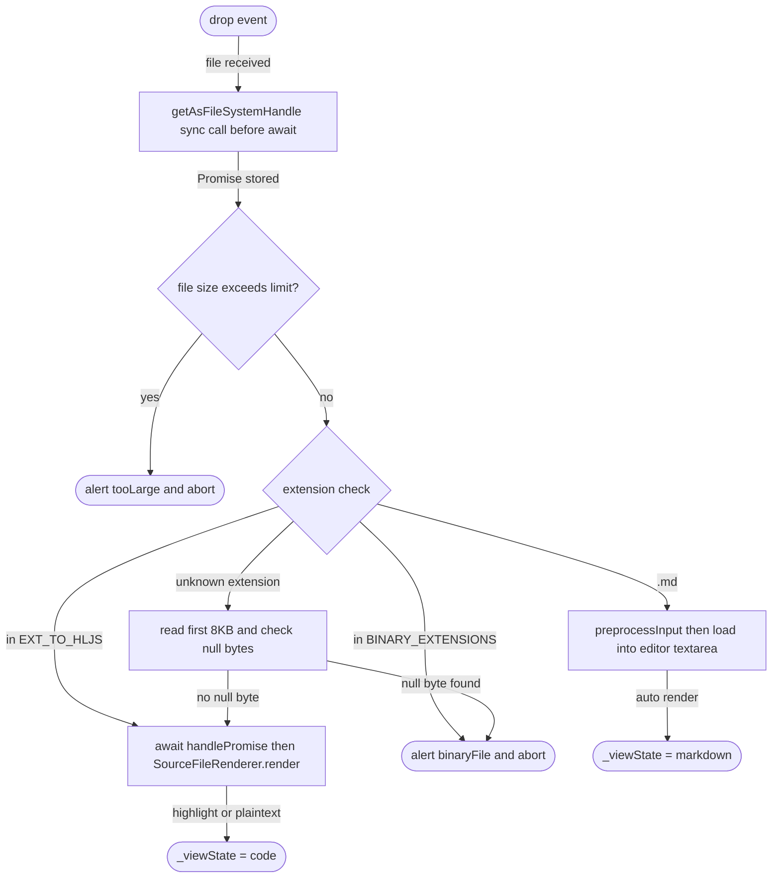

**BINARY_EXTENSIONS 定義:**

```javascript
const BINARY_EXTENSIONS = new Set([
  // Images
  ".png",
  ".jpg",
  ".jpeg",
  ".gif",
  ".bmp",
  ".ico",
  ".webp",
  ".tiff",
  ".psd",
  // Audio
  ".mp3",
  ".wav",
  ".ogg",
  ".flac",
  ".aac",
  ".wma",
  // Video
  ".mp4",
  ".avi",
  ".mkv",
  ".mov",
  ".wmv",
  ".webm",
  // Archives
  ".zip",
  ".rar",
  ".7z",
  ".tar",
  ".gz",
  ".bz2",
  ".xz",
  // Executables / libraries
  ".exe",
  ".dll",
  ".so",
  ".dylib",
  ".msi",
  ".bin",
  // Documents (binary format)
  ".pdf",
  ".doc",
  ".docx",
  ".xls",
  ".xlsx",
  ".ppt",
  ".pptx",
  // Compiled / intermediate
  ".class",
  ".pyc",
  ".o",
  ".obj",
  ".wasm",
]);
```

**FileSystemFileHandle サポート確認 (起動時に1回実行):**

```javascript
const FILE_SYSTEM_HANDLE_SUPPORTED =
  typeof DataTransferItem !== "undefined" &&
  typeof DataTransferItem.prototype.getAsFileSystemHandle === "function";
```

**ドロップハンドラ スケルトン (CON-01 準拠, INV-18 5段階分類):**

```javascript
document.addEventListener("drop", async (e) => {
  e.preventDefault();
  const item = e.dataTransfer.items?.[0];

  // Synchronous call before any await (CON-01)
  const handlePromise = FILE_SYSTEM_HANDLE_SUPPORTED
    ? item?.getAsFileSystemHandle?.()
    : null;

  const file = e.dataTransfer.files[0];
  if (!file) return;
  if (file.size > CONFIG.fileDrop.maxBytes) {
    alert(CONFIG.fileDrop.messages.tooLarge);
    return;
  }

  const ext = file.name.includes(".")
    ? file.name.slice(file.name.lastIndexOf(".")).toLowerCase()
    : "";

  if (CONFIG.fileDrop.markdownExtensions.includes(ext)) {
    // (1) .md -> Markdown Preview (with preprocessInput)
    const fileHandle = handlePromise ? await handlePromise : null;
    const text = this.preprocessInput(await file.text());
    this.elements.editor.value = text;
    await orchestrator.loadMarkdown(text, systemTheme(), fileHandle);
  } else if (EXT_TO_HLJS[ext] || EXT_TO_HLJS[file.name]) {
    // (2) Known text extension -> Code View (highlight attempt)
    this.elements.editor.value = ""; // RTC2-07: clear editor before code view
    const fileHandle = handlePromise ? await handlePromise : null;
    const metadata = await orchestrator.renderCodeView(file, fileHandle);
    this.setViewMode("code", metadata);
    this.showKeyHint("code");
  } else if (BINARY_EXTENSIONS.has(ext)) {
    // (3) Known binary extension -> reject
    alert(CONFIG.fileDrop.messages.binaryFile);
  } else {
    // (4)/(5) Unknown extension -> null byte check on first 8KB
    const slice = file.slice(0, 8192);
    const bytes = new Uint8Array(await slice.arrayBuffer());
    if (bytes.some((b) => b === 0)) {
      alert(CONFIG.fileDrop.messages.binaryFile);
      return;
    }
    // Text file with unknown extension -> Code View (plaintext)
    this.elements.editor.value = ""; // RTC2-07: clear editor before code view
    const fileHandle = handlePromise ? await handlePromise : null;
    const metadata = await orchestrator.renderCodeView(file, fileHandle);
    this.setViewMode("code", metadata);
    this.showKeyHint("code");
  }
});
```

注 (読めない場合。リリース前の試験 N4): ハンドルの取得 (`getAsFileSystemHandle()`) の拒否は、呼んだその時に受け止め (`.catch(() => null)`)、ハンドル無しとして続ける (後の `await` の間に未処理の拒否を残さない)。コードビューに渡したファイルが読めない (`renderCodeView` が失敗する) 場合は、`fileDrop.messages.readError` を `alert` で出し、初期状態に戻す。コードビューの Reload でファイルが読めない場合は、トースト `messages.edit.reloadFailed` を出し、表示は変えない。

**(その場編集。2026-xx-xx 追記)** 判定の規則 (サイズ、拡張子、バイナリの拡張子、先頭 8 KB の NUL バイト) は、`UIController.js` のモジュール関数 `classifyDroppedFile(fileName, fileSize)` (`"tooLarge"` / `"markdown"` / `"code"` / `"binary"` / `"sniff"`) と `hasNullByte(bytes)` に切り出す。ドロップのハンドラは、入出力、`alert`、INV-21 の順序 (取得 → 判定と読み込み → 保存中の拒否 → 確認 → 置き換え) だけを持つ。`.md` の読み込みでは、先頭 3 バイトで BOM を判定する (5.14.1)。

### 5.5 SourceFileRenderer

**クラススケルトン:**

```javascript
class SourceFileRenderer {
  // hljs: bundled highlight.js instance injected from main.js (shared with MarkdownRenderer)
  // fileHandleSupported: a drop gives a file handle (CON-01; tests inject it)
  constructor(config, previewEl, hljs, fileHandleSupported = FILE_SYSTEM_HANDLE_SUPPORTED) {
    this._cfg = config;
    this._fileHandleSupported = fileHandleSupported;
    this._previewEl = previewEl;
    this._hljs = hljs;
    this._fileHandle = null;
    this._fileName = "";
    this._lastScrollTop = 0;
  }

  /**
   * @returns {Promise<CodeViewMeta>}
   */
  async render(file, fileHandle, theme) {
    this._fileHandle = fileHandle;
    this._fileName = file.name;
    this._lastScrollTop = 0;
    const text = await file.text();
    const loadedAt = new Date();
    const { html, lineCount, language } = this._buildCodeBody(
      text,
      file,
      loadedAt,
    );
    this._previewEl.innerHTML = html;
    this._applyCodeTheme(theme);
    return {
      fileName: file.name,
      fileSize: file.size,
      lineCount,
      language,
      lastModified: file.lastModified,
      updatedAtStr: formatDateTime(file.lastModified),
    };
  }

  /**
   * @returns {Promise<CodeViewMeta|null>} null if fileHandle is unavailable
   */
  async reload(theme) {
    if (!this._fileHandle) {
      // as readMarkdownFile: no file (handles supported) or the browser
      const codeView = this._cfg.codeView;
      showToast(
        this._fileHandleSupported ? codeView.reloadNoFileMsg : codeView.reloadUnavailableMsg,
        codeView.toastDurationMs,
      );
      return null;
    }
    this._lastScrollTop = window.scrollY;
    const file = await this._fileHandle.getFile();
    const text = await file.text();
    const loadedAt = new Date();
    const { html, lineCount, language } = this._buildCodeBody(
      text,
      file,
      loadedAt,
    );
    this._previewEl.innerHTML = html;
    this._applyCodeTheme(theme);
    window.scrollTo(0, this._lastScrollTop);
    return {
      fileName: file.name,
      fileSize: file.size,
      lineCount,
      language,
      lastModified: file.lastModified,
      updatedAtStr: formatDateTime(file.lastModified),
    };
  }

  destroy() {
    this._previewEl.innerHTML = "";
    this._fileHandle = null;
    this._fileName = "";
    this._lastScrollTop = 0;
  }
}
```

**\_buildCodeBody(text, file, loadedAt) アルゴリズム:**

1. 拡張子を抽出: `fileName.slice(fileName.lastIndexOf('.')).toLowerCase()`
2. 言語を解決: `EXT_TO_HLJS[ext] ?? EXT_TO_HLJS[fileName] ?? null`
3. ハイライト: 言語が解決され、かつ `hljs.getLanguage(lang)` が存在する場合のみ `hljs.highlight(text, { language: lang })` を使用。未知の拡張子、およびcommonビルドに含まれない言語は `escapeHtml(text)` によるplaintext表示とし、`language` は `"plaintext"` を返す (INV-18 段階5)。`hljs.highlightAuto()` は使用しない
4. ハイライト済みHTMLを行に分割し、各行を `<span class="code-line">` で囲む。行境界をまたぐspanタグは閉じて再度開く処理を行う。
5. `#codeViewBody` のみを含むHTML文字列を返す (ヘッダー、ステータスバー、キーヒントは生成しない)
6. `{ html, lineCount, language }` オブジェクトを返す

### 5.6 SmoothScrollEngine

**クラススケルトン:**

```javascript
class SmoothScrollEngine {
  /**
   * @param {object} config - CONFIG.scroll reference
   * @param {HTMLElement} [scrollTarget] - element to scroll (defaults to window)
   */
  constructor(config, scrollTarget) {
    this._cfg = config;
    this._scrollTarget = scrollTarget || null;
    this._velocity = 0;
    this._direction = 0; // +1: down, -1: up
    this._keyHeld = false;
    this._rafId = null;
    this._lastTs = null;
    this._loop = this._loop.bind(this);
  }

  startScroll(direction) {
    this._direction = direction;
    this._keyHeld = true;
    // Suppress hover highlight during scroll (INV-18b)
    if (this._scrollTarget) this._scrollTarget.classList.add("scrolling");
    if (!this._rafId) {
      this._lastTs = null;
      this._rafId = requestAnimationFrame(this._loop);
    }
  }

  stopScroll() {
    this._keyHeld = false;
  }

  destroy() {
    if (this._rafId) cancelAnimationFrame(this._rafId);
    this._rafId = null;
    this._velocity = 0;
    this._lastTs = null;
    // Remove scrolling class (INV-18b)
    if (this._scrollTarget) this._scrollTarget.classList.remove("scrolling");
  }

  _loop(ts) {
    if (this._lastTs !== null) {
      const dt = Math.min(ts - this._lastTs, 50);
      if (this._keyHeld) {
        this._velocity = Math.min(
          this._velocity + this._cfg.acceleration * dt,
          this._cfg.maxSpeed,
        );
      } else {
        this._velocity *= Math.pow(this._cfg.friction, dt / 16.67);
      }
      if (this._velocity > 0.005) {
        const target = this._scrollTarget || window;
        target.scrollBy(0, this._direction * this._velocity * dt);
      } else {
        this._velocity = 0;
        this._rafId = null;
        this._lastTs = null;
        // Remove scrolling class when animation stops (INV-18b)
        if (this._scrollTarget)
          this._scrollTarget.classList.remove("scrolling");
        return;
      }
    }
    this._lastTs = ts;
    this._rafId = requestAnimationFrame(this._loop);
  }
}
```

**物理モデル概要:**

| フェーズ   | 計算式                                                   |
| ---------- | -------------------------------------------------------- |
| キー押下中 | `velocity = min(velocity + acceleration * dt, maxSpeed)` |
| キー解放後 | `velocity = velocity * pow(friction, dt / 16.67)`        |
| 停止条件   | `velocity < 0.005` px/ms: rAFループをキャンセル          |

- `dt` (デルタタイム、ミリ秒): 連続するrequestAnimationFrameコールバック間の経過時間。フレームレートに依存しないアニメーションに使用する。
- `dt` は50msで上限クランプ。タブ切替やスリープ後のジャンプを防止する。
- 摩擦は `Math.pow(friction, dt / 16.67)` により60fpsベースラインに正規化される。
- 物理パラメータ (maxSpeed, acceleration, friction) は `poc/smooth-scroll-poc.html` で実機テスト済みの値。すべて CONFIG 経由で調整可能。

### 5.7 ビュー状態管理

既存の `isPreRenderState()` はDOMを直接検査する (`children.length === 0`)。`#affordanceText` が `#preview` の永続的な子要素として追加されるため、この方式は破綻する。フラグベースのアプローチへの移行が必要。

`_viewState === 'markdown'` の中には、ブロック編集の状態 (`blockEditState`: `browsingPreview` / `editModeIdle` / `editingBlock`。3.3 の 11-c) がある。`_viewState` の値は増やさない。

`#editor` (上部の入力欄) はペーストの入口として残す。`#editor` と文書は次の規則で同期する: (1) ブロックの確定・Undo・挿入では、その操作のイベントハンドラの中で同期的にモデルを更新し、`onModelChanged` で UIController が `#editor.value` を本文で書き換え (本文が `CONFIG.edit.editorSyncMaxChars` を超える場合は、INV-47 のとおり `#editor` を使えるようになる前まで遅らせる)、`_editorChangedSinceRender` を下ろす (INV-47)。描画を待ってから書き換えることはしないので、確定の直後に `#editor` へ打ち込んだ文字は上書きされない。(2) `#editor` の `input` イベントで `_editorChangedSinceRender` を立てる。(3) `#editor` からの全体描画 ([Render] / `l` / `d`) は、開いている編集欄を同期的に確定してから行い (描画はキューに入れる)、未保存の確認は出さない (INV-45)。ただし `#editor` が空で本文が空でない場合は、確定より前に INV-56 の確認を出し、Cancel なら `#editor` を本文に戻して印を下ろすだけにする。システムが `#editor.value` を代入する場合の一つであり、(6) のガードはそのまま働く。`_editorChangedSinceRender` は、`#editor` の内容をモデルに取り込んだ時点で (同期。描画の完了は待たない) 下ろす。 また、システムが `#editor.value` を書き換えるとき (確定・Undo・挿入の `onModelChanged`、文書の作り直し (`.md` のドロップ、Reload、初期状態からのペーストと描画、空の文書の開始)、Clear、コードビューへの切り替え) にも同期的に下ろす (INV-45 の「最後の全体描画またはブロックの確定の後の `input`」の定義にそろえる)。その後の `#editor` の `input` は、描画中であっても印をもう一度立てる (裁定 T32)。(4) 編集モードでブロックの開始ジェスチャが行われたとき、`_editorChangedSinceRender` が立っていれば、先に `#editor` の内容で全体を描画し直す (INV-45)。 (5) ブロック編集欄を開いたまま `#editor` にフォーカスが入った場合 (Shift+Tab などのキーボード操作を含む) は、その `focusin` のハンドラの中で編集欄を同期的に確定する (`#editor` への入力が、後の確定による `#editor.value` の書き換えで失われないため。裁定 T19)。(6) ブラウザの Undo / Redo の履歴は、ページの中で 1 本である (Chromium では、ブロック編集欄の履歴が尽きた後の Ctrl+Z が、以前に入力した `#editor` に `historyUndo` として届き、フォーカスも `#editor` へ移る)。システムが `#editor.value` を代入すると、それより前の `#editor` の Undo の履歴は文書と対応しなくなる。そこで UIController は `#editor` の `beforeinput` で、`inputType` が `historyUndo` / `historyRedo` で、かつフォーカス (`document.activeElement`) が `#editor` でないものを `preventDefault()` する。また、システムが `#editor.value` を代入した後は (`onModelChanged`、文書の作り直し、Clear、コードビューへの切り替え、INV-56 の Cancel での戻し)、利用者が `#editor` に自分で入力する (`inputType` が `historyUndo` / `historyRedo` 以外の `input` が起きる) までの間、`#editor` の中で押した Undo / Redo も `preventDefault()` する (Chromium では、代入の前の履歴が代入の後の文字列に当てはめられ、本文が二重になることがある [検証済: INV-56 の Cancel の後])。それ以外の入力は妨げない。ブロック編集欄・パレット・本体での Ctrl+Z が、`#editor` と文書をずらすことはない (INV-45、INV-47、PRT-U36)。残る制限 (受容): 利用者が `#editor` に入力した後の Undo は、その入力を戻した後、代入より前の古い履歴まで進むことがある。

**RendererOrchestrator ビュー状態:**

```javascript
_viewState = 'initial'; // 'initial' | 'markdown' | 'code'

isPreRenderState() {
  return this._viewState === 'initial';
}

isCodeViewActive() {
  return this._viewState === 'code';
}
```

**\_viewState 更新ポイント:**

| 場所                                                          | 値           |
| ------------------------------------------------------------- | ------------ |
| アプリ初期化時                                                | `'initial'`  |
| `loadMarkdown()` 呼び出し時                                   | `'markdown'` |
| `renderCodeView()` / `SourceFileRenderer.render()` 呼び出し時 | `'code'`     |
| `clear()` 呼び出し時                                          | `'initial'`  |
| `startEmptyDocument()` 呼び出し時 (INV-31) | `'markdown'` |

注意: RendererOrchestrator の `_showAffordance()` / `_hideAffordance()` は削除済み。affordance 表示は UIController.setViewMode() が管理する。

**UIController.setViewMode(mode, metadata?) メソッド:**

```javascript
setViewMode(mode, metadata) {
  // Set body class: view-initial / view-markdown / view-code
  document.body.classList.remove("view-initial", "view-markdown", "view-code");
  document.body.classList.add(`view-${mode}`);

  const fileInfo = this.elements.fileInfo;
  const editor = this.elements.editor;
  const affordance = document.getElementById("affordanceText");

  switch (mode) {
    case "code":
      fileInfo.textContent = this._formatFileInfo(metadata);
      fileInfo.style.display = "block";
      editor.readOnly = true;
      editor.style.display = "none";
      if (affordance) affordance.style.display = "none";
      break;
    case "markdown":
      fileInfo.style.display = "none";
      editor.readOnly = false;
      editor.style.display = "";
      if (affordance) affordance.style.display = "none";
      break;
    case "initial":
      fileInfo.style.display = "none";
      editor.readOnly = false;
      editor.style.display = "";
      if (affordance) affordance.style.display = "block";
      break;
  }
}
```

**UIController.showKeyHint(mode) メソッド:**

```javascript
showKeyHint(mode) {
  const hint = this.elements.keyHint;
  if (!hint) return;
  const text = CONFIG.keyHints[mode];
  if (!text) {
    hint.style.display = "none";
    return;
  }
  hint.textContent = text;
  hint.style.opacity = "1";
  hint.style.display = "block";
  clearTimeout(this._keyHintTimer);
  this._keyHintTimer = setTimeout(() => {
    hint.style.opacity = "0";
  }, CONFIG.codeView.keyHintDurationMs);
}
```

ヒントは、時間の経過のほか、`document` の `keydown` / `click` / `touchmove` とプレビューの `scroll` でも消える。ただし、ヒントを表示させたイベントそのもの (表示の時点の `window.event`) では消さない。その場編集では、[Render Light] / [Render Dark] / [Edit] のクリックの処理の中で同期的に描画を始めてヒントを表示するので (INV-47)、同じクリックが `document` まで伝わったときに消してはならないためである。消すリスナーは `{ once: true }` を使わずに登録し、消すときにすべて外す。

**UIController.\_formatFileInfo(metadata) メソッド:**

```javascript
_formatFileInfo(metadata) {
  if (!metadata) return "";
  const { fileName, fileSize, lineCount, updatedAtStr } = metadata;
  const sizeStr = (fileSize / 1024).toFixed(2) + " KB";
  const linesStr = lineCount.toLocaleString() + " lines";
  return `${fileName}  |  ${linesStr}  |  ${sizeStr}\nUpdated: ${updatedAtStr}`;
}
```

### 5.8 カラーモード管理

| トリガー                                   | アクション                                                |
| ------------------------------------------ | --------------------------------------------------------- |
| HTMLページ読み込み                         | `applySystemTheme()` が `prefers-color-scheme` を読み取る |
| コードファイルドロップ                     | `applyTheme('dark')` を強制適用                           |
| `l` キーまたは Render Light (コードビュー) | `applyTheme('light')` のみ (CSS切替、再読込なし)          |
| `d` キーまたは Render Dark (コードビュー)  | `applyTheme('dark')` のみ (CSS切替、再読込なし)           |
| `l` キーまたは Render Light (Markdown)     | `orchestrator.reRender('light')`                          |
| `d` キーまたは Render Dark (Markdown)      | `orchestrator.reRender('dark')`                           |
| `r` キーまたは Reload (コードビュー)       | `orchestrator.reloadCodeView(currentTheme)`               |
| `r` キーまたは Reload (Markdown)           | `orchestrator.readMarkdownFile()` → preprocessInput → `loadMarkdown` (要fileHandle)|
| `c` キーまたは Clear                       | `uiController.doClear()`                                  |

設計根拠: hljs出力はCSSクラス (`hljs-keyword` 等) ベースであり、ライト/ダーク切替は `body.dark` のCSS切替のみで完結する。ファイル再読込・DOM再構築は不要。これによりコードビューの `l`/`d` は即時応答となる。

**UIController.handleRender() メソッド (ボタンとキーボードの両方で使用):**

```javascript
async handleRender(theme) {
  if (this.orchestrator.isCodeViewActive()) {
    // Code view: CSS-only theme switch (no file re-read, no DOM rebuild)
    applyTheme(theme);
    this.state.setTheme(theme);
  } else if (!this.orchestrator.isPreRenderState()) {
    const content = this.preprocessInput(this.elements.editor.value);
    this.state.setMarkdownText(content);
    await this.orchestrator.reRender(theme);
    this.setViewMode("markdown");
    this.showKeyHint("markdown");
  } else {
    // Initial state: render if editor has content
    const content = this.preprocessInput(this.elements.editor.value);
    if (content.trim()) {
      await this.orchestrator.loadMarkdown(content, theme);
      this.setViewMode("markdown");
      this.showKeyHint("markdown");
    }
  }
}
```

**UIController.handleReload() メソッド (Reload ボタンと `r` キーで使用):**

```javascript
async handleReload() {
  if (this.orchestrator.isPreRenderState()) return;
  const theme = this.state.currentTheme;
  if (this.orchestrator.isCodeViewActive()) {
    const metadata = await this.orchestrator.reloadCodeView(theme);
    if (metadata) this.setViewMode("code", metadata);
  } else {
    const rawText = await this.orchestrator.readMarkdownFile();
    if (rawText === null) return; // toast already shown
    const text = this.preprocessInput(rawText);
    this.elements.editor.value = text;
    await this.orchestrator.loadMarkdown(text, theme);
    this.setViewMode("markdown");
    this.showKeyHint("markdown");
  }
}
```

**RendererOrchestrator ファサードメソッド (LOD準拠):**

```javascript
reRender(theme) {
  this.state.setTheme(theme);
  applyTheme(theme);
  this.renderAll();
}

async reloadCodeView(theme) {
  return await this.sourceFileRenderer.reload(theme);
}

async renderCodeView(file, fileHandle) {
  this._viewState = "code";
  applyTheme(CONFIG.codeView.defaultTheme);
  const metadata = await this.sourceFileRenderer.render(
    file, fileHandle, CONFIG.codeView.defaultTheme
  );
  return metadata;
}

// .md fileHandle storage for reload
_mdFileHandle = null;

async loadMarkdown(text, theme, fileHandle = undefined) {
  if (fileHandle !== undefined) this._mdFileHandle = fileHandle;
  this.state.setMarkdownText(text);
  this._viewState = "markdown";
  this.state.setTheme(theme);
  applyTheme(theme);
  await this.renderAll();
}

/**
 * Read .md file from stored fileHandle. Returns raw text or null.
 * Shows appropriate toast when unavailable:
 *   - FILE_SYSTEM_HANDLE_SUPPORTED && no handle -> "No file to reload..."
 *   - !FILE_SYSTEM_HANDLE_SUPPORTED           -> "Chrome/Edge 86+ required"
 */
async readMarkdownFile() {
  if (!this._mdFileHandle) {
    const msg = FILE_SYSTEM_HANDLE_SUPPORTED
      ? CONFIG.codeView.reloadNoFileMsg
      : CONFIG.codeView.reloadUnavailableMsg;
    showToast(msg, CONFIG.codeView.toastDurationMs);
    return null;
  }
  const file = await this._mdFileHandle.getFile();
  return await file.text();
}
```

注意: `renderCodeView()` は `preview.classList` 操作を行わない。body クラスの管理は UIController.setViewMode() に委譲される。

UIController は RendererOrchestrator のパブリックメソッドのみを呼び出し、内部の SourceFileRenderer に直接アクセスしない。

`_mdFileHandle` は RendererOrchestrator (UseCase層) が保持する。Adapter用Interfaceは不要（ScrollMementoと同じCA意図的逸脱）。

**(その場編集。2026-xx-xx 追記)** `[Render]` / `l` / `d` の経路の判定は、純粋関数 `renderRouteFor(isCodeView, isPreRender)` に切り出す。`"theme"` (コードビュー: CSS の切り替えだけ)、`"editorIntoDocument"` (Markdown 表示中: 同じ文書。開いている編集欄を確定してから、改行の正規化だけを行って全体を描画する。裁定 T33)、`"newDocument"` (初期状態: 改行の正規化 → ラッパーの除去 → 新しい文書) の 3 つ。

### 5.8.1 配色 (テーマ別。2026-xx-xx 追記)

GitHub (Primer) の配色に合わせる。値は `@primer/primitives` 11.10.0 の `functional/themes/light.css` / `dark.css` (2026-10-21 に取得して確認) による。上部バー (`#topbar`) の地はライトでは変えない (ダークは下の表)。`#editor` / `#fileInfo` の地 (`CONFIG.editorColors`。5.9。初期状態の `#editor` のダークの地 `#444` を含む) はライト・ダークとも変えない。PlantUML の図は変えない。表に縞は付けない。等幅フォントの並びは 5.14.13。

**ダーク:**

| 部品 | 値 | Primer の名前 |
| --- | --- | --- |
| `body` の地 / 文字 | `#0d1117` / `#f0f6fc` | bgColor-default / fgColor-default |
| `#preview` の地 / 文字 | `#0d1117` / `#f0f6fc` | bgColor-default / fgColor-default |
| `#topbar` の地 / 下の線 | `#151b23` / `#3d444d` | bgColor-muted / borderColor-default |
| `#editor` の枠 / 文字 | `#3d444d` / `#f0f6fc` (地は `editorColors` のまま。初期状態の地 `#444` も変えない) | |
| `pre` の地 / 枠 | `#151b23` / `#3d444d` | bgColor-muted |
| コードの色分けの地 | 持たない (`pre` の `#151b23` が見える。差分の追加・削除の印だけは下の色分けの表の地) | |
| インラインのコードの地 | `#656c7633` | bgColor-neutral-muted |
| 本文のリンク、`#copyright a` | `#4493f8` | fgColor-accent |
| 引用の文字 / 線 | `#9198a1` / `#3d444d` | fgColor-muted / borderColor-default |
| 表の枠 | `#3d444d` | |
| モーダルの地 / 文字 / 枠 (見出しの下線を含む) | `#151b23` / `#f0f6fc` / `#3d444d` | |
| 閉じるボタン / ホバー | `#9198a1` / `#f0f6fc` | fgColor-muted |
| `#promptText` の地 / 枠 / 文字 | `#0d1117` / `#3d444d` / `#f0f6fc` | |
| PlantUML のエラー (地 / 文字 / 枠) | `#f851491a` / `#f85149` / `#da3633` | danger |
| 外部画像の代替表示・`.plantuml-pending` (地 / 文字 / 枠) | `#151b23` / `#9198a1` / `#656c76` | borderColor-emphasis |
| アフォーダンステキスト | `#9198a1` | |
| `#fileInfo` (地 / 文字 / 枠) | `#151b23` / `#9198a1` / `#3d444d` (コードビューの寒色の地 `#1A1E2E` は `editorColors` のまま。枠はコードビューでも `#3d444d`) | |
| キーのヒント・トースト | `#3d444d` / `#ffffff` | tooltip |
| コードビューの地 / 文字 / 行番号 / 行のホバー | `#0d1117` / `#f0f6fc` / `#9198a1` / `#151b23` | |
| 図のコピーボタン (地 / 枠 / 文字) | `#212830` / `#3d444d` / `#f0f6fc` | control-bgColor-rest |
| ブロック編集欄・編集中のセル (地 / 文字 / 枠) | `#010409` / `#f0f6fc` / `#1f6feb` (フォーカスの輪も `#1f6feb`) | bgColor-inset / borderColor-accent-emphasis |
| 原文のセルの地 | `#bb800926` | bgColor-attention-muted |
| 見えない文字の印 (INV-70) | `#bb800926` | bgColor-attention-muted |
| 編集モードのホバーの点線、帯の枠、空のブロックの枠 | `#656c76` | borderColor-emphasis |
| コードの色分け | 下の色分けの表のダークの列 (Primer の prettylights) | |
| Mermaid の図の容器 | 地を透明。配色は Mermaid の `dark` のまま | |

**ライト** (オーナーの裁定 2026-10-21。本文のプレビューとコードビューだけを GitHub に合わせる。表に無い部品は変えない):

| 部品 | 値 | Primer の名前 |
| --- | --- | --- |
| `#preview` の文字 | `#1f2328` (地は `#fff` のまま) | fgColor-default |
| 本文のリンク | `#0969da` (`#copyright a` は変えない) | fgColor-accent |
| `pre` の地 | `#f6f8fa` (枠なしのまま) | bgColor-muted |
| コードの色分けの地 | 持たない (`pre` の `#f6f8fa` が見える。差分の印は下の表) | |
| インラインのコードの地 | `#818b981f` | bgColor-neutral-muted |
| 引用の文字 / 線 | `#59636e` / `#d1d9e0` | fgColor-muted / borderColor-default |
| 表の枠 | `#d1d9e0` | borderColor-default |
| コードビューの文字 / 行番号 | `#1f2328` / `#59636e` (地 `#ffffff` と行のホバーは変えない) | fgColor-default / fgColor-muted |
| ブロック編集欄・編集中のセルの枠とフォーカスの輪 | `#0969da` (地 `#fffdf5` は変えない) | |
| 原文のセルの地、見えない文字の印 (INV-70) | `#fff8c5` | bgColor-attention-muted |
| コードの色分け | 下の色分けの表のライトの列 (Primer の prettylights) | |
| Mermaid の図の容器 | 地を透明。配色は Mermaid の `default` のまま | |

インラインのコード (`#preview` の中の、`pre` の中に無い `code`。選択子は `#preview code:not(pre code)`) は、両テーマとも角を `6px` 丸め、上下 `0.2em`・左右 `0.4em` の余白を付ける (オーナーの裁定 2026-10-21)。`pre` の中のコード (`<pre><b><code>` のような入れ子を含む) には地を付けない。

コードブロック (`pre`) の内側の余白は、両テーマとも `16px` (GitHub と同じ。オーナーの裁定 2026-10-22)。highlight.js のテーマの CSS を読まないので、`pre` の中の `code` には余白が付かない (余白は `pre` の `16px` だけ)。

**印刷はライトの色 (オーナーの裁定 2026-10-22)**: 画面がダークでも、印刷ではライトの列の色で出す。本文・リンク・引用・表・コード・色分け・コードビュー・外部画像と PlantUML の代替表示・図のコピーボタン・ブロック編集欄・表のセルの編集の印 (`grsmd-cell-*`)・文字色の読み替え (INV-66) のダークの規則は、`style.css` で `@media screen` の中にだけ書く (ライトの規則は `@media` の外)。背景を印刷しないブラウザで、ダークの淡い文字が白い紙に出るのを避けるため **[確認済: Chromium の PDF では、この対処の前、ダークの本文が `#a0a4a8` (白の上で 2.51) で出た]**。上部バー・パレット・モーダルなど印刷しない部品のダークの規則は `@media` の外に置いてよい。**既知の制約 (オーナーの裁定 2026-10-22)**: Mermaid と PlantUML の図は、描いたときの配色 (ダークなら Mermaid の `dark`、PlantUML の `CONFIG.plantuml.darkTheme` (`cyborg`)) のまま印刷される。ダークで描いた図は、白い紙の上で線が淡く (Mermaid の矢印の線は対比 1.50 **[確認済: Chromium の印刷の表示]**)、ノードは暗い箱になる。図の描き直しは非同期で、印刷の直前には間に合わないため、CSS では直さない。図をライトで印刷するには、`l` でライトにしてから印刷する。

印刷では、両テーマとも、ブロック編集欄の地・枠・フォーカスの輪を出さない (INV-53。フォーカスの `.md-block-editor:focus` の規則も `@media print` で打ち消す)。一時的な画面の表示であるキーのヒント (`#keyHint`) とトースト (`#toastContainer`) も、印刷では隠す (`display: none !important`。`showKeyHint` が書くインラインの `display` に勝つため)。見えない文字の印 (`.grsmd-invisible`。INV-70) は、印刷では印の地と影だけを消す (`background: none`、`box-shadow: none`。両テーマ)。セルでは印の要素が文字そのものを包むので、要素は隠さない (文字は印刷に残る)。

`pre` の中の色の付かない文字 (`.hljs`) は、本文の文字と同じ (ライト `#1f2328`、ダーク `#f0f6fc`)。

**コードの色分け (オーナーの裁定 2026-10-22)**: highlight.js のテーマの CSS (`highlight.js/styles/*.css`) は読み込まない。`style.css` が、highlight.js のクラスに Primer 11.10.0 の `prettylights-syntax-*` の値を当てる。クラスの組み分けは highlight.js の `github.css` に従う。規則は `#preview` に限らないので、コードビュー (`#codeViewBody` の中の `hljs-*` の `span`) にも同じ色が付く。テーマの CSS を誤って読み込んだら、`vite.config.js` の PostCSS の検査 `no-hljs-theme-css` がビルドを失敗させる (グローバルな `.hljs` の規則が混ざらないため)。

| クラス | Primer の名前 (`prettylights-syntax-`) | ライト | ダーク |
| --- | --- | --- | --- |
| `.hljs` (色の付かない文字) | — (fgColor-default) | `#1f2328` | `#f0f6fc` |
| `hljs-doctag` / `keyword` / `meta .hljs-keyword` / `template-tag` / `template-variable` / `type` / `variable.language_` | keyword | `#cf222e` | `#ff7b72` |
| `hljs-title` / `title.class_` / `title.class_.inherited__` / `title.function_` | entity | `#6639ba` | `#d2a8ff` |
| `hljs-attr` / `attribute` / `literal` / `meta` / `number` / `operator` / `variable` / `selector-attr` / `selector-class` / `selector-id` | constant | `#0550ae` | `#79c0ff` |
| `hljs-regexp` / `string` / `meta .hljs-string` | string | `#0a3069` | `#a5d6ff` |
| `hljs-built_in` / `symbol` | variable | `#953800` | `#ffa657` |
| `hljs-comment` / `code` / `formula` | comment | `#59636e` | `#9198a1` |
| `hljs-name` / `quote` / `selector-tag` / `selector-pseudo` | entity-tag | `#0550ae` | `#7ee787` |
| `hljs-subst` | storage-modifier-import | `#1f2328` | `#f0f6fc` |
| `hljs-section` (太字) | markup-heading | `#0550ae` | `#1f6feb` |
| `hljs-bullet` | markup-list | `#3b2300` | `#f2cc60` |
| `hljs-emphasis` (斜体) | markup-italic | `#1f2328` | `#f0f6fc` |
| `hljs-strong` (太字) | markup-bold | `#1f2328` | `#f0f6fc` |
| `hljs-addition` (文字 / 地) | markup-inserted | `#116329` / `#dafbe1` | `#aff5b4` / `#033a16` |
| `hljs-deletion` (文字 / 地) | markup-deleted | `#82071e` / `#ffebe9` | `#ffdcd7` / `#67060c` |

対比 (WCAG 2): ライトは `#f6f8fa` (`pre`) と `#ffffff` (コードビュー) の上、ダークは `#151b23` と `#0d1117` の上で、すべて 4.5 以上 (単体テストで確かめる)。**既知の制約**: ダークの `hljs-section` (Markdown の見出しなど) の `#1f6feb` は、`#151b23` の上で 3.74、`#0d1117` の上で 4.08 で、4.5 に届かない (Primer の値のまま。オーナーの裁定 2026-10-22)。

### 5.9 コードビュー UIレイアウトとCSS

**コードビューレイアウト (ASCII):**

```
+------------------------------------------------------------------+
| #topbar (position: fixed; top: 0)                                |
|  [editor textarea (hidden in code view)]                         |
|  [#fileInfo: hello.c | 1,234 lines | 48.20 KB                 ] |
|  [          Updated: 2026-03-05 12:34:56                       ] |
|  [Render Light] [Render Dark] [Re-load] [New Tab] [Clear] [?]   |
+------------------------------------------------------------------+
| #keyHint (position: fixed; top: topbar bottom edge; overlay)     |
|  [L] Light; [D] Dark; [R] Reload; [N] New Tab; [C] Clear;       |
|  [Up][Down] Scroll Up/Down;                                      |
+------------------------------------------------------------------+
|                                                                  |
| #preview (flex: 1; overflow: auto; position: relative)           |
|                                                                  |
|  +------------------------------------------------------------+  |
|  | #codeViewBody                                               |  |
|  |                                                            |  |
|  |   1  #include <stdio.h>                                    |  |
|  |   2  #include <stdlib.h>                                   |  |
|  |   3                                                        |  |
|  |   4  int main(int argc, char *argv[]) {                    |  |
|  |  ...                                                       |  |
|  +------------------------------------------------------------+  |
|                                                                  |
+------------------------------------------------------------------+
| #toastContainer  (position: fixed; top: 60px; center)            |
|  [  Reload not available (Chrome/Edge 86+ required)  ]          |
+------------------------------------------------------------------+
```

**レイアウト変更点:**

- `#codeViewHeader` と `#codeViewStatusBar` を廃止。ファイルメタデータは `#fileInfo` (topbar 内) に統合。
- `#codeViewKeyHint` を廃止。キーヒントは `#keyHint` (`#preview` 先頭にオーバーレイ) に統合。
- `#keyHint` は `position: fixed; top: <topbar下端>` でプレビューエリア先頭に重ねて表示。
- [Re-load] ボタンを [Render Dark] と [New Tab] の間に追加。
- コードビュー時、`#editor` は `display: none` + `readOnly = true`。
- `#fileInfo` は UIController.setViewMode() が管理。`#keyHint` は UIController.showKeyHint() が管理。

**エディタ背景色 (CSS, body クラスベース):**

```css
body.view-markdown[data-theme="light"] #editor {
  background: #fff8f0;
}
body.view-markdown[data-theme="dark"] #editor {
  background: #2d2520;
}
body.view-code[data-theme="light"] #editor {
  background: #f0f4ff;
}
body.view-code[data-theme="dark"] #editor {
  background: #1a1e2e;
}
```

**行番号CSS (CSSカウンターアプローチ):**

```css
#codeViewBody {
  counter-reset: line;
  font-family: monospace;
  font-size: 13px;
  line-height: 1.6;
  white-space: pre;
}

.code-line {
  display: block;
  counter-increment: line;
}

.code-line::before {
  content: counter(line);
  display: inline-block;
  width: 4em;
  text-align: right;
  margin-right: 1.5em;
  color: #59636e; /* light; dark #9198a1 in @media screen (5.8.1) */
  user-select: none;
  -webkit-user-select: none;
}
```

**#fileInfo:** `#editor` の直後に配置。コードビュー時にファイルメタデータを2行で表示する。フォーマット: `<filename>  |  <lines> lines  |  <KB> KB\nUpdated: <YYYY-MM-DD HH:MM:SS>`。`white-space: pre-line` で改行を反映。setViewMode("code", metadata) で表示、他モードで非表示。コードビュー時の背景色は `#editor` と同じ寒色系 (Light: #F0F4FF, Dark: #1A1E2E) を適用する。

**#keyHint:** `position: fixed; top: <topbar下端>` でプレビューエリア先頭にオーバーレイ表示。CSS `opacity` トランジションによるフェードアウト。`white-space: pre` で改行を反映（2行表示対応）。showKeyHint(mode) で表示。消去条件: CONFIG.codeView.keyHintDurationMs (5秒) 経過 / 任意のボタン押下 / マウススクロール / クリック。いずれかが発生した時点でフェードアウト開始。

### 5.10 アフォーダンステキスト

`_viewState === 'initial'` の場合、`#preview` に `#affordanceText` を表示する:

```
Get started:

  1. Paste Markdown (Ctrl+V)  ->  Markdown Preview
  2. Drop a .md file          ->  Markdown Preview
  3. Drop any text file       ->  Code View  (.py  .js  .json  .c  ...)
```

各行を最長行（3行目: 71文字）と同じ文字数に末尾スペースでパディングする。`text-align: center` + `white-space: pre` の下で行の左端を揃えるため。

**アフォーダンスCSS:**

```css
#affordanceText {
  white-space: pre;
  font-family: monospace;
  font-size: 14px;
  line-height: 2;
  color: #555; /* light; dark #9198a1 (5.8.1) */
  text-align: center;
  padding-top: 40px;
  user-select: none;
}
```

注意: 旧仕様では `position: absolute; top: 50%; transform: translate(-50%, -50%); pointer-events: none` を使用していたが、
iOS Safariで `#preview` のコンテンツ高さが実質ゼロになりタッチイベントが発火しない問題 (FS-16) の根本原因となったため、通常フロー配置に変更。
`pointer-events: none` も削除し、affordanceText上のタッチ/クリックがpreviewに伝播するようにした。
`padding-top` は `20vh` から `40px` に変更（上部寄せ配置）。テキスト後に空白行（50行）を付加し、プレビュー領域全体にレンダリング済みコンテンツを充填する (FS-16)。

**ライフサイクル (UIController.setViewMode() が管理):**

| イベント                        | `#affordanceText` 状態 |
| ------------------------------- | ---------------------- |
| `setViewMode('initial')`        | 表示 (display: block)  |
| `setViewMode('markdown')`       | 非表示 (display: none) |
| `setViewMode('code', metadata)` | 非表示 (display: none) |

注意: RendererOrchestrator の `_showAffordance()` / `_hideAffordance()` は廃止。アフォーダンスの表示/非表示は UIController.setViewMode() に一元化。main.js の初期化時は `orchestrator._showAffordance()` の代わりに UIController 初期化内で `setViewMode('initial')` を呼ぶ。

### 5.10.1 Touch Paste Assist (FS-16)

プレレンダー状態で `#preview` 領域をクリック/タップすると `#editor` にフォーカスを移動する。
UIController.setupTouchPasteAssist() で設定する。

```javascript
setupTouchPasteAssist() {
  const preview = this.elements.preview;
  const editor = this.elements.editor;

  preview.addEventListener("click", (e) => {
    if (!this.orchestrator.isPreRenderState()) return;
    if (editor.value.trim() !== "") return;
    editor.focus();
  });
}
```

**iOS Safari 対策:**
- アフォーダンステキストの後に空白行（`" \n"` x 50行）を `textContent` に付加する。iOS Safari はレンダリングされたコンテンツのない領域で click を発火しないため、プレビュー領域全体を「描画済み」にする必要がある。
- `#affordanceText` の CSS は `padding-top: 40px` で上部寄せ。`white-space: pre` により空白行がそのまま高さとして描画される。
- `#preview` に `background-color` を明示的に指定する (`#fff` / dark: `#222`)。安全マージンとして維持。
- `<meta name="viewport">` は追加しない。追加すると iPhone の既存レイアウトが崩壊するため。

**設計判断:**
- `click` イベントのみ使用する。`touchstart` は使用しない
- `click` は iOS Safari でもユーザージェスチャとして認識され `focus()` が成功する (PoC v4 で iPad 実機検証済み)
- `click` はピンチ・スクロールジェスチャでは発火しないため、ピンチアウト操作を阻害しない。`touchstart` + `preventDefault()` 方式ではピンチの1本目の指で `focus()` が発火しキーボードが出るため、ピンチ操作が不可能になる問題があった
- 条件チェック (`isPreRenderState()` + editor空) により、レンダリング済み状態では無干渉

### 5.11 キーボードショートカット対応表

| キー      | プレレンダー               | Markdownプレビュー             | コードビュー                            |
| --------- | -------------------------- | ------------------------------ | --------------------------------------- |
| ArrowUp   | 無動作                     | スムーススクロール↑            | スムーススクロール↑                     |
| ArrowDown | 無動作                     | スムーススクロール↓            | スムーススクロール↓                     |
| `l`       | 無動作                     | Markdownをライトでレンダリング | ライトテーマに切替 (CSS切替のみ、即時)  |
| `d`       | 無動作                     | Markdownをダークでレンダリング | ダークテーマに切替 (CSS切替のみ、即時)  |
| `r`       | 無動作                     | fileHandleからファイル再読込   | fileHandleからファイル再読込            |
| `n`       | 新規タブを開く             | 新規タブを開く                 | 新規タブを開く                          |
| `c`       | 無動作                     | クリアしてリセット             | コードビューを破棄してリセット          |
| Ctrl+C    | ブラウザネイティブコピー   | ブラウザネイティブコピー       | ブラウザネイティブコピー                |
| Ctrl+V    | ペースト＋自動レンダリング | 無動作 (ブラウザデフォルト)    | 無動作 (ブラウザデフォルト)             |

注意: 修飾キー (Ctrl / Meta / Alt) が押されている場合、ショートカットハンドラをバイパスしてブラウザネイティブ動作を優先する (INV-14)。

**編集機能のキー (SC-22〜24。2026-xx-xx 追加):**

| キー | プレレンダー | Markdownプレビュー | ブロック編集中 | セルの編集中 | コードビュー |
| --- | --- | --- | --- | --- | --- |
| `e` / [Edit] | `#editor` が空なら空の文書を開始、空でなければ `#editor` の内容を描画して編集モードにする (INV-31) | 編集パレットの表示 / 非表示 | (文字入力。[Edit] ボタンは有効) | (文字入力) | 無動作 (OS-06) |
| `Esc` | 無動作 | 編集パレットを閉じる | ブロック編集を取消 (IME の変換中を除く。INV-28) | セルの取消・表の編集を終える (INV-64。パレットは閉じない) | 無動作 |
| `Esc` (ポップオーバーを開いている) | — | ポップオーバーだけを閉じる (INV-53) | ポップオーバーだけを閉じる (INV-53) | ポップオーバーだけを閉じる (INV-53) | — |
| `Tab` / `Shift+Tab` | — | — | ブラウザ既定 (INV-53) | 右 / 左のセル (INV-64) | — |
| Enter / Shift+Enter | — | — | 段落・リスト・引用では改行の印 (空白 2 つ + 改行。INV-71)。表のブロックでは `<br>` (INV-27)。それ以外 (見出し、コード、数式、HTML) と、Ctrl / Alt / Meta との組み合わせは普通の改行。IME の変換中を除く | 下のセル (最後の行では表の編集を終える) / `<br>` (INV-64)。Ctrl / Alt / Meta との組み合わせは何もしない | — |
| ダブルクリック / ダブルタップ | INV-31 | 編集モードでなければ INV-57、編集モードでは開始ジェスチャ 2 回 | — | — | — |
| 主 + S / 主 + Shift + S | 止めて何もしない (INV-58) | Save / Save as (INV-58。パレットが閉じていても) | Save / Save as | Save / Save as | 止めて何もしない (INV-58) |
| 主 + Z | ブラウザ既定 | 編集モードでなければブラウザ既定 (裁定 Q3)、編集モードなら Undo (INV-59 (c)) | 変更あり: フォーカスが編集欄の中ならブラウザ既定 (文字単位)、外なら変更の取消 (INV-48 (1)) / 変更なし: Undo (INV-59) | 変更あり: セルの変更の取消 / 変更なし: Undo (INV-59 (c)) | ブラウザ既定 |
| 主 + Shift + Z / Ctrl+Y | ブラウザ既定 | ブラウザ既定 | ブラウザ既定 | 止めて何もしない (INV-59) | ブラウザ既定 |
| 主 + B / I (Shift なし) | ブラウザ既定 | ブラウザ既定 | Bold / Italic (INV-60) | Bold / Italic (INV-60) | ブラウザ既定 |
| 主 + V (貼り付け。文脈メニューの貼り付けも) | ペースト＋自動レンダリング (現行) | ブラウザ既定 | INV-69 の (i)〜(iv) を満たせばリンク (権限は使わない)、それ以外はブラウザ既定 (コードの中・リンクの行き先・URL を選んだ置き換えなど) | INV-69 の (i)〜(iv) を満たせばリンク、それ以外は文字として貼る (INV-63) | ブラウザ既定 |

「主」は INV-14 の判定式 (Mac は Cmd、それ以外は Ctrl)。横取りする場面でキーを押し続けた繰り返し (`event.repeat`) は、既定の動作だけを止め、機能は実行しない (INV-14)。Esc の繰り返しは、どの列でも何もしない (INV-14 の (3)。オーナーの裁定 Q-a)。`#editor` にフォーカスがあるときの主 + Z / B / I は、どの列でもブラウザ既定。`#editor` にフォーカスがある間の Esc は、パレットを閉じない (INV-14 のガード)。

**キーボードハンドラ スケルトン (UIController.setupKeyboard() 内):**

```javascript
document.addEventListener("keydown", (e) => {
  if (e.defaultPrevented) return; // INV-14 (1): an editor already handled it
  if (this._handlePrimaryShortcut(e)) return; // INV-14 (2), INV-58 to INV-60 (shortcutLetter)
  const active = document.activeElement;
  const tag = active?.tagName;
  if (
    tag === "INPUT" ||
    tag === "TEXTAREA" ||
    active?.isContentEditable ||
    active?.closest?.('[role="toolbar"]')
  )
    return; // INV-14 (the same check is also applied to e.target)
  if (e.ctrlKey || e.metaKey || e.altKey) return; // INV-14: modifier guard

  switch (e.key) {
    case "ArrowUp":
      e.preventDefault();
      if (!this.orchestrator.isPreRenderState())
        this.scrollEngine.startScroll(-1);
      break;
    case "ArrowDown":
      e.preventDefault();
      if (!this.orchestrator.isPreRenderState())
        this.scrollEngine.startScroll(+1);
      break;
    case "l":
      this.handleRender("light");
      break;
    case "d":
      this.handleRender("dark");
      break;
    case "r":
      this.handleReload();
      break;
    case "n":
      window.open(window.location.href, "_blank");
      break;
    case "c":
      this.doClear();
      break;
  }
});

document.addEventListener("keyup", (e) => {
  if (e.key === "ArrowUp" || e.key === "ArrowDown")
    this.scrollEngine.stopScroll();
});
```

**UIController.doClear() メソッド:**

```javascript
doClear() {
  this.scrollEngine.destroy();
  this.orchestrator.clear();
  this.elements.editor.value = "";
  applySystemTheme();
  this._showAffordance();
  this.setViewMode("initial");
}
```

Render Light / Render Dark ボタンのクリックハンドラは `this.handleRender('light')` / `this.handleRender('dark')` を呼び出す。
Reload ボタンのクリックハンドラは `this.handleReload()` を呼び出す。

ブロック編集欄の Esc / Enter は、BlockEditController が編集欄自身の `keydown` で処理する。ヘルプモーダル (`helpModal`) の「Details」に、`[Edit]` / `E` の行と、「表の中で縦棒を文字として書くときはバックスラッシュを付ける」の注記を追加する (日英併記。CON-06 の例外)。

**UIController.showKeyHint(mode) メソッド:**

```javascript
showKeyHint(mode) {
  const hint = this.elements.keyHint;
  if (!hint) return;
  const text = CONFIG.keyHints[mode];
  if (!text) { hint.style.display = "none"; return; }
  hint.textContent = text;
  hint.style.opacity = "1";
  hint.style.display = "block";

  // Clear previous dismissal listeners and timer
  this._clearKeyHintDismiss();

  // Dismiss on: timeout / button press / scroll / click
  const dismiss = () => {
    hint.style.opacity = "0";
    this._clearKeyHintDismiss();
  };
  this._keyHintTimer = setTimeout(dismiss,
    CONFIG.codeView.keyHintDurationMs);
  this._keyHintDismissHandler = dismiss;
  document.addEventListener("click", dismiss, { once: true });
  document.addEventListener("scroll", dismiss, { once: true, capture: true });
  document.addEventListener("keydown", dismiss, { once: true });
}

_clearKeyHintDismiss() {
  clearTimeout(this._keyHintTimer);
  if (this._keyHintDismissHandler) {
    document.removeEventListener("click", this._keyHintDismissHandler);
    document.removeEventListener("scroll", this._keyHintDismissHandler,
      { capture: true });
    document.removeEventListener("keydown", this._keyHintDismissHandler);
    this._keyHintDismissHandler = null;
  }
}
```

### 5.12 ユーティリティ関数

以下のユーティリティ関数はクラスに属さないモジュールレベルの関数、またはUIControllerのメソッドとして実装する。

**showToast(message, durationMs):**

```javascript
function showToast(message, durationMs) {
  let container = document.getElementById("toastContainer");
  if (!container) {
    container = document.createElement("div");
    container.id = "toastContainer";
    document.body.appendChild(container);
  }
  const toast = document.createElement("div");
  toast.className = "toast";
  toast.textContent = message;
  container.appendChild(toast);
  setTimeout(() => {
    toast.style.opacity = "0";
    toast.addEventListener("transitionend", () => toast.remove(), {
      once: true,
    });
  }, durationMs);
}
```

**applyTheme(theme) — UIController メソッド:**

```javascript
applyTheme(theme) {
  document.body.classList.toggle("dark", theme === "dark");
  this.state.setTheme(theme);
}
```

**applySystemTheme() — UIController メソッド:**

```javascript
applySystemTheme() {
  const systemTheme = window.matchMedia("(prefers-color-scheme: dark)").matches
    ? "dark" : "light";
  this.applyTheme(systemTheme);
}
```

**formatDateTime(timestamp):**

```javascript
function formatDateTime(timestamp) {
  const d = new Date(timestamp);
  const pad = (n) => String(n).padStart(2, "0");
  return (
    `${d.getFullYear()}-${pad(d.getMonth() + 1)}-${pad(d.getDate())} ` +
    `${pad(d.getHours())}:${pad(d.getMinutes())}:${pad(d.getSeconds())}`
  );
}
```

**waitForDOMStability(element, timeoutMs, debounceMs):**

```javascript
function waitForDOMStability(element, timeoutMs, debounceMs) {
  return new Promise((resolve) => {
    let timer = null;
    const observer = new ResizeObserver(() => {
      clearTimeout(timer);
      timer = setTimeout(() => {
        observer.disconnect();
        resolve();
      }, debounceMs);
    });
    observer.observe(element);
    setTimeout(() => {
      observer.disconnect();
      resolve();
    }, timeoutMs);
  });
}
```

### 5.13 AI出力前処理 (preprocessInput)

UIController.preprocessInput() は、AIツールが出力する外側のMarkdownフェンス (ラッパー) を除去する。処理は純粋関数 `splitMarkdownWrapper(text)` (新設の `src/js/textTransforms.js`、`@purity pure`。DOM と CONFIG に依存しない純粋な文字列関数だけを置くファイルで、5.14.1 の改行コードと BOM の変換関数も置く。R7.9。裁定 T8) に委ね、`body` を返す。

**`splitMarkdownWrapper(text)` は `{ prefix, body, suffix }` を返す:**

入力は LF に正規化済みの文字列とする (すべての経路で「改行の正規化 → split」の順。5.14.1)。

1. 先頭の空行 (空白だけの行を含む) に続いて、3 個以上のバッククォート、`markdown` (大文字小文字を区別しない)、任意の空白、改行、が並ぶ部分を `prefix` の候補とする (現行コードの `markdown\s*\n` と同じ範囲)。
2. 末尾にある「改行 + 候補と **同じ数** のバッククォート + 任意の空白と改行」を `suffix` の候補とする。
3. **両方の候補が揃った場合だけ** 除去する (`prefix` と `suffix` に入れる)。片方しか無い場合は何も除去しない (`markdown` 言語の例のコードブロックで始まる普通の文書や、コードブロックで終わる普通の文書を壊さないため)。
4. `prefix + body + suffix === text` が常に成り立つ (除去したものをすべて正確に返す)。`trim` はしない。

**現行からの動作の変化:** (a) ラッパーが無いのにコードブロックで終わる文書の閉じフェンスを除去しなくなる (不具合の修正)。(b) 閉じフェンスの無い (途中で切れた) AI 出力は除去しなくなる (先頭のフェンスが残り、全体がコードブロックとして表示される。両端が揃うことを要件とした旧 5.13 と同じ動作)。 **残る限界:** `markdown` 言語の例のコードブロックで始まり、普通のコードブロックで終わる文書は、両端が揃って見えるので除去される (表示が崩れるが、保存では `prefix` と `suffix` を戻すので内容は失われない。現行のコードと旧 5.13 も同じ動作)。「先頭のフェンスが末尾より前で閉じていれば除去しない」という条件は、外側と内側に同じ数のバッククォートを使った AI 出力 (よくある形) の除去を止めてしまうので採らない。

- ネストされた内部のコードブロックは除去しない。
- `.md` の読み込み (D&D と Reload)、初期状態からの Ctrl+V のペースト、初期状態の `#editor` からの描画で適用する (INV-17)。Markdown 表示中の `#editor` からの描画と、保存のときの `#editor` の取り込みでは適用しない (改行の正規化だけ。5.14.1、INV-33)。
- 保存時は、記録した `prefix` と `suffix` を付け直す (INV-38)。

### 5.14 Markdown その場編集

#### 5.14.1 読み込みと保存の変換 (純粋関数)

読み込み (ファイル): バイト列 → BOM の検出 (先頭 3 バイトが `EF BB BF`) → デコード (`File.text()`。BOM は除かれる) → 改行コードの記録と正規化 (CRLF と単独の CR を LF に。INV-44) → `splitMarkdownWrapper` (5.13) → 本文 → モデル。初期状態からのペーストと `#editor` からの描画も、同じく「改行の正規化 → `splitMarkdownWrapper`」の順とする (ペーストした文書の改行コードは LF として扱う)。**Markdown 表示中の `#editor` からの描画と、保存のときの取り込み (`applyEditorText`) では、改行の正規化だけを行い、`splitMarkdownWrapper` をかけない** (`#editor` には既にラッパーを除いた本文が入っているので、もう一度除くと、`markdown` の例で始まりコードブロックで終わる本文の両端のフェンスを失う。main の `handleRender` は Markdown 表示中も `preprocessInput` を通すので、動作の変更になる。利用者から見ると、Markdown 表示中に `#editor` の中身をラッパー付きの AI 出力に貼り替えて [Render] すると、ラッパーは除去されず、全体が 1 つのコードブロックとして表示される。ラッパーを除くには、Clear してからペーストする (PRT-W23)。裁定 T33)。保存はその逆順: 本文 → `prefix + body + suffix` → 記録した改行コードへ変換 → BOM を付ける → 書き込み。`DocumentSession.toFileText(bodyText)` がこの逆変換を行う。

関数は `textTransforms.js` の `detectLineEnding` / `normalizeLineEndings` / `convertLineEndings` / `hasUtf8Bom` (5.13 の `splitMarkdownWrapper` と同じファイル。すべて `@purity pure`)。初期状態からのペーストと描画では、ラッパーを除いた本文を `#editor` にも書き戻す (書き戻さないと、後の Markdown 表示中の描画で T33 により除去されず、`#editor` とモデルがずれる)。空白だけのペーストは横取りしない (ブラウザの既定の動作に任せる)。

#### 5.14.2 ブロックモデル (`MarkdownBlockModel`, `@purity pure`)

- `fromBody(bodyText, lexer)`: 最上位トークンからブロックの列を作る。開始タグが閉じていない `html` トークンは、タグが閉じるまでの後続トークンと合わせる (INV-41。タグの釣り合いは `html` トークンの中の非 void 要素の開始タグと終了タグを数えて判定する)。`space` トークンは直前のブロックの `separatorAfter` に入れる (先頭の `space` は先頭の空ブロックの区切りとして保持する)。
- 不変条件: `toBody() === 全ブロックの (raw + separatorAfter) の連結` (INV-41)。
- 原文との突き合わせ: marked は、ラベルが既に定義された参照リンク定義 (大文字小文字を区別しない) をトークンに積まずに読み飛ばし、その後の改行を直前のトークンの `raw` に足す [検証済: marked 18.1.0]。そこで `fromBody` / `withBody` は、本文全体を 1 回字句解析し、各トークンの `raw` を本文の該当位置と突き合わせる (`raw` の末尾の、本文に無い改行は除く)。一致しない位置 (読み飛ばされた定義の区間) では、その位置から次の空行まで (定義のタイトルは空行を含まないので、定義はそこで終わる) の短い区間だけをそれだけで字句解析し、先頭のトークンが `def` (または空行) なら、それを 1 つのトークンとして補い、元のトークン列の突き合わせを区間の後ろから続ける。読み飛ばされた定義は、1 つずつ独立した `def` ブロックになる (marked が定義 1 つにトークン 1 つを作るのと同じ単位にし、編集欄で 1 つずつ開けるようにするため)。区間が空行までに 4,096 文字を超える場合と、先頭のトークンが `def` でも空行でもない場合は、その位置から後ろの本文全体を改めて字句解析して続ける (まれな場合だけ)。字句解析する文字数は、重複の数によらずほぼ本文 1 回分である (INV-51)。`links` は、本文全体を 1 回で解析した場合と同じく、先に出た定義を優先する。`links` の各項目は `{href, title}` の凍結した写しとし、marked のオブジェクトを共有しない。
- 退避: それでもブロックの連結が本文と一致しない場合と、字句解析が例外を投げた場合は、本文全体を 1 つのブロック (種類 `document`) とし、`isWholeDocument` を真にする (本文を書き換えない)。そのブロックの描画は、ブロック単位の描画と同じ経路で行い、解析の例外は従来どおり `Markdown Parse Error` として表示する。モデルが 1 ブロックの扱いに変わったとき、RendererOrchestrator は `console.error` に記録し、`ModelChangedPort.onBlockSplitFailed()` を呼ぶ (UIController がトーストを出す)。空の本文は退避ではない (ブロック 0 個)。
- ブロック ID: `fromBody(bodyText, lexer, firstBlockId)` は `firstBlockId` から振る (新しい文書では、RendererOrchestrator が持つアプリ全体のカウンタ `_nextBlockId` の値を渡す。起動時は 1。ID はアプリ全体で単調に増え、文書をまたいでも、Clear やコードビューの後でも再利用しない。INV-48)。`withBody` / `replaceBlock` / `insertAfter` は新しい本文を字句解析し、`BlockDiff.diffBlocks` で前の列と対応付け、対応したブロックは ID を引き継ぎ、それ以外には `nextBlockId` から新しい ID を振る。自身は変更せず、`ModelChange` (新しいモデルと、本文が変わったかどうか) を返す (R7.5)。
- `diffBlocks(oldBlocks, newBlocks, maxCells)` (`@purity pure`): (1) 先頭から原文の一致するブロックを除く。(2) 末尾から同様に除く。(3) 残った区間の大きさが k × m のとき、k·m が `maxCells` (`CONFIG.edit.diffMaxCells`) 以下なら、その区間だけを LCS で対応付ける。超える場合は、区間のブロックをすべて新しいブロックとして扱う。計算量は O(n + k·m) で、k·m は上限で抑えられる。1 回の確定で変わるブロックは通常 1〜数個なので、k と m は小さい。1 MB の文書 (約 9,300 ブロック) でも、(1) と (2) は線形の比較で済む。
- 末尾の改行: トークンの種類によって `raw` が末尾の改行を含むかが異なる [検証済]。編集欄に表示するときは末尾の改行を除き、確定時に付け直す。

#### 5.14.3 部分再描画 (`RendererOrchestrator.commitBlock`)

同期の部分 (操作のイベントハンドラの中、最初の `await` より前):

1. 対象ブロックの要素で `ScrollMemento.captureAnchor` を取る (上端の画面上の位置。INV-46)。BlockEditController の確定では、編集欄を閉じる前に取って `commitBlock` に渡す (ブロックの上端は、自分の中身が変わっても動かない。閉じた後に取ると、プレビュー全体のレイアウトが強制される)。
2. `replaceBlock` で `ModelChange` (新しいモデル、`isChanged`、新しいモデルでの基準のブロック ID `anchorBlockId`) を作る。`isChanged` が偽 (原文が変わらない) なら、ここで終える (モデル・DOM・Undo の記録・未保存の印を変えない。INV-48)。
3. 前の現在のモデルを `_previousModel` (Undo の記録、1 件) に入れ、新しいモデルを現在のモデルにする。
4. `onModelChanged` を呼ぶ (UIController が `#editor.value` と未保存の印を更新する)。
5. 描画をキューに入れる。

非同期の部分 (描画のキューの中。INV-47):

6. `MarkdownRenderer.replaceBlocks(_renderedModel, _currentModel, heldBlockId)`: ブロック ID で対応付け、原文と参照リンク定義の署名が同じブロックは DOM をそのまま残す。ブロック編集欄が開いているブロック (`holdBlock`) は、HTML が変わっても外枠を残し、古い描画として記録する。編集欄が閉じたとき (`releaseBlock`) に古い描画なら、そのブロックだけを部分描画し直す (INV-47)。HTML が変わったブロックと新しいブロックだけ `wrapper.innerHTML = sanitize(html)` で作り直す。消えたブロックの要素は外す。sanitize 後の文字列を連結してもう一度パースすることはしない。キャッシュから、現在のモデルに無いキーを捨てる。
7. 差し替えた要素に対して hljs → `ExternalImageGate.apply(root)` → Mermaid → PlantUML (`mode: "placeholder"`) を行う。
8. 差し替えの直後と、DOM の安定後 (`waitForDOMStability`) に `restoreAnchor` を行う (基準の要素は `anchorBlockId` で探す。まとまった描画では最後の要求のアンカーを使う)。ただし、差し替えたのが基準のブロック 1 つだけで、ブロックの数が変わらない場合は、基準より上は動いていないので、差し替えの直後の補正は行わない (DOM の安定後の補正は行う。直後の補正は、プレビュー全体のレイアウトを強制する)。`_renderedModel` を、この描画で使った現在のモデルにする。

計測の目印 (PRT-U25): `commitBlock` の同期の部分の始めに `performance.mark("grsmd-commit-start")` を置き (直前の同名の mark を消してから)、その確定を含む部分描画の `replaceBlocks` の直後に `performance.measure("grsmd-commit", "grsmd-commit-start")` を作る (直前の同名の measure を消してから作り、作った後で mark を消す。最後の 1 件だけが残る)。原文の変わらない確定では mark を消す。どちらも通信も保存もしない。

複数の確定がキューに溜まった場合も、各描画は「最後に描画したモデル」から「その時点の現在のモデル」へ更新するので、中間のモデルを描画する必要はない。参照リンクの定義が変わった場合は署名が変わるので、全ブロックの HTML を作り直して比べる (変わったものだけ差し替える。この場合は INV-51 の 300 ms の対象外とする)。

文書が作り直された場合 (`DocumentSession.documentId` が変わった場合) は、キューの中の、それより前の部分描画とアンカーを捨て、新しい文書の全体描画だけを行う (INV-47)。文書が無くなった場合 (Clear、コードビュー) も、キューの中の部分描画とアンカーを捨てる (全体描画は行わない)。ブロック ID は文書をまたいで再利用しないので、描画の待ちの間に画面に残った古い文書の要素の ID は、新しいモデルに存在せず、クリックしても開かない (INV-29)。

#### 5.14.4 全体描画 (`renderAll`) の変更

全体描画 (初回、ドロップ、Reload、`l` / `d`、`#editor` からの描画) でも、ブロックごとに `.md-block` を作って描画する。生 HTML のまとめ (INV-41) によって、`<details>` などの表示は従来の `marked.parse` と同じになる。PlantUML は従来どおり `mode: "consent"` で描画する。全体描画では HTML のキャッシュと Undo の記録を空にする。全体描画も、キューに入れた時点の描画の世代を持ち、実行の時点で世代が進んでいれば何もしない (続けて入った全体描画は最後の 1 回だけが描き、PlantUML の確認も 1 回だけ出る)。空の文書 (ブロックが 0 個) では、ID を持たない空のブロック (`.md-block.md-block-empty`) を 1 つ置く (INV-49)。編集モードでそれを開いた編集欄の確定は、本文が空白だけでなければ `insertAfter(null, text)` で入れ、空白だけなら何もしない。

#### 5.14.5 テキスト操作 (`MarkdownTextOps`, `@purity pure`)

CONFIG を読まず、必要な値は引数で受け取る。`formatRange(text, selStart, selEnd, op, {lexBlocks, lexInline, colors})` (Bold / Italic / 文字色 / リンク。INV-66 / 67 / 69。5.14.14 / 5.14.15)、`insertLink(text, caret, label, link, context)` / `canInsertLink(text, caret, context)` (オーナーの裁定 F-R1 の位置の判定と、marked での読み直しの照合) / `removeLink(text, selStart, selEnd, context)` / `canRemoveLink(text, selStart, selEnd, context)` (外して読み直しまで通るか) (INV-69。5.14.15)、`canFormatRange(text, selStart, selEnd, lexBlocks)` (5.15.5)、`insertHardBreak(text, selStart, selEnd, {lexBlocks, lexInline})` (INV-71 の (1)〜(5))、`stripMeaninglessHardBreaks(raw, lexFull, walkTokens)` (INV-71 の (6))、`hardBreakLines(text, lexBlocks)` (INV-70 の行末の印を付ける行)、`insertTableRow` / `insertTableColumn` (列はバックスラッシュの付かない縦棒だけで区切る。コードスパンの中の縦棒も区切りとして数える。区切り行にも区切りのセルを足し、配置指定は既定とする)、`insertBlockText` (前後に空行が無ければ補って挿入する。INV-52)、`insertTextAt` (`<br>` の挿入に使う)、`changedRange(before, after)` (2 つの文字列の共通の先頭と末尾を除いた、置き換える 1 つの区間 `{start, end, text}`。5.14.6 の Undo の対象にする挿入に使う)。

- 行の文脈: `lexBlocks` (モデルと同じブロックだけの字句解析) のトークンを、リストの項目と引用の中までたどり、行ごとに、その行が属する末端のブロック (段落、リストの項目の文字、見出し、コード、HTML、数式、表など) と、行の先頭のリスト・引用の印の長さを求める。末端のブロックの行が編集欄の行の末尾に見つからない場合 (行末の空白を除いて比べる) は、その行の文脈は不明とする (書式は無効、Enter は普通の改行)。
- インラインの範囲 (INV-67 (6)): 選択の両端が同じ末端のブロックにあり、その種類が段落・リストの項目の文字・見出し・表である場合だけ。段落は各行のリスト・引用の印の後ろ、見出しは `#` の印と閉じの `#` を除いた文字 (セットテキストは下線の行を除く)、表は 1 つのセル (区切り行を除く。前後の空白とタブを除く)。選択の端の改行は除き、行の印の上の端はその隣の文字へ寄せる。
- `insertHardBreak`: カーソルの行の文脈が段落の文字のときだけ働き、それ以外は `null` (ブラウザの改行)。カーソルの前に、空白・タブと引用の印 (`>`) 以外があれば「空白 2 つ + 改行」と、引用の中ならその行の先頭の引用の印 (`>` と空白の並び) を入れる。無ければ (空の行、または段落の行の先頭)、前の行が段落の文字なら、その行の末尾の 2 つ以上の空白を除き、改行と、カーソルの前の引用の印を入れる (段落の区切り)。選択は置き換える。 カーソル (選択の両端) が INV-71 (1) の (i)〜(xi) の場所にあれば `null` (段落を `lexInline` で解析し、1 つの部品として扱うトークンの内側と、強調・リンクの文字を囲む記号の内側の端を除く。裁定 R4 / R5)。
- `stripMeaninglessHardBreaks`: 候補 (行末の 2 つ以上の空白。末端のブロックがコード・HTML・数式などインラインでない行と、文脈の不明な行は候補にしない) について、その空白を除いた本文を `lexFull` で字句解析し、`br` の数 (空白の `br` の数も。`abc\` の後ろの空白を除くと逃がしの `br` に変わるため) と、`text` と `space` を除く各トークンの `type` と、`raw` 以外の文字列・数値・真偽の属性 (子のトークンを持つトークンの `text` を除く) の列が、除く前と同じなら除く (INV-71 (6))。空白の `br` の数が候補の数と同じなら (どの候補も改行を生じている)、くり返さずに返す。そうでなければ、候補を「段落の文字の、段落の最後でない行」(改行を生じるはず) とそれ以外に分け、それぞれをまとめて試し、同じでなければ半分ずつに分けて試す (1 行まで)。ふつうのブロックは 2〜3 回の字句解析で済む。字句解析は 1 つのブロックで 8 回まで (`STRIP_MAX_LEXES`) とし、それまでに決まらなかった候補はそのまま残す (表示は変わらない側。INV-51。取り除けない候補の多い最悪の場合も含め、1,000 行のブロックで 300 ms 以内を単体テストで確かめる)。

#### 5.14.6 編集の開始ジェスチャと「外側」(BlockEditController)

- 別のブロックへ移るときのアンカー (INV-46): タップしたブロックの外枠と画面上の位置は `pointerdown` の時点で記録する (マウスでは、そこで前の編集欄が確定して閉じ、レイアウトが変わる)。編集欄を開いた後でその位置へ戻し、`RendererOrchestrator.retargetPendingAnchor(blockId)` で、確定の部分描画の基準を開いたブロックに替える。キューで待っている部分描画だけでなく、実行中 (DOM の安定を待っている間) の部分描画の基準も替える (マウスでは `pointerdown` で確定し、その描画が `pointerup` で開く時点で既に始まっていることがあるため)。部分描画のアンカーが無ければ何もしない。上にスクロールできる量が足りない場合 (文書の先頭に近い場合) は、位置を保てないことがある。
- 開始ジェスチャ (INV-29): 編集モードの間に、プレビュー内で主ボタンの `pointerdown` から `pointerup` までの移動が `CONFIG.pan.activationThresholdPx` 以下で、`pointerup` の時点で `window.getSelection()` が空で、対象が INV-29 の除外対象の内側でない場合 (除外対象の列挙は INV-29 だけに置く)。ブロック ID は `pointerdown` の時点で取る (INV-29)。
- 外側 (INV-30): ブロック編集欄、編集パレット、ポップオーバー以外の要素 (上部バー、スクロールバー以外のプレビュー、モーダル、トーストを含む)。マウスでは `pointerdown` で、タッチとペン (`pointerType !== "mouse"`) では移動が閾値以下の `pointerup` で確定する (指でのスクロールでは確定しない)。
- 確定 (11-c の `commitBlock`) は同期でモデルを更新する (描画の完了は待たない。INV-47)。確定・取消は `dispatch` で表を通してだけ行う (表の外で状態を変える入口は持たない)。
- `#editor` の `focusin` は UIController が受け (`#editor` を持つのは UIController)、ブロック編集中なら `BlockEditController.dispatch("editorFocused")` で確定する (5.7 (5)、INV-30)。
- `getSelectionRange()` / `applyTextEdit(edit)` で選択範囲と文字列だけを受け渡し、編集欄の要素は外へ渡さない (LoD)。
- 編集欄の Undo の対象 (INV-52、OS-18): `applyTextEdit` (パレットの書式・挿入)、表の中の Enter (`<br>`)、段落・リスト・引用の Enter / Shift+Enter (INV-71 の改行の印) は、`MarkdownTextOps.changedRange` で変わる区間だけを `setSelectionRange` で選び、`document.execCommand("insertText", false, text)` で入れる (ブラウザの編集欄の Undo の履歴に載る。非推奨の API だが代わりが無い)。`execCommand` が無い、`false` を返す、例外を投げる、または入れた結果が求める文字列と違う場合は、`value` の代入にフォールバックする (その場合はその変更を Ctrl+Z で戻せない)。その後で選択範囲を `edit` のとおりにする。
- IME: `compositionstart` から `compositionend` までと、`event.isComposing` が真、または `keyCode === 229` の `keydown` は処理しない (INV-27 / INV-28)。

- 編集欄は外枠 (`.md-block`) の中に置き、外枠の元の子要素は退避して、閉じるときに戻す (外枠は残るので、ブロックの特定は変わらない)。編集中の外枠には `.md-block-editing` を付ける (`position: relative`。INV-70 の層の基準)。`font-family` は CSS (5.14.13)。`overflow-y: hidden` は CSSOM で設定し、高さは `scrollHeight` に枠の幅を足した値にする (CSS は `box-sizing: border-box`、`width: 100%`。INV-40)。
- INV-29 の除外対象の「入力要素」は `input`、`textarea`、`select` とする。編集中のブロックの外枠そのものの上の押下は、編集欄の内側として扱う。
- スクロールバーの判定: 押下の対象が `#preview` または `document.documentElement` で、`offsetX > clientWidth` または `offsetY > clientHeight` のとき、スクロールバーの上とみなす (外側としない。INV-30)。
- `pointerType` が `"mouse"` 以外 (空文字を含む) の押下は、タッチとペンの扱いにする。
- 見えない文字の印 (INV-70): 編集欄を開くと `InvisibleCharOverlay` を作り (`createOverlay`)、閉じると外す。層は編集欄の直前の兄弟で、編集欄と同じ位置・大きさ (`offsetTop` / `offsetLeft` / `offsetWidth` / `offsetHeight`)、同じフォント・大きさ・行の高さ・`padding`・枠の幅 (透明)・`white-space: pre-wrap`・`overflow-wrap: break-word` で、地は編集欄の地 (編集欄の地は透明にし、層を `z-index` で後ろに置く)。最初の描画は開いた次のフレーム。描き直しは編集欄の `input` で、`requestAnimationFrame` で 1 フレームに 1 回にまとめる (`applyTextEdit` で値を代入した場合も描き直す)。編集欄の大きさの変化 (`ResizeObserver`。無ければウィンドウの `resize`) では、同じフレームに描き直しが無ければ、層の位置と大きさだけを合わせる。行末の印は、種類が段落・リスト・引用のブロックで、`MarkdownTextOps.hardBreakLines` が真の行だけ。文字数が `CONFIG.edit.invisibleMarkMaxChars` を超えたら、または印の数が `CONFIG.edit.invisibleMarkMaxMarks` を超えたら層を外す (地は編集欄に戻る)。0 幅の文字の印は、背景の代わりに `box-shadow` (同じ色、幅 1px) で見える。
- 確定のときの後始末 (INV-71 (6)): 種類が段落・リスト・引用のブロックは、`commitBlock` の前に `stripMeaninglessHardBreaks` を通す。その結果が開いた時点の原文と同じなら確定しない (表の整形 (INV-61) の結果が同じ場合も同じ)。
- ダブルタップ (INV-31) は、タッチの `pointerup` の時刻 (単調時計の `performance.now()`。壁時計の `Date.now()` は使わない) と座標で判定する (`BlockEditController.isDoubleTap`)。ダブルクリックは `dblclick` の事象で判定する。

#### 5.14.7 保存 (`SaveDocument` / `SaveDocumentAs`、UseCase 層)

- 押下のハンドラの中で同期的に、(`#editor` を取り込む場合は先に INV-56 の確認を出し、Cancel なら `#editor` を本文に戻して、何も始めずに終える) `MarkdownFileAccess.startPermissionRequest(location.fileHandle)` (Save) または `startSavePicker(location.fileName)` (Save as) を始め、続けて開いている編集欄を確定し、`#editor` に未描画の変更があればそれをモデルに取り込む (`applyEditorText`。どちらも同期。INV-33)。その後で `SaveRequest` (セッション、保存先、本文、権限またはダイアログの Promise、`confirmOverwrite` ポート) を組み立てて `execute` に渡す。アクティベーションが失効していた場合 (`SecurityError` 等) は `failed` とし、`saveActivationLost` のトーストを出す (INV-25)。
- SaveDocument は UI を直接扱わない。外部変更の確認は、`SaveRequest.confirmer` (UIController が実装する `OverwriteConfirmPort`) の `confirmOverwrite(reason)` (`Promise<boolean>` を返す) を通して行う (INV-39)。`reason` は、ファイルの更新日時が基準と異なる場合は `"changed"`、基準が不明な場合は `"unknown"` とする。不明な場合に「外部で変更された」と出すと、事実でないことがあり利用者を誤らせるので、文言を分ける。
- Save: 保存先 (`location.fileHandle`) が無い、または書き込み API が無い場合は Save as と同じ動作にする。権限 → `readLastModified` (`NotFoundError` は `failed`) → 基準と異なれば `confirmOverwrite` → `toFileText` → `writeFile` → `withSaved`。
- Save as: 保存ダイアログで得た handle と名前で、新しい `DocumentLocation` を返す (以後の Save と Reload の対象)。書き込み API が無い場合は `startDownload` で Blob (`text/markdown;charset=utf-8`) をダウンロードし、`downloadStarted` を返す。ダウンロードでは保存先も基準も変えない (INV-26)。Blob URL は `<a>` の click の 60 秒後に `URL.revokeObjectURL` する (すぐに無効にする必要は無く、ブラウザが blob を読むのに時間がかかっても足りるようにする保険)。ダウンロードは、押下のハンドラの中で、確定 (同期) に続けて同期的に始める (INV-33。ユーザーアクティベーションの中で始まる)。それでも止められた場合 **[一般知識・未検証: iOS Safari など]** は、INV-26 により基準は変わらず、安全側に倒れる (PRT-W06 を iOS Safari でも行う)。
- `SaveOutcome` は保存を始めたときの `documentId` を持ち、UIController は現在の文書 ID と一致するときだけ反映する (INV-54)。保存中 (`writingFile`) は、文書の置き換えを拒む (INV-54)。
- 書き込みの可否は `FILE_SYSTEM_WRITE_SUPPORTED` (`typeof window.showSaveFilePicker === "function"` 等) で判定する **[要検証: 判定式]**。`FILE_SYSTEM_HANDLE_SUPPORTED` とは別にする。
- 5 MB (CON-08) を超えた文書も保存できる (読み込みの上限は変えない)。
- 保存先は `DocumentLocation` だけを正とする (`RendererOrchestrator._mdFileHandle` は廃止。INV-55)。`DocumentSession` は fileHandle を持たない。

- 保存先が無い Save は、仮の保存先 `DocumentLocation(defaultFileName, null)` で、保存ダイアログを使う Save as と同じに動く。書き込み API が無い場合は、権限の要求もダイアログも始めず (`permissionOrPicker` は無し)、ダウンロードにする。
- use case が想定外の例外を投げた場合は、`failed` (`saveFailed`) として扱う (未保存のまま)。
- `MarkdownFileAccess.writeFile`: `write()` または `close()` が失敗したら `abort()` してから元のエラーを投げる (`abort()` 自体の失敗は無視し、元のエラーを隠さない)。書き込みと `close()` が成功した後の `lastModified` の読み直しが失敗した場合は、エラーではなく `null` を返す (保存は成功で、`saved` とする)。そのとき `DocumentSession.withSaved` は基準の `lastModified` を「不明」(`LAST_MODIFIED_UNKNOWN`。`DocumentSession.js` が公開する専用の値で、`null` (ファイルに由来しない文書) とも、どの更新日時とも等しくない) として記録する。`SaveDocument` は、基準が不明なら、ファイルの更新日時によらず必ず INV-39 の確認を出す。基準が `null` の文書 (ペースト・空の文書) を Save as で初めて保存した場合も同じである。次の保存が成功して更新日時を読めれば、基準は改めて記録される。

#### 5.14.8 未保存の判定とタブのタイトル

`_isDocumentDirty()` は導出値 (3.3 の 11-e)。真の間は `document.title` を `CONFIG.edit.titleUnsavedPrefix + 元のタイトル` にし、偽になったら元に戻す (ファイル名は入れない。INV-50)。`beforeunload` のハンドラは起動時に 1 度だけ登録し、`_isDocumentDirty()` が真のときだけ `event.preventDefault()` を呼ぶ (INV-22)。

パレットの状態表示 (`paletteStatus`) は、セッションが無ければ空とし、保存先が無ければ名前に `CONFIG.edit.defaultFileName` を使う。`EditPalette.setStatusText` は、文字が変わらなければ何もしない。表示中に文字が変わって大きさが変わったら、変わる前の右下の角に合わせて位置を直す (ビューポートの中に収める。INV-32)。大きさの確認は次のフレーム (`requestAnimationFrame`) で行う (確定の中で読むと、プレビュー全体のレイアウトが強制されるため)。

**既知の制約 (bfcache):** `beforeunload` のリスナーは起動時から常に登録されている。Firefox などは、このリスナーがあるページを bfcache (戻る・進むのキャッシュ) に入れないので、戻る・進むでページが読み込み直されることがある。未保存でない間だけリスナーを外す方式は採らない。

#### 5.14.9 Undo (INV-48)

パレットの Undo と INV-59 (c) の Ctrl+Z は、UIController が 11-c の `undoRequested` を起こす。開いている編集欄に変更があれば取り消して閉じ (`restoreOriginalRaw`、記録は変えない)、そうでなければ変更なしで閉じてから `undoLastUnit` (`#editor` に未描画の変更があれば INV-45 の全体描画、無ければ `RendererOrchestrator.undoLastCommit()`) を行う。Undo ボタンは、記録があるとき、または開いている編集欄に変更があるときに有効。

`_previousModel` に、直前 1 回の「本文を変えた確定」または「編集中でないときの挿入」の前のモデルを持つ。Undo は、同期で基準のアンカー (戻す範囲の最初のブロックの上端。その要素がまだ描画されていない場合は、DOM に残っている対応する位置の要素 (確定前のブロックの要素) の上端。どちらも無ければアンカーを取らず、補正しない) を取り、`_previousModel` に現在の `nextBlockId` を引き継いだモデルを現在のモデルにして (ID を再利用しない。INV-48) `_previousModel` を空にし、`anchorBlockId` を戻した範囲の最初のブロックとし (戻した結果、文書が空なら `anchorBlockId` は無しとし、補正しない。INV-49)、`onModelChanged` を呼び、描画をキューに入れる (5.14.3 の手順 6〜8)。Redo は無い (OS-18)。原文の変わらない確定と、編集中の挿入 (編集欄の文字列の変更) は、記録を変えない。

#### 5.14.10 CSP との整合 (INV-20)

インラインのイベントハンドラ属性は使わない。パレットのアイコンはインライン SVG (DOM 生成) とし、外部の画像を読まない。`blob:` のダウンロードが CSP の下で動くことを PRT-W06 で確認する。

#### 5.14.11 文書の作り直しとセッション (INV-55)

| 出来事 | DocumentSession | DocumentLocation | 外部画像の同意 | Undo の記録 | 備考 |
| --- | --- | --- | --- | --- | --- |
| `.md` のドロップ | `fromFileText` (新しい文書 ID) | ファイル名とドロップで得た handle | 失効 (`resetExternalImageConsent`。INV-43) | 空 | INV-21 の順序で  |
| Reload | `fromFileText` (新しい文書 ID。BOM と改行コードを読み直す。INV-21 の Reload の順序で) | 変えない | 維持 | 空 | `MarkdownFileAccess.readFile` で読む  |
| 初期状態からのペースト / `#editor` からの描画 | `fromPastedText` (新しい文書 ID) | 無し (ファイル名は `defaultFileName`) | 維持 (初期状態では既に失効している) | 空 |  |
| Markdown 表示中の `#editor` からの描画 | 変えない (基準も変えない) | 変えない | 維持 | 空 | `#editor` の内容は同じ文書の編集とみなす  |
| 空の文書の開始 (INV-31) | `fromPastedText("")` (新しい文書 ID) | 無し | 維持 | 空 |  |
| Clear | 無し | 無し | 失効 | 空 | 未保存は偽になる  |
| 非 `.md` のドロップ (コードビュー) | 無し | 無し | 維持 (CON-12) | 空 | モデルを無しにし (INV-47)、`state.markdownText` を空にする。未保存は偽になる  |
| 保存の成功 | `withSaved` (文書 ID は同じ) | Save as なら新しい保存先 | 維持 | 変えない | 同じ文書 ID のときだけ反映 (INV-54)  |
| ダウンロード | 変えない | 変えない | 維持 | 変えない | INV-26  |

#### 5.14.12 表のセルの編集 (INV-62〜65、INV-72)

- セルの特定は、`MarkdownRenderer.getTableElement(blockId)` が返す `table` の `rows[r].cells[c]` の参照で行う (`TableCellEditor.cellAt`)。`closest("td")` は使わない (入れ子の表のセルを拾うため)。表のつまみは `MarkdownRenderer.isTableTab` (参照)、それ以外の表のブロックの内側は余白 (INV-29 (c))。
- 構造の確認の比較: `inlineHtml(raw)` の文字列を inert な `<template>` に入れて `innerHTML` を読み、セルの `innerHTML` と比べる (DOM には入れない)。開くセルだけを比べる (INV-51)。外部画像のあるセルは、代替表示と描画が一致しないので原文のセルになる。
- 退避と写し: 開く時点のセルの子要素は、そのものを退避し (外部画像の代替表示などの状態ごと戻せる)、編集にはその写し (`cloneNode(true)`) を入れる。閉じて変わっていなければ、退避した子要素を戻す。
- 写し (`snapshotNodes`) は要素の種類 (許可した要素)、`a` の参照の番号、`span` の `style` の値、文字だけを持つ。`InlineRuns.fromNodes` は写しだけを読む (`@purity pure`)。リンクの表記 (INV-72 (a)) は、セルの原文 (`\|` → `|` の後) を `lexInline` で字句解析し、`InlineRuns.linksOf` の順に、写しの `a` (文書順) と対応付ける (数が違うか、表記の分からないリンクがあれば原文のセル)。書式の適用でセルを描き直した後は、並びのリンクの順に、`href` が一致する新しい `a` と対応付け直す (利用者が打った URL が marked でリンクになった `a` は、並びのリンクに数えない)。照合 (INV-67 (8)) に失敗して元に戻すときは、リンクの対応付けも戻す。
- 書き出しの選択肢: `inTableCell: true` (`|` とコードの中の `|`、リンクの行き先・ラベル・元の文字、`<URL>`・裸の URL の文字の、逃がされていない `|` を `\|`。`InlineRuns.escapeCellPipes`。原文のセルの自動の修正も同じ関数を使う)。`<URL>`・裸の URL の文字を変えた場合の「同じ形」は、新しい文字が INV-69 の URL の条件 (`ClipboardLink.isLinkableUrl`) を満たし、空白を含まず、その文字が裸の URL としても `<…>` としても 1 つのリンクに字句解析されるときに限る (それ以外は `[文字](元の URL)`)。
- 編集中のセルは `white-space: pre-wrap` とする (`.grsmd-cell-editing` の CSS。ブラウザが空白を U+00A0 で入れないため **[要検証: Chrome / Firefox / Safari]**)。
- `contenteditable="plaintext-only"` が使えない (例外、または読み戻した値が違う) 場合は `"true"` とし、INV-63 の許可の列挙で守る。閉じるときは、先にセルの中の選択を外してフォーカスを外し (フォーカスのある編集できる要素を編集できなくすると、ブラウザがその場で表の配置を計算し直すため)、それから属性を外す。
- INV-46: 編集欄・セルが開いている間に、別のブロック・セル・表のつまみを押した場合は、押した時点 (`pointerdown`) の表の外枠の位置を記録し、表の編集を始めるときにその位置へ戻す (`retargetPendingAnchor` も表へ向ける)。何も開いていないときは記録しない (何も動かないため)。前の確定で押した表が無くなった場合 (`resolveBlockById` が `null`) は、何も開かず、トーストも出さない。
- セルの書式 (INV-66 / 67): WYSIWYG のセルは、選択の位置 (セルの文字の中の位置。`br` は 0) で `InlineRuns.apply` を行い、書き出しの `inlineHtml` で描き直し (`writeHeldInterior`)、描き直した DOM から読んだ並びの `signature` が意図と一致しなければ元に戻して何もしない (INV-67 (8))。原文のセルは、セルの文字 (`br` は改行) に `MarkdownTextOps.formatRange` を行い、文字として書き直す。どちらもセルの変更で、確定しない。
- 見えない文字の印 (INV-70): 開いた時点と、描き直した後と、入力で印が合わなくなったときに (カーソルの位置を保って) 付け直す。印の `span` は参照で覚え、写しでは文字として扱う。閉じるときに外す。
- 計画の使い回し: 11-c のガード `canKeepTableId` (`TableCellEditor.planFor`) が作った計画 (セルの確定と INV-65 の操作の `planTableReplace`) は、セルがその後変わらず、計画の元のモデルが今のモデルである限り、続く `commitCell` / `applyTableOperation` が使う (本文全体の字句解析を 2 回しない)。表の解析 (`MarkdownTable.parse`) は、同じ原文なら使い回す。
- 性能 (INV-51): セルの確定は、開いているセルだけを `inlineHtml` で描き直し、表全体の HTML は作らない (`markWrittenInPlace`。続く部分描画もその表の HTML を作らない)。INV-65 の操作は、変わる行・セルだけを書き換える。計画 (`planTableReplace`) は、多くの場合、表の原文だけを字句解析する (3.2)。スクロールの基準を取らない (`replaceTableBlock`)。Chromium での実測 (2026-10-22。1 MB の文書の中の 1,000 行 × 5 列の表。押下から次の描画のフレームまで (部分描画、配置の計算、描画を含む)): 最初のセルを開く約 80 ms、セルの確定から次のセル (Tab) まで約 125 ms、同じ表の別のセルの押下まで約 150 ms、行の追加約 155 ms、列の追加約 130 ms、配置約 130 ms、書式の適用約 80 ms (PRT-X23。e2e の `GRSMD_PERF=1`)。

#### 5.14.13 表の整形 (INV-61)

- 対象: 種類が `table` のブロックの原文の編集欄を、内容を変えて確定したとき (BlockEditController の `commitBlock`)。編集欄の文字列を `RendererOrchestrator.formatTableText(text)` に通し、その中の表のブロック (字句解析のトークンの種類が `table`) だけを `MarkdownTable.format(MarkdownTable.parse(raw))` で整える (編集で表の後ろに段落を足すなど、複数のブロックに分かれた場合も、表のブロックだけ)。トークンの `raw` をつなぐと元の文字列にならない場合は、何も変えない。内容を変えずに閉じた場合と、表でないブロックを表に書き換えた場合は整えない。整えた結果も 1 回の確定 (1 つの変更の単位。INV-48)。セルの確定と INV-65 の操作 (INV-62、INV-65) も同じ整形を使う。
- `MarkdownTable` (`@purity pure`): `parse(raw)` は `{aligns, rows, extras}` または `null` (見出しの行と区切り行のセルの数が同じで、区切り行の各セルが `:?-+:?` のときだけ表)。セルの分割は `MarkdownTextOps.splitTableRow` と同じ規則 (共通の関数) (逃がされていない `|` で分ける。コードスパンの中の `|` も区切り。marked と同じ)。セルの前後の空白とタブだけを除き、全角の空白 (U+3000) や U+00A0 はセルの内容として残す。`rows` は見出しの列数にそろえ (足りないセルは空)、余るセルは `extras` に元のまま持つ。`format(table)` は INV-61 の形で書き、余るセルは整えた列の後ろにそのまま続ける。`insertRow` / `deleteRow` / `insertColumn` / `deleteColumn` / `setAlignment` は INV-65 の操作 (見出しの行と、列が 1 つのときの列は削除できず `null`。D2)。
- 幅 (`textWidth.js` の `displayWidth(text)`、`@purity pure`): コードポイントごとに、East_Asian_Width が F / W なら 2、General_Category が Mn / Me、または Cf (表示される前置の結合記号 U+0600〜U+0605・U+06DD・U+070F・U+0890・U+0891・U+08E2・U+110BD・U+110CD を除く) なら 0、それ以外 (Ambiguous、タブ、制御文字を含む) は 1。両方に当たる文字 (U+3099 など) は 0。範囲表は Unicode 16.0.0 の `EastAsianWidth.txt` と `DerivedGeneralCategory.txt` から開発時に 1 回だけ作った定数 (製品は実行時に通信しない)。版と作り方は `textWidth.js` の冒頭に書く。セルの幅は書かれたとおりの文字列 (`\|` は 2) で数える (等幅フォントで原文を見たときにそろうため)。
- 幅の数え方の既知の制約: (1) 和文の等幅フォントは Ambiguous の文字 (○ ① α ※ × など) を全角で描くことがあり、その場合は縦棒がずれる。(2) 絵文字の ZWJ の列と、肌の色の修飾 (U+1F3FB〜U+1F3FF、W) の付いた絵文字は W を足し合わせて数えるので、表示 (2) より広く数える。(3) VS16 の付いた絵文字 (❤️ など) は 1 と数えるが、表示は 2。(4) タブは 1 と数える。いずれも縦棒の見た目がずれるだけで、表の意味は変わらない。
- 等幅フォント: `.md-block-editor` と `#editor` は `"BIZ UDGothic", "MS Gothic", "Osaka-Mono", "Noto Sans Mono CJK JP", monospace` (システムのフォントだけ。`@font-face` は使わない)。合否の基準と既知の制約は PRT-X07。

#### 5.14.14 書式の正規形と文字色 (INV-66 / 67 / 72)

- 並び (`InlineRuns`、`@purity pure`): インラインの書式を、1 文字・1 つのコードスパン・1 つの改行・1 つの「そのままの片」(インラインの HTML、画像、数式など。原文のまま書く) の要素の並びとして持つ。各要素は書式 `{color, link, del, strong, em}` を持ち、リンクは同じリンクの要素で 1 つの値 (表記の情報。INV-72 (a)) を共有する。原文から作った要素は原文の表記 (`src`) を持ち、書き出しではそれをそのまま使う (逃がし `\*` や実体参照は変わらない)。表記の無い新しい文字 (セル、単位 E) は INV-72 (d) で逃がす。
- 色の `span`: `<span style="color: #RRGGBB">` の形で、値が `CONFIG.edit.textColors` のライトの値 (大文字・小文字を問わない) のものだけを色として読み、書いたときの値のまま持つ。それ以外の `span` と、対になる閉じのタグの無いものは、そのままの片として残す。
- 適用 (`apply` / `applyUnits`): 範囲の端がリンクの途中なら、そのリンク全体へ広げる (コードスパンとそのままの片は 1 つの要素なので、途中から選んでも全体)。Bold / Italic は、範囲の空白以外の文字がすべてその書式なら外し、そうでなければ範囲全体に付ける (空白だけなら何もしない)。文字色は範囲に値を入れる (「色を外す」は空)。その後、強調の記号 (`~~` / `**` / `*`) の内側の端の空白と改行を記号の外へ出し、`**` / `*` が CommonMark の左右の区切りの規則 (前後の文字を `[\s\p{P}\p{S}]` で判定。続く `*` は 1 つの区切りの並び。並びの外の文字は書き出しの周りの原文 `context.before` / `after`) を満たさない端は、その端の 1 要素から書式を外すことを、満たすまでくり返す (INV-67 (4)(5))。
- 書き出し (`serialize`): 外から 色 → リンク → 取り消し線 → 太字 → 斜体 の順に、同じ書式の隣り合う要素をまとめて書く (同じ種類は入れ子にしない)。リンクは、普通のリンクと完全参照は元の行き先・ラベルを保ち、省略形の参照・`<URL>`・裸の URL は、文字の書き出しが元と同じなら元の形、違えば省略形の参照は `[新しい文字][元の文字]`、`<URL>` と裸の URL は `[文字](元の URL)` (新しい文字が URL の条件 `isLinkableUrl` を満たし書式が無ければ元の形)。
- 原文の編集欄 (`MarkdownTextOps.formatRange`): インラインの範囲 (5.14.5) を `lexInline` (文書の参照リンクの定義を入れた字句解析) で解析し、選択に重なる最上位のトークン (色の `span` は開きから閉じまでを 1 組) だけを書き直す。選択の端がトークンの端にあり、書式を付けるときに、その隣の要素が同じ書式 (Bold / Italic ではその書式、色では同じ色) を持つときだけ、隣のトークンも書き直す (まとめるため。INV-67 (2))。それ以外の隣と、書き直した範囲の外の文字は、表記も変えない (INV-67 (7))。ただし、そのままでは下の照合に合わない場合 (例: `__a__**b**` の `b` の Bold を外すと `__a__b` になり、marked は `a` を太字と読まない) に限り、その書式を持つ隣も書き直してもう一度試す (`**a**b`)。書き直したインラインの範囲を `lexInline` で解析し直し、`InlineRuns.signature` (marked が示す文字・書式・リンクの区切りだけの列) が意図と一致しなければ適用しない (`null`。INV-67 (8))。書き直した結果は 1 回の `execCommand("insertText")` で入れる (Ctrl+Z で戻せる)。選択は、書式を適用した文字 (記号の内側) にする。書式を付けた場合は、その書式を持つ文字だけ (INV-67 (4)(5) で外した端の空白・約物を除く) を選ぶ。同じボタンをもう一度押すと外れ、元に戻る。
- 切らないもの (INV-67 (6)、`InlineRuns.expandRange`): リンク、コードスパン、そのままの片、実体参照 (`&amp;`、`&#x41;` など。1 つの要素)、インラインの HTML の要素 (開きと閉じのタグを名前で対にし、範囲が片方に触れれば両方を含める。`br` などの空要素と `/>` で閉じるタグは対にしない)。
- 正規形の帰結: 裸の URL と `<URL>` に書式を付けると、リンクを外側に置くため普通のリンク (`[**https://x.example/**](https://x.example/)`) になる。約物だけの範囲も、記号が効く位置 (行の端、空白の隣) なら書式が付く (INV-67 (5)。`「」` だけの段落の Bold は `**「」**`)。

正規形の例 (marked 18.1.0 で描画が意図どおり。単体テストで確かめる):

| 書式の並び | 書き出し |
| --- | --- |
| 太字の中に斜体 | `**a *b* c**` |
| 太字かつ斜体 | `***x***` |
| 取り消し線の中に太字 | `~~**x**~~` |
| 色の中に太字 | `<span style="color: #0072B2">**AA**</span>bb` |
| 色の範囲が太字の境界をまたぐ | `**bb**<span style="color: #0072B2">**AA**cc</span>` |
| リンクの中に太字 | `[**a**](u)` |
| 色の中にリンク | `<span style="color: #0072B2">[a](u)</span>` |
| 約物の前後 (E1) | `日本語「**太字**」です` |
| コードを太字 | `` **`x`** `` |

| 色 | ライト (原文に書く値) | `#ffffff` / `#fffdf5` / `#f6f8fa` 上 | ダーク (表示) | `#0d1117` / `#010409` / `#151b23` 上 |
| --- | --- | --- | --- | --- |
| 赤 (朱色) | `#B84F00` | 5.05 / 4.96 / 4.75 | `#E0661A` | 5.48 / 5.95 / 5.02 |
| 青 | `#0072B2` | 5.19 / 5.09 / 4.87 | `#56B4E9` | 8.20 / 8.90 / 7.50 |
| 緑 (青みの緑) | `#007A58` | 5.35 / 5.25 / 5.03 | `#009E73` | 5.53 / 6.00 / 5.06 |

コントラスト比は WCAG の式による (単体テストで、すべて 4.5 以上を確かめる)。ダークの読み替えは `body.dark #preview span[style*="#B84F00" i] { color: #E0661A !important; }` の形 (3 色分。`url()` を含まない)。原文は変えない。

#### 5.14.15 リンクを貼る・外す (INV-69)

- Ctrl+V / Cmd+V (主の方法。権限なし): ブロック編集欄の `paste` (BlockEditController) と、セルの `paste` (TableCellEditor。INV-63 の貼り付けより先) で、選択があり、`ClipboardLink.urlFromPasteEvent` が URL を返し、選んだ文字そのものが URL でなく (裁定 Q6)、`ClipboardLink.linkOp(url, true)` の適用が `null` でないときだけ、`preventDefault()` して適用する。ブロック編集欄は `MarkdownTextOps.formatRange` の結果を `execCommand("insertText")` で入れる (ブラウザの文字単位の Undo。5.14.6)。セルは、WYSIWYG なら `InlineRuns.apply` (セルの書式の適用と同じ)、原文のセルなら `formatRange`。`strictEnds` は、選択の端がコードスパン・インラインの HTML のタグ・画像・インラインの数式・エスケープ・実体参照・リンクの行き先やラベル (リンクの文字の `]` の後) の中にあれば `null` とする (WYSIWYG のセルでは、コードスパンなど 1 つの要素の途中。画像と数式はオーナーの裁定 F-R3)。どれかに当たれば、ブロック編集欄はブラウザの既定の貼り付け、セルは INV-63 の文字の貼り付けになる。
- ボタン: UIController は、押した時点で `BlockEditController.linkTarget()` を記録し、`ClipboardLink.readUrlAndText(clipboard)` をボタンの `pointerup` の中で始める (ユーザーアクティベーション)。読み終えた時点で、URL が無ければ (拒否・失敗を含む) `noUrlInClipboard`、対象が変わっていれば (`UIController.isSameLinkTarget`) `linkTargetChanged` のトーストを出し、何も変えない。同じなら `pasteLink(url, text)`: 選択があれば、その文字をリンクにする (既存のリンクの中なら URL を置き換え、参照リンクは普通のリンクに、裸の URL・`<URL>` は文字も新しい URL にする)。選択が無ければ、カーソルの位置に `[文字](URL)` を入れ、その文字を選ぶ (`insertLink`。文字は、クリップボードの HTML のリンクの文字、無ければ URL。その文字では書けない (読み直すと別のリンクになるなど) 場合は、URL を文字として入れる。入れられる位置はオーナーの裁定 F-R1: 1 つのインラインの範囲の文字の中で、コードスパン・HTML のタグ・リンク・画像・数式・エスケープ・実体参照・強調の記号の中でない。表の行では、先頭の `|` の前と末尾の `|` の後ろには入れない。WYSIWYG のセルでは、直前の語 (空白までの文字。裸の URL を含む) がリンクを飲み込む位置 (URL の直後など) にも入れない。行の外の空の行も入れられ、新しい段落になる (行の空白を除き、前後にブロックがあれば空行を補う。前後のブロックが変わらないことをブロックの字句解析で確かめる。リストの項目の間など、変わってしまう場所には入れない)。直前の `!` は `\!`。入れた結果を marked で読み直して照合する)。付けられなかった場合は `linkNotPastable` のトースト (オーナーの裁定 F-R2)。
- 書く形: 普通のリンク `[文字](行き先)`。行き先は `ClipboardLink.toDestination(url)` (確かめた文字列そのもの。実体参照の形は書いたとおりに残すが、marked が文字に解く。既知の制約)。リンクの文字は INV-72 (d) で逃がす。表のセル (WYSIWYG のセルと、表の原文の編集欄の表の行) では、行き先の `|` も `\|` と書く。原文のセルは INV-63 の自動の修正で `\|` になる。
- リンクを外す (`removeLink`): カーソルのあるリンク (リンクの文字の上。両端を含む。ブロック編集欄では、その原文の中も) または選択が触れるすべてのリンクを外す。外した文字は自動リンクにならないよう、スキームの後の `:`、`www.` の `.`、`@` を逃がす。WYSIWYG のセルでは、外した文字をセル (`literals`) に覚え、閉じるときの DOM からの書き出し (`InlineRuns.serialize` の `literalUrls`) でも同じく逃がす。
- 有効・無効は 5.15.5 (`canPasteLink` / `canRemoveLink`)。判定は、選択を含むインラインの範囲だけを字句解析し、書式のポップオーバーが開いている間だけ行う (開いた時点 (`EditPaletteHost.onPopoverOpened`) と、その後のフレームごと。閉じている間は無効として扱う。INV-51)。リンクにする範囲の生の `[` `]` は `\[` `\]` と書く。
- WYSIWYG のセルのカーソルの位置は、改行を 1 と数えて要素の番号に直す (`InlineRuns.runIndexAt`。2 行目の先頭なら改行の後に入れる)。
- 通信: クリップボードの読み取りはブラウザの中だけ。ページの題名を取りに行かない (裁定 V2)。`text/html` は inert な文書で解析し、DOM には入れない (画像を読まない)。

### 5.15 編集パレット

#### 5.15.1 配置

7 列 × 2 段の格子。1 段目は [grip][Bold][Italic][Format][Mermaid][Save][Save as]、2 段目は [Insert table][Insert row][Delete row][Insert column][Delete column][Table options][Undo]。区切りは置かない。グリップもボタンと同じ 28px の枠に置く。ボタンは 28px 角、角丸 6px、アイコン 17px、線幅 1.7 前後のアウトライン。下端に状態表示 (`paletteStatus`)。Mermaid / Format / Table options のボタンには右下に小さな三角 (サブメニューの印) を付け、押すとポップオーバー (`paletteMermaidMenu` / `paletteFormatMenu` / `paletteTableMenu`) を、パレットの左右のうちビューポートに収まる側に開く (INV-37)。開閉は 11-f。ポップオーバーは、項目を選んだとき、開き手をもう一度押したとき、別の開き手を押したとき、Esc、ポップオーバーとパレットの外での `pointerdown`、開き手が無効になったとき、最小化したとき、パレットを閉じたときに閉じる。ポップオーバーのボタンにも INV-34 / INV-36 を適用する (INV-35 の移動はしない)。最小化の間はグリップだけを表示し (class `edit-palette-minimized`)、未保存なら右上に点を付ける (class `edit-palette-unsaved`)。

ポップオーバーも `role="toolbar"` (`aria-label` は `Mermaid samples` / `Text format` / `Table options`) とし、フォーカスがある間は INV-14 のガードを効かせる。開き手のボタンは `aria-expanded` (開いていれば `true`) だけを持ち、`aria-haspopup` は付けない (`aria-haspopup="true"` は menu を意味し、ポップオーバーは toolbar のため)。ポップオーバーはパレットの右に 4 px の間隔で開き、ビューポートに収まらなければ左に開く。縦はパレットの上端にそろえ、ビューポートの中に収める。CSS の class は `edit-palette` / `edit-palette-row` / `edit-palette-btn` / `edit-palette-grip` / `edit-palette-status` / `edit-palette-popover` / `edit-palette-submenu` / `edit-palette-swatch` (`edit-palette-swatch-red` / `-blue` / `-green`) / `edit-palette-minimized` / `edit-palette-unsaved`。

**[要検証]** ボタンの 28px は、タッチ端末の操作の目安 (44px 前後とされる [一般知識]) より小さい。タッチ端末 (`any-pointer: coarse`) では 36px 以上に広げるかを PRT-V09 で確認して決める。

#### 5.15.2 色 (テーマ別)

ダークは GitHub (Primer) の配色 (5.8.1)。

| 要素 | Dark | Light |
| --- | --- | --- |
| パレット地 / 枠 | `#151b23` / `#3d444d` | `#f6f7f8` / `#d9dbde` |
| ボタン地 / 枠 / アイコン (グリップのアイコンを含む) | `#212830` / `#3d444d` / `#f0f6fc` | 透明 / `#c4c7cb` / `#1f2328` |
| ボタンのホバー | `#262c36` | `rgba(0, 0, 0, 0.06)` |
| 有効中 (`aria-pressed="true"`) | 地 `#1f6feb`、アイコン `#ffffff` | 地 `#0969da`、アイコン `#ffffff` |
| 無効 | アイコン `#656c76`、枠 `#3d444db3`、地 透明 | アイコン `#b5b8bc`、枠 `#e1e3e6` |
| 状態表示 | `#9198a1` | `#57606a` |
| 最小化中の未保存の点 | `#1f6feb` | `#0969da` |
| 文字色の見本 | 5.14.14 (`CONFIG.edit.textColors`) のダークの値 | 同 ライトの値 |

「有効中」の色は、`aria-pressed="true"` のボタン (Table options のポップオーバーの、今の列の配置のボタン) に当てる。ホバーの色は、無効なボタンと有効中のボタンには当てない (有効中の地を保つ)。

#### 5.15.3 アイコン

次の SVG シンボル (`viewBox="0 0 24 24"` (`i-submenu` だけは `0 0 6 6`)、`stroke="currentColor"`。色はテーマ側の CSS で決める) を用いる。各ボタンの中にインラインで書く (`<use>` は使わない)。最小化のシンボル (`i-min`) は使わない。Flowchart のアイコンは `i-mermaid` を兼ねる。

tooltip / aria-label: `Bold (Ctrl+B)`、`Italic (Ctrl+I)`、`Text format`、`Undo (Ctrl+Z)`、`Save (Ctrl+S)`、`Save as (Ctrl+Shift+S)`、`Insert table`、`Insert row`、`Delete row`、`Insert column`、`Delete column`、`Table options`、`Insert Mermaid sample`、`Move palette (long press: minimize / restore)` (グリップ)。ポップオーバーは、Mermaid が `Flowchart` / `Sequence diagram` / `State diagram` / `Class diagram`、書式が `Text color: Red` / `Text color: Blue` / `Text color: Green` / `Remove text color` / `Paste link from clipboard` / `Remove link`、Table options が `Align left` / `Align center` / `Align right` / `Default alignment`。Mac (INV-14 の判定式) では `Ctrl` を `Cmd` と表示する。

```xml
<symbol id="i-bold" viewBox="0 0 24 24" fill="none" stroke="currentColor" stroke-width="2.3" stroke-linejoin="round"><path d="M7 5h5.5a3.5 3.5 0 0 1 0 7H7zM7 12h6.5a3.5 3.5 0 0 1 0 7H7z"/></symbol>
<symbol id="i-italic" viewBox="0 0 24 24" fill="none" stroke="currentColor" stroke-width="1.9" stroke-linecap="round"><path d="M11 5h7M6 19h7M15 5l-6 14"/></symbol>
<symbol id="i-format"><path d="M6.5 16L12 3.5 17.5 16M8.6 11.5h6.8"/><path d="M4 20.5h16" stroke-width="2.6"/></symbol>
<symbol id="i-table" viewBox="0 0 24 24" fill="none" stroke="currentColor" stroke-width="1.7" stroke-linejoin="round"><rect x="3.5" y="5" width="17" height="14" rx="1.5"/><path d="M3.5 9.5h17M3.5 14.2h17M9.2 5v14M14.8 5v14"/></symbol>
<symbol id="i-row" viewBox="0 0 24 24" fill="none" stroke="currentColor" stroke-width="1.7" stroke-linecap="round" stroke-linejoin="round"><rect x="3.5" y="3" width="17" height="10" rx="1.5"/><path d="M3.5 8h17M9.2 3v10M14.8 3v10M12 15.5v6M9 18.5h6"/></symbol>
<symbol id="i-row-delete"><rect x="3.5" y="3" width="17" height="10" rx="1.5"/><path d="M3.5 8h17M9.2 3v10M14.8 3v10M8.5 18.5h7"/></symbol>
<symbol id="i-col" viewBox="0 0 24 24" fill="none" stroke="currentColor" stroke-width="1.7" stroke-linecap="round" stroke-linejoin="round"><rect x="3" y="3.5" width="10" height="17" rx="1.5"/><path d="M8 3.5v17M3 9.2h10M3 14.8h10M15.5 12h6M18.5 9v6"/></symbol>
<symbol id="i-col-delete"><rect x="3" y="3.5" width="10" height="17" rx="1.5"/><path d="M8 3.5v17M3 9.2h10M3 14.8h10M15 12h7"/></symbol>
<symbol id="i-table-options"><path d="M4 6h16M7 10h10M4 14h16M7 18h10"/></symbol>
<symbol id="i-mermaid" viewBox="0 0 24 24" fill="none" stroke="currentColor" stroke-width="1.7" stroke-linecap="round" stroke-linejoin="round"><rect x="9" y="3" width="6" height="5" rx="1"/><rect x="3" y="16" width="6" height="5" rx="1"/><rect x="15" y="16" width="6" height="5" rx="1"/><path d="M12 8v4M6 16v-4h12v4"/></symbol>
<symbol id="i-save" viewBox="0 0 24 24" fill="none" stroke="currentColor" stroke-width="1.7" stroke-linecap="round" stroke-linejoin="round"><path d="M5 4h11l3 3v12a1 1 0 0 1-1 1H6a1 1 0 0 1-1-1V5a1 1 0 0 1 1-1z"/><path d="M8 4v5h7V4M8 20v-6h8v6"/></symbol>
<symbol id="i-saveas" viewBox="0 0 24 24" fill="none" stroke="currentColor" stroke-width="1.7" stroke-linecap="round" stroke-linejoin="round"><path d="M11.5 20H6a1 1 0 0 1-1-1V5a1 1 0 0 1 1-1h10l3 3v3.5"/><path d="M8 4v5h7V4M8 20v-6h4"/><path d="M14 21l.7-2.8 4.8-4.8a1.4 1.4 0 0 1 2 2l-4.8 4.8z"/></symbol>
<symbol id="i-grip" viewBox="0 0 24 24" fill="currentColor"><circle cx="9" cy="6" r="1.5"/><circle cx="15" cy="6" r="1.5"/><circle cx="9" cy="12" r="1.5"/><circle cx="15" cy="12" r="1.5"/><circle cx="9" cy="18" r="1.5"/><circle cx="15" cy="18" r="1.5"/></symbol>
<symbol id="i-seq" viewBox="0 0 24 24" fill="none" stroke="currentColor" stroke-width="1.7" stroke-linecap="round" stroke-linejoin="round"><rect x="2.5" y="2.5" width="7" height="4" rx="1"/><rect x="14.5" y="2.5" width="7" height="4" rx="1"/><path d="M6 6.5v15M18 6.5v15" stroke-dasharray="2 2"/><path d="M6 11h11.5M15.5 9l2 2-2 2M18 17H6.5M8.5 15l-2 2 2 2"/></symbol>
<symbol id="i-state" viewBox="0 0 24 24" fill="none" stroke="currentColor" stroke-width="1.7" stroke-linecap="round" stroke-linejoin="round"><rect x="2.5" y="3.5" width="9" height="6" rx="3"/><rect x="12.5" y="14.5" width="9" height="6" rx="3"/><path d="M11.5 6.5h5a3 3 0 0 1 3 3v3M17.5 10.5l2 2 2-2M12.5 17.5h-5a3 3 0 0 1-3-3v-3M2.5 13.5l2-2 2 2"/></symbol>
<symbol id="i-submenu" viewBox="0 0 6 6" fill="currentColor"><path d="M6 0v6H0z"/></symbol>
<symbol id="i-class" viewBox="0 0 24 24" fill="none" stroke="currentColor" stroke-width="1.7" stroke-linecap="round" stroke-linejoin="round"><rect x="7" y="2.5" width="10" height="9" rx="1"/><path d="M7 5.5h10M7 8.5h10"/><rect x="2.5" y="16" width="7" height="5.5" rx="1"/><rect x="14.5" y="16" width="7" height="5.5" rx="1"/><path d="M12 11.5l-1.7 2.6h3.4z"/><path d="M12 14.1v.4M6 16v-1.5h12V16"/></symbol>
<symbol id="i-undo" viewBox="0 0 24 24" fill="none" stroke="currentColor" stroke-width="1.7" stroke-linecap="round" stroke-linejoin="round"><path d="M9 14L4 9l5-5"/><path d="M4 9h10.5a5.5 5.5 0 0 1 0 11H11"/></symbol>
<symbol id="i-color-none"><path d="M6.5 18L12 5.5 17.5 18M8.6 13.5h6.8M4 21L20 3"/></symbol>
<symbol id="i-color-swatch"><circle cx="12" cy="12" r="7"/></symbol>
<symbol id="i-link-paste"><path d="M10 14a4 4 0 0 0 5.66 0l3-3a4 4 0 0 0-5.66-5.66l-1 1"/><path d="M14 10a4 4 0 0 0-5.66 0l-3 3a4 4 0 0 0 5.66 5.66l1-1"/></symbol>
<symbol id="i-link-remove"><path d="M10 14a4 4 0 0 0 5.66 0l3-3a4 4 0 0 0-5.66-5.66l-1 1"/><path d="M14 10a4 4 0 0 0-5.66 0l-3 3a4 4 0 0 0 5.66 5.66l1-1"/><path d="M4 4l16 16"/></symbol>
<symbol id="i-align-left"><path d="M4 6h16M4 10h10M4 14h16M4 18h10"/></symbol>
<symbol id="i-align-center"><path d="M4 6h16M7 10h10M4 14h16M7 18h10"/></symbol>
<symbol id="i-align-right"><path d="M4 6h16M10 10h10M4 14h16M10 18h10"/></symbol>
<symbol id="i-align-none"><path d="M3 12h4M10 12h4M17 12h4"/></symbol>
```

属性を書いていないシンボル (`i-format` 以降の追加分) は、`viewBox="0 0 24 24"`、`fill="none"`、`stroke="currentColor"`、線幅 1.7、`stroke-linecap` / `stroke-linejoin` は `round` とする。`i-color-swatch` だけは `fill="currentColor"`、`stroke="none"` とし、色は見本の class (`edit-palette-swatch-red` など) の CSS で決める。

#### 5.15.4 ジェスチャ

3.3 の 11-d に従う。`pointerdown` で `setPointerCapture` し、`preventDefault()` で編集欄のフォーカスと選択を保つ (INV-36)。移動中は、パレットとポップオーバーの矩形がビューポートに収まるように位置を補正する (INV-37)。グリップの長押しは INV-68。タッチでは `contextmenu` を止め (パレットとポップオーバー)、`-webkit-touch-callout: none` とする。

#### 5.15.5 有効・無効

| ボタン | 有効になる条件 |
| --- | --- |
| Bold / Italic / 文字色 / 色を外す | 編集中 (ブロック編集欄、セル) で、選択範囲があり、INV-67 の (6) の条件を満たす |
| Format (書式のポップオーバーの開き手) | 編集中 |
| リンクを貼る | 編集中で、選択があって INV-67 の (6) の条件を満たすか、選択が無く、カーソルがリンクを入れられる位置にある (INV-69 (b)。オーナーの裁定 F-R1)。クリップボードの読み取りを待つ間は無効 (読み取りは 1 回ずつ。待つ間の押下は無視する。編集モードを出ると待ちを解き、その読み取りの結果は捨てる (何も変えず、トーストも出さない)) |
| リンクを外す | 編集中で、カーソルまたは選択がリンクの上にあり、外せる (外した結果を marked で読み直して意図と合う) |
| Mermaid / Insert table | セルの編集中でない |
| Save / Save as | 常に有効 (処理中の二重押しは 11-e で無視する) |
| Undo | Undo の記録があるか、開いている編集欄・セルに変更がある (INV-48) |
| Insert row / Insert column | 表のブロックの原文を編集中、またはセルの編集中 |
| Delete row | セルの編集中で、今の行が見出しの行でない |
| Delete column | セルの編集中で、列が 2 つ以上 |
| Table options (とその配置) | セルの編集中 |

リンクを貼る・外すの判定は、書式のポップオーバーが開いている間だけ行う (5.14.15。INV-51)。編集欄の文字数が `CONFIG.edit.invisibleMarkMaxChars` を超えるブロックでは、Bold / Italic / 文字色 / 色を外す / リンクを貼る / リンクを外すは、選択があれば有効とし (字句解析しない)、押した時点で確かめる。カーソルだけでは、リンクを貼る・外すとも無効 (INV-71 の上限。オーナーの裁定 2026-10-23)。Bold / Italic / 文字色 / 色を外す (ボタンと Ctrl+B / Ctrl+I) を押して付けられなかった場合は `messages.edit.formatNotApplicable`、リンクを外すで外すリンクが無かった場合は `messages.edit.linkNotRemovable` をトーストで出す (裁定 Q-f。リンクを貼るで付けられなかった場合は INV-69 の `linkNotPastable`)。

`EditPalette.setButtonStates(states)` は、この表の判定の結果を、キー `bold` / `italic` / `format` / `textColor` / `linkPaste` / `linkRemove` / `insertTable` / `insertMermaid` / `undo` / `insertRow` / `insertColumn` / `rowDelete` / `columnDelete` / `tableOptions` の真偽と、`alignment` (今の列の配置。`left` / `center` / `right` / `none`、または `null`) で受け取る。判定は UIController が行う。ボタンの有効・無効は、未保存の印を更新するたびと、編集欄の選択範囲が変わるたび (document の `selectionchange` を capture で受ける) に更新する。編集欄の入力と選択の変化では次のフレームに 1 回 (`_schedulePaletteStates`)、編集欄の開閉・確定などでは、その場で更新する。判定は INV-51 のとおり、`requestAnimationFrame` で 1 フレームに 1 回にまとめて行う。編集中の挿入 (Insert table / Mermaid の雛形) は、カーソル位置 (選択の終わり) に入れる。Bold / Italic / 文字色の判定 (INV-67 (6)) は `BlockEditController.canFormatSelection()` で、編集欄の文字列のブロックの字句解析だけを使う (同じ文字列の解析は使い回す。インラインの字句解析はしない)。ブロック編集欄の Bold / Italic / 文字色は `formatSelection` で、`MarkdownTextOps.formatRange` が `null` なら何もしない。

#### 5.15.6 キーボード操作とタブ順

パレット (`role="toolbar"`) は `body` の直下に置き、プレビューの中へは移さない (確定でブロックの要素が外れても影響を受けず、プレビューに委譲されたリスナーもパレットの操作を受け取らない)。パレットとポップオーバーのボタンは `tabindex="-1"` とし、キーボードでは操作しない (INV-53、OS-16)。ロービングタブインデックス、矢印キー、Enter / Space は扱わない。ポップオーバーを開いている間の Esc は 11-f の `popoverEscapePressed` (document の capture。IME の変換中を除く)。INV-14 の `role="toolbar"` のガードは残す。`@media print` でパレット・ポップオーバー・不可視ブロックの帯を隠す。

#### 5.15.7 資源の生存期間

パレットの `pointermove` / `pointerup` / `pointercancel` / `pointerdown` (capture) / `keydown` (capture。ポップオーバーの Esc) / `resize` のリスナーは `show()` で登録し、`hide()` で外す。長押しのタイマーは `hide()` と `pointercancel` で止める。ブロック編集欄のリスナーは編集欄を開いたときに登録し、閉じたときに外す。Clear とコードビューへの切り替えではパレットを閉じる (11-c)。

### 5.16 SW設計原則 準拠確認

| 原則         | 本設計での準拠状況                                                                                                                                                                                                                                                                                                  |
| ------------ | ------------------------------------------------------------------------------------------------------------------------------------------------------------------------------------------------------------------------------------------------------------------------------------------------------------------- |
| **KISS**     | SourceFileRendererのpublicメソッドは3個。SmoothScrollEngineは約60行。過度な抽象化なし。                                                                                                                                                                                                                             |
| **YAGNI**    | 検索、差分、プラグインシステム、マルチファイルタブは実装しない。指定された機能のみ実装する。                                                                                                                                                                                                                        |
| **DRY**      | EXT_TO_HLJSは単一のルックアップテーブル。テーマ適用は `applyTheme()`。トーストは `showToast()`。`handleRender()` はキーとボタンで共用。                                                                                                                                                                             |
| **SoC**      | SourceFileRenderer: コード本体レンダリングのみ（UI chrome は UIController に委譲）。SmoothScrollEngine: アニメーション物理のみ。UIController: イベント配線 + ビューモード管理（setViewMode, showKeyHint）。RendererOrchestrator: レンダリングパイプライン調整のみ（DOM classList 操作なし）。CONFIG: 全定数を集約。 |
| **SRP**      | 各クラスは変更理由がちょうど1つ。SourceFileRendererはコード描画変更時のみ変更。UIControllerはUI表示変更時のみ変更。RendererOrchestratorはパイプライン変更時のみ変更。 **(その場編集。2026-xx-xx 追記)** MarkdownBlockModel: 本文とブロックの対応だけ。BlockDiff: ブロック列の対応付けだけ。MarkdownTextOps: 文字列の書式操作だけ。MarkdownTable: 表の解析と整形だけ (幅は textWidth.js)。InlineRuns: インラインの書式の並びと書き出しだけ。InvisibleCharOverlay: 編集欄の後ろの印の層だけ。DocumentSession: 保存に関わる値だけ。SaveDocument / SaveDocumentAs: 保存の手順だけ。MarkdownFileAccess: ローカルファイルへの入出力だけ。BlockEditController: ブロック編集の UI イベントだけ。EditPalette: パレットの表示とジェスチャだけ (機能の実行はコールバックで UIController へ) |
| **OCP**      | EXT_TO_HLJSへの拡張子追加にロジック変更は不要。新レンダラーはUIControllerを変更せずRendererOrchestratorに追加可能。                                                                                                                                                                                                 |
| **LSP**      | MermaidRendererとPlantUMLRendererは共にDiagramRendererを継承し、互換性のある `render()` インターフェースを持つ。                                                                                                                                                                                                    |
| **ISP**      | 不要なインターフェースへの依存を強制するクラスはない。SourceFileRendererはダイアグラムレンダリングインターフェースに依存しない。                                                                                                                                                                                    |
| **DIP**      | UIControllerはRendererOrchestrator抽象に依存し、具象レンダラーには直接依存しない。CONFIGはコンストラクタ経由でクラスに注入される。                                                                                                                                                                                  |
| **SLAP**     | 各メソッドは単一の抽象レベルで動作する。`render()` は `_buildCodeBody()` と `_applyCodeTheme()` に委譲し CodeViewMeta を返す。`setViewMode()` はモードごとのUI設定に委譲する。                                                                                                                                      |
| **LOD**      | UIControllerはRendererOrchestratorのパブリックメソッド (`reRender()`, `reloadCodeView()`, `clear()`) のみを呼び出す。内部のSourceFileRendererへの直接アクセスは禁止。委譲深度は1レベル。 **(その場編集。2026-xx-xx 追記)** BlockEditController は編集欄の要素を外へ渡さず、`getSelectionRange()` / `applyTextEdit()` で値だけを受け渡す |
| **CQS**      | `isPreRenderState()` / `isCodeViewActive()` は純粋なクエリ（副作用なし）。`render()` / `reload()` はコマンド + CodeViewMeta 返却（CQS の実用的例外: レンダリング副作用とメタデータ返却を分離すると呼び出し側が複雑化するため）。`destroy()` / `setViewMode()` は純粋なコマンド。 **(その場編集。2026-xx-xx 追記)** `isBodyChanged()` / `toFileText()` / `diffBlocks()` / `toBody()` は副作用の無いクエリ。`isEditing()` / `hasUncommittedChange()` / `canUndo()` は副作用は無いが可変の状態を読むクエリ (純粋ではない) |
| **POLA**     | `L` = ライト、`D` = ダーク — 両ビューで一貫。`C` = 常にクリア。`N` = 常に新規タブ。Ctrl+C = ブラウザネイティブコピー（修飾キーガードにより bare key ショートカットと衝突しない）。`setViewMode()` で全ビュー切替を統一API化。リロードはファイルが読み込まれている場合のみ発火。 **(その場編集。2026-xx-xx 追記)** パレットのボタンは「押して離した」ときだけ動き、ずらすと移動になる。Esc は常に「取消 / 閉じる」。閲覧中 (編集モードでない) のプレビューの操作は従来どおり |
| **PIE**      | 自己説明的な命名: SourceFileRenderer、SmoothScrollEngine、EXT_TO_HLJS、keyHintDurationMs。CONFIGのキーは自然な英語として読める。                                                                                                                                                                                    |
| **CA**       | 依存の方向は内側へ: Framework(UIController) → UseCase(Orchestrator) → Entity(Renderers, ApplicationState)。Renderers はドメインコアレンダリングのため Entity に分類。循環依存なし。CONFIGは境界上の純粋データオブジェクト。**意図的逸脱:** ScrollMemento は Adapter 層だが UseCase(Orchestrator) が直接所有する。2メソッドのクラスに対して Interface を挟むのはオーバーエンジニアリングのため、実用上許容する。 **(その場編集。2026-xx-xx 追記)** Entity: MarkdownBlockModel / BlockDiff / MarkdownTextOps / MarkdownTable / InlineRuns / DocumentSession (文書の値だけで、ブラウザの型を持たない)。UseCase: RendererOrchestrator / SaveDocument / SaveDocumentAs / DocumentLocation (保存先の値。fileHandle は不透明な参照として扱い、Entity からは使わない)。Adapter: MarkdownFileAccess / ScrollMemento。Framework: BlockEditController / EditPalette / UIController / InvisibleCharOverlay。UseCase の SaveDocument は UI を直接扱わず、`confirmOverwrite` のポートを通す。依存は内向き |
| **純粋性 (R7)** | **(その場編集。2026-xx-xx 追加)** `pure`: MarkdownBlockModel / BlockDiff / MarkdownTextOps / MarkdownTable / InlineRuns / DocumentSession (不変の値) / `splitMarkdownWrapper` 等の変換関数 / `textWidth.js` の `displayWidth`。`semi-pure-b`: `ScrollMemento.captureAnchor`、`MarkdownFileAccess.readLastModified`。`non-pure`: 状態を持つコントローラ、書き込み、DOM の更新。純粋な core と非純粋な shell は別ファイル (R7.9) |
| **命名規則** | CSS: 既存のcamelCase ID規約を維持。JS: メソッドはcamelCase、クラスはPascalCase、モジュールレベル定数はUPPER_SNAKE。                                                                                                                                                                                                 |

#### 5.16.1 最小構成との比較 (R2.18)

| 構成 | 内容 | 採否と理由 |
| --- | --- | --- |
| 最小構成 | 確定のたびに全体を描き直し (PlantUML はプレースホルダ)、編集したブロックの上端でスクロールを補正する。ブロックの識別は描画のたびに振り直す番号 | 不採用 (裁定 A1)。確定のたびに文書中のすべての Mermaid を描き直し (sample-data-2.md では Mermaid が 17 個。コードブロックは 44 個)、図のズーム状態が失われ、INV-51 (1 MB で 300 ms) を満たしにくい |
| 採用した構成 | 部分再描画 (変わらないブロック ID、LCS による対応付け、HTML のキャッシュ、直列のキュー、スクロールのアンカー) | 採用。増えた要素とその理由: ブロック ID と、前後を除いた区間の LCS (確定でブロック数が変わっても、次に開くブロックと残す DOM を正しく決める。計算量は 5.14.2 で上限を置く。INV-30 / INV-42)、同期のモデル更新と描画のキューの分離 (INV-47。`#editor` との同期の遅れによる消失を防ぐ)、HTML のキャッシュ (INV-51)、直列のキュー (非同期の描画と操作の競合を防ぐ。INV-47)、アンカー (INV-46)、生 HTML のまとめ (ブロック単位の sanitize で構造が壊れるのを防ぐ。INV-41) |

#### 5.16.2 `@purity` の検査 (CON-15)

数える対象: クラスのメソッド (コンストラクタ、getter、setter を含む)、`function` 宣言と関数式、本体が `{ }` のブロックであるアロー関数。数えない対象: テストコード、自動生成コード、ベンダリングコード、本体が単一の式のアロー関数。検査: Node の小さなスクリプト (新しい依存を使わない) で、対象の関数の直前の JSDoc に `@purity` がちょうど 1 つあることを数え、付与率を出力する。スクリプトの置き場は実装時に決める。付与率は 100% でなければならない。

---

**(その場編集。2026-xx-xx 追記)** 静的な検査 (保存と通信の API、非 ASCII、インラインのハンドラ、Entity の純粋さ、廃止した API、`contenteditable`、印刷用の CSS) は、vitest のテスト `src/__tests__/staticChecks.test.js` に置く (新しい依存は使わない。AST は `vite` の `parseAst`)。

## 付録 A: バンドル依存ライブラリ

| ライブラリ             | バージョン | 取込方法                          |
| ---------------------- | ---------- | --------------------------------- |
| marked.js              | 18.1.0     | バンドル (npm)                    |
| Mermaid.js             | 11.17.2    | バンドル (npm)                    |
| highlight.js           | 11.12.0    | バンドル (npm, JS + CSSテーマ)    |
| KaTeX                  | 0.18.11    | バンドル (npm, CSS + woff2フォント) |
| marked-katex-extension | 5.1.13     | バンドル (npm)                    |
| plantuml-encoder       | 1.4.0      | バンドル (npm)                    |
| DOMPurify              | 3.4.16     | バンドル (npm、mermaidと同一コピーを共有) |

2026-07-16より全ライブラリをnpm依存としてViteビルドに内包する (単一ファイル)。実行時のCDN取得およびSRIは廃止。バージョンを変更する場合は機能検証を行うこと (CON-02, CON-10)。外部通信はPlantUMLサーバ (同意付き) のみ。
