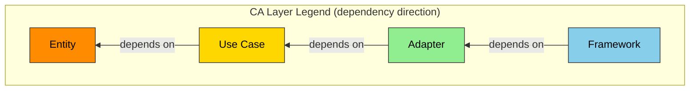
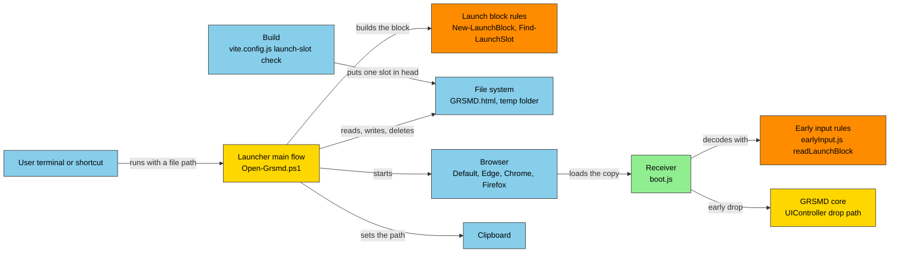
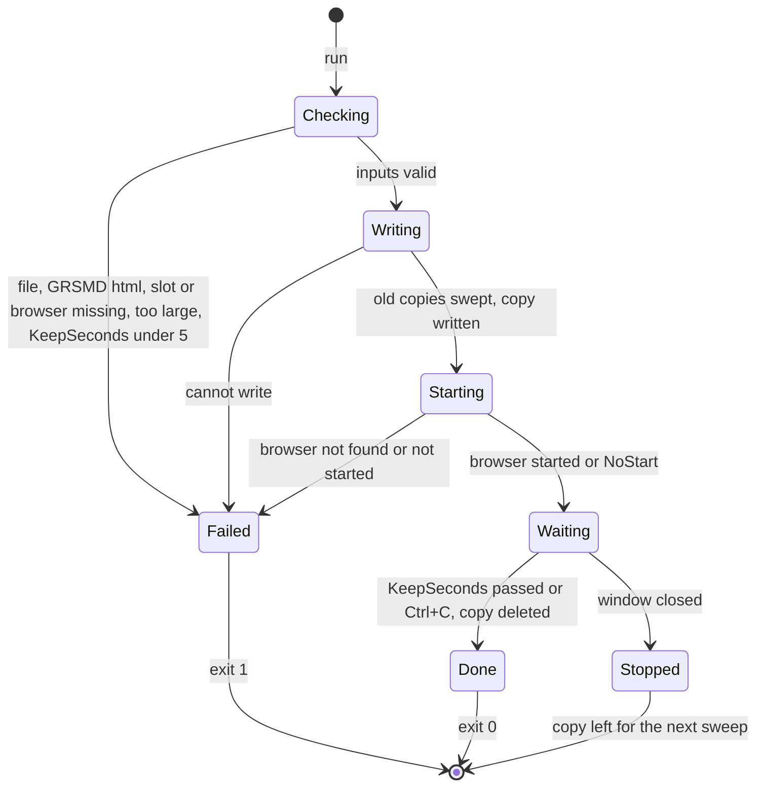
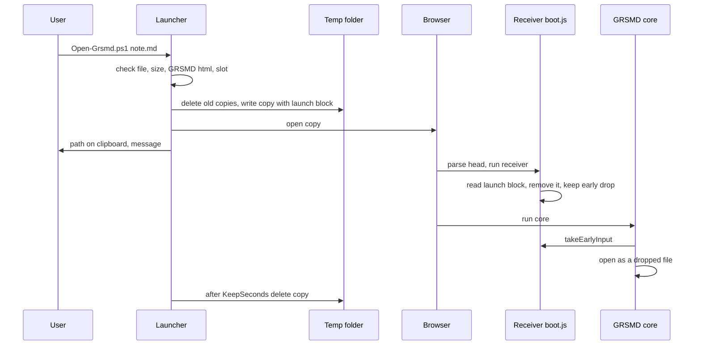

# GRSMD Launcher (Open-Grsmd.ps1) Specification

**Version:** 0.4
**Date:** 2026-10-30
**Status:** Draft for review (branch `feature/ps1-launcher`, from `develop` 30c3ccc)
**Template:** ANMS v0.34, `process-rules/spec-template-en.md` of `GoodRelax/gr-sw-maker`, commit `b723439` (the `main` of 2026-10-24, read from a local checkout)
**Review standards:** `process-rules/review-standards-en.md` of the same commit, applied through [grsmd_review_standards_ja.md](grsmd_review_standards_ja.md) (it pins the Japanese text at `63e6fdc` in [upstream_review_standards_ja.md](upstream_review_standards_ja.md) and the English row names at `b723439`, the same version read here)
**Owner rulings:** PL-1 to PL-13 (2026-10-30, Q&A sheet of this branch), PL-14 to PL-18 (2026-10-30, the review's Q&A sheet). PL-14 replaces the place of PL-6
**Main spec:** [grsmd_gen2_spec_ja.md](grsmd_gen2_spec_ja.md) (the GRSMD side of this feature is INV-104 there)

---

## Table of Contents

- [1. Foundation](#1-foundation)
- [2. Requirements](#2-requirements)
- [3. Architecture](#3-architecture)
- [4. Specification](#4-specification)
- [5. Test Strategy](#5-test-strategy)
- [6. Design Principles Compliance](#6-design-principles-compliance)
- [Appendix](#appendix)

---

## 1. Foundation

### 1.1 Background

GRSMD is a privacy-first Markdown viewer and editor in one HTML file. A user opens a document by dropping it on the page or pasting its text. A user who works in a terminal, or who has the path of a file at hand, has no way to say "open this file in GRSMD".

### 1.2 Challenges

| ID | Challenge |
| --- | --- |
| CH-1 | GRSMD has no entry for a document from outside the page (no URL parameter, no `window.name`, no file argument) |
| CH-2 | Every way of carrying a document into a browser page must keep the privacy rules of GRSMD: no network, no browser storage, no weaker CSP (main spec CON-03, CON-11, CON-12, INV-20) |
| CH-3 | A page cannot read a local file by its path (the browser blocks `file:///` reads, and the CSP blocks `fetch`) |

### 1.3 Goals

| ID | Goal |
| --- | --- |
| GL-1 | One command opens a given file in the GRSMD that the user keeps on the PC: `Open-Grsmd.ps1 <file>` |
| GL-2 | The file is opened exactly as a dropped file is (same size check, same file classes, same unsaved-change question) |
| GL-3 | The privacy rules of GRSMD hold: no network, nothing written to browser storage, the CSP unchanged, no new way for a web page to push a document into GRSMD |
| GL-4 | Saving the edited file back takes few steps although GRSMD has no handle to the file (PL-5) |

### 1.4 Approach

- The user keeps `GRSMD.html` (a GRSMD build) on the PC (PL-1).
- A PowerShell script `launcher/Open-Grsmd.ps1` (PL-9) writes a temporary copy of `GRSMD.html` into the temp folder `%TEMP%\grsmd-launcher` (PL-14; it replaces the folder next to the script of PL-6, which may be synced to a cloud). In the copy, the **launch slot** (one HTML comment in `<head>`) is replaced by the **launch block**: a `<script type="text/plain">` element that holds the file's name and bytes in Base64. The script opens the copy in a browser (PL-3).
- The receiver of GRSMD (`src/js/boot.js`, main spec INV-81 (4)) reads the launch block when it starts, removes it from the page, and hands the file to the core as an early drop. The core opens it on the drop path.
- The launch block never executes, so the CSP and its hashes stay as they are.
- A launched document is always an early input: it opens while the rest of the page (the on-demand libraries) is still being parsed. This needs the receiver fix of main spec INV-81 (2) (2026-10-30): an element that the page adds at the end of `<body>` during parsing (Mermaid's tooltip) no longer hides a library's data block from its arrival note.
- The script puts the file's full path on the clipboard, so that Save as takes one paste (PL-5).
- The script keeps the temp folder's full path in `grsmd-launcher-personal-help.md` next to itself, so that the user can find the folder (PL-16 to PL-18).
- Rejected approaches and the comparison: A.4.

### 1.5 Scope

**In scope**

| ID | Item |
| --- | --- |
| SC-L1 | `launcher/Open-Grsmd.ps1`: a script for Windows PowerShell 5.1 and PowerShell 7 on Windows |
| SC-L2 | The launch slot in the GRSMD build and its build check |
| SC-L3 | The receiver's reading of the launch block (main spec INV-104) |
| SC-L4 | The script's built-in help (`Get-Help`), with examples for a terminal and a desktop shortcut (PL-12) |
| SC-L5 | Tests: Vitest (unit and script runs), one Playwright e2e (PL-11) |

**Out of scope**

| ID | Item | Reason |
| --- | --- | --- |
| OS-L1 | Saving over the original file (Ctrl+S writes to the file) | GRSMD gets no file handle (L-1). PL-5 accepts Save as |
| OS-L2 | Explorer integration (Send to, file association, context menu) | PL-12 |
| OS-L3 | GitHub Pages GRSMD | PL-1. Taking the page from the web would be a network request |
| OS-L4 | macOS and Linux | PowerShell on those systems is not targeted. The browser start and the clipboard are Windows ways |
| OS-L5 | Attaching the script to a GitHub Release | Not asked. The script is taken from the repository |
| OS-L6 | Opening several files at once | One page holds one document (main spec OS-04) |
| OS-L7 | The launcher in GRSMD's own help ([?]) | PL-15: the launcher is an option outside GRSMD; its help is the script's own (`Get-Help`, FR-L14) and the README only |

### 1.6 Constraints

| ID | Constraint |
| --- | --- |
| CON-L1 | The launcher makes no network request. It uses no web cmdlet or class (`Invoke-WebRequest`, `Invoke-RestMethod`, `Start-BitsTransfer`, `System.Net.WebClient`, `System.Net.Http.HttpClient`, `curl`, `wget`) |
| CON-L2 | Nothing of the document goes into browser storage (main spec CON-03, CON-13). The launch block is removed from the page after it is read |
| CON-L3 | The CSP of GRSMD is not changed (main spec INV-20). The build's script and `text/plain` checks are not loosened |
| CON-L4 | The script is English and ASCII only: code, comments, messages, help (main spec CON-06) |
| CON-L5 | The script does not change the execution policy, the registry or any setting. It writes only the temporary copy (in the temp folder), the clipboard and `grsmd-launcher-personal-help.md` next to itself |
| CON-L6 | No new dependency (npm or other). No `npx` in the tests or the tools |
| CON-L7 | The size limit is the one of GRSMD: 5 MiB = 5,242,880 bytes (main spec CON-08, `CONFIG.fileDrop.maxBytes`) |

### 1.7 Limitations

| ID | Limitation | Effect | Way around |
| --- | --- | --- | --- |
| L-1 | Ctrl+S cannot write to the original file | Save asks where to save (Chrome, Edge) or downloads (Firefox), as after a drop in Firefox | Save as, paste the path from the clipboard (FR-L10), confirm the overwrite |
| L-2 | The temporary copy holds the document on disk until it is removed | The document is in the temp folder for `KeepSeconds` (default 30 s; Ctrl+C deletes it at once). When the window is closed during the wait, the copy stays until a later run after its delete time (FR-L08) | The temp folder is `%TEMP%\grsmd-launcher`, outside synced folders (PL-14). The user can open and empty it |
| L-3 | The tab shows the temporary copy's address | After the copy is removed, the browser's reload (F5) shows "file not found". GRSMD itself keeps working | Run the launcher again |
| L-4 | The script waits `KeepSeconds` before it ends | The terminal or the shortcut's window stays open for that time (at least 5 s when a browser is started, FR-L18) | `-KeepSeconds` sets the time |
| L-5 | `GRSMD.html` must have the launch slot | An older build is refused (FR-L06) | Use a newer `GRSMD.html` |
| L-6 | The clipboard's former content is replaced by the path | Windows clipboard history (Win+V), when on, keeps the path | - |
| L-7 | `grsmd-launcher-personal-help.md` holds the full path of the user's temp folder (it has the user's name) | The file is personal; a copy of the launcher's folder shared with others would show it | Ignored by git (`launcher/grsmd-launcher-personal-help.md`). It holds nothing of the opened files |

### 1.8 Glossary

| Term | Definition |
| --- | --- |
| Launcher | The script `launcher/Open-Grsmd.ps1` |
| GRSMD.html | A GRSMD build (the release `index.html` saved under this name) that the user keeps on the PC (PL-1) |
| Target file | The file that the user names on the command line |
| Launch slot | The HTML comment `<!--grsmd-launch-slot-->` in the `<head>` of the build. The launcher replaces it |
| Launch block | `<script type="text/plain" id="grsmd-launch-file" data-name="...">...</script>`: the target file's name and bytes in Base64 (4.4) |
| Temporary copy | A copy of `GRSMD.html` with the launch block in place of the launch slot: `%TEMP%\grsmd-launcher\grsmd-launch-<delete time>-<32 hex>.html` (FR-L07) |
| Delete time | The UTC time from which any run may delete a copy: the time of writing plus that run's `KeepSeconds`, in the copy's name |
| Temp folder | `%TEMP%\grsmd-launcher`: the folder `grsmd-launcher` in the user's temporary folder (`[System.IO.Path]::GetTempPath()`, from `TMP` / `TEMP`) (PL-14). Outside the repository and outside synced folders such as OneDrive |
| Receiver | `src/js/boot.js`: the small script that runs before the core and keeps an early drop or paste (main spec glossary, INV-81 (4)) |
| Early input | The last drop or paste that the receiver keeps until the core runs (`takeEarlyInput`) |
| Personal help | `grsmd-launcher-personal-help.md` next to the launcher: the temp folder's full path, how to open it, and where the usage is (4.4, PL-16 to PL-18) |
| Reference PC | The development PC of 2026-10-30: Windows 11 Pro, PowerShell 7.6.9 and Windows PowerShell 5.1, Edge 156, Chrome 156 |

### 1.9 Notation

RFC 2119 / RFC 8174: SHALL / MUST = mandatory, SHOULD = recommended, MAY = optional. EARS `shall` means SHALL.

---

## 2. Requirements

### 2.1 Functional Requirements

Each row has one response. "Before it writes anything" means before the sweep of FR-L08 and before the temporary copy.

**Launcher**

| ID | EARS | Requirement |
| --- | --- | --- |
| FR-L01 | Event-driven | When the user runs the launcher with a target file, the launcher shall open the target file in GRSMD through a temporary copy (FR-L07) in the browser (FR-L09). |
| FR-L02 | Ubiquitous | The launcher shall resolve the target file path literally (no wildcard expansion), relative to the current directory when it is not absolute. |
| FR-L03 | Unwanted behavior | If the target file does not exist or is a directory, then the launcher shall end with exit code 1 and the error of 4.3 before it writes anything. |
| FR-L04 | Unwanted behavior | If the target file is larger than 5,242,880 bytes, then the launcher shall end with exit code 1 and the error of 4.3 before it writes anything. |
| FR-L17 | Ubiquitous | The launcher shall accept a target file of 0 to 5,242,880 bytes, whatever its content (GRSMD decides on it as on a drop). |
| FR-L05 | Ubiquitous | The launcher shall take `GRSMD.html` from `-GrsmdPath` when given, else from `GRSMD.html` in the launcher's folder (PL-4). |
| FR-L19 | Unwanted behavior | If the `GRSMD.html` of FR-L05 does not exist, then the launcher shall end with exit code 1 and the error of 4.3 that names the path it tried, before it writes anything. |
| FR-L06 | Unwanted behavior | If `GRSMD.html` has no launch slot before its first `</head>`, then the launcher shall end with exit code 1 and the error of 4.3 before it writes anything. |
| FR-L18 | Unwanted behavior | Where `-NoStart` is not given, if `KeepSeconds` is less than 5, then the launcher shall end with exit code 1 and the error of 4.3 before it writes anything (a browser reads the copy only after `Start-Process` returns). |
| FR-L16 | Unwanted behavior | Where `-Browser` names a browser and `-NoStart` is not given, if that browser is not registered under `App Paths` (`msedge.exe` / `chrome.exe` / `firefox.exe`, current user first, then the machine), then the launcher shall end with exit code 1 and the error of 4.3 before it writes anything. |
| FR-L08 | Event-driven | When the checks (FR-L03 to FR-L06, FR-L16, FR-L18, FR-L19) have passed, the launcher shall delete the copies in the temp folder whose delete time (in the name, FR-L07) has passed. |
| FR-L20 | Unwanted behavior | If a copy of FR-L08 cannot be deleted, then the launcher shall print the warning of 4.3 and go on. |
| FR-L27 | Event-driven | When the checks have passed, the launcher shall write the personal help (4.4) next to itself, before the sweep of FR-L08. |
| FR-L28 | Optional feature | Where the personal help already holds the same text, the launcher shall leave the file as it is. |
| FR-L29 | Unwanted behavior | If the personal help cannot be written, then the launcher shall print the warning of 4.3 and go on. |
| FR-L07 | Ubiquitous | The launcher shall write the temporary copy into the temp folder (creating the folder when missing) as the bytes of `GRSMD.html` with the first launch slot replaced by the launch block (4.4), under the name `grsmd-launch-<delete time>-<32 hex>.html`, where the delete time is the UTC time of writing plus `KeepSeconds`, as `yyyyMMddTHHmmssZ`. |
| FR-L09 | Optional feature | Where `-NoStart` is not given, the launcher shall open the temporary copy with the browser chosen by `-Browser` (PL-7): `Default` = the program associated with `.html`; `Edge` / `Chrome` / `Firefox` = the program of FR-L16, given the copy's `file:///` URL. |
| FR-L23 | Event-driven | When the browser has been started, the launcher shall print the line "Opened in GRSMD" of 4.3. |
| FR-L10 | Event-driven | When the browser has been started, the launcher shall put the target file's full path on the clipboard (PL-5). |
| FR-L21 | Event-driven | When the path is on the clipboard, the launcher shall print the clipboard line of 4.3. |
| FR-L22 | Unwanted behavior | If the clipboard cannot be set, then the launcher shall print the warning of 4.3 and go on. |
| FR-L12 | Optional feature | Where `-NoStart` is given, the launcher shall print the line `Temporary copy: <full path>` of 4.3 instead of starting a browser (used by the tests). |
| FR-L26 | Optional feature | Where `-NoStart` is given, the launcher shall leave the clipboard unchanged. |
| FR-L24 | Event-driven | When the copy is written and the browser started (or, with `-NoStart`, the copy is written), the launcher shall print the waiting line of 4.3. |
| FR-L11 | Event-driven | When the waiting line has been printed, the launcher shall wait `KeepSeconds` seconds (4.2) before it ends. |
| FR-L15 | Ubiquitous | The launcher shall delete the temporary copy (or the part of it written) when it ends: after the wait, on an error, and on Ctrl+C (PL-13). A closed window ends the process without this (L-2). |
| FR-L25 | Unwanted behavior | If the temporary copy cannot be deleted at the end, then the launcher shall print the warning of 4.3. |
| FR-L13 | Unwanted behavior | If the temporary copy cannot be written or the browser cannot be started, then the launcher shall end with exit code 1 and the error of 4.3. |
| FR-L14 | Ubiquitous | The launcher shall carry a comment-based help (`Get-Help Open-Grsmd.ps1 -Full`) with the synopsis, every parameter, examples for a terminal and for a desktop shortcut, the Save as tip (L-1) and the way to run a downloaded script without changing the execution policy (PL-12). |

**GRSMD (receiver and build). The normative text is main spec INV-104; the rows here trace it.**

| ID | EARS | Requirement |
| --- | --- | --- |
| FR-G01 | Ubiquitous | The build shall put exactly one launch slot in `<head>`. |
| FR-G06 | Unwanted behavior | If the built page has no launch slot, more than one, or one outside `<head>`, then the build shall fail. |
| FR-G02 | Event-driven | When the receiver starts and the page has a launch block (a `<script type="text/plain">` with the id `grsmd-launch-file` whose parent is `<head>`), the receiver shall keep the file it holds as the early input of the kind `drop`, with no file handle. |
| FR-G03 | Event-driven | When the receiver has read the launch block, it shall remove the block from the page, whether the block was valid or not. |
| FR-G04 | Unwanted behavior | If the launch block cannot be decoded (not Base64, an empty name, a name that is not UTF-8), then the receiver shall keep no early input from it. |
| FR-G07 | Unwanted behavior | If the launch block cannot be decoded, then the receiver shall write one warning to the console (`GRSMD: the launch file could not be read.`). |
| FR-G05 | Event-driven | When the user drops a file or pastes text before the core runs, the receiver shall keep that input instead of the launch file (the last input wins, as now). |

### 2.2 Non-Functional Requirements

| ID | Category | Requirement | Measured by |
| --- | --- | --- | --- |
| NFR-L01 | Performance | A run with `-NoStart -KeepSeconds 0` (the PowerShell start, the checks, Base64, writing and deleting the copy) takes at most 1.0 s for a 100 KiB file and at most 2.0 s for a 5 MiB file on the reference PC, with each of the two PowerShell versions. Way of measuring: for each version and size, one run that is thrown away (PowerShell warm), then 3 runs one after another; the median of the 3 | T-L-PERF (5); measured 2026-10-30 (A.3) |
| NFR-L02 | Privacy | The launcher contains none of the network names of CON-L1 | Static test (5) |
| NFR-L03 | Privacy | After a run that is not stopped, the temp folder holds none of that run's copies | Script test (5) |
| NFR-L04 | Compatibility | The launcher runs on Windows PowerShell 5.1 and PowerShell 7 (Windows 10 and 11) with the same results | Script tests run with both (5) |
| NFR-L05 | Portability of text | The launcher file is ASCII only (no byte above 0x7E except CR and LF) | Static test (5) |
| NFR-L06 | Size | The launch slot and its explaining comment add at most 200 bytes to the build. The gzip limit of the build (1,510 kB, main spec) is unchanged | Build (`npm run build:e2e`: 1,499.78 kB gzip on 2026-10-30) |

---

## 3. Architecture

### 3.1 Architecture Concept

The launcher is a small imperative shell around pure helpers (functional core, imperative shell). On the GRSMD side the change sits in the receiver and the pure rules of early input; the core is unchanged. Layers use the Clean Architecture legend of the template.



### 3.2 Components



| Component | Responsibility | Purity |
| --- | --- | --- |
| Launch block rules (in the script) | Turn a file name and bytes into the launch block text; find the launch slot in the bytes of a build | pure |
| Launcher main flow | Check the inputs, write the copy, start the browser, set the clipboard, wait and delete | non-pure |
| `readLaunchBlock` (`earlyInput.js`) | Turn a launch block element into `{name, bytes}` or `null` | semi-pure-a (reads the element) |
| Receiver (`boot.js`) | Take the block at start, remove it, keep the file as the early drop | non-pure |
| `launchSlotError` (`vite.config.js`) | Say what is wrong with the slot in a built HTML text, or null | pure |

### 3.3 File Structure

```text
launcher/
  Open-Grsmd.ps1          the launcher (FR-L01 to FR-L14)
  GRSMD.html              placed by the user (ignored by git)
  grsmd-launcher-personal-help.md   written by the launcher (ignored by git, PL-16 to PL-18)
%TEMP%\grsmd-launcher\     temporary copies (outside the repository, PL-14)
src/index.html            the launch slot before </head> (FR-G01)
src/js/earlyInput.js      LAUNCH_BLOCK_ID, isLaunchBlock, readLaunchBlock (FR-G02, FR-G04)
src/js/boot.js            the receiver takes the block (FR-G02 to FR-G05)
vite.config.js            LAUNCH_SLOT, launchSlotError, the launch-slot plugin (FR-G01)
src/__tests__/launcher.test.js       AT-LAUNCH-01 to 19, 33, 34: static checks and script runs
src/__tests__/launchBlock.test.js    AT-LAUNCH-20 to 32: the block, the receiver, the slot
e2e/launcher.e2e.js       AT-LAUNCH-40 to 42: the copy opened in a browser
```

### 3.4 Domain Model

**Launch block** (4.4): one element, two values.

| Value | Where | Type | Meaning |
| --- | --- | --- | --- |
| name | attribute `data-name` | Base64 of the UTF-8 bytes of the target file's name (no folder) | The file name the drop path uses (classification by extension, Save as name) |
| bytes | element text | Base64 of the target file's bytes | The file's content, unchanged |

**Launcher run** (a straight sequence, no loops back):



The receiver adds no state: the launch file is one more source of the existing early input (main spec 3.3 11-g, the row `earlyInputArrived` in `receiving`).

### 3.5 Behavior



### 3.6 Decisions

**Compared with the smallest launcher (ADR-L0).** The smallest launcher checks the file, writes the copy, opens it and deletes it after a wait. What was added, and why:

| Added part | Reason | Without it |
| --- | --- | --- |
| The launch slot and its build check (FR-L06, FR-G01, FR-G06) | Tells an older `GRSMD.html` apart before anything is written (ADR-L4) | An old build opens empty and the file is silently lost |
| `-GrsmdPath` (FR-L05) | PL-4: the build may be elsewhere | The build must be next to the script |
| `-Browser` (FR-L09, FR-L16) | PL-7 | Only the `.html` association |
| The clipboard path (FR-L10) | PL-5: saving over the file in one paste | The user types the path in Save as |
| The sweep of old copies (FR-L08) | PL-13: a closed window leaves the document on disk | Left copies stay until the user empties the temp folder |
| The delete time in the name (FR-L07) | Overlapping runs (ADR-L8) | A short run deletes a copy a browser has not read yet |
| Deletion on an error and on Ctrl+C (FR-L15) | PL-13: the document stays on disk no longer than needed | A stopped run leaves the copy |
| The 5 s floor with a browser (FR-L18) | Review 1 (M2): the browser reads the copy after `Start-Process` returns | `-KeepSeconds 0` deletes the copy before the browser reads it |
| `-NoStart` (FR-L12, FR-L26) | The tests run without a browser window and without the clipboard | No automatic test of the copy |
| The personal help (FR-L27 to FR-L29) | PL-16 to PL-18: the temp folder is outside the launcher's folder (PL-14); the user keeps its path where the launcher is | The user must know where `%TEMP%` is |


| ID | Status | Context | Decision | Consequences | Decided by |
| --- | --- | --- | --- | --- | --- |
| ADR-L0 | Accepted | The smallest launcher that meets GL-1 to GL-3: check the file, write the copy, open it, delete it after a wait | Start from that and add only what a ruling or a failure needs (the table below) | Each added part has its reason | Session, review 1 (L12) |
| ADR-L1 | Accepted | Pages cannot be fed from the PC without a network request or a web-reachable entry | Use `GRSMD.html` kept on the PC | OS-L3. Updates of GRSMD are the user's (download a newer build) | Owner, PL-1 |
| ADR-L2 | Accepted | Clipboard hand-over needs a manual paste, loses the name and can stay in clipboard history | Do not use the clipboard for the content | - | Owner, PL-2 |
| ADR-L3 | Accepted | `window.name` crosses into the next web site in Edge and Chrome when the page does not clear it (measured, A.4) | Temporary copy with a launch slot, replaced by a non-executing launch block | No new input entry, nothing left in the browser, works in every browser. Costs: L-2, L-3 | Owner, PL-3 |
| ADR-L4 | Accepted | The slot must be found without parsing HTML in PowerShell, and an old build must be told apart | A fixed HTML comment, checked once in `<head>` by the build | FR-L06, FR-G01. The comment never reaches the DOM's scripts | Session, under PL-3 |
| ADR-L5 | Accepted | The content must not end the block early (`</script>`) and the bytes must survive any encoding | Base64 for the bytes and the name | Base64 has no `<`; the decoded bytes are the file's bytes (BOM and line endings kept, main spec INV-38) | Session |
| ADR-L6 | Accepted | The copy must outlive the browser's first read, and the content must not stay on disk | Wait `KeepSeconds` (30; at least 5 with a browser) in the script, then delete in a `finally` block (also on an error and on Ctrl+C); sweep old copies before writing | L-2, L-4 | Owner, PL-6, PL-13 and PL-14 (the place) |
| ADR-L9 | Accepted | With the copies under `%TEMP%` (PL-14), the user may not find them | The launcher writes `grsmd-launcher-personal-help.md` next to itself on each run (only when its text changes): the full path, how to open it, `Get-Help`. Nothing of the opened files | L-7. Ignored by git | Owner, PL-16 to PL-18 |
| ADR-L8 | Accepted | Runs with different `KeepSeconds` can overlap: a sweep by file age would delete the copy of a run that still waits | Each copy's name carries its own delete time; the sweep deletes only copies whose time has passed | FR-L07, FR-L08. A name without the time (not a copy) is never deleted | Session, review 1 (L1) |
| ADR-L7 | Accepted | The core already opens a dropped file with all its checks | The receiver hands the launch file over as an early drop | GL-2 holds by construction. No second open path | Session |

---

## 4. Specification

### 4.1 Scenarios

```gherkin
Feature: Open a file in GRSMD from PowerShell

  Background:
    Given GRSMD.html with the launch slot is next to Open-Grsmd.ps1

  Rule: A valid file opens as a dropped file

    Scenario: SC-L01 Open a Markdown file (traces: FR-L01, FR-L07, FR-L09, FR-G02, FR-G03)
      Given the file note.md of 2 KB
      When the user runs Open-Grsmd.ps1 note.md
      Then the browser opens a temporary copy in the temp folder
      And GRSMD shows note.md rendered as after a drop
      And the page has no element with the id grsmd-launch-file
      But no network request is made
```

**Result:** PASS  CONDITIONAL  FAIL  SKIP
**Remark:**

---

```gherkin
Scenario: SC-L02 Save over the file through Save as (traces: FR-L10, L-1)
  Given note.md is open through the launcher in Edge
  When the user presses Ctrl+S and pastes the clipboard into the file name
  Then the save dialog writes to note.md after the overwrite question
```

**Result:** PASS  CONDITIONAL  FAIL  SKIP
**Remark:**

---

```gherkin
Scenario: SC-L03 The copy is removed (traces: FR-L11, FR-L15, NFR-L03)
  Given the launcher runs with -NoStart and KeepSeconds 3
  When it has waited 3 s and ended
  Then the copy was there during the wait
  And the temp folder holds no copy of that run
```

**Result:** PASS  CONDITIONAL  FAIL  SKIP
**Remark:**

---

```gherkin
Scenario: SC-L04 A left copy is swept (traces: FR-L08, FR-L20)
  Given the temp folder holds a copy whose delete time passed 120 s ago
  And a copy whose delete time is 10 minutes ahead (a run that still waits)
  When the user runs the launcher
  Then the first copy is deleted before the new copy is written
  But the second copy stays, and so do files with other names
```

**Result:** PASS  CONDITIONAL  FAIL  SKIP
**Remark:**

---

```gherkin
Scenario: SC-L05 Errors stop before anything is written (traces: FR-L03, FR-L04, FR-L06, FR-L18, FR-L19)
  Given one of: the file is missing, the path is a folder, the file has 5,242,881 bytes, GRSMD.html is missing, GRSMD.html has no slot, KeepSeconds is under 5 without -NoStart
  When the user runs the launcher
  Then it prints the error of 4.3 and ends with exit code 1
  But it writes no temporary copy and starts no browser
```

**Result:** PASS  CONDITIONAL  FAIL  SKIP
**Remark:**

---

```gherkin
Scenario: SC-L06 A browser that is not installed (traces: FR-L16)
  Given Firefox is not installed
  When the user runs the launcher with -Browser Firefox
  Then it prints "Open-Grsmd: Firefox was not found." and ends with exit code 1
  And it writes no temporary copy
```

**Result:** PASS  CONDITIONAL  FAIL  SKIP
**Remark:**

---

```gherkin
Scenario: SC-L07 Other file kinds follow the drop rules (traces: FR-L01, FR-G02)
  Given a file app.js and a file image.png
  When the user opens each through the launcher
  Then app.js is shown in the code view
  And image.png is refused by GRSMD with its binary-file message
```

**Result:** PASS  CONDITIONAL  FAIL  SKIP
**Remark:**

---

```gherkin
Scenario: SC-L08 A broken block is dropped (traces: FR-G03, FR-G04)
  Given a page whose launch block text is not Base64
  When the receiver starts
  Then it keeps no early input and removes the block
  And the console has one warning
```

**Result:** PASS  CONDITIONAL  FAIL  SKIP
**Remark:**

---

```gherkin
Scenario: SC-L09 A drop before the core wins (traces: FR-G05)
  Given a page with a valid launch block
  When the user drops another file before the core runs
  Then the core opens the dropped file
```

**Result:** PASS  CONDITIONAL  FAIL  SKIP
**Remark:**

### 4.2 Command Line

```text
Open-Grsmd.ps1 [-Path] <string> [-GrsmdPath <string>] [-Browser Default|Edge|Chrome|Firefox]
               [-KeepSeconds <0..3600>] [-NoStart]
```

| Parameter | Type | Default | Meaning |
| --- | --- | --- | --- |
| `-Path` (position 0, mandatory) | string | - | The target file (FR-L02) |
| `-GrsmdPath` | string | `GRSMD.html` in the launcher's folder | The GRSMD build to copy (FR-L05) |
| `-Browser` | `Default`, `Edge`, `Chrome`, `Firefox` | `Default` | The browser (FR-L09) |
| `-KeepSeconds` | int, 0 to 3600; at least 5 unless `-NoStart` (FR-L18) | 30 | The wait before the copy is deleted (FR-L11); with the time of writing, it makes the copy's delete time (FR-L07) |
| `-NoStart` | switch | off | Do not start a browser, do not touch the clipboard, do not look `-Browser` up (FR-L12, FR-L16, FR-L26) |

Exit codes: 0 = done; 1 = any error of 4.3.

### 4.3 Messages

The launcher's own words are English ASCII. A `<reason>` is the system's message, in the language of Windows. Normal lines go to the output stream. Warnings go to the warning stream (PowerShell shows them with its own word for "WARNING", in the language of Windows, and may wrap a long line) and the run goes on. Errors are written as one line to the standard error of the process (`[Console]::Error`, not the PowerShell error stream: `$Error` does not get them) and the run ends with exit code 1.

| Case | Message |
| --- | --- |
| Opened (FR-L23) | `Opened in GRSMD: <full path of the target file>` |
| Clipboard (FR-L21) | `The full path of the file is on the clipboard. To save over the file, choose Save as and paste it as the file name.` |
| No start (FR-L12) | `Temporary copy: <full path of the copy>` |
| Waiting (FR-L24) | `The temporary copy is deleted in <n> s (Ctrl+C deletes it now).` |
| Old copy kept (FR-L20, warning) | `Could not delete an old temporary copy: <path>` |
| Copy kept (FR-L25, warning) | `Could not delete the temporary copy: <path>` |
| Personal help not written (FR-L29, warning) | `Could not write <path of the personal help>: <reason>` |
| Clipboard failed (FR-L22, warning) | `Could not put the path on the clipboard: <reason>` |
| File missing (FR-L03) | `Open-Grsmd: File not found: <path>` |
| Folder (FR-L03) | `Open-Grsmd: Not a file: <path>` |
| Too large (FR-L04) | `Open-Grsmd: The file is larger than 5 MB (<n> bytes): <path>` |
| Unreadable target | `Open-Grsmd: Cannot read <path>: <reason>` |
| No GRSMD.html (FR-L19) | `Open-Grsmd: GRSMD.html not found: <path>. Put GRSMD.html next to this script or pass -GrsmdPath.` |
| KeepSeconds too short (FR-L18) | `Open-Grsmd: -KeepSeconds must be 5 or more when a browser is started (0 to 4 only with -NoStart).` |
| No slot (FR-L06) | `Open-Grsmd: <path> has no launch slot. Use a newer GRSMD.html.` |
| Cannot write (FR-L13) | `Open-Grsmd: Cannot write the temporary copy in <folder>: <reason>` |
| Browser missing (FR-L16) | `Open-Grsmd: <Edge or Chrome or Firefox> was not found.` |
| Browser failed (FR-L13) | `Open-Grsmd: Cannot start the browser: <reason>` |
| Receiver warning (FR-G07) | `GRSMD: the launch file could not be read.` (console, in GRSMD) |

### 4.4 Data Formats

**Launch slot** (in the build, once, inside `<head>`):

```html
<!--grsmd-launch-slot-->
```

**Launch block** (written by the launcher in place of the slot; one line):

```html
<script type="text/plain" id="grsmd-launch-file" data-name="BASE64_OF_UTF8_NAME">BASE64_OF_FILE_BYTES</script>
```

- Base64 is the standard alphabet with padding (RFC 4648 section 4), no line breaks.
- The name is the leaf name only (no folder), so the page never sees the folder path.
- The receiver accepts the block only as a child of `<head>` with `type="text/plain"`: a document rendered later can never stand in for it (it does not exist yet when the receiver runs, and ids that start with `grsmd-` are dropped from documents, main spec INV-81 (5)).

**Personal help** (`grsmd-launcher-personal-help.md`, written by the launcher next to itself; UTF-8 without BOM, LF; three paragraphs, nothing else):

```markdown
Temporary folder of Open-Grsmd.ps1: `<full path of the temp folder>`

To open it, paste the path into the address bar of File Explorer.

How to use the launcher: `Get-Help .\Open-Grsmd.ps1 -Full`
```

### 4.5 Error Handling

| Error | Detected by | Action | Copy written? |
| --- | --- | --- | --- |
| Target missing, folder, too large, unreadable | Launcher, Checking | Message, exit 1 | No |
| GRSMD.html missing or no slot | Launcher, Checking | Message, exit 1 | No |
| Named browser not registered | Launcher, Checking | Message, exit 1 | No |
| `KeepSeconds` under 5 with a browser | Launcher, Checking | Message, exit 1 | No |
| Temp folder not writable (or a file named `grsmd-launcher` in its place) | Launcher, Writing | Message, exit 1 | No (partial file deleted) |
| Old copy cannot be deleted | Launcher, Writing | Warning, go on | - |
| Browser start fails | Launcher, Starting | Delete the copy, message, exit 1 | Deleted |
| Clipboard cannot be set | Launcher, Starting | Warning, go on | - |
| Ctrl+C while waiting | Launcher, Waiting | Delete the copy at once | Deleted |
| Window closed while waiting | - (the process is ended) | The next run sweeps the copy (FR-L08) | Left (L-2) |
| Block not decodable | Receiver | Remove block, console warning, start empty | - |
| File too large, binary, unsaved changes | GRSMD core (drop path) | As for a drop (main spec INV-11, INV-18, INV-21) | - |

---

## 5. Test Strategy

| Test level | Target | Policy | Tool | IDs | Pass criteria |
| --- | --- | --- | --- | --- | --- |
| Unit | `readLaunchBlock`, `isLaunchBlock`, the receiver with a launch block, `launchSlotError` and the build plugin, the source page's slot | jsdom pages; every branch of FR-G01 to FR-G07 (SC-L08, SC-L09): a non-ASCII name, kept bytes (BOM, CR LF, NUL), an empty file, each undecodable case, a block outside `<head>`, a drop after the block | Vitest (`npm test`, `src/__tests__/launchBlock.test.js`) | AT-LAUNCH-20 to 32 | All pass |
| Static | The launcher file | ASCII only (NFR-L05); none of the network names of CON-L1 (NFR-L02); the help of FR-L14; the same slot, block id and size limit as the build, the receiver and `CONFIG` (DRY across the two languages); git ignores the personal help and `launcher/GRSMD.html` (L-7) | Vitest (`src/__tests__/launcher.test.js`) | AT-LAUNCH-01 to 04, 34 | All pass |
| Script (integration) | The launcher, with `-NoStart` except for runs refused in the checks | Vitest starts `powershell.exe` and, when installed, `pwsh.exe`, each with `-NoProfile -ExecutionPolicy Bypass -File` (that process only; no setting changes), in a temporary folder with a copy of the launcher and a small `GRSMD.html`; each run gets `TEMP` and `TMP` of its own (the real temp folder is never touched). Checks: the copy is the build with the slot replaced, its name carries the delete time, and its block decodes to the file's name (non-ASCII, a space) and bytes (FR-L07); the copy is kept for `KeepSeconds` and then deleted (SC-L03); the sweep by delete time and its warning (SC-L04, FR-L20); a literal relative path, checked by the block's name and bytes (FR-L02); the size limit and an empty file (FR-L17); `-GrsmdPath` (FR-L05); each error of SC-L05 with its exact message, exit code 1 and no temp folder; a copy that cannot be written (FR-L13); SC-L06 and `-NoStart` with an unregistered browser when Firefox is not registered (skipped otherwise). The personal help: its exact text (and nothing of the opened file), left as it is when unchanged, a warning when it cannot be written, and none written by a run that stops in the checks (FR-L27 to FR-L29). Each new check was seen to fail on a changed launcher (wildcards expanded, every copy swept, no wait, the personal help always rewritten) | Vitest (`src/__tests__/launcher.test.js`) | AT-LAUNCH-05 to 19, 33 | All pass on both PowerShell versions |
| Build | The built HTML | The build fails without exactly one slot in `<head>` (the `launch-slot` plugin, FR-G01, FR-G06); the size limit (NFR-L06) | `npm run build`, `npm run build:e2e` | (the build itself) | The build passes |
| E2E | SC-L01, SC-L07 | Build to `output/e2e`, make a copy with the launcher (`-NoStart`), open it by `file:///` in Chromium (a page route lets through that one URL; the fixtures' guards stay on for everything else): a Markdown file with math and a diagram, a JavaScript file, a PNG file refused with GRSMD's message. Run only after the coordinator's OK | Playwright (`e2e/launcher.e2e.js`, `npm run test:e2e`) | AT-LAUNCH-40 to 42 | All pass |
| Performance (T-L-PERF) | NFR-L01 | The way of NFR-L01 (one run thrown away, then the median of 3), for 100 KiB and 5 MiB files, with both PowerShell versions, on the reference PC | Manual with `Measure-Command` | T-L-PERF | Within NFR-L01 (A.3) |
| Manual | What the automatic tests cannot reach: the browser started by the `.html` association and by `-Browser`, the clipboard, Save as with the pasted path, the desktop shortcut, Ctrl+C during the wait | By the owner on the reference PC: PRT-AM01 to AM04 of the pre-release test spec (= M-L1 to M-L4) | - | M-L1 to M-L4 | All pass |

## 6. Design Principles Compliance

| Category | Identifier | Review result |
| --- | --- | --- |
| Naming | Naming | Terms of 1.8 are used in code and messages (`launch slot`, `launch block`, `temporary copy`). PowerShell functions use approved verbs |
| Dependencies | Dependency Direction | The launcher depends only on the build's contract (the slot, 4.4). The receiver depends on the pure rules in `earlyInput.js`, as for drops and pastes |
| Dependencies | SDP | The contract (4.4) is the most stable part; both the launcher and the receiver depend on it |
| Simplicity | KISS | No server, no protocol, no new class: one comment, one block, one early drop |
| Simplicity | YAGNI | No Explorer integration, no multi-file, no Release asset (1.5). Every part added to the smallest launcher has its reason (3.6, ADR-L0) |
| Simplicity | DRY | One open path in GRSMD (the drop path, ADR-L7). The block id lives in one constant (`earlyInput.js`), the slot in one (`vite.config.js`), the size limit in `CONFIG.fileDrop.maxBytes`; the launcher's copies of the three are checked by AT-LAUNCH-04 |
| Separation | SoC / SRP | Launcher: hand the file over. Receiver: keep the early input. Core: open it |
| Separation | SLAP | The launcher's main flow calls one helper per step of 3.4 |
| SOLID | OCP / LSP / ISP / DIP | Not applicable: no classes or interfaces are added |
| Coupling | LoD | The receiver reads only its own block element |
| Coupling | CQS | `readLaunchBlock` only reads; the receiver removes the block in a separate step |
| Readability | POLA / PIE | The launcher's messages say what happened and what to do next (4.3) |
| Testability | Testability | `-NoStart` exercises everything but the browser start and the clipboard; the pure parts are tested alone |
| Purity | Pure / Semi-pure / Non-pure | 3.2 classifies every part; side effects are at the edges |
| Structure | Collect-Process Separation | The launcher collects all inputs (Checking) before it writes anything |
| State Transitions | State Transition | 3.4: a straight sequence; the receiver adds no state |
| Concurrency | Concurrency Safety | Each run has its own random copy name, and each name carries its own delete time: the sweep deletes only copies whose time has passed, so a run with a short wait never deletes the copy of a run that still waits (ADR-L8) |
| Error Handling | Error Propagation | Every failure ends with a message and exit 1 (4.5); the receiver warns instead of failing silently |
| Resource Mgmt | Resource Lifecycle | The copy is created and deleted by the same run (FR-L15), or swept by a later run after its delete time (FR-L08) |
| Immutability | Immutability | The target file and `GRSMD.html` are only read |
| Efficiency | Resource Efficiency | One 4.3 MB copy per run, deleted after `KeepSeconds` |

---

## Appendix

### A.1 References

1. GoodRelax/gr-sw-maker, `process-rules/spec-template-en.md`, commit `b723439` (2026-10-24)
2. GoodRelax/gr-sw-maker, `process-rules/review-standards-en.md`, commit `b723439` (2026-10-24)
3. [grsmd_gen2_spec_ja.md](grsmd_gen2_spec_ja.md): INV-81 (receiver), INV-104 (launch block), CON-03, CON-08, INV-20
4. RFC 4648, The Base16, Base32, and Base64 Data Encodings

### A.2 Licenses

No dependency is added. The launcher is part of this repository (MIT, `LICENSE`).

### A.3 Changelog

| Version | Date | Change |
| --- | --- | --- |
| 0.1 | 2026-10-30 | First draft (rulings PL-1 to PL-13). T-L-PERF measured on the reference PC (`-NoStart -KeepSeconds 0`, median of 3): Windows PowerShell 5.1: 100 KiB 413 ms, 5 MiB 450 ms; PowerShell 7.6.9: 100 KiB 777 ms, 5 MiB 1,217 ms (the PowerShell start alone: 266 to 425 ms) |
| 0.2 | 2026-10-30 | Review 1 (M2, L1 to L4, L8 to L15): at least 5 s with a browser (FR-L18); the delete time in the copy's name and the sweep by it (FR-L07, FR-L08, ADR-L8); one response per requirement (new FR-L15 to FR-L26, FR-G06, FR-G07); the browser is looked up only without `-NoStart` (FR-L16); 4.3 on the standard error and the language of `<reason>`; the comparison with the smallest launcher (3.6, ADR-L0); the way of measuring NFR-L01. T-L-PERF measured again that way (one run thrown away, then the median of 3; output/e2e build, 2026-10-30): Windows PowerShell 5.1: 100 KiB 335 ms, 5 MiB 383 ms; PowerShell 7.6.9: 100 KiB 915 ms, 5 MiB 1,206 ms (all within NFR-L01; PowerShell 7 at 100 KiB is near its 1.0 s line). |
| 0.3 | 2026-10-30 | Owner rulings PL-14 (the temp folder moves to `%TEMP%\grsmd-launcher`, outside synced folders; review 1, M1) and PL-15 (no launcher text in GRSMD's own help: OS-L7). |
| 0.4 | 2026-10-30 | Owner rulings PL-16 to PL-18: the personal help `grsmd-launcher-personal-help.md` (FR-L27 to FR-L29, 4.4, ADR-L9, L-7) |

### A.4 Hand-over Approaches Compared (PL-2, PL-3)

Measured on the reference PC, 2026-10-30, with Playwright on throwaway local pages and a server on 127.0.0.1 only (no outside request):

- A page in a temporary folder that sets `window.name` to 7 MB and moves to a `file:///` page in another folder: the 7 MB arrive in Edge 156, Chrome 156 and Firefox; WebKit clears it.
- When that page does not clear `window.name` and the user then opens a web site in the same tab, Edge and Chrome hand the 7 MB to the web site; Firefox clears it.
- A web page cannot navigate to a `file:///` page in any of these browsers.
- Launcher work: 2 KB file, copy 49 ms / small page 19 ms; 5 MB file, about 0.4 to 0.5 s for either (mostly Base64).

| Viewpoint | Copy + slot (chosen) | Copy + before `</head>` | `window.name` + check | `window.name` only |
| --- | --- | --- | --- | --- |
| New input entry | None | None | Any local `file:///` page | Any local `file:///` page |
| Content left in the browser | None | None | Crosses to the next web site when not cleared | Same, more likely |
| Content on disk | Until deleted | Until deleted | Until deleted | Until deleted |
| Browser dependence | None | None | Relies on `window.name` across `file:///` | Same |
| Old build told apart | Yes (slot) | No | Yes | No |
| Usability | Tab shows the copy; F5 fails after delete | Same | Tab shows GRSMD.html | Same |
| Size limit | None | None | 7 MB tested | 7 MB tested |

Rejected before the comparison: the content in the URL (kept in history; about 32,000 characters on a command line), a local server (needs a looser `connect-src`; a backend), browser remote debugging (opens a control port), the page reading a neighbor file (blocked by the browser and the CSP), the clipboard (PL-2).

